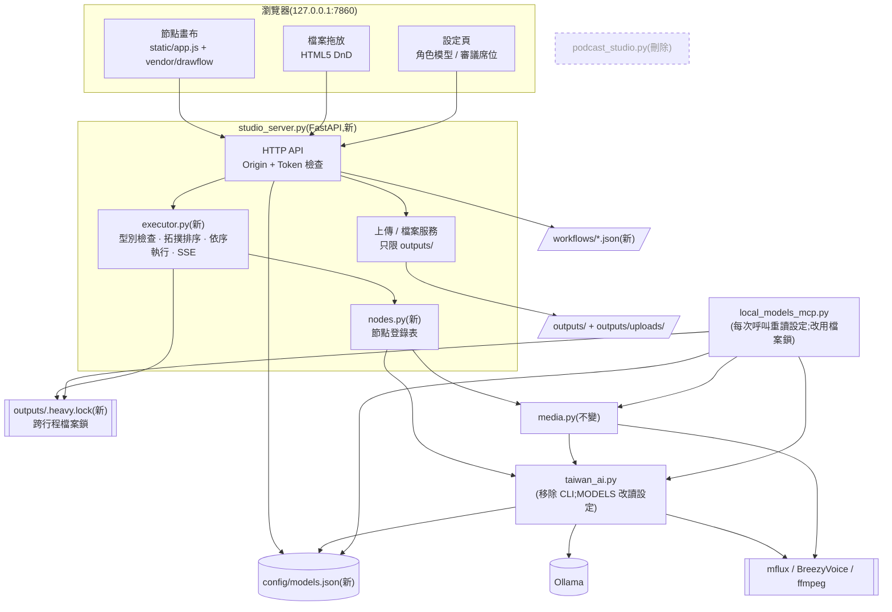
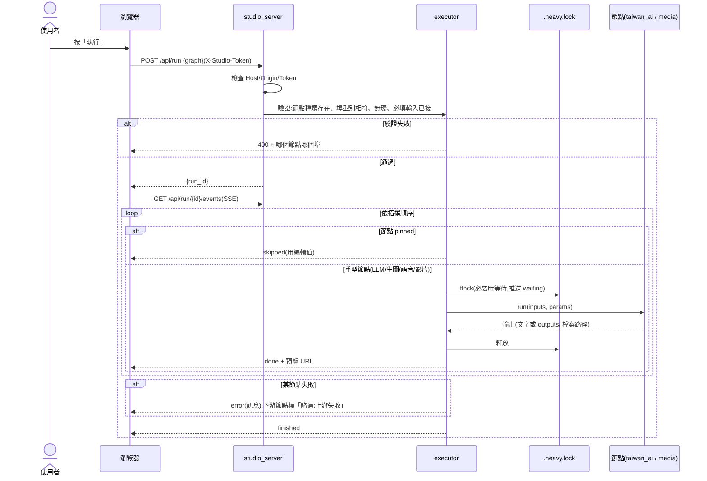
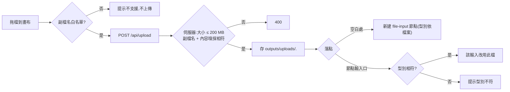

# CHG-20261022-01 — 網頁改版:節點畫布 + 檔案拖放 + 共用模型設定,移除 Gradio 與 CLI

- 專案:podcast-studio
- 分支(Branch):main
- 日期:2026-10-22(UTC+0)
- 類型:新功能 / 重構
- 提出者:使用者
- 實作者:主 agent 派發(DIR-3);實際工作者記於「## 派發記錄」
- 驗收者:獨立 Claude subagent(不參與施工、不看實作者自述)+ 使用者操作驗收
- 風險分級:高(命中高風險清單:**跨模組介面**——`config/models.json` 由網頁寫、MCP 讀;**安全**——新增會改變狀態的 HTTP 端點、檔案上傳與檔案下載)
- Autonomy:halt
- Commit/PR:(收尾時填)
- 重複性檢查(Recurrence check):(收尾時填)
- Diagrams:見「## 設計圖」節
- Mockup:見「## 畫面草稿」節
- Security-impact:見「## 安全影響」節
- Skill: ai-sdlc v1.66
- 關聯:FR-1~7(功能保留、實作替換)、FR-14(棄用)、FR-16~21、FR-23;Guideline v1.1;待補項 ADP-1、ADP-2、ADP-8(本筆一併處理,見修改步驟);後續 CHG-20261022-02(MCP 註冊管理,依賴本筆的設定頁)

## 動機

使用者指示(2026-10-22):不需要 CLI,只要網頁;網頁要能配置模型(與 MCP 共用)並支援 drag and drop——**檔案拖放與節點拖拉編排兩者都要**。Gradio 的元件模型做不出節點編輯器,使用者選定改用 FastAPI + 原生 JS。

## 使用者故事

1. 作為使用者,我打開網頁就看到預設流程(主題 → 文案 → 台灣用語 → 語音;標題 → 封面;封面 + 語音 + 文案 → 影片),填主題與標題後按「執行」就能拿到 MP4 與 SRT,以便不必重新學新介面。
2. 作為使用者,我可以從左側節點清單把節點拖到畫布、拖線連起來,自己決定步驟順序與分支,以便做出四步以外的流程(例如同一份文案做兩種封面)。
3. 作為使用者,型別不符的連線(例如把圖片接到語音的文字輸入)會被拒絕並提示原因,以便不會等到執行才失敗。
4. 作為使用者,我可以把自己的 `.txt` 文稿、封面圖、錄好的音檔直接拖進畫布變成輸入節點,或拖到某個節點的輸入口取代它,以便混用自己的素材與 AI 產出。
5. 作為使用者,文字節點的輸出可以直接在節點上改;改過的節點會被「釘住」,再按執行時不重跑它、下游用我改的內容,以便保留 FR-2「人工修改文案」。
6. 作為使用者,執行時每個節點顯示狀態與預覽(文字、圖、播放器、影片),失敗的節點顯示錯誤訊息,以便知道卡在哪裡。
7. 作為使用者,我可以把流程存檔、之後再載入,以便重複使用。
8. 作為使用者,我在設定頁替每個角色從 Ollama 已下載的模型中挑選並設參數,存檔後網頁與 Claude Code / Codex 透過 MCP 呼叫時都用同一組,以便只改一個地方。
9. 作為使用者,我在設定頁調整審議席位用哪個本機模型(DIR-1),以便治理審議跟著模型更換。
10. 作為 MCP client,我在網頁執行重型工作時呼叫 `generate_image` 會等待而不是同時搶記憶體,以便不 OOM。

## 決策與取捨

| 決策 | 選項 | 前提假設(此決策建立在什麼之上) | 為何這樣選 |
|------|------|----------------------------------|------------|
| 網頁框架 | FastAPI + 原生 JS vs Gradio + 嵌入 vs ComfyUI | 本機沒有 node/npm;前端必須免建置;離線 | **使用者選定**(2026-10-22)。節點編輯器與 HTML5 拖放用原生 JS 最直接 |
| 節點編輯器函式庫 | Drawflow vs LiteGraph.js vs 自寫 SVG | 需單檔、MIT、免建置、可離線 | **代決**:Drawflow(單一 JS + CSS,MIT,API 直接提供拖拉節點與連線事件)。LiteGraph 偏 canvas 繪圖、客製節點內容(textarea、播放器)較麻煩;自寫成本高 |
| 第三方前端檔 | CDN 載入 vs 存進 repo | NFR「離線前端」 | 存進 `static/vendor/`,記錄版本與授權。**下載一次需要使用者同意**(確認閘一併詢問) |
| 執行模型 | 伺服器端依拓撲順序逐一執行 vs 前端逐節點呼叫 API | 24 GB 記憶體同時只撐一個重型工作 | 伺服器端:一次送整張圖、背景執行緒依序跑、SSE 推進度;前端關掉分頁也不中斷 |
| 型別系統 | text / image / audio / video 四種埠型別 | 現有功能的資料只有這四種 | 連線時前端檢查、執行前伺服器再檢查一次(前端可被繞過) |
| 人工修改 | 「釘住」節點(pinned)vs 每次重跑覆蓋 | FR-2 要保留人工修改 | 使用者編輯過的文字節點標記 pinned,執行時跳過、輸出用編輯值;可手動解除 |
| 模型設定存放 | `config/models.json` vs 環境變數 vs 資料庫 | 單人本機;MCP 是另一個行程 | JSON 檔入 git(只有本機模型名稱,無秘密);原子寫入(暫存檔 + rename);檔案不存在或壞掉 → 用程式內預設值並在設定頁顯示警告 |
| MCP 讀設定時機 | 每次工具呼叫重讀 vs 啟動時讀一次 | 使用者期待「改了就生效」 | 每次重讀(檔案小,成本可忽略) |
| 跨行程互斥(ADP-2) | `fcntl.flock` 檔案鎖 vs 行程內鎖 | 網頁與 MCP 是兩個行程 | `outputs/.heavy.lock` 檔案鎖,網頁與 MCP 共用;取不到鎖時等待並在節點上顯示「等待其他工作」 |
| 卸載模型(ADP-1) | 卸載「設定中的模型」vs 卸載「目前載入的全部模型」 | heavy 模型會在 `MODELS` 還原後殘留 | 改為查 `/api/ps` 卸載**目前實際載入**的全部模型 |
| CLI | 保留 vs 移除 | 使用者決定不需要 | 移除 `taiwan_ai.py` 的 `ask/code/image/auto/main` 與 `code` 角色;`taiwan_ai.py` 只剩共用函式庫 |
| Gradio 版 | 保留並存 vs 刪除 | 新版功能涵蓋 FR-1~7 | 刪除 `podcast_studio.py`(git 可回復);`.claude/launch.json` 改指新伺服器 |
| 防跨站請求 | 不防 vs 檢查 Origin + 啟動權杖 | 瀏覽器中任何網站都能對 `127.0.0.1:7860` 發請求(CSRF / DNS rebinding) | 所有會改狀態的端點檢查 `Host` 與 `Origin` 必須是 `127.0.0.1:7860` / `localhost:7860`,並要求 `X-Studio-Token`(伺服器啟動時隨機產生、只嵌在首頁) |
| 埠號 | 沿用 7860 vs 換新 | 使用者習慣與 launch.json | 沿用 7860 |

**代決事項**(Guideline 與使用者指示推導不出,由 agent 先決定,確認閘請覆核):Drawflow、pinned 語意、`config/models.json` 入 git、上傳上限 200 MB、防跨站做法、沿用 7860、刪除 `podcast_studio.py`。

## 設計圖

### (1) 受影響範圍的架構圖



相依方向維持單向:入口(`studio_server` / `local_models_mcp`)→ `nodes`/`executor` → `media` → `taiwan_ai` → 外部引擎。`config/models.json` 是兩個入口共享的**資料契約**(跨模組介面,見安全影響)。

### (2) 本次變更的流程圖:按下「執行」



### (3) 檔案拖放流程



## 畫面草稿

### 主畫面(節點畫布)

```
┌──────────────────────────────────────────────────────────────────────────┐
│ Podcast 工作室   [流程:預設 ▼] [載入] [存檔]        [▶ 執行] [■ 停止] [⚙ 設定] │
├────────────┬─────────────────────────────────────────────────────────────┤
│ 節點清單   │                                                             │
│ ── 輸入 ── │  ┌─主題───────┐   ┌─寫文案──────────┐   ┌─台灣用語────┐       │
│ ▢ 文字     │  │台灣夜市文化 │──▶│風格[輕鬆聊天▼]  │──▶│✓ 完成        │──┐    │
│ ▢ 檔案     │  └────────────┘   │長度[2]分 ✓ 完成 │   │[可編輯文字…] │  │    │
│ ── 文字 ── │                   └─────────────────┘   │📌 已釘住      │  │    │
│ ▢ 寫文案   │                                         └──────────────┘  │    │
│ ▢ AI 修改  │  ┌─標題───────┐   ┌─封面 prompt─┐  ┌─生圖+標題────┐  ┌─語音──▼─┐ │
│ ▢ 台灣用語 │  │夜市的味道   │──▶│ ⏳ 執行中   │─▶│[縮圖]        │  │▶ 0:00/2:01│ │
│ ── 媒體 ── │  └────────────┘   └─────────────┘  └──────┬───────┘  └────┬────┘ │
│ ▢ 語音     │                                          ▼                ▼      │
│ ▢ 生圖     │                                     ┌─合成影片(含字幕)─────┐     │
│ ▢ 疊標題   │      ⇩ 把 .txt / 圖片 / 音檔拖到這裡  │ 待執行               │     │
│ ▢ 合成影片 │                                     └──────────────────────┘     │
├────────────┴─────────────────────────────────────────────────────────────┤
│ 狀態列:封面 prompt 執行中…(等待其他工作:MCP generate_image)               │
└──────────────────────────────────────────────────────────────────────────┘
```

- 連線型別以埠的顏色區分:文字=藍、圖片=綠、音訊=橘、影片=紫。
- 拖檔經過畫布時顯示虛線框;經過可接受的輸入口時該埠高亮,不相符的埠變灰。

### 設定頁

```
┌─ 設定 ───────────────────────────────────────────────────────────────┐
│ 角色模型(網頁與 local-models MCP 共用 · config/models.json)          │
│   推理 reason       [Qwen3.5-9B-Uncensored…:Q4_K_M ▼]  think ☐  ctx [16384] │
│   重型推理          [Qwen3.8-27B-…:IQ3_M ▼]            think ☑  ctx [16384] │
│   台灣用語 taiwan   [Llama-Breeze2-8B…:Q4_K_M ▼]                       │
│   生圖              [flux-1-schnell-mflux-q4]  steps [4]   ✔ mflux 已安裝 │
│   語音聲線          [data/example.wav ▼]  逐字稿 [……]  ✔ BreezyVoice 已安裝 │
│ ───────────────────────────────────────────────────────────────────── │
│ 審議席位(DIR-1)                                                      │
│   risk ⛔ [Qwen3.5-9B ▼] security ⛔ [qwen3:8b ▼] compliance ⛔ [qwen3-abliterated ▼] │
│   impact [glm4 ▼]  drift [qwen3:8b ▼]  consistency [glm4 ▼]            │
│   ⚠ glm4 不得用於 ⛔ 否決席(下拉選單不列出)                            │
│ ───────────────────────────────────────────────────────────────────── │
│ MCP 註冊(CHG-20261022-02)                                           │
│                                           [還原預設]  [儲存]          │
└──────────────────────────────────────────────────────────────────────┘
```

## 安全影響

| 類別 | 是否觸及 | 影響範圍 / 理由 |
|------|----------|-----------------|
| irreversible-delete | 否 | 刪除 `podcast_studio.py` 與 CLI 程式碼在 git 內可回復;上傳不刪任何既有檔;`outputs/` 產出檔以秒級時間戳命名、同秒同前綴會互相覆寫(ADP-8)→ T2 把 `stamp()` 改為「時間戳 + 毫秒 + 4 碼隨機」,不再覆寫;工作流程**同名存檔會覆寫** `workflows/<name>.json` → UI 要求確認後才覆寫,伺服器端拒絕名稱含路徑分隔或 `..` |
| payments | 否 | 無金流 |
| prod-migration | 否 | 無資料庫、無正式環境;`config/models.json` 是新檔,不存在時用預設值,不需遷移 |
| security-boundary | **是** | (a) 新增會改變狀態的 HTTP 端點:`/api/run`(觸發本機模型與子程序)、`/api/upload`(寫檔)、`PUT /api/config`(改變 MCP 會呼叫哪個模型)、`PUT /api/workflows/*`(寫檔)。風險:瀏覽器中其他網站以 CSRF / DNS rebinding 呼叫。對策:只綁 `127.0.0.1`;**所有請求**檢查 `Host`(含 GET,擋 DNS rebinding 讀取 `/api/config` 與 `/files/*`);改變狀態的請求另檢查 `Origin` 與啟動權杖 `X-Studio-Token`。(b) 檔案上傳與下載:路徑穿越、超大檔、偽裝副檔名 / MIME。對策:伺服器產生檔名、副檔名白名單 + **以檔頭內容嗅探判定型別**(不信任用戶端 `Content-Type`)、200 MB 上限、檔案服務只解析 `outputs/` 之下的真實路徑(`resolve()` 後檢查前綴)。(c) **跨模組信任**:網頁寫的 `config/models.json` 決定 MCP 呼叫哪個模型與參數 → 模型名稱必須在 Ollama `/api/tags` 清單內才可存;路徑類欄位(聲線音檔)限 `tools/BreezyVoice/data/` 與 `outputs/uploads/` 之下;MCP 讀到不合法值時用預設值並記 stderr。(d) 節點參數進子程序一律以 list 傳遞,不經 shell;參數先依 `NodeSpec.params` 驗證型別與範圍(例:生圖寬高為 16 倍數且 256–2048、steps 1–8、分鐘 0.5–10),不合格不執行 |

## 修改指引

### 目標

以 FastAPI + 原生 JS 重寫網頁層,提供節點畫布(FR-16~18、20)、檔案拖放(FR-19)、共用模型設定(FR-21、23);移除 CLI(FR-14)與 Gradio 版;順帶處理 ADP-1(卸載殘留)與 ADP-2(跨行程互斥),因為兩者都位在本筆必改的程式路徑上。

### 影響範圍

| 受影響項 | 類型 | 改動 | 連帶影響 |
|----------|------|------|----------|
| `podcast_studio.py` | 目錄/設計 | 刪除 | `.claude/launch.json` 改指 `studio_server.py`;`PODCAST_STUDIO.md` §3、§9 過時 → 加註指向帳本 |
| `studio_server.py` | 目錄/邏輯/設計 | 新增:FastAPI、靜態檔、API、SSE | 新依賴 fastapi、uvicorn、python-multipart(PEP 723 檔頭) |
| `executor.py`、`nodes.py` | 邏輯/設計 | 新增:型別檢查、拓撲排序、依序執行、節點登錄表 | 節點包住既有 `taiwan_ai` / `media` 函式,不改其行為 |
| `static/`(`index.html`、`app.js`、`style.css`、`vendor/drawflow.*`) | 目錄 | 新增 | 需下載 Drawflow 一次(使用者同意) |
| `config/models.json` + `settings.py`(讀寫、驗證、預設值) | 資料/設計 | 新增 | `taiwan_ai.MODELS` 不再是硬寫常數 |
| `taiwan_ai.py` | 設計 | 移除 CLI 與 `code` 角色;模型改讀設定;`unload_llms()` 改卸載 `/api/ps` 列出的全部模型(ADP-1) | `local_models_mcp.list_models` 的 `code` 排除邏輯可刪 |
| `local_models_mcp.py` | 設計 | 每次呼叫重讀設定;`busy()` 改用跨行程檔案鎖(ADP-2) | MCP 工具契約(名稱、參數、回傳)**不變** |
| `media.py` | — | 不變 | — |
| `workflows/default.json` | 資料 | 新增預設範本 | — |
| `tests/` | 目錄 | 新增 pytest(executor、settings、上傳驗證、split_sentences/make_srt)與 `tests/ui_check.py`(Playwright) | 首次執行需下載 Chromium(使用者同意) |
| `.gitignore` | — | 新增 `artifacts/`(UI 檢查截圖) | `config/models.json` 刻意入 git(只含本機模型名稱,無秘密) |

### 前置(主 agent,確認閘通過且使用者同意下載後;不屬於 runner task)

- [ ] P1. 下載 Drawflow 固定版本到 `static/vendor/drawflow.min.js`、`drawflow.min.css`,記錄版本、來源 URL、SHA-256、MIT 授權於 `static/vendor/README.md`
- [ ] P2. 以 `uv run --with playwright playwright install chromium` 安裝 UI 檢查用瀏覽器(約 150 MB)

### Global Constraints(全域約束——每個 task 都要遵守)

- 每個 Python 入口檔一律是 PEP 723 單檔 script(`uv run --script`),新依賴寫進檔頭 `dependencies`;不新增 `pyproject.toml`。
- 測試一律以 `./scripts/check.sh [pytest 參數]` 執行(T1 建立);測試不得呼叫真的 Ollama、mflux、BreezyVoice、ffmpeg 以外的外部服務——模型呼叫一律以 monkeypatch 替身。
- 網頁伺服器一律只綁 `127.0.0.1:7860`;**所有請求**(含 GET、`/files/*`、SSE)一律檢查 `Host` ∈ {`127.0.0.1:7860`, `localhost:7860`}(擋 DNS rebinding 讀取);會改變狀態的端點(POST/PUT/DELETE)另外檢查 `Origin` 並要求標頭 `X-Studio-Token` 等於啟動時產生的權杖;不符一律回 403。
- 節點參數一律依 `NodeSpec.params` 宣告的型別與範圍驗證(整數上下限、列舉、字串長度上限),驗證在 `executor.validate` 執行;不合格回 400,不進子程序。
- `heavy_lock()` 一律使用 `fcntl.LOCK_EX`(排他鎖)。
- 檔案讀寫一律限 `outputs/`、`workflows/`、`config/` 之下:路徑先 `resolve()` 再檢查前綴;使用者提供的檔名一律不用於落地檔名。
- 子程序一律 argv list,不經 shell。
- 重型工作(LLM、生圖、語音、影片)一律在 `heavy_lock()`(跨行程 `fcntl.flock`,`outputs/.heavy.lock`)內執行;網頁與 MCP 共用同一把。
- 埠型別只有 `text`、`image`、`audio`、`video` 四種。
- 前端一律原生 HTML/JS/CSS,不使用建置工具,不從 CDN 載入任何資源;唯一第三方前端檔是 `static/vendor/drawflow.*`。
- 使用者面文字、註解一律繁體中文與台灣用語。
- MCP 工具的名稱、參數、回傳格式一律不變。
- 審議席位否決席(risk、security、compliance)不得設定為 `glm4:*`(DIR-1)。
- 不修改 `media.py` 的行為(只允許因 import 調整而改動的行)。

### Tasks(checkbox=續作點)

- [ ] T1. 測試載具與設定模組
  - interfaces: consumes 無 / produces `scripts/check.sh`(以 uv 帶 pytest、httpx、fastapi、uvicorn、python-multipart、opencc-python-reimplemented、imageio-ffmpeg、pillow<13 執行 `pytest -q tests/ "$@"`)、`settings.py`(`load() -> dict`、`save(cfg) -> None` 原子寫入、`validate(cfg, available_models) -> list[str]`、`DEFAULTS`)、`config/models.json`(等於 DEFAULTS)、`tests/test_settings.py`
  - test: `./scripts/check.sh tests/test_settings.py`——檔案不存在回 DEFAULTS;壞 JSON 回 DEFAULTS 並帶警告;未下載的模型名稱、允許目錄外的聲線路徑、否決席設 glm4 → validate 回錯誤;save 後 load 相等;save 中斷不留半個檔
- [ ] T2. taiwan_ai 改為純函式庫並讀設定(ADP-1)
  - interfaces: consumes `settings.load()` / produces `taiwan_ai.py`:移除 `ask`、`code`、`image`、`auto`、`main`、argparse、`code` 角色;`model(role) -> str` 取代直接讀 `MODELS`;`unload_llms()` 改卸載 `/api/ps` 列出的全部模型;`stamp()` 改為時間戳 + 毫秒 + 4 碼隨機(ADP-8);`tests/test_taiwan_ai.py`
  - test: `./scripts/check.sh tests/test_taiwan_ai.py`——替身 `/api/ps` 回兩個模型(含 heavy)時兩個都收到 `keep_alive:0`;`chat("reason", …)` 使用設定中的模型名;同一毫秒內連呼 1000 次 `stamp()` 無重複;`python3 -c "import ast,sys; t=ast.parse(open('taiwan_ai.py').read()); sys.exit(any(isinstance(n,ast.FunctionDef) and n.name in {'ask','code','image','auto','main'} for n in t.body))"` exit 0
- [ ] T3. 跨行程重型鎖與 MCP 重讀設定(ADP-2)
  - interfaces: consumes T1、T2 / produces `heavy_lock.py`(`heavy_lock(timeout=None, on_wait=None)` context manager);`local_models_mcp.py` 的 `busy()` 改用它、每次工具呼叫重讀設定、`list_models` 移除 `code` 排除邏輯;`tests/test_heavy_lock.py`
  - test: `./scripts/check.sh tests/test_heavy_lock.py`——兩個子行程同時取鎖(`LOCK_EX`),執行區間不重疊;持鎖行程被 kill 後另一行程 2 秒內取得鎖;等待時 `on_wait` 被呼叫
- [ ] T4. 節點登錄表
  - interfaces: consumes T2、`media.py` / produces `nodes.py`:`REGISTRY: dict[str, NodeSpec]`(`inputs`、`outputs`、`params`、`heavy: bool`、`run(inputs, params) -> dict`),十種節點 text-input、file-input、write-script、revise、taiwanize、speak、cover-prompt、generate-image、add-title、make-video;`tests/test_nodes.py`
  - test: `./scripts/check.sh tests/test_nodes.py`——每種節點的埠型別符合 Global Constraints;以替身 `taiwan_ai`/`media` 執行每個節點回傳宣告的輸出鍵;write-script 字數 = 分鐘 × 250 寫入 prompt
- [ ] T5. 圖執行器
  - interfaces: consumes T3、T4 / produces `executor.py`:`validate(graph) -> list[錯誤(node_id, port, 訊息)]`(未知種類、型別不符、有環、必填未接)、`run(graph, emit) -> None`(拓撲順序、pinned 跳過、重型節點在 `heavy_lock` 內、上游失敗下游標 skipped、節點之間可取消);`tests/test_executor.py`
  - test: `./scripts/check.sh tests/test_executor.py`——有環、image 接到 text 輸入、必填未接、參數超出範圍(例 width=17、steps=99、字串參數非字串)各回一筆錯誤;菱形圖的執行順序是合法拓撲序;pinned 節點不呼叫 run 且下游拿到編輯值;中間節點拋例外時其下游為 skipped、旁支照跑;cancel 後不再啟動新節點
- [ ] T6. 伺服器核心與安全檢查
  - interfaces: consumes T5 / produces `studio_server.py`:靜態檔(首頁注入權杖)、Host/Origin/Token 中介層、`GET /api/nodes`、`POST /api/run`、`GET /api/run/{id}/events`(SSE)、`POST /api/run/{id}/cancel`;`tests/test_server_core.py`
  - test: `./scripts/check.sh tests/test_server_core.py`——缺 Token、錯 Origin、錯 Host 的 POST 各回 403;錯 Host 的 GET(`/api/config`、`/files/*`、SSE)回 403;合法 run 以替身執行器收到 SSE 事件序列 started → node 事件 → finished;非法圖回 400 且指出節點與埠
- [ ] T7. 上傳、檔案服務、工作流程存取
  - interfaces: consumes T6 / produces `POST /api/upload`(白名單 `.txt .md .png .jpg .jpeg .webp .wav .mp3 .m4a`、≤ 200 MB、內容嗅探、存 `outputs/uploads/<uuid>.<ext>`、回 `{file_id, kind, url}`)、`GET /files/{path}`(只限 `outputs/`)、`GET/PUT /api/workflows/{name}`(名稱 `^[\w\-]{1,64}$`,覆寫需 `overwrite:true`);`tests/test_server_files.py`
  - test: `./scripts/check.sh tests/test_server_files.py`——`../` 與絕對路徑的 `/files` 請求回 404;副檔名 `.png` 但內容是文字回 400;超過上限回 413;`.exe` 回 400;同名工作流程未帶 overwrite 回 409
- [ ] T8. 設定 API
  - interfaces: consumes T1、T6 / produces `GET /api/config`、`PUT /api/config`(呼叫 `settings.validate`,錯誤回 422)、`GET /api/models`(Ollama `/api/tags` 清單、mflux 是否安裝、BreezyVoice 是否安裝、可選聲線檔);`tests/test_server_config.py`
  - test: `./scripts/check.sh tests/test_server_config.py`——PUT 合法設定後 `settings.load()` 相等;PUT 未下載模型回 422 且檔案不變;否決席設 glm4 回 422
- [ ] T9. 前端:節點畫布與執行
  - interfaces: consumes T6 的 API、`static/vendor/drawflow.*` / produces `static/index.html`、`static/app.js`、`static/style.css`:節點清單拖出、連線型別檢查(不符即移除連線並提示)、執行/停止、SSE 狀態與預覽(文字、圖、音訊、影片)、文字輸出可編輯與 pinned 標記
  - test: `node` 不可用,改以 `./scripts/check.sh tests/test_static.py`——`index.html` 只引用 `static/` 下的資源(無 `http://`、`https://`);`app.js` 宣告的埠型別與 `GET /api/nodes` 一致;實際互動由 T13 驗證
- [ ] T10. 前端:檔案拖放與工作流程存取
  - interfaces: consumes T7、T9 / produces `static/app.js` 拖放處理(畫布空白處 → 新建 file-input;輸入口 → 取代該輸入,型別不符提示)、存檔/載入對話框(同名確認覆寫)
  - test: `./scripts/check.sh tests/test_static.py`(擴充:拖放處理只接受白名單副檔名清單與伺服器一致);實際互動由 T13 驗證
- [ ] T11. 前端:設定頁
  - interfaces: consumes T8 / produces `static/settings.html`(或 `index.html` 內分頁)與對應 JS:角色模型下拉(來自 `/api/models`)、參數、審議席位(否決席下拉不列 `glm4:*`)、還原預設、儲存(422 錯誤逐欄顯示)
  - test: `./scripts/check.sh tests/test_static.py`(擴充:設定頁欄位與 `settings.DEFAULTS` 的鍵一致);實際互動由 T13 驗證
- [ ] T12. 預設範本與舊入口退場
  - interfaces: consumes T4 / produces `workflows/default.json`(原四步流程)、刪除 `podcast_studio.py`、`.claude/launch.json` 改為 `uv run --script studio_server.py`、`PODCAST_STUDIO.md` 開頭加註「現行規格以 `docs/` 為準」、`.gitignore` 加 `artifacts/`
  - test: `./scripts/check.sh tests/test_default_workflow.py`——`executor.validate(default.json)` 無錯誤且涵蓋 write-script、taiwanize、speak、cover-prompt、generate-image、add-title、make-video;`test ! -e podcast_studio.py`
- [ ] T13. UI 互動檢查
  - interfaces: consumes T9~T12、P2 / produces `tests/ui_check.py`(PEP 723,playwright;以替身模型啟動伺服器):載入預設範本、拖出節點、連線(含型別不符被拒)、拖檔建立節點、編輯文字並出現 pinned、設定頁存檔;截圖存 `artifacts/canvas.png`、`artifacts/dnd.png`、`artifacts/settings.png`
  - test: `uv run --script tests/ui_check.py` exit 0 且三張截圖存在

### Behaviour spec
- feature: features/canvas.feature
- feature: features/file_dnd.feature
- feature: features/settings.feature
- feature: features/heavy_lock.feature

### Acceptance operation
- operate: `uv run --script studio_server.py`,瀏覽器開 `http://127.0.0.1:7860`,用預設範本填主題「台灣夜市文化」、長度 1 分鐘、標題「夜市的味道」按執行;執行期間另以 MCP stdio client 呼叫 `generate_image`;再把一個 `.txt` 文稿拖進畫布接到語音節點重跑語音與影片
- observe: 每個節點依序顯示完成;MCP 呼叫在網頁重型節點執行時等待、之後完成;產出 `outputs/podcast-*.mp4` 與同名 `.srt`;設定頁改推理模型後 MCP `list_models` 反映新值
- pass: MP4 為 1920×1080、含 H.264 + AAC + 一條 mov_text 字幕軌(`ffprobe` 驗證);SRT 最後結束時間與音檔長度差 ≤ 0.5 秒;兩個重型工作的執行區間不重疊(伺服器與 MCP 的 stderr 時間戳);全程無 OOM

### 本機閘
- cmd: ./scripts/check.sh && uv run --script tests/ui_check.py
- pass: 兩者 exit 0

### 結構文件更新

- [ ] `docs/structure/directory.md`:新增 `studio_server.py`、`executor.py`、`nodes.py`、`settings.py`、`static/`、`config/`、`workflows/`、`tests/`;移除 `podcast_studio.py`
- [ ] `docs/structure/logical.md`:架構圖改為上方 (1);流程 A 改為上方 (2);新增拖放流程
- [ ] `docs/structure/design.md`:新增 HTTP API 契約、節點登錄表、設定 schema、鎖;設計決策表加入本筆決策;CLI 移除
- [ ] `docs/structure/data.md`:新增 `config/models.json` schema、工作流程 JSON schema、`outputs/uploads/`
- [ ] `docs/ai-guideline.md`:§7 驗收條件改寫為新介面;§9 ADP-1、ADP-2 標「由 CHG-20261022-01 處理」(結案以 ACC 為準);ADP-10(`burn_subs` 命名)隨 Gradio 刪除失效

### 風險與回滾

- 風險:(1) 網頁層整個重寫,FR-1~7 功能可能漏接 → 驗收逐條對照使用者故事與 FR;(2) 設定檔壞掉導致 MCP 呼叫錯模型 → 驗證 + 預設值回退;(3) 跨站請求 → Origin + Token;(4) 檔案鎖在行程崩潰時 → `flock` 隨行程結束自動釋放,不留死鎖;(5) Drawflow 上游行為差異 → 固定版本 + SHA-256。
- 回滾方式:`git revert` 本筆 commit(程式、`static/`、`config/`、`workflows/`、帳本同一個 commit);`config/models.json` 被刪後 MCP 回到預設值,不需手動清理。
- 使用者資料在回滾後的處置:`outputs/uploads/`(上傳檔)與使用者另存的 `workflows/*.json` **不會被 revert 刪除**(前者不入 git,後者若已 commit 則隨 revert 移除——回滾前先把要保留的工作流程複製到 repo 外);舊版程式不讀這兩處,留著無害,由使用者決定是否刪除。

### Interaction spec
- kind: gui-web
- cmd: uv run --script tests/ui_check.py
- artifacts: artifacts/canvas.png, artifacts/settings.png, artifacts/dnd.png

## 結構異動摘要

(實作後填)

## 審議

依 DIR-1,本機模型序列執行,兩階段(獨立 → 互讀)。限制:只有 Qwen、GLM 兩個家族;8–9B 模型判斷力有限——否決席 pass 不取代使用者確認閘。

### 第 1 輪(2026-10-22,commit `9a0867a` 版本)

```
[verdict] risk        | Qwen3.8-27B-…:IQ3_M        | pass    | 標頭風險分級、高風險清單 | 分級判對(跨模組介面 + 安全),不得降級;獨立驗收者欄位待補(R-09)、回滾未涵蓋使用者資料(R-11)
[verdict] impact      | Qwen3.5-9B-…:Q4_K_M        | pass    | 影響範圍表 | 連帶影響已列;第 1 次回應格式不合格(空回應),重派第 2 次成功
[verdict] drift       | qwen3:8b                   | pass    | 結構文件更新清單 | 四份結構文件與 Guideline 更新涵蓋所有改動
[verdict] compliance  | qwen3-abliterated:8b       | pass    | DIR-1、Guideline §8 | 未違反 directive
[verdict] security    | qwen3:8b                   | fail    | ## 安全影響 | 四類未全覆蓋;GET 端點未驗證;MIME 偽裝;鎖模式;節點參數未驗證
[verdict] consistency | glm4:latest                | concern | 標頭關聯 | 理由自相矛盾(同時稱「未動契約」與「動到契約有宣告」),無具體證據
```

**偏離記錄**:第 1 輪 impact 席誤用 `Qwen3.5-9B`(think),與 DIR-1 席位表(impact = `glm4:latest`)不符,是派發腳本的錯誤;該席第 1 次思考 13 分鐘後回空白。2026-10-22 17:05 已修正腳本並加上每席 15 分鐘逾時。impact 非否決席且判 pass,本輪結論不受影響,不重審。

互讀:risk 不同意 security(「四類已逐類回答」)、不同意 consistency;impact、drift、consistency 同意 security;compliance 認為 security 應為 concern;其餘互相同意。

### 派發者裁決(第 1 輪)

security 為否決席,fail **不得由派發者推翻**。逐點查核後的處置:

| security 發現 | 查核 | 處置 |
|---|---|---|
| irreversible-delete 未提及 | **不成立**:安全影響表已逐類回答。但子點「`outputs/` 覆寫」成立(ADP-8) | 納入:T2 修 `stamp()`,安全影響表補述 |
| prod-migration 未提及 | **不成立**:已回答「否」;所提「MCP 註冊遷移」屬 CHG-02 | 不改 |
| GET `/api/config` 無驗證 | **成立**:Host 檢查原本只對改狀態端點,DNS rebinding 可讀 GET 回應與 `/files/*` | 納入:所有請求檢查 Host;T6 測試補 GET |
| `/api/upload` MIME 偽裝 | **部分成立**:原文已有內容嗅探,但未寫明不信任 `Content-Type` | 措辭明確化 |
| 檔案鎖未設 exclusive | **成立(明確化)** | 全域約束寫明 `LOCK_EX` |
| executor 輸入型別未限制 | **成立**:參數型別與範圍原本未驗證 | 納入:全域約束 + T5 測試 |

另納入 risk 席 R-09(標頭加驗收者)與 R-11(回滾的使用者資料處置)。consistency 席 concern 無可查證據,記錄不採。修正後 **security 席重審**,結果附於第 2 輪。

## 狀態

草稿——等待確認閘(使用者覆核:設計圖、畫面草稿、代決事項、風險分級、兩項下載同意)
