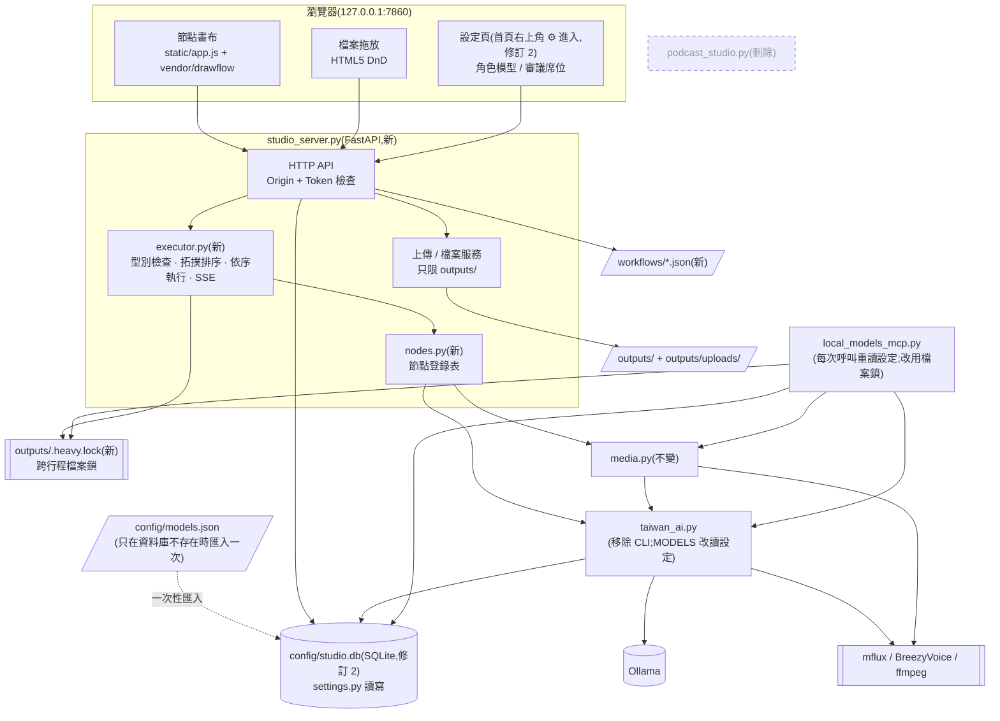
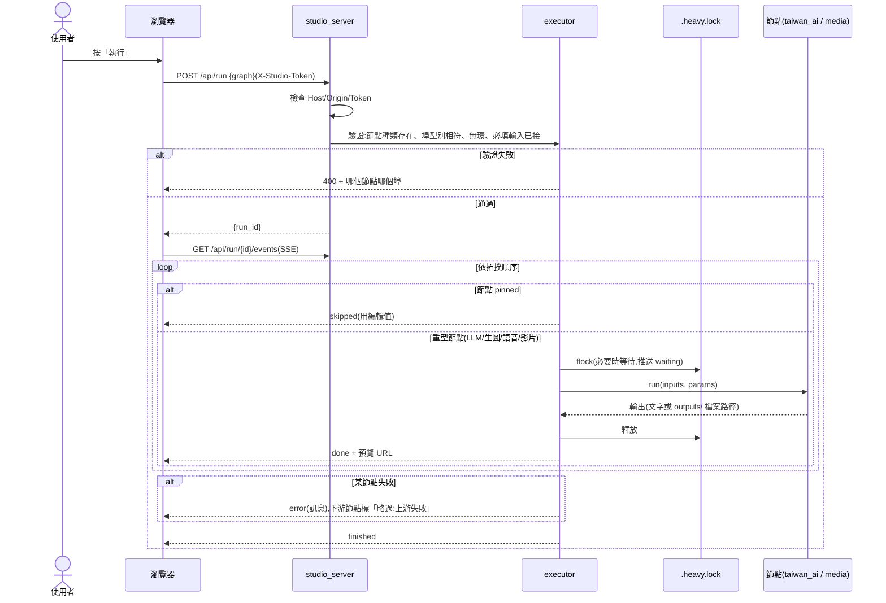
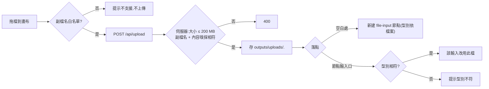
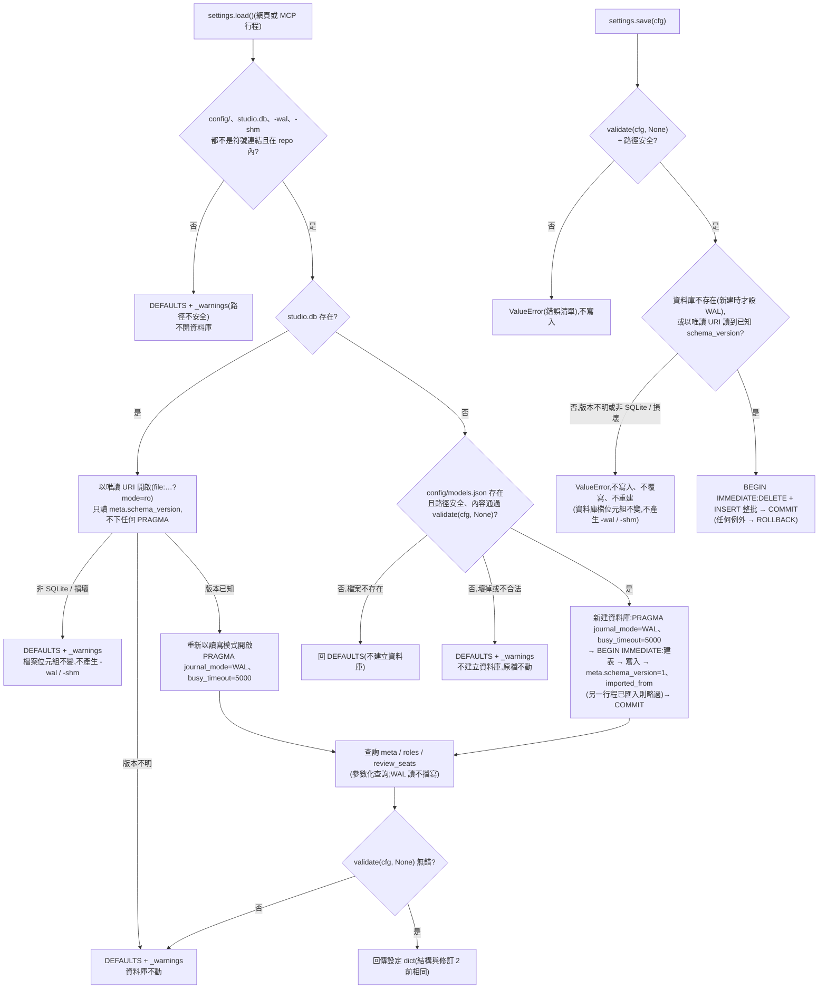

# CHG-20261022-01 — 網頁改版:節點畫布 + 檔案拖放 + 共用模型設定,移除 Gradio 與 CLI

- 專案:podcast-studio
- 分支(Branch):main
- 日期:2026-10-22(UTC+0)
- 類型:新功能 / 重構
- 提出者:使用者
- 實作者:主 agent 派發(DIR-3);實際工作者記於「## 派發記錄」
- 驗收者:獨立 Claude subagent(不參與施工、不看實作者自述)+ 使用者操作驗收
- 風險分級:高(命中高風險清單:**跨模組介面**——模型設定由網頁寫、MCP 讀(修訂 2 起由 `config/models.json` 改存 SQLite `config/studio.db`);**資料模型**(修訂 2)——新增設定資料庫與一次性 JSON → SQLite 匯入;**安全**——新增會改變狀態的 HTTP 端點、檔案上傳與檔案下載;BreezyVoice 子程序可能連線 Hugging Face(ADP-12,修訂 2 一併處理))
- Autonomy:halt
- Commit/PR:(收尾時填)
- 重複性檢查(Recurrence check):(收尾時填)
- Diagrams:見「## 設計圖」節
- Mockup:見「## 畫面草稿」節
- Security-impact:見「## 安全影響」節
- Skill: ai-sdlc v1.66
- 關聯:FR-1~7(功能保留、實作替換)、FR-14(棄用)、FR-16~21、FR-23;Guideline v1.1;待補項 ADP-1、ADP-2、ADP-8(本筆一併處理,見修改步驟)、ADP-12(修訂 2 新增,T4 處理 `taiwan_ai.speak()` 的離線環境變數);修訂 2 依據 Guideline v1.5(FR-21 修改:設定改存 SQLite;FR-31 修改:設定由首頁右上角圖示開啟);後續 CHG-20261022-02(MCP 註冊管理,依賴本筆的設定頁)

## 動機

使用者指示(2026-10-22):不需要 CLI,只要網頁;網頁要能配置模型(與 MCP 共用)並支援 drag and drop——**檔案拖放與節點拖拉編排兩者都要**。Gradio 的元件模型做不出節點編輯器,使用者選定改用 FastAPI + 原生 JS。

## 使用者故事

1. 作為使用者,我打開網頁就看到預設流程(主題 → 文案 → 台灣用語 → 語音;標題 → 封面;封面 + 語音 + 文案 → 影片),填主題與標題後按「執行」就能拿到 MP4 與 SRT,以便不必重新學新介面。
2. 作為使用者,我可以從左側節點清單把節點拖到畫布、拖線連起來,自己決定步驟順序與分支,以便做出四步以外的流程(例如同一份文案做兩種封面)。
3. 作為使用者,型別不符的連線(例如把圖片接到語音的文字輸入)會被拒絕並提示原因,以便不會等到執行才失敗。
4. 作為使用者,我可以把自己的 `.txt` 文稿、封面圖、錄好的音檔直接拖進畫布變成輸入節點,或拖到某個節點的輸入口取代它,以便混用自己的素材與 AI 產出。
5. 作為使用者,文字節點的輸出可以直接在節點上改;改過的節點會被「釘住」,再按執行時不重跑它、下游用我改的內容,以便保留 FR-2「人工修改文案」。
6. 作為使用者,執行時每個節點顯示狀態與預覽(文字、圖、播放器、影片),失敗的節點顯示錯誤訊息,以便知道卡在哪裡。
7. 作為使用者,我可以把流程存檔、之後再載入,以便重複使用。
8. 作為使用者,我在設定頁替每個角色從 Ollama 已下載的模型中挑選並設參數,存檔後網頁與 Claude Code / Codex 透過 MCP 呼叫時都用同一組,以便只改一個地方。(修訂 2:設定頁由首頁右上角 ⚙ 開啟;設定存在 SQLite,網頁存檔不會讓 git 工作樹變髒。)
9. 作為使用者,我在設定頁調整審議席位用哪個本機模型(DIR-1),以便治理審議跟著模型更換。
10. 作為 MCP client,我在網頁執行重型工作時呼叫 `generate_image` 會等待而不是同時搶記憶體,以便不 OOM。

## 決策與取捨

| 決策 | 選項 | 前提假設(此決策建立在什麼之上) | 為何這樣選 |
|------|------|----------------------------------|------------|
| 網頁框架 | FastAPI + 原生 JS vs Gradio + 嵌入 vs ComfyUI | 本機沒有 node/npm;前端必須免建置;離線 | **使用者選定**(2026-10-22)。節點編輯器與 HTML5 拖放用原生 JS 最直接 |
| 節點編輯器函式庫 | Drawflow vs LiteGraph.js vs 自寫 SVG | 需單檔、MIT、免建置、可離線 | **代決**:Drawflow(單一 JS + CSS,MIT,API 直接提供拖拉節點與連線事件)。LiteGraph 偏 canvas 繪圖、客製節點內容(textarea、播放器)較麻煩;自寫成本高 |
| 第三方前端檔 | CDN 載入 vs 存進 repo | NFR「離線前端」 | 存進 `static/vendor/`,記錄版本與授權。**下載一次需要使用者同意**(確認閘一併詢問) |
| 執行模型 | 伺服器端依拓撲順序逐一執行 vs 前端逐節點呼叫 API | 24 GB 記憶體同時只撐一個重型工作 | 伺服器端:一次送整張圖、背景執行緒依序跑、SSE 推進度;前端關掉分頁也不中斷 |
| 型別系統 | text / image / audio / video 四種埠型別 | 現有功能的資料只有這四種 | 連線時前端檢查、執行前伺服器再檢查一次(前端可被繞過) |
| 人工修改 | 「釘住」節點(pinned)vs 每次重跑覆蓋 | FR-2 要保留人工修改 | 使用者編輯過的文字節點標記 pinned,執行時跳過、輸出用編輯值;可手動解除 |
| 模型設定存放 | `config/models.json` vs 環境變數 vs 資料庫 | 單人本機;MCP 是另一個行程 | (修訂 2 取代,見本表末三列)~~JSON 檔入 git(只有本機模型名稱,無秘密);原子寫入(暫存檔 + rename)~~;檔案不存在或壞掉 → 用程式內預設值並在設定頁顯示警告 |
| MCP 讀設定時機 | 每次工具呼叫重讀 vs 啟動時讀一次 | 使用者期待「改了就生效」 | 每次重讀(檔案小,成本可忽略) |
| 跨行程互斥(ADP-2) | `fcntl.flock` 檔案鎖 vs 行程內鎖 | 網頁與 MCP 是兩個行程 | `outputs/.heavy.lock` 檔案鎖,網頁與 MCP 共用;取不到鎖時等待並在節點上顯示「等待其他工作」 |
| 卸載模型(ADP-1) | 卸載「設定中的模型」vs 卸載「目前載入的全部模型」 | heavy 模型會在 `MODELS` 還原後殘留 | 改為查 `/api/ps` 卸載**目前實際載入**的全部模型 |
| CLI | 保留 vs 移除 | 使用者決定不需要 | 移除 `taiwan_ai.py` 的 `ask/code/image/auto/main` 與 `code` 角色;`taiwan_ai.py` 只剩共用函式庫 |
| Gradio 版 | 保留並存 vs 刪除 | 新版功能涵蓋 FR-1~7 | 刪除 `podcast_studio.py`(git 可回復);`.claude/launch.json` 改指新伺服器 |
| 防跨站請求 | 不防 vs 檢查 Origin + 啟動權杖 | 瀏覽器中任何網站都能對 `127.0.0.1:7860` 發請求(CSRF / DNS rebinding) | 所有會改狀態的端點檢查 `Host` 與 `Origin` 必須是 `127.0.0.1:7860` / `localhost:7860`,並要求 `X-Studio-Token`(伺服器啟動時隨機產生、只嵌在首頁) |
| 埠號 | 沿用 7860 vs 換新 | 使用者習慣與 launch.json | 沿用 7860 |
| 模型設定存放(修訂 2) | `config/models.json` vs SQLite | 網頁與 MCP 兩個行程同時讀寫;使用者要求「可透過使用sqlite管理模型配置並且能在local網站中設定」 | **使用者選定**(2026-10-25):SQLite `config/studio.db`,不入 git(使用者資料,不讓網頁存檔把工作樹弄髒——`scripts/deploy_local.sh` 遇到不乾淨的工作樹會中止部署);`DEFAULTS` 留在程式;`settings.load()` / `save()` / `validate()` 簽名不變,T2 與 MCP 呼叫端不受影響 |
| 併發與一致性(修訂 2) | 每次寫整檔 vs SQLite 交易 | 網頁寫、MCP 讀,可能同一時間 | **代決**:`journal_mode=WAL` + `busy_timeout=5000`(只在版本已知或新建資料庫時設定;先以唯讀 URI 讀 `meta.schema_version`,版本不明或非 SQLite 時不下任何會寫入的 PRAGMA,見 Global Constraints);`save()` 以 `BEGIN IMMEDIATE` 單一交易整批改寫,失敗即 rollback;讀取不需鎖檔 |
| 既有 JSON 的去留(修訂 2) | 持續雙寫 vs 一次性匯入後停用 | 修訂 2 前只有 T1、T2 落地,網頁設定頁尚未存在,`config/models.json` 內容等於 `DEFAULTS` | **代決**:資料庫不存在且 `config/models.json` 存在時,於第一次 `load()` 以單一交易匯入一次;之後只讀資料庫。程式**不刪除** `config/models.json`;T3 把它移出 git 並列入 `.gitignore` |

**代決事項**(Guideline 與使用者指示推導不出,由 agent 先決定,確認閘請覆核):Drawflow、pinned 語意、~~`config/models.json` 入 git~~(修訂 2 改為 SQLite 不入 git)、上傳上限 200 MB、防跨站做法、沿用 7860、刪除 `podcast_studio.py`。修訂 2 新增代決:資料庫路徑 `config/studio.db`、WAL 與 busy_timeout 5000 毫秒、一次性匯入且不刪原檔、T3 把 `config/models.json` 移出 git、新 task 插在 T2 之後並把原 T3~T13 順延為 T4~T14、ADP-12 的 `speak()` 修正放在 T4。

## 設計圖

### (1) 受影響範圍的架構圖



相依方向維持單向:入口(`studio_server` / `local_models_mcp`)→ `nodes`/`executor` → `media` → `taiwan_ai` → 外部引擎。設定資料(修訂 2 起為 `config/studio.db`,只經 `settings.py` 存取)是兩個入口共享的**資料契約**(跨模組介面,見安全影響)。`TAI --> ENG` 這條邊的 BreezyVoice 子程序,修訂 2 起一律帶 `HF_HUB_OFFLINE=1`、`TRANSFORMERS_OFFLINE=1`(ADP-12)。

### (2) 本次變更的流程圖:按下「執行」



### (3) 檔案拖放流程



### (4) 設定讀寫與一次性匯入(修訂 2)



## 畫面草稿

### 設定 › 進階流程(節點畫布)——修訂 1:不再是主畫面

> 修訂 1(2026-10-23):依使用者指示,網頁只有「建立 Podcast / 設定 / 免責說明與授權」三個分頁;節點畫布移到「設定 › 進階流程」,用來調整「建立 Podcast」步驟精靈的步驟與模型。下方草稿的頂端工具列改為設定頁內的子頁標題;「執行」按鈕保留作為試跑流程用。主畫面與精靈見 CHG-20261022-04。

> 修訂 2(2026-10-26):三個分頁取消。首頁改為「精靈」「完整模式」兩張卡片,右上角 ⚙ 圖示開啟設定,首頁底部連結開啟「免責說明與授權」(見 CHG-20261022-04 修訂 2 草稿)。節點畫布仍在「設定 › 進階流程」,內容不變。

```
┌──────────────────────────────────────────────────────────────────────────┐
│ Podcast 工作室   [流程:預設 ▼] [載入] [存檔]        [▶ 執行] [■ 停止] [⚙ 設定] │
├────────────┬─────────────────────────────────────────────────────────────┤
│ 節點清單   │                                                             │
│ ── 輸入 ── │  ┌─主題───────┐   ┌─寫文案──────────┐   ┌─台灣用語────┐       │
│ ▢ 文字     │  │台灣夜市文化 │──▶│風格[輕鬆聊天▼]  │──▶│✓ 完成        │──┐    │
│ ▢ 檔案     │  └────────────┘   │長度[2]分 ✓ 完成 │   │[可編輯文字…] │  │    │
│ ── 文字 ── │                   └─────────────────┘   │📌 已釘住      │  │    │
│ ▢ 寫文案   │                                         └──────────────┘  │    │
│ ▢ AI 修改  │  ┌─標題───────┐   ┌─封面 prompt─┐  ┌─生圖+標題────┐  ┌─語音──▼─┐ │
│ ▢ 台灣用語 │  │夜市的味道   │──▶│ ⏳ 執行中   │─▶│[縮圖]        │  │▶ 0:00/2:01│ │
│ ── 媒體 ── │  └────────────┘   └─────────────┘  └──────┬───────┘  └────┬────┘ │
│ ▢ 語音     │                                          ▼                ▼      │
│ ▢ 生圖     │                                     ┌─合成影片(含字幕)─────┐     │
│ ▢ 疊標題   │      ⇩ 把 .txt / 圖片 / 音檔拖到這裡  │ 待執行               │     │
│ ▢ 合成影片 │                                     └──────────────────────┘     │
├────────────┴─────────────────────────────────────────────────────────────┤
│ 狀態列:封面 prompt 執行中…(等待其他工作:MCP generate_image)               │
└──────────────────────────────────────────────────────────────────────────┘
```

- 連線型別以埠的顏色區分:文字=藍、圖片=綠、音訊=橘、影片=紫。
- 拖檔經過畫布時顯示虛線框;經過可接受的輸入口時該埠高亮,不相符的埠變灰。

### 設定頁(修訂 2:由首頁右上角 ⚙ 開啟,不是分頁;設定存 `config/studio.db`)

```
┌ ← 首頁                                 設定                                       ⚙ ┐
│ [模型]  [審議席位]  [語音預設]  [進階流程]          (設定頁內的子頁切換,不是網頁分頁) │
├───────────────────────────────────────────────────────────────────────────────────┤
│ 角色模型(網頁與 local-models MCP 共用 · 儲存於設定資料庫)                           │
│   推理 reason       [Qwen3.5-9B-Uncensored…:Q4_K_M ▼]  think ☐  ctx [16384]          │
│   重型推理          [Qwen3.8-27B-…:IQ3_M ▼]            think ☑  ctx [16384]          │
│   台灣用語 taiwan   [Llama-Breeze2-8B…:Q4_K_M ▼]                                    │
│   生圖              [flux-1-schnell-mflux-q4]  steps [4]   ✔ mflux 已安裝            │
│   語音聲線          [data/example.wav ▼]  逐字稿 [……]  ✔ BreezyVoice 已安裝          │
│   ⓘ 已從 config/models.json 匯入一次(2026-10-26 10:12),之後只讀資料庫                │
│ ───────────────────────────────────────────────────────────────────────────────── │
│ 審議席位(DIR-1)                                                                  │
│   risk ⛔ [Qwen3.5-9B ▼] security ⛔ [Codex ▼] compliance ⛔ [Codex ▼]              │
│   impact [glm4 ▼]  drift [qwen3:8b ▼]  consistency [glm4 ▼]                        │
│   ⚠ glm4 不得用於 ⛔ 否決席(下拉選單不列出)                                        │
│   Codex 只能擔任 ⛔ 否決席(DIR-1 第 9 條;預設同 settings.DEFAULTS)              │
│ ───────────────────────────────────────────────────────────────────────────────── │
│ MCP 註冊(CHG-20261022-02)                                                       │
│                                                       [還原預設]  [儲存]           │
├───────────────────────────────────────────────────────────────────────────────────┤
│                                免責說明與授權                                        │
└───────────────────────────────────────────────────────────────────────────────────┘
```

- 「匯入一次」提示只在 `meta.imported_from` 有值時顯示;資料庫讀取失敗、版本未知或內容不合法時,改顯示對應的 `_warnings` 文字並以預設值填入欄位。
- 頁首只有返回首頁、標題與 ⚙;不放步驟順序說明或「本機」字樣(沿用修訂 1 規則)。
- 底部「免責說明與授權」是連結,與首頁底部的連結開啟同一頁(CHG-20261022-04 修訂 2)。
- 「語音預設」子頁的欄位由 CHG-20261022-04 新增。

修訂 1 版設定頁(保留作對照,修訂 2 取代):

```
┌─ 設定 ───────────────────────────────────────────────────────────────┐
│ 角色模型(網頁與 local-models MCP 共用 · config/models.json)          │
│   推理 reason       [Qwen3.5-9B-Uncensored…:Q4_K_M ▼]  think ☐  ctx [16384] │
│   重型推理          [Qwen3.8-27B-…:IQ3_M ▼]            think ☑  ctx [16384] │
│   台灣用語 taiwan   [Llama-Breeze2-8B…:Q4_K_M ▼]                       │
│   生圖              [flux-1-schnell-mflux-q4]  steps [4]   ✔ mflux 已安裝 │
│   語音聲線          [data/example.wav ▼]  逐字稿 [……]  ✔ BreezyVoice 已安裝 │
│ ───────────────────────────────────────────────────────────────────── │
│ 審議席位(DIR-1)                                                      │
│   risk ⛔ [Qwen3.5-9B ▼] security ⛔ [Codex ▼] compliance ⛔ [Codex ▼]  │
│   impact [glm4 ▼]  drift [qwen3:8b ▼]  consistency [glm4 ▼]            │
│   ⚠ glm4 不得用於 ⛔ 否決席(下拉選單不列出)                            │
│   Codex 只能擔任 ⛔ 否決席(DIR-1 第 9 條;預設同 settings.DEFAULTS) │
│ ───────────────────────────────────────────────────────────────────── │
│ MCP 註冊(CHG-20261022-02)                                           │
│                                           [還原預設]  [儲存]          │
└──────────────────────────────────────────────────────────────────────┘
```

## 安全影響

| 類別 | 是否觸及 | 影響範圍 / 理由 |
|------|----------|-----------------|
| irreversible-delete | 否 | 刪除 `podcast_studio.py` 與 CLI 程式碼在 git 內可回復;上傳不刪任何既有檔;`outputs/` 產出檔以秒級時間戳命名、同秒同前綴會互相覆寫(ADP-8)→ T2 把 `stamp()` 改為「時間戳 + 毫秒 + 4 碼隨機」,輸出檔一律先以 `reserve()` 排他建立佔位檔(`O_EXCL`、不跟隨符號連結,撞名重取),不覆寫既有檔;工作流程**同名存檔會覆寫** `workflows/<name>.json` → UI 要求確認後才覆寫,伺服器端拒絕名稱含路徑分隔或 `..`。修訂 2:`settings.save()` 以單一交易整批改寫 `roles`、`review_seats` 兩表(先刪後寫,失敗 rollback,不會留下半套設定);一次性匯入**不刪除** `config/models.json`;資料庫損壞時程式不刪除、不覆寫該檔,只回預設值並提示;T3 以 `git rm` 把 `config/models.json` 移出 repo(git 可回復,內容等於 `DEFAULTS`,見 prod-migration) |
| payments | 否 | 無金流 |
| prod-migration | **是(有限,修訂 2)** | 修訂 2 前:無資料庫,`config/models.json` 是新檔。修訂 2 新增 SQLite `config/studio.db` 與**一次性 JSON → SQLite 匯入**:(a) 觸發條件:資料庫不存在且 `config/models.json` 存在、路徑安全、內容通過 `validate(cfg, None)`;(b) 在 `BEGIN IMMEDIATE` 交易內建表、寫入並記 `meta.schema_version=1`、`imported_from`、`imported_at`,失敗即 rollback 且不留資料庫檔(下次 `load()` 再試);網頁與 MCP 同時觸發時,後到者在交易內看到 `schema_version` 已存在即略過;(c) 原檔不刪除、之後不再讀取;(d) 實際影響面:修訂 2 時 main 只有 T1、T2,網頁設定頁尚未存在,追蹤中的 `config/models.json` 等於 `DEFAULTS`,匯入結果與預設值相同;若使用者曾手動改過該檔,`scripts/deploy_local.sh` 會因工作樹不乾淨而在 pull 前中止,由使用者先決定保留或捨棄修改;(e) 資料庫 `schema_version` 大於程式所知版本時不讀、不寫,回預設值並提示,不猜測轉換;(f) 回滾見「風險與回滾」 |
| security-boundary | **是** | (a) 新增會改變狀態的 HTTP 端點:`/api/run`(觸發本機模型與子程序)、`/api/upload`(寫檔)、`PUT /api/config`(改變 MCP 會呼叫哪個模型)、`PUT /api/workflows/*`(寫檔)。風險:瀏覽器中其他網站以 CSRF / DNS rebinding 呼叫。對策:只綁 `127.0.0.1`;**所有請求**檢查 `Host`(含 GET,擋 DNS rebinding 讀取 `/api/config` 與 `/files/*`);改變狀態的請求另檢查 `Origin` 與啟動權杖 `X-Studio-Token`。(b) 檔案上傳與下載:路徑穿越、超大檔、偽裝副檔名 / MIME。對策:伺服器產生檔名、副檔名白名單 + **以檔頭內容嗅探判定型別**(不信任用戶端 `Content-Type`)、200 MB 上限、檔案服務只解析 `outputs/` 之下的真實路徑(`resolve()` 後檢查前綴)。(c) **跨模組信任**:網頁寫的 `config/models.json` 決定 MCP 呼叫哪個模型與參數 → 模型名稱必須在 Ollama `/api/tags` 清單內才可存;路徑類欄位(聲線音檔)限 `tools/BreezyVoice/data/` 與 `outputs/uploads/` 之下;MCP 讀到不合法值時用預設值並記 stderr。(d) 節點參數進子程序一律以 list 傳遞,不經 shell;參數先依 `NodeSpec.params` 驗證型別與範圍(例:生圖寬高為 16 倍數且 256–2048、steps 1–8、分鐘 0.5–10),不合格不執行。(e) **修訂 2:SQLite 設定檔**——`config/studio.db` 及其 `-wal`、`-shm` 檔沿用 T1 對 `config/models.json` 的路徑規則:`config/` 與三個檔逐層不得是符號連結、解析後必須在 repo 內,否則 `load()` 回預設值並提示、`save()` 丟 `ValueError`,且不開啟資料庫;建立時檔案權限 0600;SQL 一律參數化(`?` 佔位),表名與欄名寫死在程式內,任何使用者或模型提供的字串都不拼進 SQL;讀出的資料一律再經 `validate(cfg, None)`,不合法就整份回預設值——資料庫被他人改寫時,MCP 不會因此呼叫非預期的模型或讀取允許目錄外的聲線檔;資料庫不經 `/files/*` 或任何 HTTP 端點直接提供下載。(f) **修訂 2:ADP-12**——BreezyVoice 載入模型時呼叫 `snapshot_download`(`tools/BreezyVoice/single_inference.py:207`,預設 `--model_path` 為 Hugging Face repo id,第 400 行;`cosyvoice/cli/cosyvoice.py:27`),G2PW 以 `BertTokenizer.from_pretrained('bert-base-chinese')` 載入分詞器(`tools/BreezyVoice/.venv/lib/python3.10/site-packages/g2pw/api.py:84`);子程序環境沒有離線變數時,每次執行都可能連線 Hugging Face,違反「不送資料出本機」。對策:T4 讓 `taiwan_ai.speak()` 的子程序環境加入 `HF_HUB_OFFLINE=1`、`TRANSFORMERS_OFFLINE=1`(CHG-20261022-04 的 `breezy_worker` 同樣設定);快取不存在時改為失敗並提示,不自動下載 |

## 修訂 1(2026-10-23,確認閘後、實作前)

- 依據:使用者指示(2026-10-23):「語音部分語速太慢 要能設定某段的語速倍率」「不要用 tab 也不要在上面說明順序與本機說明」「每個步驟都是下一步」「需要 TAB 的只有建立 podcast、設定與免責說明授權」;並選定:節點畫布放進「設定」當進階、語速 = 全域預設 + 每句覆寫。
- 內容:節點畫布(FR-16)由主畫面移到「設定 › 進階流程」;`workflows/default.json` 同時定義 CHG-20261022-04 步驟精靈的預設步驟。節點引擎、API、安全約束、檔案拖放到畫布的行為不變。
- 影響的 task:T9(畫布所在位置)、T11(設定分頁含子頁)、T12(預設流程兼作精靈步驟)、T13(UI 檢查進入路徑)。(修訂 2 重新編號後依序為 T10、T12、T13、T14。)
- 審議:本修訂只改前端位置,不改 API、資料、權限或子程序,未觸及安全影響四類;不重跑審議,於確認閘由使用者覆核畫面。

## 修訂 2(2026-10-26,確認閘後、實作前;T1、T2 已 merge)

- 依據:使用者指示(2026-10-25/26):「可透過使用sqlite管理模型配置並且能在local網站中設定」「進入後首先會是兩個card 分別是精靈和完整模式 然後右上角有icon能進行設定」;並選定:免責說明與授權改為首頁底部連結(設定頁也可進入)。另依 2026-10-26 查證新增 Guideline §9 ADP-12(BreezyVoice 每次載入都可能連線 Hugging Face)。
- 內容:
  1. 模型設定改存 SQLite `config/studio.db`(不入 git);`DEFAULTS` 留在程式;`settings.load()` / `save()` / `validate()` 的簽名與回傳結構不變,T2(`taiwan_ai.model()`)與 MCP 呼叫端不受影響;資料庫不存在時從 `config/models.json` 一次性匯入,之後不再讀 JSON。資料表:`meta`(含 `schema_version`)、`roles`、`review_seats`(schema 見 T3)。
  2. 網頁三分頁取消:設定頁改由首頁右上角 ⚙ 圖示開啟;節點畫布仍在「設定 › 進階流程」。首頁版面(兩張卡片、底部免責連結)屬 CHG-20261022-04 修訂 2。
  3. ADP-12:T4 讓 `taiwan_ai.speak()` 的 BreezyVoice 子程序環境加入 `HF_HUB_OFFLINE=1`、`TRANSFORMERS_OFFLINE=1`。放在本筆而不是 CHG-20261022-04 的理由:`speak()` 是現行 MCP `speak` 走的路徑,本筆排在 CHG-04 之前施工,能較早停止對外連線;T2 已打勾不能再改,T4 本來就改 `local_models_mcp.py` 的重型路徑,範圍最接近。
- 新 task 的位置與重新編號:plan-check 要求 task 編號 `T1..Tn` 依出現順序連續(`T2a` 不符格式),而 runner 依清單順序施工。新 task 必須排在設定 API 與設定頁之前——否則那段期間網頁存檔會改寫入 git 的 `config/models.json`,工作樹變髒,`scripts/deploy_local.sh` 拒絕部署。因此新 task 插在 T2 之後成為 T3,原 T3~T13 依序順延一號:

  | 修訂 1 編號 | 修訂 2 編號 | 內容 |
  |---|---|---|
  | T1、T2 | T1、T2(不變,已打勾) | 測試載具與設定模組;taiwan_ai 純函式庫 |
  | — | **T3(新)** | 設定改存 SQLite 與一次性匯入 |
  | T3 | T4 | 跨行程重型鎖、MCP 重讀設定;修訂 2 加 ADP-12 |
  | T4~T7 | T5~T8 | 節點登錄表、圖執行器、伺服器核心、上傳與檔案 |
  | T8 | T9 | 設定 API |
  | T9、T10 | T10、T11 | 前端畫布、拖放 |
  | T11 | T12 | 前端設定頁 |
  | T12 | T13 | 預設範本與舊入口退場 |
  | T13 | T14 | UI 互動檢查 |

  「## 審議」節與修訂 1 段落裡的 task 編號指當時版本,不改寫。
- 影響的 task:T1(測試描述中與 JSON 檔相關的案例由 T3 改寫)、T3(新)、T4(ADP-12)、T9(設定 API 經 `settings` 讀寫資料庫)、T12(設定頁由 ⚙ 開啟)、T13(啟動設定與 `.gitignore`)、T14(UI 檢查的進入路徑);行為規格 `features/settings.feature` 改寫為資料庫版本並新增匯入情境。
- 審議:本修訂改變資料存放(新增 SQLite 與一次性匯入)、改變 BreezyVoice 子程序環境,觸及 security-boundary 與 prod-migration;確認閘前依 DIR-1 重跑否決席(risk、security、compliance,Codex),判決記於「## 審議」。

## 修改指引

### 目標

以 FastAPI + 原生 JS 重寫網頁層,提供節點畫布(FR-16~18、20)、檔案拖放(FR-19)、共用模型設定(FR-21、23);移除 CLI(FR-14)與 Gradio 版;順帶處理 ADP-1(卸載殘留)與 ADP-2(跨行程互斥),因為兩者都位在本筆必改的程式路徑上。

### 影響範圍

| 受影響項 | 類型 | 改動 | 連帶影響 |
|----------|------|------|----------|
| `podcast_studio.py` | 目錄/設計 | 刪除 | `.claude/launch.json` 改指 `studio_server.py`;`PODCAST_STUDIO.md` §3、§9 過時 → 加註指向帳本 |
| `studio_server.py` | 目錄/邏輯/設計 | 新增:FastAPI、靜態檔、API、SSE | 新依賴 fastapi、uvicorn、python-multipart(PEP 723 檔頭) |
| `executor.py`、`nodes.py` | 邏輯/設計 | 新增:型別檢查、拓撲排序、依序執行、節點登錄表 | 節點包住既有 `taiwan_ai` / `media` 函式,不改其行為 |
| `static/`(`index.html`、`app.js`、`style.css`、`vendor/drawflow.*`) | 目錄 | 新增 | 需下載 Drawflow 一次(使用者同意) |
| `config/models.json` + `settings.py`(讀寫、驗證、預設值) | 資料/設計 | 新增(T1);修訂 2:`settings.py` 改讀寫 SQLite,`config/models.json` 只作一次性匯入來源並移出 git(T3) | `taiwan_ai.MODELS` 不再是硬寫常數 |
| `config/studio.db`(修訂 2) | 資料 | 新增:SQLite 設定資料庫(`meta`、`roles`、`review_seats`),WAL 模式,不入 git | `docs/structure/data.md` 新增 schema;CHG-20261022-04 的語音預設改存同一資料庫 |
| `taiwan_ai.py` | 設計 | 移除 CLI 與 `code` 角色;模型改讀設定;`unload_llms()` 改卸載 `/api/ps` 列出的全部模型(ADP-1);修訂 2:`speak()` 子程序環境加入 `HF_HUB_OFFLINE=1`、`TRANSFORMERS_OFFLINE=1`(ADP-12,T4) | `local_models_mcp.list_models` 的 `code` 排除邏輯可刪;BreezyVoice 模型快取不存在時 `speak()` 改為失敗而不是下載 |
| `local_models_mcp.py` | 設計 | 每次呼叫重讀設定;`busy()` 改用跨行程檔案鎖(ADP-2) | MCP 工具契約(名稱、參數、回傳)**不變** |
| `media.py` | — | 只改輸出檔名改以 `taiwan_ai.reserve()` 排他建立(見 Global Constraints) | — |
| `workflows/default.json` | 資料 | 新增預設範本 | — |
| `tests/` | 目錄 | 新增 pytest(executor、settings、上傳驗證、split_sentences/make_srt)與 `tests/ui_check.py`(Playwright) | 首次執行需下載 Chromium(使用者同意) |
| `.gitignore` | — | 修訂 2 新增 `config/studio.db`、`config/studio.db-wal`、`config/studio.db-shm`、`config/models.json` | ~~`config/models.json` 刻意入 git~~(修訂 2:移出 git,設定屬使用者資料) |

### 前置(主 agent,確認閘通過且使用者同意下載後;不屬於 runner task)

- [x] P1. 下載 Drawflow 固定版本到 `static/vendor/drawflow.min.js`、`drawflow.min.css`,記錄版本、來源 URL、SHA-256、MIT 授權於 `static/vendor/README.md`
- [ ] P2. 以 `uv run --with playwright playwright install chromium` 安裝 UI 檢查用瀏覽器(約 150 MB)

### Global Constraints(全域約束——每個 task 都要遵守)

- 每個 Python 入口檔一律是 PEP 723 單檔 script(`uv run --script`),新依賴寫進檔頭 `dependencies`;不新增 `pyproject.toml`。
- 測試一律以 `./scripts/check.sh [pytest 參數]` 執行(T1 建立);測試不得呼叫真的 Ollama、mflux、BreezyVoice、ffmpeg 以外的外部服務——模型呼叫一律以 monkeypatch 替身。
- 網頁伺服器一律只綁 `127.0.0.1:7860`;**所有請求**(含 GET、`/files/*`、SSE)一律檢查 `Host` ∈ {`127.0.0.1:7860`, `localhost:7860`}(擋 DNS rebinding 讀取);會改變狀態的端點(POST/PUT/DELETE)另外檢查 `Origin` 並要求標頭 `X-Studio-Token` 等於啟動時產生的權杖;不符一律回 403。
- 節點參數一律依 `NodeSpec.params` 宣告的型別與範圍驗證(整數上下限、列舉、字串長度上限),驗證在 `executor.validate` 執行;不合格回 400,不進子程序。
- `heavy_lock()` 一律使用 `fcntl.LOCK_EX`(排他鎖)。
- 改變狀態的請求:缺 `Origin`、`Origin: null`、`OPTIONS` 預檢一律 403;`Origin` 以完整字串比對 `http://127.0.0.1:7860` 或 `http://localhost:7860`。
- 啟動權杖一律 `secrets.token_urlsafe(32)`,只存在記憶體與首頁 HTML,不寫入日誌或檔案。
- 伺服器一律不送任何 CORS 標頭(`Access-Control-Allow-*`)。
- 回應一律帶 `X-Content-Type-Options: nosniff` 與 `Content-Security-Policy: default-src 'self'; media-src 'self' blob:; img-src 'self' blob: data:`;`/files/*` 的文字檔以 `text/plain; charset=utf-8` 送出。
- 前端顯示使用者或模型產生的文字一律用 `textContent`,不使用 `innerHTML`。
- 上傳一律以串流讀取並在累計超過 200 MB 時立即中止回 413,不先讀完整個請求。
- `/files/{path}` 一律先 URL 解碼、再 `resolve()`、最後檢查前綴。
- 單一工作流程節點數 ≤ 100、文字參數 ≤ 20000 字;同時只允許一個執行中的 run,第二個回 409。
- 檔案讀寫一律限 `outputs/`、`workflows/`、`config/` 之下:路徑先 `resolve()` 再檢查前綴;使用者提供的檔名一律不用於落地檔名。
- 子程序一律 argv list,不經 shell。
- 重型工作(LLM、生圖、語音、影片)一律在 `heavy_lock()`(跨行程 `fcntl.flock`,`outputs/.heavy.lock`)內執行;網頁與 MCP 共用同一把。
- 埠型別只有 `text`、`image`、`audio`、`video` 四種。
- 前端一律原生 HTML/JS/CSS,不使用建置工具,不從 CDN 載入任何資源;唯一第三方前端檔是 `static/vendor/drawflow.*`。
- 使用者面文字、註解一律繁體中文與台灣用語。
- MCP 工具的名稱、參數、回傳格式一律不變。
- 審議席位否決席(risk、security、compliance)不得設定為 `glm4:*`(DIR-1)。
- (修訂 2)模型設定一律只經 `settings.load()` / `save()` / `validate()` 存取 `config/studio.db`;其他模組不得直接開啟資料庫或讀 `config/models.json`。
- (修訂 2)SQL 一律參數化(`?` 佔位),表名、欄名寫死在 `settings.py`;不得以字串格式化或串接組 SQL。
- (修訂 2)開啟既有資料庫時一律先以唯讀 URI(`file:config/studio.db?mode=ro`)讀 `meta.schema_version`,此階段不下任何會寫入的 PRAGMA;只有版本已知、或新建資料庫時,才以讀寫模式開啟並設定 `PRAGMA journal_mode=WAL`、`PRAGMA busy_timeout=5000`。版本不明或非 SQLite 的檔案,`load()` 與 `save()` 都不得改變其位元組,也不得產生 `-wal`、`-shm`;`save()` 與一次性匯入一律在 `BEGIN IMMEDIATE` 交易內完成,例外即 `ROLLBACK`。
- (修訂 2)`config/`、`config/studio.db`、`-wal`、`-shm` 逐層不得是符號連結、解析後必須位於 repo 內;不符時 `load()` 回 `DEFAULTS` 並帶 `_warnings`,`save()` 丟 `ValueError`,兩者都不開啟資料庫。資料庫檔建立時權限 0600。
- (修訂 2)從資料庫讀出的設定一律再經 `validate(cfg, None)`;`schema_version` 未知或內容不合法時整份回 `DEFAULTS` 並帶 `_warnings`,不修改資料庫。
- (修訂 2,ADP-12)啟動 BreezyVoice 的子程序環境一律包含 `HF_HUB_OFFLINE=1` 與 `TRANSFORMERS_OFFLINE=1`。
- 不修改 `media.py` 的行為(只允許因 import 調整而改動的行)。例外:輸出檔名改以 `taiwan_ai.reserve()` 排他建立、撞名重取,依使用者 2026-10-25 指示「修正 PR #33 兩項 security 疑慮:輸出檔以排他建立避免覆寫(撞名就重取 stamp)」;檔名格式、外部指令參數與輸出內容不變。

### Tasks(checkbox=續作點)

- [x] T1. 測試載具與設定模組
  - interfaces: consumes 無 / produces `scripts/check.sh`(以 uv 帶 pytest、httpx、fastapi、uvicorn、python-multipart、OpenCC 純 Python 套件(套件名見 `taiwan_ai.py` 檔頭)、imageio-ffmpeg、pillow<13 執行 `pytest -q tests/ "$@"`)、`settings.py`(`load() -> dict`、`save(cfg) -> None` 原子寫入、`validate(cfg, available_models) -> list[str]`、`DEFAULTS`)、`config/models.json`(等於 DEFAULTS)、`tests/test_settings.py`
  - test: `./scripts/check.sh tests/test_settings.py`——檔案不存在回 DEFAULTS;壞 JSON 回 DEFAULTS 並帶警告;未下載的模型名稱、允許目錄外的聲線路徑、否決席設 glm4 → validate 回錯誤;save 後 load 相等;save 中斷不留半個檔
- [x] T2. taiwan_ai 改為純函式庫並讀設定(ADP-1)
  - interfaces: consumes `settings.load()` / produces `taiwan_ai.py`:移除 `ask`、`code`、`image`、`auto`、`main`、argparse、`code` 角色;`model(role) -> str` 取代直接讀 `MODELS`;`unload_llms()` 改卸載 `/api/ps` 列出的全部模型;`stamp()` 改為時間戳 + 毫秒 + 4 碼隨機(ADP-8);`tests/test_taiwan_ai.py`
  - test: `./scripts/check.sh tests/test_taiwan_ai.py`——替身 `/api/ps` 回兩個模型(含 heavy)時兩個都收到 `keep_alive:0`;`chat("reason", …)` 使用設定中的模型名;同一毫秒內連呼 1000 次 `stamp()` 無重複;`python3 -c "import ast,sys; t=ast.parse(open('taiwan_ai.py').read()); sys.exit(any(isinstance(n,ast.FunctionDef) and n.name in {'ask','code','image','auto','main'} for n in t.body))"` exit 0
- [x] T3. 設定改存 SQLite 與一次性匯入(修訂 2)
  - interfaces: consumes T1(`settings.DEFAULTS`、`validate`、路徑規則)、T2(`taiwan_ai.model()` 只呼叫 `settings.load()`)/ produces `settings.py` 改寫儲存層:`DB_PATH = config/studio.db`;`load() -> dict`、`save(cfg) -> None`、`validate(cfg, available_models) -> list[str]` 簽名與回傳結構不變(含 `_warnings`);schema v1 = `meta(key TEXT PRIMARY KEY, value TEXT NOT NULL)`(`schema_version`、`imported_from`、`imported_at`)、`roles(role TEXT PRIMARY KEY, config TEXT NOT NULL)`(`config` 為該角色鍵值的 JSON)、`review_seats(seat TEXT PRIMARY KEY, model TEXT NOT NULL)`;資料庫不存在且 `config/models.json` 合法時於 `BEGIN IMMEDIATE` 交易內匯入一次;新警告常數 `WARN_DB_UNREADABLE`(「設定資料庫無法讀取,已使用預設值」)、`WARN_DB_VERSION`(「設定資料庫版本不明,已使用預設值」);`git rm config/models.json`;`.gitignore` 加 `config/studio.db`、`config/studio.db-wal`、`config/studio.db-shm`、`config/models.json`;改寫 `tests/test_settings.py`
  - test: `./scripts/check.sh tests/test_settings.py tests/test_taiwan_ai.py`——資料庫與 JSON 都不存在 → 回 DEFAULTS 且不建立資料庫檔;只有合法 JSON → 第一次 `load()` 建立資料庫、`meta.imported_from = config/models.json`、回傳值等於 JSON 內容,之後改 JSON 不影響 `load()`;壞 JSON → DEFAULTS + `_warnings` 且不建立資料庫;`save()` 後 `load()` 相等;`save()` 交易中途丟例外 → 資料庫內容等於 save 前(roles 與 review_seats 兩表都不變);兩個子行程同時第一次 `load()` → 只匯入一次(`imported_at` 只有一筆)且皆回相同設定;一個子行程連續 `save()` 200 次時另一子行程 `load()` 200 次,全部成功且每次結果都是完整一份合法設定(無 `database is locked`);`config/studio.db` 是符號連結或 `-wal` 是符號連結 → `load()` 回 DEFAULTS + 路徑不安全警告、`save()` 丟 ValueError,且連結目標檔內容不變;資料庫被寫入 `review_seats.security = glm4:latest` 或 `roles` 的聲線路徑指向 `/etc/passwd` → `load()` 回 DEFAULTS + 警告;`meta.schema_version = 99`(以 rollback journal 模式建立的測試檔)→ `load()` 回 DEFAULTS + 版本警告,接著 `save()` 丟 ValueError;兩者之後檔案位元組與 SHA-256 皆等於操作前,且 `config/studio.db-wal`、`config/studio.db-shm` 都不存在;非 SQLite 內容的 `studio.db` → `load()` 回 DEFAULTS + 警告,`save()` 丟 ValueError、不覆寫、不重建;兩者之後檔案位元組不變且不產生 `-wal`、`-shm`;新建資料庫檔權限為 0600;新建或版本已知的資料庫 `PRAGMA journal_mode` 回 `wal`;`python3 -c "import ast,sys; t=ast.parse(open('settings.py').read()); sys.exit(any(isinstance(n,ast.JoinedStr) and 'SELECT' in ast.unparse(n).upper() for n in ast.walk(t)))"` exit 0(不以 f-string 組 SQL);`git ls-files config/models.json` 輸出為空;`tests/test_taiwan_ai.py` 不改即通過
- [x] T4. 跨行程重型鎖、MCP 重讀設定與語音離線環境(ADP-2、ADP-12)
  - interfaces: consumes T1、T2、T3 / produces `heavy_lock.py`(`heavy_lock(timeout=None, on_wait=None)` context manager);`local_models_mcp.py` 的 `busy()` 改用它、每次工具呼叫重讀設定、`list_models` 移除 `code` 排除邏輯;修訂 2:`taiwan_ai.speak()` 的子程序環境加入 `HF_HUB_OFFLINE=1`、`TRANSFORMERS_OFFLINE=1`(其餘環境變數、argv、輸出不變;ADP-9 的 `HOME` 不在本 task 處理);`tests/test_heavy_lock.py`;`tests/test_taiwan_ai.py` 擴充
  - test: `./scripts/check.sh tests/test_heavy_lock.py tests/test_taiwan_ai.py`——兩個子行程同時取鎖(`LOCK_EX`),執行區間不重疊;持鎖行程被 kill 後另一行程 2 秒內取得鎖;等待時 `on_wait` 被呼叫;以 monkeypatch 攔截 `subprocess.run`,`speak("測試")` 傳入的 `env` 含 `HF_HUB_OFFLINE == "1"` 與 `TRANSFORMERS_OFFLINE == "1"`,且 `PYTHONUTF8`、`PATH` 與修訂前相同
- [x] T5. 節點登錄表
  - interfaces: consumes T2、`media.py` / produces `nodes.py`:`REGISTRY: dict[str, NodeSpec]`(`inputs`、`outputs`、`params`、`heavy: bool`、`run(inputs, params) -> dict`),十種節點 text-input、file-input、write-script、revise、taiwanize、speak、cover-prompt、generate-image、add-title、make-video;`tests/test_nodes.py`
  - test: `./scripts/check.sh tests/test_nodes.py`——每種節點的埠型別符合 Global Constraints;以替身 `taiwan_ai`/`media` 執行每個節點回傳宣告的輸出鍵;write-script 字數 = 分鐘 × 250 寫入 prompt
- [x] T6. 圖執行器
  - interfaces: consumes T4、T5 / produces `executor.py`:`validate(graph) -> list[錯誤(node_id, port, 訊息)]`(未知種類、型別不符、有環、必填未接)、`run(graph, emit) -> None`(拓撲順序、pinned 跳過、重型節點在 `heavy_lock` 內、上游失敗下游標 skipped、節點之間可取消);`tests/test_executor.py`
  - test: `./scripts/check.sh tests/test_executor.py`——有環、image 接到 text 輸入、必填未接、參數超出範圍(例 width=17、steps=99、字串參數非字串)各回一筆錯誤;菱形圖的執行順序是合法拓撲序;pinned 節點不呼叫 run 且下游拿到編輯值;中間節點拋例外時其下游為 skipped、旁支照跑;cancel 後不再啟動新節點
- [x] T7. 伺服器核心與安全檢查
  - interfaces: consumes T6 / produces `studio_server.py`:靜態檔(首頁注入權杖)、Host/Origin/Token 中介層、`GET /api/nodes`、`POST /api/run`、`GET /api/run/{id}/events`(SSE)、`POST /api/run/{id}/cancel`;`tests/test_server_core.py`
  - test: `./scripts/check.sh tests/test_server_core.py`——缺 Token、錯 Origin、錯 Host 的 POST 各回 403;錯 Host 的 GET(`/api/config`、`/files/*`、SSE)回 403;合法 run 以替身執行器收到 SSE 事件序列 started → node 事件 → finished;非法圖回 400 且指出節點與埠
- [x] T8. 上傳、檔案服務、工作流程存取
  - interfaces: consumes T7 / produces `POST /api/upload`(白名單 `.txt .md .png .jpg .jpeg .webp .wav .mp3 .m4a`、≤ 200 MB、內容嗅探、存 `outputs/uploads/<uuid>.<ext>`、回 `{file_id, kind, url}`)、`GET /files/{path}`(只限 `outputs/`)、`GET/PUT /api/workflows/{name}`(名稱 `^[\w\-]{1,64}$`,覆寫需 `overwrite:true`);`tests/test_server_files.py`
  - test: `./scripts/check.sh tests/test_server_files.py`——`../` 與絕對路徑的 `/files` 請求回 404;副檔名 `.png` 但內容是文字回 400;超過上限回 413;`.exe` 回 400;同名工作流程未帶 overwrite 回 409;`/files/` 取 `config/studio.db` 回 404
- [x] T9. 設定 API
  - interfaces: consumes T3、T7 / produces `GET /api/config`(回 `settings.load()`,含 `_warnings` 與 `meta.imported_from` 提示)、`PUT /api/config`(呼叫 `settings.validate`,錯誤回 422;合格呼叫 `settings.save()`,不直接碰資料庫或 JSON 檔)、`GET /api/models`(Ollama `/api/tags` 清單、mflux 是否安裝、BreezyVoice 是否安裝、可選聲線檔);`tests/test_server_config.py`
  - test: `./scripts/check.sh tests/test_server_config.py`——PUT 合法設定後 `settings.load()` 相等且 `config/models.json` 未被建立或修改;PUT 未下載模型回 422 且資料庫內容不變;否決席設 glm4 回 422;`settings.save` 被替身成丟例外時回 500 且回應不含本機絕對路徑;`grep -n "sqlite3\|models\.json" studio_server.py` 無輸出
- [ ] T10. 前端:節點畫布與執行
  - interfaces: consumes T7 的 API、`static/vendor/drawflow.*` / produces 「設定 › 進階流程」子頁(修訂 1:不是主畫面)的 `static/` 前端:節點清單拖出、連線型別檢查(不符即移除連線並提示)、執行/停止、SSE 狀態與預覽(文字、圖、音訊、影片)、文字輸出可編輯與 pinned 標記
  - test: `node` 不可用,改以 `./scripts/check.sh tests/test_static.py`——`index.html` 只引用 `static/` 下的資源(無 `http://`、`https://`);`app.js` 宣告的埠型別與 `GET /api/nodes` 一致;實際互動由 T14 驗證
- [ ] T11. 前端:檔案拖放與工作流程存取
  - interfaces: consumes T8、T10 / produces `static/app.js` 拖放處理(畫布空白處 → 新建 file-input;輸入口 → 取代該輸入,型別不符提示)、存檔/載入對話框(同名確認覆寫)
  - test: `./scripts/check.sh tests/test_static.py`(擴充:拖放處理只接受白名單副檔名清單與伺服器一致);實際互動由 T14 驗證
- [ ] T12. 前端:設定頁
  - interfaces: consumes T9 / produces 設定頁與對應 JS(修訂 2:由首頁右上角 ⚙ 圖示開啟,不是分頁;頁首有「← 首頁」),內含子頁:模型、審議席位、語音預設(欄位由 CHG-20261022-04 加入)、進階流程(T10 節點畫布);角色模型下拉(來自 `/api/models`)、參數、審議席位(否決席下拉不列 `glm4:*`;security、compliance 預設 Codex,同 `settings.DEFAULTS`)、還原預設、儲存(422 錯誤逐欄顯示)、`_warnings` 與「已匯入一次」提示;底部「免責說明與授權」連結
  - test: `./scripts/check.sh tests/test_static.py`(擴充:設定頁欄位與 `settings.DEFAULTS` 的鍵一致;首頁 HTML 有 `aria-label="設定"` 的圖示按鈕且沒有 `role="tab"` 元素;設定頁頁首不含「本機」字樣);實際互動由 T14 驗證
- [ ] T13. 預設範本與舊入口退場
  - interfaces: consumes T5 / produces `workflows/default.json`(原四步流程;修訂 1:同時定義「建立 Podcast」步驟精靈的預設步驟 ① 文稿 ② 語音 ③ 封面 ④ 剪輯 ⑤ 匯出)、刪除 `podcast_studio.py`、`.claude/launch.json` 改為 `uv run --script studio_server.py`(修訂 2:不帶任何設定檔路徑參數;設定一律由 `settings.py` 讀 `config/studio.db`)、`PODCAST_STUDIO.md` 開頭加註「現行規格以 `docs/` 為準」(UI 檢查截圖寫在已忽略的 `outputs/ui_check/`,不另加規則;`config/` 相關項目已於 T3 加入)
  - test: `./scripts/check.sh tests/test_default_workflow.py`——`executor.validate(default.json)` 無錯誤且涵蓋 write-script、taiwanize、speak、cover-prompt、generate-image、add-title、make-video;`test ! -e podcast_studio.py`;`.claude/launch.json` 的 `runtimeArgs` 等於 `["run", "--script", "studio_server.py"]`;`git check-ignore config/studio.db config/studio.db-wal outputs/ui_check/x.png` 三者皆命中
- [ ] T14. UI 互動檢查
  - interfaces: consumes T10~T13、P2 / produces `tests/ui_check.py`(PEP 723,playwright;以替身模型啟動伺服器,設定資料庫放在暫存 repo 副本或以 monkeypatch 指到暫存目錄,不碰使用者的 `config/studio.db`):首頁點右上角 ⚙ 進入設定(修訂 2:不經分頁)、進入「設定 › 進階流程」、載入預設範本、拖出節點、連線(含型別不符被拒)、拖檔建立節點、編輯文字並出現 pinned、設定頁存檔後重新整理仍保留;截圖存 `outputs/ui_check/canvas.png`、`outputs/ui_check/dnd.png`、`outputs/ui_check/settings.png`
  - test: `uv run --script tests/ui_check.py` exit 0 且三張截圖存在

### Behaviour spec
- feature: features/canvas.feature
- feature: features/file_dnd.feature
- feature: features/settings.feature
- feature: features/heavy_lock.feature

### Acceptance operation
- operate: `uv run --script studio_server.py`,瀏覽器開 `http://127.0.0.1:7860`,從首頁右上角 ⚙ 進入「設定 › 進階流程」,用預設範本填主題「台灣夜市文化」、長度 1 分鐘、標題「夜市的味道」按執行;執行期間另以 MCP stdio client 呼叫 `generate_image`;再把一個 `.txt` 文稿拖進畫布接到語音節點重跑語音與影片;在設定頁改推理模型並儲存;語音合成期間以 `nettop -p <BreezyVoice 子程序 pid> -L 1` 或 `lsof -i -a -p <pid>` 觀察對外連線
- observe: 每個節點依序顯示完成;MCP 呼叫在網頁重型節點執行時等待、之後完成;產出 `outputs/podcast-*.mp4` 與同名 `.srt`;設定頁改推理模型後 MCP `list_models` 反映新值;`config/studio.db` 存在且 `git status --porcelain` 無輸出;BreezyVoice 子程序沒有連往 Hugging Face 的連線
- pass: MP4 為 1920×1080、含 H.264 + AAC + 一條 mov_text 字幕軌(`ffprobe` 驗證);SRT 最後結束時間與音檔長度差 ≤ 0.5 秒;兩個重型工作的執行區間不重疊(伺服器與 MCP 的 stderr 時間戳);全程無 OOM;儲存設定後工作樹仍乾淨;語音合成期間 BreezyVoice 子程序對外連線數為 0;模型快取存在的正常語音合成,從子程序啟動到結束全程觀察,對外連線數為 0

### 本機閘
- cmd: ./scripts/check.sh && uv run --script tests/ui_check.py
- pass: 兩者 exit 0

### 結構文件更新

- [ ] `docs/structure/directory.md`:新增 `studio_server.py`、`executor.py`、`nodes.py`、`settings.py`、`static/`、`config/`(修訂 2:`config/studio.db` 與 `-wal`、`-shm` 為 ignored 使用者資料;`config/models.json` 移出 git,只作一次性匯入來源)、`workflows/`、`tests/`;移除 `podcast_studio.py`
- [ ] `docs/structure/logical.md`:架構圖改為上方 (1);流程 A 改為上方 (2);新增拖放流程;修訂 2 新增 (4) 設定讀寫與一次性匯入
- [ ] `docs/structure/design.md`:新增 HTTP API 契約、節點登錄表、設定模組介面(修訂 2:`load/save/validate` 簽名不變、儲存層為 SQLite、WAL + `busy_timeout`、交易寫入、參數化查詢、路徑規則)、鎖;設計決策表加入本筆決策(含修訂 2 三列);CLI 移除;BreezyVoice 子程序環境含離線變數(ADP-12)
- [ ] `docs/structure/data.md`:新增設定資料庫 schema(修訂 2:`config/studio.db` 的 `meta`、`roles`、`review_seats` 三表、`schema_version = 1`、一次性匯入規則;取代原本的 `config/models.json` schema)、工作流程 JSON schema、`outputs/uploads/`
- [ ] `docs/ai-guideline.md`:§7 驗收條件改寫為新介面;§9 ADP-1、ADP-2、ADP-12 標「由 CHG-20261022-01 處理」(結案以 ACC 為準);ADP-10(`burn_subs` 命名)隨 Gradio 刪除失效

### 風險與回滾

- 風險:(1) 網頁層整個重寫,FR-1~7 功能可能漏接 → 驗收逐條對照使用者故事與 FR;(2) 設定壞掉導致 MCP 呼叫錯模型 → 驗證 + 預設值回退(修訂 2:資料庫讀出的值同樣經 `validate`);(3) 跨站請求 → Origin + Token;(4) 檔案鎖在行程崩潰時 → `flock` 隨行程結束自動釋放,不留死鎖;(5) Drawflow 上游行為差異 → 固定版本 + SHA-256;(6)(修訂 2)網頁寫、MCP 讀同時發生 → WAL + `busy_timeout` + 交易,T3 以雙行程壓力測試驗證;(7)(修訂 2)離線變數讓 BreezyVoice 在模型快取缺失時直接失敗 → 錯誤訊息提示重跑 `./setup_breezyvoice.sh`(建置期允許連網,§5 例外),執行期不下載。
- 回滾方式:`git revert` 本筆 commit(程式、`static/`、`config/`、`workflows/`、帳本同一個 commit);revert T3 會讓 `settings.py` 回到讀 `config/models.json`,並一併還原 T3 刪除的追蹤檔(內容等於 `DEFAULTS`),於是 MCP 回到預設值,不需手動清理。
- 使用者資料在回滾後的處置:`outputs/uploads/`(上傳檔)與使用者另存的 `workflows/*.json` **不會被 revert 刪除**(前者不入 git,後者若已 commit 則隨 revert 移除——回滾前先把要保留的工作流程複製到 repo 外);舊版程式不讀這兩處,留著無害,由使用者決定是否刪除。修訂 2:`config/studio.db`(與 `-wal`、`-shm`)不入 git,revert 不會刪除;舊版程式不讀它,使用者在網頁存過的設定**不會自動帶回** JSON——要保留時,回滾前在設定頁記下各欄位,或以 `sqlite3 config/studio.db .dump` 另存到 repo 外。

### Interaction spec
- kind: gui-web
- cmd: uv run --script tests/ui_check.py
- artifacts: outputs/ui_check/canvas.png, outputs/ui_check/settings.png, outputs/ui_check/dnd.png

## 結構異動摘要

(實作後填)

## 審議

依 DIR-1,本機模型序列執行,兩階段(獨立 → 互讀)。限制:只有 Qwen、GLM 兩個家族;8–9B 模型判斷力有限——否決席 pass 不取代使用者確認閘。

### 第 1 輪(2026-10-22,commit `9a0867a` 版本)

```
[verdict] risk        | Qwen3.8-27B-…:IQ3_M        | pass    | 標頭風險分級、高風險清單 | 分級判對(跨模組介面 + 安全),不得降級;獨立驗收者欄位待補(R-09)、回滾未涵蓋使用者資料(R-11)
[verdict] impact      | Qwen3.5-9B-…:Q4_K_M        | pass    | 影響範圍表 | 連帶影響已列;第 1 次回應格式不合格(空回應),重派第 2 次成功
[verdict] drift       | qwen3:8b                   | pass    | 結構文件更新清單 | 四份結構文件與 Guideline 更新涵蓋所有改動
[verdict] compliance  | qwen3-abliterated:8b       | pass    | DIR-1、Guideline §8 | 未違反 directive
[verdict] security    | qwen3:8b                   | fail    | ## 安全影響 | 四類未全覆蓋;GET 端點未驗證;MIME 偽裝;鎖模式;節點參數未驗證
[verdict] consistency | glm4:latest                | concern | 標頭關聯 | 理由自相矛盾(同時稱「未動契約」與「動到契約有宣告」),無具體證據
```

**偏離記錄**:第 1 輪 impact 席誤用 `Qwen3.5-9B`(think),與 DIR-1 席位表(impact = `glm4:latest`)不符,是派發腳本的錯誤;該席第 1 次思考 13 分鐘後回空白。2026-10-22 17:05 已修正腳本並加上每席 15 分鐘逾時。impact 非否決席且判 pass,本輪結論不受影響,不重審。

互讀:risk 不同意 security(「四類已逐類回答」)、不同意 consistency;impact、drift、consistency 同意 security;compliance 認為 security 應為 concern;其餘互相同意。

### 派發者裁決(第 1 輪)

security 為否決席,fail **不得由派發者推翻**。逐點查核後的處置:

| security 發現 | 查核 | 處置 |
|---|---|---|
| irreversible-delete 未提及 | **不成立**:安全影響表已逐類回答。但子點「`outputs/` 覆寫」成立(ADP-8) | 納入:T2 修 `stamp()`,安全影響表補述 |
| prod-migration 未提及 | **不成立**:已回答「否」;所提「MCP 註冊遷移」屬 CHG-02 | 不改 |
| GET `/api/config` 無驗證 | **成立**:Host 檢查原本只對改狀態端點,DNS rebinding 可讀 GET 回應與 `/files/*` | 納入:所有請求檢查 Host;T6 測試補 GET |
| `/api/upload` MIME 偽裝 | **部分成立**:原文已有內容嗅探,但未寫明不信任 `Content-Type` | 措辭明確化 |
| 檔案鎖未設 exclusive | **成立(明確化)** | 全域約束寫明 `LOCK_EX` |
| executor 輸入型別未限制 | **成立**:參數型別與範圍原本未驗證 | 納入:全域約束 + T5 測試 |

另納入 risk 席 R-09(標頭加驗收者)與 R-11(回滾的使用者資料處置)。consistency 席 concern 無可查證據,記錄不採。修正後 **security 席重審**,結果附於第 2 輪。

### 第 2 輪(2026-10-22,commit `cd81563` 版本,只重審 security 席)

```
[verdict] security | qwen3:8b | fail | ## 安全影響、T5、T6 | 稱 GET 未驗證 Host、節點參數未驗證、MIME 未寫明不信任 Content-Type、同名存檔未說明確認
```

### 派發者查核(第 2 輪)

| security 發現 | 查核(對照送審版本 `cd81563` 的行號) | 結論 |
|---|---|---|
| GET `/api/config` 未驗證 Host | 全域約束第 255 行「**所有請求**(含 GET、`/files/*`、SSE)一律檢查 `Host`」;T6 測試第 287 行「錯 Host 的 GET … 回 403」 | **與原文矛盾** |
| 節點參數未驗證 | 全域約束第 256 行 `NodeSpec.params` 驗證;T5 測試第 284 行「參數超出範圍 … 各回一筆錯誤」 | **與原文矛盾** |
| MIME 未說明不信任 Content-Type | 安全影響 (b)「以檔頭內容嗅探判定型別(不信任用戶端 `Content-Type`)」 | **與原文矛盾** |
| 同名存檔未說明 UI 確認 | 安全影響 irreversible-delete「UI 要求確認後才覆寫」;T7 `overwrite:true`、409 | **與原文矛盾** |
| prod-migration:MCP 註冊遷移 | 屬 CHG-20261022-02 範圍 | 不適用 |

否決席 fail 派發者**不得推翻**;五點均與送審文字矛盾,顯示 `qwen3:8b` 在約 3 萬字的 CHG 上讀取不可靠。**交使用者在確認閘裁決**(選項:使用者簽名推翻 / 改用較強模型重審 security 席)。

使用者裁決(2026-10-22):security 席改用 `Qwen3.8-27B` 重審(DIR-1 同步更新:高風險 CHG 的 security 席用 27B)。

### 第 3 輪(2026-10-22,commit `8b0f387` 版本,security 席 27B)

```
[verdict] security | Qwen3.8-27B-…:IQ3_M | pass | ## 安全影響、Global Constraints、T5~T7 | 四類皆已回答,所述威脅在設計層面皆有對應控制;另列 14 項未明定或輕微事項
```

### 派發者處置(第 3 輪)

security 席 pass。14 項發現中,低成本且能直接寫成可測約束的 8 項納入 Global Constraints(不放寬任何既有控制):S-01 Origin 缺漏 / null / 預檢、S-02 權杖產生與不落地、S-03 不送 CORS、S-04 nosniff 與 CSP、S-05 前端一律 `textContent`、S-06 串流限制上傳大小、S-11 解碼→resolve→前綴的順序、S-10 / S-12 圖大小與同時執行數上限。其餘(S-07 回滾資料已於第 1 輪處理、S-08 本機檔案權限、S-09 設定參數範圍由 T1 validate 涵蓋、S-13 Drawflow 以 SHA-256 驗證、S-14 Ollama 信任屬範圍外)記錄不改。

**審議結論**:全部席位已有回答;否決席(risk、compliance、security)皆為 pass。


## 狀態

草稿(修訂 2 確認閘於 2026-10-26 通過;T1、T2 已 merge(PR #32、#33),T3 起施工中)——修訂 1 確認閘於 2026-10-23 通過,使用者原話:「核准 CHG-04 / CHG-01 修訂 1 確認閘(含新畫面草稿、語速預設 1.15×、授權取不到標未知),merge PR #13。」——確認閘於 2026-10-23 通過(使用者原話見下)。

確認閘核准(2026-10-23,使用者於確認閘明示核准:「是,核准 CHG-01、03、04 確認閘:接受 CHG-03 殘留風險 (q)、同意下載 Drawflow 與 Chromium、同意 vendored 腳本隨 repo 公開、接受代決事項。從 CHG-03 開始施工。」);施工順序在 CHG-20261022-03 之後

修訂 2 確認閘核准(2026-10-26,使用者原話:「核准 CHG-01、CHG-04 修訂 2 確認閘(含重新編號 T3~T14、config/models.json 移出 git、ADP-12 修正放 CHG-01 T4、代決事項與 security 兩項 concern 施工時補測試);merge PR #34,#35 改 base 為 main 後 CI 全綠再 merge,然後派發 CHG-01 T3。」)。修訂 2 內容:設定改存 SQLite、新 T3 與原 T3~T13 順延、設定頁改由 ⚙ 開啟、ADP-12 於 T4 處理。DIR-4 預授權不適用於修訂的確認閘(DIR-4 第 2 條)。
