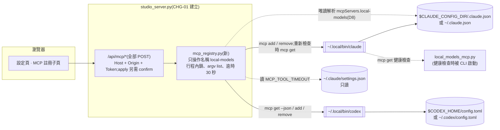
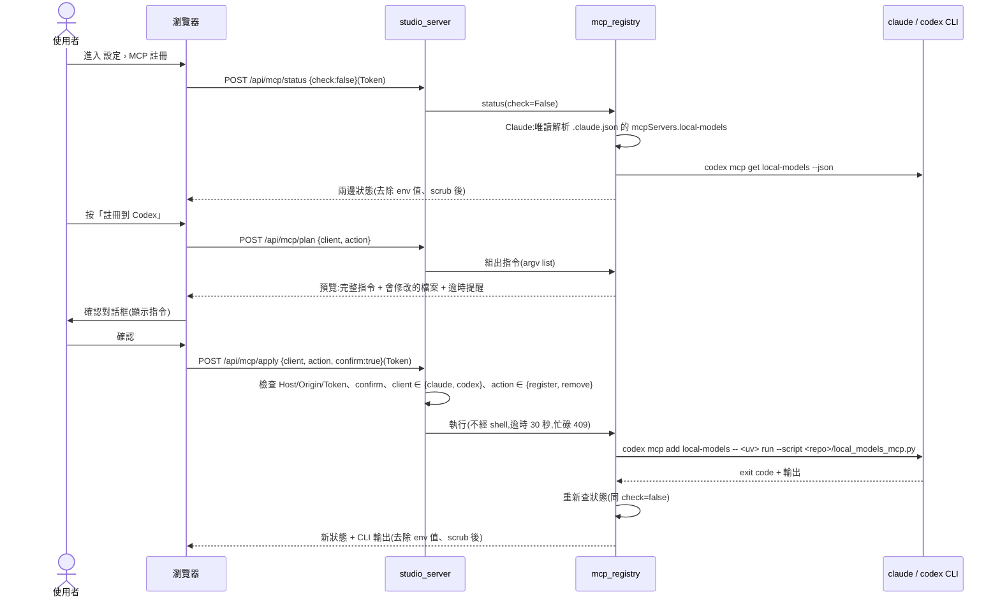

# CHG-20261022-02 — 設定頁加入 MCP 註冊管理(Claude Code / Codex)

- 專案:podcast-studio
- 分支(Branch):main
- 日期:2026-10-22(UTC+0);執行計畫補寫 2026-10-30(草案修訂 1)
- 類型:新功能
- 提出者:使用者
- 實作者:主 agent 派發(DIR-3);實際工作者記於「## 派發記錄」
- 驗收者:獨立 Claude subagent(不參與施工、不看實作者自述)+ 使用者操作驗收
- 風險分級:高(命中高風險清單:**安全**——網頁端點會呼叫官方 CLI 寫 repo 外的使用者全域設定 `~/.claude.json`、`~/.codex/config.toml`,並決定其他 agent 會啟動哪個程式;另會唯讀解析 `~/.claude.json`(含使用者帳號資訊的檔案);**跨模組介面**——新增模組 `mcp_registry.py` 與 `studio_server.py` 的介面、`/api/mcp/*` 三個端點,以及對外部 CLI(`claude mcp …`、`codex mcp …`)輸出格式與 `~/.claude.json` 結構的依賴)
- Autonomy:halt
- Commit/PR:草案修訂 1 分支 `draft/CHG-20261022-02-plan`;施工整合分支 `chg/CHG-20261022-02-impl`(DIR-5);其餘收尾時填
- 重複性檢查(Recurrence check):首次——未見於先前 CHG 或 KN。「替身測試抓不到外部程式真實行為」的同類風險(CHG-20261022-04、CHG-20261029-01 記過)以修改步驟 1 的實機查證與 T1 的暫存設定目錄實機測試處理,不另建 KN
- Diagrams:見「## 設計圖」節
- Mockup:見「## 畫面草稿」節
- Security-impact:見「## 安全影響」節
- Skill: ai-sdlc v1.66
- 關聯:FR-22;NFR「全域設定(v1.1)」;Guideline v1.13(本筆 T4 升 v1.14);`PODCAST_STUDIO.md §10.3`、`§10.5 #5`;**依賴 CHG-20261022-01**(設定頁、Host / Origin / Token 檢查、`studio_server.py`)——該筆已於 2026-10-26 完成驗收(見其「## 狀態」),本筆依此補上執行計畫

## 動機

使用者指示(2026-10-22):網頁能配置模型與 MCP;在範圍選項中選定「再加 MCP 註冊管理」。目前註冊靠手打 `PODCAST_STUDIO.md §10.3` 的指令。

2026-10-30 補執行計畫時,主 agent 查證兩個 CLI 的實際行為(見「### 修改步驟」第 1 步查證紀錄),發現三件原草稿沒有料到的事:`claude mcp get` 會實際啟動 MCP 伺服器做健康檢查;`codex mcp add` 無法設定 `tool_timeout_sec`;兩邊目前都已註冊。本次修訂依這三點調整決策(新列與修訂列當時標「待確認閘」,使用者 2026-10-30 確認閘照建議核准,紀錄見「## 審議」),其餘保留原意。

## 使用者故事

1. 作為使用者,我在設定頁看到 local-models 在 Claude Code 與 Codex 是否已註冊、註冊的指令與路徑是什麼,以便確認 agent 會呼叫到這個 repo 的伺服器。
2. 作為使用者,我按「註冊」並在確認對話框看到**將要執行的完整指令**後才執行,以便知道網頁對我的全域設定做了什麼。
3. 作為使用者,我按「移除」並確認後,local-models 從該 client 移除,其他 MCP 伺服器不受影響,以便安全地停用。
4. 作為使用者,註冊或移除失敗時看到 CLI 的錯誤輸出,以便自己排除。
5. 作為使用者,Claude Code 的長工具逾時(`MCP_TOOL_TIMEOUT`)沒設定時看到提醒與建議值,但網頁**不替我改** `~/.claude/settings.json`,以便全域設定的改動範圍最小。
6. (修訂 1 新增)作為使用者,Codex 那筆註冊沒有 `tool_timeout_sec` 時看到提醒與要手動加入的 TOML 片段;移除 Codex 註冊前,確認框明白告訴我目前的 `tool_timeout_sec` 會一起消失、重新註冊也不會帶回來,以便長工具(合成影片等)不會在我不知情下開始逾時。
7. (修訂 1 新增)作為使用者,打開設定頁不會為了查狀態而啟動 MCP 伺服器;要確認伺服器實際能連上時,我自己按「重新檢查」,以便開頁快、也不會多跑程式。

## 決策與取捨

| # | 決策 | 選項 | 前提假設 | 為何這樣選 |
|---|------|------|----------|------------|
| D1 | 寫設定的方式 | 官方 CLI vs 直接編輯 JSON/TOML | `claude`、`codex` CLI 存在於 `~/.local/bin/`(2026-10-22 查證,2026-10-30 再查證);CLI 會處理格式與其他欄位 | 官方 CLI(`claude mcp add/remove -s user`、`codex mcp add/remove`);**不直接編輯檔案**,避免弄壞使用者其他設定(FR-22) |
| D2 | CLI 路徑 | PATH 搜尋 vs 絕對路徑 | 網頁伺服器啟動時 PATH 不一定含 `~/.local/bin` | 絕對路徑(`~/.local/bin/claude`、`~/.local/bin/codex`;註冊內容的 `uv` 也用 `~/.local/bin/uv` 絕對路徑,同 `§10.3`),不存在時該 client 顯示「未安裝」並停用按鈕 |
| D3 | 註冊範圍(使用者 2026-10-30 覆核照准) | user vs project / local scope | 既有決策 `PODCAST_STUDIO.md §10.5 #5`:user scope | user scope;不提供其他選項 |
| D4 | 伺服器名稱(使用者 2026-10-30 覆核照准) | 可改 vs 固定 | 只管理自己 | 固定 `local-models`;**只能操作這個名稱**,不列出、不移除其他伺服器 |
| D5 | Claude 逾時設定(使用者 2026-10-30 覆核照准) | 自動寫入 vs 只提醒 | `MCP_TOOL_TIMEOUT` 在 `~/.claude/settings.json` 的 `env`,與 MCP 註冊是不同檔案;2026-10-30 查證已設定 | **代決**:只讀取並提醒,不寫入(縮小全域寫入範圍)。(修訂 1)原列的 Codex 部分改由 D9 處理 |
| D6 | 確認方式 | 單擊即執行 vs 對話框顯示指令 | 寫 repo 外設定 | 對話框顯示完整指令,使用者確認後才送出;伺服器端再要求 `confirm: true` |
| D7 | 「已註冊」判斷(修訂 1 修訂,**已核准(使用者 2026-10-30),隨 D8 選 (b)**) | 見 D8 | 原草稿:`claude mcp get local-models`、`codex mcp list`。2026-10-30 查證:`claude mcp get` / `list` 會實際啟動 `local_models_mcp.py` 做健康檢查(約數秒);`codex mcp get <名稱> --json` 輸出 JSON | 比對規則不變:`command` 等於 `~/.local/bin/uv` 的絕對路徑,且 `args` 逐元素等於 `["run", "--script", "<repo 絕對路徑>/local_models_mcp.py"]` 才算「指向本 repo」;查詢的來源改依 D8 |
| D8 | 狀態查詢方式(修訂 1 新增,**已核准(使用者 2026-10-30),選 (b)**) | (a) 每次開設定頁都跑 `claude mcp get` 與 `codex mcp get --json`;(b) **Claude 端唯讀解析 `~/.claude.json` 頂層 `mcpServers["local-models"]`(user scope 的存放處),Codex 端跑 `codex mcp get local-models --json`;`claude mcp get` 只在使用者按「重新檢查」時才呼叫**;(c) 兩邊都只在按「重新檢查」時呼叫 CLI,開頁時只顯示「尚未檢查」;(d) Codex 端也改為唯讀解析 `~/.codex/config.toml` | (a) 每次開頁啟動一次 MCP 伺服器(數秒、多一個 `uv` 行程);(b) `~/.claude.json` 格式由 Claude Code 決定、可能改版,〔觀察〕2026-10-30 頂層 `mcpServers.local-models` 為 `{"type":"stdio","command","args","env"}`;該檔約 70 KB、含帳號資訊、Claude Code 執行中會頻繁改寫;(d) 標準庫 `tomllib` 需 Python 3.11,`studio_server.py` 宣告 `>=3.10`,要嘛升版宣告、要嘛加 `tomli` 依賴 | **建議 (b)**:開頁不啟動伺服器;解析失敗(檔案不存在除外)、格式不認得或超過 16 MB 時顯示「狀態不明,請按重新檢查」,不顯示成「未註冊」。只讀頂層 `mcpServers["local-models"]`(取內容),以及 `projects[<本 repo 絕對路徑>].mcpServers["local-models"]`、`<repo>/.mcp.json` 的 `mcpServers["local-models"]` 是否存在(後兩者只判斷有無,供 D17 遮蔽偵測,不回傳內容、不寫日誌),其餘內容(含其他 repo 的 `projects` 項)不保留、不送瀏覽器、不寫日誌。〔推論〕`codex mcp get --json` 不做健康檢查,修改步驟 1 補查;若查到它也會啟動伺服器,Codex 端改同 (c) 只在按鈕時呼叫,其餘不變。查狀態的端點因會啟動子程序,一律用 POST(要 Origin + Token),不用 GET(GET 不驗 Origin / Token,外站可觸發)。(a) 開頁成本高;(c) 開頁看不到狀態,不符使用者故事 1;(d) 多一個依賴或升 Python 版本,且與 D1「格式交給 CLI」的方向不一致 |
| D9 | Codex `tool_timeout_sec`(修訂 1 新增,**已核准(使用者 2026-10-30),選 (a)**) | (a) **只提醒**:狀態顯示目前 `tool_timeout_sec`(取自 `codex mcp get --json`);沒有時顯示提醒與要手動加入的 TOML 片段(可複製);移除確認框明示「目前 `tool_timeout_sec = N` 會一起消失,重新註冊不會帶回」;(b) (a) + 有 `tool_timeout_sec` 時移除按鈕需再勾一個「我了解逾時設定會消失」才能確認;(c) 網頁在 `codex mcp add` 之後直接改寫 `~/.codex/config.toml` 補 `tool_timeout_sec` | 2026-10-30 查證:`codex mcp add` 沒有設定 `tool_timeout_sec` 的參數,`-c key=value` 只是當次覆寫、不寫入檔案;現況 Codex 那筆有 `tool_timeout_sec = 1800.0`(手動設定)。〔推論〕從網頁「移除 → 註冊」後 `tool_timeout_sec` 會消失,長工具(合成影片、`reason(heavy)`)會逾時 | **建議 (a)**。(b) 多一道勾選,保護較強但操作較繁,使用者若偏好可改選。(c) **不建議**:違反 FR-22「不直接編輯 `~/.codex/config.toml`」,需改 Guideline;要自己寫 TOML(Python 3.10 沒有 TOML 寫入器,需加依賴或手寫),可能弄壞註解與其他段落、與執行中的 Codex 同時寫檔;若選 (c) 需另列風險並升為 FR 修改 |
| D10 | CLI 設定目錄與隔離(修訂 1 新增,**已核准(使用者 2026-10-30),選 (a)**) | (a) **`mcp_registry` 呼叫 CLI 時沿用伺服器行程的環境變數 `CLAUDE_CONFIG_DIR`、`CODEX_HOME`;D8 解析的檔案路徑也依同一規則決定(`CLAUDE_CONFIG_DIR` 有設時為 `$CLAUDE_CONFIG_DIR/.claude.json`,否則 `~/.claude.json`)**;測試與實機驗證都把這兩個變數指到暫存目錄;(b) 只在測試裡用假 CLI,實機驗證直接對真實設定做 | 2026-10-30 查證(見修改步驟 1):Claude Code 2.1.308 以 `CLAUDE_CONFIG_DIR` 決定全域設定檔位置;Codex 0.163.0 以 `CODEX_HOME` 決定設定目錄(必須是已存在的目錄) | **建議 (a)**:真 CLI 可先在暫存設定目錄完整跑一輪,真實設定只在使用者同意後動一次。(b) 實機驗證會直接動使用者現有註冊與 `tool_timeout_sec` |
| D11 | 驗收時不破壞現有設定(修訂 1 新增,**已核准(使用者 2026-10-30),選 (a)**) | (a) **三段:唯讀檢視真實設定 → 暫存設定目錄跑完整註冊 / 移除 → 使用者同意後才對真實設定做一輪,先備份、再依 D9 片段恢復 `tool_timeout_sec`**;(b) 只做前兩段,真實設定不動;(c) 直接對真實設定操作 | 現況兩邊都已註冊且指向本 repo;真實設定的移除會讓 Codex 失去 `tool_timeout_sec` | **建議 (a)**;使用者若不想動真實設定可選 (b),P6~P8 記「使用者選擇不做」。細節見「### Acceptance operation」 |
| D12 | 指令預覽的路徑顯示(修訂 1 新增,**已核准(使用者 2026-10-30),選 (a)**) | (a) **沿用 `scrub()`:家目錄顯示為 `~`、repo 位置顯示為 `<repo>`,確認框下方註明「`~` 為家目錄、`<repo>` 為本 repo 位置,執行時展開為絕對路徑」**;(b) 顯示完整絕對路徑(原畫面草稿寫法) | CHG-20261022-01 的全域約束:送到瀏覽器的字串一律經 `scrub()`,不送本機絕對路徑;使用者故事 2 要「完整指令」 | **建議 (a)**:不破例送絕對路徑;指令的每個元素仍逐一列出,只差路徑前綴的寫法。(b) 需在全域約束開例外 |
| D13 | 同時操作(修訂 1 新增,代決;使用者 2026-10-30 覆核照准) | 與合成 / 匯出共用「執行中」旗標 vs `mcp_registry` 自己的鎖 | MCP 註冊不是重型工作,不該被合成擋住 | **代決**:`mcp_registry` 自己一把行程內鎖,同時只跑一個 CLI 操作(含重新檢查),忙碌回 409;不進 `heavy_lock` |
| D14 | 放在設定頁哪裡(修訂 1 新增,代決;使用者 2026-10-30 覆核照准) | 新子頁 vs 放進「模型」子頁 | 設定頁已有 models / seats / voice / flow / fusion 五個子頁 | **代決**:新增第六個子頁「MCP 註冊」(`#/settings/mcp`,`data-sub="mcp"`),不共用「還原預設 / 儲存」列(不屬 `FORM_SUBPAGES`) |
| D15 | 已註冊但指向其他位置(修訂 1 新增,代決;使用者 2026-10-30 覆核照准) | 提供「改為指向本 repo」一鍵 vs 只能先移除再註冊 | `claude mcp add` 遇到同名會失敗;〔未知〕`codex mcp add` 遇到同名是覆寫或失敗(修改步驟 1 補查) | **代決**:只提供「移除」,移除後再按「註冊」;不做一鍵改指向(一次只做一個 CLI 動作,確認框內容單純) |
| D16 | 現有 env 的顯示(修訂 1,代決;使用者 2026-10-30 覆核照准) | 顯示 env 鍵與值 vs 只顯示鍵 | env 可能被使用者放了秘密值;現況兩邊 env 都是空的 | **代決**:確認框與狀態只列 env 的**鍵名**,值一律顯示「(已設定)」;移除確認框明示 env 會一起消失。(修訂 1)**所有送到瀏覽器的 CLI 文字**(`claude mcp get` 人讀輸出、`codex mcp get --json`、add / remove 的輸出與錯誤)一律先經 `mcp_registry.redact_env()` 去除 env 值、只留鍵名,再經 `scrub()`:(1) 已知 env 值(取自 `.claude.json` 與 `codex mcp get --json` 解析到的 env)在文字中出現處一律換成「(已設定)」;(2) 形如 `鍵=值` 的行(含 `Environment:` 段之下各行)值一律換成「(已設定)」;(3) JSON 輸出的 `env` 物件只保留鍵、值換成「(已設定)」;`scrub()` 只遮路徑,不能取代本步 |
| D17 | 「重新檢查」在非 registered 時的行為(修訂 1 新增,**已核准(使用者 2026-10-30),選 (a)**) | (a) **只在 Claude 狀態為 `registered`(指向本 repo)且本 repo 沒有同名 local / project scope 註冊(`.claude.json` 的 `projects[<repo>].mcpServers["local-models"]`、`<repo>/.mcp.json` 的 `mcpServers["local-models"]`)時才呼叫 `claude mcp get`;狀態為 `other` / `unknown` / `absent` / 被遮蔽時不呼叫,Claude 列顯示「不做健康檢查:註冊內容不是本 repo 的伺服器」並停用該 client 的重新檢查**;(b) 一律呼叫,但先跳確認框顯示「將啟動:<註冊的 command / args>」,使用者確認後才執行;(c) 一律呼叫(原寫法) | `claude mcp get` 的健康檢查會**啟動註冊內容指定的程式**;狀態為 `other` 時那是別的程式,`unknown` 時不知道是什麼;以 repo 為 cwd 執行時,local / project scope 的同名註冊會遮蔽 user scope;CLI 子程序 cwd 固定為 repo 根目錄 | **建議 (a)**:健康檢查只會啟動已比對為本 repo 的 `local_models_mcp.py`。(b) 等於讓網頁按鈕啟動任意已註冊程式,即使有確認框也擴大了網頁能觸發的範圍;(c) 同 (b) 且沒有確認。被遮蔽時另顯示「本 repo 有同名 local / project scope 註冊,會優先於 user scope」 |

**代決事項**(使用者原話推導不出細節,由 agent 先決定):D5(原草稿)、D13~D16;以及原草稿的「固定名稱 `local-models`」(D4)、「只支援 user scope」(D3)——使用者 2026-10-30 確認閘覆核照准(紀錄見「## 審議」)。

**確認閘核准結果**(使用者 2026-10-30,紀錄見「## 審議」):D7 隨 D8、D8 選 (b)、D9 選 (a)、D10 選 (a)、D11 選 (a)、D12 選 (a)、D17 選 (a),全部照起草建議;另依確認閘第 3 題新增「所有 CLI 子程序 env 帶 `UV_OFFLINE=1`」(見 Global Constraints、安全影響 (g))。

## 設計圖

### (1) 受影響範圍的架構圖



### (2) 本次變更的流程圖:按下「註冊」



### (3) 按下「重新檢查」(修訂 1 新增)

```mermaid
sequenceDiagram
  actor U as 使用者
  participant B as 瀏覽器
  participant S as studio_server
  participant M as mcp_registry
  participant C as claude CLI
  participant L as local_models_mcp.py

  U->>B: 按「重新檢查」
  B->>S: POST /api/mcp/status {check:true}(Token)
  S->>M: status(check=True)
  M->>M: 先依 D8 判斷 Claude 狀態;不是 registered 或被 local / project scope 遮蔽時不呼叫 CLI(D17 建議 (a)),直接回「不做健康檢查」
  M->>C: claude mcp get local-models(只在 registered 且未被遮蔽時;cwd = repo;逾時 30 秒)
  C->>L: 啟動並做健康檢查
  L-->>C: 回應 / 失敗
  C-->>M: 人讀文字(Scope / Status / Type / Command / Args / Environment)
  M->>M: 解析 Status 行;解析不了時只顯示「連線狀態不明」與 CLI 原文(去除 env 值、scrub 後)
  M-->>B: 兩邊狀態 + Claude 連線結果
```

## 畫面草稿

ASCII 線框(修訂 1 依 D8、D9、D12、D16 更新;路徑依 D12 建議以 `~`、`<repo>` 顯示)。

```text
┌─ 設定 › MCP 註冊 ─────────────────────────────────────────────────────────┐
│ 模型 | 審議席位 | 語音預設 | 進階流程 | 合音詞庫 | [MCP 註冊]              │
│                                                                           │
│ local-models 伺服器:~/.local/bin/uv run --script <repo>/local_models_mcp.py│
│                                                          [重新檢查]       │
│                                                                           │
│  Claude Code   ✔ 已註冊(user scope,指向本 repo)            [移除]       │
│                連線:尚未檢查(按「重新檢查」會啟動一次 MCP 伺服器)       │
│                ✔ MCP_TOOL_TIMEOUT 已設定(1800000)                        │
│                                                                           │
│  Codex         ✔ 已註冊(指向本 repo)                         [移除]       │
│                ✔ tool_timeout_sec = 1800                                  │
│                                                                           │
│ ┌─ 確認 ──────────────────────────────────────────────────────────────┐  │
│ │ 將執行:                                                              │  │
│ │ ~/.local/bin/codex mcp remove local-models                           │  │
│ │ 這會修改 ~/.codex/config.toml 的 local-models 段落。                  │  │
│ │ 目前註冊內容:command ~/.local/bin/uv、args run --script              │  │
│ │   <repo>/local_models_mcp.py、env (無)、tool_timeout_sec = 1800       │  │
│ │ ⚠ tool_timeout_sec 會一起消失,重新註冊也不會帶回;長工具可能逾時。   │  │
│ │   要恢復請手動在 ~/.codex/config.toml 的 [mcp_servers.local-models]   │  │
│ │   加入:tool_timeout_sec = 1800                         [複製片段]     │  │
│ │ ~ 為家目錄、<repo> 為本 repo 位置,執行時展開為絕對路徑。            │  │
│ │                                             [取消]  [確認執行]       │  │
│ └──────────────────────────────────────────────────────────────────────┘  │
└───────────────────────────────────────────────────────────────────────────┘

(Codex 未註冊時)
│  Codex         ✖ 未註冊                                       [註冊]       │
(Codex 已註冊但沒有 tool_timeout_sec 時)
│  Codex         ✔ 已註冊(指向本 repo)                         [移除]       │
│                ⚠ 沒有 tool_timeout_sec;長工具可能逾時。請手動加入:       │
│                  [mcp_servers.local-models] 下 tool_timeout_sec = 1800   │
│                                                         [複製片段]        │
(解析失敗時)
│  Claude Code   ? 狀態不明(設定檔格式無法辨識),請按「重新檢查」[按鈕停用]│
(CLI 不存在時)
│  Codex         — 未安裝(找不到 ~/.local/bin/codex)          [按鈕停用]   │
```

## 安全影響

| 類別 | 是否觸及 | 影響範圍 / 理由 |
|------|----------|-----------------|
| irreversible-delete | **是(有限)** | 「移除」會刪掉使用者全域設定中的 `local-models` 項目。範圍限定為這一個名稱;可再按「註冊」恢復 command / args,但以下內容**不會恢復**:(a)使用者手動加過的 env(依 D16 確認框列出鍵名);(b)(修訂 1)Codex 那筆的 `tool_timeout_sec`——`codex mcp add` 無法設定(2026-10-30 查證),依 D9 確認框明示目前值會消失、重新註冊不會帶回,並給出手動恢復的 TOML 片段。對策:移除前在確認框顯示目前註冊內容(D8 的來源);CHG 收尾的使用說明(`PODCAST_STUDIO.md §10.3`)寫明;驗收時真實設定只在使用者同意後操作且先備份(D11) |
| payments | 否 | 無金流 |
| prod-migration | 否 | 無資料庫、不改專案檔或設定資料庫 `config/studio.db` |
| security-boundary | **是** | (a) 網頁端點可改寫 repo 外的全域設定,而該設定決定 Claude Code / Codex 會**啟動哪個程式**——若被跨站請求濫用,等於讓外部網站替使用者註冊程式。對策:沿用 CHG-01 的 Host/Origin/Token 檢查,另加 `confirm:true`;**指令參數全部由伺服器組出**,用戶端只能傳 `client`(`claude` / `codex`)與 `action`(`register` / `remove`)兩個列舉值與布林 `check`,不能傳任何路徑或參數;未知欄位 422。(b) 子程序一律 argv list、不經 shell、`stdin` 為 `/dev/null`、逾時 30 秒、輸出一律依「`redact_env()` 去除 env 值(只留鍵名,D16)→ `scrub()` → 截斷(上限 64 KB)」的順序處理後才送瀏覽器(先去除再截斷,秘密值跨截斷邊界時前綴也不外露);`scrub()` 只遮路徑,不負責 env 值。(c) 只讀 `~/.claude/settings.json`,不寫。(d)(修訂 1)會啟動子程序的查狀態也走 POST(Origin + Token),外站不能以 GET 觸發 CLI 或健康檢查(D8)。(e)(修訂 1)D8 唯讀解析 `~/.claude.json`:該檔含帳號資訊,只讀頂層 `mcpServers["local-models"]`(取內容),以及 `projects[<本 repo 絕對路徑>].mcpServers["local-models"]`、`<repo>/.mcp.json` 的 `mcpServers["local-models"]` 是否存在(後兩者只判斷有無,供 D17 遮蔽偵測,不回傳內容、不寫日誌),其餘內容(含其他 repo 的 `projects` 項)不保留、不回傳、不寫日誌;`<repo>/.mcp.json` 同樣只判斷有無同名項;檔案上限 16 MB;以符號連結替換該檔等需先能寫入本機檔案的攻擊屬 DIR-7 威脅模型外,不另防護。(f)(修訂 1)CLI 的設定目錄沿用伺服器行程的 `CLAUDE_CONFIG_DIR` / `CODEX_HOME`(D10),瀏覽器不能指定。(g) **不新增對外網路呼叫**:本筆只呼叫本機 CLI 與讀本機檔。所有 CLI 子程序 env 一律帶 `UV_OFFLINE=1`、`CLAUDE_CODE_DISABLE_NONESSENTIAL_TRAFFIC=1`、`DISABLE_TELEMETRY=1`:`UV_OFFLINE=1` 為使用者 2026-10-30 確認閘第 3 題選定,健康檢查經 CLI 啟動的 `uv run --script` 不會下載依賴;後兩個為使用者 2026-10-30 選項「先試關閉非必要流量再判斷 (Recommended)」選定(修改步驟 1 補查時,只帶 `UV_OFFLINE=1` 的 `claude mcp add` 有 2 條連到 `160.79.104.10:443` 的連線,加上這兩個變數後 25 條指令的 127.0.0.1 / `::1` 以外連線均為 0;原文見該補查紀錄)。三個變數只加在網頁呼叫的子程序,不寫入註冊內容,agent 平常啟動 MCP 伺服器不受影響。`claude mcp get` 的健康檢查會啟動**註冊內容指定的程式**:依 D17 建議 (a),只在 Claude 狀態為 `registered`(command / args 已比對為本 repo 的 `local_models_mcp.py`)且本 repo 沒有同名 local / project scope 註冊時才呼叫,此時啟動的才是本 repo 的 stdio 伺服器(不開網路埠);`registered` 只比對 command / args,env 由使用者自訂,不列入比對;`other` / `unknown` / `absent` / 被遮蔽時不呼叫。D17 若選 (b) 或 (c),本項要改寫為「可能啟動使用者註冊的其他程式」並列入風險。〔推論〕CLI 本身(`claude`、`codex`)執行 `mcp` 子指令時是否另有連網(例:更新檢查、遙測)不在本筆控制範圍;修改步驟 1 以整棵行程樹每 0.2 秒取樣 `lsof` 的方式觀察(含 `uv` 依賴下載這類子孫行程的連線;極短連線仍可能漏掉),**觀察到 127.0.0.1 / `::1` 以外的連線時停下交使用者決定**(是否接受、改用其他做法或取消本筆),使用者原話記入本 CHG 後才繼續 T1 |

## 修改指引

### 目標

FR-22:設定頁可查詢、註冊、移除 local-models 在 Claude Code / Codex 的 user scope 註冊;查詢不在開頁時啟動 MCP 伺服器(D8);Claude 的 `MCP_TOOL_TIMEOUT` 與 Codex 的 `tool_timeout_sec` 只提醒、不寫入(D5、D9)。

### 影響範圍

| 受影響項 | 類型 | 改動 | 連帶影響 |
|----------|------|------|----------|
| `mcp_registry.py` | 設計 | 新增:路徑決定(D10)、狀態查詢(D8;含「指向本 repo」比對 D7、逾時設定讀取 D5 / D9、唯讀判斷 `projects[<repo>]` 與 `<repo>/.mcp.json` 有無同名項 D17)、指令組裝、執行(行程內鎖 D13) | 依賴外部 CLI 的輸出格式與 `~/.claude.json` 格式 → 解析失敗時顯示「狀態不明」而不是「未註冊」 |
| `studio_server.py` | 設計 | 新增 `POST /api/mcp/status`、`POST /api/mcp/plan`、`POST /api/mcp/apply`;檔頭端點說明 | 沿用 CHG-01 的安全中介層 |
| `static/index.html`、`static/app.js`、`static/style.css` | 目錄 | 設定頁新增「MCP 註冊」子頁(D14)、狀態列、確認框(`<dialog>`)、複製 TOML 片段 | `SUBPAGES` 加 `mcp`;`FORM_SUBPAGES` 不變 |
| `tests/` | — | 新增 `tests/test_mcp_registry.py`、`tests/test_server_mcp.py`;擴充 `tests/test_static.py`;`tests/ui_check.py` 新增 `mcp` 組(`--only mcp`) | 一律以假 CLI 腳本 + 暫存 `CLAUDE_CONFIG_DIR` / `CODEX_HOME`,不碰真實全域設定 |
| `features/mcp_registry.feature` | — | 新增(使用者故事 1~7 的場景) | — |
| `PODCAST_STUDIO.md §10.3` | 文件 | 加註「可改由網頁設定頁操作」、`tool_timeout_sec` 需手動補的說明與恢復片段 | — |
| `docs/structure/*.md`、`docs/ai-guideline.md` | 文件 | 見「### 結構文件更新」 | — |

### Global Constraints(全域約束——每個 task 都要遵守)

- 沿用 CHG-20261022-01 的全部全域約束(PEP 723、`./scripts/check.sh`、Host / Origin / Token、argv list、原生前端、`textContent`、繁體中文、送到瀏覽器的字串經 `scrub()`、錯誤訊息不含絕對路徑)。
- 送到瀏覽器的 CLI 文字與註冊內容一律依「`mcp_registry.redact_env()` 去除 env 值(只留鍵名,D16)→ `scrub()` → 截斷 64 KB」的順序處理;不得只靠 `scrub()`,也不得先截斷再去除。
- 只操作名稱 `local-models`、只用 user scope;不列出、不讀取、不移除其他 MCP 伺服器的內容(Claude 端只讀頂層 `mcpServers["local-models"]`(取內容),以及 `projects[<本 repo 絕對路徑>].mcpServers["local-models"]`、`<repo>/.mcp.json` 的 `mcpServers["local-models"]` 是否存在(後兩者只判斷有無,供 D17 遮蔽偵測,不回傳內容、不寫日誌))。
- 寫設定一律只透過 `~/.local/bin/claude`、`~/.local/bin/codex` 的 `mcp add` / `mcp remove`;**不直接寫** `.claude.json`、`config.toml`、`~/.claude/settings.json`。
- 子程序一律 argv list、不經 shell、`stdin=DEVNULL`、逾時 30 秒、環境沿用伺服器行程(含 `CLAUDE_CONFIG_DIR`、`CODEX_HOME`,D10),並一律另帶 `UV_OFFLINE=1`、`CLAUDE_CODE_DISABLE_NONESSENTIAL_TRAFFIC=1`、`DISABLE_TELEMETRY=1` 三個變數(`UV_OFFLINE=1` 依確認閘第 3 題,擋 `uv` 下載依賴,經 CLI 傳給健康檢查啟動的 `uv`;後兩個依使用者 2026-10-30 選項「先試關閉非必要流量再判斷 (Recommended)」,關閉 CLI 自身的非必要流量與遙測,原文見修改步驟 1 補查紀錄;三個變數只加在網頁呼叫的子程序,不寫入註冊內容);瀏覽器傳入的值只能是 `client`、`action` 列舉與布林 `check`、`confirm`。
- 開設定頁(`check:false`)不得呼叫 `claude mcp get` / `list`(會啟動 MCP 伺服器);只有 `check:true` 可以,且依 D17 建議 (a) 只在 Claude 狀態為 `registered` 且未被 local / project scope 遮蔽時才呼叫;CLI 子程序 cwd 固定為 repo 根目錄。
- 查狀態、預覽、執行三個端點一律 POST。
- `mcp_registry` 同時只跑一個 CLI 操作,忙碌回 409;不進 `heavy_lock`。
- 任何解析失敗、格式不認得、CLI 非 0 結束一律顯示「狀態不明」或 CLI 錯誤原文(依序去除 env 值、scrub、截斷 64 KB),不得推論成「未註冊」。
- **測試不得動到真實全域設定**:pytest 與 `ui_check.py` 一律把 `HOME`(必要時)、`CLAUDE_CONFIG_DIR`、`CODEX_HOME` 指到暫存目錄,CLI 路徑換成暫存目錄內的假 CLI 腳本;測試前後比對真實 `~/.codex/config.toml` 的 SHA-256 與真實 `~/.claude.json` 的 `mcpServers` 鍵內容不變(檔案不存在時跳過比對,CI 即屬此情況)。
- 不新增網路呼叫、不新增需下載的依賴。

### 修改步驟(每完成一步立刻打勾——勾選狀態就是中斷後的續作點)

- [x] 1. 查證兩個 CLI 的實際子指令與輸出格式,記錄到本 CHG
  - **查證紀錄(2026-10-30,主 agent)**:
    - `~/.local/bin/claude`、`~/.local/bin/codex`、`~/.local/bin/uv` 都存在。
    - Claude Code:`claude mcp add [-s local|user|project] [-e KEY=V] <name> -- <cmd> [args...]`;`claude mcp remove <name> -s user`;`claude mcp get <name>` 輸出為人讀文字(Scope / Status / Type / Command / Args / Environment),**而且 `get` 與 `list` 都會做健康檢查——會實際啟動 MCP 伺服器程式**(`local_models_mcp.py`),約需數秒。也有 `claude mcp add-json <name> <json> -s user`。
    - Codex:`codex mcp add <NAME> [--env K=V] -- <COMMAND>...`;`codex mcp remove <NAME>`;`codex mcp get <NAME> --json`、`codex mcp list --json` 輸出 JSON(含 `transport.command` / `args` / `env`、`tool_timeout_sec`)。**`codex mcp add` 沒有設定 `tool_timeout_sec` 的參數**;`-c key=value` 只是當次覆寫,不寫入檔案。
    - 現況:local-models 已在兩邊 user scope 註冊,指向 `/Users/weiss/.local/bin/uv run --script /Users/weiss/Documents/github/podcast-studio/local_models_mcp.py`;Codex 那筆有 `tool_timeout_sec = 1800.0`(手動設定);`~/.claude/settings.json` 的 `env` 已有 `MCP_TOOL_TIMEOUT`。
    - 推論:從網頁「移除 → 註冊」Codex 會讓 `tool_timeout_sec` 消失,長工具(合成影片等)會逾時。
  - **查證紀錄(2026-10-30,起草者 Claude subagent;只跑 `--help`、`--version` 與讀檔,未執行任何 add / remove)**:
    - 版本:Claude Code `2.1.308`、`codex-cli 0.163.0`。`claude mcp --help` 的 `get`、`list` 說明原文含 "approved servers are health-checked",與上一點一致;`claude mcp add` 的 `-s, --scope` 預設為 `local`,故組指令時一律明帶 `-s user`。
    - `CLAUDE_CONFIG_DIR`:〔觀察〕Claude Code 2.1.308 執行檔內的設定路徑函式為「全域設定 = `join(CLAUDE_CONFIG_DIR 或家目錄, ".claude.json")`、使用者設定 = `join(CLAUDE_CONFIG_DIR 或 ~/.claude, "settings.json")`」(以 `python3` 讀執行檔字串取得;執行檔內 `CLAUDE_CONFIG_DIR` 出現 54 次)。即設了 `CLAUDE_CONFIG_DIR=<暫存>` 時,user scope 的註冊寫到 `<暫存>/.claude.json`。
    - `CODEX_HOME`:〔觀察〕Codex 0.163.0 執行檔內有 `CODEX_HOME points to …, but that path is not a directory` 與 `$CODEX_HOME/config.toml` 等字串;`codex mcp --help` 的 `-c` 說明寫「Override a configuration value that would otherwise be loaded from `~/.codex/config.toml`」。即設定目錄由 `CODEX_HOME` 決定(預設 `~/.codex`),且必須是已存在的目錄。
    - 〔觀察〕`~/.claude.json` 頂層 `mcpServers` 目前只有 `local-models`,內容 `{"type": "stdio", "command": "/Users/weiss/.local/bin/uv", "args": ["run", "--script", "/Users/weiss/Documents/github/podcast-studio/local_models_mcp.py"], "env": {}}`;`projects` 底下沒有同名的 local scope 註冊。`~/.claude.json` 約 70 KB,本 session 執行中持續被改寫;`~/.codex/config.toml` 228 位元組。系統 `python3` 沒有 `tomllib`(低於 3.11)。
  - **施工前補查(T1 開工時,只在暫存設定目錄;派發者確認目錄為新建的空目錄後才執行)**:
    - [x] 以 `CLAUDE_CONFIG_DIR=<暫存>/claude` 執行 `claude mcp add -s user local-models -- <uv> run --script <repo>/local_models_mcp.py`,確認寫入 `<暫存>/claude/.claude.json` 的頂層 `mcpServers`,真實 `~/.claude.json` 的 `mcpServers` 不變;再以 `claude mcp get local-models` 記錄實際輸出格式(Status 行的字樣)、`claude mcp remove local-models -s user` 的結束碼與輸出;同名再 `add` 時的結束碼與訊息。〔未知〕暫存設定目錄是否要求登入或首次設定——若要求,記錄現象並改以 `HOME=<暫存>` 搭配,再不行就停下交派發者。
    - [x] 以 `CODEX_HOME=<暫存>/codex`(先 `mkdir`)執行 `codex mcp add local-models -- …`、`codex mcp get local-models --json`、`codex mcp remove local-models`,記錄 JSON 欄位(`transport.command`、`args`、`env`、`tool_timeout_sec`)、移除後 `get` 的結束碼與訊息、同名再 `add` 是覆寫或失敗(D15);在暫存 `config.toml` 手動加 `tool_timeout_sec = 1800` 後確認 `get --json` 讀得到。
    - [x] 確認 `codex mcp get --json` 是否啟動 MCP 伺服器(暫存註冊的指令改為一支會寫標記檔的替身腳本,看標記檔是否出現);結果決定 D8 的 Codex 端是否改為只在按鈕時呼叫。
    - [x] 觀察 `claude mcp get`、`codex mcp get`、`mcp add`、`mcp remove` 執行期間是否有對外連線:以 `pgrep -P` 遞迴取得該子指令的整棵行程樹(含它啟動的 `uv`、`local_models_mcp.py` 等子孫行程),在子指令執行期間每 0.2 秒取樣一次 `lsof -nP -i -a -p <所有子孫 pid,逗號分隔>`(每次取樣都重新取得行程樹),記錄結果(安全影響 (g));觀察時一併記錄當下 `uv` 快取狀態(`local_models_mcp.py` 的依賴是否已在快取,例:以 `UV_OFFLINE=1 uv run --script local_models_mcp.py --help` 或 `uv cache dir` 下的內容判斷),以便解讀健康檢查成敗與連線來源。方法限制:短於取樣間隔、或在兩次取樣之間開關的連線仍可能漏掉,記為已知限制;已知可能的對外連線來源:`uv run --script` 依賴快取不足時向 PyPI 下載依賴,以及 `claude`、`codex` CLI 自身的更新檢查或遙測。**觀察到 127.0.0.1 / `::1` 以外的連線時停下**,把連線對象與發生的子指令交使用者決定(接受、改用其他做法或取消本筆),使用者原話記入本 CHG 後才繼續 T1。
    - [x] 比對真實 `~/.codex/config.toml` 的 SHA-256 與真實 `~/.claude.json` 的 `mcpServers` 鍵在補查前後相同。
  - **查證紀錄(2026-10-30,補查;Claude subagent,暫存設定目錄 `<scratchpad>/probe-2202/`,新建空目錄;每條 CLI 指令單獨執行並經觀察腳本整棵行程樹取樣 `lsof`)**:
    - 〔觀察〕`uv` 快取:`UV_OFFLINE=1 uv sync --script local_models_mcp.py --dry-run` 結束碼 0、「Would make no changes」,`local_models_mcp.py` 的依賴已全部在快取;期間無連線。
    - 〔觀察〕第一次(env 只帶 `CLAUDE_CONFIG_DIR`、`CODEX_HOME`、`UV_OFFLINE=1`):`claude mcp add -s user local-models -- …` 結束碼 0,執行期間 `claude` 行程本身有 2 條 TCP 連線到 `160.79.104.10:443`(ESTABLISHED),行程樹只有 `claude`。〔推論〕屬 Anthropic 網段，為 CLI 自身的非必要流量(遙測、更新檢查等)。依本步驟規則停下;使用者 2026-10-30 以選項選「先試關閉非必要流量再判斷 (Recommended)」,選項說明:「子程序 env 加 CLAUDE_CODE_DISABLE_NONESSENTIAL_TRAFFIC=1、DISABLE_TELEMETRY=1 重測;歸零就寫進 Global Constraints 採用，仍有連線再回來問你」。另記：暫存 `.claude.json` 會自動帶入帳號相關鍵(`oauthAccount` 等，內容未讀),補查結束後已刪除。另記一項偏離：第一次的 `claude --version`、`codex --version` 未明帶暫存環境變數、未經觀察(唯讀版本查詢);第二次起每條指令單獨執行並全部明帶。
    - 〔觀察〕第二次(env 另加 `CLAUDE_CODE_DISABLE_NONESSENTIAL_TRAFFIC=1`、`DISABLE_TELEMETRY=1`,取樣間隔改 0.05 秒):Claude 的 remove / add / get / 同名再 add / 不存在時 get 與 remove / `--version`,以及 Codex 的 `--version` / add / get --json / 同名再 add / 手動加 `tool_timeout_sec` 後 get / 覆寫 add / remove / 不存在時 get 與 remove / 替身 add、get、list、remove,共 25 條，**127.0.0.1 / `::1` 以外的連線均為 0**(含 `claude mcp get` 健康檢查啟動的 `uv`、`python` 子孫行程)。Claude add / remove 執行時間由 0.48 秒降為約 0.16 秒。→ 依使用者決定，兩個變數併入 `UV_OFFLINE=1`,寫進 Global Constraints。
    - 〔觀察〕Claude Code 2.1.308:`mcp add -s user` 結束碼 0,stdout「Added stdio MCP server local-models with command: … to user config」+「File modified: <設定目錄>/.claude.json」,寫入頂層 `mcpServers.local-models`(`{"type":"stdio","command","args","env":{}}`),另建 `backups/`;`mcp get` 結束碼 0,輸出 `Scope: User config (available in all your projects)`、`Status: ✔ Connected`、`Type: stdio`、`Command:`、`Args:`、`Environment:`(env 空時其後無內容)及「To remove this server, run: claude mcp remove local-models -s user」,會啟動健康檢查(行程樹含 `uv`、`python`),`UV_OFFLINE=1` 下仍成功;`mcp remove -s user` 結束碼 0、「Removed MCP server local-models from user config」;同名再 add 結束碼 1、stderr「MCP server local-models already exists in user config」;不存在時 get 結束碼 1、stderr「No MCP server named "local-models". Run `claude mcp add` to add one.」;不存在時 remove 結束碼 1、stderr「No MCP server named "local-models" in user scope」。暫存設定目錄未要求登入或互動。
    - 〔觀察〕Codex 0.163.0:`mcp add` 結束碼 0、「Added global MCP server 'local-models'.」,寫入 `[mcp_servers.local-models]` 的 `command`、`args`;`mcp get --json` 欄位為 `name`、`enabled`、`disabled_reason`、`transport{type,command,args,env,env_vars,cwd}`、`enabled_tools`、`disabled_tools`、`startup_timeout_sec`、`tool_timeout_sec`,無 env 時 `env` 為 `null`;`list --json` 另含 `auth_status`。**同名再 add 為直接覆寫**(結束碼 0、無警告),且覆寫會讓手動加的 `tool_timeout_sec` 消失;在 `config.toml` 手動加 `tool_timeout_sec = 1800` 後 `get --json` 回 `1800.0`。`mcp remove` 結束碼 0、「Removed global MCP server 'local-models'.」;移除後 `get --json` 結束碼 1、stderr「Error: No MCP server named 'local-models' found.」;不存在時 remove **結束碼 0**、stdout「No MCP server named 'local-models' found.」。
    - 〔觀察〕`codex mcp get --json` 與 `list --json` 不啟動 MCP 伺服器：暫存註冊指向只寫標記檔的替身腳本，兩者執行後(再等 1 秒)標記檔皆未出現，行程樹只有 `codex`;替身直接執行可寫出標記檔(正向對照)。→ D8 的 Codex 端維持開頁呼叫 `get --json`。
    - 〔推論〕影響:D15「只提供移除、不做一鍵改指向」不變(Codex 同名 add 會無聲覆寫並丟失 `tool_timeout_sec`);T1 判定 Codex「找不到」用結束碼 1 + stderr 含「No MCP server named」;`codex mcp remove` 對不存在項回 0,不能只以結束碼判斷移除成功，移除後須重新查狀態。
    - 〔觀察〕補查前後真實 `~/.codex/config.toml` 的 SHA-256 與真實 `~/.claude.json` 的頂層 `mcpServers` 鍵均與備份相同。
    - 方法限制：取樣間隔 0.05~0.2 秒，多數指令執行不到 0.2 秒、只取樣 1~2 次，更短的連線可能漏掉;Codex 未測不帶兩個新變數時是否連線。
- [x] 2. T1:`mcp_registry.py` 與測試(見「### Tasks」)
- [x] 3. T2:API 端點 + 安全檢查與測試
- [x] 4. T3:前端 MCP 註冊子頁與確認框、`ui_check.py` mcp 組
- [ ] 5. 實機驗證(修訂 1 改寫,依 D10、D11)
  - [ ] 5a. **暫存設定目錄**:停下使用者在 7860 的伺服器前先告知使用者;以 `CLAUDE_CONFIG_DIR=<暫存>/claude CODEX_HOME=<暫存>/codex uv run --script studio_server.py` 啟動,在網頁對兩個 client 各做「註冊 → 重新檢查 → 移除 → 註冊」,每步比對暫存設定檔只有 `local-models` 段落變化;結束後比對真實 `~/.codex/config.toml` SHA-256 與真實 `~/.claude.json` 的 `mcpServers` 鍵不變;以平常方式重啟 7860。
  - [ ] 5b. **真實設定(使用者在對話中同意後才做,一次)**:先備份 `~/.codex/config.toml` 與 `~/.claude.json` 的 `mcpServers` 鍵內容到 repo 外(session scratchpad);在網頁對 Codex 做「移除 → 註冊」,對 Claude 做「移除 → 註冊」;比對 `~/.claude.json` 的 `mcpServers.local-models` 與備份相同、`~/.claude/settings.json` 未變;`~/.codex/config.toml` 與備份的差異應只有 `tool_timeout_sec` 一行。**恢復 `tool_timeout_sec`**:由使用者在 `~/.codex/config.toml` 的 `[mcp_servers.local-models]` 段落加回 `tool_timeout_sec = 1800`(或使用者核准後由派發者以備份檔覆蓋回去——兩者擇一,由使用者決定),再以 `codex mcp get local-models --json` 確認 `tool_timeout_sec` 為 1800。若差異不只這一行,停下交使用者,以備份恢復。

### Tasks(checkbox=續作點)

- [x] T1. `mcp_registry.py`:路徑、狀態、指令組裝與執行
  - interfaces: consumes `studio_server.scrub()` 的規則(或抽成共用函式)、`~/.local/bin/{claude,codex,uv}`、環境變數 `CLAUDE_CONFIG_DIR` / `CODEX_HOME`(子程序另帶 `UV_OFFLINE=1`、`CLAUDE_CODE_DISABLE_NONESSENTIAL_TRAFFIC=1`、`DISABLE_TELEMETRY=1`)/ produces `mcp_registry.NAME = "local-models"`、`CLIENTS = ("claude", "codex")`、`ACTIONS = ("register", "remove")`、`paths() -> {"claude_cli", "codex_cli", "uv", "claude_json", "claude_settings", "repo_mcp_json", "codex_home"}`、`server_argv() -> list[str]`(`[uv, "run", "--script", <repo>/local_models_mcp.py]`)、`status(check: bool) -> {"server": [...], "claude": ClientStatus, "codex": ClientStatus}`(ClientStatus = `{"installed", "state": "registered"|"other"|"absent"|"unknown", "command", "args", "env_keys", "timeout": {...}, "health"?: "ok"|"failed"|"unknown"|null, "detail"?}`;Claude 的 `timeout` 為 `MCP_TOOL_TIMEOUT` 值或 null,Codex 的為 `tool_timeout_sec` 或 null)、`plan(client, action) -> {"argv", "files", "current", "warnings"}`、`apply(client, action) -> {"ok", "exit_code", "output", "status"}`、`Busy` 例外;`tests/test_mcp_registry.py`、`features/mcp_registry.feature`
  - test: `./scripts/check.sh tests/test_mcp_registry.py`——全部以暫存目錄內的假 `claude` / `codex` 腳本(記錄收到的 argv 與環境到檔案、依情境回固定輸出與結束碼)與暫存 `CLAUDE_CONFIG_DIR` / `CODEX_HOME` 執行:(1) `check=False` 時假 `claude` 被呼叫 0 次,Claude 狀態取自暫存 `.claude.json` 的 `mcpServers["local-models"]`;`check=True` 且狀態為 `registered` 時呼叫 `claude mcp get local-models` 恰 1 次(cwd 為 repo 根目錄);`check=True` 但 Claude 狀態為 `other`、`unknown`、`absent`,或暫存 `.claude.json` 的 `projects[<repo>].mcpServers` 有同名 local scope 註冊、或 `<repo>/.mcp.json`(測試以暫存 repo 根目錄替身)有同名 project scope 註冊時,假 `claude` 被呼叫 0 次,`health` 為 null 並附「不做健康檢查」說明(D17 建議 (a));(2) 指向本 repo / 指向其他路徑 / 沒有該鍵 / 檔案不存在 / JSON 壞掉 / 頂層不是物件 / 超過 16 MB 分別得 `registered` / `other` / `absent` / `absent` / `unknown` / `unknown` / `unknown`;`.claude.json` 其他鍵(放一個假的帳號欄位)不出現在回傳的任何字串中;暫存 `.claude.json` 放另一個 repo 路徑的 `projects` 項(其 `mcpServers` 與其他欄位含可辨識字串 `其他專案-9c2e`)時,所有回傳字串都不含該字串、也不含那個 repo 路徑;(3) Codex `get --json` 回本 repo / 其他路徑 / 非 0 結束且訊息為「找不到」/ 非 JSON 輸出,分別得 `registered` / `other` / `absent` / `unknown`(「找不到」判定為結束碼 1 且 stderr 含 `No MCP server named`,依修改步驟 1 補查結果;其他非 0 結束一律 `unknown`);`tool_timeout_sec` 有無分別回數值 / null;(4) `plan("codex", "register")` 的 argv 逐元素等於 `[<codex>, "mcp", "add", "local-models", "--", <uv>, "run", "--script", <repo>/local_models_mcp.py]`,`plan("claude", "register")` 含 `-s user`,`remove` 兩邊各自正確;`plan("codex", "remove")` 在有 `tool_timeout_sec` 時 `warnings` 含逾時消失提醒與 TOML 片段;(5) `client` / `action` 不在列舉內丟 `ValueError`;已是 `registered` 時 `register`、`absent` 時 `remove`、`unknown` 或未安裝時兩者都丟 `ValueError`(繁中訊息);(6) 子程序以 argv list、`shell=False`、`stdin=DEVNULL`、`timeout=30` 呼叫(以替身 `subprocess.run` 驗參數);逾時回「CLI 執行逾時」;輸出超過 64 KB 截斷;回傳字串不含暫存目錄與家目錄的絕對路徑(經 scrub);假 `claude mcp get` 的 `Environment:` 段與 add / remove 輸出含 `SECRET_KEY=秘密值-7f3a`、假 `codex mcp get --json` 的 `env` 含同一組鍵值時,`status()`、`plan()`、`apply()` 回傳的任何字串都不含 `秘密值-7f3a`,但含鍵名 `SECRET_KEY`;假 CLI 輸出長度使秘密值 `SECRET_KEY=秘密值-7f3a-長字串` 跨越 64 KB 截斷邊界時,回傳字串不含該值長度 ≥ 4 字元的任何前綴(以逐一前綴比對斷言);(7) 兩個執行緒同時 `apply`,第二個丟 `Busy`;(8) 環境變數:假 CLI 記錄到的 `CLAUDE_CONFIG_DIR` / `CODEX_HOME` 等於測試設定的暫存目錄;每一次 CLI 子程序(get、add、remove、重新檢查)記錄到的 env 都含 `UV_OFFLINE=1`、`CLAUDE_CODE_DISABLE_NONESSENTIAL_TRAFFIC=1`、`DISABLE_TELEMETRY=1` 三個變數(伺服器行程本身沒設、或設成其他值時也一樣);假 `claude mcp get` 回健康檢查失敗(非 0 結束、輸出含 `SECRET_KEY=秘密值-7f3a`)時,`health` 為 `failed`、附 CLI 錯誤文字,且該文字不含秘密值;(9) 測試前後真實 `~/.codex/config.toml` 的 SHA-256 與真實 `~/.claude.json` 的 `mcpServers` 鍵相同(檔案不存在時跳過);(10) `apply` 一律在 CLI 執行後重新查狀態(同 `check=False`),`ok` 以新狀態判斷——`register` 後為 `registered`、`remove` 後為 `absent` 才是 `true`,不只看結束碼(修改步驟 1 補查:`codex mcp remove` 對不存在項也回 0):假 `codex mcp remove` 回 0 但註冊仍在、假 `add` 回 0 但查不到註冊時 `ok` 為 `false`;CLI 回非 0 時 `ok` 為 `false` 並附 CLI 錯誤文字。另:`tests/integration/test_mcp_registry_real.py`(真 CLI、暫存 `CLAUDE_CONFIG_DIR` / `CODEX_HOME`,不列入 `check.sh`,只在本機手動執行)跑兩個 client 的註冊 → 查詢 → 移除 → 查詢,斷言暫存設定檔內容與真實設定不變
  - T1 施工代決(interfaces 與 test 的補充):
    - (T1 施工代決)`timeout` 為 dict:Claude 為 `{"key": "MCP_TOOL_TIMEOUT", "value": <字串或 null>, "suggested": "1800000"}`;Codex 為 `{"key": "tool_timeout_sec", "value": <數值或 null>, "snippet": <手動補的 TOML 片段 `[mcp_servers.local-models]` + `tool_timeout_sec = <目前值或 1800>`>}`(供 T3「複製片段」)。
    - (T1 施工代決)ClientStatus 另含 `shadowed`(`true` / `false` / `null`;`null` 為無法判斷,例:`<repo>/.mcp.json` 或 `.claude.json` 無法解析;Codex 一律 `false`),`health` 與 `detail` 一律帶出、預設 null;遮蔽時 `check=False` 的 `detail` 即為「本 repo 有同名 local / project scope 註冊,會優先於 user scope」。
    - (T1 施工代決)`mcp_registry` 自有 `scrub()`(規則同 `studio_server.scrub()`:repo → `<repo>`、家目錄 → `~`,另含 `pwd` 取得的實際家目錄),不從 `studio_server` 匯入(T2 起 `studio_server` 會匯入 `mcp_registry`,避免循環匯入);另把**不在家目錄或 repo 之下**的 `CLAUDE_CONFIG_DIR` / `CODEX_HOME` 顯示為 `$CLAUDE_CONFIG_DIR` / `$CODEX_HOME`(例:5a 指到 scratchpad 時 `plan().files` 為 `$CODEX_HOME/config.toml`;未設或在家目錄下時仍為 `~/.codex/config.toml`)。另提供 `redact_env(text, known)`。
    - (T1 施工代決)狀態為 `other`(指向其他位置)時 `register` 也丟 `ValueError`(依 D15;修改步驟 1 補查證實 Codex 同名 add 會無聲覆寫並丟失 `tool_timeout_sec`),只能 `remove`。
    - (T1 施工代決)`apply` 的 `ok` 須結束碼為 0 **且**重新查到的狀態符合預期(`register` → `registered`、`remove` → `absent`);CLI 逾時時 `exit_code` 為 null、`ok` 為 false、`output` 為「CLI 執行逾時(超過 30 秒)」。
    - (T1 施工代決)健康檢查判定:`claude mcp get` 結束碼 0 且 Status 行含 `Connected` 或 ✔ → `ok`;Status 行含 fail / error 或 ✘ / ✗ → `failed`(附 CLI 文字);其他 → `unknown`(`detail` 為「連線狀態不明」+ CLI 原文);非 0 結束 → `failed`(附 CLI 錯誤文字);逾時或無法執行 → `unknown`(不是 `failed`)。
    - (T1 施工代決)`status` / `plan` / `apply` 共用同一把行程內**非阻塞**鎖(D13「含重新檢查」),任一執行中時其他呼叫丟 `Busy`(T2 對應 409),含 `status(check=False)`;client / action 列舉檢查在取鎖與呼叫 CLI 之前。
- [x] T2. API 端點與安全檢查
  - interfaces: consumes T1 / produces `POST /api/mcp/status`(`{"check": bool}`,預設 false)→ 200 `status()` 結果;`POST /api/mcp/plan`(`{"client", "action"}`)→ 200 `plan()` 結果;`POST /api/mcp/apply`(`{"client", "action", "confirm": true}`)→ 200 `apply()` 結果;400 缺 `confirm:true`;409 忙碌;422 未知欄位、列舉外的值、狀態不允許該動作;回應一律 `Cache-Control: no-store`、字串經 `scrub()`;`studio_server.py` 檔頭端點說明;`tests/test_server_mcp.py`
  - test: `./scripts/check.sh tests/test_server_mcp.py`——以 `create_app()` 與 T1 的假 CLI:(1) 三個端點缺 Token、Token 錯、錯 Origin、缺 Origin、`Origin: null`、Host 不符一律 403 且假 CLI 呼叫 0 次;(2) 三個端點以 GET 呼叫回 405(或 404)且假 CLI 呼叫 0 次;(3) `apply` 缺 `confirm`、`confirm` 為 `"true"` 字串或 1 → 400,呼叫 0 次;(4) `client` 為 `"claude; rm"`、`"../codex"`、`"gemini"`,`action` 為 `"add"`,或帶多餘欄位 `argv` / `command` / `path` / `scope` / `name` → 422,呼叫 0 次;(5) 合法 `apply` 呼叫假 CLI 恰 1 次、argv 與 T1 `plan()` 相同,回應含新狀態與 CLI 輸出;(6) `status` `check:false` 時假 `claude` 呼叫 0 次;(7) 回應本文不含暫存目錄、家目錄的絕對路徑,也不含暫存 `.claude.json` 中的假帳號欄位;假 CLI 輸出與註冊內容含 `SECRET_KEY=秘密值-7f3a` 時,三個端點的回應本文都不含 `秘密值-7f3a`(含鍵名 `SECRET_KEY`);(8) 忙碌時第二個 `apply` 409
  - T2 施工代決(interfaces 與 test 的補充):
    - (T2 施工代決)檢查順序:本文過大 413 → 不是 JSON 物件 422 → 有該端點規定以外的欄位 422(`status` 只收 `check`;`plan` 只收 `client`、`action`;`apply` 只收 `client`、`action`、`confirm`)→ `apply` 的 `confirm` 不是 JSON `true` 400 → 交 `mcp_registry`(列舉外的值、缺 `client` / `action`、狀態不允許該動作 → `ValueError` → 422;`Busy` → 409)。因此 `apply` 同時缺 `confirm` 又帶列舉外 `client` 時回 400;兩種情況都不呼叫 CLI。
    - (T2 施工代決)`status` 的本文可省略或為空(等同 `{"check": false}`);`check` 不是布林(含字串 `"true"`、1、null)→ 422。
    - (T2 施工代決)本文上限 `MAX_MCP_BODY` = 4 KB,超過 413(依 CHG-20261022-01 其他端點的慣例,interfaces 未列)。
    - (T2 施工代決)`apply` 的 CLI 非 0 結束或結果狀態不符預期時仍回 200(`ok: false`、`output` 為 CLI 錯誤原文),不轉成 4xx / 5xx;前端以 `ok` 判斷。
    - (T2 施工代決)錯誤回應格式為 `{"error": 繁中訊息}`(同專案 API);`Cache-Control: no-store` 加在三個端點的所有回應(含 400 / 409 / 413 / 422),安全中介層直接回的 403 依 CHG-20261022-01 原樣不帶。
    - (T2 施工代決)`mcp_registry` 回傳的字串已依「`redact_env()` → `scrub()` → 截斷」處理,端點再經一次 `studio_server._scrub_obj()`(只遮路徑,不會變長)。
- [x] T3. 前端「MCP 註冊」子頁、確認框與 `ui_check.py` mcp 組
  - interfaces: consumes T2 / produces `static/index.html` 子頁 `data-sub="mcp"`(subnav「MCP 註冊」)、狀態區(`#mcp-claude`、`#mcp-codex`)、「重新檢查」按鈕、確認框 `<dialog id="mcp-dialog">`(指令逐元素列出、會修改的檔案、目前註冊內容、警告、路徑說明、「複製片段」);`static/app.js` `SUBPAGES` 加 `mcp`、`McpPanel.open()`(進子頁時 `status` `check:false`)、按鈕依狀態啟用 / 停用;`static/style.css`;`tests/test_static.py` 擴充;`tests/ui_check.py` 新增 `mcp` 組與 `--only mcp`(假 CLI + 暫存 `CLAUDE_CONFIG_DIR` / `CODEX_HOME`)
  - test: `./scripts/check.sh tests/test_static.py` 與 `uv run --script tests/ui_check.py --only mcp`——(1) `test_static`:子頁、對話框與按鈕元素存在,所有文字為繁體中文;`app.js` 不以 `innerHTML` 寫入 CLI 輸出;(2) `ui_check` mcp 組:進入 `#/settings/mcp` 後兩個 client 顯示假 CLI 情境對應的狀態,假 `claude` 呼叫 0 次;按「重新檢查」後假 `claude` 呼叫 1 次、顯示連線結果;Codex「註冊」→ 確認框顯示的指令與 `plan` 回應逐元素相同、含路徑說明;按「取消」假 CLI 呼叫 0 次;再按「確認執行」後狀態變為已註冊、顯示「沒有 tool_timeout_sec」提醒與片段;Codex「移除」確認框在有 `tool_timeout_sec` 時顯示逾時消失警告;假 CLI 回非 0 時畫面顯示 CLI 錯誤原文;未安裝(假 CLI 不存在)時按鈕停用;Claude 狀態為「指向其他位置」時重新檢查不呼叫假 `claude`、畫面顯示「不做健康檢查」說明(D17 建議 (a));假 CLI 輸出含 env 值時畫面文字不含該值;截圖 `mcp.png`、`mcp-confirm.png`;結束後比對真實設定不變(同 Global Constraints);瀏覽器 console 與 CSP 無錯誤
  - T3 施工代決(interfaces 與 test 的補充):
    - (T3 施工代決)「重新檢查」只有一顆、兩個 client 共用(畫面草稿只畫一顆),不另做「停用該 client 的重新檢查」;Claude 不是 `registered` 或被遮蔽時,按下仍會送 `check:true`(同時更新 Codex 狀態),由 T1 依 D17 (a) 不呼叫 `claude mcp get`,Claude 列的連線行顯示伺服器回的「不做健康檢查:…」說明。D17 的保護在伺服器端,不依賴前端停用。
    - (T3 施工代決)狀態到畫面文字的對應抽成純函式 `mcpView(client, status, checked)`(`static/app.js`),`tests/test_static.py` 以 JS 執行環境(node 或 macOS jsc)實跑;`detail` 中「不做健康檢查:…」拆到連線行、「本 repo 有同名…」顯示為警告行、「狀態不明(…)」併入狀態行。
    - (T3 施工代決)未安裝時只顯示「— 未安裝(找不到 ~/.local/bin/<client>)」並停用該 client 的註冊 / 移除鍵,不另列註冊內容;狀態 `unknown` 時兩個動作都停用(與 T1 `plan()` 丟 `ValueError` 一致);狀態 `other` 時按鍵為「移除」(D15)。
    - (T3 施工代決)Claude 的 `MCP_TOOL_TIMEOUT` 提醒行不論註冊與否都顯示(與註冊是不同設定檔);Codex 的 `tool_timeout_sec` 行只在 `registered` / `other` 時顯示。確認框的「複製片段」在 Codex 註冊(片段為建議值 1800)與 Codex 移除且有 `tool_timeout_sec`(片段為目前值)時出現;狀態列在 Codex 已註冊但沒有 `tool_timeout_sec` 時另有一顆「複製片段」。複製用 `navigator.clipboard.writeText`,失敗時提示手動選取;`ui_check` 不點複製(無頭瀏覽器的剪貼簿權限不穩定),只檢查片段文字與按鈕出現。
    - (T3 施工代決)`apply` 結果顯示在子頁下方的結果區(標題 +「CLI 輸出」原文,`textContent`)並跳出提示;`ok:false` 時標題為「執行失敗(結束碼 N)」或「執行後狀態不符預期(結束碼 0)」。按「重新檢查」或重新進子頁時結果區隱藏。`plan` / `apply` 請求本身失敗(409、422 等)時,`plan` 以提示訊息顯示、`apply` 顯示在確認框內的錯誤列。
    - (T3 施工代決)確認框另有一行在指令、檔案或警告含 `$CLAUDE_CONFIG_DIR` / `$CODEX_HOME` 時才出現的說明(T1 施工代決的路徑寫法),平常隱藏。
    - (T3 施工代決)`ui_check` mcp 組的假 CLI 另寫在 `tests/ui_check.py`(行為同 `tests/test_mcp_registry.py` 的 `FAKE_CLI`;`ui_check` 是 PEP 723 script、依賴不含 pytest,不能匯入該測試檔)。暫存設定:`HOME=<暫存>/home`、`CLAUDE_CONFIG_DIR=<暫存>/home`、`CODEX_HOME=<暫存>/home/.codex`(使截圖路徑以 `~/.claude.json`、`~/.codex/config.toml` 顯示,同畫面草稿),`mcp_registry.ROOT` 換成暫存 repo;伺服器同其他組在本行程以隨機埠啟動,不碰 7860。不帶 `--only` 時三組依 canvas → editor → mcp 執行。
    - (T3 施工代決)截圖依「### Interaction spec」複製為 `docs/changes/screens/CHG-20261022-02/T3-mcp.png`、`T3-mcp-confirm.png`(派發指示由施工者複製);截圖由假 CLI 與暫存設定產生,施工者目視確認畫面不含家目錄、暫存目錄絕對路徑或 env 值(假 env 鍵名 `SECRET_KEY` 依 D16 只顯示鍵名與「(已設定)」)。
- [x] T4. `PODCAST_STUDIO.md §10.3`、結構文件與 Guideline
  - interfaces: consumes T1~T3 合入整合分支後的程式 / produces `PODCAST_STUDIO.md §10.3` 加註網頁操作方式、`tool_timeout_sec` 需手動補與恢復片段、`MCP_TOOL_TIMEOUT` 不由網頁寫入;`docs/structure/{logical,design,data,directory}.md` 依「### 結構文件更新」;`docs/ai-guideline.md` §7 新增 FR-22 驗收條件、§11 變更歷程 v1.14
  - test: `python3 scripts/ci/plan_check_changed.py --repo . --range origin/main..HEAD` 與 `python3 .ai-sdlc/skills/ai-sdlc-autopilot/scripts/doc_integrity_check.py --repo .` 皆 exit 0;`grep -n "mcp_registry" docs/structure/*.md` 在 logical、design、directory 三份都有結果;`./scripts/check.sh` exit 0

**分支與 task 切分(DIR-5)**:確認閘核准後由 main 開整合分支 `chg/CHG-20261022-02-impl`;T1~T4 各開一個分支(`chg/CHG-20261022-02-T1` ~ `-T4`)與一個 PR,base 為整合分支,施工期不跑本機審議與 CI。T1 → T2 → T3 依序(T2 依賴 T1 介面、T3 依賴 T2 端點);T4 在 T1~T3 合入整合分支後施工。T1~T3 改到程式路徑,合入整合分支前依 DIR-5 第 8 條先取得使用者核准,在該 PR 分支以只改「## 派發記錄」的 commit 寫入核准原話後再合入;T4 只改文件仍依 DIR-5 合入整合分支。全部 task 完成後依 DIR-5 第 2~4 條逐 PR 審議(高風險 → 六席,`--codex-seats risk,security,compliance`)、單一模型統整報告(`docs/changes/review/CHG-20261022-02-summary.md`)、開發模型一次修正,再以一個 PR 合進 main(DIR-6 統整判定 + CI 四項 + 使用者核准)。修改步驟 5 的實機驗證在合進 main 前於整合分支的程式上做 5a;5b 在合進 main 後、驗收前做,或併入 Acceptance operation 第 (3) 段,不重複做。施工者:T1~T3 為中高風險程式 task,依 DIR-3 可直接派 Claude subagent;T4 文件 task 依 DIR-3 先交本機模型,不合格改派。

### Behaviour spec
- feature: features/mcp_registry.feature

(此 feature 檔由 T1 新增;場景對應使用者故事 1~7:顯示兩個 client 的註冊狀態與指令;開頁不啟動 MCP 伺服器;重新檢查;註冊前確認框顯示完整指令;移除只影響 local-models;CLI 失敗顯示錯誤原文;`MCP_TOOL_TIMEOUT` 未設定只提醒;Codex 沒有 `tool_timeout_sec` 時提醒並給片段;移除 Codex 前警告逾時設定會消失;跨站請求與缺確認一律拒絕。)

### Acceptance operation
- operate: 合進 main 後,分三段(D11 建議 (a);使用者若選 (b) 只做 (1)(2)):(1) **唯讀檢視真實設定**——以平常方式重啟 7860(`uv run --script studio_server.py`),開 `http://127.0.0.1:7860/#/settings/mcp`,不按註冊 / 移除;記錄兩個 client 的狀態,按一次「重新檢查」;另在終端機依修改步驟 1 的方法(以 `pgrep -P` 遞迴取得該子指令的整棵行程樹(含它啟動的 `uv`、`local_models_mcp.py` 等子孫行程),在子指令執行期間每 0.2 秒取樣一次 `lsof -nP -i -a -p <所有子孫 pid,逗號分隔>`(每次取樣都重新取得行程樹))觀察重新檢查期間的連線。(2) **暫存設定目錄完整操作**——先告知使用者會暫停 7860;停下 7860 後以 `CLAUDE_CONFIG_DIR=<暫存>/claude CODEX_HOME=<暫存>/codex uv run --script studio_server.py` 啟動(`<暫存>` 為 session scratchpad 內新建的空目錄,`codex` 子目錄先建立);在網頁對 Claude Code 與 Codex 各做「註冊 → 重新檢查 → 移除 → 註冊」,在暫存 `config.toml` 手動加 `tool_timeout_sec = 1800` 後重新整理,再做一次 Codex「移除」並看確認框;另以 DevTools 主控台對 `/api/mcp/apply` 送缺 Token、缺 `confirm`、`client: "x"` 三個請求;結束後停下暫存伺服器、以平常方式重啟 7860。(3) **真實設定(使用者在對話中同意後才做)**——先把 `~/.codex/config.toml` 與 `~/.claude.json` 的 `mcpServers` 鍵備份到 session scratchpad;在網頁對 Codex 做「移除 → 註冊」、對 Claude Code 做「移除 → 註冊」;依「### 修改步驟」5b 恢復 `tool_timeout_sec`;最後在 Claude Code 與 Codex 各呼叫一次 `local-models` 的 `list_models` 工具。全程在段落 (1) 前後、(2) 前後、(3) 前後各記錄一次真實 `~/.codex/config.toml` SHA-256、`~/.claude.json` 的 `mcpServers` 鍵與 `~/.claude/settings.json` SHA-256
- observe: (1) 兩邊顯示「已註冊(指向本 repo)」,Claude 顯示 `MCP_TOOL_TIMEOUT` 已設定、Codex 顯示 `tool_timeout_sec = 1800`;開頁時沒有 `local_models_mcp.py` 行程被啟動(以 `ps` 觀察),按重新檢查時才出現並結束;指令與路徑以 `~`、`<repo>` 顯示(D12 選 (a) 時)。(2) 每一步的狀態與確認框內容與畫面草稿一致;暫存設定檔每步只有 local-models 段落變化;Codex 移除確認框出現逾時消失警告;三個不合規請求分別 403、400、422。(3) 移除後該 client 顯示未註冊、註冊後恢復已註冊;Codex 註冊後顯示「沒有 tool_timeout_sec」提醒,恢復後提醒消失;兩個 agent 都能呼叫 `list_models`
- pass: (P1)段落 (1) 前後真實設定三項紀錄完全相同;(P2)開頁(`check:false`)期間 `local_models_mcp.py` 行程數為 0、`claude mcp get` 執行次數為 0(伺服器日誌或 `ps` 紀錄);(P3)段落 (2) 前後真實設定三項紀錄完全相同,暫存設定的註冊 / 移除結果與 CLI 直接查詢(`CLAUDE_CONFIG_DIR=… claude mcp get`、`CODEX_HOME=… codex mcp get --json`)一致;(P4)三個不合規請求的狀態碼為 403 / 400 / 422,且暫存設定檔未變;(P5)重新檢查期間與註冊 / 移除期間,`claude`、`codex` 行程及其整棵行程樹(含 `uv`、`local_models_mcp.py`)依修改步驟 1 的取樣方法觀察到的 127.0.0.1 / `::1` 以外連線記錄於 ACC,並註明方法限制(極短連線可能漏掉)(安全影響 (g));**有對外連線時,須有使用者的決定紀錄**(修改步驟 1 或驗收當下取得,原話記入本 CHG 與 ACC),沒有則不通過;本筆程式本身新增的對外連線數為 0;(P6)段落 (3) 後 `~/.claude.json` 的 `mcpServers.local-models` 與備份相同、`~/.claude/settings.json` SHA-256 不變;(P7)段落 (3) 恢復前 `~/.codex/config.toml` 與備份的差異只有 `tool_timeout_sec` 一行,恢復後 `codex mcp get local-models --json` 的 `tool_timeout_sec` 為 1800;(P8)兩個 agent 呼叫 `list_models` 成功;(P9)使用者看畫面確認(原話記入 ACC);(P10)`./scripts/check.sh` 與 `uv run --script tests/ui_check.py` exit 0。使用者不同意段落 (3) 時,P6~P8 記「使用者選擇不做」,不算未通過

### 本機閘
- cmd: ./scripts/check.sh && uv run --script tests/ui_check.py
- pass: 兩者 exit 0

### Interaction spec
- kind: gui-web
- cmd: uv run --script tests/ui_check.py --only mcp
- artifacts: outputs/ui_check/mcp.png, outputs/ui_check/mcp-confirm.png

(依 DIR-6 第 11 條,送審前派發者把這兩張截圖複製到 `docs/changes/screens/CHG-20261022-02/T3-mcp.png`、`T3-mcp-confirm.png`;截圖以假 CLI 與暫存設定產生,畫面中的路徑經 `scrub()`,不含使用者真實設定內容。)

### 結構文件更新

- [x] `docs/structure/logical.md`:新增 `mcp_registry` 元件(職責、相依、對應 FR-22)與「MCP 註冊 / 重新檢查」流程;相依方向 `studio_server` → `mcp_registry`
- [x] `docs/structure/design.md`:`mcp_registry` 介面、外部 CLI 契約(`claude mcp add/remove/get`、`codex mcp add/remove/get --json`,含 `get` 健康檢查會啟動伺服器的事實)、`/api/mcp/*` 三個端點列入 HTTP API 表、D8~D12 設計決策
- [x] `docs/structure/data.md`:新增「repo 外讀寫的檔案」一節(現況沒有此節),列出 `.claude.json`(唯讀:頂層 `mcpServers.local-models` 取內容,`projects[<本 repo>].mcpServers.local-models` 只判斷有無;寫入只經 CLI)、`<repo>/.mcp.json`(唯讀,只判斷 `mcpServers.local-models` 有無)、`config.toml`(只經 CLI)、`~/.claude/settings.json`(唯讀 `env.MCP_TOOL_TIMEOUT`),與 `CLAUDE_CONFIG_DIR` / `CODEX_HOME` 的路徑規則
- [x] `docs/structure/directory.md`:新增 `mcp_registry.py`、`tests/test_mcp_registry.py`、`tests/test_server_mcp.py`、`tests/integration/test_mcp_registry_real.py`、`features/mcp_registry.feature`
- [x] `docs/ai-guideline.md`:§7 新增 FR-22 驗收條件(開頁不啟動 MCP 伺服器、註冊 / 移除只經 CLI、真實設定只有 local-models 段落變化、逾時設定只提醒);§11 變更歷程 v1.14。FR-22 本文不改(D9 選 (c) 時才需修改,屆時另列)

### 風險與回滾

- 風險:(1) CLI 改版導致解析錯誤 → 顯示「狀態不明」並停用按鈕;(2) `~/.claude.json` 格式改版(D8 (b))→ 同 (1),使用者可按「重新檢查」改由 CLI 判斷;(3) 誤刪自訂參數(env、`tool_timeout_sec`)→ 確認框顯示目前內容與警告(D9、D16);(4) Codex 移除後再註冊失去 `tool_timeout_sec`,長工具逾時 → 狀態列常駐提醒與片段,`PODCAST_STUDIO.md §10.3` 寫明;(5) 〔推論〕local scope 或 project scope 若另有同名 `local-models`,Claude Code 會以那筆優先,網頁只看 user scope 會顯示「已註冊」但實際啟動的是另一筆 → 現況沒有(修改步驟 1 查證);本筆依 D17 偵測**本 repo** 的 local / project scope 同名註冊(只判斷有無),有時顯示提示且不做健康檢查;Claude Code 在其他目錄啟動時,該目錄的 local scope 仍可能遮蔽,本筆不偵測,列入「## 後續改善」;(6) 重新檢查會啟動一次 `local_models_mcp.py`,若當下有重型工作,MCP 伺服器只啟動、不呼叫工具,不進 `heavy_lock`;(7) 驗收段落 (2) 需暫停使用者的 7860 伺服器 → 事先告知,結束後重啟;(8) `UV_OFFLINE=1` 使 `uv` 快取不足時健康檢查失敗(`uv` 無法下載 `local_models_mcp.py` 的依賴)→ Claude 列顯示「健康檢查失敗」並附 CLI 錯誤(依序經 `redact_env()` → `scrub()` → 截斷),不改判為未註冊;使用者可先在終端機正常執行一次 `uv run --script local_models_mcp.py` 補齊快取後再按重新檢查
- 回滾方式:`git revert` 本筆合進 main 的 commit(整合分支一次合入);網頁寫過的全域設定以 `PODCAST_STUDIO.md §10.3` 的 `claude mcp add …` / `codex mcp add …` 手動恢復,Codex 另依 §10.3 的 TOML 片段補回 `tool_timeout_sec = 1800`;驗收段落 (3) 的備份留在 session scratchpad,可直接比對恢復

## 結構異動摘要

(T4,以整合分支 `chg/CHG-20261022-02-impl` 的 T1~T3 程式為準)

- 新增模組 `mcp_registry.py`(FR-22):local-models 在 Claude Code / Codex 的 user scope 註冊狀態查詢、指令組裝與執行;只經官方 CLI 寫設定;相依方向 `studio_server` → `mcp_registry`,`mcp_registry` 不匯入 repo 內其他模組(`logical.md` 分層表、相依方向、流程 H;`design.md` 關鍵元件、元件關係圖、檔尾「CHG-20261022-02」節)。
- 新增 HTTP API:`POST /api/mcp/status`、`POST /api/mcp/plan`、`POST /api/mcp/apply`(`design.md` HTTP API 表);外部 CLI 契約(`claude mcp add/remove/get`、`codex mcp add/remove/get --json`)與 D8~D12 設計決策(`design.md` 檔尾)。
- 新增資料面「repo 外讀寫的檔案」:`.claude.json`、`<repo>/.mcp.json`、Codex `config.toml`、Claude Code `settings.json` 的讀寫方式、讀取範圍與 `CLAUDE_CONFIG_DIR` / `CODEX_HOME` 路徑規則(`data.md`);本筆不改 `config/studio.db`、專案檔或工作流程格式。
- 新增檔案:`mcp_registry.py`、`tests/test_mcp_registry.py`、`tests/test_server_mcp.py`、`tests/integration/test_mcp_registry_real.py`、`features/mcp_registry.feature`;設定頁第六個子頁「MCP 註冊」;`tests/ui_check.py` 新增 `mcp` 組(`directory.md`)。
- `docs/ai-guideline.md` 升 v1.14:§7 新增 FR-22 驗收條件,§11 變更歷程;FR-22 本文不改。`PODCAST_STUDIO.md §10.3` 加註網頁操作方式、`tool_timeout_sec` 需手動補(附恢復片段)、`MCP_TOOL_TIMEOUT` 不由網頁寫入。

## 派發記錄

> 依 DIR-3:主 agent 只派發。審查與審議結論不記在本節,一律見對應 PR 的審議留言與「## 審議」節。

| task | 施工者 | 派發者獨立驗證 | PR | 備註 |
|------|--------|----------------|----|------|
| 草稿 | 主 agent(2026-10-22) | — | — | 原草稿,狀態為「計畫待補」 |
| 草案修訂 1(補執行計畫) | Claude subagent | — | 分支 `draft/CHG-20261022-02-plan` | DIR-3 第 2 條例外:治理文件草案直接派 Claude subagent。依主 agent 2026-10-30 查證的 CLI 事實補執行計畫:新增 D8~D16(D7~D12 標待確認閘)、使用者故事 6~7、設計圖 (3)、畫面草稿更新、安全影響更新、T1~T4、Acceptance operation 三段;起草者只跑 `--help` / `--version` 與讀檔(未執行 add / remove),查證結果記於修改步驟 1。`features/mcp_registry.feature` 依派發指示不在本次起草範圍,列為 T1 產出 |
| 草案修正 1 | Claude subagent | — | 分支 `draft/CHG-20261022-02-plan`(同分支) | 改到的節:表頭(風險分級)、「## 決策與取捨」(D16、新增 D17)、「## 設計圖」(2)(3)、「## 安全影響」、「### Global Constraints」、「### 修改步驟」第 1 步、「### Tasks」(T1、T2、T3 的 test)、「### Acceptance operation」、「### 結構文件更新」、「## 派發記錄」、「## 狀態」 |
| 草案修正 2 | Claude subagent | — | 分支 `draft/CHG-20261022-02-plan`(同分支) | 改到的節:「## 決策與取捨」(D8、D16、D17)、「## 安全影響」、「### Global Constraints」、「### 修改步驟」第 1 步、「### Tasks」(T1 的 interfaces 與 test)、「### Acceptance operation」、「### 結構文件更新」、「### 風險與回滾」、「## 派發記錄」、「## 後續改善」 |
| 確認閘核准紀錄 | Claude subagent(主 agent 轉述使用者選項) | — | 分支 `draft/CHG-20261022-02-plan`(同分支) | 改到的節:「## 動機」、「## 決策與取捨」、「## 安全影響」、「### 影響範圍」、「### Global Constraints」、「### 修改步驟」第 1 步、「### Tasks」(T1 的 interfaces 與 test)、「### 風險與回滾」、「## 派發記錄」、「## 審議」、「## 狀態」 |
| T1 | Claude subagent(依 DIR-3 例外二直接派發) | `./scripts/check.sh`(1586 passed)、`secret_scan.py --range`(通過) | #128 | 分支 `chg/CHG-20261022-02-T1`;因該分支 `cc23fc7` 的測試假值被秘密掃描判為 password-assignment(已於 `e2674ea` 修正),為不改寫已 push 歷史，派發者將同一份樹壓成一個 commit 另開分支 `chg/CHG-20261022-02-T1s` 開 PR。合入整合分支核准(DIR-5 第 8 條):使用者 2026-10-30 原話「合入 #128」。改到的檔案:`mcp_registry.py`(新增)、`tests/test_mcp_registry.py`(新增)、`tests/integration/test_mcp_registry_real.py`(新增,未執行)、`features/mcp_registry.feature`(新增)、`docs/changes/CHG-20261022-02.md`(修改步驟 1 補查紀錄與打勾、Global Constraints 與安全影響 (g) 三個 env 變數、T1 interfaces 與 test (3)(8)(10)、T1 施工代決補充、T1 與修改步驟 2 打勾、本列) |
| T2 | Claude subagent(依 DIR-3 例外二直接派發) | `./scripts/check.sh`(1686 passed、1 skipped)、`secret_scan.py --range`(通過) | #129 | 分支 `chg/CHG-20261022-02-T2`(base `chg/CHG-20261022-02-impl`)。合入整合分支核准(DIR-5 第 8 條):使用者 2026-10-30 原話「合入 #129」。改到的檔案:`studio_server.py`(匯入 `mcp_registry`、`MAX_MCP_BODY` / `MCP_FIELDS`、`POST /api/mcp/status`、`/api/mcp/plan`、`/api/mcp/apply`、檔頭端點說明)、`tests/test_server_mcp.py`(新增;沿用 `tests/test_mcp_registry.py` 的假 CLI 與 `Env`)、`docs/changes/CHG-20261022-02.md`(T2 施工代決、T2 與修改步驟 3 打勾、本列) |
| T3 | Claude subagent(依 DIR-3 例外二直接派發) | `./scripts/check.sh`(1692 passed、1 skipped)、`uv run --script tests/ui_check.py --only mcp`(通過)、`secret_scan.py --range`(通過)、兩張截圖目視 | #130 | 分支 `chg/CHG-20261022-02-T3`(base `chg/CHG-20261022-02-impl`)。合入整合分支核准(DIR-5 第 8 條):使用者 2026-10-30 原話「合入 #130」。改到的檔案:`static/index.html`(設定 subnav「MCP 註冊」、子頁 `data-sub="mcp"`、確認框 `#mcp-dialog`)、`static/app.js`(`SUBPAGES` 加 `mcp`、`mcpView`、`McpPanel`、路由)、`static/style.css`(MCP 註冊樣式)、`tests/test_static.py`(MCP 子頁、對話框、繁體中文、請求與 `mcpView` 實跑)、`tests/ui_check.py`(`mcp` 組、`--only mcp`、假 CLI、真實設定前後比對)、`docs/changes/screens/CHG-20261022-02/T3-mcp.png`、`T3-mcp-confirm.png`(新增)、`docs/changes/CHG-20261022-02.md`(T3 施工代決、T3 與修改步驟 4 打勾、本列) |
| T4 | 本機模型 qwen3:8b(Ollama `localhost:11434`,`think: false`)起草 + Claude subagent 檢查、修正與改派(DIR-3 第 2 條) | `plan_check_changed.py --range`、`doc_integrity_check.py`、`grep mcp_registry docs/structure/*.md`、`./scripts/check.sh`、`secret_scan.py --range` | — | 分支 `chg/CHG-20261022-02-T4`(base `chg/CHG-20261022-02-impl`)。施工者把各文件的現行節錄與從程式整理的事實條列交 qwen3:8b,逐段檢查。**採用(小幅修正)**:`PODCAST_STUDIO.md §10.3` 三段補充(去掉重複的節標題、全形標點改為文件既有的半形標點、補 `codex mcp get --json` 確認步驟與網頁開頁不啟動伺服器的說明);`data.md`「repo 外讀寫的檔案」表(修正 `.claude.json` 讀取範圍自相矛盾的「取 env 鍵名、不取內容」,`projects[<repo>].mcpServers` 補上 `["local-models"]`,補檔案不存在 / 壞掉時的狀態與 `.mcp.json` 無法解析時 `shadowed` 為 null);`directory.md`「CHG-20261022-02 新增」表(標點改半形、用途補細節);`ai-guideline.md` §7 FR-22 勾選項(引言改為既有「條件取自 CHG 的 Acceptance operation」格式、補 Codex 差異只有 `tool_timeout_sec` 一行);`design.md` 的 `mcp_registry` 介面條列(補常數、`state` 判定與 `timeout` 結構)。**改派(施工者自寫)**:`logical.md` 全部(qwen3:8b 的 sequenceDiagram 文字為簡體字,例「读取 Claude 状态」「返回状态结果」;把查狀態寫成 `GET /api/mcp/status`,程式為 POST;分層表把 `mcp_registry` 的依賴寫成 `studio_server`、`heavy_lock`、`safe_fs`、`settings`,實際只用標準庫、不匯入任何專案模組);`design.md` 的外部 CLI 契約(寫成 `claude mcp get local-models --json`,Claude Code 沒有 `--json`)、端點表的錯誤欄(缺 413、409)與 D8~D12 決策表(等級欄寫「A」而非〔觀察〕,取捨理由為杜撰的「降低耦合度與提高穩定性」等,與 CHG 決策表不符);`design.md` 的關鍵元件列、元件關係圖、`logical.md` 前端與入口列的修改、`directory.md` 樹狀與職責表的修改為施工者直接撰寫(未交本機模型)。本機模型只收到 repo 內文件節錄與程式事實,未送出本機 |

## 審議

(依 DIR-1;高風險 → 全席六席)

草案 PR #127:第 1 輪 head `06da2aa` 統整判定 fix;第 2 輪 head `fb07127` 統整判定 fix,連續兩輪 fix,使用者 2026-10-30 原話「再修一輪」,同意再修一輪重審;第 3 輪 head `5fb242a` 統整判定 merge。各輪意見與判定見 PR #127 留言。

確認閘(2026-10-30,使用者以選項作答;問題原文與所選選項標籤逐字照錄):

1. 問「設計決策是否照建議核准?(D8(b)、D9(a)、D10(a)、D12(a)、D17(a),代決 D3~D5、D13~D16 與風險「高」、halt、畫面草稿照准)」——使用者選「全部照建議核准 (Recommended)」。
2. 問「驗收時要不要動你真實的 ~/.claude.json 與 ~/.codex/config.toml?」——使用者選「三段式,最後經同意才動 (Recommended)」(即 D11 (a))。
3. 問「CLI(claude/codex/uv)本身可能對外連線(更新檢查、遙測、uv 下載依賴),要怎麼把關?」——使用者選「取樣觀察 + UV_OFFLINE=1 (Recommended)」(選項說明:看到 127.0.0.1 以外的連線就停下交使用者決定;子程序另帶 UV_OFFLINE=1 擋 uv 下載)。

核准範圍:D7~D12、D17 依所選選項;代決 D3~D5、D13~D16;風險分級「高」、Autonomy halt、畫面草稿;第 3 題的 `UV_OFFLINE=1` 已寫入 Global Constraints、安全影響 (g)、T1 與風險 (8)。程式 task PR 合入整合分支前仍另等使用者核准(DIR-5 第 8 條)。

## 後續改善(不屬本筆範圍,另開 CHG)

- (候選,風險 5)其他目錄的 local scope 同名註冊遮蔽 user scope 時的提示(本筆只偵測本 repo 的 local / project scope)。

## 狀態

確認閘已核准(2026-10-30,紀錄見「## 審議」);草案 PR #127 合入 main 後依 DIR-5 開整合分支 `chg/CHG-20261022-02-impl` 施工。
