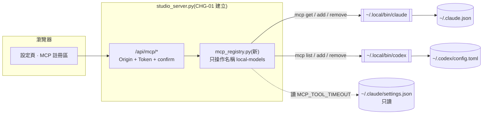
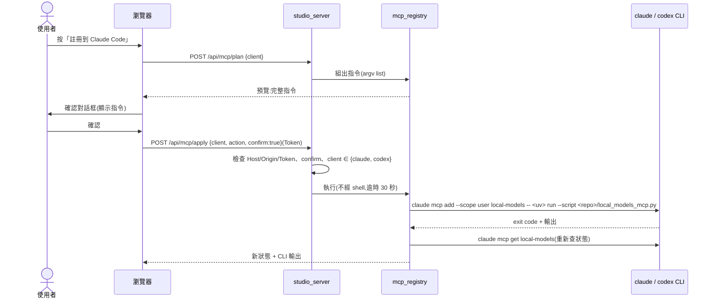

# CHG-20261022-02 — 設定頁加入 MCP 註冊管理(Claude Code / Codex)

- 專案:podcast-studio
- 分支(Branch):main
- 日期:2026-10-22(UTC+0)
- 類型:新功能
- 提出者:使用者
- 實作者:claude-opus-5-5(主 agent)
- 風險分級:高(命中高風險清單:**安全**——網頁端點會寫 repo 外的使用者全域設定 `~/.claude.json`、`~/.codex/config.toml`,並決定其他 agent 會啟動哪個程式)
- Autonomy:halt
- Commit/PR:(收尾時填)
- 重複性檢查(Recurrence check):(收尾時填)
- Diagrams:見「## 設計圖」節
- Mockup:見「## 畫面草稿」節
- Security-impact:見「## 安全影響」節
- Skill: ai-sdlc v1.66
- 關聯:FR-22;Guideline v1.1;**依賴 CHG-20261022-01**(設定頁、Origin/Token 檢查、`studio_server.py`)——01 驗收前本筆不開工

## 動機

使用者指示(2026-10-22):網頁能配置模型與 MCP;在範圍選項中選定「再加 MCP 註冊管理」。目前註冊靠手打 `PODCAST_STUDIO.md §10.3` 的指令。

## 使用者故事

1. 作為使用者,我在設定頁看到 local-models 在 Claude Code 與 Codex 是否已註冊、註冊的指令與路徑是什麼,以便確認 agent 會呼叫到這個 repo 的伺服器。
2. 作為使用者,我按「註冊」並在確認對話框看到**將要執行的完整指令**後才執行,以便知道網頁對我的全域設定做了什麼。
3. 作為使用者,我按「移除」並確認後,local-models 從該 client 移除,其他 MCP 伺服器不受影響,以便安全地停用。
4. 作為使用者,註冊或移除失敗時看到 CLI 的錯誤輸出,以便自己排除。
5. 作為使用者,Claude Code 的長工具逾時(`MCP_TOOL_TIMEOUT`)沒設定時看到提醒與建議值,但網頁**不替我改** `~/.claude/settings.json`,以便全域設定的改動範圍最小。

## 決策與取捨

| 決策 | 選項 | 前提假設 | 為何這樣選 |
|------|------|----------|------------|
| 寫設定的方式 | 官方 CLI vs 直接編輯 JSON/TOML | `claude`、`codex` CLI 存在於 `~/.local/bin/`(2026-10-22 查證);CLI 會處理格式與其他欄位 | 官方 CLI(`claude mcp add/remove/get --scope user`、`codex mcp add/remove/list`);**不直接編輯檔案**,避免弄壞使用者其他設定 |
| CLI 路徑 | PATH 搜尋 vs 絕對路徑 | 網頁伺服器啟動時 PATH 不一定含 `~/.local/bin` | 絕對路徑(`~/.local/bin/claude`、`~/.local/bin/codex`),不存在時該 client 顯示「未安裝」並停用按鈕 |
| 註冊範圍 | user vs project scope | 既有決策 `PODCAST_STUDIO.md §10.5 #5`:user scope | user scope;不提供其他選項 |
| 伺服器名稱 | 可改 vs 固定 | 只管理自己 | 固定 `local-models`;**只能操作這個名稱**,不列出、不移除其他伺服器 |
| 逾時設定 | 自動寫入 vs 只提醒 | `MCP_TOOL_TIMEOUT` 在 `~/.claude/settings.json` 的 `env`,與 MCP 註冊是不同檔案 | **代決**:只讀取並提醒,不寫入(縮小全域寫入範圍);Codex 的 `tool_timeout_sec` 由 `codex mcp add` 支援時一併帶入,不支援則提醒 |
| 確認方式 | 單擊即執行 vs 對話框顯示指令 | 寫 repo 外設定 | 對話框顯示完整指令,使用者確認後才送出;伺服器端再要求 `confirm: true` |
| 「已註冊」判斷 | 解析設定檔 vs CLI 查詢 | 設定格式可能改版 | `claude mcp get local-models`、`codex mcp list`,並比對 command/args 是否指向本 repo 的 `local_models_mcp.py` |

**代決事項**:不寫 `MCP_TOOL_TIMEOUT`、固定名稱 `local-models`、只支援 user scope。

## 設計圖

### (1) 受影響範圍的架構圖



### (2) 本次變更的流程圖:按下「註冊」



## 畫面草稿

```
┌─ 設定 › MCP 註冊 ─────────────────────────────────────────────────────┐
│ local-models 伺服器:uv run --script /Users/weiss/…/local_models_mcp.py │
│                                                                       │
│  Claude Code   ✔ 已註冊(user scope,指向本 repo)        [移除]       │
│                ⚠ MCP_TOOL_TIMEOUT 未設定,建議 1800000(請自行加入     │
│                  ~/.claude/settings.json 的 env)                      │
│  Codex         ✖ 未註冊                                   [註冊]       │
│                                                                       │
│ ┌─ 確認 ──────────────────────────────────────────────────────────┐  │
│ │ 將執行:                                                          │  │
│ │ ~/.local/bin/codex mcp add local-models -- /Users/weiss/.local/  │  │
│ │   bin/uv run --script /Users/weiss/…/local_models_mcp.py         │  │
│ │ 這會修改 ~/.codex/config.toml。             [取消]  [確認執行]   │  │
│ └──────────────────────────────────────────────────────────────────┘  │
└───────────────────────────────────────────────────────────────────────┘
```

## 安全影響

| 類別 | 是否觸及 | 影響範圍 / 理由 |
|------|----------|-----------------|
| irreversible-delete | **是(有限)** | 「移除」會刪掉使用者全域設定中的 `local-models` 項目。範圍限定為這一個名稱;可再按「註冊」恢復(相同指令),但若使用者曾手動加過自訂參數(例如 env),移除後**不會保留**。對策:移除前在確認框顯示目前註冊內容(`claude mcp get` 輸出),並在 CHG 收尾的使用說明中寫明 |
| payments | 否 | 無金流 |
| prod-migration | 否 | 無資料庫 |
| security-boundary | **是** | (a) 網頁端點可改寫 repo 外的全域設定,而該設定決定 Claude Code / Codex 會**啟動哪個程式**——若被跨站請求濫用,等於讓外部網站替使用者註冊程式。對策:沿用 CHG-01 的 Host/Origin/Token 檢查,另加 `confirm:true`;**指令參數全部由伺服器組出**,用戶端只能傳 `client` 與 `action` 兩個列舉值,不能傳任何路徑或參數。(b) 子程序一律 argv list、不經 shell、逾時 30 秒。(c) 只讀 `~/.claude/settings.json`,不寫 |

## 修改指引

### 目標

FR-22:設定頁可查詢、註冊、移除 local-models 在 Claude Code / Codex 的 user scope 註冊。

### 影響範圍

| 受影響項 | 類型 | 改動 | 連帶影響 |
|----------|------|------|----------|
| `mcp_registry.py` | 設計 | 新增:狀態查詢、指令組裝、執行 | 依賴外部 CLI 的輸出格式 → 解析失敗時顯示「狀態不明」而不是「未註冊」 |
| `studio_server.py` | 設計 | 新增 `/api/mcp/status`、`/api/mcp/plan`、`/api/mcp/apply` | 沿用 CHG-01 的安全檢查 |
| `static/` 設定頁 | 目錄 | 新增 MCP 註冊區與確認框 | — |
| `PODCAST_STUDIO.md §10.3` | 文件 | 加註「可改由網頁設定頁操作」 | — |

### 修改步驟(每完成一步立刻打勾——勾選狀態就是中斷後的續作點)

- [ ] 1. 查證兩個 CLI 的實際子指令與輸出格式(`claude mcp --help`、`codex mcp --help`),記錄到本 CHG
- [ ] 2. `mcp_registry.py`:狀態查詢(含「指向本 repo」比對)、指令組裝、執行;先寫測試(以假 CLI 腳本取代真 CLI,**測試不得動到真實全域設定**)
- [ ] 3. API 端點 + 安全檢查;先寫測試(缺 Token、錯 Origin、缺 confirm、非法 client 一律拒絕)
- [ ] 4. 前端 MCP 註冊區與確認框
- [ ] 5. 實機驗證:**在使用者同意後**,對 Codex 實際執行一次註冊 → 查詢 → 移除 → 註冊(恢復原狀),比對前後 `~/.codex/config.toml` 只有 local-models 段落變化

### 結構文件更新

- [ ] `docs/structure/logical.md`、`design.md`:新增 `mcp_registry` 元件與外部 CLI 契約
- [ ] `docs/structure/directory.md`:新增 `mcp_registry.py`

### 風險與回滾

- 風險:CLI 改版導致解析錯誤 → 顯示「狀態不明」並停用按鈕;誤刪自訂參數 → 確認框顯示目前內容。
- 回滾方式:`git revert` 本筆 commit;已寫入的全域設定以 `claude mcp add …` / `codex mcp add …`(`PODCAST_STUDIO.md §10.3`)手動恢復。

### Interaction spec
- kind: gui-web
- cmd: uv run --script tests/ui_check.py --only mcp
- artifacts: artifacts/mcp.png

## 結構異動摘要

(實作後填)

## 審議

(依 DIR-1;高風險 → 全席六席)

## 狀態

草稿——依賴 CHG-20261022-01 驗收;等待確認閘
