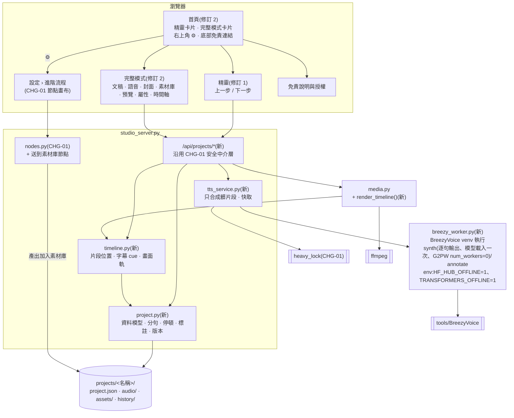
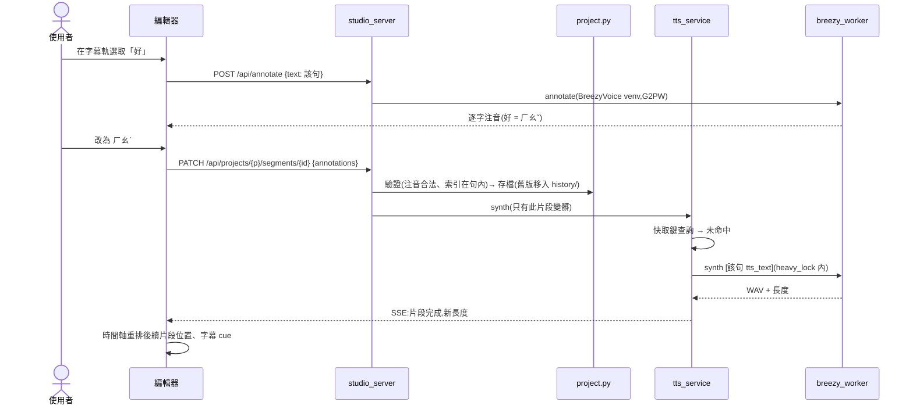
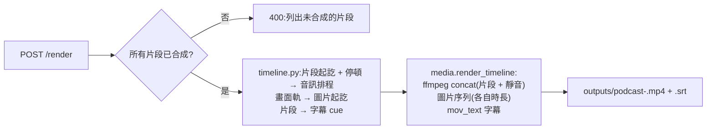

# CHG-20261022-04 — 步驟精靈 + 時間軸剪輯 + 逐句合成 + 停頓 + 聲調 + 語速

- 專案:podcast-studio
- 分支(Branch):main
- 日期:2026-10-22(UTC+0)
- 類型:新功能
- 提出者:使用者
- 實作者:主 agent 派發(DIR-3);實際工作者記於「## 派發記錄」
- 驗收者:獨立 Claude subagent(不參與施工、不看實作者自述)+ 使用者操作驗收
- 風險分級:高(命中高風險清單:**資料模型**——新增專案檔格式;**跨模組介面**——新增逐句合成與 BreezyVoice worker 介面(既有整段合成路徑保留)、時間軸渲染;**安全**——新增會寫檔的 HTTP 端點;**刪除(有限)**——history 超過 10 版自動刪最舊版)
- Autonomy:halt
- Commit/PR:(收尾時填)
- 重複性檢查(Recurrence check):(收尾時填)
- Diagrams:見「## 設計圖」節
- Mockup:見「## 畫面草稿」節
- Security-impact:見「## 安全影響」節
- Skill: ai-sdlc v1.66
- 關聯:FR-24~34(Guideline v1.3;修訂 1 新增 FR-31~34、修改 FR-24;修訂 2 依 Guideline v1.5 修改 FR-25、FR-31、FR-34,新增 FR-35 完整模式);待補項 ADP-12(修訂 2:`breezy_worker` 子程序帶離線環境變數;`taiwan_ai.speak()` 的部分由 CHG-20261022-01 T4 處理);**依賴 CHG-20261022-01**(`studio_server.py`、安全中介層、`heavy_lock`、節點登錄表、設定);CHG-01 的節點畫布改放「生成流程」分頁(本筆 T8 調整);`PODCAST_STUDIO.md §6` 已知限制「字幕依字數估時」、「數字念法 → 注音標註」由本筆處理;修訂 3:對齊 CHG-20261022-01 與 CHG-20261026-01(兩筆皆驗收完成並 merge)留在 main 的介面——`taiwan_ai.BREEZY_ENV`、`taiwan_ai.role_config("voice")`、`media.wav_seconds()` 的 RIFF 解析、`make_video` 的 `-r 10` 與 `-t`、首頁與設定頁的 hash 路由與預留位置;兩筆「## 後續改善」指名由本筆處理的兩項(覆寫 `default` 遺失 `steps` 鍵、沒有工作流程清單端點)見「## 修訂 3」

## 動機

使用者指示(2026-10-22):「畫面編輯採取影片編輯畫面」「可以設定說話語音中斷時間長度(增加停頓感)以及設定特定字詞或句的語調」。使用者選定:時間軸為主畫面、節點畫布當生成器;語調採注音聲調標註。

查證(2026-10-22):BreezyVoice 原生支援 `字[:注音]` 標註(`tools/BreezyVoice/README.md:72-74`);沒有停頓或語氣指令(模型非 `-Instruct` 版,`cosyvoice/cli/cosyvoice.py:24`);`batch_inference.py` 示範模型載入一次合成多句;`G2PWConverter` 可產生逐字注音(`single_inference.py:294-301`)。

## 使用者故事

1. 作為使用者,我打開網頁看到影片編輯器:左側素材庫、中間預覽、右側屬性、下方時間軸(畫面、語音、字幕三軌),以便用熟悉的剪輯方式完成一集。
2. 作為使用者,我把文稿放上時間軸後,系統逐句合成語音,每句是語音軌上的一個片段,以便看見每句話的位置與長度。
3. 作為使用者,我改了某一句的文字,只有那一句重新合成,其他句不動,以便修改不用等整篇重跑。
4. 作為使用者,我在設定裡給逗號、句號、段落各設預設停頓秒數,也能在時間軸上拖拉兩句之間的空隙、或在屬性面板輸入秒數,以便加強停頓感。
5. 作為使用者,我在文稿或字幕上選取一個字詞,看到系統自動標的注音,改成我要的注音與聲調(例:「好」改三聲、「的」改輕聲),該句自動重新合成,以便修正破音字與念法。
6. 作為使用者,我按預覽播放就能在瀏覽器裡看到畫面、聽到語音、看到字幕同步,不必先匯出,以便快速檢查。
7. 作為使用者,字幕時間跟實際語音對齊,以便不再有一兩秒的落差。
8. 作為使用者,我可以在畫面軌放多張圖、拖拉調整起訖,以便一集不只一張封面。
9. 作為使用者,我按匯出得到 1920×1080 MP4 與 SRT,並可存檔專案、之後載入繼續剪,存檔保留最近 10 個版本,以便誤改時能退回。
10. 作為使用者,我在「生成流程」分頁用節點產出的文稿、語音、圖片會出現在素材庫,以便直接拖上時間軸。
11. (修訂 2)作為使用者,我進入網頁先看到「精靈」與「完整模式」兩張卡片,右上角有設定圖示,底部有免責說明與授權連結,以便依熟悉程度選擇一步一步做或一次看全部。
12. (修訂 2)作為使用者,我在「完整模式」的同一個畫面編輯文稿、語音、封面與時間軸,不必按下一步,以便像影片剪輯軟體一樣直接修改任何部分。
13. (修訂 2)作為使用者,語音逐句合成時第一句約 1.5 分鐘就能試聽,不必等整段約 11 分鐘合成完,以便及早發現念錯的地方。

## 決策與取捨

| 決策 | 選項 | 前提假設 | 為何這樣選 |
|------|------|----------|------------|
| 主畫面 | 時間軸為主 + 節點當生成器 vs 只要時間軸 | — | **使用者選定**(2026-10-22) |
| 語調 | 注音聲調標註 vs 語氣參考音 vs 後製變調 | BreezyVoice 原生只支援注音 | **使用者選定**:注音聲調標註 |
| 停頓實作 | 文字插入標點 / 空白 vs 分句合成後插入靜音 | 模型沒有停頓指令;靠標點只能粗略影響 | 分句合成 + 精確靜音,長度可精確到 0.1 秒 |
| 分句單位 | 句尾標點(。！？!?;;換行)vs 逗號 | 逗號切太碎會讓合成失去語句連貫 | 語音片段以**句**為單位;逗號處的停頓由模型自然處理,使用者要加長時,在屬性面板對該逗號設「強制停頓」→ 該處切成兩個片段 |
| 合成程序 | 每句一個子程序 vs 常駐 worker | 每次載入模型需數十秒 | `breezy_worker.py` 以 BreezyVoice venv 執行,**一次呼叫處理整批句子**(模型載入一次);也提供 `annotate` 模式產生逐字注音 |
| 合成粒度(修訂 2,依 2026-10-26 實測) | A 整段 vs B 逐句(模型載入一次)vs B2 = B + G2PW `num_workers = 0` vs C 逐句、每句新行程 | 使用者:「如果模型的語音輸出整段會花比較時間 可以評估改採分批每句輸出來改善 實際上已測試後得到的結論為主」 | **採 B2**:逐句輸出、模型載入一次,並在建立 `G2PWConverter` 後把 `num_workers` 設為 0。實測總耗時 610.3 秒(A 655.9 / 662.0 秒),第一段可播放 92.8 秒(A 要等全部完成);峰值 RSS 12.13 GiB(A 10.78 GiB)。證據與限制見「## 修訂 2」 |
| 首頁(修訂 2) | 三分頁 vs 兩張卡片 | 使用者:「進入後首先會是兩個card 分別是精靈和完整模式 然後右上角有icon能進行設定」 | **使用者選定**:首頁只有「精靈」「完整模式」兩張卡片;右上角 ⚙ 開設定;免責說明與授權為首頁底部連結(設定頁也可進入)。取代修訂 1 的三分頁 |
| 完整模式(修訂 2) | 沿用精靈步驟 vs 單頁編輯器 | — | **使用者選定**:單一畫面的影片編輯器,文稿、語音、封面、時間軸都在同一頁,沒有步驟;即修訂 1 的「④ 剪輯」版面加上文稿與封面面板 |
| 片段快取 | 每次全部重合成 vs 以內容雜湊快取 | 使用者會反覆改少數幾句 | 快取鍵 = SHA-256(含標註的合成文字 + 聲線檔雜湊 + 模型名);命中即重用 |
| 預覽 | 先渲染 MP4 vs 瀏覽器即時播放 | 渲染要時間;片段都是獨立 WAV | 瀏覽器依時間軸排程播放片段、切換圖片、疊字幕;匯出時才用 ffmpeg |
| 字幕 | 依字數估時 vs 片段實際長度 | 已有每句真實長度 | 字幕 = 片段;超過 24 字在片段內依字數比例再切(誤差限縮在單句內) |
| 專案格式 | JSON 檔 vs SQLite | 單人、git 友善、可人工檢視 | `projects/<名稱>/project.json` + `audio/`、`assets/`;`projects/` 不入 git(使用者資料) |
| 版本保留 | 不保留 vs 最近 N 版 | 拖拉編輯容易誤改 | 每次存檔前把舊檔移到 `history/<時間戳>.json`,保留最近 10 版 |
| 時間軸前端 | 第三方時間軸套件 vs 自寫 | 免建置、離線;需求只有三軌、拖拉空隙與圖片 | **代決**:自寫(原生 JS + CSS,DOM 元件);不引入新的第三方前端檔 |
| 預設停頓 | — | 台灣華語播報語感 | **代決**:逗號 0.0 秒(模型自然)、句號 0.4 秒、段落 0.8 秒;使用者可改 |
| 精靈步驟來源(修訂 3) | 新增 `GET /api/workflows` 清單端點 + 「選用流程」設定 vs 讀既有 `GET /api/workflows/default` 的 `steps` | main 沒有清單端點,也沒有「目前選用的流程」這個設定;使用者原則「多次審議都無交集時只採最低限度」 | **代決**:精靈只讀 `GET /api/workflows/default` 的頂層 `steps`;不新增端點、不新增設定鍵。FR-32 的「目前選用的流程」即預設範本 |
| 畫布存檔與 `steps`(修訂 3) | 伺服器拒絕覆寫 `default` vs 畫布存檔保留 `steps` | 現行 `buildGraph()` 不帶 `steps`,覆寫 `default` 後精靈沒有步驟;`features/wizard_speed.feature`「精靈步驟來自目前選用的流程」要求在畫布改預設流程後精靈跟著變 | **代決**:畫布存檔保留載入時的 `steps`(只改前端);伺服器端不改。拒絕覆寫會讓該情境做不到,須改 FR-32,不採 |
| 自錄音檔取代一句(修訂 3) | 接受上傳白名單的全部音檔 vs 只接受 WAV vs 以 ffmpeg 轉成 WAV | `media.wav_seconds()` 只讀得到 WAV 長度;MP3 / M4A 讀不到長度屬 ADP-7 | **代決**:只接受檔頭為 RIFF/WAVE 的音檔,長度以 `media.wav_seconds()` 取得;其他回 422(繁中訊息),不轉檔 |
| 匯出影格率與截止(修訂 3) | 沿用 ffmpeg 預設 vs 比照 `make_video` 的 `-r 10` + `-t` | CHG-20261026-01 實測:靜止圖的影片長度要以 `-t` 截止,`-r 2` 誤差達 0.5 秒 | **代決**:`render_timeline` 輸出 `-r 10`,加 `-t <layout 總長>`;圖片起訖取到 0.1 秒 |

**代決事項**:分句規則與「強制停頓」切法、預設停頓秒數、自寫時間軸、`projects/` 不入 git、保留 10 版。修訂 2 新增代決:語音預設改存 CHG-20261022-01 的設定資料庫(新增 `voice_defaults` 表,`schema_version` 1 → 2)、兩張卡片與完整模式共用同一份專案資料與同一組 API、首頁底部連結開啟的免責頁是獨立畫面(不是分頁)。修訂 3 新增代決:見「## 修訂 3」的代決清單(R3-1~R3-6)。

## 設計圖

### (1) 受影響範圍的架構圖



### (2) 本次變更的流程圖:改一個字的聲調



### (3) 匯出流程



### (4) 逐句合成(修訂 2,B2 方案)

```mermaid
sequenceDiagram
  participant T as tts_service
  participant W as breezy_worker(子程序)
  participant B as 瀏覽器
  T->>W: argv list + jobs.json(髒片段 N 句)<br/>env 含 HF_HUB_OFFLINE=1、TRANSFORMERS_OFFLINE=1
  W->>W: 載入 CustomCosyVoice 一次;建立 G2PWConverter 後設 num_workers = 0
  loop 每一句
    W->>W: 合成單句(不跨句串接)
    W-->>T: stdout 一行 JSON {id, seconds}(<id>.wav 已寫完)
    T-->>B: SSE:片段完成,可播放
  end
  W-->>T: result.json + exit 0
```

## 畫面草稿

### 修訂 2:首頁(取代修訂 1 的三分頁外殼)

```
┌──────────────────────────────────────────────────────────────────────────────────────────────┐
│ Podcast 工作室                                                                            ⚙  │
│                                                                                              │
│                                                                                              │
│        ┌────────────────────────────────────┐      ┌────────────────────────────────────┐   │
│        │                                    │      │                                    │   │
│        │              ✦  精靈                │      │           ▤  完整模式               │   │
│        │                                    │      │                                    │   │
│        │   一次一步完成一集,                │      │   文稿、語音、封面、時間軸          │   │
│        │   只有「上一步 / 下一步」           │      │   在同一個畫面編輯                  │   │
│        │                                    │      │                                    │   │
│        └────────────────────────────────────┘      └────────────────────────────────────┘   │
│                                                                                              │
│        最近的專案:夜市的味道(10/26 10:12)  ▸ 以精靈開啟   ▸ 以完整模式開啟                  │
│                                                                                              │
│                                                                                              │
│ ──────────────────────────────────────────────────────────────────────────────────────────── │
│                                      免責說明與授權                                           │
└──────────────────────────────────────────────────────────────────────────────────────────────┘
```

- 首頁只有兩張卡片、右上角 ⚙(`aria-label="設定"`)與底部「免責說明與授權」連結;**沒有分頁列**。
- 卡片說明只描述該模式做什麼,不放步驟順序說明(不出現「①→②」或以「→」串起的步驟)、不放「本機」字樣。
- 「最近的專案」列在沒有專案時不顯示;兩種模式讀寫同一份 `project.json`,可隨時互換。
- 點「精靈」進入修訂 1 的步驟精靈(下方「修訂 1 後的整體版面」去掉頂端分頁列,改為「← 首頁」與 ⚙)。

### 修訂 2:完整模式(單頁編輯器,沒有步驟)

```
┌ ← 首頁   專案:夜市的味道  [存檔] [版本▼] [匯出 MP4]                                        ⚙ ┐
├─ 文稿 ───────────────────┬──────────────── 預覽 ─────────────────┬─ 屬性 ──────────────────┤
│ 主題 [台灣夜市文化   ]   │ ┌─────────────────────────────────┐ │ 選取:片段 #3              │
│ 風格 [輕鬆聊天 ▾] 長度[1]│ │        [ 16:9 畫面預覽 ]         │ │ 文字:今天來聊台灣夜市     │
│ [AI 寫稿] [AI 修改…]     │ │   今天來聊台灣夜市(字幕)         │ │ 語速 [1.30× ▾]            │
│ ┌──────────────────────┐ │ └─────────────────────────────────┘ │ 狀態:✓ 已合成 2.4 秒     │
│ │大家好,歡迎收聽…     │ │   ⏮  ▶  ⏭   00:04.2 / 02:10.6        │ ── 停頓 ──                │
│ │今天來聊台灣夜市。    │ │                                      │ 之前 [0.4] 秒 之後 [0.8] 秒│
│ └──────────────────────┘ ├─ 封面 ─────────────────────────────┤ ── 聲調 ──                │
│ [逐句合成全部]           │ 標題 [夜市的味道]  [AI 產生封面]     │ 今 天 來 聊 台 灣 夜 市    │
│ ─ 素材庫 ─  ⇩ 拖檔到這裡 │ ▣ cover-1.png  ▣ 夜市照片.jpg        │ ㄐ ㄊ ㄌ ㄌ ㄊ ㄨ ㄧ ㄕ ←點字│
├──────────────────────────┴──────────────────────────────────────┴──────────────────────────┤
│ 00:00     00:02     00:04     00:06     00:08     00:10                     [－ 縮放 ＋]   │
│ 字幕 │[大家好]  [歡迎收聽]  [今天來聊台灣夜市]  [你最愛的…        ]                         │
│ 語音 │▕█████▏ ↔ ▕████████▏↔▕████████████▏ ↔ ▕████ ⏳ 合成中        ← ↔ 拖拉=停頓長度      │
│ 畫面 │▓▓▓▓▓▓▓▓▓▓ cover-1.png ▓▓▓▓▓▓▓▓▓▓▓▓▓▓│▓▓▓▓ 夜市照片.jpg ▓▓▓▓▓▓▓▓  ← 拖邊緣=起訖       │
└──────────────────────────────────────────────────────────────────────────────────────────┘
```

- 沒有「上一步 / 下一步」,也沒有分頁;所有面板同時可見。
- 時間軸、預覽、屬性、聲調彈出框與修訂 1「④ 剪輯」相同;新增的是左側文稿面板與中間的封面面板。
- 逐句合成時,已完成的句子立即出現在語音軌並可播放,尚未完成的顯示「⏳ 合成中」。

### 修訂 1 後的整體版面(修訂 2:頂端分頁列改為「← 首頁」與 ⚙;步驟精靈內容不變)

```
┌ [建立 Podcast]  [設定]  [免責說明與授權] ─────────────────────────── 專案:夜市的味道 [存檔] ┐
│                                                                                              │
│   ① 文稿    ② 語音    ③ 封面    ④ 剪輯    ⑤ 匯出          ← 目前步驟高亮,僅作位置指示       │
│  ──────────────────────────────────────────────────────────────────────────────────────────  │
│   ② 語音                                                                                     │
│   句 1  大家好,歡迎收聽…              語速 [預設 ▾]   ✓ 已合成 2.1 秒   ▶                   │
│   句 2  今天來聊台灣夜市               語速 [1.30× ▾]  ✓ 已合成 1.8 秒   ▶                   │
│   句 3  這家攤販已經開了四十年         語速 [預設 ▾]   ⏳ 合成中                             │
│   ⇩ 把自己錄的音檔拖到某一句上,取代該句                                                     │
│                                                                                              │
│                                                         [ ← 上一步 ]   [ 下一步 → ]          │
└──────────────────────────────────────────────────────────────────────────────────────────────┘
```

- 頁首與各步驟**不放**步驟順序說明或「本機執行」說明。
- ④ 剪輯步驟的內容即下方「主畫面」草稿去掉頂端分頁列與專案按鈕列(移到外殼)。

### 免責說明與授權(修訂 2:由首頁底部或設定頁底部連結開啟的獨立畫面,不是分頁;頁首改為「← 首頁」與 ⚙,內容不變)

```
┌ [建立 Podcast]  [設定]  [免責說明與授權] ───────────────────────────────────────────────────┐
│ AI 生成內容聲明                                                                              │
│   文稿、語音、封面由 AI 模型產生,可能有錯誤或不當內容,發布前請自行檢查。                     │
│ 聲線                                                                                         │
│   以他人聲音作為聲線樣本前,須取得聲音所有人同意。                                           │
│ 模型與元件授權                                                                               │
│   元件               用途        授權            來源                                        │
│   BreezyVoice        語音合成    (取自 LICENSE)  tools/BreezyVoice/LICENSE                   │
│   FLUX.1-schnell     生圖        (取自模型卡)    Hugging Face 模型卡                         │
│   Qwen3.5-9B …       推理        未知            (模型卡未載明時如實標示)                  │
└──────────────────────────────────────────────────────────────────────────────────────────────┘
```

### 主畫面(編輯器分頁)——修訂 1 後為「④ 剪輯」步驟的內容

```
┌ Podcast 工作室 ── [編輯] [生成流程] [設定] ──────── 專案:夜市的味道 [存檔] [版本▼] [匯出 MP4] ┐
├─ 素材庫 ─────────┬──────────────── 預覽 ─────────────────┬─ 屬性 ───────────────────────┤
│ ⇩ 拖檔到這裡       │ ┌─────────────────────────────────┐ │ 選取:片段 #3                  │
│ ▣ cover-1.png      │ │                                 │ │ 文字:今天來聊台灣夜市         │
│ ▣ 夜市照片.jpg     │ │        [ 16:9 畫面預覽 ]         │ │ 狀態:✓ 已合成  2.4 秒         │
│ ≣ 文稿-1           │ │                                 │ │ ── 停頓 ──                    │
│ ♪ 自錄開場.wav     │ │   今天來聊台灣夜市(字幕)         │ │ 之前 [0.4] 秒   之後 [0.8] 秒  │
│                    │ └─────────────────────────────────┘ │ ── 聲調 ──                    │
│ (生成流程的產出    │   ⏮  ▶  ⏭   00:04.2 / 02:10.6        │ 今 天 來 聊 台 灣 夜 市        │
│  自動出現在這裡)   │                                      │ ㄐ ㄊ ㄌ ㄌ ㄊ ㄨ ㄧ ㄕ  ←點字改 │
├────────────────────┴──────────────────────────────────────┴──────────────────────────────┤
│ 00:00     00:02     00:04     00:06     00:08     00:10                     [－ 縮放 ＋]  │
│ 字幕 │[大家好]  [歡迎收聽]  [今天來聊台灣夜市]  [你最愛的…        ]                        │
│ 語音 │▕█████▏ ↔ ▕████████▏↔▕████████████▏ ↔ ▕██████████████        ← ↔ 拖拉=停頓長度     │
│ 畫面 │▓▓▓▓▓▓▓▓▓▓ cover-1.png ▓▓▓▓▓▓▓▓▓▓▓▓▓▓│▓▓▓▓ 夜市照片.jpg ▓▓▓▓▓▓▓▓  ← 拖邊緣=起訖      │
│      ▲ 播放頭                                                                            │
└──────────────────────────────────────────────────────────────────────────────────────────┘
```

### 聲調標註彈出框(點選字幕軌上的字)

```
          ┌─ 「好」的念法 ──────────────┐
          │ 自動:ㄏㄠˇ                    │
          │ ○ ㄏㄠˇ(三聲)  ● ㄏㄠˋ(四聲) │
          │ 自訂:[ㄏㄠˋ      ]           │
          │ 輕聲 ☐          [清除] [套用]  │
          └──────────────────────────────┘
          套用後:該句標示「重新合成中…」
```

### 設定頁新增(修訂 2:設定頁由首頁右上角 ⚙ 開啟,版面見 CHG-20261022-01;語音預設存設定資料庫)

```
── 語音預設 ──  語速 [1.15×]  停頓:逗號 [0.0] 秒  句號 [0.4] 秒  段落 [0.8] 秒   (語速 0.5–2.0,精度 0.05;停頓 0–5,精度 0.1)
── 進階流程 ──  (CHG-20261022-01 的節點畫布;調整精靈步驟與各步模型)
```

## 安全影響

| 類別 | 是否觸及 | 影響範圍 / 理由 |
|------|----------|-----------------|
| irreversible-delete | **是(有限)** | 編輯會覆寫 `projects/<名稱>/project.json`;刪除片段 / 圖片會移除時間軸項目。對策:原子寫入;每次存檔前把舊版移入 `history/`,保留最近 10 版(第 11 版起最舊的被刪,範圍限 `history/`);刪除時間軸項目不刪素材檔;刪除整個專案需二次確認,只移到 `projects/.trash/`,30 天後於啟動時清除(範圍限 `.trash/`)。這兩處是本筆僅有的自動刪除;另 `tmp/` 的暫存輸入檔用完即刪(非使用者資料) |
| payments | 否 | 無金流 |
| prod-migration | **是(有限,修訂 2)** | 專案檔是新格式,帶 `schema_version: 1`,讀到未知版本拒絕載入並提示,不猜測轉換。修訂 2:語音預設(語速、三種停頓)改存 CHG-20261022-01 的設定資料庫 `config/studio.db`,新增 `voice_defaults(key TEXT PRIMARY KEY, value REAL NOT NULL)` 表,`meta.schema_version` 由 1 升為 2。升級在 `settings` 開啟資料庫時於單一 `BEGIN IMMEDIATE` 交易內進行,只新增表並寫入預設值,不改 `roles`、`review_seats` 既有列;失敗即 rollback,資料庫維持 v1 且回傳語音預設為程式內預設值並帶 `_warnings`;網頁與 MCP 同時觸發時,後到者在交易內看到版本已是 2 即略過;資料庫版本大於 2 時不讀不寫。回滾 CHG-04 後舊版 `settings` 讀到 `schema_version = 2` 會依 CHG-01 規則回預設值——因此回滾時須一併處理資料庫,見「風險與回滾」 |
| security-boundary | **是** | (a) 新端點 `/api/projects/*`、`/api/annotate` 沿用 CHG-01 的 Host / Origin / Token 中介層與路徑限制(`projects/` 加入允許目錄);專案名稱 `^[\w\-]{1,64}$`。(b) 使用者文字進 `breezy_worker.py`:以 JSON 檔(暫存於 `projects/<名稱>/tmp/`)傳遞,不放命令列參數、不經 shell;注音標註只允許注音符號與聲調符號,其他字元拒絕,避免把任意字串注入 BreezyVoice 的 `[:…]` 語法。(c) worker 以 BreezyVoice venv 執行第三方程式碼——與現況 `taiwan_ai.speak()` 相同的信任等級,不新增新的第三方來源。修訂 2(ADP-12):BreezyVoice 載入模型時會呼叫 `snapshot_download`(`tools/BreezyVoice/single_inference.py:207`、`cosyvoice/cli/cosyvoice.py:27`),G2PW 以 `BertTokenizer.from_pretrained('bert-base-chinese')` 載入分詞器;worker 子程序環境一律帶 `HF_HUB_OFFLINE=1`、`TRANSFORMERS_OFFLINE=1`,快取缺失時失敗而不下載;worker 一律傳入聲線逐字稿,不走 Whisper 轉寫的後備路徑(`single_inference.py` 的 `transcribe_audio` 會載入 `openai/whisper-base`)。(d) 資源上限:音訊 60 分鐘、片段 2000、單句 500 字、文稿 50000 字、`project.json` 5 MB、素材 200 個 / 2 GB;synth、render、run 同時只允許一個。(e) 素材只經 CHG-01 上傳管道進入並以 asset id 引用,ffmpeg 與 worker 只拿到伺服器解析且檢查過前綴的路徑。(f) 原文的 `[`、`]` 轉全形,防止繞過標註驗證注入 BreezyVoice 語法。(g) `projects/` 不經 `/files/*` 暴露 |

## 修訂 1(2026-10-23,確認閘後、實作前)

- 依據:使用者指示(2026-10-23):「語音部分語速太慢 要能設定某段的語速倍率」「不要用 tab 也不要在上面說明順序與本機說明」「每個步驟都是下一步」「需要 TAB 的只有建立 podcast、設定與免責說明授權」;並選定:節點畫布放進「設定」當進階、語速 = 全域預設 + 每句覆寫。
- 內容:主畫面改為三分頁外殼 + 「建立 Podcast」步驟精靈(FR-31、FR-32);時間軸編輯器改為精靈的 ④ 剪輯步驟(FR-24 修改);新增每句語速倍率(FR-33);新增免責說明與授權分頁(FR-34)。
- 決策:語速以 ffmpeg `atempo` 後製(BreezyVoice 無語速參數——`tools/BreezyVoice/cosyvoice` 內查無 speed,2026-10-23 查證);全域預設 1.15×(使用者反映「語速太慢」,代決);授權文字不得臆測,取不到標「未知」(代決)。
- 影響的 task:T2(segment.speed)、T3(`apply_speed`)、T4(變速後長度)、T7(外殼、精靈、免責分頁)、T8(語速選單、設定)、T9(UI 檢查);新增行為規格 `features/wizard_speed.feature`。
- 因 CHG 內容改變,修訂後重跑審議 security 席(27B),並重新經使用者確認閘(含新畫面草稿)。

## 修訂 2(2026-10-26,確認閘後、實作前)

- 依據:使用者指示(2026-10-25/26):「進入後首先會是兩個card 分別是精靈和完整模式 然後右上角有icon能進行設定」;並選定:完整模式 = 單一畫面的完整編輯器(文稿、語音、封面、時間軸都在同一頁,像影片剪輯軟體,沒有步驟);免責說明與授權 = 首頁底部連結(設定頁也可進入)。「如果模型的語音輸出整段會花比較時間 可以評估改採分批每句輸出來改善 實際上已測試後得到的結論為主 這樣在調整間隔也比較有彈性」——2026-10-26 實測結果見下。另依 2026-10-26 查證新增 Guideline §9 ADP-12。
- 內容:
  1. 修訂 1 的三分頁外殼取消:首頁只有「精靈」「完整模式」兩張卡片,右上角 ⚙ 開設定(CHG-20261022-01 T12),底部連結開「免責說明與授權」。精靈內容(上一步 / 下一步、步驟取自 `/api/workflows`、每步可拖入檔案)不變。
  2. 新增「完整模式」:單頁編輯器 = 修訂 1「④ 剪輯」版面 + 文稿面板 + 封面面板;與精靈共用同一份專案資料與同一組 `/api/projects/*` API,不新增端點。
  3. 修訂 1 仍適用的規則保留:頁首與各頁不放「本機」字樣、不以「→」串起步驟順序;精靈只有上一步 / 下一步;授權取不到標「未知」;語速預設 1.15×、每句 0.5–2.0× 以 ffmpeg `atempo` 變速且不重新合成。
  4. 語音合成定案為**逐句輸出、模型載入一次、G2PW `num_workers = 0`**(B2),寫入 T1 與全域約束。
  5. 語音預設改存設定資料庫(CHG-20261022-01 修訂 2 的 SQLite),新增 `voice_defaults` 表(見安全影響 prod-migration)。
  6. ADP-12:`breezy_worker` 子程序環境帶 `HF_HUB_OFFLINE=1`、`TRANSFORMERS_OFFLINE=1`。
- 實測證據(2026-10-26;Apple M5 Pro 15 核、24 GB,只用 CPU,BreezyVoice 於 `single_inference.py:9` 設 `torch.set_num_threads(1)`;同一份文稿 10 句、267 字):

  | 變體 | 總耗時 | 第一段可播放 | 峰值 RSS |
  |---|---|---|---|
  | A 整段(現行 `single_inference`) | 655.9 秒 / 662.0 秒(兩次) | 同總耗時 | 10.78 GiB |
  | B 逐句、模型載入一次 | 791.5 秒 / 799.9 秒(兩次) | 111.9 秒 | 11.2 GiB |
  | B2 = B + G2PW `num_workers = 0`(建立後設定) | 610.3 秒 | 92.8 秒 | 12.13 GiB |
  | C 逐句、每句新行程(以 3 句推估) | 約 840–925 秒 | 112.2 秒 | 10.66 GiB |

  - B 變慢的原因是 G2PW 每次呼叫都以 DataLoader 產生子行程(每次約 19 秒),不是模型本身;純模型時間 A 628 秒、B 593.6 秒、B2 592 秒。
  - `G2PWConverter(num_workers=0)` 無效:`tools/BreezyVoice/.venv/lib/python3.10/site-packages/g2pw/api.py:79` 為 `num_workers if num_workers else config.num_workers`,0 被當成假值;必須在建立後設定屬性。
  - 「整段」本身就在 `inference_zero_shot_no_normalize`(`single_inference.py:266-276`)以 `re.split` 依句尾標點切句、逐句推論後直接串接,中間沒有間隔,因此整段合成沒有跨句韻律上的優勢;逐句輸出另可精確控制句間停頓。
  - 待人工確認:B 版中一句短句「你有試過嗎？」輸出偏小聲、偏短,需試聽;同一句在同一行程內的輸出,會因先前合成過哪些句子而略有不同。
  - 限制:每個變體只跑 1–2 次、只有一份文稿、單執行緒、未測 MPS;B2 峰值 RSS 比 A 多約 1.35 GiB,仍在 `heavy_lock` 互斥下執行(同時只有一個重型工作)。數字不作為效能承諾,只作為選擇 B2 的依據。
- 影響的 task:T1(逐句合成定案、G2PW `num_workers`、逐句進度輸出、離線環境變數、快取缺失時離線失敗的測試)、T2(依審議補 `startup_cleanup` 的 30 天界線與符號連結測試)、T3(依 worker 逐句進度 emit)、T7(首頁雙卡片、⚙、底部連結、完整模式)、T8(語音預設存資料庫)、T9(UI 檢查加首頁與完整模式);行為規格 `features/wizard_speed.feature` 新增首頁情境。
- 審議:本修訂改變畫面外殼、新增設定資料表與 schema 升級、改變 worker 子程序環境,觸及 prod-migration 與 security-boundary;確認閘前依 DIR-1 重跑否決席(risk、security、compliance,Codex),判決記於「## 審議」。

## 修訂 3(2026-10-27,修訂 2 確認閘後、實作前)

- 依據:施工前把本筆計畫與 main(`0adea97`)比對。CHG-20261022-01、CHG-20261026-01 兩筆驗收完成並 merge 後,main 已有本筆原本要新增或假設不存在的介面;兩筆的「## 後續改善」另把兩項缺口指名給本筆:「從畫布以 `default` 名稱覆寫存檔……遺失步驟精靈用的 `steps` 鍵……應於 CHG-20261022-04 處理」、「工作流程清單端點(`GET /api/workflows`)不存在……應於 CHG-04 處理」。依使用者原則「如果多次審議都無交集 只採最低限度」,本修訂只做對齊所需的最窄改動,不新增功能。
- 比對結果分兩類:(a) 只更新引用、不改行為——直接改寫下方文字,不列代決;(b) 改變行為、介面或範圍——列為代決 R3-1~R3-6,需經使用者確認閘。
- (a) 只更新引用:
  1. 首頁、設定頁、免責頁在 main 已有 hash 路由與預留位置(`static/index.html` 的 `#page-home`、`#page-settings`、`#page-disclaimer`;`static/app.js` 的 `route()` 處理 `#/`、`#/settings/<子頁>`、`#/disclaimer`);設定頁底部已有「免責說明與授權」連結,「語音預設」子頁(`#/settings/voice`)是預留位置。T7 把首頁與免責頁的預留內容換成正式內容、在首頁加底部連結,精靈與完整模式各加一個 hash 路由;T8 把「語音預設」子頁換成正式欄位並加入共用「還原預設 / 儲存」的子頁清單(`FORM_SUBPAGES`)。
  2. 節點畫布已在「設定 › 進階流程」(CHG-20261022-01 T10、T12),T8 不再搬移。
  3. `taiwan_ai.speak()` 的離線環境變數已由 CHG-20261022-01 T4 加入(`taiwan_ai.BREEZY_ENV`);CHG-20261026-01 T1 新增 `taiwan_ai.role_config()` 並移除 `VOICE_WAV`、`VOICE_TEXT`。本筆仍不改 `speak()`。
  4. 設定資料庫 main 仍為 schema v1;`roles.voice` 只存聲線檔與逐字稿(`wav`、`text`),不含語速與停頓,因此 T8 的 `voice_defaults` 表與 1 → 2 升級照修訂 2 進行。施工注意:一次性匯入(`_import_body`)與 `save()` 寫入的 `schema_version` 一併改為 2;`validate()` 頂層允許鍵加入 `voice_defaults`;`static/app.js` 的 `SETTINGS_DEFAULTS` 須與 `settings.DEFAULTS` 相等(`tests/test_static.py` 既有檢查)。
  5. `media.wav_seconds()` 已能讀 PCM、IEEE float 與 EXTENSIBLE WAV(CHG-20261026-01 T4);T3 的變速後長度、T6 的自錄音檔長度一律用它,不另寫解析。
  6. 輸出檔一律以 `taiwan_ai.reserve()` 排他佔位(CHG-20261022-01 Global Constraints),T5 匯出沿用,不只是 `stamp()`。
  7. 「執行中」旗標即 `studio_server.py` 的 `Runs.start()` / `Runs.active`;`heavy_lock` 在 `heavy_lock.py`。
  8. `tests/ui_check.py` 目前沒有 `--only` 參數,T9 新增;不帶參數時既有三張截圖照舊產出。
  9. `nodes.py` 登錄表目前恰為十種節點(`tests/test_nodes.py` 的 `test_登錄表恰為十種節點`),T8 新增節點時一併改這個測試。
  10. 結構文件更新清單:Guideline §7 應為 FR-24~35(FR-35 為修訂 2 新增);「字幕依字數估時」在 `PODCAST_STUDIO.md §6`,Guideline §6 沒有這一條。
- (b) 代決(確認閘請逐項覆核):
  - **R3-1 精靈步驟來源**:精靈只讀 `GET /api/workflows/default` 回傳 `graph.steps`;不新增 `GET /api/workflows` 清單端點,也不新增「選用流程」設定鍵。FR-32 的「目前選用的流程」即預設範本 `workflows/default.json`。`steps` 不存在或格式不對時,精靈顯示繁中錯誤(提示以 `git checkout -- workflows/default.json` 復原),不以寫死的步驟替代。替代方案:新增清單端點與選用設定(需新增設定鍵或資料表,範圍較大)。
  - **R3-2 畫布存檔保留 `steps`**:`static/app.js` 的 `buildGraph()` 帶出載入時的 `steps`;已不在畫布上的節點 id 從各步驟移除,原本有節點、移除後變空的步驟整個刪除,原本就沒有節點的步驟(④ 剪輯)保留。伺服器端與 `executor.validate` 不改。覆寫 `default` 仍會讓工作樹變髒(CHG-20261026-01 代決 7 不變),驗收後以 `git checkout -- workflows/default.json` 復原。替代方案:伺服器拒絕覆寫 `default`——但 `features/wizard_speed.feature`「精靈步驟來自目前選用的流程」就做不到,須改 FR-32。
  - **R3-3 worker 子程序環境**:取消 T1 的 `breezy_worker.spawn_env()`,T3 啟動 worker 時直接用 `taiwan_ai.BREEZY_ENV`(已含 `HF_HUB_OFFLINE=1`、`TRANSFORMERS_OFFLINE=1`、`PYTHONUTF8=1`、`PATH=/usr/bin:/bin`),`cwd` 同 `speak()` 為 `tools/BreezyVoice`,離線變數只有一個來源。worker 在快取缺失時的錯誤訊息改為與 `taiwan_ai.SPEAK_FAILED_HINT` 同義(需在建置期允許連網時先下載一次模型快取),不提示重跑 `./setup_breezyvoice.sh`——該腳本不下載 Hugging Face 快取。
  - **R3-4 聲線來源與快取鍵**:T3 每次 `synth()` 經 `taiwan_ai.role_config("voice")` 讀一次聲線(`wav` 以 `taiwan_ai.ROOT` 轉絕對路徑、`text` 為逐字稿),不另存聲線設定、不快取設定值。合成快取鍵加入逐字稿:SHA-256(含標註的合成文字 + 聲線檔 SHA-256 + 聲線逐字稿 SHA-256 + 模型名)——設定頁只改逐字稿時,舊快取不得命中。
  - **R3-5 匯出影格率與截止**:`render_timeline` 比照 `make_video`:輸出影格率 `-r 10`,在輸出檔名前加 `-t <layout.duration,小數 3 位>`;圖片起訖四捨五入到 0.1 秒;輸出以 `taiwan_ai.reserve()` 佔位。
  - **R3-6 自錄音檔取代一句**:只接受檔頭為 RIFF/WAVE 的音檔(以前 12 位元組判斷,不看副檔名),長度以 `media.wav_seconds()` 取得;MP3 / M4A 等回 422,訊息繁中(例「取代語音只接受 WAV 音檔」),不轉檔。替代方案:以 ffmpeg 轉成 WAV(多一個子程序路徑)。
- 影響的 task:T1(R3-3)、T3(R3-3、R3-4)、T5(R3-5)、T6(R3-6)、T7(R3-1、R3-2)、T8(移除「CHG-01 節點畫布位於設定 › 進階流程」的產出——main 已有)、T9(R3-2 互動檢查、`--only` 參數);行為規格不改。
- 審議:R3-3 改變 worker 子程序環境的來源(內容不變)、R3-6 收窄上傳音檔的使用範圍,觸及 security-boundary;確認閘前依 DIR-1 重跑否決席(risk、security、compliance),判決記於「## 審議」。

## 修改指引

### 目標

(修訂 2:首頁為「精靈」「完整模式」兩張卡片;時間軸編輯器同時是精靈的 ④ 剪輯與完整模式的主體。)FR-24~30:影片編輯器時間軸為主畫面;逐句合成、停頓長度、聲調標註、實際長度字幕、多圖畫面軌、匯出與專案版本。

### 影響範圍

| 受影響項 | 類型 | 改動 | 連帶影響 |
|----------|------|------|----------|
| `breezy_worker.py` | 設計 | 新增:在 BreezyVoice venv 執行;`synth`(批次;修訂 2:逐句輸出、模型載入一次、G2PW `num_workers = 0`、每句完成即在 stdout 印一行進度 JSON、子程序環境帶離線變數——修訂 3:環境由 T3 傳入 `taiwan_ai.BREEZY_ENV`)、`annotate`(逐字注音) | 依賴 BreezyVoice 內部函式 `single_inference`、`G2PWConverter` 與其 `num_workers` 屬性;上游改版風險同 ADP-5 |
| `project.py` | 資料/設計 | 新增:專案資料模型、分句、停頓、標註、版本 | `docs/structure/data.md` 新增實體 |
| `timeline.py` | 邏輯 | 新增:片段位置、字幕 cue、畫面軌 | — |
| `tts_service.py` | 設計 | 新增:髒片段合成、快取 | 使用 `heavy_lock` |
| `media.py` | 設計 | **新增** `render_timeline()`(修訂 3:`-r 10`、`-t <總長>`,比照 CHG-20261026-01 的 `make_video`);既有函式不改 | `make_srt` 依字數估時的路徑保留給 MCP `make_video` |
| `studio_server.py` | 設計 | 新增 `/api/projects/*`、`/api/annotate`(修訂 3:不新增 `GET /api/workflows` 清單端點,精靈讀既有 `GET /api/workflows/default`) | 允許目錄加入 `projects/` |
| `static/`(編輯器分頁、時間軸、屬性面板、注音彈出框) | 目錄 | 新增;CHG-01 的節點畫布改放「生成流程」分頁(修訂 1 改為「設定 › 進階流程」);修訂 2:首頁雙卡片、⚙、底部免責連結、完整模式單頁編輯器;修訂 3:填入 main 既有的首頁、免責頁與「語音預設」子頁預留位置,畫布存檔保留 `steps`(`buildGraph()`) | CHG-01 的畫面草稿需同步改標題(修訂 2 已同步) |
| `nodes.py` | 設計 | 新增「送到素材庫」節點 | — |
| `settings.py` / ~~`config/models.json`~~ `config/studio.db`(修訂 2) | 資料 | 新增語速預設與停頓預設三個鍵;修訂 2:存於 `voice_defaults` 表,`schema_version` 1 → 2 | 驗證範圍:停頓 0–5、語速 0.5–2.0;`load()` / `save()` 回傳結構新增 `voice_defaults` 鍵 |
| `.gitignore` | — | 新增 `projects/` | — |
| `taiwan_ai.speak()`、MCP `speak` | — | **本筆不改**(整段合成路徑保留;修訂 2 的 ADP-12 離線環境變數由 CHG-20261022-01 T4 加入) | MCP 契約不變 |

### Global Constraints(全域約束——每個 task 都要遵守)

- 沿用 CHG-20261022-01 的全部全域約束(PEP 723、`./scripts/check.sh`、Host / Origin / Token、允許目錄、argv list、`heavy_lock`、原生前端、繁體中文、MCP 契約不變)。
- 允許讀寫的目錄加入 `projects/`;專案名稱一律符合 `^[\w\-]{1,64}$`。
- 專案檔一律帶 `schema_version: 1`;未知版本一律拒絕載入。
- 每次寫入 `project.json` 前一律把舊檔移到 `history/<時間戳>.json`,`history/` 只保留最近 10 個。
- 注音標註只接受注音符號(ㄅ–ㄩ)與聲調符號(ˊˇˋ˙),長度 1–5;其他輸入一律 422。
- 停頓秒數一律 0–5、四捨五入到 0.1。
- 語音片段一律以句尾標點(。！？!?;;與換行)切分;使用者設定的「強制停頓」位置另外切分。
- 使用者文字一律以 JSON 檔傳給 `breezy_worker.py`,不放進命令列參數。
- ~~合成快取鍵一律 = SHA-256(含標註的合成文字 + 聲線檔 SHA-256 + 模型名)~~(修訂 3 取代):合成快取鍵一律 = SHA-256(含標註的合成文字 + 聲線檔 SHA-256 + 聲線逐字稿 SHA-256 + 模型名);聲線一律在每次 `synth()` 經 `taiwan_ai.role_config("voice")` 讀一次,不另存、不快取設定值。
- `media.py` 既有函式行為一律不變;只新增函式。
- ~~畫面一律只有三個分頁:建立 Podcast、設定、免責說明與授權~~(修訂 2 取代):首頁一律只有「精靈」「完整模式」兩張卡片、右上角一個設定圖示(`aria-label="設定"`)、底部一個「免責說明與授權」連結;網頁任何地方都不使用分頁列(`role="tab"`);任何頁面不放步驟順序說明或「本機執行」說明文字(FR-31)。
- (修訂 2)完整模式一律是單一畫面,文稿、語音、封面、素材庫、預覽、屬性、時間軸同時可見,沒有上一步 / 下一步;與精靈共用 `/api/projects/*`,不新增端點。
- (修訂 2)`breezy_worker.py synth` 一律逐句合成、每句各自輸出 `<id>.wav`,同一次呼叫內模型只載入一次;不呼叫 `inference_zero_shot_no_normalize` 對多句串接。
- (修訂 2)`breezy_worker.py` 建立 `G2PWConverter` 後一律把其 `num_workers` 屬性設為 0(建構子參數 0 無效)。
- (修訂 2,ADP-12)`breezy_worker.py` 子程序環境一律包含 `HF_HUB_OFFLINE=1`、`TRANSFORMERS_OFFLINE=1`;worker 一律傳入聲線逐字稿,不走 Whisper 後備路徑。(修訂 3)環境一律直接使用 `taiwan_ai.BREEZY_ENV`,不另建環境變數來源。
- (修訂 2)語音預設一律經 `settings.load()` / `save()` 存取(`voice_defaults` 表),不另建設定檔。
- 「建立 Podcast」一律是步驟精靈:一次只顯示一步,只有「上一步 / 下一步」;~~步驟清單取自目前選用的流程(`workflows/`)~~(修訂 3 取代)步驟清單一律取自 `GET /api/workflows/default` 的頂層 `steps`,不寫死在前端;畫布存檔一律保留 `steps`(移除已不在畫布上的節點 id)。
- 語速一律 0.5–2.0×、四捨五入到 0.05;以 ffmpeg `atempo`(單一濾鏡,範圍內不串接)變速;改語速只重做變速,不重新合成;變速結果以「合成快取鍵 + 語速」為鍵另行快取。
- 單一專案音訊總長 ≤ 60 分鐘、片段數 ≤ 2000、單句文字 ≤ 500 字、整份文稿 ≤ 50000 字、`project.json` ≤ 5 MB、素材 ≤ 200 個且總量 ≤ 2 GB。
- 素材(圖片、音訊、文稿)一律經 CHG-01 的 `/api/upload`(白名單、內容嗅探、200 MB、伺服器命名)進入,再複製到 `projects/<名稱>/assets/<uuid>.<ext>`;專案只記 asset id,**不記任何路徑**;`render_timeline` 與 worker 只依 asset id 在該專案 `assets/`、`audio/` 內解析檔案,解析後 `resolve()` 檢查前綴。
- 使用者文稿進合成前一律跳脫 BreezyVoice 標註語法:原文中的 `[`、`]` 換成全形 `［`、`］`,使唯一能產生 `[:注音]` 的途徑是經驗證的標註欄位。
- 專案名稱 regex 一律以 ASCII 比對(`re.ASCII`)。
- `project.json` 一律原子寫入(暫存檔 + `os.replace`),同一專案的寫入以專案層級鎖序列化;history 檔名 = `YYYYmmdd-HHMMSS-<毫秒>-<4 碼隨機>.json`。
- `projects/<名稱>/tmp/` 的 worker 輸入檔在 worker 結束後(成功或失敗)一律刪除;啟動時清空殘留的 `tmp/`。
- `projects/.trash/` 保留 30 天,啟動時清除超過 30 天者(第二個自動刪除點,範圍限 `.trash/`)。
- `projects/` 不經 `/files/*` 提供;專案音訊與素材只經 `/api/projects/{p}/media/{asset_id}` 提供。
- 同時只允許一個 synth 或 render(與 CHG-01 的 run 共用同一個「執行中」旗標),第二個回 409。
- 前端顯示文稿、字幕、屬性面板文字一律用 `textContent`(沿用 CHG-01 約束)。
- `/api/annotate` 輸入一律 ≤ 500 字,暫存檔放 `outputs/.tmp/`(不屬任何專案),用完即刪。
- 還原版本一律視為一次存檔:先把目前版本移入 history,再原子寫入。
- 刪除專案的 API 一律要求 `confirm: true`;移入 `.trash/<名稱>-<時間戳>-<4 碼隨機>/`,不覆蓋既有項目。
- worker 每句合成逾時 120 秒、整批逾時 = 句數 × 120 秒;render 逾時 600 秒;逾時即終止子程序並回報失敗。
- 匯出檔名沿用 CHG-01 T2 改過的 `stamp()`(毫秒 + 隨機碼),不覆蓋;(修訂 3)輸出一律以 `taiwan_ai.reserve()` 排他佔位。
- (修訂 3)`render_timeline` 輸出影格率一律 `-r 10`,並在輸出檔名前加 `-t <layout.duration,小數 3 位>`;圖片起訖一律四捨五入到 0.1 秒。
- (修訂 3)以自錄音檔取代一句時,一律只接受檔頭為 RIFF/WAVE 的音檔,長度以 `media.wav_seconds()` 取得;其他音檔回 422,不轉檔。
- `/api/annotate` 一律共用 synth / render / run 的「執行中」旗標並在 `heavy_lock` 內執行,逾時 60 秒。
- 「單一專案音訊總長 ≤ 60 分鐘」一律以變速後長度計算;render 逾時 = max(600, 音訊秒數 × 2) 秒。
- 專案 media 端點只送出白名單副檔名(png、jpg、jpeg、webp、wav、mp3、m4a、txt、md),一律帶 `X-Content-Type-Options: nosniff`,文字檔以 `text/plain; charset=utf-8` 送出;不送 SVG / HTML。
- segment id、image id、版本 id 一律為伺服器產生的 `^[0-9a-f]{8,32}$` 或時間戳格式,其他輸入回 404。
- 錯誤回應一律不含本機絕對路徑或堆疊。

### Tasks(checkbox=續作點)

- [ ] T1. BreezyVoice worker
  - interfaces: consumes `tools/BreezyVoice`(`single_inference`、`CustomCosyVoice`、`G2PWConverter`)/ produces `breezy_worker.py`:`synth --jobs <json> --out <dir>`(模型載入一次,逐句輸出 `<id>.wav` 與 `result.json` 含長度;修訂 2 定案 B2:每句各自推論、不跨句串接,建立 `G2PWConverter` 後設 `num_workers = 0`,每句寫完 WAV 即在 stdout 印一行 `{"id", "seconds"}` JSON 供 T3 逐句 emit)、`annotate --input <json>`(輸出逐字注音陣列);~~`spawn_env() -> dict`~~(修訂 3 取消:環境由 T3 直接傳入 `taiwan_ai.BREEZY_ENV`,ADP-12);`tests/test_breezy_worker.py`(以假的 BreezyVoice 模組測參數處理)與 `tests/integration/test_breezy_worker_real.py`(真模型,兩句,不列入 `check.sh`)
  - test: `./scripts/check.sh tests/test_breezy_worker.py`——以假的 BreezyVoice 模組:三句 jobs → 模型建構子只被呼叫 1 次、單句推論被呼叫 3 次、產出 3 個 `<id>.wav`、stdout 依序 3 行合法 JSON;建立後 `G2PWConverter` 替身的 `num_workers == 0`;jobs 缺聲線逐字稿 → 非 0 結束且不呼叫轉寫函式;模型快取缺失:假的 `snapshot_download` 在讀到 `HF_HUB_OFFLINE=1` 時丟出「快取不存在」例外、否則把一次「網路下載」記入計數器,worker 以 `taiwan_ai.BREEZY_ENV` 的環境執行(修訂 3)→ 非 0 結束、stderr 有繁體中文錯誤訊息(修訂 3:與 `taiwan_ai.SPEAK_FAILED_HINT` 同義,提示在建置期允許連網時先下載模型快取,不提示 `./setup_breezyvoice.sh`)且不含本機絕對路徑、網路下載計數為 0、輸出目錄沒有任何 WAV;另 `tools/BreezyVoice/.venv/bin/python -m pytest tests/integration/test_breezy_worker_real.py` 以 `taiwan_ai.BREEZY_ENV` 執行(離線)產出兩個非空 WAV 且 `annotate("今天天氣真好")` 回傳 6 個注音
- [ ] T2. 專案資料模型
  - interfaces: consumes T1 的注音格式 / produces `project.py`:`Project`(segments(含 `speed`,`null` = 用全域預設)、images、assets、pauses 與語速預設、schema_version)、`split_segments(text, forced_breaks) -> list`、`tts_text(segment) -> str`(產生 `字[:注音]`)、`load/save`(history 10 版、`.trash/`)、`validate`、`startup_cleanup(now)`(修訂 2 補:清除 `projects/.trash/` 中滿 30 天的項目與各專案殘留的 `tmp/` 內容;T6 伺服器啟動時呼叫);`tests/test_project.py`
  - test: `./scripts/check.sh tests/test_project.py`——語速 1.23 → 1.25、0.45 與 2.05 回錯誤、`null` 取全域預設 1.15;原文含 `[:ㄅ]` 時 `tts_text` 輸出全形括號;專案名稱含非 ASCII 字母回錯誤;兩個執行緒同時存檔不產生壞檔且 history 檔名不重複;超過文字與素材上限回錯誤;分句依句尾標點與強制停頓;`tts_text` 把索引 2 的「好」標 ㄏㄠˋ 產生 `…好[:ㄏㄠˋ]…`;非注音字元標註回錯誤;停頓 5.04 → 5.0、-1 → 錯誤;第 11 次存檔後 history 剩 10 個;schema_version=2 拒絕載入;`startup_cleanup`:`.trash/` 內 29 天 23 小時的項目保留、滿 30 天的項目刪除(以注入的 `now` 判定,不依賴真實時間);`.trash/` 內的符號連結(指向 `projects/` 外的目錄或檔案)本身與其目標都不跟隨、不刪除,目標內容不變;`tmp/` 內指向 `projects/` 外的符號連結不跟隨,目標不變;`projects/.trash`、某專案目錄、其 `tmp/` 或 `history/` 本身是符號連結(指向 `projects/` 外)時,`startup_cleanup` 與 history 超過 10 版的輪替刪除都拒絕處理該目錄並記警告,連結目標內容不變;各專案 `tmp/` 的一般殘留檔被清空;`project.json`、`audio/`、`assets/`、`history/` 不受影響
- [ ] T3. 合成服務
  - interfaces: consumes T1、T2、`heavy_lock` / produces `tts_service.py`:`dirty_segments(project)`、`synth(project, emit)`(只合成髒片段、快取命中跳過、`heavy_lock` 內、逐片段 emit——修訂 2:讀 worker stdout 的逐句進度行,每句完成即 emit,不等整批結束;worker 以 argv list、`env=taiwan_ai.BREEZY_ENV`、`cwd=tools/BreezyVoice` 啟動(修訂 3);聲線每次 `synth()` 經 `taiwan_ai.role_config("voice")` 讀一次(修訂 3))、`apply_speed(segment)`(ffmpeg `atempo`,argv list,以「合成快取鍵 + 語速」快取)、`tests/test_tts_service.py`
  - test: `./scripts/check.sh tests/test_tts_service.py`——改某句語速 → worker 零次呼叫、只對該句跑一次 `atempo`,輸出長度 ≈ 原長 ÷ 語速(±3%);以替身 worker:三句全新 → 合成三句;改第二句 → 只合成第二句;改回原文字 → 快取命中、零次合成;聲線檔改變 → 全部變髒;(修訂 3)只改聲線逐字稿 → 全部變髒、快取不命中;`taiwan_ai.role_config` 在一次 `synth()` 內只被呼叫 1 次;替身 worker 每句間隔 1 秒印進度時,第一個 emit 在第一句進度行後 0.5 秒內送出(不等 worker 結束);啟動 worker 的 `env` 等於 `taiwan_ai.BREEZY_ENV`(修訂 3)
- [ ] T4. 時間軸計算
  - interfaces: consumes T2 / produces `timeline.py`:`layout(project) -> {segments:[start,end], cues:[start,end,text], images:[start,end,file], duration}`;`tests/test_timeline.py`
  - test: `./scripts/check.sh tests/test_timeline.py`——片段長度採變速後長度;片段起點 = 前一段終點 + 停頓;30 字片段切成 2 個 cue 且 cue 終點等於片段終點;預設一張圖撐滿全長;圖片起訖超出總長被截斷
- [ ] T5. 匯出渲染
  - interfaces: consumes T4、`taiwan_ai.reserve()` / produces `media.render_timeline(project, layout) -> (mp4, srt)`(新增函式;修訂 3:`-r 10`、`-t <layout.duration,小數 3 位>`、圖片起訖取到 0.1 秒、輸出以 `reserve()` 佔位);`tests/test_render_timeline.py`(以 1 秒正弦波片段與兩張純色圖實跑 ffmpeg)
  - test: `./scripts/check.sh tests/test_render_timeline.py`——layout 中的 asset id 指向專案外路徑(含符號連結)時拒絕渲染;輸出 1920×1080、音訊總長 = 片段長度總和 + 停頓總和(±0.05 秒)、字幕軌 cue 數等於 layout、第二張圖從指定時間開始(取該幀比對顏色);(修訂 3)以 `ffmpeg -i <mp4> -map 0:v -f null -` 與 `-map 0:a` 量得的影片軌、音軌長度差 ≤ 0.1 秒;argv 含 `-r 10` 與 `-t`
- [ ] T6. 專案 API
  - interfaces: consumes T2~T5、CHG-01 中介層 / produces 伺服器啟動時呼叫 `project.startup_cleanup(now)`(修訂 2 補);`/api/projects/{p}/media/{asset_id}`(只依 asset id 解析,`resolve()` 後檢查在該專案 `assets/` 或 `audio/` 內)、`/api/projects`(列表、新增、載入、刪除→`.trash/`,需 `confirm:true`)、`/api/projects/{p}`(存檔、版本列表、還原版本)、`/api/projects/{p}/segments/{id}`(文字、停頓、標註、強制停頓;修訂 3:以自錄音檔取代該句時只接受 RIFF/WAVE,長度以 `media.wav_seconds()` 取得)、`/api/projects/{p}/images`、`/api/annotate`、`/api/projects/{p}/synth`(SSE)、`/api/projects/{p}/render`;`tests/test_server_projects.py`
  - test: `./scripts/check.sh tests/test_server_projects.py`——media 端點以不存在或他專案的 asset id 回 404;專案名稱以 `%2e%2e` 編碼回 400;刪除未帶 `confirm:true` 回 400;同名專案刪兩次在 `.trash/` 產生兩個不同目錄;還原版本後 history 多一個檔;`/api/annotate` 超過 500 字回 422;專案名稱含 `..` 回 400;`/files/` 取 `projects/` 下的檔案回 404;render 進行中再送 synth 回 409;worker 結束後 `tmp/` 為空;非法注音回 422;未合成就 render 回 400 並列出片段;刪除專案後檔案在 `.trash/`;還原版本後內容相等;錯 Host / 缺 Token 回 403;(修訂 3)以內容為 MP3 的上傳檔取代一句回 422 且訊息為繁中、片段不變,以 float32 WAV 取代則片段長度等於 `media.wav_seconds()` 的值;`GET /api/workflows` 仍回 404 或 405(不新增清單端點)
- [ ] T7. 前端:首頁雙卡片、步驟精靈、完整模式、剪輯步驟與預覽
  - interfaces: consumes T6、CHG-20261022-01 的設定頁(⚙ 開啟)/ produces 修訂 2 首頁:恰好兩張卡片「精靈」「完整模式」、右上角設定圖示(`aria-label="設定"`,開 CHG-01 設定頁)、底部「免責說明與授權」連結(設定頁底部也有同一連結),無分頁列;(修訂 3)填入 main 既有的 `#page-home`、`#page-disclaimer` 預留位置,精靈與完整模式各加一個 hash 路由;畫布存檔(`buildGraph()`)保留載入時的 `steps`,移除已不在畫布上的節點 id,原本有節點、移除後變空的步驟刪除,原本就沒有節點的步驟保留;`steps` 缺失或格式不對時精靈顯示繁中錯誤;精靈卡片 → 步驟精靈;完整模式卡片 → 單頁編輯器(文稿面板、封面面板 + ④ 剪輯版面,無上一步 / 下一步,共用 `/api/projects/*`);~~三個分頁(建立 Podcast、設定、免責說明與授權)~~(修訂 2 取代);步驟精靈(上一步 / 下一步,步驟清單取自 `GET /api/workflows/default` 的 `steps`(修訂 3),預設 ① 文稿 ② 語音 ③ 封面 ④ 剪輯 ⑤ 匯出,每步可拖入檔案取代 AI 產出);④ 剪輯步驟 = 素材庫、預覽、屬性、時間軸三軌,預覽依 layout 排程播放片段並切換圖片與字幕;「免責說明與授權」頁(修訂 2:由連結開啟的獨立畫面,不是分頁;AI 生成聲明、模型與元件授權逐項列出——授權文字取自各模型卡 / `tools/BreezyVoice/LICENSE` 等來源,取不到標「未知」不得臆測——與聲線複製同意提醒)
  - test: `./scripts/check.sh tests/test_static.py`(擴充,修訂 2:首頁恰好兩個卡片元素,文字分別為「精靈」「完整模式」;首頁恰好一個 `aria-label="設定"` 的圖示按鈕,位於頁首;首頁底部恰好一個指向免責頁的「免責說明與授權」連結,設定頁也有同一個連結;所有 HTML 不含 `role="tab"` 或分頁列元素;精靈卡片連到精靈、完整模式卡片連到完整模式畫面;完整模式畫面同時含文稿、封面、素材庫、預覽、屬性、時間軸六個區塊且不含「上一步」「下一步」按鈕;頁首、卡片與各步驟不含「本機」字樣或「→」串成的步驟順序說明;~~精靈步驟清單來自 `/api/workflows` 而非寫死~~(修訂 3 取代)精靈步驟清單來自 `GET /api/workflows/default` 的 `steps` 而非寫死,`app.js` 不含 `GET /api/workflows` 清單請求;`buildGraph()` 輸出含 `steps`;授權表每列都有來源欄或「未知」;只引用 `static/` 資源);實際互動由 T9 驗證
- [ ] T8. 前端:停頓、聲調、語速、畫面軌編輯
  - interfaces: consumes T6、T7、CHG-01 節點畫布 / produces 拖拉片段空隙調停頓、屬性面板輸入停頓、點字開注音彈出框並套用、② 語音步驟與屬性面板的每句語速選單(預設 / 0.5–2.0×)、畫面軌拖邊緣改起訖(精靈 ④ 與完整模式共用同一組元件);設定頁「語音預設」子頁(修訂 2:經 `settings.save()` 存入 `voice_defaults` 表,`schema_version` 1 → 2 升級寫在 `settings.py`;修訂 3:取代 main 既有的預留位置,並加入 `FORM_SUBPAGES`;`static/app.js` 的 `SETTINGS_DEFAULTS` 同步加入 `voice_defaults`);~~CHG-01 節點畫布位於「設定 › 進階流程」~~(修訂 3:main 已有,不再列為產出);「送到素材庫」節點(`nodes.py`)
  - test: `./scripts/check.sh tests/test_nodes.py tests/test_settings.py`(擴充:送到素材庫節點把輸出檔登記到專案 assets;v1 資料庫第一次 `load()` 升為 v2 且 `roles`、`review_seats` 內容不變、`voice_defaults` 等於預設 1.15 / 0.0 / 0.4 / 0.8;兩個子行程同時觸發升級只升一次;升級交易中途丟例外 → 資料庫仍為 v1 且回傳帶 `_warnings`;語速 2.5 或停頓 5.5 的 `save()` 丟 ValueError;修訂 3:從 `config/models.json` 一次性匯入的新資料庫 `schema_version` 為 2;`tests/test_nodes.py` 的節點總數改為十一種);實際互動由 T9 驗證
- [ ] T9. UI 互動檢查
  - interfaces: consumes T7、T8、CHG-01 的 `tests/ui_check.py` / produces 擴充 `tests/ui_check.py`(修訂 3:新增 `--only editor` 參數,只跑本筆的檢查;不帶參數時既有 `canvas.png`、`dnd.png`、`settings.png` 照舊產出;修訂 3:在暫存目錄的「設定 › 進階流程」刪除封面步驟的節點並覆寫 `default` 後,回首頁開精靈,步驟不含「封面」且仍含「剪輯」):~~確認只有三個分頁~~(修訂 2 取代)確認首頁只有兩張卡片、右上角 ⚙、底部免責連結且沒有分頁列;點 ⚙ 開設定頁後按「← 首頁」回首頁;點「精靈」卡片後精靈從 ① 走到 ⑤(上一步 / 下一步)、② 拖入自錄音檔取代一句、改一句語速為 1.3×(不觸發合成)、④ 拖空隙改停頓、改一個字的聲調、拖第二張圖、預覽播放 3 秒、⑤ 匯出;回首頁點「完整模式」卡片,同一專案的文稿、封面、時間軸同頁顯示,在文稿面板改一句後只有該句重新合成,畫面上沒有上一步 / 下一步;點首頁底部連結開啟免責說明與授權;截圖 `outputs/ui_check/home.png`、`outputs/ui_check/wizard.png`、`outputs/ui_check/full.png`、`outputs/ui_check/editor.png`、`outputs/ui_check/tone.png`、`outputs/ui_check/disclaimer.png`
  - test: `uv run --script tests/ui_check.py --only editor` exit 0 且六張截圖存在

### Behaviour spec
- feature: features/timeline_editor.feature
- feature: features/pause_tone.feature
- feature: features/wizard_speed.feature

### Acceptance operation
- operate: 啟動網頁,首頁點「完整模式」卡片,新建專案「夜市的味道」,貼入約 1 分鐘文稿合成(合成期間以 `lsof -i -a -p <worker pid>` 觀察對外連線);把第 2、3 句間停頓拖到 1.5 秒;把文稿中某個「好」改成四聲;放兩張圖;預覽播放;匯出;回首頁改從「精靈」卡片開啟同一專案走到 ⑤;從首頁底部連結開啟免責說明與授權
- observe: 改停頓與改聲調都只重新合成受影響的句(伺服器 log 的合成次數);第一句在整批合成結束前就出現在語音軌並可播放;預覽中字幕與語音同步;匯出的 MP4 第 2、3 句之間有 1.5 秒靜音;精靈與完整模式顯示同一份專案內容
- pass: `ffprobe` 驗證 1920×1080、H.264 + AAC + mov_text;以 ffmpeg `silencedetect`(-40 dB)在第 2、3 句間測得 1.5 ± 0.1 秒靜音;SRT 每個 cue 起點與對應片段起點差 ≤ 0.05 秒;使用者試聽確認「好」為四聲,並試聽短問句(例「你有試過嗎？」)音量與長度正常;第一句可播放的時間早於整批完成時間;worker 對外連線數為 0

### 本機閘
- cmd: ./scripts/check.sh && uv run --script tests/ui_check.py
- pass: 兩者 exit 0

### Interaction spec
- kind: gui-web
- cmd: uv run --script tests/ui_check.py --only editor
- artifacts: outputs/ui_check/home.png, outputs/ui_check/wizard.png, outputs/ui_check/full.png, outputs/ui_check/editor.png, outputs/ui_check/tone.png, outputs/ui_check/disclaimer.png

### 結構文件更新

- [ ] `docs/structure/directory.md`:新增 `breezy_worker.py`、`project.py`、`timeline.py`、`tts_service.py`、`projects/`(ignored);修訂 2:`static/` 下的首頁、完整模式與免責頁
- [ ] `docs/structure/logical.md`:架構圖加入首頁雙卡片、精靈、完整模式、編輯器與專案模組;新增「改聲調」「匯出」「逐句合成」流程
- [ ] `docs/structure/design.md`:新增專案 API 契約、worker 介面(修訂 2:逐句輸出與 stdout 進度行、G2PW `num_workers = 0`、`spawn_env()` 離線變數)、快取鍵、設計決策(含修訂 2 合成粒度與實測依據)
- [ ] `docs/structure/data.md`、`docs/structure/design.md`(修訂 3):移除「前端畫布存檔目前不保留 `steps`」〔觀察〕,改記保留規則
- [ ] `docs/structure/data.md`:新增專案實體(Project、Segment、Annotation、ImageClip、Asset)與 schema_version;修訂 2:設定資料庫 `voice_defaults` 表與 `schema_version` 2
- [ ] `docs/ai-guideline.md`:§7 驗收條件加入 FR-24~35(修訂 3 更正);~~§6 移除「字幕依字數估時」限制~~(修訂 3:Guideline §6 沒有這一條,只在 `PODCAST_STUDIO.md §6`);FR-32 註明「目前選用的流程」即預設範本 `workflows/default.json`(修訂 3,R3-1);§9 ADP-12 註明 worker 部分由本筆處理(修訂 3:T3 以 `taiwan_ai.BREEZY_ENV` 啟動 worker);`PODCAST_STUDIO.md §6` 加註指向帳本

### 風險與回滾

- 風險:(1) BreezyVoice 內部函式介面改版 → worker 只依賴三個函式,並有整合測試;(2) 分句切太碎導致語氣不連貫 → 以句為單位,逗號不切(修訂 2 實測:整段合成本來就逐句推論後串接,逐句輸出不損失跨句韻律);(3) 預覽與匯出不一致 → 兩者共用 `timeline.layout()`;(4) 專案檔損壞 → history 10 版可還原;(5)(修訂 2)短句音量或長度異常(B 版「你有試過嗎？」)→ 驗收試聽,異常時記入 Guideline §9 另案處理,不在本筆調整模型;(6)(修訂 2)B2 峰值 RSS 約 12.1 GiB,比整段多約 1.35 GiB → 仍在 `heavy_lock` 內獨占執行;(7)(修訂 2)上游改掉 `G2PWConverter.num_workers` 屬性 → T1 單元測試與整合測試會失敗。
- 回滾方式:`git revert` 本筆 commit;`projects/` 為使用者資料不入 git,revert 後保留在磁碟上,舊版程式不讀它。修訂 2:回滾後舊版 `settings` 讀到 `schema_version = 2` 會回預設值並提示——回滾前先以 `sqlite3 config/studio.db .dump` 備份到 repo 外,再於同一交易內 `DROP TABLE voice_defaults` 並把 `meta.schema_version` 改回 1(`roles`、`review_seats` 不受影響);此步驟寫入回滾說明,由使用者執行或核准後執行。

## 派發記錄

(施工時填)

## 結構異動摘要

(實作後填)

## 審議

依 DIR-1,本機模型兩階段;高風險 → 全席,security 席用 27B。

**偏離記錄**:本筆審議本應在 CHG-01 / CHG-03 的 security 重審**之後**才開始,但等待條件以 `python3 …/panel.py` 比對行程,而 macOS 上該行程顯示為框架版 Python 的路徑,比對永遠失敗,於是本筆從 21:20 起與重審**並行**,違反使用者「不要並行處理」的指示;impact 席第 1 次 15 分鐘逾時可能與此有關。已改為比對 `scratchpad/panel.py` 並確認可偵測到執行中的審議。

### 第 1 輪(2026-10-22,計畫版)

```
[verdict] risk        | Qwen3.8-27B-…:IQ3_M  | pass    | 標頭、## 安全影響 | 命中資料模型、跨模組介面、安全、刪除(有限),分級正確;建議標頭補列刪除
[verdict] impact      | glm4:latest          | pass    | — | 逐條宣稱 FR-1~15 都做完了,與本筆 FR-24~30 無關(第 1 次逾時,重派)
[verdict] drift       | qwen3:8b             | fail    | ### 結構文件更新 | 稱 data.md、design.md 等尚未含本筆內容
[verdict] compliance  | qwen3-abliterated:8b | pass    | DIR-1、§8 | 符合
[verdict] security    | Qwen3.8-27B-…:IQ3_M  | fail    | ## 安全影響、Global Constraints、T5~T7 | 素材上傳驗證、資源上限、輸出編碼、tmp/history/trash 生命週期未明定;原文可注入 [:…] 語法
[verdict] consistency | glm4:latest          | concern | — | 稱本筆改動 MCP 契約;原文明載 MCP speak 不改
```

### 派發者查核(第 1 輪)

| 席位 | 發現 | 查核 | 處置 |
|---|---|---|---|
| security ⛔ | 素材 / 圖片未明定白名單、大小、命名、路徑檢查 | **成立** | 素材一律經 CHG-01 上傳管道、以 asset id 引用、解析後檢查前綴 |
| security ⛔ | 素材數量與總量、文字長度、project.json 大小無上限 | **成立** | 全域約束補上限 |
| security ⛔ | `render_timeline` 用圖片路徑呼叫 ffmpeg 未驗證 | **成立** | 只接受 asset id;T5 測試補專案外路徑 / 符號連結 |
| security ⛔ | 原文可含 `[:…]` 繞過標註驗證 | **成立** | 原文 `[` `]` 轉全形;T2 測試 |
| security ⛔ | 前端輸出編碼未明定 | 部分成立(CHG-01 已有 `textContent` 約束) | 本筆重申 |
| security ⛔ | history 檔名唯一性、原子寫入、併發 | **成立** | 原子寫入 + 專案層級鎖 + 毫秒與隨機碼檔名 |
| security ⛔ | tmp / .trash 清理未明定 | **成立** | tmp 用完即刪、啟動清空;.trash 30 天 |
| security ⛔ | `projects/` 加入允許目錄擴大暴露面 | **成立** | 不經 `/files/*`,只經專案 media 端點 |
| security ⛔ | `\w` 可匹配 Unicode | **成立** | `re.ASCII` |
| security ⛔ | synth / render 並發 | **成立** | 與 CHG-01 共用單一執行中旗標,409 |
| risk ⛔ | 標頭未列「刪除」 | **成立(輕微)** | 標頭補列 |
| drift | 結構文件尚未含本筆內容 | **不成立**:結構文件於實作時更新,「結構文件更新」清單已逐項列出 | 不採 |
| impact / consistency | 與本筆無關 / 與原文矛盾 | — | 不採;glm4 兩席三筆 CHG 皆未產出可用判決,另記入 DIR-1 證據 |

修正後 **security 席(27B)第 2 輪重審**。

### 第 2 輪(2026-10-22,commit `1810ea9` 版本,security 席 27B)

```
[verdict] security | Qwen3.8-27B-…:IQ3_M | pass | ## 安全影響、Global Constraints、T6 | 四類皆答,對策在設計層面足以擋住所述威脅;另列 17 項中/低風險驗證缺口
```

### 派發者處置(第 2 輪)(修訂 1 前)

security 席 pass。可直接寫成可測約束的項目納入:F-01 media 端點列入 T6 並測;F-02 `/api/annotate` 長度上限與暫存位置;F-04 還原版本走 history;F-05 / F-15 刪除需 `confirm:true` 且 `.trash/` 名稱不衝突;F-08 worker / render 逾時;F-12 編碼過的專案名稱測試;F-14 匯出檔名不覆蓋。其餘(F-03 全域磁碟上限、F-06 崩潰窗口、F-07 隨機碼理論碰撞、F-09 BreezyVoice 第三方信任、F-10 持續防 XSS、F-11 worker 路徑測試、F-13 未來語法、F-16 長期不啟動、F-17 依賴 CHG-01)記錄不改。

**審議結論**:全部席位已有回答;否決席(risk、compliance、security)皆為 pass。

### 修訂 1 後重審(2026-10-23,security 席 27B)

```
[verdict] security | Qwen3.8-27B-…:IQ3_M | pass | ## 安全影響、Global Constraints、修訂 1 | 四類皆答,修訂後對策仍足以擋住所述威脅;另列 22 項低 / 中風險項
```

派發者處置:納入 `/api/annotate` 共用執行旗標 + `heavy_lock` + 60 秒逾時(席位指出若 annotate 載入模型而無互斥可轉為 fail)、音訊上限以變速後長度計、render 逾時隨長度放大、media 端點副檔名白名單與 nosniff、id 格式、錯誤回應不洩漏路徑。其餘(崩潰窗口、全域磁碟配額、快取鍵用模型名、SSE 斷線行為、隱私加密等)記錄不改。修訂 1 不改 risk 與 compliance 席的判斷依據,不重跑。


## 狀態

草稿——修訂 3 待確認閘(2026-10-27 起草;對齊 CHG-20261022-01、CHG-20261026-01 在 main 的介面,代決 R3-1~R3-6 待使用者覆核;確認閘前依 DIR-1 重跑否決席)。修訂 3 確認閘核准前不施工。

修訂 2 確認閘於 2026-10-26 通過,尚未施工——修訂 1 確認閘於 2026-10-23 通過,使用者原話:「核准 CHG-04 / CHG-01 修訂 1 確認閘(含新畫面草稿、語速預設 1.15×、授權取不到標未知),merge PR #13。」——確認閘於 2026-10-23 通過(使用者原話見下)。

確認閘核准(2026-10-23,使用者於確認閘明示核准:「是,核准 CHG-01、03、04 確認閘:接受 CHG-03 殘留風險 (q)、同意下載 Drawflow 與 Chromium、同意 vendored 腳本隨 repo 公開、接受代決事項。從 CHG-03 開始施工。」);施工順序在 CHG-20261022-01 之後

修訂 2 確認閘核准(2026-10-26,使用者原話:「核准 CHG-01、CHG-04 修訂 2 確認閘(含重新編號 T3~T14、config/models.json 移出 git、ADP-12 修正放 CHG-01 T4、代決事項與 security 兩項 concern 施工時補測試);merge PR #34,#35 改 base 為 main 後 CI 全綠再 merge,然後派發 CHG-01 T3。」)。修訂 2 內容:首頁雙卡片與 ⚙、完整模式單頁編輯器、免責說明改為底部連結、語音逐句合成定案(B2,含實測依據)、語音預設改存設定資料庫、ADP-12 的 worker 部分。DIR-4 預授權不適用於修訂的確認閘(DIR-4 第 2 條)。
