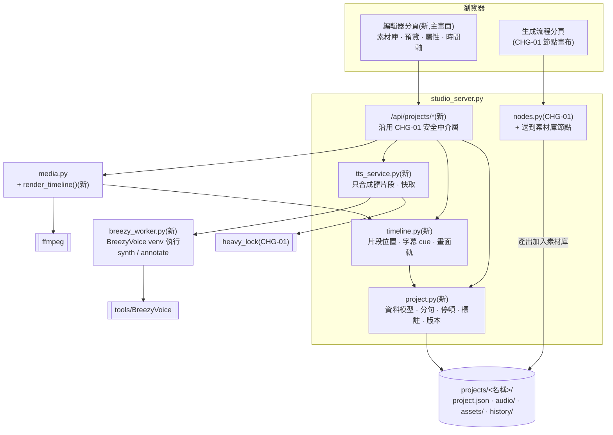
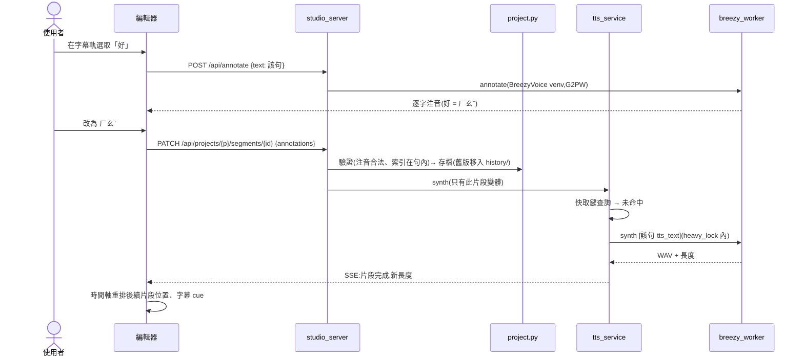
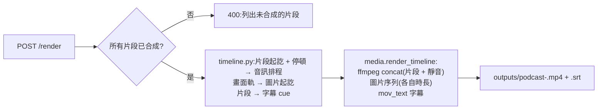

# CHG-20261022-04 — 影片編輯器時間軸 + 逐句合成 + 停頓長度 + 聲調標註

- 專案:podcast-studio
- 分支(Branch):main
- 日期:2026-10-22(UTC+0)
- 類型:新功能
- 提出者:使用者
- 實作者:主 agent 派發(DIR-3);實際工作者記於「## 派發記錄」
- 驗收者:獨立 Claude subagent(不參與施工、不看實作者自述)+ 使用者操作驗收
- 風險分級:高(命中高風險清單:**資料模型**——新增專案檔格式;**跨模組介面**——新增逐句合成與 BreezyVoice worker 介面(既有整段合成路徑保留)、時間軸渲染;**安全**——新增會寫檔的 HTTP 端點;**刪除(有限)**——history 超過 10 版自動刪最舊版)
- Autonomy:halt
- Commit/PR:(收尾時填)
- 重複性檢查(Recurrence check):(收尾時填)
- Diagrams:見「## 設計圖」節
- Mockup:見「## 畫面草稿」節
- Security-impact:見「## 安全影響」節
- Skill: ai-sdlc v1.66
- 關聯:FR-24~30(Guideline v1.2);**依賴 CHG-20261022-01**(`studio_server.py`、安全中介層、`heavy_lock`、節點登錄表、設定);CHG-01 的節點畫布改放「生成流程」分頁(本筆 T8 調整);`PODCAST_STUDIO.md §6` 已知限制「字幕依字數估時」、「數字念法 → 注音標註」由本筆處理

## 動機

使用者指示(2026-10-22):「畫面編輯採取影片編輯畫面」「可以設定說話語音中斷時間長度(增加停頓感)以及設定特定字詞或句的語調」。使用者選定:時間軸為主畫面、節點畫布當生成器;語調採注音聲調標註。

查證(2026-10-22):BreezyVoice 原生支援 `字[:注音]` 標註(`tools/BreezyVoice/README.md:72-74`);沒有停頓或語氣指令(模型非 `-Instruct` 版,`cosyvoice/cli/cosyvoice.py:24`);`batch_inference.py` 示範模型載入一次合成多句;`G2PWConverter` 可產生逐字注音(`single_inference.py:294-301`)。

## 使用者故事

1. 作為使用者,我打開網頁看到影片編輯器:左側素材庫、中間預覽、右側屬性、下方時間軸(畫面、語音、字幕三軌),以便用熟悉的剪輯方式完成一集。
2. 作為使用者,我把文稿放上時間軸後,系統逐句合成語音,每句是語音軌上的一個片段,以便看見每句話的位置與長度。
3. 作為使用者,我改了某一句的文字,只有那一句重新合成,其他句不動,以便修改不用等整篇重跑。
4. 作為使用者,我在設定裡給逗號、句號、段落各設預設停頓秒數,也能在時間軸上拖拉兩句之間的空隙、或在屬性面板輸入秒數,以便加強停頓感。
5. 作為使用者,我在文稿或字幕上選取一個字詞,看到系統自動標的注音,改成我要的注音與聲調(例:「好」改三聲、「的」改輕聲),該句自動重新合成,以便修正破音字與念法。
6. 作為使用者,我按預覽播放就能在瀏覽器裡看到畫面、聽到語音、看到字幕同步,不必先匯出,以便快速檢查。
7. 作為使用者,字幕時間跟實際語音對齊,以便不再有一兩秒的落差。
8. 作為使用者,我可以在畫面軌放多張圖、拖拉調整起訖,以便一集不只一張封面。
9. 作為使用者,我按匯出得到 1920×1080 MP4 與 SRT,並可存檔專案、之後載入繼續剪,存檔保留最近 10 個版本,以便誤改時能退回。
10. 作為使用者,我在「生成流程」分頁用節點產出的文稿、語音、圖片會出現在素材庫,以便直接拖上時間軸。

## 決策與取捨

| 決策 | 選項 | 前提假設 | 為何這樣選 |
|------|------|----------|------------|
| 主畫面 | 時間軸為主 + 節點當生成器 vs 只要時間軸 | — | **使用者選定**(2026-10-22) |
| 語調 | 注音聲調標註 vs 語氣參考音 vs 後製變調 | BreezyVoice 原生只支援注音 | **使用者選定**:注音聲調標註 |
| 停頓實作 | 文字插入標點 / 空白 vs 分句合成後插入靜音 | 模型沒有停頓指令;靠標點只能粗略影響 | 分句合成 + 精確靜音,長度可精確到 0.1 秒 |
| 分句單位 | 句尾標點(。！？!?;;換行)vs 逗號 | 逗號切太碎會讓合成失去語句連貫 | 語音片段以**句**為單位;逗號處的停頓由模型自然處理,使用者要加長時,在屬性面板對該逗號設「強制停頓」→ 該處切成兩個片段 |
| 合成程序 | 每句一個子程序 vs 常駐 worker | 每次載入模型需數十秒 | `breezy_worker.py` 以 BreezyVoice venv 執行,**一次呼叫處理整批句子**(模型載入一次);也提供 `annotate` 模式產生逐字注音 |
| 片段快取 | 每次全部重合成 vs 以內容雜湊快取 | 使用者會反覆改少數幾句 | 快取鍵 = SHA-256(含標註的合成文字 + 聲線檔雜湊 + 模型名);命中即重用 |
| 預覽 | 先渲染 MP4 vs 瀏覽器即時播放 | 渲染要時間;片段都是獨立 WAV | 瀏覽器依時間軸排程播放片段、切換圖片、疊字幕;匯出時才用 ffmpeg |
| 字幕 | 依字數估時 vs 片段實際長度 | 已有每句真實長度 | 字幕 = 片段;超過 24 字在片段內依字數比例再切(誤差限縮在單句內) |
| 專案格式 | JSON 檔 vs SQLite | 單人、git 友善、可人工檢視 | `projects/<名稱>/project.json` + `audio/`、`assets/`;`projects/` 不入 git(使用者資料) |
| 版本保留 | 不保留 vs 最近 N 版 | 拖拉編輯容易誤改 | 每次存檔前把舊檔移到 `history/<時間戳>.json`,保留最近 10 版 |
| 時間軸前端 | 第三方時間軸套件 vs 自寫 | 免建置、離線;需求只有三軌、拖拉空隙與圖片 | **代決**:自寫(原生 JS + CSS,DOM 元件);不引入新的第三方前端檔 |
| 預設停頓 | — | 台灣華語播報語感 | **代決**:逗號 0.0 秒(模型自然)、句號 0.4 秒、段落 0.8 秒;使用者可改 |

**代決事項**:分句規則與「強制停頓」切法、預設停頓秒數、自寫時間軸、`projects/` 不入 git、保留 10 版。

## 設計圖

### (1) 受影響範圍的架構圖



### (2) 本次變更的流程圖:改一個字的聲調



### (3) 匯出流程



## 畫面草稿

### 主畫面(編輯器分頁)

```
┌ Podcast 工作室 ── [編輯] [生成流程] [設定] ──────── 專案:夜市的味道 [存檔] [版本▼] [匯出 MP4] ┐
├─ 素材庫 ─────────┬──────────────── 預覽 ─────────────────┬─ 屬性 ───────────────────────┤
│ ⇩ 拖檔到這裡       │ ┌─────────────────────────────────┐ │ 選取:片段 #3                  │
│ ▣ cover-1.png      │ │                                 │ │ 文字:今天來聊台灣夜市         │
│ ▣ 夜市照片.jpg     │ │        [ 16:9 畫面預覽 ]         │ │ 狀態:✓ 已合成  2.4 秒         │
│ ≣ 文稿-1           │ │                                 │ │ ── 停頓 ──                    │
│ ♪ 自錄開場.wav     │ │   今天來聊台灣夜市(字幕)         │ │ 之前 [0.4] 秒   之後 [0.8] 秒  │
│                    │ └─────────────────────────────────┘ │ ── 聲調 ──                    │
│ (生成流程的產出    │   ⏮  ▶  ⏭   00:04.2 / 02:10.6        │ 今 天 來 聊 台 灣 夜 市        │
│  自動出現在這裡)   │                                      │ ㄐ ㄊ ㄌ ㄌ ㄊ ㄨ ㄧ ㄕ  ←點字改 │
├────────────────────┴──────────────────────────────────────┴──────────────────────────────┤
│ 00:00     00:02     00:04     00:06     00:08     00:10                     [－ 縮放 ＋]  │
│ 字幕 │[大家好]  [歡迎收聽]  [今天來聊台灣夜市]  [你最愛的…        ]                        │
│ 語音 │▕█████▏ ↔ ▕████████▏↔▕████████████▏ ↔ ▕██████████████        ← ↔ 拖拉=停頓長度     │
│ 畫面 │▓▓▓▓▓▓▓▓▓▓ cover-1.png ▓▓▓▓▓▓▓▓▓▓▓▓▓▓│▓▓▓▓ 夜市照片.jpg ▓▓▓▓▓▓▓▓  ← 拖邊緣=起訖      │
│      ▲ 播放頭                                                                            │
└──────────────────────────────────────────────────────────────────────────────────────────┘
```

### 聲調標註彈出框(點選字幕軌上的字)

```
          ┌─ 「好」的念法 ──────────────┐
          │ 自動:ㄏㄠˇ                    │
          │ ○ ㄏㄠˇ(三聲)  ● ㄏㄠˋ(四聲) │
          │ 自訂:[ㄏㄠˋ      ]           │
          │ 輕聲 ☐          [清除] [套用]  │
          └──────────────────────────────┘
          套用後:該句標示「重新合成中…」
```

### 設定頁新增

```
── 停頓預設 ──  逗號 [0.0] 秒  句號 [0.4] 秒  段落 [0.8] 秒   (0–5,精度 0.1)
```

## 安全影響

| 類別 | 是否觸及 | 影響範圍 / 理由 |
|------|----------|-----------------|
| irreversible-delete | **是(有限)** | 編輯會覆寫 `projects/<名稱>/project.json`;刪除片段 / 圖片會移除時間軸項目。對策:原子寫入;每次存檔前把舊版移入 `history/`,保留最近 10 版(第 11 版起最舊的被刪,範圍限 `history/`);刪除時間軸項目不刪素材檔;刪除整個專案需二次確認,只移到 `projects/.trash/`,30 天後於啟動時清除(範圍限 `.trash/`)。這兩處是本筆僅有的自動刪除;另 `tmp/` 的暫存輸入檔用完即刪(非使用者資料) |
| payments | 否 | 無金流 |
| prod-migration | 否 | 無資料庫;專案檔是新格式,帶 `schema_version: 1`,讀到未知版本拒絕載入並提示,不猜測轉換 |
| security-boundary | **是** | (a) 新端點 `/api/projects/*`、`/api/annotate` 沿用 CHG-01 的 Host / Origin / Token 中介層與路徑限制(`projects/` 加入允許目錄);專案名稱 `^[\w\-]{1,64}$`。(b) 使用者文字進 `breezy_worker.py`:以 JSON 檔(暫存於 `projects/<名稱>/tmp/`)傳遞,不放命令列參數、不經 shell;注音標註只允許注音符號與聲調符號,其他字元拒絕,避免把任意字串注入 BreezyVoice 的 `[:…]` 語法。(c) worker 以 BreezyVoice venv 執行第三方程式碼——與現況 `taiwan_ai.speak()` 相同的信任等級,不新增新的第三方來源。(d) 資源上限:音訊 60 分鐘、片段 2000、單句 500 字、文稿 50000 字、`project.json` 5 MB、素材 200 個 / 2 GB;synth、render、run 同時只允許一個。(e) 素材只經 CHG-01 上傳管道進入並以 asset id 引用,ffmpeg 與 worker 只拿到伺服器解析且檢查過前綴的路徑。(f) 原文的 `[`、`]` 轉全形,防止繞過標註驗證注入 BreezyVoice 語法。(g) `projects/` 不經 `/files/*` 暴露 |

## 修改指引

### 目標

FR-24~30:影片編輯器時間軸為主畫面;逐句合成、停頓長度、聲調標註、實際長度字幕、多圖畫面軌、匯出與專案版本。

### 影響範圍

| 受影響項 | 類型 | 改動 | 連帶影響 |
|----------|------|------|----------|
| `breezy_worker.py` | 設計 | 新增:在 BreezyVoice venv 執行;`synth`(批次)、`annotate`(逐字注音) | 依賴 BreezyVoice 內部函式 `single_inference`、`G2PWConverter`;上游改版風險同 ADP-5 |
| `project.py` | 資料/設計 | 新增:專案資料模型、分句、停頓、標註、版本 | `docs/structure/data.md` 新增實體 |
| `timeline.py` | 邏輯 | 新增:片段位置、字幕 cue、畫面軌 | — |
| `tts_service.py` | 設計 | 新增:髒片段合成、快取 | 使用 `heavy_lock` |
| `media.py` | 設計 | **新增** `render_timeline()`;既有函式不改 | `make_srt` 依字數估時的路徑保留給 MCP `make_video` |
| `studio_server.py` | 設計 | 新增 `/api/projects/*`、`/api/annotate` | 允許目錄加入 `projects/` |
| `static/`(編輯器分頁、時間軸、屬性面板、注音彈出框) | 目錄 | 新增;CHG-01 的節點畫布改放「生成流程」分頁 | CHG-01 的畫面草稿需同步改標題 |
| `nodes.py` | 設計 | 新增「送到素材庫」節點 | — |
| `settings.py` / `config/models.json` | 資料 | 新增停頓預設三個鍵 | 驗證範圍 0–5 |
| `.gitignore` | — | 新增 `projects/` | — |
| `taiwan_ai.speak()`、MCP `speak` | — | **不改**(整段合成路徑保留) | MCP 契約不變 |

### Global Constraints(全域約束——每個 task 都要遵守)

- 沿用 CHG-20261022-01 的全部全域約束(PEP 723、`./scripts/check.sh`、Host / Origin / Token、允許目錄、argv list、`heavy_lock`、原生前端、繁體中文、MCP 契約不變)。
- 允許讀寫的目錄加入 `projects/`;專案名稱一律符合 `^[\w\-]{1,64}$`。
- 專案檔一律帶 `schema_version: 1`;未知版本一律拒絕載入。
- 每次寫入 `project.json` 前一律把舊檔移到 `history/<時間戳>.json`,`history/` 只保留最近 10 個。
- 注音標註只接受注音符號(ㄅ–ㄩ)與聲調符號(ˊˇˋ˙),長度 1–5;其他輸入一律 422。
- 停頓秒數一律 0–5、四捨五入到 0.1。
- 語音片段一律以句尾標點(。！？!?;;與換行)切分;使用者設定的「強制停頓」位置另外切分。
- 使用者文字一律以 JSON 檔傳給 `breezy_worker.py`,不放進命令列參數。
- 合成快取鍵一律 = SHA-256(含標註的合成文字 + 聲線檔 SHA-256 + 模型名)。
- `media.py` 既有函式行為一律不變;只新增函式。
- 單一專案音訊總長 ≤ 60 分鐘、片段數 ≤ 2000、單句文字 ≤ 500 字、整份文稿 ≤ 50000 字、`project.json` ≤ 5 MB、素材 ≤ 200 個且總量 ≤ 2 GB。
- 素材(圖片、音訊、文稿)一律經 CHG-01 的 `/api/upload`(白名單、內容嗅探、200 MB、伺服器命名)進入,再複製到 `projects/<名稱>/assets/<uuid>.<ext>`;專案只記 asset id,**不記任何路徑**;`render_timeline` 與 worker 只依 asset id 在該專案 `assets/`、`audio/` 內解析檔案,解析後 `resolve()` 檢查前綴。
- 使用者文稿進合成前一律跳脫 BreezyVoice 標註語法:原文中的 `[`、`]` 換成全形 `［`、`］`,使唯一能產生 `[:注音]` 的途徑是經驗證的標註欄位。
- 專案名稱 regex 一律以 ASCII 比對(`re.ASCII`)。
- `project.json` 一律原子寫入(暫存檔 + `os.replace`),同一專案的寫入以專案層級鎖序列化;history 檔名 = `YYYYmmdd-HHMMSS-<毫秒>-<4 碼隨機>.json`。
- `projects/<名稱>/tmp/` 的 worker 輸入檔在 worker 結束後(成功或失敗)一律刪除;啟動時清空殘留的 `tmp/`。
- `projects/.trash/` 保留 30 天,啟動時清除超過 30 天者(第二個自動刪除點,範圍限 `.trash/`)。
- `projects/` 不經 `/files/*` 提供;專案音訊與素材只經 `/api/projects/{p}/media/{asset_id}` 提供。
- 同時只允許一個 synth 或 render(與 CHG-01 的 run 共用同一個「執行中」旗標),第二個回 409。
- 前端顯示文稿、字幕、屬性面板文字一律用 `textContent`(沿用 CHG-01 約束)。
- `/api/annotate` 輸入一律 ≤ 500 字,暫存檔放 `outputs/.tmp/`(不屬任何專案),用完即刪。
- 還原版本一律視為一次存檔:先把目前版本移入 history,再原子寫入。
- 刪除專案的 API 一律要求 `confirm: true`;移入 `.trash/<名稱>-<時間戳>-<4 碼隨機>/`,不覆蓋既有項目。
- worker 每句合成逾時 120 秒、整批逾時 = 句數 × 120 秒;render 逾時 600 秒;逾時即終止子程序並回報失敗。
- 匯出檔名沿用 CHG-01 T2 改過的 `stamp()`(毫秒 + 隨機碼),不覆蓋。

### Tasks(checkbox=續作點)

- [ ] T1. BreezyVoice worker
  - interfaces: consumes `tools/BreezyVoice`(`single_inference`、`CustomCosyVoice`、`G2PWConverter`)/ produces `breezy_worker.py`:`synth --jobs <json> --out <dir>`(模型載入一次,逐句輸出 `<id>.wav` 與 `result.json` 含長度)、`annotate --input <json>`(輸出逐字注音陣列);`tests/test_breezy_worker.py`(以假的 BreezyVoice 模組測參數處理)與 `tests/integration/test_breezy_worker_real.py`(真模型,兩句,不列入 `check.sh`)
  - test: `./scripts/check.sh tests/test_breezy_worker.py`;另 `tools/BreezyVoice/.venv/bin/python -m pytest tests/integration/test_breezy_worker_real.py` 產出兩個非空 WAV 且 `annotate("今天天氣真好")` 回傳 6 個注音
- [ ] T2. 專案資料模型
  - interfaces: consumes T1 的注音格式 / produces `project.py`:`Project`(segments、images、assets、pauses 預設、schema_version)、`split_segments(text, forced_breaks) -> list`、`tts_text(segment) -> str`(產生 `字[:注音]`)、`load/save`(history 10 版、`.trash/`)、`validate`;`tests/test_project.py`
  - test: `./scripts/check.sh tests/test_project.py`——原文含 `[:ㄅ]` 時 `tts_text` 輸出全形括號;專案名稱含非 ASCII 字母回錯誤;兩個執行緒同時存檔不產生壞檔且 history 檔名不重複;超過文字與素材上限回錯誤;分句依句尾標點與強制停頓;`tts_text` 把索引 2 的「好」標 ㄏㄠˋ 產生 `…好[:ㄏㄠˋ]…`;非注音字元標註回錯誤;停頓 5.04 → 5.0、-1 → 錯誤;第 11 次存檔後 history 剩 10 個;schema_version=2 拒絕載入
- [ ] T3. 合成服務
  - interfaces: consumes T1、T2、`heavy_lock` / produces `tts_service.py`:`dirty_segments(project)`、`synth(project, emit)`(只合成髒片段、快取命中跳過、`heavy_lock` 內、逐片段 emit)、`tests/test_tts_service.py`
  - test: `./scripts/check.sh tests/test_tts_service.py`——以替身 worker:三句全新 → 合成三句;改第二句 → 只合成第二句;改回原文字 → 快取命中、零次合成;聲線檔改變 → 全部變髒
- [ ] T4. 時間軸計算
  - interfaces: consumes T2 / produces `timeline.py`:`layout(project) -> {segments:[start,end], cues:[start,end,text], images:[start,end,file], duration}`;`tests/test_timeline.py`
  - test: `./scripts/check.sh tests/test_timeline.py`——片段起點 = 前一段終點 + 停頓;30 字片段切成 2 個 cue 且 cue 終點等於片段終點;預設一張圖撐滿全長;圖片起訖超出總長被截斷
- [ ] T5. 匯出渲染
  - interfaces: consumes T4 / produces `media.render_timeline(project, layout) -> (mp4, srt)`(新增函式);`tests/test_render_timeline.py`(以 1 秒正弦波片段與兩張純色圖實跑 ffmpeg)
  - test: `./scripts/check.sh tests/test_render_timeline.py`——layout 中的 asset id 指向專案外路徑(含符號連結)時拒絕渲染;輸出 1920×1080、音訊總長 = 片段長度總和 + 停頓總和(±0.05 秒)、字幕軌 cue 數等於 layout、第二張圖從指定時間開始(取該幀比對顏色)
- [ ] T6. 專案 API
  - interfaces: consumes T2~T5、CHG-01 中介層 / produces `/api/projects/{p}/media/{asset_id}`(只依 asset id 解析,`resolve()` 後檢查在該專案 `assets/` 或 `audio/` 內)、`/api/projects`(列表、新增、載入、刪除→`.trash/`,需 `confirm:true`)、`/api/projects/{p}`(存檔、版本列表、還原版本)、`/api/projects/{p}/segments/{id}`(文字、停頓、標註、強制停頓)、`/api/projects/{p}/images`、`/api/annotate`、`/api/projects/{p}/synth`(SSE)、`/api/projects/{p}/render`;`tests/test_server_projects.py`
  - test: `./scripts/check.sh tests/test_server_projects.py`——media 端點以不存在或他專案的 asset id 回 404;專案名稱以 `%2e%2e` 編碼回 400;刪除未帶 `confirm:true` 回 400;同名專案刪兩次在 `.trash/` 產生兩個不同目錄;還原版本後 history 多一個檔;`/api/annotate` 超過 500 字回 422;專案名稱含 `..` 回 400;`/files/` 取 `projects/` 下的檔案回 404;render 進行中再送 synth 回 409;worker 結束後 `tmp/` 為空;非法注音回 422;未合成就 render 回 400 並列出片段;刪除專案後檔案在 `.trash/`;還原版本後內容相等;錯 Host / 缺 Token 回 403
- [ ] T7. 前端:編輯器版面與預覽
  - interfaces: consumes T6 / produces 編輯器分頁(素材庫、預覽、屬性、時間軸三軌)、拖檔到素材庫、從素材庫拖到軌道、預覽依 layout 排程播放片段 WAV 並切換圖片與字幕、播放頭與縮放
  - test: `./scripts/check.sh tests/test_static.py`(擴充:編輯器只引用 `static/` 資源;軌道名稱與 layout 鍵一致);實際互動由 T9 驗證
- [ ] T8. 前端:停頓、聲調、畫面軌編輯與分頁調整
  - interfaces: consumes T6、T7、CHG-01 節點畫布 / produces 拖拉片段空隙調停頓、屬性面板輸入停頓、點字開注音彈出框並套用、畫面軌拖邊緣改起訖;CHG-01 節點畫布移到「生成流程」分頁;「送到素材庫」節點(`nodes.py`)
  - test: `./scripts/check.sh tests/test_nodes.py`(擴充:送到素材庫節點把輸出檔登記到專案 assets);實際互動由 T9 驗證
- [ ] T9. UI 互動檢查
  - interfaces: consumes T7、T8、CHG-01 的 `tests/ui_check.py` / produces 擴充 `tests/ui_check.py`:建立專案、放文稿、(替身)合成、拖空隙改停頓、改一個字的聲調、拖第二張圖、預覽播放 3 秒、匯出;截圖 `artifacts/editor.png`、`artifacts/tone.png`
  - test: `uv run --script tests/ui_check.py --only editor` exit 0 且兩張截圖存在

### Behaviour spec
- feature: features/timeline_editor.feature
- feature: features/pause_tone.feature

### Acceptance operation
- operate: 啟動網頁,新建專案「夜市的味道」,貼入約 1 分鐘文稿合成;把第 2、3 句間停頓拖到 1.5 秒;把文稿中某個「好」改成四聲;放兩張圖;預覽播放;匯出
- observe: 改停頓與改聲調都只重新合成受影響的句(伺服器 log 的合成次數);預覽中字幕與語音同步;匯出的 MP4 第 2、3 句之間有 1.5 秒靜音
- pass: `ffprobe` 驗證 1920×1080、H.264 + AAC + mov_text;以 ffmpeg `silencedetect`(-40 dB)在第 2、3 句間測得 1.5 ± 0.1 秒靜音;SRT 每個 cue 起點與對應片段起點差 ≤ 0.05 秒;使用者試聽確認「好」為四聲

### 本機閘
- cmd: ./scripts/check.sh && uv run --script tests/ui_check.py
- pass: 兩者 exit 0

### Interaction spec
- kind: gui-web
- cmd: uv run --script tests/ui_check.py --only editor
- artifacts: artifacts/editor.png, artifacts/tone.png

### 結構文件更新

- [ ] `docs/structure/directory.md`:新增 `breezy_worker.py`、`project.py`、`timeline.py`、`tts_service.py`、`projects/`(ignored)
- [ ] `docs/structure/logical.md`:架構圖加入編輯器與專案模組;新增「改聲調」「匯出」流程
- [ ] `docs/structure/design.md`:新增專案 API 契約、worker 介面、快取鍵、設計決策
- [ ] `docs/structure/data.md`:新增專案實體(Project、Segment、Annotation、ImageClip、Asset)與 schema_version
- [ ] `docs/ai-guideline.md`:§7 驗收條件加入 FR-24~30;§6 移除「字幕依字數估時」限制;`PODCAST_STUDIO.md §6` 加註指向帳本

### 風險與回滾

- 風險:(1) BreezyVoice 內部函式介面改版 → worker 只依賴三個函式,並有整合測試;(2) 分句切太碎導致語氣不連貫 → 以句為單位,逗號不切;(3) 預覽與匯出不一致 → 兩者共用 `timeline.layout()`;(4) 專案檔損壞 → history 10 版可還原。
- 回滾方式:`git revert` 本筆 commit;`projects/` 為使用者資料不入 git,revert 後保留在磁碟上,舊版程式不讀它。

## 派發記錄

(施工時填)

## 結構異動摘要

(實作後填)

## 審議

依 DIR-1,本機模型兩階段;高風險 → 全席,security 席用 27B。

**偏離記錄**:本筆審議本應在 CHG-01 / CHG-03 的 security 重審**之後**才開始,但等待條件以 `python3 …/panel.py` 比對行程,而 macOS 上該行程顯示為框架版 Python 的路徑,比對永遠失敗,於是本筆從 21:20 起與重審**並行**,違反使用者「不要並行處理」的指示;impact 席第 1 次 15 分鐘逾時可能與此有關。已改為比對 `scratchpad/panel.py` 並確認可偵測到執行中的審議。

### 第 1 輪(2026-10-22,計畫版)

```
[verdict] risk        | Qwen3.8-27B-…:IQ3_M  | pass    | 標頭、## 安全影響 | 命中資料模型、跨模組介面、安全、刪除(有限),分級正確;建議標頭補列刪除
[verdict] impact      | glm4:latest          | pass    | — | 逐條列 FR-1~15「已實作」,與本筆 FR-24~30 無關(第 1 次逾時,重派)
[verdict] drift       | qwen3:8b             | fail    | ### 結構文件更新 | 稱 data.md、design.md 等尚未含本筆內容
[verdict] compliance  | qwen3-abliterated:8b | pass    | DIR-1、§8 | 符合
[verdict] security    | Qwen3.8-27B-…:IQ3_M  | fail    | ## 安全影響、Global Constraints、T5~T7 | 素材上傳驗證、資源上限、輸出編碼、tmp/history/trash 生命週期未明定;原文可注入 [:…] 語法
[verdict] consistency | glm4:latest          | concern | — | 稱本筆改動 MCP 契約;原文明載 MCP speak 不改
```

### 派發者查核(第 1 輪)

| 席位 | 發現 | 查核 | 處置 |
|---|---|---|---|
| security ⛔ | 素材 / 圖片未明定白名單、大小、命名、路徑檢查 | **成立** | 素材一律經 CHG-01 上傳管道、以 asset id 引用、解析後檢查前綴 |
| security ⛔ | 素材數量與總量、文字長度、project.json 大小無上限 | **成立** | 全域約束補上限 |
| security ⛔ | `render_timeline` 用圖片路徑呼叫 ffmpeg 未驗證 | **成立** | 只接受 asset id;T5 測試補專案外路徑 / 符號連結 |
| security ⛔ | 原文可含 `[:…]` 繞過標註驗證 | **成立** | 原文 `[` `]` 轉全形;T2 測試 |
| security ⛔ | 前端輸出編碼未明定 | 部分成立(CHG-01 已有 `textContent` 約束) | 本筆重申 |
| security ⛔ | history 檔名唯一性、原子寫入、併發 | **成立** | 原子寫入 + 專案層級鎖 + 毫秒與隨機碼檔名 |
| security ⛔ | tmp / .trash 清理未明定 | **成立** | tmp 用完即刪、啟動清空;.trash 30 天 |
| security ⛔ | `projects/` 加入允許目錄擴大暴露面 | **成立** | 不經 `/files/*`,只經專案 media 端點 |
| security ⛔ | `\w` 可匹配 Unicode | **成立** | `re.ASCII` |
| security ⛔ | synth / render 並發 | **成立** | 與 CHG-01 共用單一執行中旗標,409 |
| risk ⛔ | 標頭未列「刪除」 | **成立(輕微)** | 標頭補列 |
| drift | 結構文件尚未含本筆內容 | **不成立**:結構文件於實作時更新,「結構文件更新」清單已逐項列出 | 不採 |
| impact / consistency | 與本筆無關 / 與原文矛盾 | — | 不採;glm4 兩席三筆 CHG 皆未產出可用判決,另記入 DIR-1 證據 |

修正後 **security 席(27B)第 2 輪重審**。

### 第 2 輪(2026-10-22,commit `1810ea9` 版本,security 席 27B)

```
[verdict] security | Qwen3.8-27B-…:IQ3_M | pass | ## 安全影響、Global Constraints、T6 | 四類皆答,對策在設計層面足以擋住所述威脅;另列 17 項中/低風險驗證缺口
```

### 派發者處置(第 2 輪)

security 席 pass。可直接寫成可測約束的項目納入:F-01 media 端點列入 T6 並測;F-02 `/api/annotate` 長度上限與暫存位置;F-04 還原版本走 history;F-05 / F-15 刪除需 `confirm:true` 且 `.trash/` 名稱不衝突;F-08 worker / render 逾時;F-12 編碼過的專案名稱測試;F-14 匯出檔名不覆蓋。其餘(F-03 全域磁碟上限、F-06 崩潰窗口、F-07 隨機碼理論碰撞、F-09 BreezyVoice 第三方信任、F-10 持續防 XSS、F-11 worker 路徑測試、F-13 未來語法、F-16 長期不啟動、F-17 依賴 CHG-01)記錄不改。

**審議結論**:全部席位已有回答;否決席(risk、compliance、security)皆為 pass。


## 狀態

草稿——審議通過;依賴 CHG-20261022-01;等待確認閘
