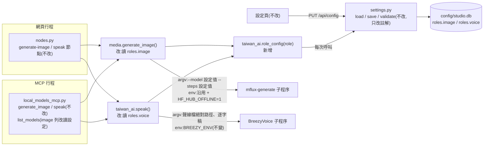
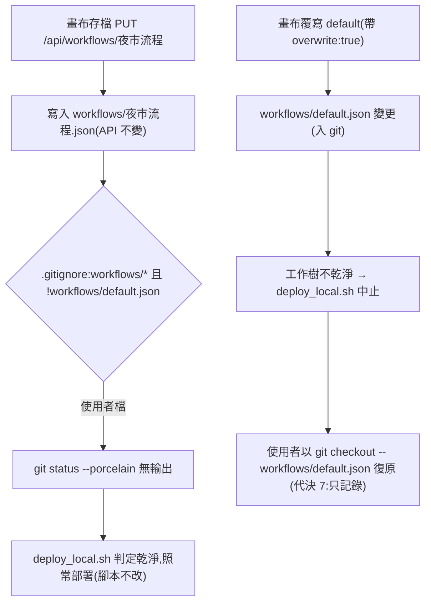

# CHG-20261026-01 — 生圖與聲線設定接上程式、workflows/ 使用者檔列入忽略

- 專案:podcast-studio
- 分支(Branch):main
- 日期:2026-10-26(UTC+0)
- 類型:缺陷修正(設定未生效)/ 設定調整
- 提出者:使用者
- 實作者:主 agent 派發(DIR-3);實際工作者記於「## 派發記錄」
- 驗收者:獨立 Claude subagent(不參與施工、不看實作者自述)+ 使用者操作驗收
- 風險分級:高(命中高風險清單:**跨模組介面**——設定資料 `roles.image`、`roles.voice` 新增讀取端 `media.generate_image()`、`taiwan_ai.speak()`,網頁與 local-models MCP 兩個行程的行為同時改變;**安全相關**——設定頁可編輯的值改為流入 mflux 與 BreezyVoice 子程序的 argv,且生圖模型名稱若指向本機沒有快取的 Hugging Face 模型,mflux 會在執行期下載,屬 Guideline §8「新增網路呼叫」的路徑,本筆以離線環境變數堵住;安全影響 security-boundary 答「是」,依 CHG-20261022-03 先例判級就高不就低,不接受自評降級)
- Autonomy:halt
- Commit/PR:(收尾時填)
- 重複性檢查(Recurrence check):(收尾時填)
- Diagrams:見「## 設計圖」節
- Mockup: skipped — 本筆不改任何畫面:設定頁的生圖、聲線欄位與畫布存檔對話框維持 CHG-20261022-01 T11、T12 的樣子
- Security-impact:見「## 安全影響」節
- Skill: ai-sdlc v1.66
- 關聯:**CHG-20261022-01 的後續**——T13 結構文件更新記下的兩項〔觀察〕(`docs/structure/design.md`、`docs/structure/data.md`:設定的 `image`、`voice` 角色沒有被讀取;`docs/structure/directory.md`、`docs/structure/data.md`:使用者另存的工作流程沒有列入 `.gitignore`);FR-4、FR-10、FR-3、FR-11(功能不變,參數來源改為設定)、FR-18、FR-21;CHG-20261022-01 Global Constraints「不修改 `media.py` 的行為」由本筆對 `generate_image()` 明示放寬(範圍見本筆 Global Constraints);CHG-20261022-04 的 `breezy_worker`(尚未施工)聲線來源由 CHG-04 自行決定,本筆不改 CHG-04;§9 待補項 ADP-3、ADP-4、ADP-9 不在本筆處理

## 動機

使用者指示(2026-10-26,原話):「另開一筆小 CHG 處理兩個缺口(生圖與聲線設定接上程式、workflows/ 使用者檔列入忽略),草稿給我過確認閘;同時進行 CHG-01 驗收。」

兩個缺口都是 CHG-20261022-01 T13 更新結構文件時記下的〔觀察〕:

1. 設定頁可以編輯 `roles.image`(`model`、`steps`)與 `roles.voice`(`wav`、`text`),通過 `settings.validate` 後存進 `config/studio.db`;但 `media.generate_image()` 仍用 `taiwan_ai.FLUX` 與固定 `--steps 4`,`taiwan_ai.speak()` 仍用 `VOICE_WAV` / `VOICE_TEXT` 常數——**使用者存了設定卻不生效**。
2. 從畫布存檔會建立未追蹤的 `workflows/<名稱>.json`;`scripts/deploy_local.sh` 遇到不乾淨的工作樹(含未追蹤檔)會中止部署,所以**存一次工作流程就無法部署**。

## 使用者故事

1. 作為使用者,我在設定頁把生圖步數改成 6 並儲存後,網頁的生圖節點與 Claude Code / Codex 透過 MCP 呼叫的 `generate_image` 都用 6 步,以便設定頁改的值真的生效。
2. 作為使用者,我在設定頁把聲線換成自己上傳的音檔與對應逐字稿後,網頁的語音節點與 MCP `speak` 都用新聲線合成,以便不必改程式就能換聲音。
3. 作為使用者,我沒動過生圖與聲線設定時,生圖與語音的結果和現在相同,以便升級不改變既有產出。
4. 作為使用者,我在畫布把流程存成「夜市流程」之後,`git status --porcelain` 仍沒有輸出,`scripts/deploy_local.sh` 不會因此拒絕部署。

## 決策與取捨

> 依使用者 2026-10-26 原則:「如果多次審議都無交集 只採最低限度」——本筆一律取能補上兩個缺口的最窄做法,其他改善不順手做。

| 決策 | 選項 | 前提假設(此決策建立在什麼之上) | 為何這樣選 |
|------|------|----------------------------------|------------|
| 讀設定的時機 | 呼叫當下經 `settings.load()` 重讀 vs 行程啟動時讀一次 | 推理模型已採「每次呼叫重讀」(`taiwan_ai.model()`);MCP 是長駐行程 | **代決**:與 `taiwan_ai.model()` 相同,每次 `generate_image()` / `speak()` 呼叫時讀一次;MCP 與網頁共用這兩個函式,**MCP 不需另改即自動跟上**(`local_models_mcp.generate_image` → `media.generate_image`、`local_models_mcp.speak` → `taiwan_ai.speak`) |
| 讀取介面 | 新增 `taiwan_ai.role_config(role)` vs 各自直接讀 `settings.load()["roles"]` | `taiwan_ai._role()` 要求角色有 `model` 鍵,`voice` 角色沒有;CHG-01 Global Constraints 規定設定只經 `settings.load()` 存取 | **代決**:新增 `taiwan_ai.role_config(role) -> dict`(回傳 `settings.load()["roles"][role]` 的副本,未知角色丟 `KeyError`);`media` 與 `speak` 都經它讀,不直接碰資料庫 |
| `generate-image` 節點要不要有 `steps` 參數 | 節點參數 vs 只走設定 | 使用者指示只要「設定接上程式」;節點參數會造成兩個來源互相覆蓋 | **代決**:不新增,步數只由設定決定;節點參數維持 `width`、`height` |
| `--base-model` | 固定 `schnell` vs 開放設定 | 預設模型是 schnell 系;設定頁沒有這個欄位 | **代決**:維持固定 `schnell`,不新增設定鍵(設定 schema v1 不變)。後果:使用者若把模型改成 dev 系,mflux 會用錯誤的基底設定——記在風險 |
| 生圖模型改成本機沒有快取的模型 | 執行期允許下載 vs mflux 子程序加 `HF_HUB_OFFLINE=1` vs 驗證只准預設模型 | Guideline §5「不送資料出本機」、§8「新增網路呼叫屬高風險」;mflux 以 Hugging Face 快取載入權重〔推論,未查證 mflux 原始碼,驗收時以 `lsof` 觀察〕 | **代決**:mflux 子程序環境在沿用目前環境的前提下加入 `HF_HUB_OFFLINE=1`,沒有快取就直接失敗、不下載;同 ADP-12 對 BreezyVoice 的做法。只准預設模型會讓設定欄位失去意義,不採 |
| 舊常數的去留 | 保留 `FLUX`、`VOICE_WAV`、`VOICE_TEXT` vs 移除 | 保留會留下第二個「看似生效」的來源,正是本筆要補的缺口 | **代決**:移除三個常數,預設值只留在 `settings.DEFAULTS`;MCP `list_models` 的 `image` 列改回報設定中的模型(輸出結構不變);`MFLUX`、`BREEZY` 保留 |
| 設定驗證 | 新增規則 vs 沿用 `settings.validate` | 已查:`steps` 必須是 1–8 整數;`wav` 必須在 `tools/BreezyVoice/data/`、`outputs/uploads/` 之下,不含 `..`、逐層不得是符號連結;`text` 非空且 ≤ 20000 字;`model` 非空、≤ 300 字、無控制字元;資料庫讀出的值每次 `load()` 都再經 `validate(cfg, None)`,不合法整份回 `DEFAULTS` | **代決**:不新增驗證規則。值一律以獨立 argv 元素傳入、不經 shell;以 `-` 開頭的值會被 mflux / BreezyVoice 的 argparse 當成缺少參數而失敗,不構成選項注入 |
| 工作流程使用者檔 | `.gitignore` 加 `workflows/*` 與 `!workflows/default.json` vs 改存 `outputs/` 或 `config/` vs 改 `deploy_local.sh` 的乾淨判定 | 使用者指示「workflows/ 使用者檔列入忽略」;`deploy_local.sh` 以 `git status --porcelain --untracked-files=all` 判定,已忽略的檔案不算(`tests/ci/test_deploy_local.py` 的 `test_ignored_files_do_not_count_as_dirty` 已涵蓋) | 依使用者指示:只改 `.gitignore`;**不改 `scripts/deploy_local.sh`**(治理基礎設施,本筆不需 `infra-approved`),也不改存檔位置與 API |
| 從畫布覆寫 `default` | 只記錄 vs 伺服器拒絕 `PUT /api/workflows/default` | `workflows/default.json` 入 git;畫布存檔(`buildGraph()`)不保留步驟精靈用的頂層 `steps` 鍵(`docs/structure/design.md`、`data.md` 〔觀察〕),CHG-20261022-04 的精靈要讀這個鍵 | **代決**:只記錄,不改程式。覆寫後工作樹變髒,`deploy_local.sh` 會中止(不會部署壞掉的範本),以 `git checkout -- workflows/default.json` 復原;代價是覆寫後精靈的預設步驟不見,直到復原。替代方案(伺服器對 `default` 回 409 或 403)會改 `studio_server.py` 與前端提示,超出使用者指示的範圍,確認閘可改選 |

**代決事項**(Guideline 與使用者指示推導不出,由 agent 先決定,確認閘請覆核):

1. 讀設定時機與介面:每次呼叫經新增的 `taiwan_ai.role_config()` 重讀。
2. `generate-image` 節點不新增 `steps` 參數,步數只走設定。
3. `--base-model schnell` 維持固定。
4. mflux 子程序加 `HF_HUB_OFFLINE=1`(沿用其餘環境變數)。
5. 移除 `taiwan_ai.FLUX`、`VOICE_WAV`、`VOICE_TEXT`;MCP `list_models` 的 `image` 列改回報設定值。
6. 不新增 `settings.validate` 規則。
7. 從畫布覆寫 `default` 只記錄、不改程式(替代:伺服器拒絕覆寫 `default`)。
8. 不改 `scripts/deploy_local.sh`。
9. 風險分級判「高」(理由見標頭)。

## 設計圖

### (1) 受影響範圍的架構圖

### (2) 本次變更的流程圖:存工作流程與部署

## 安全影響

| 類別 | 是否觸及 | 影響範圍 / 理由 |
|------|----------|-----------------|
| irreversible-delete | 否 | 不刪除任何檔案或資料。`.gitignore` 只改變 git 是否追蹤,不刪檔;已追蹤的 `workflows/default.json` 不受影響。注意:被忽略的檔案在 `git clean -X` / `-x` 時會被刪,這是使用者手動操作,本筆不執行;另外若日後某個 commit 新增與使用者檔同名的追蹤檔,`git pull` 可能覆蓋該使用者檔——Global Constraints 因此規定 `workflows/` 之下除 `default.json` 外不再新增追蹤檔 |
| payments | 否 | 無金流 |
| prod-migration | 否 | 設定資料庫 schema v1 不變,不新增鍵、不轉換資料;`DEFAULTS` 不變。既有資料庫中已存的 `image`、`voice` 值會在本筆合併後開始生效——這正是需求;若使用者先前存過不想要的值,第一次生圖或語音就會使用它(驗收前先在設定頁確認或按「還原預設」) |
| security-boundary | **是** | (a) 設定頁可編輯的 `roles.image.model`、`roles.image.steps`、`roles.voice.wav`、`roles.voice.text` 改為流入子程序 argv。對策:值來自 `settings.load()`,讀出時一律再經 `validate(cfg, None)`(步數 1–8 整數、聲線檔限兩個允許目錄且逐層拒絕符號連結與 `..`、文字非空且有長度上限、模型名稱無控制字元);argv 一律 list、不經 shell,每個值是獨立元素;寫入端仍是 CHG-01 的 `PUT /api/config`(Host / Origin / 權杖中介層不變)。(b) 生圖模型名稱若指向本機沒有快取的模型,mflux 可能在執行期連線 Hugging Face 下載——新的對外連線路徑。對策:mflux 子程序環境加入 `HF_HUB_OFFLINE=1`,快取不存在就失敗,不下載;驗收以 `lsof` 觀察 mflux 子程序對外連線數為 0。(c) BreezyVoice 子程序環境維持 `BREEZY_ENV`(含 ADP-12 的離線變數),本筆只改聲線檔路徑與逐字稿兩個 argv 值。(d) `.gitignore` 變更不擴大任何讀寫範圍;工作流程 API 的名稱規則、路徑檢查、覆寫確認不變 |

## 修改指引

### 目標

讓設定頁的 `roles.image`、`roles.voice` 在網頁與 MCP 兩邊實際生效且預設行為不變;讓畫布另存的工作流程不再使工作樹變髒。

### 影響範圍

- 程式:`taiwan_ai.py`(新增 `role_config()`、`speak()` 讀聲線設定、移除 `FLUX`、`VOICE_WAV`、`VOICE_TEXT`)、`media.py`(`generate_image()` 讀生圖設定、mflux 子程序環境)、`local_models_mcp.py`(只改 `list_models` 的 `image` 列)、`settings.py`(只改註解)
- 設定:`.gitignore`(新增 `workflows/` 規則)
- 測試:`tests/test_taiwan_ai.py`、`tests/test_media.py`、`tests/test_heavy_lock.py`、`tests/test_default_workflow.py`
- 行為規格:`features/settings_effect.feature`、`features/workflow_ignore.feature`(新增)
- 不改:`nodes.py`、`studio_server.py`、`static/`、`scripts/deploy_local.sh`、`tests/ci/`、`workflows/default.json`、設定資料庫 schema

### Global Constraints(全域約束——每個 task 都要遵守)

- 測試一律以 `./scripts/check.sh [pytest 參數]` 執行;測試不得呼叫真的 Ollama、mflux、BreezyVoice——子程序一律以 monkeypatch 替身攔截並檢查 argv 與 env。
- 生圖與聲線設定一律在**每次** `media.generate_image()` / `taiwan_ai.speak()` 呼叫時經 `taiwan_ai.role_config()` → `settings.load()` 讀取,一次呼叫只讀一次;其他模組不得直接開啟 `config/studio.db` 或快取設定值。
- 設定為 `settings.DEFAULTS` 時,mflux 與 BreezyVoice 的 argv 必須與本筆之前**逐元素相同**(`--model mflux-community/flux-1-schnell-mflux-q4`、`--base-model schnell`、`--steps 4`;`--speaker_prompt_audio_path <repo>/tools/BreezyVoice/data/example.wav`、`--speaker_prompt_text_transcription <官方範例逐字稿>`),元素順序不變。
- CHG-20261022-01「不修改 `media.py` 的行為」由本筆明示放寬,範圍只限 `generate_image()`:`--model`、`--steps` 改取設定值,子程序環境改為「沿用目前環境 + `HF_HUB_OFFLINE=1`」;其餘 argv、`unload_llms()`、`reserve()` 與暫存目錄處理、輸出檔名與內容不變;`media.py` 其他函式不改。
- `taiwan_ai.speak()` 只改 `--speaker_prompt_audio_path`(設定的 `wav`,相對路徑以 repo 根目錄 `ROOT` 為基準轉成絕對路徑)與 `--speaker_prompt_text_transcription`(設定的 `text`)兩個值;`BREEZY_ENV`、清除 Markdown 的處理、`cwd`、其餘 argv、輸出不變(ADP-4、ADP-9 不在本筆處理)。
- 子程序一律 argv list,不經 shell。
- MCP 工具的名稱、參數、回傳格式一律不變;`list_models` 輸出的鍵與順序不變,只有 `roles.image.model` 的值改為設定值。
- 節點登錄表(`nodes.py`)與 HTTP API(`studio_server.py`)不改;`generate-image` 節點不新增參數。
- 設定資料庫 schema、`settings.DEFAULTS`、`settings.validate` 的規則不變;`settings.py` 只允許改註解。
- `workflows/` 之下只追蹤 `workflows/default.json`;其他檔案(含存檔暫存檔 `.wf-*.tmp`)一律被 `.gitignore` 忽略;日後不得在 `workflows/` 新增其他追蹤檔。
- 不改 `scripts/deploy_local.sh` 與 `tests/ci/`(治理基礎設施)。
- 不新增任何對外網路呼叫。
- 使用者面文字、註解一律繁體中文與台灣用語。

### Tasks(checkbox=續作點)

- [ ] T1. 聲線讀設定(`taiwan_ai`)
  - interfaces: consumes `settings.load()`(roles.voice 的 `wav`、`text`)/ produces `taiwan_ai.role_config(role) -> dict`(回傳 `settings.load()["roles"][role]` 的副本;未知角色丟 `KeyError`);`taiwan_ai.speak(text) -> Path` 簽名不變,每次呼叫以 `role_config("voice")` 取聲線檔與逐字稿;移除 `VOICE_WAV`、`VOICE_TEXT` 常數;`settings.py` 中引用舊常數的註解改寫;`tests/test_taiwan_ai.py` 擴充
  - test: `./scripts/check.sh tests/test_taiwan_ai.py`——以 monkeypatch 攔截 `subprocess.run`:設定為 `DEFAULTS` 時 argv 與本筆之前的 argv 逐元素相同(聲線檔為 `ROOT / "tools/BreezyVoice/data/example.wav"`、逐字稿為官方範例原文);把設定改成 `outputs/uploads/v.wav` 與「測試逐字稿」後再呼叫一次,argv 的兩個值隨之改變(證明每次呼叫重讀);`env` 仍等於 `BREEZY_ENV`;`role_config("不存在")` 丟 `KeyError`;`grep -nE "VOICE_WAV|VOICE_TEXT" taiwan_ai.py media.py nodes.py local_models_mcp.py studio_server.py settings.py` 無輸出
- [ ] T2. 生圖讀設定(`media`、MCP `list_models`)
  - interfaces: consumes T1(`taiwan_ai.role_config()`)/ produces `media.generate_image(prompt, width=1024, height=1024)` 簽名不變,每次呼叫以 `role_config("image")` 取 `model`、`steps`,mflux argv 的 `--model`、`--steps` 改用設定值,子程序 `env` 為目前環境的副本加 `HF_HUB_OFFLINE=1`;移除 `taiwan_ai.FLUX`;`local_models_mcp.list_models` 的 `image` 列 `model` 改為設定值(鍵與順序不變);`tests/test_media.py`、`tests/test_heavy_lock.py` 擴充
  - test: `./scripts/check.sh tests/test_media.py tests/test_heavy_lock.py tests/test_nodes.py`——以替身 mflux:設定為 `DEFAULTS` 時 argv 與本筆之前逐元素相同;設定 `steps: 6`、`model: "test/model"` 後 argv 含 `--model test/model` 與 `--steps 6`,`--base-model schnell` 不變;傳給 `subprocess.run` 的 `env["HF_HUB_OFFLINE"] == "1"`,其餘鍵與 `os.environ` 相同;既有的佔位、暫存目錄、不覆寫測試照過;`list_models()` 的 `roles.image.model` 隨設定改變、輸出鍵順序與既有測試相同;`generate-image` 節點的參數仍只有 `width`、`height`;`grep -nE "^FLUX = |(tai|taiwan_ai)\.FLUX([^_A-Za-z]|$)" *.py` 無輸出
- [ ] T3. `workflows/` 使用者檔列入忽略
  - interfaces: consumes 無 / produces `.gitignore` 新增 `workflows/*` 與 `!workflows/default.json`(附繁中註解,引用本 CHG);`tests/test_default_workflow.py` 擴充
  - test: `./scripts/check.sh tests/test_default_workflow.py tests/ci/test_deploy_local.py`——`git check-ignore -q --no-index workflows/夜市流程.json` 與 `git check-ignore -q --no-index workflows/.wf-0.tmp` exit 0;`git check-ignore -q --no-index workflows/default.json` exit 1;`git ls-files workflows` 只有 `workflows/default.json`;既有的 `test_user_data_is_git_ignored` 照過;`tests/ci/test_deploy_local.py`(不修改)全部通過

### Behaviour spec
- feature: features/settings_effect.feature
- feature: features/workflow_ignore.feature

### Acceptance operation
- operate: (1) `uv run --script studio_server.py`,從首頁 ⚙ 進入設定頁,把生圖步數改成 2 並儲存;在「設定 › 進階流程」執行只含「文字輸入 → 生圖」兩個節點的流程,執行期間以 `ps -ww -o args= -p "$(pgrep -f mflux-generate)"` 取得 mflux 指令列,並以 `lsof -i -a -p <mflux pid>` 觀察對外連線;再以 MCP `generate_image` 呼叫一次並取指令列。(2) 把 `tools/BreezyVoice/data/example.wav` 的複本(改名)拖進畫布上傳,在設定頁的聲線選單選它(逐字稿沿用官方範例原文)並儲存;執行「語音」節點,合成期間以 `ps -ww -o args= -p "$(pgrep -f single_inference.py)"` 取得指令列;再以 MCP `speak` 呼叫一次並取指令列。(3) 設定頁按「還原預設」並儲存,再各生圖、合成一次並取指令列。(4) 在「設定 › 進階流程」載入預設範本,存成「夜市流程」,執行 `git status --porcelain --untracked-files=all` 與 `git check-ignore -v workflows/夜市流程.json`
- observe: (1) 網頁與 MCP 兩次的 mflux 指令列都含 `--steps 2`,伺服器日誌中 mflux 的進度列(有輸出時)為 2 步;mflux 子程序沒有對外連線;產出可開啟的 PNG。(2) 網頁與 MCP 兩次的 BreezyVoice 指令列都含 `--speaker_prompt_audio_path <repo>/outputs/uploads/<上傳檔名>.wav`;產出可播放的 WAV。(3) 還原預設後 mflux 指令列含 `--model mflux-community/flux-1-schnell-mflux-q4` 與 `--steps 4`,BreezyVoice 指令列含 `<repo>/tools/BreezyVoice/data/example.wav`。(4) `git status` 無輸出;`git check-ignore -v` 指出 `.gitignore` 的 `workflows/*` 規則
- pass: 步數與聲線的改變在網頁與 MCP 兩條路徑都反映在子程序指令列上;還原預設後指令列與本筆之前相同;生圖與語音全程 mflux、BreezyVoice 子程序對外連線數為 0;存「夜市流程」後 `git status --porcelain --untracked-files=all` 無輸出(與 `scripts/deploy_local.sh` 的判定相同)

### 本機閘
- cmd: ./scripts/check.sh
- pass: exit 0

### 結構文件更新

- [ ] `docs/structure/data.md`:設定角色表 `image`、`voice` 兩列移除「未讀此角色」〔觀察〕,改記讀取端與時機;程式內常數表移除 `FLUX`、`VOICE_WAV`、`VOICE_TEXT`;工作流程 JSON 節改記「`default.json` 入 git、其他檔案被 `.gitignore` 忽略」與「覆寫 `default` 會讓工作樹變髒、步驟精靈的 `steps` 鍵遺失」
- [ ] `docs/structure/design.md`:移除「設定未被讀取」〔觀察〕;mflux 指令改記 `--model <roles.image.model> --steps <roles.image.steps>` 與 `HF_HUB_OFFLINE=1`;`taiwan_ai` 常數清單移除 `FLUX`;新增 `role_config()`;設計決策表加入本筆代決
- [ ] `docs/structure/directory.md`:`workflows/` 列改記「只追蹤 `default.json`,使用者另存的檔案被忽略」
- [ ] `docs/structure/logical.md`:媒體層相依改為 `taiwan_ai.role_config()`(不再讀 `FLUX`);耦合點說明補上 `roles.image`、`roles.voice` 的讀取端
- [ ] `docs/ai-guideline.md`:§7 驗收條件補「設定頁改生圖步數與聲線後,網頁與 MCP 皆生效;存工作流程後工作樹乾淨」;§11 變更歷程加一列

### 風險與回滾

- 風險:(1) 使用者先前存過的 `image`、`voice` 值在合併後開始生效,產出可能與預期不同 → 驗收前先在設定頁確認或還原預設;(2) 步數設成 1–2 時畫質下降 → 使用者自選,範圍沿用 `validate` 的 1–8;(3) 聲線逐字稿與音檔內容不符時 BreezyVoice 合成品質差 → 設定頁既有提示範圍內,本筆不加檢查;(4) `--base-model` 固定 `schnell`,換成 dev 系模型會以錯誤基底執行 → 代決 3,確認閘可改;(5) `HF_HUB_OFFLINE=1` 讓沒有快取的模型直接失敗,若預設模型的快取不完整,原本可能靠執行期下載補齊的情況會變成失敗 → 驗收 (3) 會發現;需要時在建置期(允許連網)先下載一次;(6) 覆寫 `default` 仍會讓工作樹變髒並遺失步驟精靈的 `steps` 鍵 → 代決 7,`deploy_local.sh` 會中止,以 `git checkout -- workflows/default.json` 復原;(7) 被忽略的使用者工作流程檔不在 git 保護內,`git clean -X` 會刪掉 → 本筆不執行,使用者自行備份。
- 回滾方式:`git revert` 本筆各 task 的 commit。revert T1、T2 後 `generate_image()` / `speak()` 回到常數,設定資料庫內容不受影響(仍可在設定頁編輯,只是又不生效);revert T3 後使用者另存的 `workflows/*.json` 會重新顯示為未追蹤檔(不會被刪除),`deploy_local.sh` 又會因此中止,需先把這些檔移到 repo 外。

## 派發記錄

> 依 DIR-3:主 agent 只派發。審查與審議結論不記在本節,一律見對應 PR 的審議留言與「## 審議」節。

| task | 施工者 | 派發者獨立驗證 | PR | 備註 |
|------|--------|----------------|----|------|
| 草案 | Claude subagent | — | (本 PR) | 依使用者 2026-10-26 指示起草;確認閘前不施工 |

## 審議

(確認閘前)

## 狀態

草稿(待確認閘)——DIR-4 預授權不適用於新 CHG 的確認閘(DIR-4 第 2 條),須使用者明示核准後才派發 T1。
