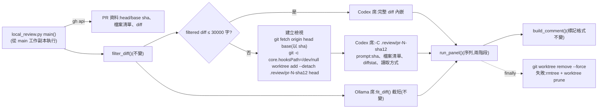
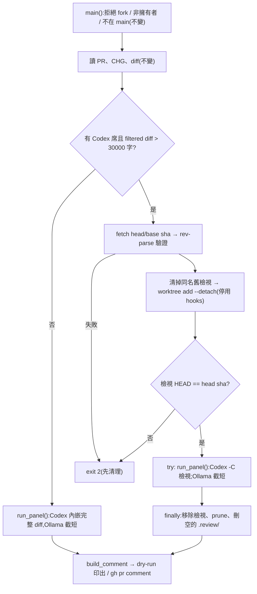

# CHG-20261028-01 — 本機審議 Codex 席讀得到完整程式(大 diff 改以 PR head 唯讀檢視送審)

- 專案:podcast-studio
- 分支(Branch):main
- 日期:2026-10-28(UTC+0)
- 類型:治理基礎設施缺陷修正(審議工具送審內容不完整)
- 提出者:使用者(來源:CHG-20261022-04 DIR-5 統整報告 C-2)
- 實作者:主 agent 派發(DIR-3);實際工作者記於「## 派發記錄」
- 驗收者:獨立 Claude subagent(不參與施工、不看實作者自述)+ 派發者以 PR #76 實際重審
- 風險分級:高(命中高風險清單:**安全相關**——改的是治理基礎設施 `scripts/local_review.py`(DIR-2 第 3 條);把 PR head 的內容以 detached worktree 寫到主工作副本內的 `.review/`,放寬 CHG-20261022-03 安全影響「PR 內容只以 `gh api` 讀成資料、絕不 checkout」的約束;新增一個 `git fetch origin <sha>` 網路呼叫(對象與既有 `gh api` 同為 GitHub);Codex(雲端)席可讀的範圍由「prompt 內的 diff」擴大為「PR head 的完整檔案樹」。安全影響 security-boundary 答「是」,依 CHG-20261022-03 先例判級就高不就低)
- Autonomy:halt
- Commit/PR:(草案 PR 與 T1 PR 開出後補記)
- 重複性檢查(Recurrence check):不是首次——CHG-20261022-04 T2–T9 的逐一審議中,Codex 三席已因「看不到實作」判 concern / fail(統整報告 C-2 列出 RS-5、RS-6、RS-9、RS-12、RS-14、RS-20、RS-28、RS-36,核對程式後八項都不成立);PR #76(整合分支合進 main,diff 約 658 KB)送審時「## diff」被截到空,security 判 fail、compliance 判 concern。根因是 `fit_diff()` 對 Codex 席也套用本機 Ollama 的 `num_ctx` 預算,CHG 全文與參考資料佔滿預算後 diff 剩 0 字;未見於先前 KN,不另建 KN
- Diagrams:見「## 設計圖」節
- Mockup: skipped — 本筆不改任何畫面,只改開發流程腳本
- Security-impact:見「## 安全影響」節
- Skill: ai-sdlc v1.66
- 關聯:CHG-20261022-04 DIR-5 統整報告(整合分支 `chg/CHG-20261022-04-impl` 上的 `docs/changes/review/CHG-20261022-04-summary.md`)§3 C-2、§5 C-2;DIR-1 第 9 條(Codex 席 read-only、prompt 經 stdin)、第 10 條(送審 CHG 去除審議紀錄);DIR-2 第 3 條(`infra-approved`);DIR-4、DIR-5 第 5 條(本筆 merge 後重審 PR #76);CHG-20261022-03 安全影響 (d)(g)(n)(o)(`local_review.py` 的原始安全約束)

## 動機

`scripts/local_review.py` 送審時,每一席的 prompt 都經 `fit_diff()` 把 diff 截到「CHG + 參考資料 + diff」放得進本機 Ollama 的 `num_ctx`(40960 token)。Codex 席(security、compliance,以及 27B 暫停期間的 risk)不受這個限制,卻沿用同一套截短:CHG 很大時 diff 會被截到 0 字。PR #76(CHG-20261022-04 整合分支合進 main)送審時「## diff」為空,security 席因看不到程式判 fail、compliance 判 concern;依 DIR-4 第 2 條,否決席 fail 時不能預授權 merge。

使用者決定(2026-10-28,原話):「Approve C-2: open a small CHG so the Codex seats in local_review.py can read the full code (infra-approved). Once it merges, re-review PR #76 and merge under DIR-4 if no veto seat fails.」

## 使用者故事

1. 作為使用者,我對 diff 很大的 PR 跑本機審議時,Codex 擔任的否決席能讀到每一個變更檔案的完整 diff 與檔案內容,以便判決依據實際程式,而不是「看不到實作」。
2. 作為使用者,diff 小的 PR 送審方式與現在相同,以便日常審議不多做事。
3. 作為使用者,本機 Ollama 席的送審內容與現在相同(仍依 `num_ctx` 截短),以便本筆不改變 Ollama 席的行為。
4. 作為使用者,審議結束後(含中途失敗)主工作副本不留下任何 PR 內容或額外的 worktree 登記,以便 `scripts/deploy_local.sh` 的乾淨判定與 `git worktree list` 不受影響。

## 決策與取捨

> 依使用者 2026-10-26 原則「如果多次審議都無交集 只採最低限度」與本次核准範圍(「讓 Codex 席讀得到完整程式」),只改 Codex 席,其他改善不順手做。

| 決策 | 選項 | 前提假設 | 為何這樣選 |
|------|------|----------|------------|
| Codex 席取得完整程式的方式 | (a) 不截短、把整份 diff 放進 prompt;(b) 分檔多次送審;(c) PR head 的唯讀檢視 + prompt 給 sha 與檔案清單,席位自行讀 | Codex 以 `codex exec -s read-only -C <目錄>` 執行,read-only sandbox 可讀檔、可跑唯讀的 `git diff` / `git show`;PR #76 的 diff 約 658 KB,(a) 單次 prompt 過大;(b) 一席要拆成多次判決再合併,改變判決語意 | **代決**:(c)。diff 超過門檻時,在主工作副本內的 `.review/pr-<編號>-<head sha 前 12 碼>/` 以 `git worktree add --detach` 建 PR head 的檢視,Codex 以 `-C` 指向它;prompt 給 base / head 的 40 碼 sha、變更檔案清單、diffstat 與讀取方式(`git diff <base>...<head> -- <路徑>`、直接讀檔或 `git show <head>:<路徑>`) |
| 內嵌與檢視的門檻 | 固定字數 vs 依 Codex context 估算 | 既有 `DIFF_CHAR_LIMIT` = 30000 字是 Ollama 席 diff 的上限;Codex context 遠大於此,但沒有公開、穩定的數字可依 | **代決**:經 `filter_diff()` 處理後(去 `.ai-sdlc/`、CHG 檔 diff 以一行取代)的 diff ≤ 30000 字(沿用 `DIFF_CHAR_LIMIT`)時,Codex 席把**完整** diff 直接放進 prompt(不再套 `num_ctx` 截短),不建檢視;超過 30000 字時改用檢視,prompt 的「## diff」放讀取說明與 diffstat,不放截短後的 diff |
| PR head 以 sha 鎖定 | 以分支名取用 vs 以 API 回報的 head sha 取用 | 審議標記 `sha=<head>` 由 `gh api` 的 `head.sha` 決定;若以分支名取用,PR 在審議期間被 push 會審到跟標記不同的內容 | **代決**:`git fetch --no-tags --no-write-fetch-head origin <head sha> <base sha>`(只取物件,不建分支、不寫 `FETCH_HEAD`),再以 `git rev-parse --verify <sha>^{commit}` 確認兩個 sha 都在;worktree 以 head sha 建立後再以 `git -C <檢視> rev-parse HEAD` 比對,不一致即中止(exit 2) |
| 檢視的建立選項 | 一般 `worktree add` vs 停用 hooks | 主工作副本的 `.git/hooks/post-checkout` 若存在,`worktree add` 會執行它 | **代決**:`git -c core.hooksPath=/dev/null worktree add --detach <路徑> <head sha>`,不執行任何 hook;不建分支 |
| 檢視的清理 | 只在成功時清 vs `try/finally` | 審議可能因例外、Ctrl-C 或子程序失敗中途結束 | **代決**:建立後整段審議包在 `try/finally`,結束一律 `git worktree remove --force <路徑>`;失敗時改以 `shutil.rmtree` 刪目錄(只限 `.review/` 之下)再 `git worktree prune`;最後 `.review/` 為空即刪除。建立前若同名目錄已存在(上次中斷留下),先以同一套清理移除 |
| 寫入範圍 | 系統暫存目錄 vs repo 內 gitignored 目錄 | 使用者要求腳本不得寫出 repo 以外;`deploy_local.sh` 以 `git status --porcelain --untracked-files=all` 判定乾淨 | **代決**:檢視只放 `<repo>/.review/`,`.gitignore` 新增 `.review/`;路徑以 `resolve()` 確認在 `<repo>/.review/` 之下,且 `.review` 不得是符號連結;worktree 的登記檔在 `<repo>/.git/worktrees/`(repo 內) |
| CHG 檔 diff 與前輪判決 | 檢視內刪改 CHG 檔 vs prompt 指示不讀 | 檢視是完整 head,其中的 `docs/changes/CHG-*.md` 含「## 審議」節;DIR-1 第 10 條要求獨立階段不看前輪判決 | **代決**:prompt 明示「不要讀 `docs/changes/CHG-*.md` 與 `.ai-sdlc/` 的 diff 或檔案(CHG 全文已另附並去除審議節;vendored 不審)」,並給排除 pathspec 的 `git diff` 範例;不改檢視內容(改了就不是 head,與標記 sha 不符)。殘留風險記於「## 風險與回滾」 |
| Ollama 席與 27B 改派 | 一併改 vs 不改 | 核准範圍只限 Codex 席 | **代決**:Ollama 席沿用 `fit_diff()` 截短,送審內容與本筆之前相同;27B 逾時改派 Codex(`heavy_fallback()`)沿用該席原本的 Ollama prompt 與 `-C <repo>`,不改(27B 暫停中,DIR-1 第 10 條) |
| 留言與標記 | 新增欄位 vs 不變 | `scripts/ci/review_gate.py` 解析標記;否決席與 sha 驗證不能變 | **代決**:標記格式、`[verdict]` 行格式不變;只在留言說明列加一句「Codex 席以 PR head 唯讀檢視讀完整程式(diff N 字超過 30000 字門檻)」,屬人讀文字 |

**代決事項**(Guideline 與使用者指示推導不出,由 agent 先決定,確認閘請覆核):

1. 取得方式採 PR head 唯讀檢視(detached worktree),不採整份 diff 內嵌或分檔送審。
2. 門檻:`filter_diff()` 後 ≤ 30000 字內嵌完整 diff,超過改用檢視。
3. 以 API 回報的 head / base sha 取用並比對,不以分支名取用。
4. `worktree add` 停用 hooks、不建分支。
5. `try/finally` 清理,失敗時退回 `rmtree` + `worktree prune`。
6. 檢視放 `<repo>/.review/`,`.gitignore` 新增該目錄。
7. 檢視內容不改;以 prompt 指示不讀 CHG 檔與 `.ai-sdlc/`。
8. Ollama 席、27B 改派、留言標記格式不變。
9. 風險分級判「高」。

## 設計圖

### (1) 受影響範圍的架構圖

### (2) 本次變更的流程圖

## 安全影響

| 類別 | 是否觸及 | 影響範圍 / 理由 |
|------|----------|-----------------|
| irreversible-delete | 否 | 只刪本次執行自己建立的檢視(`<repo>/.review/pr-<編號>-<sha12>/`)與其 worktree 登記;`rmtree` 退路以 `resolve()` 確認在 `<repo>/.review/` 之下才執行,`.review` 是符號連結時拒絕。不碰主工作副本的追蹤檔、分支或其他 worktree(`git worktree prune` 只清已不存在目錄的登記) |
| payments | 否 | 無金流 |
| prod-migration | 否 | 不改資料、設定或部署;`deploy_local.sh` 不改 |
| security-boundary | **是** | (a) **PR 內容落地**:CHG-20261022-03 的「PR 內容只以 `gh api` 讀成資料、絕不 checkout」放寬為「主工作副本不 checkout;PR head 只以 detached worktree 建在 gitignored 的 `.review/` 供 Codex 唯讀讀取」。對策:仍只處理本 repo 分支且作者為擁有者的 PR(fork、非擁有者在建檢視之前就 exit 1,不變);不呼叫 `git checkout`、`git switch`、`gh pr checkout`;`worktree add` 以 `core.hooksPath=/dev/null` 停用 hook;本腳本不執行檢視內任何程式;審完即移除(含例外)。(b) **新網路呼叫**:`git fetch origin <sha> <sha>`,對象為 `origin`(本 repo 的 GitHub 遠端),與既有 `gh api` 同一服務、同一 repo,不送出本機資料;不寫 `FETCH_HEAD`、不建 ref。(c) **審到的內容與標記一致**:以 API 回報的 head sha 取用,建立後比對檢視 HEAD,不一致即中止;base sha 同樣驗證。(d) **Codex 可讀範圍擴大**:由 prompt 內的 diff 擴大為 PR head 的完整檔案樹;repo 已公開,屬 DIR-1 第 9 條的既有使用者明示例外(送審資料送往雲端)。Codex 仍只用 `-s read-only`、prompt 經 stdin;`codex_argv()` 的禁用旗標檢查不變。read-only sandbox 不能寫檔,但可執行唯讀指令——prompt 明示只讀、不得執行檢視內程式;這與既有 `-C <repo>` 時的能力相同。(e) 審議標記、`review_gate.py`、否決席判定、留言 sanitize 與單席 4000 字上限不變 |

## 修改指引

### 目標

diff 超過 30000 字時,Codex 席以 PR head 的唯讀檢視讀到完整程式;diff 小時 Codex 席收到完整 diff;Ollama 席、fork 拒絕、擁有者限制與審議標記格式不變;檢視在審完(含例外)一律移除。

### 影響範圍

- 程式:`scripts/local_review.py`(新增檢視建立 / 移除、Codex 席送審內容與 `-C` 目錄;docstring 安全約束改寫)
- 設定:`.gitignore`(新增 `.review/`)
- 測試:`tests/ci/test_review_gate.py`(`FakeEnv` 補 git 呼叫替身與 PR base sha;新增 Codex 檢視相關測試)
- 行為規格:`features/local_review_codex.feature`(新增)
- 結構文件:`docs/structure/directory.md`、`docs/structure/design.md`、`docs/structure/logical.md`
- 不改:`scripts/ci/review_gate.py`、`.github/`、`.ai-sdlc/`、`scripts/deploy_local.sh`、產品程式

### Global Constraints(全域約束——每個 task 都要遵守)

- 只改 Codex 席的送審內容與工作目錄;Ollama 席的 prompt、`fit_diff()`、`num_predict` 計算與本筆之前逐字相同。
- fork PR、非擁有者 PR、不在 main 執行一律在任何 git fetch / worktree 動作之前拒絕,退出碼不變。
- 不呼叫 `git checkout`、`git switch`、`gh pr checkout`;主工作副本的 HEAD、index、追蹤檔不變。
- PR head 以 `gh api` 回報的 40 碼 head sha 取用並驗證;檢視 HEAD 與標記 sha 不一致即中止。
- 腳本寫入只限 `<repo>/.review/`、`<repo>/.git/`(fetch 物件與 worktree 登記)與既有的 `outputs/.tmp/local_review/`;不寫 repo 以外。
- 檢視在 `try/finally` 中移除;測試必須涵蓋成功與失敗兩條路徑。
- Codex 一律 `-s read-only`、prompt 由 stdin 傳入;`CODEX_FORBIDDEN` 檢查不變。
- 審議標記、`[verdict]` 行格式、`review_gate.py` 不變。
- 測試不得呼叫真的 `codex`、`gh`、`git fetch`、Ollama;以替身取代 `run_cmd()`、`call_ollama()`。
- 使用者面文字、註解一律繁體中文與台灣用語。

### Tasks(checkbox=續作點)

- [x] T1. Codex 席以 PR head 唯讀檢視讀完整程式
  - interfaces: consumes `gh api repos/{slug}/pulls/{n}` 的 `head.sha`、`base.sha` / produces `local_review.CODEX_INLINE_LIMIT`(= `DIFF_CHAR_LIMIT`,30000)、`local_review.VIEW_ROOT`(`<repo>/.review`)、`make_view(pr_no, head_sha, base_sha) -> Path`(fetch、驗證、`worktree add --detach`、比對 HEAD;失敗丟 `CmdError` 並已清理)、`remove_view(path) -> None`(`worktree remove --force`,失敗退回 `rmtree` + `prune`,刪空的 `.review/`)、`codex_argv(schema_path, out_path, workdir=REPO_ROOT)`(`-C` 改為參數)、`run_panel(seats, make_block, diff, codex_diff=None)`(Codex 席用 `codex_diff`、不經 `fit_diff()`);`.gitignore` 新增 `.review/`;`features/local_review_codex.feature`;`tests/ci/test_review_gate.py` 擴充;結構文件更新
  - test: `python3 -m unittest discover -s tests/ci` 與 `./scripts/check.sh`——以替身 `run_cmd()`:(1) filtered diff > 30000 字時,每次 `codex exec` 的 `-C` 為 `<repo>/.review/pr-9-<sha12>`,stdin 含 base 與 head 的 40 碼 sha、變更檔案清單、diffstat 與 `git diff <base>...<head>`,不含「截斷於」註記;(2) 同一次執行 Ollama 席的 prompt 仍含「截斷於」且符合 `num_ctx` 預算;(3) filtered diff ≤ 30000 字時不建檢視、`-C` 為 `<repo>`、Codex prompt 含完整 diff;(4) 審完檢視目錄不存在、`worktree remove` 被呼叫;(5) `run_panel` 丟例外時檢視仍被移除、例外往外傳;(6) 檢視 HEAD 與 head sha 不符、fetch 失敗、`worktree add` 失敗時 exit 2 且不留目錄;(7) fork / 非擁有者 PR 不呼叫任何 `git fetch` 或 `worktree`;(8) 既有 `test_no_checkout_commands` 照過(大 diff 情境也不含 `checkout`、`switch`);(9) `git worktree add` 的 argv 含 `-c core.hooksPath=/dev/null` 與 `--detach`、以 head sha 為 commit-ish;另以 `python3 scripts/local_review.py --pr 76 --codex-seats security --seats security --dry-run` 實測一次,Codex 席判決不得以「看不到程式 / diff 為空」為理由

### Behaviour spec
- feature: features/local_review_codex.feature

### Acceptance operation
- operate: (1) 從 main 的工作副本(或 HEAD 名為 `main`、內容為本筆 merge 後 main 的副本)執行 `python3 scripts/local_review.py --pr 76 --codex-seats security --seats security --dry-run`,執行期間以 `git worktree list` 觀察;(2) 結束後執行 `git worktree list`、`ls .review`、`git status --porcelain --untracked-files=all`;(3) 以 `--pr <小 diff 的 PR>` 再跑一次 dry-run;(4) 本筆 merge 後依使用者指示正式重審 PR #76(`--codex-seats risk,security,compliance`)
- observe: (1) 執行期間 `git worktree list` 出現 `.review/pr-76-<sha12>`(detached,HEAD 為 PR #76 的 head sha);dry-run 留言的 security 席細節引用具體檔案與行為,說明列註明以唯讀檢視讀完整程式;(2) 結束後 `git worktree list` 只剩原有項目、`.review` 不存在、`git status` 無輸出;(3) 小 diff 不建檢視;(4) 留言標記 sha 等於 PR #76 head
- pass: Codex 席不再以「diff 為空 / 看不到程式」為理由判 fail 或 concern;檢視在結束後不存在;標記格式通過 `review_gate.py` 解析

### 本機閘
- cmd: ./scripts/check.sh
- pass: exit 0

### 結構文件更新

- [x] `docs/structure/directory.md`:`scripts/local_review.py` 列的限制改記「主工作副本不 checkout;diff 超過 30000 字時以 `.review/` 下的 detached worktree 供 Codex 席唯讀讀取,審完移除」;新增 `.review/`(gitignored,本機審議暫存)說明
- [x] `docs/structure/design.md`:設計決策表新增「Codex 席以 PR head 唯讀檢視讀完整程式」一列
- [x] `docs/structure/logical.md`:本機審議步驟補記 Codex 席讀取方式

### 風險與回滾

- 風險:(1) Codex 在檢視中仍可能讀到 CHG 檔的「## 審議」節(前輪判決)→ prompt 明示不讀;若實審發現仍受影響,另開 CHG 評估在 prompt 外的強制手段;(2) Codex 自行決定讀哪些檔,可能漏讀 → prompt 給完整檔案清單與 diffstat,並要求逐檔讀 diff;判決仍不能取代使用者在確認閘的判斷(DIR-1 第 8 條);(3) 腳本被強制終止(SIGKILL)時 `finally` 不會執行,留下 `.review/` 與 worktree 登記 → 下次同一 PR 同一 sha 執行時先清掉同名舊檢視;其他殘留以 `git worktree remove --force` 手動清,`.review/` 已 gitignored,不影響部署判定;(4) `git fetch` 以 sha 取用依賴 GitHub 允許取可達 commit → 2026-10-28 以 PR #76 實測可取;失敗時 exit 2,不靜默退回截短;(5) 檢視約佔一份 PR head 的磁碟空間(不含 `tools/`、`outputs/` 等 ignored 目錄)
- 回滾方式:`git revert` T1 的 commit,回到所有席位共用 `fit_diff()` 截短;`.review/` 若有殘留可直接刪除並 `git worktree prune`

## 派發記錄

> 依 DIR-3:主 agent 只派發。審查與審議結論不記在本節,一律見對應 PR 的審議留言與「## 審議」節。

| task | 施工者 | 派發者獨立驗證 | PR | 備註 |
|------|--------|----------------|----|------|
| 草案 | Claude subagent | — | (本 PR) | 依使用者 2026-10-28 核准 C-2 起草(核准原話見「## 狀態」);DIR-3 第 2 條例外:治理文件草案直接派 Claude subagent |
| T1 | Claude subagent | `python3 -m unittest discover -s tests/ci`(142 項)、`./scripts/check.sh`(857 項)、`ruff check --select E9,F`、doc_integrity_check;2026-10-28 實測 `python3 scripts/local_review.py --pr 76 --codex-seats security --seats security --dry-run`(於 HEAD 名為 `main`、內容為本分支的暫存副本執行) | (T1 PR 開出後補記) | DIR-3 第 2 條例外二:高風險程式 task 直接派 Claude subagent。實測:filtered diff 528045 字 → 建 `.review/pr-76-50fdaee21d31`,Codex 席 179 秒回答,判決引用 `studio_server.py`、`project.py` 具體行號(讀到完整程式);結束後 `.review/` 與 worktree 登記皆不存在。該次 security 判 fail,理由為 PR #76 本身的實質發現(自錄音檔繞過素材配額、媒體端點符號連結競態),不是「看不到程式」;屬 PR #76 的審議結果,不屬本筆 |

## 審議

(確認閘前)

## 後續改善(不屬本筆範圍,另開 CHG)

- 27B 逾時改派 Codex(`heavy_fallback()`)仍使用 Ollama 席截短後的 prompt;27B 恢復使用時再評估。
- 前輪判決隔離目前只靠 prompt 指示;若要強制,需改用不含 CHG 檔的檢視或其他機制。

## 狀態

草稿(2026-10-28)。

確認閘核准(2026-10-28,使用者原話:「Approve C-2: open a small CHG so the Codex seats in local_review.py can read the full code (infra-approved). Once it merges, re-review PR #76 and merge under DIR-4 if no veto seat fails.」)——核准範圍限於讓 `scripts/local_review.py` 的 Codex 席讀得到完整程式;本草案的代決事項與風險分級「高」依此核准範圍執行。
