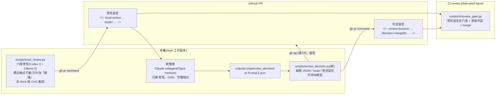
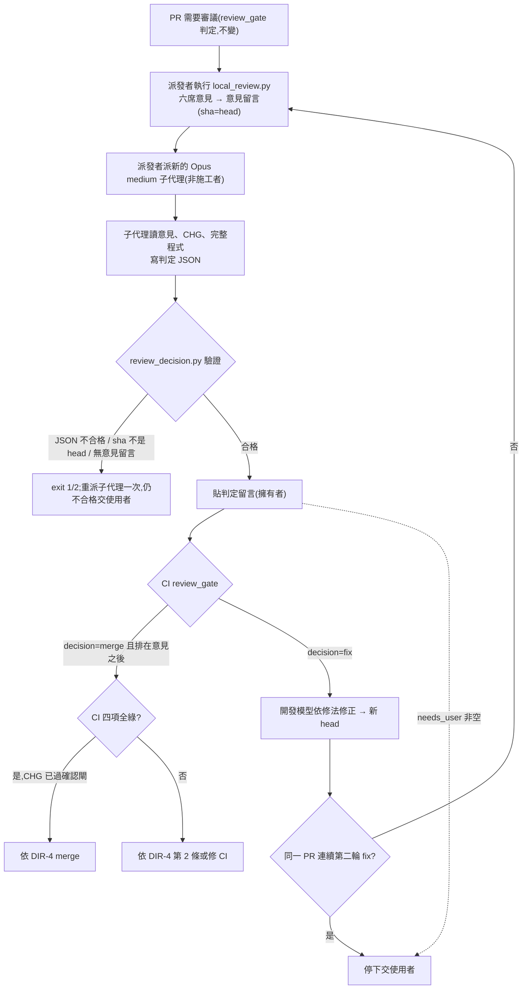
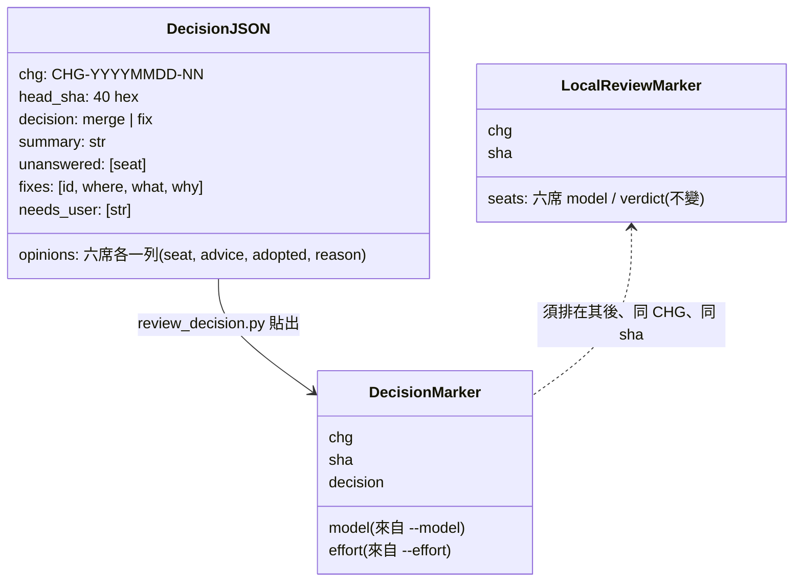

# CHG-20261028-02 — 審議席改為意見,由單一獨立統整席判定可否合併

- 專案:podcast-studio
- 分支(Branch):main
- 日期:2026-10-28(UTC+0)
- 類型:治理流程與治理基礎設施變更(審議席位語意、merge 閘)
- 提出者:使用者(2026-10-28 指示,原話見「## 狀態」)
- 實作者:主 agent 派發(DIR-3);實際工作者記於「## 派發記錄」
- 驗收者:獨立 Claude subagent(不參與施工、不看實作者自述)+ 派發者以 PR #76 實際走一次新流程
- 風險分級:高(命中高風險清單:**安全相關**——改的是治理基礎設施 `scripts/local_review.py`、`scripts/ci/review_gate.py`、`tests/ci/`(DIR-2 第 3 條),並新增同屬治理基礎設施的 `scripts/review_decision.py`;merge 閘由「否決席無 fail、全部席位有回答」改為「單一統整席對目前 head 判定 merge」,移除 DIR-4 預授權所依賴的否決席補償控制;安全影響 security-boundary 答「是」。依 CHG-20261022-03、CHG-20261028-01 先例判級就高不就低)
- Autonomy:halt
- Commit/PR:草案 PR 開出後補記
- 重複性檢查(Recurrence check):不是首次——CHG-20261022-04 的逐一審議與 PR #76 合併審議中,否決席多次因送審內容不完整(看不到程式、CHG 過大)判 concern / fail 或沒有回答,DIR-5 統整報告核對程式後多項不成立,卻仍依 DIR-4 第 2 條擋下 merge;glm4 席在 CHG 過大時超出 `num_ctx` 而沒有回答。DIR-5 已引入「單一模型統整」,本筆把統整結果升為 merge 判定。未見於先前 KN,不另建 KN
- Diagrams:見「## 設計圖」節
- Mockup: skipped — 本筆不改任何畫面,只改開發流程腳本與治理規則
- Security-impact:見「## 安全影響」節
- Skill: ai-sdlc v1.66
- 關聯:DIR-1(席位表、第 1、4、6、8、10 條)、DIR-2 第 3 條(`infra-approved`、治理基礎設施清單)、DIR-3 第 2 條、DIR-4(預授權條件)、DIR-5(批次審議、第 3、5、6、7 條);CHG-20261022-03 安全影響 (b)(c)(i)(n)(`review_gate.py` 的原始安全約束);CHG-20261028-01(Codex 席唯讀檢視,統整席可沿用);PR #76(重審暫停,等本筆生效後以新流程審)

## 動機

現行規則下,審議席(DIR-1:Codex 三席 + Ollama 三席)中的 risk、security、compliance 是否決席:任一判 fail 或任一席沒有回答,CI `review` 檢查就不過,DIR-4 預授權也不適用。實務上:

1. 否決席的 fail 常來自送審內容不完整或模型誤讀(CHG-20261022-04 統整報告 C-2 列出八項「看不到實作」的發現,核對程式後都不成立),卻仍有否決效力;
2. 本機 8–9B 席與 glm4 席在 CHG 很大時沒有回答,`no-answer` 一律擋下 merge;
3. DIR-5 已由單一模型(Opus medium)讀完全部審議統整成報告,但 merge 條件仍看各席判決,統整結果沒有對應的閘。

使用者決定(2026-10-28,原話):「改為審議席提供意見 最後統整為單一獨立審議席全部審議再決議如何修」。

## 使用者故事

1. 作為使用者,各審議席的判決改為「意見」,不再單席否決,以便模型誤讀或沒有回答不會直接擋下 merge。
2. 作為使用者,由一個與施工者不同的獨立統整席(Opus medium)讀完全部意見、CHG 與完整程式,判定「可合併」或「需修正(列出修法)」,以便合併決定建立在核對過程式的單一判斷上。
3. 作為使用者,CI 的 `review` 檢查改看統整席對目前 head 的判定,以便閘與實際決定一致;各席意見留言仍必須先存在於同一 head,以便統整席有東西可統整。
4. 作為使用者,沒有回答的席位在統整報告中逐一列出,以便我知道哪些面向沒有模型意見。
5. 作為使用者,統整席判定可合併且 CI 全綠時,派發者依 DIR-4 merge;判定需修正時,由開發的模型依修法清單修正後重跑意見與統整。

## 決策與取捨

> 依使用者 2026-10-26 原則「如果多次審議都無交集 只採最低限度」與本次指示範圍,只改「誰決定能否合併」與相應的閘;席位表、兩階段審議、留言標記格式盡量不動。

| 決策 | 選項 | 前提假設 | 為何這樣選 |
|------|------|----------|------------|
| 合併由誰決定 | (a) 派發者看意見裁決;(b) 單一獨立統整席判定;(c) 多數決 | 使用者 2026-10-28 選擇「統整席決定」 | **使用者決定**:(b)。統整席判定 `merge` 或 `fix`;`fix` 必須列出修法 |
| 統整席模型 | Opus medium vs 其他 | 使用者 2026-10-28 選擇「Opus medium(獨立子代理,與施工者不同)」 | **使用者決定**:Opus、effort medium,以 Claude subagent 擔任,不得是同一 PR 的施工者 |
| CI 閘看什麼 | 看各席判決 vs 看統整判定 | 使用者 2026-10-28 選擇「改看統整判定」 | **使用者決定**:`review_gate.py` 改驗統整席對目前 head 的判定;仍要求同一 head 的意見留言存在 |
| 統整席如何被呼叫 | (a) 腳本以 `claude -p` 呼叫 Opus;(b) 派發者派 Opus medium 子代理產出判定 JSON,再由腳本貼出 | 本機 `claude -p` CLI 的 OAuth 已過期,腳本無法直接呼叫 Opus;DIR-3 主 agent 本來就負責派發 | **代決**:(b)。子代理只產出判定 JSON 檔;新腳本 `scripts/review_decision.py` 驗證後以擁有者身分貼出帶標記的判定留言。腳本不呼叫任何模型 |
| 判定 JSON 的 `model` 欄 | 子代理自填 vs 腳本參數 | DIR-1 第 4 條:`<model>` 欄由派發者填入實際模型名,不信任模型自填 | **代決**:標記的 `model`、`effort` 取自 `review_decision.py` 的 `--model`、`--effort` 參數(派發者填),JSON 內不收模型名 |
| 判定留言標記 | 沿用 `local-review` 標記加欄位 vs 新標記 | `local-review` 標記由 `local_review.py` 貼出、格式與 `[verdict]` 行不變是既有約束;兩種留言作者都是擁有者,需能區分 | **代決**:新標記 `<!-- review-decision CHG-YYYYMMDD-NN sha=<head 40 hex> decision=merge\|fix model=<模型> effort=<等級> -->`,一則留言只能有一個;`local-review` 標記格式不變 |
| 各席意見的欄位 | (a) 刪除 verdict;(b) 保留 `pass/concern/fail` 欄位,改稱「建議」、不具否決效力 | 標記 `seats={"席位": {"model", "verdict"}}` 與 `[verdict]` 行格式由 DIR-1 第 4 條、`review_gate.parse_local_review()` 規定;(a) 要同時改 schema、標記、gate 解析與歷史留言相容 | **代決**:(b)。JSON schema、標記、`[verdict]` 行格式不變;prompt 與留言文字改為「建議等級,不具否決效力,由統整席判定」;移除 prompt 中「否決席:fail 即否決」字樣 |
| 互讀階段 | 保留 vs 刪除 | 統整席會讀全部意見,互讀與統整部分重疊;刪除要改 `run_panel()` 與 `final_verdict()` 及多項既有測試 | **代決**:保留(最小改動);互讀結果一併列入意見留言供統整席參考 |
| gate 對意見留言的要求 | (a) 只要有標記;(b) 有標記且六席都在(值可為 `no-answer`);(c) 六席都有回答 | 使用者:「不再要求各席 pass 或全部有回答」;`--seats` 除錯執行會產生缺席位的留言,不能代表「各席意見已跑」 | **代決**:(b)。六席都必須出現在標記中(代表都派過),判決值可為任何 `VERDICTS`;不再因 `fail` 或 `no-answer` 判不通過 |
| 判定與意見的先後 | 不檢查 vs 判定留言須在採用的意見留言之後 | 統整席必須讀到該 head 的意見;以留言順序(GitHub issue comments 依建立時間排序)可確定判定晚於意見 | **代決**:gate 只採信排在「採用的意見留言」之後的判定留言;`review_decision.py` 貼出前也檢查該 head 已有合格的意見留言 |
| 判定須帶的內容 | 只有 decision vs 結構化報告 | 使用者:「沒回答的席位在統整報告中列出」「判定需修正(列出修法)」 | **代決**:JSON 必含 `chg`、`head_sha`、`decision`、`summary`、`opinions`(六席各一列:建議等級、是否採納、理由)、`unanswered`(必須等於意見標記中 `no-answer` 的席位)、`fixes`(修法清單)、`needs_user`(需使用者決定的事項);`decision=merge` 時 `fixes`、`needs_user` 必須為空,`decision=fix` 時兩者至少一項非空 |
| 沒有回答的席位如何補位 | 不補 vs 統整席代為檢視該席問題 | 使用者不再要求全部有回答,但否決席面向(risk、security、compliance)不能因此沒人看 | **代決**:統整席對每個 `no-answer` 席位,須以該席的判決問題(`seat_config()` 的 `q`)自行檢視並在 `opinions` 該列的理由寫出結果 |
| 統整席讀取的資料 | 只讀意見 vs 意見 + CHG + 完整程式 | 使用者:「單一獨立審議席全部審議再決議如何修」;CHG-20261028-01 已有唯讀讀取完整程式的作法 | **代決**:統整席讀同一 head 的意見留言全文、CHG 全文(含「## 審議」節與派發記錄)、完整程式(`gh pr diff <編號>`,diff 過大時以 `git fetch origin <head sha>` 後 `git show <head>:<路徑>` 讀取);只讀,不改任何檔案,不開 PR、不貼留言;唯一寫出物是判定 JSON |
| 判定 JSON 落點 | 暫存目錄 vs repo 內 gitignored 目錄 | 腳本不寫 repo 以外(CHG-20261028-01 先例);`outputs/` 已 gitignored | **代決**:`outputs/.tmp/review_decision/pr-<編號>-<sha12>.json`;腳本只讀不刪,由派發者於 merge 後自行清理 |
| 派發者能否改判定 | 可改 vs 不可改 | 統整席是獨立判斷;派發者若能改 JSON 等於回到 (a) | **代決**:派發者不得修改統整席的 JSON 內容(含 `decision`);格式不合格時重派一次,仍不合格交使用者 |
| `fix` 之後 | 修正後只重跑統整 vs 意見與統整都重跑 | 修正會產生新 head;標記以 sha 綁定 | **代決**:修正後新 head 須重跑意見(`local_review.py`)與統整(新子代理);同一 PR 連續兩輪判定 `fix` 時停下交使用者,避免修正迴圈 |
| 統整與 DIR-1 隔離 | 視為違反 vs 明示不適用 | DIR-1 第 10 條的隔離針對「獨立階段的意見席」;統整席的職責就是讀全部意見與前輪紀錄 | **代決**:DIR-6 明示統整席不受 DIR-1 第 10 條隔離約束;意見席的隔離不變(送審 CHG 仍去除「## 審議」節)。DIR-5 第 7 條的例外保留,並註明統整席的情形不需該例外 |
| 統整席與 DIR-1「不派 Claude subagent 當席位」 | 抵觸 vs 增列例外 | DIR-1 第 1 條排除 Claude subagent 擔任席位;統整席是使用者指定的 Opus 子代理 | **代決**:DIR-1 第 1 條增列「統整席(DIR-6)例外」;意見六席仍不派 Claude subagent |
| glm4 等非 think 席 CHG 過大超出 `num_ctx` | (a) 本筆一併截短 CHG;(b) 列為不做 | 非 think 席 diff 截到 0 後 prompt 仍超過 `num_ctx − NUM_PREDICT` 時,Ollama 會截掉 prompt 開頭(含系統說明),席位沒有回答;改為意見後 `no-answer` 不再擋 merge,但兩席意見會長期缺席;截短只需在 `run_panel()` 的組包處多一步 `clip()` | **代決**:(a),範圍只限非 think 的 Ollama 席(現為 impact、consistency,`glm4:latest`):diff 截到 0 仍超過預算時,CHG 全文以 `clip()` 截到放得進 `num_ctx − NUM_PREDICT`,並記「CHG 由 N 字截短為 M 字」注意行;think 席維持既有「思考預算不足」處理,Codex 席不截 CHG |
| 本筆自身的審議與合併規則 | 依新規則 vs 依現行規則 | CI 的 `review` 一律執行 base 分支(trusted)的 `review_gate.py`;本筆合進 main 前,main 上仍是現行 gate | **代決**:本筆的草案 PR、task PR、合併 PR 一律依現行 DIR-1、DIR-4、DIR-5(否決席制)審議與 merge;新流程自本筆合進 main 之後的下一個 PR 起生效,第一個適用者為 PR #76 |
| 施工方式 | 逐 task 直接合 main vs DIR-5 整合分支 | 程式(T1~T3)與規則(T4)須同時生效,否則 main 會出現「gate 看判定但 directive 仍寫否決席」的中間狀態 | **代決**:依 DIR-5 開整合分支 `chg/CHG-20261028-02-impl`,T1~T4 合進整合分支後以一個 PR 合進 main |
| 風險分級 | 中 vs 高 | 改 merge 閘語意、移除否決席補償控制、改治理基礎設施 | **代決**:高 |

**代決事項**(Guideline 與使用者指示推導不出,由 agent 先決定,**確認閘須由使用者逐條覆核**):

1. 統整席由派發者派 Opus medium 子代理擔任,子代理只產出判定 JSON;`scripts/review_decision.py` 驗證後以擁有者身分貼出判定留言,腳本不呼叫任何模型(因 `claude -p` OAuth 過期)。
2. 判定留言標記採新格式 `<!-- review-decision CHG-… sha=<40 hex> decision=merge|fix model=<模型> effort=<等級> -->`,一則留言只能有一個;`local-review` 標記格式不變。
3. 標記的 `model`、`effort` 取自腳本參數(派發者填),不取自 JSON(DIR-1 第 4 條)。
4. 各席意見保留 `pass/concern/fail` 欄位與 `[verdict]` 行格式,改稱「建議」、不具否決效力;移除 prompt 中「否決席:fail 即否決」字樣。
5. 保留互讀階段,不刪。
6. gate 要求同一 head 的意見留言標記含六席(值可為 `no-answer`),不再因 `fail` 或 `no-answer` 判不通過。
7. gate 只採信排在採用的意見留言之後、CHG 相同、sha 為目前 head 的擁有者判定留言(多則取最後一則);`decision=fix` 判不通過。
8. 判定 JSON 必含 `chg`、`head_sha`、`decision`、`summary`、`opinions`(六席各一列)、`unanswered`(須等於意見標記中的 `no-answer` 席位)、`fixes`、`needs_user`;`merge` 時 `fixes`、`needs_user` 須為空,`fix` 時至少一項非空。
9. 統整席對每個 `no-answer` 席位以該席判決問題自行檢視並寫出結果。
10. 統整席讀意見留言全文、CHG 全文(含「## 審議」節)、完整程式;只讀,唯一寫出物是判定 JSON。
11. 判定 JSON 放 `outputs/.tmp/review_decision/pr-<編號>-<sha12>.json`;腳本只讀不刪。
12. 派發者不得修改統整席的 JSON;格式不合格重派一次,仍不合格交使用者。
13. 判定 `fix` 後新 head 須重跑意見與統整;同一 PR 連續兩輪 `fix` 時停下交使用者。
14. 統整席不受 DIR-1 第 10 條(前輪判決隔離)約束;意見席隔離不變;DIR-5 第 7 條保留。
15. DIR-1 第 1 條增列統整席例外(Claude subagent 可擔任統整席);意見六席仍不派 Claude subagent。
16. 本筆一併讓非 think 的 Ollama 席(impact、consistency)在 CHG 過大時截短 CHG;think 席與 Codex 席不變。
17. 本筆自身依現行 DIR-1、DIR-4、DIR-5(否決席制)審議與 merge;新流程自本筆合進 main 後的下一個 PR 起生效,第一個適用者為 PR #76。
18. 依 DIR-5 開整合分支 `chg/CHG-20261028-02-impl`,T1~T4 一併以一個 PR 合進 main。
19. `scripts/review_decision.py` 列入治理基礎設施清單(`review_gate.INFRA_FILES`、DIR-2 第 3 條、Guideline §8)。
20. 風險分級判「高」。

## 擬修訂 directive

> 本節是 T4 要寫進 `docs/knowledge/directives.md` 與 `docs/knowledge/INDEX.md` 的擬定文字。本草案**不改** `directives.md`;確認閘核准後由 T4 照本節(含使用者覆核時的修改)寫入。依 `directives.md` 表頭規則:同一規則只留一條現行版本,修訂時改寫本條並把舊敘述原文移到該條「歷史」,歷史條目記日期、依據(本 CHG 與使用者原話)。

### 新增 DIR-6 — 審議席提供意見,單一獨立統整席判定可否合併

- 日期 / 分支:2026-10-28(UTC+0)/ 全分支
- tags/scope:cicd, review, llm
- 情境:任何需要審議的 PR(`review_gate.py` 判定需要審議者),自 CHG-20261028-02 合進 main 之後的下一個 PR 起;第一個適用者為 PR #76。
- 規則:
  1. **意見席**:DIR-1 席位表的六席(risk、impact、drift、compliance、security、consistency)只提供意見。各席輸出的 `pass / concern / fail` 是建議等級,**不具否決效力**;沒有回答(`no-answer`)也不擋 merge。席位分配、序列執行、逾時、Codex 限制、送審 CHG 去除「## 審議」節等規定照 DIR-1。
  2. **統整席**:同一 head 的意見留言貼出後,派發者派**一個**獨立 Claude subagent 擔任統整席(預設 Opus、effort medium;使用者可改指定)。統整席不得是該 PR 的施工者,也不得是同一 PR 前一輪的統整席子代理(每輪新派)。
  3. 統整席讀取:該 head 的意見留言全文、CHG 全文(含「## 審議」節與派發記錄)、完整程式(`gh pr diff`;過大時 `git fetch origin <head sha>` 後以 `git show <head>:<路徑>` 讀取)。統整席只讀,不改檔、不開 PR、不貼留言;唯一寫出物是判定 JSON(`outputs/.tmp/review_decision/pr-<編號>-<sha12>.json`,格式見 `scripts/review_decision.py --schema`)。
  4. 統整席判定 `merge`(可合併)或 `fix`(需修正):逐席列出建議等級、是否採納與理由;每項發現核對程式後判斷是否成立;`no-answer` 的席位逐一列出,並由統整席以該席的判決問題自行檢視、寫出結果;`fix` 必須列出修法(位置、改法、理由);需使用者決定的事項列入 `needs_user`,有任何一項即不得判 `merge`。
  5. 派發者以 `python3 scripts/review_decision.py --pr <編號> --decision-file <JSON> --model <實際模型> --effort <等級>` 貼出判定留言(標記 `<!-- review-decision CHG-… sha=<head> decision=merge|fix model=… effort=… -->`)。`model`、`effort` 由派發者填,不信任子代理自填。**派發者不得修改 JSON 內容**;格式不合格重派一次,仍不合格交使用者。
  6. CI `review` 檢查:需要擁有者對目前 head 的意見留言(標記含六席)與排在其後、CHG 相同的擁有者判定留言,且判定為 `merge`。
  7. 判定 `fix`:由開發的模型依修法清單修正,產生新 head 後重跑意見與統整(新派子代理)。同一 PR **連續兩輪**判定 `fix` 時停下交使用者。
  8. 統整席的職責就是讀全部意見與前輪紀錄,**不受 DIR-1 第 10 條(獨立階段不得看到前輪判決)約束**;意見席的隔離不變。
  9. 統整判定 `merge` 不能取代使用者在確認閘的判斷;判定只決定 DIR-4 預授權的條件是否成立。
- 原因:使用者指示(2026-10-28,原話):「改為審議席提供意見 最後統整為單一獨立審議席全部審議再決議如何修」;追問後選擇:合併由統整席決定、統整席 Opus medium、CI 閘改看統整判定、PR #76 重審暫停待新流程生效。
- 信度:使用者確認(第 2 條模型、第 6 條閘為使用者選擇;呼叫方式、標記格式、JSON 欄位、連續兩輪停下、隔離不適用為 agent 補上的執行細節,見 CHG-20261028-02 代決事項,使用者可推翻)
- 狀態:生效(CHG-20261028-02 合進 main 時)

### DIR-1 同步修訂

| 條 | 現行 | 擬改為 |
|----|------|--------|
| 標題 | 審議會席位一律由本機邏輯模型(Ollama)擔任 | 不變 |
| 情境 | 任何需要審議會的時候……逐 task review、末端審查。 | 句末補「各席提供意見,合併與否由統整席判定(DIR-6)。」 |
| 第 1 條 | ……**不派 Claude subagent 當席位**;例外見第 9 條……派發者負責組派發包、呼叫模型、收判決、裁決;核准權仍在使用者 | 「不派 Claude subagent 當意見席」;例外補「統整席由 Claude subagent 擔任(DIR-6)」;「收判決、裁決」改為「收意見、派統整席(DIR-6)」 |
| 第 4 條 | 判決必須是一行合格的 `[verdict] …pass/fail/concern…` | 格式不變;補一句「第三欄為建議等級,不具否決效力(DIR-6)」 |
| 第 5 條席位表 | risk / security / compliance 列標「(否決席)」 | 改標「(原否決席,現為意見席;glm4 不得擔任,見第 6 條)」 |
| 第 6 條 | glm4 不得擔任否決席(risk / security / compliance) | 「glm4 不得擔任 risk / security / compliance 席」(席名不變,刪「否決」二字) |
| 第 8 條 | ……**否決席 pass 不能取代使用者在確認閘的判斷** | 「**意見席的建議與統整席的判定都不能取代使用者在確認閘的判斷**」 |
| 第 10 條(前輪判決隔離) | 獨立階段不得看到前輪判決 | 句末補「統整席(DIR-6)不受此限」 |

### DIR-4 同步修訂

| 條 | 現行 | 擬改為 |
|----|------|--------|
| 標題 | 已過確認閘的 CHG,審議無否決、CI 全綠即由派發者 merge | 已過確認閘的 CHG,統整判定可合併、CI 全綠即由派發者 merge |
| 第 1 條第 2 點 | 本機審議(DIR-1)全部席位都有回答,否決席沒有 fail、沒有 no-answer | 同一 head 已有六席意見留言,且統整席(DIR-6)對目前 head 判定 `merge` |
| 第 2 條 | 不適用:……任何否決席 fail 或 no-answer;需要推翻否決席;…… | 刪「任何否決席 fail 或 no-answer;需要推翻否決席」,改為「統整判定 `fix` 而派發者擬不修正直接 merge;統整判定列有 `needs_user` 事項;同一 PR 連續兩輪判定 `fix`;統整 JSON 兩次格式不合格」;其餘項目不變 |
| 取捨(派發者註記) | 補償控制改為「否決席無 fail + CI 全綠 + 第 5 條自動失效」 | 補償控制改為「獨立統整席判定 merge(核對完整程式)+ CI 全綠 + 第 5 條自動失效」;註明否決席已由 DIR-6 取代 |

### DIR-5 同步修訂

| 條 | 現行 | 擬改為 |
|----|------|--------|
| 第 2 條 | 全部 task 完成後,對每個 task PR 逐一跑本機審議(DIR-1 席位不變) | 不變(逐一跑的是意見) |
| 第 3 條 | 單一模型統整成報告 | 不變;補一句「此報告是施工期的修正依據,不是合併判定;合併判定見第 5 條」 |
| 第 5 條 | ……該 PR 跑完整本機審議與 CI 四項,merge 條件同 DIR-4 第 1 條(否決席無 fail、全部席位有回答、CI 全綠) | ……該 PR 跑六席意見、統整席判定(DIR-6)與 CI 四項,merge 條件同 DIR-4 第 1 條(統整判定 `merge`、CI 全綠) |
| 第 6 條 | 修正後仍有否決席 fail 時,依 DIR-4 第 2 條交使用者 | 合併 PR 統整判定 `fix` 時依 DIR-6 第 7 條處理;連續兩輪 `fix` 依 DIR-4 第 2 條交使用者 |
| 第 7 條 | DIR-1 隔離的例外(統整報告、修訂補記、派發記錄) | 保留;句末補「合併 PR 的統整席(DIR-6)本來就讀全部意見與前輪紀錄,不需本例外」 |

### 舊敘述移入「歷史」的方式

- DIR-1、DIR-4、DIR-5 各在「歷史」新增一筆:`2026-10-28 依 CHG-20261028-02(使用者原話:「改為審議席提供意見 最後統整為單一獨立審議席全部審議再決議如何修」)修訂。原敘述:`,其下逐條貼上被改寫各條的**原文全文**(依上表列出的條次),不摘要。
- DIR-4 標題變更:INDEX 的錨點連結隨標題更新;「歷史」記原標題。
- INDEX.md:新增 DIR-6 列;DIR-1、DIR-4、DIR-5 的「一句規則」改寫(例 DIR-4:「已過確認閘的 CHG:統整席判定 merge、CI 全綠即自行 merge;……」);`_entries` 計數由 6 改 7。

## 設計圖

### (1) 受影響範圍的架構圖

### (2) 本次變更的流程圖

### (3) 判定留言與 gate 的資料結構

## 安全影響

| 類別 | 是否觸及 | 影響範圍 / 理由 |
|------|----------|-----------------|
| irreversible-delete | 否 | `review_decision.py` 只讀判定 JSON 與 GitHub 資料、貼一則留言,不刪任何檔案或留言;`local_review.py` 的檢視清理(CHG-20261028-01)不變;判定 JSON 由派發者手動清理 |
| payments | 否 | 無金流 |
| prod-migration | 否 | 不改資料、設定或部署;`scripts/deploy_local.sh`、`.github/workflows/ci.yml` 不改 |
| security-boundary | **是** | (a) **merge 閘語意改變**:由「三個否決席(兩個家族、含雲端 Codex)任一 fail 即擋」改為「單一統整席判定」。單一模型被 PR 內容 prompt injection 或誤判時,可能判 `merge`。對策:統整席核對完整程式、須逐席回應意見並補看 `no-answer` 席位的問題;`needs_user` 有項目即不得 `merge`;CI 其餘三項不變;治理基礎設施路徑仍需擁有者 `infra-approved`(人工);CHG 確認閘不變;DIR-4 第 5 條自動失效不變;子代理產出的 JSON 只當資料,派發者不得修改。(b) **判定標記的可信度**:`review_gate.py` 只採信 `author_association == OWNER`、sha 等於目前 head、CHG 相符、排在採用的意見留言之後、一則留言只有一個 `review-decision` 標記者;非擁有者或格式不合的標記忽略(與 `local-review` 標記同一套規則)。`model`、`effort` 欄位由派發者以參數填入並以白名單字元驗證。(c) **留言內容**:`review_decision.py` 貼出的 JSON 文字一律經 `local_review.sanitize()` 去除 `<!--`、`-->`、打斷三個以上反引號,放在程式碼區塊內,單欄上限沿用 `SEAT_CHAR_LIMIT`;避免 JSON 內容偽造第二個標記。(d) **網路**:`review_decision.py` 只呼叫 `gh api`、`gh pr comment`,對象為本 repo 的 GitHub,與 `local_review.py` 同一服務;不新增外部服務。統整席子代理為 Claude(雲端),送審資料(PR、CHG、程式)送往 Anthropic——施工者本來就是 Claude subagent(DIR-3),不是新的資料去處;repo 已公開。(e) **執行限制**:`review_decision.py` 與 `local_review.py` 同樣拒絕 fork PR、非擁有者 PR、不在 main 執行;不 checkout、不執行 PR 內容;子程序一律 argv list、不經 shell |

## 修改指引

### 目標

審議席輸出改為不具否決效力的意見;新增 `scripts/review_decision.py` 貼出統整席判定;`review_gate.py` 改驗「同一 head 的六席意見留言 + 其後的統整判定 = merge」;非 think 的 Ollama 席在 CHG 過大時截短 CHG;directive 與結構文件同步。

### 影響範圍

- 程式:`scripts/local_review.py`(prompt 與留言文字意見化、非 think 席 CHG 截短)、`scripts/review_decision.py`(新增)、`scripts/ci/review_gate.py`(判定解析與閘、`INFRA_FILES` 加入新腳本)
- 測試:`tests/ci/test_review_gate.py`(`EvaluateTest` 改寫否決相關案例、新增判定案例;`LocalReviewTest` 補意見化與截短案例)、`tests/ci/test_review_decision.py`(新增)
- 行為規格:`features/review_decision.feature`(新增)
- 規則:`docs/knowledge/directives.md`(新增 DIR-6,修訂 DIR-1、DIR-4、DIR-5)、`docs/knowledge/INDEX.md`
- 帳本:`docs/ai-guideline.md` §8 CI/CD 約定、§11 變更歷程
- 結構文件:`docs/structure/directory.md`、`docs/structure/logical.md`、`docs/structure/design.md`
- 不改:`.github/workflows/ci.yml`(`review` job 指令不變)、`.ai-sdlc/`、`scripts/deploy_local.sh`、產品程式、`local-review` 標記格式、DIR-1 席位分配

### Global Constraints(全域約束——每個 task 都要遵守)

- `local-review` 標記格式、`[verdict]` 行格式、`VERDICT_SCHEMA`、`CROSS_SCHEMA` 不變;席位分配與 Codex 限制(`-s read-only`、prompt 經 stdin、`CODEX_FORBIDDEN`)不變。
- Codex 席與 think 席的送審內容與本筆之前逐字相同;CHG 截短只限非 think 的 Ollama 席,且只在 diff 截到 0 仍超過預算時發生。
- `review_gate.py` 只採信擁有者留言;判定標記必須 sha 等於目前 head、CHG 與採用的意見留言相同、排在其後、一則留言只有一個標記;`decision=fix` 一律不通過。
- `review_gate.py` 是否需要審議的判定(路徑分類、CHG 分級、commit 引用)與 `infra-approved` 規則不變。
- `review_decision.py` 不呼叫任何模型;拒絕 fork PR、非擁有者 PR、不在 main 執行(退出碼 1);只讀判定 JSON,不寫、不刪任何檔案;`model`、`effort` 只取自參數。
- 所有貼出的模型產出經 `sanitize()`、放在程式碼區塊內;子程序一律 argv list、不經 shell;不 checkout、不執行 PR 內容。
- 測試不得呼叫真的 `codex`、`gh`、`git fetch`、Ollama;以替身取代 `run_cmd()`、`call_ollama()`。
- 使用者面文字、註解一律繁體中文與台灣用語。
- 不新增依賴;維持只用 Python 標準函式庫。

### Tasks(checkbox=續作點)

- [x] T1. `local_review.py` 意見化與非 think 席 CHG 截短
  - interfaces: consumes `review_gate.SEATS`、`review_gate.VETO_SEATS`(只用於 glm4 檢查) / produces `run_panel()` 系統說明改為意見席(不含「否決席」「fail 即否決」字樣,改為「建議等級供統整席參考,不具否決效力」);`build_comment()` 標題改「審議意見(DIR-1 / DIR-6)」,說明列改「各席為意見,不具否決效力;是否合併由統整席判定(DIR-6)」,標記與 `[verdict]` 行不變;`make_block(diff_text, chg_limit=None)`(`chg_limit` 為 None 時與現行相同);非 think 的 Ollama 席在 `fit_diff()` 截到 0 仍超過 `NUM_CTX − NUM_PREDICT` 時以 `clip()` 截 CHG,注意行「CHG 由 N 字截短為 M 字(放進 num_ctx {NUM_CTX})」;留言說明列新增「CHG 截斷:<席位>」
  - test: `python3 -m unittest discover -s tests/ci` 與 `./scripts/check.sh`——以替身:(1) 六席 system prompt 都不含「否決」、都含「不具否決效力」;(2) 留言標記仍可被 `review_gate.parse_local_review()` 解析,`[verdict]` 行格式不變;(3) CHG 約 90000 字時 impact、consistency 席的 prompt 粗估 + `NUM_PREDICT` ≤ `NUM_CTX`,含「CHG 由」注意行,留言含「CHG 截斷」;(4) 同一情境 think 席(drift)prompt 與本筆之前相同(仍為「思考預算不足」路徑),Codex 席 prompt 含 CHG 全文;(5) CHG 小時所有席位 prompt 與本筆之前逐字相同;(6) 既有 `LocalReviewTest` 除文字斷言外照過

- [ ] T2. 新增 `scripts/review_decision.py`(貼出統整席判定)
  - interfaces: consumes 統整席判定 JSON(`outputs/.tmp/review_decision/pr-<編號>-<sha12>.json`)、`gh api` 的 PR 與 issue comments、`review_gate.parse_local_review()`、`local_review.run_cmd()` / `gh()` / `sanitize()` / `clip()` / `SEAT_CHAR_LIMIT` / produces CLI `python3 scripts/review_decision.py --pr <N> --decision-file <路徑> --model <[A-Za-z0-9._:-]{1,64}> --effort <low|medium|high|xhigh|max> [--dry-run]`、`--schema`(印出 `DECISION_SCHEMA` 後 exit 0);`DECISION_SCHEMA`;`validate_decision(obj, head_sha, opinion_seats) -> list[str]`(回傳繁中錯誤清單,空 = 合格);`build_decision_comment(chg, pr_no, head_sha, model, effort, obj) -> str`(含逐席意見表、未回答席位、修法清單、需使用者決定事項,全部經 `sanitize()` 放在程式碼區塊內,結尾唯一一個 `<!-- review-decision {chg} sha={head} decision={merge|fix} model={model} effort={effort} -->`);退出碼 0 = 已貼出或 dry-run 已印出;1 = 拒絕(fork、非擁有者、不在 main、目前 head 沒有合格的六席意見留言、JSON 的 `head_sha` 不是目前 head、JSON 不合格);2 = 參數錯誤或子程序 / API 失敗;`features/review_decision.feature`
  - test: `python3 -m unittest discover -s tests/ci`(新增 `tests/ci/test_review_decision.py`)——以替身 `run_cmd()`:(1) 合格 `merge` JSON 產生的留言恰有一個 `review-decision` 標記,sha、decision、model、effort 正確;(2) JSON 內含 `<!--`、`-->`、三個反引號、偽造的 `review-decision` 標記時,留言仍只有一個標記;(3) `head_sha` 不是目前 head → exit 1;(4) 目前 head 沒有擁有者意見留言、意見標記缺席位、意見留言 CHG 與 JSON 不同 → exit 1;(5) `merge` 但 `fixes` 或 `needs_user` 非空、`fix` 但兩者皆空、`opinions` 不是六席各一列、`unanswered` 與意見標記的 `no-answer` 席位不同 → exit 1 並列出原因;(6) `--model` 含空白或 `-->`、`--effort` 不在白名單 → exit 2;(7) fork、非擁有者、不在 main → exit 1 且不呼叫 `gh pr comment`;(8) `--dry-run` 不呼叫 `gh pr comment`;(9) 全程不呼叫任何模型、`git checkout`、`git switch`,不寫任何檔案;(10) `--schema` 輸出可被 `json.loads()` 解析

- [ ] T3. `review_gate.py` 改驗統整判定
  - interfaces: consumes `review-decision` 標記(T2)、`local-review` 標記 / produces `DECISION_RE`、`DECISION_ANY_RE`、`parse_decision(body) -> Optional[dict]`(沒有、超過一個或格式不合回傳 None);`INFRA_FILES` 加入 `scripts/review_decision.py`;`evaluate()` 第 3 段改為:採用擁有者、sha = head、CHG 允許、六席都在的最後一則意見留言(不再因 `fail`、`no-answer` 不通過,`no-answer` 席位列為說明訊息);再採用排在其後、擁有者、sha = head、CHG 相同的最後一則判定留言;缺判定 → 不通過並提示 `review_decision.py` 用法;`decision=fix` → 不通過;`decision=merge` → 通過。`review_command()` 補統整步驟提示;docstring 規則第 3 條改寫;`VETO_SEATS` 保留(供 `local_review.seat_config()` 的 glm4 檢查),註明已無否決效力;`.github/workflows/ci.yml` 不改
  - test: `python3 -m unittest discover -s tests/ci`——改寫 `EvaluateTest`:(1) 意見留言 security 判 `fail` + 判定 `merge` → 通過;(2) 意見有 `no-answer` + 判定 `merge` → 通過,訊息列出未回答席位;(3) 意見標記缺席位 → 不通過;(4) 只有意見留言、沒有判定 → 不通過,訊息含 `review_decision.py`;(5) 判定 `fix` → 不通過;(6) 判定 sha 不是 head、非擁有者、一則兩個標記、CHG 與意見不同、排在意見留言之前 → 各自忽略;(7) 同 head 先 `fix` 後 `merge` → 取最後一則,通過;先 `merge` 後 `fix` → 不通過;(8) 免審議的 PR 不需要判定(既有免審議案例照過);(9) `scripts/review_decision.py` 被改到時需要 `infra-approved`;(10) 既有 `infra-approved`、分級、符號連結、`collect()` 測試照過

- [ ] T4. directive、帳本與結構文件
  - interfaces: consumes 本 CHG「## 擬修訂 directive」(含使用者覆核時的修改)/ produces `docs/knowledge/directives.md`(新增 DIR-6;DIR-1、DIR-4、DIR-5 依該節修訂,舊敘述原文移入各條「歷史」)、`docs/knowledge/INDEX.md`(DIR-6 列、DIR-1/4/5 一句規則、計數 7)、`docs/ai-guideline.md`(§8 CI/CD 約定:`review` 檢查改看統整判定、治理基礎設施清單加 `scripts/review_decision.py`、本機審議步驟補統整席;§11 新增 v1.8 列)、結構文件(見下節)
  - test: `python3 .ai-sdlc/skills/ai-sdlc-autopilot/scripts/doc_integrity_check.py --repo .` exit 0;`python3 scripts/ci/plan_check_changed.py --repo . --range origin/main..HEAD` exit 0;以 `grep` 確認 `directives.md` 現行條文(「歷史」以外)不再出現「否決席 fail」「否決席沒有 fail」作為 merge 條件;INDEX 六條連結的錨點在 `directives.md` 都存在

### Behaviour spec
- feature: features/review_decision.feature

### Acceptance operation
- operate: (1) 本筆合進 main 後,對 PR #76 從 main 工作副本執行 `python3 scripts/local_review.py --pr 76 --codex-seats risk,security,compliance`(Guideline §8:27B 暫停期間帶此參數);(2) 派發者派新的 Opus medium 子代理(非 PR #76 施工者)讀意見、CHG、完整程式,寫 `outputs/.tmp/review_decision/pr-76-<sha12>.json`;(3) 執行 `python3 scripts/review_decision.py --pr 76 --decision-file <JSON> --model <實際模型> --effort medium --dry-run`,再去掉 `--dry-run` 貼出;(4) 觀察 PR #76 的 CI `review` 檢查;(5) 另以一則刻意的非擁有者或舊 sha 判定(以 `evaluate()` 單元測試資料重現,不在真 PR 上偽造)確認被忽略
- observe: (1) 意見留言標題為「審議意見」,說明列註明不具否決效力,標記含六席;(2) JSON 列出六席意見、未回答席位與(如有)修法;(3) 判定留言恰有一個 `review-decision` 標記,sha 為 PR #76 head,`model` 為派發者填入的實際模型;(4) 判定 `merge` 時 `review` 檢查通過、`fix` 時不通過且訊息指出判定為需修正;(5) 被忽略的判定不影響結果
- pass: PR #76 的 `review` 檢查結果與統整判定一致;意見席的 `fail` 或 `no-answer` 不再單獨擋下;判定留言可被 `review_gate.parse_decision()` 解析

### 本機閘
- cmd: ./scripts/check.sh
- pass: exit 0

### 結構文件更新

- [ ] `docs/structure/directory.md`:樹狀圖與職責表新增 `scripts/review_decision.py`(統整席判定留言,治理基礎設施)、`outputs/.tmp/review_decision/`(判定 JSON,ignored);`scripts/ci/review_gate.py` 列改記「驗意見留言與統整判定」;`features/` 列補 `review_decision.feature`
- [ ] `docs/structure/logical.md`:CI/CD 流程第 2 步改為「意見 → 統整席判定」,流程圖補統整席與 `review_decision.py`;第 4 步補 DIR-4 依統整判定
- [ ] `docs/structure/design.md`:設計決策表新增「審議席改為意見、單一統整席判定」一列;「本機審議閘」列改記 gate 驗判定留言

### 風險與回滾

- 風險:(1) **單點判斷**:統整席是單一模型,誤判或被 prompt injection 時可能判 `merge` → 補償控制見安全影響 (a);DIR-4 第 5 條自動失效保留;治理基礎設施 PR 仍需人工 `infra-approved`。(2) **少了否決席的雲端交叉檢查**:Codex 席意見仍會產出並由統整席逐條回應,但不再有獨立否決力;若實際使用後發現統整席採納率偏低或事後發現漏判,另開 CHG 評估恢復部分否決(例:security 席 `fail` 需統整席逐條反駁且列入 `needs_user`)。(3) **派發者與統整席同屬 Claude**:模型家族與主 agent 相同,可能共享盲點 → 限制寫進判定留言說明列;使用者可改指定統整模型(DIR-6 第 2 條)。(4) **判定與意見的先後依留言順序**:GitHub 依建立時間排序;若派發者先貼判定再補意見,gate 會忽略該判定,需重貼,屬可接受的保守失敗。(5) **本筆自身仍受舊閘**:草案 PR、task PR 與合併 PR 依現行否決席制,若否決席因送審內容問題擋下,依 DIR-4 第 2 條交使用者決定。(6) **PR #76 的舊留言**:舊格式意見留言仍可解析,但沒有判定留言 → 新流程生效後需重跑意見與統整,不沿用舊留言。(7) **CHG 截短**:非 think 席看到的 CHG 不完整,意見可能遺漏後段內容 → 注意行與留言標出截短,統整席讀 CHG 全文。
- 回滾方式:`git revert` 合併 PR 的 squash commit,`review_gate.py`、`local_review.py` 回到否決席制,`review_decision.py` 移除;`directives.md` 隨同一 commit 回到修訂前(DIR-6 移除、DIR-1/4/5 回復原文)。回滾後新流程貼出的判定留言不再被解析,不影響 gate

## 派發記錄

> 依 DIR-3:主 agent 只派發。審查與審議結論不記在本節,一律見對應 PR 的審議留言與「## 審議」節。

| task | 施工者 | 派發者獨立驗證 | PR | 備註 |
|------|--------|----------------|----|------|
| 草案 | Claude subagent | doc_integrity_check、plan-check | 待開 | 依使用者 2026-10-28 指示起草(原話與選擇見「## 狀態」);DIR-3 第 2 條例外:治理文件草案直接派 Claude subagent |
| T1 | Claude subagent | `python3 -m unittest discover -s tests/ci`、`./scripts/check.sh`、`ruff check --select E9,F` | 整合分支施工期不開 PR(DIR-5 第 1 條;分支 `chg/CHG-20261028-02-T1`) | DIR-3 第 2 條例外二:高風險程式 task 直接派 Claude subagent。新增測試 `LocalReviewTest.test_system_prompts_are_advisory`、`test_advisory_comment_marker_and_verdict_lines_unchanged`、`test_big_chg_clipped_only_for_non_think_ollama_seats`、`test_small_chg_prompt_unchanged_and_no_chg_limit`;CHG 截短另以 Codex 引擎檢查排除(`codex_diff` 為 None 時 Codex 席也不截 CHG) |

## 審議

(確認閘前)

## 後續改善(不屬本筆範圍,另開 CHG)

- 腳本直接呼叫統整模型(`claude -p` OAuth 恢復後),取代派發者手動派子代理與 JSON 交接。
- 互讀階段與統整席重疊,實際使用一段時間後評估是否刪除互讀以縮短審議時間。
- think 席與 Codex 席在 CHG 過大時的處理(本筆只處理非 think 的 Ollama 席)。
- 27B 恢復使用時,重新檢視 risk 席配置。

## 狀態

草稿(2026-10-28)。確認閘核准(2026-10-28,使用者原話:「全部照草案核准」)——代決事項 1~20 全部照草案、風險分級「高」,依代決 17、18 以現行否決席制審議本筆,並依 DIR-5 開整合分支施工 T1~T4。

使用者指示(2026-10-28,原話):「改為審議席提供意見 最後統整為單一獨立審議席全部審議再決議如何修」。

追問後的選擇(2026-10-28):

1. 合併決定:**統整席決定**——單一獨立統整席讀完各席意見與程式,判定「可合併」或「需修正(列出修法)」;判定可合併且 CI 全綠,就依 DIR-4 merge。
2. 統整席模型:**Opus medium**(獨立子代理,與施工者不同)。
3. CI 閘:**改看統整判定**——`review_gate.py` 改為檢查統整席對目前 head 的判定;需開治理 CHG、`infra-approved`。
4. PR #76 的重審先暫停,等新流程生效後用新流程審。
