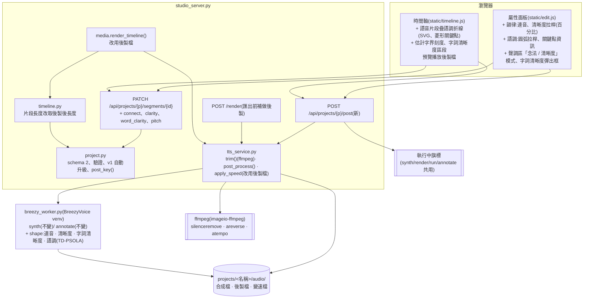
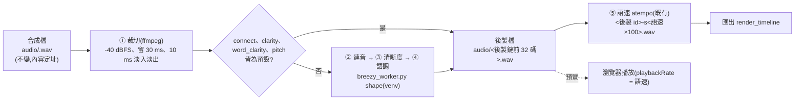

# CHG-20261029-01 — 連音、字詞清晰度、語調折線與片段靜音裁切

- 專案:podcast-studio
- 分支(Branch):main
- 日期:2026-10-29(UTC+0)
- 類型:新功能 + 驗收落差修正(CHG-20261022-04 ACC-20261028-01 P2)
- 提出者:使用者
- 實作者:主 agent 派發(DIR-3);實際工作者記於「## 派發記錄」
- 驗收者:獨立 Claude subagent(不參與施工、不看實作者自述)+ 使用者操作驗收與試聽
- 風險分級:高(命中高風險清單:**資料模型**——專案檔 `schema_version` 1 → 2,新增片段欄位,舊專案載入時自動升級;**跨模組介面**——`breezy_worker.py` 新增 `shape` 子命令、`tts_service` 新增後製管線、`timeline.layout()` 與 `media.render_timeline()` 改用後製後的音檔與長度;**安全**——新增會寫檔的 HTTP 端點 `POST /api/projects/{p}/post`,使用者數值參數經 JSON 檔流入 BreezyVoice venv 內執行的程式)
- Autonomy:halt
- Commit/PR:草稿分支 `docs/CHG-20261029-01-draft`(未開 PR)
- 重複性檢查(Recurrence check):P2(句間停頓比設定長約 0.6 秒)是 CHG-20261022-04 已記錄的「替身測試抓不到外部引擎真實輸出」同類問題(該 CHG 表頭記為第二次出現);本筆以真模型產物實測並把量測寫進 Acceptance operation,不另建 KN。連音、清晰度、語調折線為使用者新需求,未見於先前 CHG
- Diagrams:見「## 設計圖」節
- Mockup:見「## 畫面草稿」節(變更前截圖與變更後 mockup 存於 `docs/changes/mockups/CHG-20261029-01/`)
- Security-impact:見「## 安全影響」節
- Skill: ai-sdlc v1.66
- 關聯:FR-26(停頓,本筆修改:以語音邊界計)、新增 FR-36(連音)、FR-37(清晰度,句與字詞)、FR-38(語調折線);依賴 CHG-20261022-04 留在 main 的 `project.py`、`tts_service.py`、`timeline.py`、`media.render_timeline()`、`breezy_worker.py`、`static/edit.js`、`static/timeline.js`;ACC-20261028-01「未達標項與處置」不通過項 1(P2)與 P4 觀察;ADP-5(BreezyVoice 上游未釘版本,本筆新增對 venv 內 numpy / scipy / librosa 的依賴,同一風險)

## 動機

使用者原話(2026-10-27~28,依時間順序):

1. 「下次修改項目先記錄 每段能設定模型產出聲音的黏著程度(連音) 和每個字詞是否清晰的設計」
2. 「連音只限定字與字 不是句與句」「上次demo的產出語音過於清晰不太像是人說話的習慣」「不然可以在後製時調整聲音的語調或者速度」「另外調整程度採用 百分比 使用拉桿調整 旁邊會顯示百分比」
3. 「這個CHG中 除了這樣設計以外,後製中的語調高度可以採取類似折線方式設計(使用者可以設定圓弧程度)」
4. 「在這份CHG動工前 先提供變更前與變更後的畫面」
5. 語調設計參考圖(使用者提供,2026-10-27):影片剪輯軟體的片段關鍵影格線——片段色塊上有一條水平線,線上有**菱形控制點**,點與點之間以線段相連,可拖動;一條**紅色直線**為播放頭。語調折線照此樣式:疊在時間軸該句片段上、菱形關鍵點、可拖曳增刪。
6. 「併入下筆 CHG」(2026-10-28,對 ACC-20261028-01 P2):BreezyVoice 每句開頭約 0.44–0.57 秒、結尾約 0.16–0.24 秒低於 -40 dB,實際句間停頓比設定多約 0.6 秒。方向:合成後裁掉片段前後低音量段(保留少量餘裕),讓片段邊界貼齊語音。
7. 參考(非本筆必做):ACC-20261028-01 P4——「好」標四聲後使用者聽到「大家歡迎收聽夜市的味道」,「好」不清楚;使用者說「P4雖未達到原本要處理的目的但語氣更像人」,並決定「視為通過」。本筆不處理聲調標註的念法效果;它顯示「字詞清晰度不一定越高越好」,與需求 2 的方向一致。

查證(2026-10-29):BreezyVoice(CosyVoice 非 Instruct 版)沒有韻律、語速或清晰度參數(CHG-20261022-04 修訂 1 已查證語速;本筆同樣只能後製)。本機可用工具:repo 已依賴的 `imageio-ffmpeg`(ffmpeg 7.1,有 `silenceremove`、`atempo`、`asetrate`、`lowpass`、`firequalizer`、`acrossfade`,**沒有** `rubberband` 濾鏡);系統沒有 `rubberband`、`sox`;BreezyVoice venv 已有 numpy 1.26.4、scipy 1.15.3、librosa 0.10.2、soundfile 0.12.1(沒有 pyworld、parselmouth、pyrubberband)。

## 使用者故事

1. 作為使用者,我設定的句間停頓就是我聽到的停頓,以便停頓秒數可以信任(FR-26 修改)。
2. 作為使用者,我在屬性面板拖「連音」拉桿,旁邊即時顯示百分比,該句字與字之間黏得更緊、句與句的停頓不變,以便語音不再一字一字念得太開(FR-36)。
3. 作為使用者,我拖「清晰度」拉桿降低整句的咬字銳利度,也能選取某個字詞單獨設定清晰度,以便聽起來更像人說話(FR-37)。
4. 作為使用者,我在時間軸的語音片段上點兩下新增菱形關鍵點、上下拖曳改音高、選取後按 Delete 刪除,並以「圓弧」拉桿設定折線轉角的圓滑程度,以便調整一句話的語調起伏(FR-38)。
5. 作為使用者,調整以上任何一項都不必等重新合成,幾秒內就能試聽,以便反覆微調。

## 決策與取捨

### 先實測後製方案(2026-10-29,只在 session scratchpad 做,不入 repo)

素材:`outputs/acc/` 內 CHG-20261022-04 驗收時以真 BreezyVoice 產生的 `試聽-第1句-好-自動三聲.wav`(22050 Hz)、`試聽-第5句-你有試過嗎.wav`,以及匯出 MP4 解碼的音軌(15 句,依 SRT 找片段邊界)。未重新合成(不佔 `heavy_lock`)。量測以 numpy / scipy / librosa(BreezyVoice venv)與 imageio-ffmpeg 7.1 進行。**聽感**:實測者無法試聽,以下聽感敘述一律為〔推論〕,需使用者試聽確認(見 Acceptance operation)。

| 方案 | 量測結果 | 耗時 | 依賴 / 限制 |
|------|----------|------|-------------|
| (iv) 現況(不裁切) | 試聽檔開頭低於 -40 dBFS 0.569 / 0.622 / 0.796 秒、結尾 0.243 / 0.099 / 0.378 秒;匯出 15 句開頭平均 0.535 秒(0.15–1.32)、結尾平均 0.243 秒(0.00–0.95)。第 1、5 句間插入 1.5 秒數位靜音,`silencedetect`(-40 dB)量得 **2.395 秒** | — | 與 ACC-20261028-01 P2 一致(該次 2.111 秒) |
| (iv) numpy 裁切(峰值 -40 dBFS,保留 0 / 20 / 30 / 50 ms,10 ms 淡入淡出) | 同一組量得 1.511 / 1.540 / **1.560** / 1.600 秒 | < 1 ms / 句 | 餘裕 50 ms 時多量到一段字間空隙 |
| (iv) ffmpeg `silenceremove`(`detection=peak`、-40 dB、`start_silence` 20 / 30 ms)+ `areverse` 處理結尾 | 前後各剩 0.020 / 0.030 秒;句間 1.54 / **1.56** 秒 | 6–7 ms / 句 | 只用既有 imageio-ffmpeg;〔推論〕-40 dBFS 以下的極輕子音起音可能被裁,由 30 ms 餘裕緩衝 |
| (i) 字界偵測:能量包絡(25 ms 窗、5 ms 步進、5 點平滑)找峰谷 | 包絡峰數 / 字數:12/12、5/5、15/14、21/19、25/18 | < 5 ms | 短句吻合;長句多偵測 1–7 個(擦音、爆破音另成峰),**長句字界估計不可靠**;改進需強制對齊模型(需下載) |
| (i) 縮短字間空隙(句內低於句峰值 -30 dB、30–120 ms 的段落,縮短 p,切點 12 ms 等功率交叉淡化) | 長於 120 ms 的空隙(多為句內逗號)不動;第 7 句(含兩個逗號)若不設上限,100% 時縮短 42.6%,設上限後 17.4% | 1–3 ms / 句 | 只在真的有空隙處起作用;短而黏的句子幾乎不變 |
| (i) 字界交叉淡化(在估計字界讓前後字重疊 p × 30 ms) | 每個字界短 p × 30 ms | < 1 ms | 依賴字界估計;〔推論〕重疊過長會出現兩字同時發聲的「疊音」 |
| (i) 上兩者合併(本筆採用) | 5 句合計 15.66 秒:50% → −9.9%,100% → −20.7%(單句 −16% ~ −28%);第 1 句 2.439 → 2.190(50%)/ 1.969 秒(100%) | 0.2–0.5 秒 / 句(含語調) | 句子變短,時間軸如實反映 |
| (i) 對照:整句 `atempo` 1.25 | 2.439 → 1.961 秒,句內空隙段數 3 → 3 | 12 ms | 只是整句變快,字與字的相對間隔不變,**不符合「連音」**;語速功能已有(FR-33) |
| (ii) 低通濾波(4 階 Butterworth,零相位) | 第 1 句 3 kHz 以上能量比 −15.1 dB;截止 6500 / 4899 / 3790 / 3000 Hz → −15.3 / −16.3 / −19.3 / −27.4 dB;頻譜重心 1810 → 1423 Hz(3500 Hz) | 約 1 ms / 句 | 只用 scipy(venv 已有);〔推論〕聽感是「咬字較不銳利、較悶」,不會產生含糊連讀 |
| (ii) ffmpeg `firequalizer` 3 kHz 以上 −6 dB | −15.1 → −20.9 dB | 10 ms | 效果與低通同類,參數較難對應單一拉桿 |
| (ii) ffmpeg `acompressor`(壓縮動態) | 高頻比 −15.1 → **−10.6 dB**(反而更亮)、峰均比 20.0 → 16.9 dB | 11 ms | 方向相反,不採用 |
| (ii) 字首起音衰減(每字前 50 ms 衰減 3 / 6 / 9 dB) | 高頻比與峰均比變化 ≤ 0.3 dB | < 1 ms | 量測不到差異,不採用 |
| (iii) TD-PSOLA(numpy 自寫,pyin 估 F0) | 5 個關鍵點、圓弧 50%:與目標曲線誤差中位 **0.47** 半音、P90 1.51 半音;長度不變;全句 +4 半音時頻譜重心 1810 → 1792 Hz(共振峰保留) | 153 ms / 2.4 秒音訊;程序首次 pyin 0.57 秒(全新環境的 numba 首次編譯約 6 秒) | 只用 venv 已有的 numpy、librosa(pyin);〔推論〕大幅度(> ±6 半音)或氣聲段可能有顆粒感 |
| (iii) librosa `pitch_shift` 分段(每 0.1 秒一段、20 ms 交叉淡化) | 誤差中位 0.19、P90 0.60 半音;長度不變 | **12983 ms** / 2.4 秒音訊 | 太慢;〔推論〕相位聲碼器的「金屬感 / 迴音感」 |
| (iii) ffmpeg `asetrate` + `aresample` + `atempo` 分 4 段 | 誤差中位 1.19、P90 3.02 半音;長度 2.439 → 2.356 秒;全句 +4 半音時頻譜重心 1810 → 2255 Hz | 58 ms | 只能階梯近似、長度會變、共振峰跟著移(〔推論〕「花栗鼠」聲),不採用 |
| (iii) `rubberband`、WORLD(pyworld)、Praat(parselmouth) | 未測 | — | 本機沒有,需下載安裝,列為「需使用者核准的前置」選項,本筆預設不用 |

整條後製(裁切後 → 連音 → 清晰度 → 語調)在單一行程:import 0.28 秒、每句 0.2–0.5 秒、峰值 RSS 約 301 MiB。試聽樣本(暫存,不入 repo,不是本 CHG 的依據檔):session scratchpad 的 `exp/listen/`(裁切後原音、連音 50 / 100%、清晰度 75 / 50 / 25 / 0%、語調折線圓弧 0 / 50 / 100%、三者合併、librosa 與 ffmpeg 對照)。

### 決策

| 決策 | 選項 | 前提假設 | 為何這樣選 |
|------|------|----------|------------|
| 片段靜音裁切 | 改量法 vs 裁切片段 | 使用者「併入下筆 CHG」,方向為裁切 | 裁切;ffmpeg `silenceremove` + `areverse`,只用既有依賴,每句約 7 ms |
| 連音做法 | 整句 atempo vs 縮短字間空隙 + 字界交叉淡化 vs 重新合成 | 使用者「連音只限定字與字 不是句與句」 | 縮空隙 + 交叉淡化:只動句內字間,句間停頓不變;atempo 實測只是整句變快 |
| 清晰度做法 | 低通 vs EQ vs 壓縮 vs 起音衰減 | 使用者「過於清晰不太像是人說話」 | 低通:單一參數、可量測、可只套用在某個字詞的時間範圍 |
| 語調做法 | TD-PSOLA vs librosa 相位聲碼器 vs ffmpeg 階梯 | 使用者「語調高度可以採取類似折線方式設計」;不下載新工具 | TD-PSOLA:精度可接受(中位 0.47 半音)、長度不變、共振峰保留、0.15 秒 / 句 |
| 後製執行位置 | server 行程加 numpy(新依賴需下載)vs BreezyVoice venv(已有 numpy / scipy / librosa) | 不得自行安裝需下載的套件 | venv:`breezy_worker.py` 新增 `shape` 子命令;不新增下載 |
| 後製時機 | 合成時一併做 vs 合成後另做、以參數快取 | 使用者要反覆微調(使用者故事 5) | 合成後另做;改參數只重做後製,不重新合成 |

**代決事項**(確認閘須逐條核准):

1. **D1 後製執行位置**:連音、清晰度、語調在 BreezyVoice venv 以 `breezy_worker.py shape` 執行(只用 venv 已有的 numpy、scipy、librosa、soundfile);不在 `studio_server.py` 新增 numpy 等依賴。
2. **D2 靜音裁切參數**:對**合成片段**一律裁切;門檻 -40 dBFS(樣本峰值,與驗收量法 `silencedetect` 相同判準),前後各保留 30 ms,裁切點 10 ms 淡入 / 淡出;以 ffmpeg `silenceremove=start_periods=1:start_threshold=-40dB:start_silence=0.03:detection=peak`,接 `areverse` 再做一次處理結尾。不提供開關。
3. **D3 停頓定義不變**:停頓仍是片段邊界之間的數位靜音;裁切後量得的句間靜音 ≈ 設定值 + 約 0.06 秒(兩側餘裕),不從停頓扣除餘裕。
4. **D4 自錄音檔不後製**:以自錄音檔取代的片段(audio 沒有 `key`)不裁切、不套用連音 / 清晰度 / 語調,屬性面板的拉桿停用並說明原因。
5. **D5 連音的作用範圍**:只動句內「低於句峰值 -30 dB、長 30–120 ms」的字間空隙與估計字界;長於 120 ms 的句內低音量段(多為逗號處)不動;句與句之間只由停頓決定。
6. **D6 連音對應**(見下方「拉桿百分比對應」):空隙縮短比例 = p;字界交叉淡化長度 = p × 30 ms;預設 0%(不處理)。連音會讓句子變短(實測 50% 約 −10%、100% 約 −21%),時間軸與字幕依實際長度重排;不以變速補回長度。
7. **D7 清晰度對應**:低通截止 = 3000 × (8000 / 3000)^p Hz(p < 100%);100% 不濾波;預設 100%(不處理)。只以低通近似「較不銳利」,不改變發音內容。
8. **D8 字詞清晰度**:以字元索引區間 `[start, end)` 設定,每句最多 32 段、不得重疊、只能落在漢字上;時間範圍由能量包絡依字數估計字界(長句誤差可達 ±1 字,已知限制),區段邊緣 20 ms 交叉淡化;未個別設定的字沿用整句清晰度。不引入強制對齊模型。
9. **D9 語調關鍵點格式**:每點 = (位置:片段相對位置 0–1、取到 0.01;音高:相對原音 −6 ~ +6 半音、取到 0.1);每句 2–16 點,位置嚴格遞增;第一點之前與最後一點之後維持端點值;沒有語調(`pitch: null`)= 不處理。
10. **D10 圓弧程度定義**:每個中間關鍵點的尖角以二次貝茲曲線取代,切入與切出點分別在相鄰兩段線段上距該點「圓弧 × 線段長度 ÷ 2」處;0% 為直線折線,100% 為最圓滑;圓弧大於 0% 時曲線不一定通過中間關鍵點(見 `after-pitch-roundness.png`);預設 50%;每句一個圓弧值。
11. **D11 音高演算法**:TD-PSOLA(numpy 自寫,F0 以 `librosa.pyin`,fmin 70 Hz、fmax 400 Hz);無聲段原樣保留。
12. **D12 後製順序**:裁切 → 連音 → 清晰度(整句,再疊字詞)→ 語調 → 語速(既有 `atempo`)。關鍵點位置以「語調步驟輸入」(裁切、連音後)的長度換算。
13. **D13 後製快取**:後製鍵 = SHA-256(JSON 陣列 [audio.id, 後製版本號 1, 裁切參數, connect, clarity, word_clarity, pitch]);後製檔 `audio/<後製鍵前 32 碼>.wav`;變速快取改以後製檔 id 為基礎(`<後製 id>-s<語速×100>.wav`)。改參數只重做後製,不重新合成;舊的後製檔與變速檔不自動刪除。
14. **D14 專案檔升版**:`schema_version` 1 → 2;片段新增 `connect`、`clarity`、`word_clarity`、`pitch`(使用者可改)與 `post`(伺服器產生);讀到 v1 時在記憶體補上預設值,下次存檔寫成 v2(舊檔照例移入 `history/`);v3 以上拒絕載入。
15. **D15 不新增全域預設**:連音、清晰度、圓弧沒有設定頁的全域預設、不改設定資料庫(`config/studio.db` schema 不變);`null` 一律取程式常數(連音 0%、清晰度 100%、圓弧 50%)。使用者需求是「每段能設定」,取最低限度。
16. **D16 介面位置**:拉桿只放在剪輯時的屬性面板(完整模式與精靈 ④ 剪輯共用);精靈 ② 語音步驟不加拉桿。拉桿整數 0–100、步進 1%,拉桿右側即時顯示百分比,放開後才送出;每個拉桿旁有「預設」按鈕(恢復 `null`)。
17. **D17 語調編輯操作**:在時間軸**已選取**的語音片段上點兩下新增關鍵點(點在折線上的位置與高度);拖曳關鍵點同時改位置與音高(位置不得越過相鄰點);選取後按 Delete / Backspace 刪除(剩 2 點時再刪即清除語調);折線與關鍵點只在選取的片段上可編輯,其他片段只顯示細線。語音軌高度由 48 px 增為 78 px。
18. **D18 預覽與匯出用同一份後製檔**:瀏覽器預覽播放後製檔(語速仍以 `playbackRate`),匯出以後製檔做 `atempo`;時間軸長度取後製後長度。
19. **D19 後製不進 `heavy_lock`**:實測峰值 RSS 約 301 MiB、每句 0.2–0.5 秒;改為共用 synth / render / run / annotate 的「執行中」旗標(忙碌回 409,前端在目前工作結束後重試)。後製 worker 逾時 = 30 + 5 × 句數 秒。
20. **D20 後製觸發**:合成每完成一句即裁切(使該句一出現就是裁切後的長度);拉桿放開、語調關鍵點放開時前端 PATCH 片段後呼叫 `POST /api/projects/{p}/post`(只處理該句);開啟舊專案時對沒有有效後製的片段補做;匯出前自動補做所有過期片段。
21. **D21 P2 量法不變**:驗收仍以 `silencedetect`(-40 dB)量第 2、3 句之間,1.5 ± 0.1 秒為通過。
22. **D22 聲調標註不在本筆調整**:P4 觀察僅作參考;聲調標註的念法效果不改。

### 拉桿百分比對應(0–100%,整數,步進 1%)

| 拉桿 | 作用位置 | 0% | 25% | 50% | 75% | 100% | 預設 | 對應公式 |
|------|----------|----|-----|-----|-----|------|------|----------|
| 連音 | 每句 | 不處理 | 空隙縮 25%、字界重疊 7.5 ms | 空隙縮 50%、重疊 15 ms(實測整句約 −10%) | 空隙縮 75%、重疊 22.5 ms | 空隙縮到只剩 12 ms 交叉淡化、重疊 30 ms(實測約 −21%) | **0%** | 字間空隙(句內、低於句峰值 −30 dB、30–120 ms)縮短 p;估計字界交叉淡化 p × 30 ms |
| 清晰度 | 每句 | 低通 3000 Hz(第 1 句 3 kHz 以上能量 −12.3 dB) | 3790 Hz(−4.2 dB) | 4899 Hz(−1.2 dB) | 6532 Hz(−0.2 dB) | 不濾波(原音) | **100%** | p < 100%:截止 3000 × (8000/3000)^p Hz;p = 100%:不處理 |
| 字詞清晰度 | 每個字詞區段 | 同上 | 同上 | 同上 | 同上 | 同上 | 未設定(沿用整句) | 同清晰度,只套用在該字詞的估計時間範圍,邊緣 20 ms 交叉淡化 |
| 圓弧 | 每句語調 | 直線折線 | 切入 12.5% 線段長 | 切入 25% | 切入 37.5% | 切入 50%(最圓滑) | **50%** | 切入 / 切出距離 = p × 相鄰線段長 ÷ 2 |

語調關鍵點本身不是拉桿:位置 0–1(取到 0.01)、音高 −6 ~ +6 半音(取到 0.1),在時間軸拖曳設定,屬性面板顯示選取中關鍵點的位置(%)與半音值。

## 設計圖

### (1) 受影響範圍的架構圖



### (2) 後製管線(每個合成片段)



### (3) 拖曳語調關鍵點的流程

```mermaid
sequenceDiagram
  actor U as 使用者
  participant B as 時間軸 / 屬性面板
  participant S as studio_server
  participant P as project.py
  participant T as tts_service
  participant W as breezy_worker shape

  U->>B: 在選取的片段上點兩下 → 新增菱形關鍵點;拖曳到 +3.0 半音後放開
  B->>S: PATCH segments/{id} {pitch: {points, roundness}}
  S->>P: 驗證(2–16 點、位置遞增、±6 半音)→ 存檔(舊版移入 history/)
  S-->>B: 專案檢視(該片段 post 過期)
  B->>S: POST /post {segments: [id]}
  S->>S: 取「執行中」旗標(忙碌 → 409,前端稍後重試)
  S->>T: post_process([id])
  T->>T: 後製鍵 → 快取未命中
  T->>W: shape --jobs <tmp/jobs.json> --out <tmp/>(argv list、BREEZY_ENV)
  W-->>T: stdout {"id", "seconds"}
  T->>P: 更新 segment.post {id, key, seconds, trim}(存檔)
  S-->>B: 新長度 → 時間軸重排、預覽改播新後製檔
```

## 畫面草稿

### 變更前(目前 main 的實際畫面)

以 `tests/ui_check.py` 的隔離做法截圖(本行程內的 `studio_server.create_app()`、127.0.0.1 隨機埠、暫存目錄、替身 worker 依字數產生正弦波 WAV;未使用 7860、未碰 `config/studio.db` 與 `projects/`),視窗 1600×940:

- `mockups/CHG-20261029-01/before-full.png`:完整模式全畫面,選取片段 #1。
- `mockups/CHG-20261029-01/before-props.png`:屬性面板——文字、狀態「✓ 已合成 2.8 秒」、語速選單、停頓「之後 0.4 秒」與「預設」、聲調區逐字注音與「試聽這一句」。沒有連音、清晰度、語調。
- `mockups/CHG-20261029-01/before-timeline.png`:時間軸三軌(字幕、語音、畫面),語音片段高 48 px、只有文字,片段之間的虛線框是停頓,紅色直線為播放頭。


### 變更後(靜態 mockup)

`mockups/CHG-20261029-01/after.html`(純 HTML / CSS + 行內 SVG,不引外部資源)以 Playwright 截圖:

- `mockups/CHG-20261029-01/after-full.png`:完整模式全畫面(版面不變,只改屬性面板與時間軸)。
- `mockups/CHG-20261029-01/after-props.png`:屬性面板。
- `mockups/CHG-20261029-01/after-timeline.png`:時間軸。
- `mockups/CHG-20261029-01/after-pitch-roundness.png`:同一組關鍵點在圓弧 0% / 50% / 100% 的形狀對照。


屬性面板(選取合成片段時):

```
屬性
選取:片段 #1
文字   大家好，歡迎收聽夜市的味道。
狀態   ✓ 已合成 2.2 秒 (已裁掉前後低音量 0.69 秒)        ← 長度為後製後;括號為裁切量
語速   [預設(1.15×) ▾]
── 停頓 ──
之後   [0.4] 秒 [預設]
── 韻律 [新] ──
連音   ●━━━━━○──────────  35%  [預設]                   ← 拉桿右側即時顯示百分比
       字與字之間的黏著;句與句之間仍由「停頓」決定
清晰度 ●━━━━━━━━━━○────  70%  [預設]
       整句的咬字清晰程度;個別字詞可在下方另設
── 語調 [新] ──
圓弧   ●━━━━━━━○────────  50%  [預設]
       折線轉角的圓弧程度:0% 為直線折角,100% 為最圓滑
關鍵點 5 個 · 選取中:#2(位置 22%,+3.0 半音)
       [清除語調] [▶ 試聽這一句]
── 聲調與字詞清晰度 ──
[念法] [清晰度]                                          ← 模式切換;「念法」即原本的注音彈出框
 大 家 好 ， 歡 迎 收 聽 [夜][市] 的 味 道               ← 清晰度模式:拖曳選取字詞
 ▔▔ ▔▔ ▔▔    ▔▔ ▔▔ ▔▔ ▔▔  ▔    ▔  ▔▔ ▔▔ ▔▔             ← 字下橫條長度 = 清晰度;個別設定者紫色
          ┌─ 「夜市」的清晰度 ──── 第 9–10 字 ┐
          │ ●━━━━━○───────────      40%      │
          │ 未個別設定的字沿用整句清晰度(70%) │
          │                     [清除] [套用] │
          └───────────────────────────────────┘
```

- 自錄音檔片段:韻律、語調小節顯示但停用,說明「自錄音檔不做後製」(D4)。
- 後製進行中:狀態顯示「⏳ 後製中」;失敗時顯示繁中錯誤訊息,片段沿用上一份有效後製檔。

時間軸(語音軌高 78 px;參考使用者提供的剪輯軟體關鍵影格線樣式):

```
00:00     00:01     00:02     00:03     00:04 …
字幕 │[大家好，歡迎收聽夜市的味道]   [今天我們來聊聊台灣的夜市文化] …
語音 │┌#1 大家好，歡迎收聽夜市的 [夜市 40%]┐┄┄┌#2 今天我們來聊聊…┐┄┄┌#3 夜市是很多人…    ┐
     ││   ◇                  ◇            │  │                 │  │ ╭───────╮        │
     │◇──╱ ╲────────────────╱ ╲─────────◇│  │                 │  │╱         ╲──── │ ← 未選取片段只顯示細線
     ││      ╲──◇──╱          ┃            │  │                 │  │                 │
     │└──────────────────────┃────────────┘  └─────────────────┘  └─────────────────┘
畫面 │▓▓▓▓▓▓▓▓▓▓▓▓▓▓▓▓▓▓▓ 封面.png ▓┃▓▓▓▓▓▓▓▓▓▓▓▓▓▓▓▓▓▓▓▓▓▓▓▓▓▓▓▓▓▓▓▓▓▓▓▓▓▓▓▓
                                  ┃ ← 紅色直線 = 播放頭(既有)
```

- 選取的語音片段上疊一條**語調折線**:水平虛線為原音高(0 半音),上下界 ±6 半音;**菱形**為關鍵點,點與點之間以線段相連,轉角依「圓弧」拉桿圓滑化;選取中的關鍵點為實心黃色並顯示「#2 · 22% · +3.0 半音」。操作:點兩下新增、拖曳調整(位置與音高)、選取後 Delete 刪除(D17)。
- 選取片段內以細白線標出**估計字界**,設定了字詞清晰度的範圍以紫色斜線區段與「夜市 40%」標示(D8)。
- 片段邊界已是裁切後的位置(貼齊語音);時間軸不另畫被裁掉的部分。靜音裁切沒有開關,只在屬性面板狀態列顯示裁切秒數(D2)。
- 紅色直線播放頭、字幕軌、畫面軌與停頓拖拉不變。


## 安全影響

| 類別 | 是否觸及 | 影響範圍 / 理由 |
|------|----------|-----------------|
| irreversible-delete | 否 | 不新增自動刪除:後製檔、變速檔不自動刪除(磁碟用量增加列入風險);合成檔原樣保留,裁切與後製一律寫新檔;`tmp/` 的 worker 輸入 / 輸出暫存檔用完即刪(沿用 CHG-20261022-04,非使用者資料) |
| payments | 否 | 無金流 |
| prod-migration | **是(有限)** | 專案檔 `schema_version` 1 → 2(D14):讀到 v1 只在記憶體補欄位,存檔才寫成 v2,v1 舊檔照例移入 `history/`;v3 以上拒絕載入、不猜測轉換。設定資料庫不改(D15)。回滾見「風險與回滾」 |
| security-boundary | **是** | (a) 新端點 `POST /api/projects/{p}/post` 沿用 CHG-20261022-01 的 Host / Origin / Token 中介層與 `projects/` 路徑限制,與 synth / render 共用「執行中」旗標(D19);segment id 一律 `^[0-9a-f]{8,32}$`。(b) PATCH 新欄位只接受數字與整數索引,範圍驗證在 `project.validate()`(連音、清晰度、圓弧為 0–100 整數;半音 −6 ~ +6;位置 0–1;字詞區段落在句內且不重疊);任何字串欄位一律拒絕。(c) `shape` 子命令只讀 JSON 檔(放在 `projects/<名稱>/tmp/`,不放命令列),輸入、輸出檔名由伺服器產生,worker 再驗證一次範圍與檔名格式(`^[0-9a-f]{8,32}\.wav$`),只在 `--out` 目錄內讀寫。(d) worker 以 BreezyVoice venv 執行,環境沿用 `taiwan_ai.BREEZY_ENV`(含 `HF_HUB_OFFLINE=1`、`TRANSFORMERS_OFFLINE=1`);`shape` 不載入任何模型、不 import 會連網的模組,新增網路呼叫為 0。(e) ffmpeg 裁切以 argv list 執行,輸入、輸出為伺服器解析並檢查前綴的路徑;濾鏡字串只含程式常數。(f) 新增錯誤訊息一律繁中、不含本機絕對路徑。(g) 資源上限:每句 word_clarity ≤ 32 段、關鍵點 ≤ 16 個;`post` 一次最多處理 2000 句;worker 逾時 30 + 5 × 句數 秒 |

## 修改指引

### 目標

FR-26(修改):合成片段的邊界貼齊語音,設定的停頓即實際聽到的停頓(±0.1 秒)。FR-36:每句「連音」百分比拉桿,只動句內字與字之間。FR-37:每句與每個字詞的「清晰度」百分比拉桿。FR-38:時間軸語音片段上的語調折線(菱形關鍵點、可新增 / 拖曳 / 刪除),以「圓弧」百分比拉桿設定轉角圓滑程度。以上都不重新合成。

### 影響範圍

| 受影響項 | 類型 | 改動 | 連帶影響 |
|----------|------|------|----------|
| `project.py` | 資料 | `schema_version` 2;片段新增 `connect`、`clarity`、`word_clarity`、`pitch`、`post`;v1 載入升級;`post_params(segment)`、`post_key(segment)` | `docs/structure/data.md` |
| `breezy_worker.py` | 設計 | 新增 `shape --jobs <json> --out <dir>`(連音、清晰度、字詞清晰度、語調);`synth`、`annotate` 不變 | 新依賴 venv 內 numpy、scipy、librosa、soundfile(ADP-5 同類風險) |
| `tts_service.py` | 設計 | 新增 `trim()`(ffmpeg)、`post_process(project, ids, emit)`;`synth()` 每句完成即裁切;`apply_speed()` 改以後製檔為來源 | `docs/structure/design.md` |
| `timeline.py` | 邏輯 | 片段長度 = 後製後長度 ÷ 語速(沒有有效後製時退回合成長度) | 預覽與匯出共用 |
| `media.py` | 設計 | `render_timeline()` 的片段音檔改用後製檔(經 `apply_speed`);其他函式不變 | — |
| `studio_server.py` | 設計 | PATCH 片段接受新欄位;新增 `POST /api/projects/{p}/post`;render 前補做後製;media 端點可送後製檔與變速檔 | `docs/structure/design.md` |
| `static/edit.js`、`static/timeline.js`、`static/style.css`、`static/index.html` | 目錄 | 屬性面板拉桿與百分比、字詞清晰度模式與彈出框、語調折線 SVG 與關鍵點操作、預覽播放後製檔 | `tests/ui_check.py` |
| `tests/` | — | `test_project.py`、`test_breezy_worker.py`、`test_tts_service.py`、`test_timeline.py`、`test_render_timeline.py`、`test_server_projects.py` 擴充;新增 `tests/integration/test_shape_real.py`(真 venv,不列入 `check.sh`);`tests/ui_check.py` editor 組擴充 | — |
| `features/prosody_trim.feature` | — | 新增(本草稿) | — |

### Global Constraints(全域約束——每個 task 都要遵守)

- 沿用 CHG-20261022-01 與 CHG-20261022-04 的全部全域約束(PEP 723、`./scripts/check.sh`、Host / Origin / Token、允許目錄、argv list、原生前端、`textContent`、繁體中文、錯誤訊息不含絕對路徑、專案層級鎖與原子寫入、history 10 版)。
- 不新增任何需下載的依賴:server 端只用既有 `imageio-ffmpeg` 與標準庫;`shape` 只用 BreezyVoice venv 已有的 numpy、scipy、librosa、soundfile。
- 不新增網路呼叫;`shape` 子程序環境一律為 `taiwan_ai.BREEZY_ENV`,不 import 會連網的模組、不載入模型。
- 合成檔 `audio/<audio.id>.wav` 一律不改寫;裁切與後製一律輸出新檔;合成快取鍵不變。
- 改連音、清晰度、字詞清晰度、語調、語速一律不呼叫 `synth`(worker synth 次數為 0)。
- 裁切一律:-40 dBFS 峰值門檻、前後保留 30 ms、10 ms 淡入淡出;只對 audio 帶 `key` 的合成片段;自錄音檔不裁切、不後製。
- 連音、清晰度、圓弧一律為 0–100 整數或 `null`;`null` 取程式常數(0%、100%、50%);拉桿對應一律依「拉桿百分比對應」表。
- 語調關鍵點一律 2–16 點、位置 0–1 取到 0.01 且嚴格遞增、音高 −6 ~ +6 半音取到 0.1;字詞清晰度一律 `[start, end)` 落在句內漢字、互不重疊、每句 ≤ 32 段;不合格回 422(繁中訊息)。
- 連音只動句內 30–120 ms 的字間空隙與估計字界;句間停頓計算方式不變。
- 後製鍵一律 = SHA-256(JSON 陣列 [audio.id, 後製版本號, 裁切參數, connect, clarity, word_clarity, pitch]);後製檔 `audio/<後製鍵前 32 碼>.wav`;變速檔 `<後製 id>-s<語速×100>.wav`。
- 預設參數(連音 0%、清晰度 100%、無字詞清晰度、無語調)的後製結果一律等於裁切結果,不啟動 `shape`。
- 預覽、匯出、時間軸長度一律使用同一份後製檔與後製後長度(`timeline.layout()` 為唯一來源)。
- 後製與 synth / render / run / annotate 共用「執行中」旗標,忙碌回 409;後製不進 `heavy_lock`;worker 逾時 30 + 5 × 句數 秒。
- 專案檔一律寫 `schema_version: 2`;讀 v1 自動升級、v3 以上拒絕。
- 拉桿一律整數、步進 1%,右側即時顯示「NN%」,放開(`change`)才送出。
- 使用者面文字、註解、文件一律繁體中文與台灣用語。

### Tasks(checkbox=續作點)

- [ ] T1. 專案資料模型 schema 2
  - interfaces: consumes `project.py`(CHG-20261022-04 T2)/ produces `project.SCHEMA_VERSION = 2`、片段欄位 `connect`、`clarity`、`word_clarity`、`pitch`、`post`、`project.PROSODY_DEFAULTS`(連音 0、清晰度 100、圓弧 50)、`post_params(segment) -> dict`、`post_key(segment) -> str`、`is_post_fresh(segment) -> bool`、v1 → v2 升級;`tests/test_project.py` 擴充
  - test: `./scripts/check.sh tests/test_project.py`——v1 專案檔載入後每個片段有 `connect: null`、`clarity: null`、`word_clarity: []`、`pitch: null`、`post: null`,存檔後 `schema_version == 2` 且 v1 檔在 `history/`;v3 拒絕載入;連音 101、清晰度 −1、圓弧 "50" 回錯誤;半音 6.04 → 6.0、6.06 回錯誤;位置 0.505 → 0.51;關鍵點 1 個或 17 個、位置不遞增回錯誤;字詞清晰度區段重疊、超出句長、落在標點上回錯誤;PATCH 不能寫入 `post`;同參數 `post_key` 相同、改任一參數不同、改語速不變
- [ ] T2. worker `shape` 子命令
  - interfaces: consumes T1 的參數格式、BreezyVoice venv 的 numpy / scipy / librosa / soundfile / produces `breezy_worker.py shape --jobs <json> --out <dir>`(jobs:`[{"id", "input", "chars", "connect", "clarity", "word_clarity", "pitch"}]`;每句寫 `<out>/<id>.wav`,stdout 一行 `{"id", "seconds"}`;結束碼 2 / 4 同 synth);`tests/test_breezy_worker.py` 擴充、`tests/integration/test_shape_real.py`(真 venv,以 repo 內產生的合成語音替身或使用者提供的 WAV,不列入 `check.sh`)
  - test: `./scripts/check.sh tests/test_breezy_worker.py`——jobs 含字串型數值、檔名不符 `^[0-9a-f]{8,32}$`、`input` 含路徑分隔字元一律結束碼 2 且不寫檔;`tools/BreezyVoice/.venv/bin/python -m pytest tests/integration/test_shape_real.py`——以含 3 段 60 ms 與 1 段 200 ms 字間靜音的合成訊號:連音 100% 後 60 ms 空隙總長減少 ≥ 80%、200 ms 空隙長度不變(±10 ms);連音 0% + 清晰度 100% + 無語調時輸出與輸入逐樣本相同;清晰度 0% 時 3 kHz 以上能量比下降 ≥ 6 dB;字詞清晰度只讓區段內高頻下降、區段外變化 ≤ 0.5 dB;語調 5 點(±3 半音)時 pyin 量得與目標曲線誤差中位 ≤ 1.0 半音、長度不變(±10 ms);全程以 `taiwan_ai.BREEZY_ENV` 執行且不開啟任何 socket(以替身 `socket.socket` 計數為 0)
- [ ] T3. 後製服務(裁切、後製管線、變速改源)
  - interfaces: consumes T1、T2、ffmpeg / produces `tts_service.trim(src, dst) -> (seconds, head, tail)`、`tts_service.post_process(project, segment_ids, emit) -> {"processed", "cached"}`、`synth()` 每句完成即裁切並寫入 `segment.post`、`apply_speed()` 以後製檔為來源;`timeline.layout()` 改取後製後長度;`media.render_timeline()` 改用後製檔;`tests/test_tts_service.py`、`tests/test_timeline.py`、`tests/test_render_timeline.py` 擴充
  - test: `./scripts/check.sh tests/test_tts_service.py tests/test_timeline.py tests/test_render_timeline.py`——以前 0.6 秒、後 0.25 秒為 −60 dBFS 噪聲的正弦波片段:裁切後開頭與結尾低於 −40 dBFS 的長度各在 0.02–0.05 秒;兩片段 + 1.5 秒停頓匯出後 `silencedetect`(-40 dB)量得 1.5 ± 0.1 秒;自錄音檔(audio 無 `key`)不裁切;預設參數不啟動 `shape`(替身計數 0);改連音只啟動 `shape` 一次、`synth` 0 次;同參數第二次 `post_process` 全部命中快取;改語速只重跑 `atempo` 且來源為後製檔;`layout()` 片段長度 = `post.seconds ÷ 語速`,`post` 過期時退回 `audio.seconds`;render 遇過期片段先補做後製
- [ ] T4. 伺服器 API
  - interfaces: consumes T1、T3 / produces `PATCH /api/projects/{p}/segments/{id}` 接受 `connect`、`clarity`、`word_clarity`、`pitch`;`POST /api/projects/{p}/post`(body `{"segments": [id…]}` 或省略 = 全部過期片段;回專案檢視)、render 前補做後製、media 端點送後製檔;`tests/test_server_projects.py` 擴充
  - test: `./scripts/check.sh tests/test_server_projects.py`——缺 Token 或錯誤 Origin 的 `POST /post` 回 403;synth 進行中呼叫 `POST /post` 回 409;不合法數值回 422 且訊息為繁中、不含絕對路徑;PATCH `post` 欄位回 422;segment id 不合格式回 404;`POST /post` 後專案檢視的片段帶新的 `post.seconds`;自錄音檔片段 PATCH 連音回 422(「自錄音檔不做後製」)
- [ ] T5. 屬性面板:連音、清晰度、圓弧拉桿與字詞清晰度
  - interfaces: consumes T4 / produces `static/edit.js` 屬性面板「韻律」「語調」小節(`input[type=range]` 0–100 步進 1、右側 `<output>` 顯示「NN%」、「預設」按鈕)、聲調區「念法 / 清晰度」模式與字詞清晰度彈出框;拉桿放開後 PATCH 再 `POST /post`;`static/style.css`;`tests/ui_check.py` editor 組擴充
  - test: `uv run --script tests/ui_check.py --only editor`——拖連音拉桿時 `<output>` 文字隨之改變、放開後專案 `connect` 為該值且 worker synth 次數不變;按「預設」後 `connect` 為 `null`;清晰度模式拖選「夜市」設 40% 套用後 `word_clarity == [{start: 8, end: 10, value: 40}]`(依測試文稿的索引);自錄音檔片段的拉桿為 `disabled`;截圖 `prosody.png`
- [ ] T6. 時間軸語調折線與預覽
  - interfaces: consumes T4、T5 / produces `static/timeline.js` 選取片段的語調折線(SVG 疊加、菱形關鍵點、水平 0 半音虛線、估計字界刻度、字詞清晰度斜線區段)、點兩下新增 / 拖曳 / Delete 刪除、圓弧依 D10 繪製、語音軌 78 px、預覽播放後製檔;`static/style.css`;`tests/ui_check.py` editor 組擴充
  - test: `uv run --script tests/ui_check.py --only editor`——在選取片段上點兩下後關鍵點數 +1 且專案 `pitch.points` 長度相同;拖曳關鍵點向上後該點半音 > 0 且位置未越過相鄰點;選取後按 Delete 點數 −1;剩 2 點再刪則 `pitch` 為 `null`;圓弧拉桿 0% 與 100% 時折線 `path` 的 `d` 不同(100% 含 `Q` 指令);預覽播放的 `<audio>` 來源為後製檔 id;截圖 `pitch.png`

### Behaviour spec
- feature: features/prosody_trim.feature

### Acceptance operation
- operate: 合併後以使用者的網頁伺服器(或 `scripts/deploy_local.sh` 部署的同版程式)在完整模式新建專案「夜市的味道韻律」,貼入 ACC-20261028-01 的同一份文稿(15 句)以真 BreezyVoice 合成;(1) 把第 2、3 句間停頓設為 1.5 秒,匯出;(2) 第 1 句連音 50%、另匯出一次連音 100%;(3) 第 7 句「老闆說，滷汁要每天細心照顧，味道才會穩定」連音 100%;(4) 第 1 句清晰度 0%、「夜市」字詞清晰度 40%;(5) 第 1 句加 5 個語調關鍵點(+3、−2、+2 半音)、圓弧 0% 與 100% 各試聽一次;(6) 開啟 CHG-20261022-04 驗收時的舊專案(schema 1);全程記錄 worker synth 次數並以 `lsof -i -a -p <shape worker pid>` 觀察連線
- observe: 屬性面板的拉桿右側即時顯示百分比;改連音、清晰度、語調後只重做後製、synth 次數不變;時間軸語調折線有菱形關鍵點、可新增 / 拖曳 / 刪除,圓弧拉桿改變轉角形狀;舊專案可開啟編輯,存檔後為 schema 2 且舊檔在 history
- pass: (P1)以 `silencedetect`(-40 dB)在第 2、3 句間測得 1.5 ± 0.1 秒靜音;(P2)每個合成片段的後製檔開頭與結尾低於 -40 dBFS 的長度 ≤ 0.05 秒;(P3)連音 100% 的第 1 句長度(變速前)比 0% 短 ≥ 5%,句內 30–120 ms 字間空隙總長減少 ≥ 50%;第 7 句句內長於 0.12 秒的低音量段長度變化 ≤ 0.02 秒;第 1、2 句間停頓不變(±0.1 秒);(P4)清晰度 0% 的第 1 句 3 kHz 以上能量比比 100% 低 ≥ 6 dB;(P5)語調 5 點時以 pyin 量得與目標曲線的誤差中位 ≤ 1.0 半音,長度變化 ≤ 0.01 秒;(P6)改上述任一參數 worker synth 次數 0、單句後製完成時間 ≤ 3 秒;(P7)shape worker 對外連線數為 0;(P8)使用者試聽連音 50%、清晰度、語調折線,判定「比預設更像人說話」或接受現況(使用者原話記入 ACC);(P9)舊專案(schema 1)可開啟並存檔為 schema 2

### 本機閘
- cmd: ./scripts/check.sh && uv run --script tests/ui_check.py
- pass: 兩者 exit 0

### Interaction spec
- kind: gui-web
- cmd: uv run --script tests/ui_check.py --only editor
- artifacts: outputs/ui_check/full.png, outputs/ui_check/editor.png, outputs/ui_check/prosody.png, outputs/ui_check/pitch.png

### 結構文件更新

- [ ] `docs/structure/data.md`:Segment 新增 `connect`、`clarity`、`word_clarity`、`pitch`、`post`;專案檔 `schema_version: 2` 與 v1 升級規則;`audio/` 新增後製檔與以後製檔為基礎的變速檔命名
- [ ] `docs/structure/design.md`:`breezy_worker.py shape` 介面、後製鍵、`POST /api/projects/{p}/post` 契約、設計決策(含本筆實測依據)
- [ ] `docs/structure/logical.md`:後製管線與「拖曳語調關鍵點」流程
- [ ] `docs/structure/directory.md`:`features/prosody_trim.feature`、`tests/integration/test_shape_real.py`
- [ ] `docs/ai-guideline.md`:§4 新增 FR-36~38、修改 FR-26(以語音邊界計);§7 驗收條件加入對應項;§11 變更歷程

### 風險與回滾

- 風險:(1) 長句字界估計不準(實測長句多偵測 1–7 個峰)→ 字詞清晰度與連音的交叉淡化可能落在字中間;已知限制寫入畫面說明,改善需強制對齊模型(需下載,另開 CHG);(2) 連音讓句子變短(100% 約 −21%),使用者可能誤以為是語速改變 → 屬性面板狀態列顯示後製後長度,驗收時試聽確認(P8);(3) -40 dBFS 裁切可能削掉極輕的子音起音 → 保留 30 ms 餘裕與 10 ms 淡入,驗收試聽;(4) TD-PSOLA 在大幅變調或氣聲段可能有顆粒感 → 範圍限 ±6 半音,驗收試聽;(5) BreezyVoice venv 由 `setup_breezyvoice.sh` 重建,上游未釘版本(ADP-5),重建後 numpy / scipy / librosa 版本可能變動 → `test_shape_real.py` 於重建後執行;(6) 後製檔與變速檔不自動刪除,反覆調整會增加 `projects/<名稱>/audio/` 用量(每次單句約 0.1–0.3 MB)→ 另開 CHG 處理清理策略;(7) 合併後第一次開啟舊專案會補做裁切,時間軸長度改變(句間空隙變短約 0.6 秒)——這是本筆要修正的行為,但使用者會看到既有專案的總長變短;(8) 聽感無法由施工者或驗收 subagent 判定,只能由使用者試聽(P8)。
- 回滾方式:`git revert` 本筆各 task 的 commit。回滾後舊版程式只讀 `schema_version: 1`,本筆存過的專案(v2)會被拒絕載入——回滾前先備份 `projects/` 到 repo 外,再由使用者選擇:(a) 以各專案 `history/` 中本筆合併前的 v1 版本還原(本筆之後的編輯會遺失),或 (b) 保留 v2 專案待重新套用本筆。合成檔不受影響;後製檔與變速檔留在 `audio/`,舊版程式不讀。設定資料庫未改,不需處理。

## 派發記錄

> 依 DIR-3:主 agent 只派發。審查與審議結論不記在本節,一律見對應 PR 的審議留言與「## 審議」節。

| task | 施工者 | 派發者獨立驗證 | PR | 備註 |
|------|--------|----------------|----|------|
| 草稿 | Claude subagent | — | 未開(分支 `docs/CHG-20261029-01-draft`) | DIR-3 第 2 條例外:治理文件草案直接派 Claude subagent。後製方案實測、變更前截圖(隔離伺服器、替身 worker)、變更後 mockup 與截圖於起草時完成;實測程式與試聽樣本只在 session scratchpad,不入 repo |

## 審議

(確認閘前)

## 後續改善(不屬本筆範圍,另開 CHG)

- 後製檔與變速檔的清理策略(風險 6)。
- 長句字界精準化:強制對齊模型(需下載與授權確認)。
- 若使用者試聽後要更高品質的變調:評估 WORLD(pyworld)、Praat(parselmouth)或 Rubber Band(皆需下載安裝,需使用者核准)。
- 連音、清晰度的全域預設(本筆 D15 不做)。
- 聲調標註的念法效果(ACC-20261028-01 P4 觀察)。

## 狀態

草稿(2026-10-29)——**未過確認閘**。動工前須使用者:(1) 確認「## 畫面草稿」的變更前 / 變更後畫面;(2) 逐條核准代決事項 D1~D22 與「拉桿百分比對應」表;(3) 核准風險分級「高」。本草稿不需要任何下載安裝;若使用者改選需下載的方案(見「## 後續改善」與決策表的替代選項),須另行核准該前置。
