# CHG-20261029-01 — 連音、字詞清晰度、語調折線與片段靜音裁切

- 專案:podcast-studio
- 分支(Branch):main
- 日期:2026-10-29(UTC+0)
- 類型:新功能 + 驗收落差修正(CHG-20261022-04 ACC-20261028-01 P2);修訂 1(草稿):ACC-20261029-03 使用者試聽不通過項(P8 清晰度與語調、P11 合音)的修正
- 提出者:使用者
- 實作者:主 agent 派發(DIR-3);實際工作者記於「## 派發記錄」
- 驗收者:獨立 Claude subagent(不參與施工、不看實作者自述)+ 使用者操作驗收與試聽
- 風險分級:高(命中高風險清單:**資料模型**——專案檔 `schema_version` 1 → 2,新增片段欄位,舊專案載入時自動升級;設定資料庫 `config/studio.db` schema 2 → 3,新增合音詞庫表(核准後新增);**跨模組介面**——`breezy_worker.py` 新增 `shape` 子命令、`tts_service` 新增後製管線、`timeline.layout()` 與 `media.render_timeline()` 改用後製後的音檔與長度;**安全**——新增會寫檔的 HTTP 端點 `POST /api/projects/{p}/post`,使用者數值參數經 JSON 檔流入 BreezyVoice venv 內執行的程式;核准後新增合音詞庫的匯入端點(使用者上傳檔寫入設定資料庫))
- Autonomy:halt
- Commit/PR:#98(草案,分支 `docs/CHG-20261029-01-draft`);施工整合分支 `chg/CHG-20261029-01-impl`(DIR-5);task PR #99~#107(T1~T9,base 為整合分支 `chg/CHG-20261029-01-impl`);DIR-5 修正 #108;整合分支合進 main #109;驗收 ACC-20261029-03(分支 `acc/CHG-20261029-01`,未合進 main);修訂 1 草稿 #110(分支 `docs/CHG-20261029-01-rev1`)
- 重複性檢查(Recurrence check):P2(句間停頓比設定長約 0.6 秒)是 CHG-20261022-04 已記錄的「替身測試抓不到外部引擎真實輸出」同類問題(該 CHG 表頭記為第二次出現);本筆以真模型產物實測並把量測寫進 Acceptance operation,不另建 KN。連音、清晰度、語調折線為使用者新需求,未見於先前 CHG
- Diagrams:見「## 設計圖」節
- Mockup:見「## 畫面草稿」節(變更前截圖與變更後 mockup 存於 `docs/changes/mockups/CHG-20261029-01/`);修訂 1 的變更前截圖與變更後 mockup 為同目錄的 `rev1-*`
- Security-impact:見「## 安全影響」節
- Skill: ai-sdlc v1.66
- 關聯:FR-26(停頓,本筆修改:以語音邊界計)、新增 FR-36(連音)、FR-37(清晰度,句與字詞)、FR-38(語調折線)、FR-39(合音,核准後新增)、FR-40(合音詞庫與匯入匯出,核准後新增);FR-21(設定資料庫,本筆升 schema 3);依賴 CHG-20261022-04 留在 main 的 `project.py`、`tts_service.py`、`timeline.py`、`media.render_timeline()`、`breezy_worker.py`、`static/edit.js`、`static/timeline.js`;ACC-20261028-01「未達標項與處置」不通過項 1(P2)與 P4 觀察;ADP-5(BreezyVoice 上游未釘版本,本筆新增對 venv 內 numpy / scipy / librosa 的依賴,同一風險);修訂 1:ACC-20261029-03「未達標項與處置」(P8、P11 不通過,使用者選「本 CHG 開修訂」);BreezyVoice 上游 `tools/BreezyVoice/single_inference.py:52` 刪字 bug(影響 CHG-20261022-04 逐字聲調標註,R1-12,本修訂不修正)

## 動機

使用者原話(2026-10-27~28,依時間順序):

1. 「下次修改項目先記錄 每段能設定模型產出聲音的黏著程度(連音) 和每個字詞是否清晰的設計」
2. 「連音只限定字與字 不是句與句」「上次demo的產出語音過於清晰不太像是人說話的習慣」「不然可以在後製時調整聲音的語調或者速度」「另外調整程度採用 百分比 使用拉桿調整 旁邊會顯示百分比」
3. 「這個CHG中 除了這樣設計以外,後製中的語調高度可以採取類似折線方式設計(使用者可以設定圓弧程度)」
4. 「在這份CHG動工前 先提供變更前與變更後的畫面」
5. 語調設計參考圖(使用者提供,2026-10-27):影片剪輯軟體的片段關鍵影格線——片段色塊上有一條水平線,線上有**菱形控制點**,點與點之間以線段相連,可拖動;一條**紅色直線**為播放頭。語調折線照此樣式:疊在時間軸該句片段上、菱形關鍵點、可拖曳增刪。
6. 「併入下筆 CHG」(2026-10-28,對 ACC-20261028-01 P2):BreezyVoice 每句開頭約 0.44–0.57 秒、結尾約 0.16–0.24 秒低於 -40 dB,實際句間停頓比設定多約 0.6 秒。方向:合成後裁掉片段前後低音量段(保留少量餘裕),讓片段邊界貼齊語音。
7. 清晰度的定義(2026-10-29,使用者原話):「清晰度有問題 清晰度專門指的是說話的含糊情況 清晰度越高越字正腔圓 越低則越含糊像是含滷蛋」。草稿第一版以低通近似清晰度,只會讓聲音變悶(像隔牆),不符此定義,已改為「咬字含糊程度」(見決策與取捨、D7)。
8. 參考(非本筆必做):ACC-20261028-01 P4——「好」標四聲後使用者聽到「大家歡迎收聽夜市的味道」,「好」不清楚;使用者說「P4雖未達到原本要處理的目的但語氣更像人」,並決定「視為通過」。本筆不處理聲調標註的念法效果;它顯示「字詞清晰度不一定越高越好」,與需求 2 的方向一致。
9. 確認閘回覆與合音(2026-10-29,使用者原話):「核准 但是可以調整為更側重子音或連音的弱化 如果二字單詞 像是"這樣" 在含糊且合音的情況會變成 "醬" 以口語化方式來說的話 是這樣 在快速回應時會變成 是醬 不知道 -> 不造 等」
10. 合音的產生方式(2026-10-29,使用者原話):「不能判斷合音或者視該詞的第一子音與第二母音而定？」
11. 合音詞庫(2026-10-29,使用者原話):「這樣可以 但是如果是合音資料庫 應該要採取可維護方式處理 像是匯入匯出」
12. 匯入的刪除風險(2026-10-29,使用者原話):「匯入會有刪除風險的議題 這邊需要做一些調整 如果前後一致則不作為風險 前後不一則列出會更動項目並警告使用者 使用者可以選擇覆蓋或者自定義勾選哪些是保留不被更新」
13. 匯入預覽表(2026-10-29,使用者原話):「欄位調整為 保留 類別 詞 合音注音 啟用 差異變化則變成同欄位 並且有明顯差異的背景顏色進行標示 原值 -> 新值」
14. 匯入預覽不寫原因(2026-10-29,使用者原話):「匯入後的值變化不需要寫原因為什麼」
15. 匯入的訊息提示(2026-10-29,使用者原話):「只有匯入失敗和格式錯誤會額外跳出訊息提示」
16. 拒絕原因的呈現(2026-10-29,使用者原話):「拒絕需要寫原因 但採用額外的提示區塊表示拒絕原因 格式會是 合音詞:拒絕原因」
17. 匯入上限範圍與合音字數(2026-10-29,使用者原話):「可以,另外不應該只限定二字只能限定不超過四字」
18. 合音的優先順序與輸入時提示(2026-10-29,使用者原話):「由多的先 然後後面操作上打出關鍵字後會跳出浮動窗提示可使用合音 使用者可以勾選啟用 而處理規則的優先順序是從字數多到字數少」
19. 合音提示的呈現(2026-10-29,使用者原話):「使用者在輸入文稿時 會在可合音的文字下面提供黃色的波浪底線 點擊後會彈出浮動窗 可啟用可停用 停用的話則會變成紅色 啟用會變成綠色 並且啟用後會常駐一個浮動窗顯示合音詞來遮住被合音的詞」
20. 合音提示先做小型測試(2026-10-29,使用者原話):「這部分可以先進行小型的測試」
21. 原型試用結果(2026-10-29,使用者原話):「兩者都是符合需求且可用的」
22. 匯入時只差顯示字(2026-10-29,使用者原話):「算修改並顯示」

查證(2026-10-29):BreezyVoice(CosyVoice 非 Instruct 版)沒有韻律、語速或清晰度參數(CHG-20261022-04 修訂 1 已查證語速;本筆同樣只能後製)。本機可用工具:repo 已依賴的 `imageio-ffmpeg`(ffmpeg 7.1,有 `silenceremove`、`atempo`、`asetrate`、`lowpass`、`firequalizer`、`acrossfade`,**沒有** `rubberband` 濾鏡);系統沒有 `rubberband`、`sox`;BreezyVoice venv 已有 numpy 1.26.4、scipy 1.15.3、librosa 0.10.2、soundfile 0.12.1(沒有 pyworld、parselmouth、pyrubberband)。

## 使用者故事

1. 作為使用者,我設定的句間停頓就是我聽到的停頓,以便停頓秒數可以信任(FR-26 修改)。
2. 作為使用者,我在屬性面板拖「連音」拉桿,旁邊即時顯示百分比,該句字與字之間黏得更緊、句與句的停頓不變,以便語音不再一字一字念得太開(FR-36)。
3. 作為使用者,我拖「清晰度」拉桿:100% 是現在字正腔圓的念法,越往下越像口齒含糊、「含滷蛋」;也能選取某個字詞單獨設定清晰度,以便聽起來更像人隨口說話(FR-37)。
4. 作為使用者,我在時間軸的語音片段上點兩下新增菱形關鍵點、上下拖曳改音高、選取後按 Delete 刪除,並以「圓弧」拉桿設定折線轉角的圓滑程度,以便調整一句話的語調起伏(FR-38)。
5. 作為使用者,調整連音、清晰度、語調都不必等重新合成,幾秒內就能試聽,以便反覆微調。
6. (核准後新增)作為使用者,我選取「這樣」「知道」這類相鄰兩字套用「合音」,模型改念成「醬」「造」,字幕仍顯示原文,以便做出「是醬」「不造」的口語感(FR-39)。
7. (核准後新增)作為使用者,我在設定頁的「合音詞庫」維護常用合音詞,能新增、編輯、停用、匯入與匯出,以便規則合錯時修正並在不同機器間搬移(FR-40)。

## 決策與取捨

### 先實測後製方案(2026-10-29,只在 session scratchpad 做,不入 repo)

素材:`outputs/acc/` 內 CHG-20261022-04 驗收時以真 BreezyVoice 產生的 `試聽-第1句-好-自動三聲.wav`(22050 Hz)、`試聽-第5句-你有試過嗎.wav`,以及匯出 MP4 解碼的音軌(15 句,依 SRT 找片段邊界)。未重新合成(不佔 `heavy_lock`)。量測以 numpy / scipy / librosa(BreezyVoice venv)與 imageio-ffmpeg 7.1 進行。**聽感**:實測者無法試聽,以下聽感敘述一律為〔推論〕,需使用者試聽確認(見 Acceptance operation)。

| 方案 | 量測結果 | 耗時 | 依賴 / 限制 |
|------|----------|------|-------------|
| (iv) 現況(不裁切) | 試聽檔開頭低於 -40 dBFS 0.569 / 0.622 / 0.796 秒、結尾 0.243 / 0.099 / 0.378 秒;匯出 15 句開頭平均 0.535 秒(0.15–1.32)、結尾平均 0.243 秒(0.00–0.95)。第 1、5 句間插入 1.5 秒數位靜音,`silencedetect`(-40 dB)量得 **2.395 秒** | — | 與 ACC-20261028-01 P2 一致(該次 2.111 秒) |
| (iv) numpy 裁切(峰值 -40 dBFS,保留 0 / 20 / 30 / 50 ms,10 ms 淡入淡出) | 同一組量得 1.511 / 1.540 / **1.560** / 1.600 秒 | < 1 ms / 句 | 餘裕 50 ms 時多量到一段字間空隙 |
| (iv) ffmpeg `silenceremove`(`detection=peak`、-40 dB、`start_silence` 20 / 30 ms)+ `areverse` 處理結尾 | 前後各剩 0.020 / 0.030 秒;句間 1.54 / **1.56** 秒 | 6–7 ms / 句 | 只用既有 imageio-ffmpeg;〔推論〕-40 dBFS 以下的極輕子音起音可能被裁,由 30 ms 餘裕緩衝 |
| (i) 字界偵測:能量包絡(25 ms 窗、5 ms 步進、5 點平滑)找峰谷 | 包絡峰數 / 字數:12/12、5/5、15/14、21/19、25/18 | < 5 ms | 短句吻合;長句多偵測 1–7 個(擦音、爆破音另成峰),**長句字界估計不可靠**;改進需強制對齊模型(需下載) |
| (i) 縮短字間空隙(句內低於句峰值 -30 dB、30–120 ms 的段落,縮短 p,切點 12 ms 等功率交叉淡化) | 長於 120 ms 的空隙(多為句內逗號)不動;第 7 句(含兩個逗號)若不設上限,100% 時縮短 42.6%,設上限後 17.4% | 1–3 ms / 句 | 只在真的有空隙處起作用;短而黏的句子幾乎不變 |
| (i) 字界交叉淡化(在估計字界讓前後字重疊 p × 30 ms) | 每個字界短 p × 30 ms | < 1 ms | 依賴字界估計;〔推論〕重疊過長會出現兩字同時發聲的「疊音」 |
| (i) 上兩者合併(本筆採用) | 5 句合計 15.66 秒:50% → −9.9%,100% → −20.7%(單句 −16% ~ −28%);第 1 句 2.439 → 2.190(50%)/ 1.969 秒(100%) | 0.2–0.5 秒 / 句(含語調) | 句子變短,時間軸如實反映 |
| (i) 對照:整句 `atempo` 1.25 | 2.439 → 1.961 秒,句內空隙段數 3 → 3 | 12 ms | 只是整句變快,字與字的相對間隔不變,**不符合「連音」**;語速功能已有(FR-33) |
| (ii) 對照:只有低通(草稿第一版方案) | 子音幀 3 kHz 以上能量 75 / 50 / 25 / 0% → −0.2 / −1.2 / −4.1 / −12.4 dB;包絡離散度 +2 ~ +5%(母音沒有往中性靠);能量起伏不變 | 1 ms / 句 | **不符使用者定義**:只是變悶(像隔牆),不是含糊;不採用為主方案 |
| (ii) A 頻譜時間平滑(幅度譜沿時間移動平均 c × 80 ms,相位用原音) | 頻譜通量 −11 / −15 / −15 / −15%;包絡距離 0.5 / 1.8 / 3.4 / 5.4 dB;子音能量幾乎不變 | 9–11 ms / 句 | 通量在 50% 後不再下降(沿用原相位會把部分起伏帶回);〔推論〕字間轉接變糊,過量時有「拖影 / 迴響」感 |
| (ii) B 共振峰中性化(每幀倒頻譜包絡往全句平均包絡內插 c × 0.7) | 包絡離散度 −17 / −34 / −51 / −67%;子音 −1.8 / −4.0 / −6.6 / −9.5 dB;距離 3.6 / 6.7 / 9.5 / 12.1 dB | 7 ms / 句 | 〔推論〕母音往中性「ㄜ」靠、字與字的音色差變小——最接近「含糊」的單一做法 |
| (ii) C 子音弱化(子音幀=非靜音且 3 kHz 以上能量比為句內前 25%;其 2.5 kHz 以上衰減 c × 15 dB,遮罩 20 ms 平滑) | 子音 −3.6 / −7.1 / −10.6 / −14.0 dB;母音段幾乎不動(離散度 −1 ~ −4%) | 4 ms / 句 | 〔推論〕ㄙ、ㄕ、ㄘ、送氣音變弱,像口齒不清;單獨用時母音仍清楚 |
| (ii) D 音節對比降低(幀能量往 150 ms 平滑能量靠攏 c × 0.6,單幀 ±12 dB) | 能量起伏 std −0.7 / −1.4 / −2.1 / −2.5 dB;子音 +0.2 ~ +0.8 dB | 4 ms / 句 | 〔推論〕起音變緩、字間低谷被填平,單獨用時像「念得較平」而非含糊 |
| (ii) E 合併 v1(核准前版本:C → B → A(×0.75)→ D(×0.8),清晰度 < 50% 時另加 2 階低通 8000 → 4500 Hz) | 子音 −4.8 / −8.9 / −13.2 / −18.0 dB;頻譜通量 −13 / −17 / −22 / −24%;包絡離散度 −21 / −40 / −54 / −67%;包絡距離(4 kHz 以下)4.1 / 7.7 / 10.7 / 13.0 dB;能量起伏 −1.6 / −2.8 / −3.7 / −4.3 dB | 24–27 ms / 句 | 母音中性化(離散度 −67%)比重偏高;核准時使用者要求「更側重子音或連音的弱化」,改為 v2;〔推論〕0% 時可能有輕微「水聲 / 相位」雜音,需試聽 |
| (ii) **E 合併 v2(本筆採用,核准後調整)**:子音弱化(子音幀取 3 kHz 以上能量比前 35%,2 kHz 以上衰減 c × 24 dB,遮罩 30 ms)→ 頻譜時間平滑 c × 120 ms → 共振峰中性化 c × 0.3 → 音節對比 c × 0.3;清晰度 < 25% 時加 2 階低通 8000 → 5000 Hz | 子音 −6.4 / −11.8 / −16.5 / −22.4 dB;頻譜通量 −15 / −16 / −16 / −21%;包絡離散度 −14 / −24 / −31 / −40%;包絡距離 3.0 / 6.5 / 9.6 / 11.7 dB;能量起伏 −0.8 / −1.9 / −3.2 / −4.3 dB | 27–29 ms / 句 | 子音弱化與轉接抹平為主、母音中性化降為輔(離散度只到 −40%);頻譜通量在 −15% 附近飽和(沿用原音相位的限制,要更強需相位重建,〔推論〕會帶機器聲,不採用);〔推論〕0% 時拖影較 v1 明顯 |
| (ii) 文字前處理(例:去標點讓模型讀得連、同音字替換) | 未測 | — | BreezyVoice 沒有咬字控制;改文字會改變內容或停頓且結果不可控,實測需佔 `heavy_lock` 重新合成(每句約 30 秒);列為後續,不在本筆 |
| (iii) TD-PSOLA(numpy 自寫,pyin 估 F0) | 5 個關鍵點、圓弧 50%:與目標曲線誤差中位 **0.47** 半音、P90 1.51 半音;長度不變;全句 +4 半音時頻譜重心 1810 → 1792 Hz(共振峰保留) | 153 ms / 2.4 秒音訊;程序首次 pyin 0.57 秒(全新環境的 numba 首次編譯約 6 秒) | 只用 venv 已有的 numpy、librosa(pyin);〔推論〕大幅度(> ±6 半音)或氣聲段可能有顆粒感 |
| (iii) librosa `pitch_shift` 分段(每 0.1 秒一段、20 ms 交叉淡化) | 誤差中位 0.19、P90 0.60 半音;長度不變 | **12983 ms** / 2.4 秒音訊 | 太慢;〔推論〕相位聲碼器的「金屬感 / 迴音感」 |
| (iii) ffmpeg `asetrate` + `aresample` + `atempo` 分 4 段 | 誤差中位 1.19、P90 3.02 半音;長度 2.439 → 2.356 秒;全句 +4 半音時頻譜重心 1810 → 2255 Hz | 58 ms | 只能階梯近似、長度會變、共振峰跟著移(〔推論〕「花栗鼠」聲),不採用 |
| (iii) `rubberband`、WORLD(pyworld)、Praat(parselmouth) | 未測 | — | 本機沒有,需下載安裝,列為「需使用者核准的前置」選項,本筆預設不用 |

清晰度各做法的指標皆為 3 句平均(第 1 句、第 5 句、匯出第 2 句),依序為清晰度 75 / 50 / 25 / 0%;輸出一律把 RMS 對齊原音,排除「只是變小聲」。指標定義:子音能量 = 原音判定為子音的幀在 3 kHz 以上的總能量變化;頻譜通量 = 相鄰幀對數幅度譜差的均方根平均;包絡離散度 = 各幀倒頻譜包絡到全句平均包絡的距離平均(負值 = 母音往中性靠);包絡距離 = 與原音包絡的對數距離(4 kHz 以下);能量起伏 = 非靜音幀能量(dB)的標準差變化。

整條後製(裁切後 → 連音 → 清晰度 → 語調)在單一行程:import 0.28 秒、每句 0.2–0.5 秒(清晰度 E 每句另加約 25 ms)、峰值 RSS 約 301 MiB。試聽樣本(暫存,不入 repo,不是本 CHG 的依據檔):session scratchpad 的 `exp/listen/`(裁切後原音、連音 50 / 100%、清晰度 A~E、E v2 與只有低通的對照各 75 / 50 / 25 / 0%(檔名 `50-清晰度-<做法>-<百分比>.wav`)、合音成對試聽 `60-合音-*.wav`、語調折線圓弧 0 / 50 / 100%、三者合併、librosa 與 ffmpeg 變調對照)。

### 決策

| 決策 | 選項 | 前提假設 | 為何這樣選 |
|------|------|----------|------------|
| 片段靜音裁切 | 改量法 vs 裁切片段 | 使用者「併入下筆 CHG」,方向為裁切 | 裁切;ffmpeg `silenceremove` + `areverse`,只用既有依賴,每句約 7 ms |
| 連音做法 | 整句 atempo vs 縮短字間空隙 + 字界交叉淡化 vs 重新合成 | 使用者「連音只限定字與字 不是句與句」 | 縮空隙 + 交叉淡化:只動句內字間,句間停頓不變;atempo 實測只是整句變快 |
| 清晰度做法 | 只有低通 vs 頻譜時間平滑 vs 共振峰中性化 vs 子音弱化 vs 音節對比降低 vs 合併 | 使用者定義:「清晰度越高越字正腔圓 越低則越含糊像是含滷蛋」 | 合併(E v2,核准後調整為側重子音弱化與轉接抹平):含糊同時包含子音弱、母音往中性靠、轉接被抹平、音節對比低,單一做法只涵蓋一項;只有低通只會變悶,不符定義 |
| 合音(核准後新增) | 後製 vs 合成前改文字 | 「這樣→醬」是詞彙層的融合,後製做不出來 | 合成前以**注音標註**把兩字換成一個音節送 BreezyVoice(實測見「### 合音」);字幕、文稿顯示原文 |
| 合音詞庫存放(核准後新增) | repo JSON + 使用者覆寫 vs 設定資料庫新表 | 既有設定(模型、審議席位、語音預設)都在 `config/studio.db` | 設定資料庫新表 `fusion_words`(schema 2 → 3),預設詞為程式常數、升級時寫入;一處存放、沿用既有交易與鎖 |
| 語調做法 | TD-PSOLA vs librosa 相位聲碼器 vs ffmpeg 階梯 | 使用者「語調高度可以採取類似折線方式設計」;不下載新工具 | TD-PSOLA:精度可接受(中位 0.47 半音)、長度不變、共振峰保留、0.15 秒 / 句 |
| 後製執行位置 | server 行程加 numpy(新依賴需下載)vs BreezyVoice venv(已有 numpy / scipy / librosa) | 不得自行安裝需下載的套件 | venv:`breezy_worker.py` 新增 `shape` 子命令;不新增下載 |
| 後製時機 | 合成時一併做 vs 合成後另做、以參數快取 | 使用者要反覆微調(使用者故事 5) | 合成後另做;改參數只重做後製,不重新合成 |

**代決事項**(確認閘須逐條核准):

1. **D1 後製執行位置**:連音、清晰度、語調在 BreezyVoice venv 以 `breezy_worker.py shape` 執行(只用 venv 已有的 numpy、scipy、librosa、soundfile);不在 `studio_server.py` 新增 numpy 等依賴。
2. **D2 靜音裁切參數**:對**合成片段**一律裁切;門檻 -40 dBFS(樣本峰值,與驗收量法 `silencedetect` 相同判準),前後各保留 30 ms,裁切點 10 ms 淡入 / 淡出;以 ffmpeg `silenceremove=start_periods=1:start_threshold=-40dB:start_silence=0.03:detection=peak`,接 `areverse` 再做一次處理結尾。不提供開關。
3. **D3 停頓定義不變**:停頓仍是片段邊界之間的數位靜音;裁切後量得的句間靜音 ≈ 設定值 + 約 0.06 秒(兩側餘裕),不從停頓扣除餘裕。
4. **D4 自錄音檔不後製**:以自錄音檔取代的片段(audio 沒有 `key`)不裁切、不套用連音 / 清晰度 / 語調,屬性面板的拉桿停用並說明原因。
5. **D5 連音的作用範圍**:只動句內「低於句峰值 -30 dB、長 30–120 ms」的字間空隙與估計字界;長於 120 ms 的句內低音量段(多為逗號處)不動;句與句之間只由停頓決定。
6. **D6 連音對應**(見下方「拉桿百分比對應」):空隙縮短比例 = p;字界交叉淡化長度 = p × 30 ms;預設 0%(不處理)。連音會讓句子變短(實測 50% 約 −10%、100% 約 −21%),時間軸與字幕依實際長度重排;不以變速補回長度。
7. **D7 清晰度對應(咬字含糊程度;核准後調整為 v2,側重子音與連音的弱化)**:清晰度 p(0–100%)、含糊量 c = 1 − p;依序做 ① 子音弱化(子音幀 = 非靜音且 3 kHz 以上能量比為句內前 35%;其 2 kHz 以上衰減 c × 24 dB,遮罩 30 ms 平滑)② 頻譜時間平滑(幅度譜沿時間 c × 120 ms 移動平均,相位用原音)③ 共振峰中性化(包絡往全句平均內插 c × 0.3,輔助)④ 音節對比降低(往 150 ms 平滑能量靠攏 c × 0.3,輔助)⑤ 只在 p < 25% 時加 2 階低通(截止 8000 × (5000/8000)^(1 − 4p) Hz)⑥ RMS 對齊原音;100% 不處理;預設 100%。100% = 現況的字正腔圓,越低越含糊;不是單純變悶或變小聲。〔推論〕聽感需使用者試聽確認(P8)。〔修訂 1 草稿擬改:見「## 修訂 1」R1-1、R1-2、R1-3,待核准〕
8. **D8 字詞清晰度**:以字元索引區間 `[start, end)` 設定,每句最多 32 段、不得重疊、只能落在漢字上;處理方式與 D7 相同(共振峰中性化的平均包絡取整句),只在該字詞的估計時間範圍以 20 ms 交叉淡化換成處理後的聲音;時間範圍由能量包絡依字數估計字界(長句誤差可達 ±1 字,已知限制);未個別設定的字沿用整句清晰度。不引入強制對齊模型。〔修訂 1 草稿擬改:見「## 修訂 1」R1-1(處理方式隨方案 C)、R1-3,待核准〕
9. **D9 語調關鍵點格式**:每點 = (位置:片段相對位置 0–1、取到 0.01;音高:相對原音 −6 ~ +6 半音、取到 0.1);每句 2–16 點,位置嚴格遞增;第一點之前與最後一點之後維持端點值;沒有語調(`pitch: null`)= 不處理。〔修訂 1 草稿擬改:見「## 修訂 1」R1-9(只加內部上限 ±7.2),待核准〕
10. **D10 圓弧程度定義**:每個中間關鍵點的尖角以二次貝茲曲線取代,切入與切出點分別在相鄰兩段線段上距該點「圓弧 × 線段長度 ÷ 2」處;0% 為直線折線,100% 為最圓滑;圓弧大於 0% 時曲線不一定通過中間關鍵點(見 `after-pitch-roundness.png`);預設 50%;每句一個圓弧值。〔修訂 1 草稿擬改:見「## 修訂 1」R1-6、R1-7,待核准〕
11. **D11 音高演算法**:TD-PSOLA(numpy 自寫,F0 以 `librosa.pyin`,fmin 70 Hz、fmax 400 Hz);無聲段原樣保留。
12. **D12 後製順序**:裁切 → 連音 → 清晰度(整句,再疊字詞)→ 語調 → 語速(既有 `atempo`)。關鍵點位置以「語調步驟輸入」(裁切、連音後)的長度換算。
13. **D13 後製快取**:後製鍵 = SHA-256(JSON 陣列 [audio.id, 後製版本號 1, 裁切參數, connect, clarity, word_clarity, pitch]);後製檔 `audio/<後製鍵前 32 碼>.wav`;變速快取改以後製檔 id 為基礎(`<後製 id>-s<語速×100>.wav`)。改參數只重做後製,不重新合成;舊的後製檔與變速檔不自動刪除。〔修訂 1 草稿擬改:見「## 修訂 1」R1-11,待核准〕
14. **D14 專案檔升版**:`schema_version` 1 → 2;片段新增 `connect`、`clarity`、`word_clarity`、`pitch`(使用者可改)與 `post`(伺服器產生);讀到 v1 時在記憶體補上預設值,下次存檔寫成 v2(舊檔照例移入 `history/`);v3 以上拒絕載入。
15. **D15 不新增全域預設**:連音、清晰度、圓弧沒有設定頁的全域預設、連音等參數不寫入設定資料庫(核准後新增的合音詞庫例外,見 D29);`null` 一律取程式常數(連音 0%、清晰度 100%、圓弧 50%)。使用者需求是「每段能設定」,取最低限度。
16. **D16 介面位置**:拉桿只放在剪輯時的屬性面板(完整模式與精靈 ④ 剪輯共用);精靈 ② 語音步驟不加拉桿。拉桿整數 0–100、步進 1%,拉桿右側即時顯示百分比,放開後才送出;每個拉桿旁有「預設」按鈕(恢復 `null`)。
17. **D17 語調編輯操作**:在時間軸**已選取**的語音片段上點兩下新增關鍵點(點在折線上的位置與高度);拖曳關鍵點同時改位置與音高(位置不得越過相鄰點);選取後按 Delete / Backspace 刪除(剩 2 點時再刪即清除語調);折線與關鍵點只在選取的片段上可編輯,其他片段只顯示細線。語音軌高度由 48 px 增為 78 px。〔修訂 1 草稿擬改:見「## 修訂 1」R1-10(顯示自動點),待核准〕
18. **D18 預覽與匯出用同一份後製檔**:瀏覽器預覽播放後製檔(語速仍以 `playbackRate`),匯出以後製檔做 `atempo`;時間軸長度取後製後長度。
19. **D19 後製不進 `heavy_lock`**:實測峰值 RSS 約 301 MiB、每句 0.2–0.5 秒;改為共用 synth / render / run / annotate 的「執行中」旗標(忙碌回 409,前端在目前工作結束後重試)。後製 worker 逾時 = 30 + 5 × 句數 秒。
20. **D20 後製觸發**:合成每完成一句即裁切(使該句一出現就是裁切後的長度);拉桿放開、語調關鍵點放開時前端 PATCH 片段後呼叫 `POST /api/projects/{p}/post`(只處理該句);開啟舊專案時對沒有有效後製的片段補做;匯出前自動補做所有過期片段。
21. **D21 P2 量法不變**:驗收仍以 `silencedetect`(-40 dB)量第 2、3 句之間,1.5 ± 0.1 秒為通過。
22. **D22 聲調標註不在本筆調整**:P4 觀察僅作參考;聲調標註的念法效果不改。

**核准後新增的代決事項**(使用者 2026-10-29 核准 D1~D22 後依其追加指示新增;已於 2026-10-29 覆核核准,見「## 狀態」;D36 為覆核 (d) 後新增):

23. **D23 合音觸發(最小設計;字數依使用者原話放寬為 2~4 字,見「## 動機」第 17 點)**:不做斷詞、不自動套用。使用者在屬性面板聲調區的「合音」模式拖曳選取**相鄰 2~4 個漢字**(超過 4 字或含非漢字時彈出框註明「合音最多 4 個漢字」且「套用」停用),彈出框顯示詞庫值或規則結果(3~4 字見 D37),按「套用」才生效;另一個入口是文稿編輯時的黃色波浪底線(D40,取代原本「清晰度 ≤ 50% 時虛線建議」與「打字即跳浮動窗」),點擊後在浮動窗選「啟用」才套用;兩個入口都要使用者明確操作。預設不合音。
24. **D24 合音規則**:規則只處理**兩字**:A、B → 一個音節 = A 的聲母 + B 的介音與韻母 + B 的聲調(B 為輕聲時取 A 的聲調);A 為零聲母時沒有聲母,介音取 B 的介音、B 沒有介音時取 A 的介音。選取的字詞(2~4 字)在詞庫中有且啟用時一律以詞庫值為準;3~4 字不在詞庫時依 D37(規則表見「### 合音」)。**處理的優先順序依使用者原話「從字數多到字數少」**:同一段文字先比 4 字詞庫詞、再 3 字、再 2 字,最後才用兩字規則;每一層由左至右、取最長匹配,已被較長詞涵蓋的字不再參與較短詞的比對(不重疊)。例:「我不知道耶」先命中 3 字「不知道」,不再拆出 2 字「知道」;「是這樣子」3 字的「是這樣」(較左)與「這樣子」重疊,取「是這樣」,剩下的「子」不合音。
25. **D25 音節合法化**:依「### 合音」的合法化表處理(顎化、去顎化、唇音去 ㄨ 介音等);表中標「跳過」或結果與 A、B 任一字原音相同時不合音,彈出框顯示原因,使用者可手動輸入注音。捲舌變平舌(知道 → ㄗㄠˋ)不屬規則,只由詞庫條目指定。
26. **D26 送模型方式**:注音標註路線——n 字(2~4)合成 k 個音節(1 ≤ k ≤ n − 1)時,前 k 個字依序帶 `[:第 i 個音節]`、刪除其餘 n − k 個字(例:兩字 `是這[:ㄐㄧㄤˋ]啊`;三字「不知道」→ `不[:ㄅㄨˋ]知[:ㄗㄠˋ]`;省略型「怎麼樣」→ `怎[:ㄗㄣˇ]麼[:ㄧㄤˋ]`),不找同音字;依據見「### 合音」實測。〔修訂 1 草稿擬改:見「## 修訂 1」R1-4,待核准〕
27. **D27 片段資料**:片段新增 `fusions: [{"index": 起點字元索引, "length": 2~4, "zhuyin": 1~(length − 1) 個音節(以半形空白分隔), "source": "rule" | "lexicon" | "manual"}]`;範圍內每個字都必須是漢字、各組互不重疊、每句 ≤ 16 組;合音範圍內不得有聲調標註(422,請先清除);字詞清晰度區段必須完整包含或完全不含合音範圍。已套用的合音以注音值存在專案檔,之後改詞庫不回頭改既有片段。另有 `fusion_off`(停用位置,D41)。〔修訂 1 草稿擬改:見「## 修訂 1」R1-4(新增選填 `display`),待核准〕
28. **D28 合音會重新合成**:套用或移除合音即改變送 worker 的文字(`tts_text`),快取鍵自然不同、該句變髒、走既有 synth(`heavy_lock`);字幕、文稿、時間軸、屬性面板一律顯示原文;片段長度取實際音檔;字界估計與字詞清晰度的時間換算以送模型的字數為準。〔修訂 1 草稿擬改:見「## 修訂 1」R1-5,待核准〕
29. **D29 合音詞庫存放**:設定資料庫新增 `fusion_words(word TEXT PRIMARY KEY, zhuyin TEXT NOT NULL, display TEXT NOT NULL DEFAULT '', enabled INTEGER NOT NULL, source TEXT NOT NULL)`(`display` 見 D43)(source ∈ default / custom),`meta.schema_version` 2 → 3,升級在 `settings` 既有的 `BEGIN IMMEDIATE` 交易內進行,只新增表並寫入預設詞(程式常數 `settings.FUSION_DEFAULTS`);不改 `roles`、`review_seats`、`voice_defaults`。預設詞可編輯或停用(編輯後 source 仍為 default,可「還原」為程式常數值),不可刪除;自訂詞可刪除。同一次升級另建 `fusion_settings(key TEXT PRIMARY KEY, value INTEGER NOT NULL)`,寫入匯入上限的預設值 `import_max_kb = 256`、`import_max_rows = 1000`(D36)。
30. **D30 匯入 / 匯出(依使用者 2026-10-29 原話改為「差異預覽 + 逐項保留」,取代原本的「合併 / 取代」兩種模式)**:匯出 JSON(`{"format": "podcast-studio-fusions", "version": 1, "words": [{"word", "zhuyin", "display", "enabled", "source"}]}`)與 CSV(UTF-8、含表頭 `word,zhuyin,display,enabled,source`;`display` 可空),含預設與自訂。匯入分兩段:**(a)預覽**——解析檔案(整檔層級不合法:超過大小上限、超過筆數上限(兩者皆為後台設定值,D36)、不是 UTF-8、JSON / CSV 結構錯誤、`format` 或 `version` 不符,一律整檔拒絕、詞庫不變),逐筆驗證(詞條層級不合法,例 5 字以上的詞、注音音節數不少於字數、不合法注音,列入「拒絕」),再與現有詞庫比對,每個詞歸入一類:新增(檔案有、詞庫沒有)、修改(兩邊都有但注音、顯示字 `display`(D43)或啟用狀態不同;只差 `display` 也歸修改並寫入,依使用者原話 「算修改並顯示」,見「## 動機」第 22 點)、停用(詞庫的預設詞不在檔案中)、刪除(詞庫的自訂詞不在檔案中)、不變、拒絕。被拒絕的詞不產生任何更動項目,詞庫中同一個詞的原資料保留(原 F-4 補充,一併適用)。匯入檔中的 `source` 一律忽略,由伺服器依 `settings.FUSION_DEFAULTS` 判定(詞在預設詞庫中即 default,否則 custom);新增與修改一併寫入 `zhuyin`、`display`、`enabled`。**前後一致**(新增、修改、停用、刪除皆為 0;拒絕不計入)時 `status` 為 `same`,預覽區以一行狀態「與現有詞庫一致,無需更動」取代更動表,不警告、不提供確認按鈕、零寫入;若同時有被拒詞條,仍以類別「拒絕」列出被拒詞條並顯示「拒絕原因」區塊,但不提供確認按鈕、零寫入(覆核 (e))。**前後不一**時以表格列出每一筆會更動的項目並顯示警告;表格欄位固定為「保留|類別|詞|合音注音|啟用」五欄(依使用者 2026-10-29 原話,見「## 動機」第 13 點),不另設「原值 / 新值」欄——有變動的欄位直接在該欄內顯示「原值 → 新值」並以底色標示(`display` 的變化顯示在「合音注音」欄同一格的第二行「顯示字 原值 → 新值」,該格加修改底色;五欄不變):新增整列綠底、修改的儲存格黃底、停用的「啟用」欄橙底、刪除整列紅底加刪除線、不變的儲存格無底色;另以類別文字與左側色條標示(不只靠顏色),表格上方附圖例,深色主題另設同色相、較高不透明度的底色;儲存格只顯示值或「原值 → 新值」與底色,不附任何原因說明文字(依使用者原話,見「## 動機」第 14 點),類別欄即表達更動類型;被拒絕的詞條以類別「拒絕」列在表中(灰底、沒有保留勾選框、不寫入),表格儲存格不寫原因;有被拒詞條時,在表格下方另設「拒絕原因」提示區塊,每行一筆、格式為「合音詞:拒絕原因」(例:「然後:注音不是單一合法音節」「我也不知道:詞須為 2~4 個漢字」「是這樣:注音音節數須少於字數」),沒有被拒詞條時不顯示該區塊(依使用者原話,見「## 動機」第 16 點),使用者二擇一:「全部覆蓋」(套用所有更動,含刪除與停用)或「自訂」(每筆更動旁有「保留」勾選框,勾選者維持現值不被更新;刪除類勾保留即不刪)。畫面預設選「自訂」,且刪除與停用兩類預設勾「保留」、新增與修改預設不勾(代決:刪除只在使用者明確取消勾選或選「全部覆蓋」時發生)。**(b)套用**——帶預覽代號、預覽時的詞庫版本與 `apply: "all"` 或 `keep: [word…]`;伺服器在 `BEGIN IMMEDIATE` 交易內重算目前詞庫版本(SHA-256(依 word 排序的全部列之 JSON)),與預覽時不同即拒絕(409,「詞庫在預覽後被修改,請重新預覽」),相同才寫入未被保留的更動;失敗即 rollback;實際寫入筆數為 0 時不開寫入交易。預覽結果只存在伺服器記憶體,代號為 128 位元隨機值、單次有效、10 分鐘過期。上限:由後台設定(D36),預設 256 KB、1000 筆。**額外提示**(依使用者原話,見「## 動機」第 15、16 點;覆核 (d) 調整):額外提示只有——(0)有被拒詞條時表格下方的「拒絕原因」區塊(每行「合音詞:拒絕原因」,沒有被拒詞條時不顯示);以及跳出的訊息提示——(1)匯入失敗:套用時詞庫版本不符(409)、預覽代號失效或已用過(409)、寫入失敗 rollback;(2)格式錯誤:不是 UTF-8、JSON / CSV 結構錯誤、`format` 或 `version` 不符;(3)超過上限:檔案超過大小上限或筆數超過筆數上限(皆回 413),提示文字直接寫「超過允許大小上限(<上限> KB)」或「超過筆數上限(<上限> 筆)」,<上限> 為當下的後台設定值,不使用「匯入失敗」「格式錯誤」的分類用語。一致、不一致的差異都不跳出訊息;被拒詞條不跳出訊息,只以類別「拒絕」列在表中並在「拒絕原因」區塊列出原因。代決(使用者 2026-10-29 覆核核准,見「## 狀態」):一致時在預覽區以一行狀態「與現有詞庫一致,無需更動」取代表格(視為預覽區的空狀態,不是跳出訊息);不一致時預覽區上方的警告列(⚠ 與各類更動筆數)屬預覽區內容、不是跳出訊息,保留使用者先前要求的「警告使用者」;預覽表本身不附任何說明文字。
31. **D31 詞條驗證(依使用者原話放寬為 2~4 字)**:`word` 為 2~4 個漢字(同 `names.py` 的 CJK 範圍);`zhuyin` 為 1~(字數 − 1) 個合法音節、以半形空白分隔,音節數必須少於字數(否則不算合音,拒絕);每個音節為聲調符號格式,同 `breezy_worker` 的注音驗證,另依合法化表檢查聲母與介音組合;`display` 為空字串或 1~4 個漢字(D43);`enabled` 為布林;同一 `word` 唯一。例:不知道 → `ㄅㄨˋ ㄗㄠˋ`、是這樣 → `ㄕˋ ㄐㄧㄤˋ`。
32. **D32 存入合音詞庫**:合音彈出框的「存入合音詞庫」把目前選取的 2~4 字與結果注音寫入詞庫(source = custom;該詞已存在時先確認覆寫);寫入只影響之後的建議與預填值。
33. **D33 MCP**:MCP `speak` 沒有片段與選字概念,本筆不套用合音;MCP 與網頁共用 `settings`,schema 3 由同一份程式讀取,合併後需重啟網頁伺服器與 MCP。
34. **D34 省略型(重新評估,已於 2026-10-29 覆核核准)**:「怎麼樣 → 怎樣」這類刪字在 2~4 字範圍內可以用詞庫表達(合音注音的音節數少於字數即成立,例 `怎麼樣` → `ㄗㄣˇ ㄧㄤˋ`),因此**詞庫可收**;規則不自動產生省略型(規則只做兩字合一音)。
35. **D35 預設詞庫初版**:見「### 合音」的詞庫表(兩字 6 組,`不要` 預設停用;3~4 字 5 組為字數放寬後新增,**已於 2026-10-29 覆核核准**)。
36. **D36 匯入上限由後台設定**(依使用者 2026-10-29 覆核原話 「d 說明要調整為超過允許大小上限 與筆數上限,而這個上線目前可以先採取後台設定調整」):設定資料庫 `fusion_settings` 表的 `import_max_kb`(預設 256,允許 16–4096)與 `import_max_rows`(預設 1000,允許 10–10000),在設定頁「合音詞庫」子頁以兩個數字欄位調整並儲存(`GET` / `PUT /api/settings/fusions/limits`,改變狀態要求 Token,超出允許範圍回 422 且不寫入);伺服器每次匯入預覽都讀取目前設定值作為上限,multipart 請求本體上限 = `import_max_kb` + 16 KB(表單欄位與邊界的餘量);另有程式內硬上限 4096 KB + 16 KB、10000 筆,設定值不能超過。允許範圍 16–4096 KB、10–10000 筆:使用者 2026-10-29 核准(原話:「可以」)。

**字數放寬後新增的代決事項**(使用者 2026-10-29 追加 「可以,另外不應該只限定二字只能限定不超過四字」;**已於 2026-10-29 覆核核准**):

37. **D37 3~4 字不在詞庫時(已於 2026-10-29 覆核核准)**:彈出框列出選取範圍內每一對相鄰兩字的結果(詞庫值優先,其次規則結果,不合法者標「跳過」與原因),使用者**只選一對**合併,其餘字維持原讀音;預設依「字數多到字數少」的順序:先找選取範圍內較長(3 字)的詞庫詞(4 字選取時),再找兩字詞庫值,最後才是第一對合法的規則結果;都不合法時「套用」停用、可手動輸入注音。結果存成同一組 `fusions`(`length` = 選取字數、音節數 = 字數 − 1)。不做多對同時合併、不做規則推導三字合一。
38. **D38 候選比對(已於 2026-10-29 覆核核准)**:波浪底線(D40)與合音模式預填共用同一個比對函式:依 D24 的「4 字 → 3 字 → 2 字」順序、每層由左至右最長匹配、不重疊;有聲調標註的範圍不比對;已啟用(`fusions`)或已停用(`fusion_off`,D41)的範圍依狀態顯示綠色或紅色,不再以黃色提示。
39. **D39 字數放寬的連帶規則(已於 2026-10-29 覆核核准)**:CSV 匯入匯出的 `zhuyin` 欄以半形空白分隔多個音節;詞庫表、差異預覽表與合音彈出框顯示多音節時以空白分隔;預設詞庫與自訂詞都適用 2~4 字;既有兩字資料不需轉換。
40. **D40 文稿編輯時的合音標示(依使用者原話改寫,已於 2026-10-29 覆核核准)**:在完整模式文稿框、精靈 ① 文稿步驟的文稿框與屬性面板的句子文字中,符合 D38 比對的可合音文字下方顯示**黃色波浪底線**(未決定),不自動跳出浮動窗;**點擊**該文字才彈出浮動窗,內容為「<原詞> → <合音注音>」與「啟用」「停用」兩個選項。選「停用」:底線變**紅色**、記錄為停用(D41)、不套用合音,之後不再以黃色提示該處。選「啟用」:底線變**綠色**、寫入片段 `fusions`(source = lexicon;文稿尚未存檔時先存檔並分句,再依該詞所在片段與句內索引寫入)、提示該句需重新合成,並在該詞位置**常駐一個小浮層**顯示合音詞(D43),遮住被合音的原詞;點擊浮層可再開浮動窗改為停用。浮動窗與浮層只出現在文稿編輯區,字幕軌、時間軸與預覽字幕仍顯示原文。此入口取代原 D23 的「清晰度 ≤ 50% 時虛線建議」與前一版的「打字即跳浮動窗、✕ 關閉」。浮動窗不屬於匯入的「額外提示」規則(D30)。**實作做法**:使用者試用原型後回覆 「兩者都是符合需求且可用的」(兩種做法都接受);依原型實測選風險較低、改動較小的做法 A「textarea + 上方標記層」(D42),做法 B「contenteditable + 疊加層」記為備案(A 在實作或驗收中出現無法解決的錯位、IME 或瀏覽器相容問題時,另開 CHG 改用 B)。
41. **D41 合音狀態的記錄(依使用者原話改寫,已於 2026-10-29 覆核核准)**:每個可合音位置有三種狀態——未決定(沒有任何紀錄,黃線)、啟用(在 `fusions`,綠線)、停用(在片段新欄位 `fusion_off: [{"index", "length"}]`,紅線;取代前一版的 `fusion_dismissed`)。兩者互斥(同一範圍不能同時在 `fusions` 與 `fusion_off`),每句 `fusion_off` ≤ 32 筆,隨專案存檔,重新載入後狀態保留。句子文字改動時,`fusions` 與 `fusion_off` 依位移調整,範圍與改動範圍重疊者清除(回到未決定,`fusions` 被清除時該句變髒、需重新合成)。改為停用即從 `fusions` 移除並寫入 `fusion_off`,改為啟用則相反。
42. **D42 文稿框的標示做法(依原型實測定案;使用者回覆 「兩者都是符合需求且可用的」,A 為採用、B 為備案)**:保留現有 `<textarea>`(不改成 contenteditable),在其**上方**疊一層同步捲動的標記層(與 textarea 同一組排版 CSS:字型、字級、行高、內距、`white-space: pre-wrap`、換行規則,寬度扣掉捲軸;文字透明、`pointer-events: none`,只畫三色波浪底線);啟用後的浮層放在標記層之上,只有浮層本身可點;其餘點擊落到 textarea,由 `selectionStart` 判斷是否點在可合音範圍內再開浮動窗。IME 組字期間(`compositionstart`~`compositionend`)不重算標示、不開浮動窗,組字結束即重算;貼上沿用 textarea 的純文字;標記層與浮層的文字一律以 `textContent` 寫入;`resize` 與捲動時重新同步。依據:「### 合音輸入原型實測」——兩種做法都通過 11 項自動測試,但 contenteditable 需自行處理瀏覽器產生的 `<div>` / `<br>` 結構與 Enter、貼上行為,且既有以 `value` 讀寫的程式與測試都要改,不採用。
43. **D43 浮層顯示的合音詞(已於 2026-10-29 覆核核准)**:詞庫新增選填欄位 `display`(0~4 個漢字,例 這樣 → 醬、不知道 → 不造),浮層優先顯示 `display`,沒有時顯示合音注音;規則或手動產生的合音(不在詞庫)顯示合音注音。`display` 只用於浮層與詞庫表的「同音字(參考)」欄,不送模型。〔修訂 1 草稿擬改:見「## 修訂 1」R1-4,待核准〕

### 拉桿百分比對應(0–100%,整數,步進 1%)

| 拉桿 | 作用位置 | 0% | 25% | 50% | 75% | 100% | 預設 | 對應公式 |
|------|----------|----|-----|-----|-----|------|------|----------|
| 連音 | 每句 | 不處理 | 空隙縮 25%、字界重疊 7.5 ms | 空隙縮 50%、重疊 15 ms(實測整句約 −10%) | 空隙縮 75%、重疊 22.5 ms | 空隙縮到只剩 12 ms 交叉淡化、重疊 30 ms(實測約 −21%) | **0%** | 字間空隙(句內、低於句峰值 −30 dB、30–120 ms)縮短 p;估計字界交叉淡化 p × 30 ms |
| 清晰度(咬字含糊程度,v2) | 每句 | 最含糊:子音 −24 dB、平滑 120 ms、中性化 0.3、對比 0.3、低通 5000 Hz(實測子音 −22.4 dB、通量 −21%、離散度 −40%) | 子音 −18 dB、平滑 90 ms、中性化 0.225、對比 0.225、不低通(實測 −16.5 dB、−16%、−31%) | 子音 −12 dB、平滑 60 ms、中性化 0.15、對比 0.15(實測 −11.8 dB、−16%、−24%) | 子音 −6 dB、平滑 30 ms、中性化 0.075、對比 0.075(實測 −6.4 dB、−15%、−14%) | 不處理(字正腔圓,現況) | **100%** | c = 1 − p:子音衰減 c × 24 dB、時間平滑 c × 120 ms、包絡內插 c × 0.3、對比 c × 0.3、p < 25% 時低通 8000 × (5000/8000)^(1 − 4p) Hz、RMS 對齊原音 |
| 字詞清晰度 | 每個字詞區段 | 同上 | 同上 | 同上 | 同上 | 同上 | 未設定(沿用整句) | 同清晰度(咬字含糊程度),只套用在該字詞的估計時間範圍,邊緣 20 ms 交叉淡化 |
| 圓弧 | 每句語調 | 直線折線 | 切入 12.5% 線段長 | 切入 25% | 切入 37.5% | 切入 50%(最圓滑) | **50%** | 切入 / 切出距離 = p × 相鄰線段長 ÷ 2 |

語調關鍵點本身不是拉桿:位置 0–1(取到 0.01)、音高 −6 ~ +6 半音(取到 0.1),在時間軸拖曳設定,屬性面板顯示選取中關鍵點的位置(%)與半音值。

> 修訂 1 草稿(待核准):清晰度列擬改為方案 C 的係數(見「## 修訂 1」R1-2),低於 25% 時拉桿旁警告(R1-3);圓弧列擬改為 PCHIP 混合、曲線一律經過每個實際套用的點(含放大後的峰谷與自動補點)(R1-6)。

### 合音(核准後新增,FR-39、FR-40)

**規則(D24)**:注音分解為 聲母 I、介音 M(ㄧ ㄨ ㄩ)、韻母 F(ㄚ ㄛ ㄜ ㄝ ㄞ ㄟ ㄠ ㄡ ㄢ ㄣ ㄤ ㄥ ㄦ 或空)、聲調 T。

| 項目 | 取自 | 例:這(ㄓㄜˋ)樣(ㄧㄤˋ) | 例:知(ㄓ)道(ㄉㄠˋ) | 例:我(ㄨㄛˇ)們(˙ㄇㄣ) | 例:什(ㄕㄣˊ)麼(˙ㄇㄜ) |
|------|------|------|------|------|------|
| 聲母 | A 的聲母(A 零聲母則無) | ㄓ | ㄓ | (無) | ㄕ |
| 介音 | B 的介音;A 零聲母且 B 無介音時取 A 的介音 | ㄧ | (無) | ㄨ(取自 A) | (無) |
| 韻母 | B 的韻母 | ㄤ | ㄠ | ㄣ | ㄜ |
| 聲調 | B 的聲調;B 為輕聲時取 A 的聲調 | ˋ | ˋ | ˇ(們為輕聲,取我) | ˊ(麼為輕聲,取什) |
| 合成 | — | ㄓㄧㄤˋ | ㄓㄠˋ | ㄨㄣˇ | ㄕㄜˊ |
| 合法化後 | 見下表 | **ㄐㄧㄤˋ(醬)** | ㄓㄠˋ(照);詞庫覆寫為 **ㄗㄠˋ(造)** | **ㄨㄣˇ(穩)** | ㄕㄜˊ(舌);詞庫覆寫為 **ㄕㄚˊ(啥)** |

**合法化表(D25)**(由上而下套用第一條符合者):

| # | 條件 | 處理 | 例 |
|---|------|------|----|
| 1 | B 沒有韻母且沒有介音(B 是 ㄓㄔㄕㄖㄗㄘㄙ 單獨成音節,如 是、子、事) | 跳過(不合音) | 就是、樣子 |
| 2 | B 的韻母為 ㄦ(兒化) | 跳過 | 那兒 |
| 3 | 聲母 ∈ ㄓㄗㄍ 且介音 ∈ ㄧㄩ | 聲母改 ㄐ(顎化) | 這樣 → ㄓㄧㄤ → ㄐㄧㄤ |
| 4 | 聲母 ∈ ㄔㄘㄎ 且介音 ∈ ㄧㄩ | 聲母改 ㄑ | — |
| 5 | 聲母 ∈ ㄕㄙㄏ 且介音 ∈ ㄧㄩ | 聲母改 ㄒ | 所以 → ㄙㄧ → ㄒㄧ |
| 6 | 聲母 = ㄖ 且介音 ∈ ㄧㄩ | 跳過 | — |
| 7 | 聲母 ∈ ㄐㄑㄒ 且介音不是 ㄧㄩ | 聲母改 ㄓㄔㄕ(去顎化) | 覺得 → ㄐㄜ → ㄓㄜ |
| 8 | 聲母 ∈ ㄅㄆㄇㄈ 且介音 = ㄨ | 去掉介音 ㄨ(ㄨㄛ → ㄛ) | 不過 → ㄅㄨㄛ → ㄅㄛ |
| 9 | 聲母 ∈ ㄅㄆㄇ 且介音 = ㄩ;聲母 = ㄈ 且介音 ∈ ㄧㄩ;聲母 ∈ ㄉㄊ 且介音 = ㄩ;聲母 ∈ ㄍㄎㄏㄓㄔㄕㄖㄗㄘㄙ 以外者接 ㄩ 且韻母不在 ㄝㄢㄣㄥ 與空 | 跳過 | — |
| 10 | 零聲母、無介音、韻母為空 | 跳過 | — |
| 11 | 合法化後與 A 或 B 原音完全相同(含聲調) | 跳過(合音沒有效果) | 一樣 → ㄧㄤˋ = 樣 |
| 12 | 其他 | 照用 | 那樣 → ㄋㄧㄤˋ |

聲調組合不檢查(例 ㄗㄜˇ 雖無常用字也照送);捲舌變平舌只由詞庫指定(D25)。

**實測(2026-10-29,真 BreezyVoice worker,在使用者 repo 的 `heavy_lock` 內一次一件;聲線為設定預設的官方範例,未讀寫 `config/studio.db`)**:

G2PW 對同音字的自動注音:醬 ㄐㄧㄤˋ、造 ㄗㄠˋ、啥 ㄕㄚˊ、穩 ㄨㄣˇ,與規則 / 詞庫的合音注音相同。同音字路線與注音標註路線送進模型的音素相同,差別只在文字 token(同音字路線多一個「醬」字 token,標註路線保留原字「這」再以標註覆寫讀音)。

共 3 批 29 句,每句一次合成(BreezyVoice 有取樣隨機性,同一句重跑長度不同,下表為單次結果)。「語音跨度」= 相對峰值 −30 dB 以上的頭尾距離(即裁切後長度)。

| 組 | 送模型的文字 | 語音跨度(秒) |
|----|--------------|----------------|
| 這樣(短句) | 是這樣啊 / 是這[:ㄐㄧㄤˋ]啊 / 是醬啊 | 0.50 / 0.37 / 0.83 |
| 這樣子(短句) | 這樣子就好了 / 這[:ㄐㄧㄤˋ]子就好了 / 醬子就好了 | 0.94 / 1.54 / 0.83 |
| 不知道(短句) | 我不知道耶 / 我不知[:ㄗㄠˋ]耶 / 我不造耶 | 0.34 / 1.06 / 0.80 |
| 不知道,規則值(短句) | 我不知[:ㄓㄠˋ]耶 / 我不照耶 | 0.59 / 0.69 |
| 什麼(短句) | 你在幹什麼 / 你在幹什[:ㄕㄚˊ] / 你在幹啥 | 0.79 / 0.76 / 0.99 |
| 什麼,規則值(短句) | 你在幹什[:ㄕㄜˊ] | 0.95 |
| 我們(短句) | 我們走吧 / 我[:ㄨㄣˇ]走吧 / 穩走吧 | 0.73 / 0.34 / 0.78 |
| 這樣(長句) | 老闆說是這樣啊，滷汁要每天細心照顧 / 標註 / 同音字 | 3.80 / 3.53 / 4.28 |
| 不知道 + 什麼(長句) | 其實我也不知道，為什麼夜市這麼好逛 / 標註 / 同音字 | 2.64 / 3.30 / 3.69 |
| 我們(長句) | 我們下班後最愛去逛夜市吃東西 / 標註 / 同音字 | 2.86 / 3.18 / 4.04 |
| 對照:省略型(短句) | 怎麼樣都可以 / 怎樣都可以 | 1.16 / 0.84 |

結論:
1. **短句(≤ 6 字)的輸出本身不穩**:原句「我不知道耶」5 個音節只有 0.34 秒、「是這樣啊」4 個音節 0.50 秒,〔推論〕模型在極短句會吞字或念得過快(與 ACC-20261028-01 對短問句的觀察同類)。短句不能用來判斷合音效果。
2. **長句**:三組都是標註路線的長度比同音字路線短(3.53 / 4.28、3.30 / 3.69、3.18 / 4.04);但合音句不一定比原句短(第 2、3 組反而較長)。長度不能證明合音有沒有「念成一個音」,只能靠試聽。
3. 採用**注音標註路線**(D26):不必找對應漢字(規則產生的音節常沒有常用字,例 ㄗㄜˇ);送進模型的音素與同音字路線相同;長句實測長度較接近原句。〔推論〕念法是否像「醬」「不造」要由使用者試聽確認(P11)。若試聽不穩,再改同音字路線(列入後續改善)。
4. 實測合成耗時約 30–50 秒 / 句(含在同一次 worker 內,模型只載入一次),與 CHG-20261022-04 一致;合音會重新合成該句(D28)。

**預設詞庫初版(D35,`settings.FUSION_DEFAULTS`)**:

| 原詞(2~4 字) | 合音注音 | 同音字(參考) | 來源 | 預設啟用 | 說明 |
|------|----------|----------------|------|----------|------|
| 這樣 | ㄐㄧㄤˋ | 醬 | 規則結果 | 是 | 「是醬」「醬子」 |
| 那樣 | ㄋㄧㄤˋ | 釀 | 規則結果 | 是 | 未實測,與「這樣」同型 |
| 知道 | ㄗㄠˋ | 造 | 覆寫(規則為 ㄓㄠˋ) | 是 | 捲舌變平舌,台灣口語「不造」 |
| 什麼 | ㄕㄚˊ | 啥 | 覆寫(規則為 ㄕㄜˊ) | 是 | 「幹啥」 |
| 我們 | ㄨㄣˇ | 穩 | 規則結果 | 是 | 快讀的「我們」 |
| 不要 | ㄅㄧㄠˋ | — | 規則結果 | **否** | 未實測,預設停用 |
| 不知道 | ㄅㄨˋ ㄗㄠˋ | 不造 | 3 字 | 是 | 「我也不造」 |
| 是這樣 | ㄕˋ ㄐㄧㄤˋ | 是醬 | 3 字 | 是 | 「是醬啊」 |
| 這樣子 | ㄐㄧㄤˋ ˙ㄗ | 醬子 | 3 字 | 是 | 「醬子就好了」 |
| 為什麼 | ㄨㄟˋ ㄕㄚˊ | 為啥 | 3 字 | 是 | 「為啥」 |
| 怎麼樣 | ㄗㄣˇ ㄧㄤˋ | 怎樣 | 3 字省略型(D34) | 是 | 刪「麼」 |

不收:我們 → 偶們(台灣國語腔,易被視為模仿口音)、不用 → 甭(北方用語)、那個 → 內個(易與「內」字義混淆)、喜歡 → 喜翻(網路書寫,不是口語合音)。4 字組初版不收(常見口語 4 字合音不明確,留待使用者自訂)。

### 合音輸入原型實測(2026-10-29,依使用者原話「這部分可以先進行小型的測試」)

原型 `mockups/CHG-20261029-01/prototype-fusion-input.html`(單一 HTML,純 HTML / CSS / JS,不引外部資源,可直接以瀏覽器開啟試用):內建 5 個詞的小詞庫(這樣、知道、什麼、不知道、是這樣)與「4 字 → 3 字 → 2 字、由左至右最長匹配、不重疊」比對,並排兩種做法——(A)`<textarea>` + 上方同步捲動的標記層(文字透明、`pointer-events: none`,只畫波浪底線;啟用後的浮層在其上、只有浮層可點;點擊 textarea 以 `selectionStart` 判斷是否點在可合音範圍);(B)`contenteditable="plaintext-only"` + 疊加層(以 `Range.getClientRects()` 畫底線與浮層,不改編輯區內的 DOM)。兩者共用同一份狀態模型與位移規則(改動範圍之前不動、之後位移、重疊者清除)。

以 Playwright(headless Chromium,`file://` 開啟、攔截所有非 file 請求)自動測 11 項,兩種做法都 **11 / 11 通過**:

| 項目 | A textarea + 標記層 | B contenteditable + 疊加層 |
|------|------|------|
| 打字後比對(只標「不知道」,不另標「知道」) | 通過 | 通過 |
| 點擊黃線開浮動窗、啟用後綠線與浮層覆蓋原詞(浮層外框涵蓋原詞,四邊誤差 ≤ 0.5 px) | 通過 | 通過 |
| 停用紅線;點浮層開浮動窗改為停用、浮層消失 | 通過 | 通過 |
| 開頭插入兩字後狀態位移、浮層仍對齊(dx = 0、dy = 0 px) | 通過 | 通過 |
| 刪除被合音詞中的一字後狀態清除、浮層消失 | 通過 | 通過 |
| 系統剪貼簿貼上三行後文字與標記正確 | 通過 | 通過 |
| 25 行後捲到底:A 鏡像層 `scrollTop` 相同、內容高度差 0 px;B 底線與文字底差 ≤ 1 px | 通過 | 通過(第一次失敗,見下) |
| IME 組字(CDP `Input.imeSetComposition` 兩次後 `Input.insertText` 提交):組字期間重算 0 次、提交後標記出現、游標在詞尾 | 通過 | 通過 |

結論與據此定案的做法:

1. **採用做法 A(textarea + 上方標記層),做法 B 為備案**(使用者試用後回覆 「兩者都是符合需求且可用的」,兩者皆接受;D40、D42 依此定案):選 A 的理由——IME 組字、游標與貼上純文字都由瀏覽器原生 textarea 處理,原型兩者都通過,但 B 要自行維護 DOM 與文字位置的對應(原型第一次就在這裡失敗);對既有文稿編輯的改動量 A 最小:現有文稿框是 `<textarea>`,程式以 `value` 讀寫、`tests/ui_check.py` 以 `fill()` 操作,A 不需改這些;IME、貼上純文字、復原(⌘Z)都由瀏覽器原生處理。
2. **做法 B 可行但成本較高**:瀏覽器在 contenteditable 內插入多行時會產生文字節點、`<br>` 或每行一個 `<div>`,第一次測試捲動項目就因文字位置與 DOM 對應錯誤而失敗,需另寫「把 DOM 攤平成文字 / 換行序列」的對應才通過;另外 Enter 要攔截改插 `\n`、`plaintext-only` 的瀏覽器支援度與貼上行為都要另外驗證,且既有以 `value` 讀寫的程式與測試都要改。
3. **A 的已知限制**:標記層必須逐項複製 textarea 的排版(字型、字級、行高、內距、換行規則、扣掉捲軸的寬度),任一不一致就會錯位,實作時以同一組 CSS class 並在 `resize` 與捲動時同步;浮層遮住原詞時,使用者仍可把游標移入被遮的字中編輯(會清除該處狀態,與 D41 一致)。
4. **未驗證**:只測了 headless Chromium;IME 以 CDP 事件模擬,不是真的注音輸入法;macOS 上 Safari 與 app 內建瀏覽器的實際輸入,需使用者以原型試用確認(原型可直接在瀏覽器開啟)。

截圖:`mockups/CHG-20261029-01/proto-both.png`(兩種做法並排,含黃 / 綠 / 紅三色底線、「是醬」浮層與 A 的「不知道」浮動窗)、`proto-A.png`、`proto-B.png`。

**覆核核准(2026-10-29,使用者原話:「照草案核准」)**:D34、D35(新增 3 字預設詞 5 組)、D37~D41、D43 照草案核准;連同先前已核准的 D1~D33、D36、D42,本 CHG 全部代決已由使用者核准,T1~T9 依 DIR-5 施工。

## 設計圖

### (1) 受影響範圍的架構圖

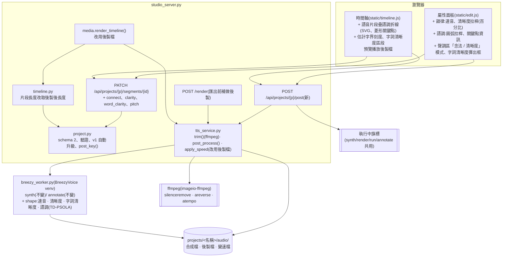

### (2) 後製管線(每個合成片段)

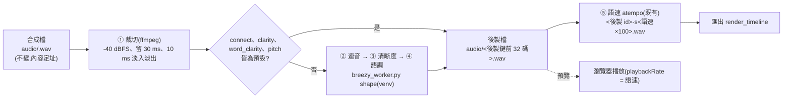

### (3) 拖曳語調關鍵點的流程

```mermaid
sequenceDiagram
  actor U as 使用者
  participant B as 時間軸 / 屬性面板
  participant S as studio_server
  participant P as project.py
  participant T as tts_service
  participant W as breezy_worker shape

  U->>B: 在選取的片段上點兩下 → 新增菱形關鍵點;拖曳到 +3.0 半音後放開
  B->>S: PATCH segments/{id} {pitch: {points, roundness}}
  S->>P: 驗證(2–16 點、位置遞增、±6 半音)→ 存檔(舊版移入 history/)
  S-->>B: 專案檢視(該片段 post 過期)
  B->>S: POST /post {segments: [id]}
  S->>S: 取「執行中」旗標(忙碌 → 409,前端稍後重試)
  S->>T: post_process([id])
  T->>T: 後製鍵 → 快取未命中
  T->>W: shape --jobs <tmp/jobs.json> --out <tmp/>(argv list、BREEZY_ENV)
  W-->>T: stdout {"id", "seconds"}
  T->>P: 更新 segment.post {id, key, seconds, trim}(存檔)
  S-->>B: 新長度 → 時間軸重排、預覽改播新後製檔
```

修訂 1 草稿(待核准,R1-10):上圖的 `W-->>T` 改為回傳 `{"id", "seconds", "pitch_points"}`(吸附後的內部點),`T->>P` 的 `segment.post` 多一個 `pitch_points`;瀏覽器在後製有效時依它畫實線、虛線自動點與放大峰谷。其餘流程不變。

## 畫面草稿

### 變更前(目前 main 的實際畫面)

以 `tests/ui_check.py` 的隔離做法截圖(本行程內的 `studio_server.create_app()`、127.0.0.1 隨機埠、暫存目錄、替身 worker 依字數產生正弦波 WAV;未使用 7860、未碰 `config/studio.db` 與 `projects/`),視窗 1600×940:

- `mockups/CHG-20261029-01/before-full.png`:完整模式全畫面,選取片段 #1。
- `mockups/CHG-20261029-01/before-props.png`:屬性面板——文字、狀態「✓ 已合成 2.8 秒」、語速選單、停頓「之後 0.4 秒」與「預設」、聲調區逐字注音與「試聽這一句」。沒有連音、清晰度、語調。
- `mockups/CHG-20261029-01/before-timeline.png`:時間軸三軌(字幕、語音、畫面),語音片段高 48 px、只有文字,片段之間的虛線框是停頓,紅色直線為播放頭。

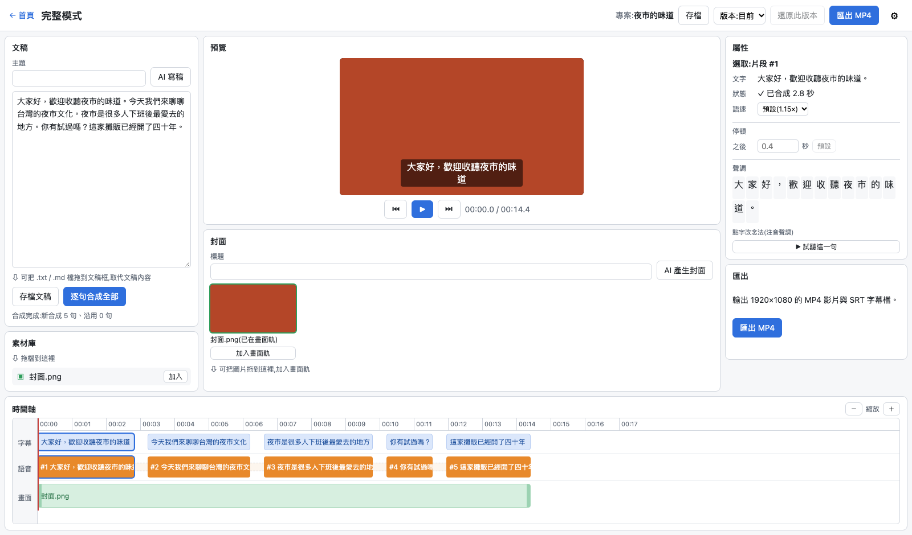

### 變更後(靜態 mockup)

`mockups/CHG-20261029-01/after.html`(純 HTML / CSS + 行內 SVG,不引外部資源)以 Playwright 截圖:

- `mockups/CHG-20261029-01/after-full.png`:完整模式全畫面(版面不變,只改屬性面板與時間軸)。
- `mockups/CHG-20261029-01/after-props.png`:屬性面板。
- `mockups/CHG-20261029-01/after-timeline.png`:時間軸。
- `mockups/CHG-20261029-01/after-pitch-roundness.png`:同一組關鍵點在圓弧 0% / 50% / 100% 的形狀對照。

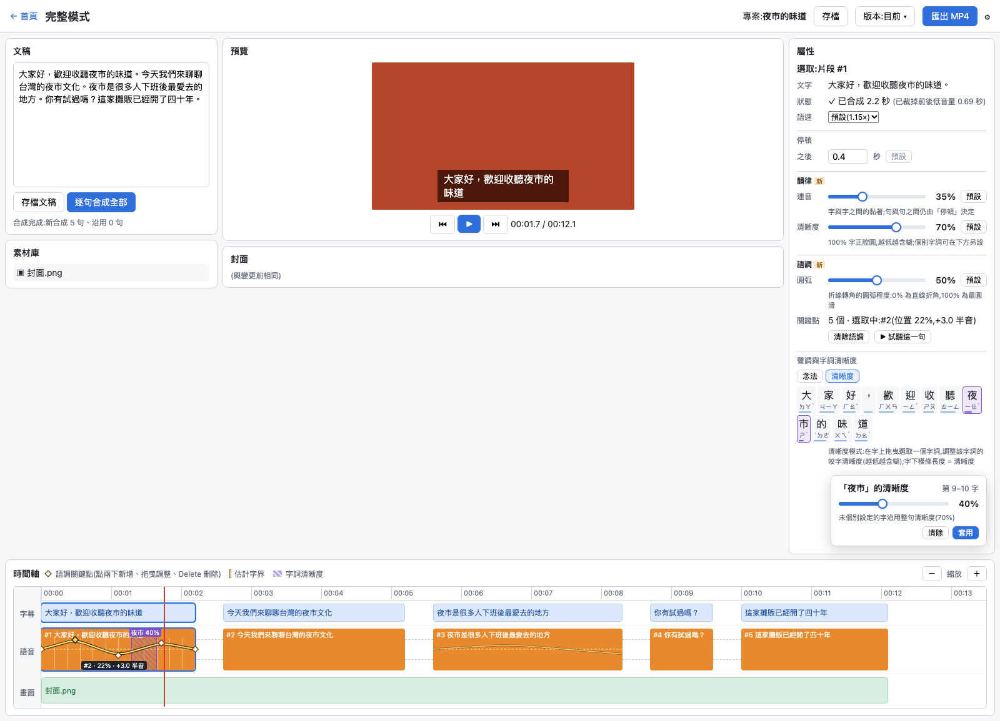

屬性面板(選取合成片段時):

```
屬性
選取:片段 #1
文字   大家好，歡迎收聽夜市的味道。
狀態   ✓ 已合成 2.2 秒 (已裁掉前後低音量 0.69 秒)        ← 長度為後製後;括號為裁切量
語速   [預設(1.15×) ▾]
── 停頓 ──
之後   [0.4] 秒 [預設]
── 韻律 [新] ──
連音   ●━━━━━○──────────  35%  [預設]                   ← 拉桿右側即時顯示百分比
       字與字之間的黏著;句與句之間仍由「停頓」決定
清晰度 ●━━━━━━━━━━○────  70%  [預設]
       100% 字正腔圓,越低越含糊;個別字詞可在下方另設
── 語調 [新] ──
圓弧   ●━━━━━━━○────────  50%  [預設]
       折線轉角的圓弧程度:0% 為直線折角,100% 為最圓滑
關鍵點 5 個 · 選取中:#2(位置 22%,+3.0 半音)
       [清除語調] [▶ 試聽這一句]
── 聲調與字詞清晰度 ──
[念法] [清晰度] [合音]                                   ← 模式切換;「念法」即原本的注音彈出框;「合音」見下方合音畫面
 大 家 好 ， 歡 迎 收 聽 [夜][市] 的 味 道               ← 清晰度模式:拖曳選取字詞
 ▔▔ ▔▔ ▔▔    ▔▔ ▔▔ ▔▔ ▔▔  ▔    ▔  ▔▔ ▔▔ ▔▔             ← 字下橫條長度 = 清晰度;個別設定者紫色
          ┌─ 「夜市」的清晰度 ──── 第 9–10 字 ┐
          │ ●━━━━━○───────────      40%      │
          │ 未個別設定的字沿用整句清晰度(70%) │
          │                     [清除] [套用] │
          └───────────────────────────────────┘
```

- 自錄音檔片段:韻律、語調小節顯示但停用,說明「自錄音檔不做後製」(D4)。
- 後製進行中:狀態顯示「⏳ 後製中」;失敗時顯示繁中錯誤訊息,片段沿用上一份有效後製檔。

時間軸(語音軌高 78 px;參考使用者提供的剪輯軟體關鍵影格線樣式):

```
00:00     00:01     00:02     00:03     00:04 …
字幕 │[大家好，歡迎收聽夜市的味道]   [今天我們來聊聊台灣的夜市文化] …
語音 │┌#1 大家好，歡迎收聽夜市的 [夜市 40%]┐┄┄┌#2 今天我們來聊聊…┐┄┄┌#3 夜市是很多人…    ┐
     ││   ◇                  ◇            │  │                 │  │ ╭───────╮        │
     │◇──╱ ╲────────────────╱ ╲─────────◇│  │                 │  │╱         ╲──── │ ← 未選取片段只顯示細線
     ││      ╲──◇──╱          ┃            │  │                 │  │                 │
     │└──────────────────────┃────────────┘  └─────────────────┘  └─────────────────┘
畫面 │▓▓▓▓▓▓▓▓▓▓▓▓▓▓▓▓▓▓▓ 封面.png ▓┃▓▓▓▓▓▓▓▓▓▓▓▓▓▓▓▓▓▓▓▓▓▓▓▓▓▓▓▓▓▓▓▓▓▓▓▓▓▓▓▓
                                  ┃ ← 紅色直線 = 播放頭(既有)
```

- 選取的語音片段上疊一條**語調折線**:水平虛線為原音高(0 半音),上下界 ±6 半音;**菱形**為關鍵點,點與點之間以線段相連,轉角依「圓弧」拉桿圓滑化;選取中的關鍵點為實心黃色並顯示「#2 · 22% · +3.0 半音」。操作:點兩下新增、拖曳調整(位置與音高)、選取後 Delete 刪除(D17)。
- 選取片段內以細白線標出**估計字界**,設定了字詞清晰度的範圍以紫色斜線區段與「夜市 40%」標示(D8)。
- 片段邊界已是裁切後的位置(貼齊語音);時間軸不另畫被裁掉的部分。靜音裁切沒有開關,只在屬性面板狀態列顯示裁切秒數(D2)。
- 紅色直線播放頭、字幕軌、畫面軌與停頓拖拉不變。

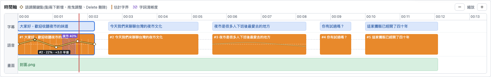

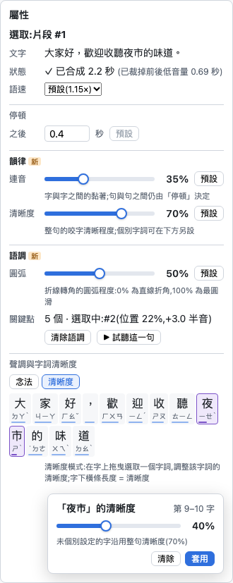


### 變更後:合音(核准後新增)

- `mockups/CHG-20261029-01/after-fusion.png`:屬性面板聲調區新增「合音」模式(與「念法」「清晰度」並列)。第 6 句已套用三字「不知道 → ㄅㄨˋ ㄗㄠˋ(詞庫)」,以藍色框與虛線底線標在字上、下方列出並可 ✕ 移除;再選取四字「就是這樣」時,彈出框列出三組相鄰兩字選項(就是:跳過;是這:規則 ㄕㄜˋ;這樣:詞庫 ㄐㄧㄤˋ,預設選取),只合併所選的一對,其餘字維持原讀音(D37),可改注音、「存入合音詞庫」「套用」;「送模型」列顯示實際送出的標註文字,「字幕」列顯示原文;狀態為「重新合成中」(D28)。
- 時間軸(`after-timeline.png`):有合音的片段右下角顯示「⟲ 合音 2」,字幕軌仍是原文「我也不知道，反正就是這樣」;圖例說明「送模型的文字含合音(字幕仍為原文)」。
- 屬性面板(`after-props.png`):聲調區標題改為「聲調、字詞清晰度與合音」,模式切換多一個「合音」。
- `mockups/CHG-20261029-01/after-settings-fusion.png`:設定頁新增「合音詞庫」子頁(與模型、審議席位、語音預設、進階流程並列)——表格列出原詞(2~4 字,例含「不知道」「是這樣」)、合音注音、同音字(參考)、來源(預設 / 自訂)、啟用、編輯與刪除(預設詞為「還原」);右上「＋ 新增」「匯入…」「匯出 JSON」「匯出 CSV」;列表下方有「匯入大小上限 [256] KB(16–4096)」「匯入筆數上限 [1000] 筆(10–10000)」兩個設定欄位與「儲存上限」(D36);匯入後先顯示差異預覽(D30):與現有詞庫一致時只顯示「與現有詞庫一致,無需更動」;不一致時顯示警告、圖例與逐筆更動表(「保留|類別|詞|合音注音|啟用」五欄;變動的儲存格內為「原值 → 新值」並以底色標示:新增整列綠底、修改儲存格黃底、停用的「啟用」欄橙底、刪除整列紅底加刪除線,被拒詞條以類別「拒絕」灰底列出;儲存格不附原因說明;有被拒詞條時表格下方顯示「拒絕原因」區塊,每行「合音詞:拒絕原因」);額外提示只有三種——拒絕原因區塊、匯入失敗、格式錯誤(後兩者的示意在 `after.html` 的「#panel-import-errors」,未另截圖),選「全部覆蓋」或「自訂」(勾選「保留」的項目不被更新;刪除與停用預設勾保留),確認按鈕標示實際將更動的筆數。

- `mockups/CHG-20261029-01/after-fusion-typing.png`:完整模式文稿框中三種狀態並排——「是這樣」已啟用:綠色波浪底線,上方常駐浮層「是醬」遮住原詞;「不知道」未決定:黃色波浪底線,點擊後彈出浮動窗「不知道 → ㄅㄨˋ ㄗㄠˋ」與「啟用」「停用」;「為什麼」已停用:紅色波浪底線;只標示字數最多的「不知道」,不另標「知道」;附圖例(D40~D43)。


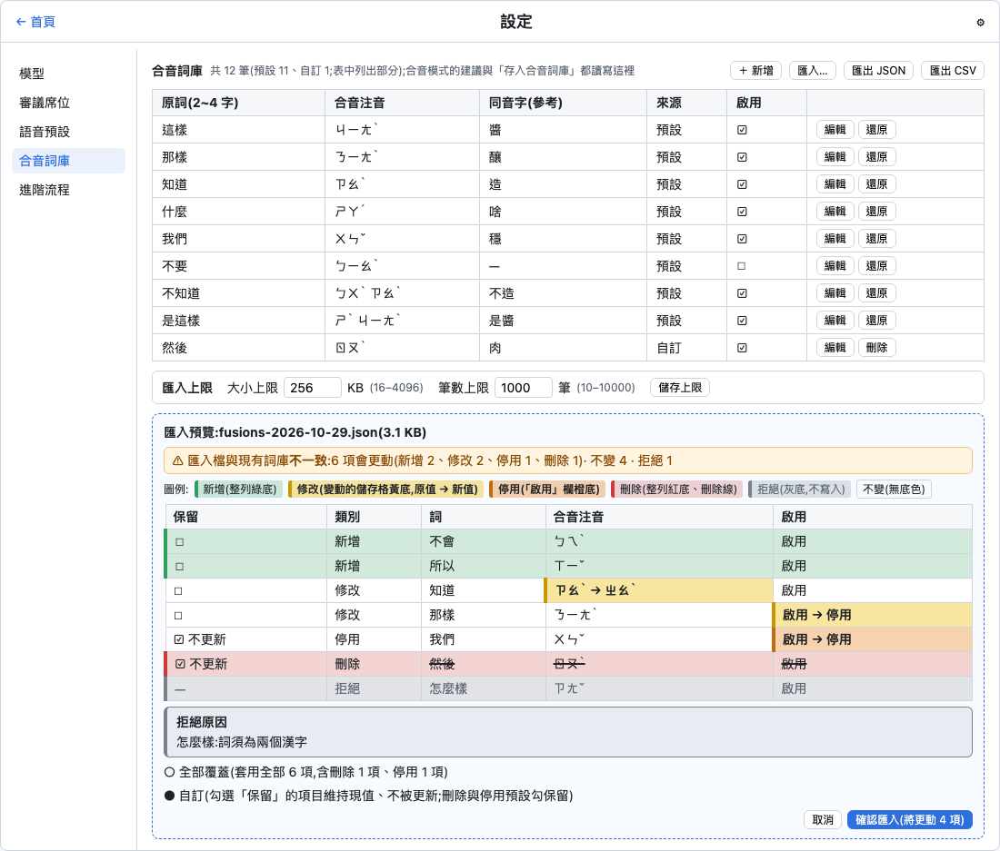

### 修訂 1(草稿,待使用者核准)

變更前:以 Playwright 開使用者的網頁伺服器 `http://127.0.0.1:7860`(main `f75f9a1`),只新建名稱帶「草稿」的專案「草稿修訂1畫面」(文稿「大家好，歡迎收聽夜市的味道。」,以真 BreezyVoice 合成一句),以 PATCH 設清晰度 20%、5 個語調關鍵點(0、+3、−2、+2、0 半音)與圓弧 100%,截圖後以 `DELETE {"confirm": true}` 移入 `projects/.trash/`;未動使用者的專案、未停止伺服器。視窗 1600×1240,時間軸放大 4 次。

- `mockups/CHG-20261029-01/rev1-before-full.png`:完整模式全畫面。
- `mockups/CHG-20261029-01/rev1-before-props.png`:屬性面板——清晰度 20% 時沒有任何提示。
- `mockups/CHG-20261029-01/rev1-before-timeline.png`:時間軸——圓弧 100% 時曲線不經過中間的菱形(二次貝茲),起伏被削平;沒有自動點。


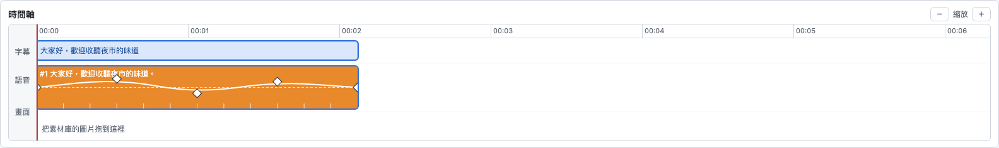

變更後:`mockups/CHG-20261029-01/rev1-after.html`(純 HTML / CSS + 行內 SVG + 行內 JS,不引外部資源;JS 依 R1-6、R1-7 的公式算座標,PCHIP 導數規則與 scipy `PchipInterpolator` 在 9 個取樣點的差 ≤ 1e-15)以 Playwright 截圖:

- `mockups/CHG-20261029-01/rev1-after-props.png`:屬性面板——清晰度 20% 時在說明文字下方顯示淺橙底警告「⚠ 低於 25% 會過度含糊、聲音偏悶,不建議使用;需要含糊感時建議用 50% 或 25%。」(R1-3);圓弧說明加「曲線一律經過每個實際套用的點(含放大後的峰谷與自動補點)」;關鍵點列加「· 自動補點 3 個(虛線,不可拖曳)」(R1-10)。粉紅虛線框只是草稿標示,不是畫面元素。
- `mockups/CHG-20261029-01/rev1-after-word-clarity.png`:字詞清晰度彈出框——「夜市」15% 時同一則警告,「套用」照常可按(只警告、不阻擋)。
- `mockups/CHG-20261029-01/rev1-after-timeline.png`:時間軸——實線為實際套用的曲線(經過每個實際套用的點(含放大後的峰谷與自動補點);不經過使用者畫的峰谷菱形);白色實心菱形為使用者關鍵點(可拖曳);黃色虛線菱形為 × 1.2 放大後的峰谷,以虛線連到使用者菱形並標套用值(+3.6、−2.4、+2.4);虛線圓為自動補點(峰前 −1、谷前 +1 半音),其中一點示意「吸附到有聲處」;縱軸 ±7.2 半音(R1-9);語音軌為了看清楚放大顯示,實際高度仍為 78 px。
- `mockups/CHG-20261029-01/rev1-after-roundness.png`:圓弧 0% / 50% / 100% 對照——深色虛線為修訂前(二次貝茲),白色實線為修訂 1(PCHIP 混合 + 自動補點)。

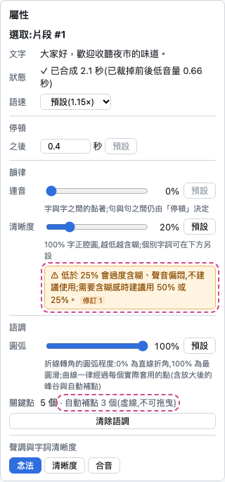

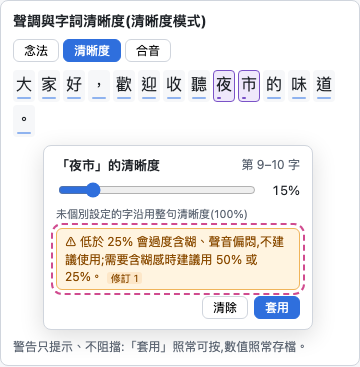

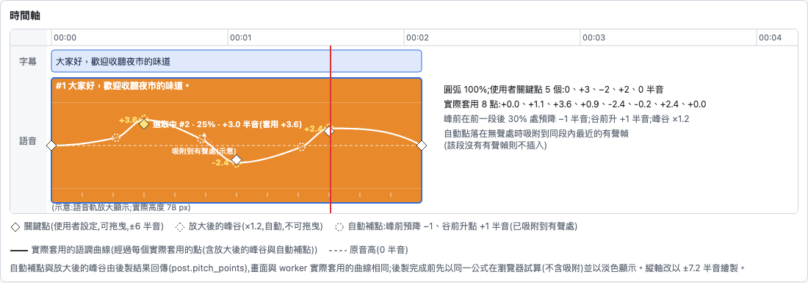

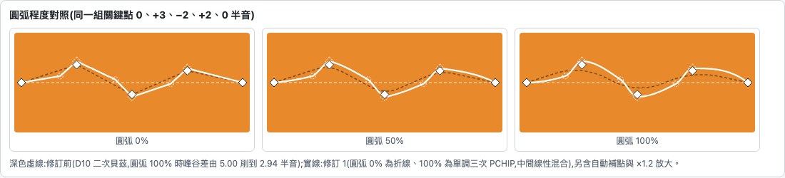

- 合音(R1-4)沒有新畫面:文稿框、浮層、合音模式彈出框的版面不變;合音模式彈出框「送模型」列的內容改為實際送出的文字(例 `是醬啊`)。

## 安全影響

| 類別 | 是否觸及 | 影響範圍 / 理由 |
|------|----------|-----------------|
| irreversible-delete | **是(有限)** | 後製與裁切不刪除任何東西:後製檔、變速檔不自動刪除(磁碟用量增加列入風險);合成檔原樣保留,裁切與後製一律寫新檔;`tmp/` 的 worker 輸入 / 輸出暫存檔用完即刪(沿用 CHG-20261022-04,非使用者資料)。合音詞庫有三個刪除點:(1)D29 使用者在設定頁刪除**自訂詞**(單筆,按鈕須再確認;預設詞不可刪,只能停用或還原,API 回 422);(2)D30 匯入時刪除**檔案外的自訂詞**——只在使用者於差異預覽中看過該筆並確認後發生(選「全部覆蓋」,或在「自訂」中取消該筆的「保留」勾選;刪除類預設勾保留);前後一致時零寫入;預覽後詞庫被改則套用被拒;預設詞只會被停用不刪;被拒絕的詞條不產生更動;預覽先列出將刪除與將停用的筆數與詞,確認後才寫入;整批單一交易,失敗即 rollback;建議匯入前先匯出備份);(3)回滾時 `DROP TABLE fusion_words` 與 `fusion_settings`(只在使用者執行或核准後執行,之前先 `.dump` 備份並匯出 JSON,見「風險與回滾」)。刪除範圍一律限 `fusion_words`、`fusion_settings` 兩表,不觸及 `roles`、`review_seats`、`voice_defaults` |
| payments | 否 | 無金流 |
| prod-migration | **是(有限)** | 專案檔 `schema_version` 1 → 2(D14):讀到 v1 只在記憶體補欄位,存檔才寫成 v2,v1 舊檔照例移入 `history/`;v3 以上拒絕載入、不猜測轉換。核准後新增:設定資料庫 `config/studio.db` schema 2 → 3(D29),只新增 `fusion_words`(寫入預設詞)與 `fusion_settings`(寫入預設上限,D36)兩張表,在 `settings` 既有 `BEGIN IMMEDIATE` 交易內升級,失敗即 rollback 維持 v2、回傳程式內預設詞庫並帶 `_warnings`;兩個行程同時觸發時後到者看到版本已是 3 即略過;版本大於 3 不讀不寫。回滾見「風險與回滾」 |
| security-boundary | **是** | (a) 新端點 `POST /api/projects/{p}/post` 沿用 CHG-20261022-01 的 Host / Origin / Token 中介層與 `projects/` 路徑限制,與 synth / render 共用「執行中」旗標(D19);segment id 一律 `^[0-9a-f]{8,32}$`。(b) PATCH 新欄位只接受數字與整數索引,範圍驗證在 `project.validate()`(連音、清晰度、圓弧為 0–100 整數;半音 −6 ~ +6;位置 0–1;字詞區段落在句內且不重疊);任何字串欄位一律拒絕。(c) `shape` 子命令只讀 JSON 檔(放在 `projects/<名稱>/tmp/`,不放命令列),輸入、輸出檔名由伺服器產生,worker 再驗證一次範圍與檔名格式(`^[0-9a-f]{8,32}\.wav$`),只在 `--out` 目錄內讀寫。(d) worker 以 BreezyVoice venv 執行,環境沿用 `taiwan_ai.BREEZY_ENV`(含 `HF_HUB_OFFLINE=1`、`TRANSFORMERS_OFFLINE=1`);`shape` 不載入任何模型、不 import 會連網的模組,新增網路呼叫為 0。(e) ffmpeg 裁切以 argv list 執行,輸入、輸出為伺服器解析並檢查前綴的路徑;濾鏡字串只含程式常數。(f) 新增錯誤訊息一律繁中、不含本機絕對路徑。(g) 資源上限:每句 word_clarity ≤ 32 段、關鍵點 ≤ 16 個;`post` 一次最多處理 2000 句;worker 逾時 30 + 5 × 句數 秒。(h)核准後新增:合音詞庫端點(`GET /api/settings/fusions`、`PUT`/`DELETE /api/settings/fusions/{word}`、`POST /api/settings/fusions/{word}/restore`(預設詞還原為程式常數值)、`GET` / `PUT /api/settings/fusions/limits`(匯入上限,D36)、`POST /api/settings/fusions/import/preview`、`POST /api/settings/fusions/import/apply`(預覽代號 128 位元隨機、單次有效、10 分鐘過期,套用時比對詞庫版本)、`GET /api/settings/fusions/export?format=json|csv`、`POST /api/fusion/suggest`)沿用 Host / Origin / Token 中介層,改變狀態者要求 Token;匯入檔只經 multipart 上傳到記憶體解析,不落地、不經 `/api/upload`,上限由後台設定(D36,預設 256 KB、1000 筆,可調範圍 16–4096 KB、10–10000 筆;程式內另有硬上限 4096 KB + 16 KB、10000 筆,設定值不能超過;請求本體上限隨設定值,超過即 413、不讀完),只接受 UTF-8(含或不含 BOM),JSON 深度與型別嚴格檢查,CSV 只接受五個欄位;每筆依 D31 驗證,非法筆拒絕(表格以類別「拒絕」列出,原因只顯示在「拒絕原因」提示區塊;原因為伺服器產生的固定繁中句子,以 `textContent` 顯示);寫入走 `settings` 既有交易與初始化鎖。匯出 CSV 的欄位只含漢字、注音、布林與 default/custom,不會以 `=`、`+`、`-`、`@` 開頭,不構成試算表公式注入。(i)合音只改送 worker 的標註文字,標註仍經 `breezy_worker.to_breezy_text` 驗證(只接受注音與聲調符號) |


**修訂 1 的安全影響(草稿)**:不新增端點、不新增網路呼叫(`shape` 仍以 `taiwan_ai.BREEZY_ENV` 執行、不載入模型);irreversible-delete 不變(後製檔仍不自動刪除,合成檔不改寫);payments 不變。prod-migration:專案檔仍為 `schema_version: 2`,只新增兩個選填欄位——`fusions[].display`(使用者經 PATCH 寫入,伺服器驗證為空字串或 1~4 個漢字,同 D31 的 CJK 範圍,其他型別、長度或字元回 422)與 `post.pitch_points`(伺服器產生,PATCH 不能寫入);舊專案檔不需轉換;回滾見「風險與回滾」。security-boundary:(a) `display` 只含漢字,送 worker 前照例經 `escape_text` 與 `breezy_worker.to_breezy_text` 檢查,不會組出方括號標記;(b) worker stdout 新增的 `pitch_points` 由伺服器驗證(≤ 30 點、數字、位置 0–1 遞增、±7.2)後才寫入專案檔,不合格即當作後製失敗;(c) 清晰度警告只在前端顯示,以 `textContent` 寫入固定文字;(d) 資源:每句內部點 ≤ 30 個,清晰度方案 C 每句約 49 ms、語調約 125 ms,後製逾時(30 + 5 × 句數 秒)不變。

## 修訂 1(2026-10-29,ACC-20261029-03 使用者試聽後、施工前;草稿,待使用者核准)

- 依據:ACC-20261029-03(分支 `acc/CHG-20261029-01`,尚未合進 main)「## 未達標項與處置」的「使用者試聽結果與處置」——P8 清晰度、P8 語調折線、P11 合音三項不通過;使用者處置:P8 清晰度與 P11「不造」選「本 CHG 開修訂」,語調圓弧選「跟上題同處置」。連音 50%、片段裁切兩項使用者判定成立,本修訂不改。
- 使用者原話(2026-10-29,照錄):
  1. 試聽 ACC:「25含糊又有點悶, 0額外更加悶」「P11聽到的是“是醬啊 我也不XXX”,XXX部分不符合剛剛提供的不造」「p8_legato_050_s1的確更像是正常人說話的語速，p8_pitch_round_100_s1起伏不太明顯」「沒有被裁掉」;清晰度 100% 與改版前是否相同,使用者選「一樣」。
  2. 修訂實測試聽:「C 的效果比較好 000則過於滷蛋不建議採取這種等級」「使用者可以選但需要警告 建議需要滷蛋的情況採取 50/25」「可以s3效果比較好」(指直接換字的 `fusion_full_direct_s3.wav`;主 agent 的理解是直接換字可行)「語調起伏不明顯可以考慮先降低一點再調到原本稍高的位置？」「pitch_predip_d1k12f30sym_round100比較接近」。
- 範圍:只處理 ACC 不通過的三項(清晰度變悶、合音「不造」念錯、語調起伏不明顯)與其連帶的後製快取失效;連音、靜音裁切、合音詞庫(匯入匯出、上限)、文稿合音標示不改。依使用者原則「規格寬窄二選一時取窄」,有寬窄兩案者一律取窄並標「代決」。
- 標示:「使用者選定」= 使用者 2026-10-29 已明確選定的方向;「代決」= 起草者補上的細節,確認閘須逐項覆核。**本節所有代決均未核准**;核准前,本節以外已核准的 D1~D43 照舊有效,本節標「擬改」之處以本節為準只在核准後生效。

### 修訂 1 實測(2026-10-29,只在 session scratchpad 做,不入 repo;數值照錄於此,不依賴暫存檔)

素材:ACC-20261029-03 第 1 句的裁切檔(「大家好，歡迎收聽夜市的味道。」,2.439 秒、22050 Hz,即該 ACC 的 `p8_clarity_100_s1.wav`)。清晰度與語調只做後製、不重新合成;合音以真 BreezyVoice worker 在使用者 repo 的 `heavy_lock` 內一次一件合成,每種寫法 3 個 seed(聲線為設定預設)。試聽檔在 `outputs/rev-exp-CHG-20261029-01/`(`outputs/` 不入 git,不是本 CHG 的依據檔)。量測以 BreezyVoice venv 的 numpy / scipy / librosa 進行。

**(a) 清晰度:悶的來源與方案 C**

把現行 D7 v2 的 ①~⑤ 逐步拆開量測:

- ③ 共振峰中性化是悶的主因:每幀包絡往全句平均包絡靠、再把 RMS 對齊原音,結果母音幀 125–500 Hz 抬高約 5–6 dB、2–4 kHz 降 1.6–2.8 dB;② 頻譜時間平滑在母音上也有同向效果(母音「低−中高」+2.3 dB)。
- 清晰度 0% 另有 ⑤ 2 階低通,把 8–11 kHz 壓掉約 25 dB——對應使用者「0額外更加悶」。
- 另試了「只拿掉 ⑤ 低通」(方案 A)與「A + 頻譜傾斜補償」(方案 B),使用者試聽後選方案 C(「C 的效果比較好」)。

指標(都以原音的幀分類為準,輸出長度不變,可逐幀比較):子音幀 ≥ 3 kHz = 原音判定為子音的幀在 3 kHz 以上的能量變化;母音「低−中高」= 原音判定為母音的幀(非靜音且不是子音幀)在 125 / 250 / 500 Hz 三個八度帶的能量變化平均,減去 1 k / 2 kHz 兩個八度帶的能量變化平均(dB;正值 = 低頻相對變重,即「悶」);非子音幀 ≥ 4 kHz = 母音幀 4 kHz 以上的能量變化(大幅負值 = 高頻被削);包絡離散度 = 各幀倒頻譜包絡到全句平均包絡的距離平均之變化(負值 = 母音往中性靠);RMS 差 = 整句 RMS 變化。

| 做法(數值依序為清晰度 50 / 25 / 0%) | 子音幀 ≥ 3 kHz | 母音「低−中高」 | 非子音幀 ≥ 4 kHz | 包絡離散度 | RMS 差 | 耗時 |
|------|------|------|------|------|------|------|
| 現行 D7 v2 | −10.3 / −14.3 / −19.3 dB(ACC-20261029-03 量得) | **+4.77 / +6.85 / +8.40 dB** | 0% 時 6 kHz 以上 −12.1 dB(ACC,⑤ 低通) | −26.6 / −37.9 / −46.8%(ACC) | 0 | 27–29 ms / 句 |
| **方案 C(本修訂採用)** | −9.79 / −15.35 / −19.67 dB | **−0.04 / −0.11 / −0.12 dB** | +0.65 / +0.68 / +0.69 dB | −19.6 / −24.8 / −25.7% | 0 | 約 49 ms / 句 |

- 方案 C 在 100% 時輸出等於原音(逐樣本相同);子音弱化量與現行相近,母音不再變悶、高頻不再被削;代價是母音中性化變弱(離散度只到 −25.7%)。
- 只量了第 1 句一句(單一句、單一聲線);75% 未量測。〔推論〕其他句的數值會有差異,由重新驗收的 P4 以真模型產物確認。

**(b) 合音:「不造」念錯的原因(上游刪字 bug)**

- BreezyVoice 上游 `tools/BreezyVoice/single_inference.py` 的 `text_normalize_new()` 先以方括號把文字切段,每段經內部函式 `text_normalize_no_split()` 正規化;**第 52 行**:該段不是最後一段且結尾不是「。」時執行 `text = text[:-1]`。本機的文字正規化是 WeTextProcessing(`tn.chinese.normalizer`),不會在段尾補標點,所以被切掉的是方括號前、被注音標註的那個字本身。
- 結果(以 `fe_test` 對同一份前處理逐句列出模型實際收到的文字):

| 送 worker 的文字 | 模型實際收到 | 3 個 seed 的長度(秒) |
|------|------|------|
| `是這[:ㄐㄧㄤˋ]啊，我也不[:ㄅㄨˋ]知[:ㄗㄠˋ]。`(現行 D26) | `是[:ㄐㄧㄤ4]啊，我也[:ㄅㄨ4][:ㄗㄠ4]。` | 2.426 / 4.029 / 2.426 |
| `是醬啊，我也不造。`(直接換字) | `是醬啊，我也不造。`(不變) | 2.426 / 3.587 / 2.380 |
| `我也不[:ㄅㄨˋ]知[:ㄗㄠˋ]。`(現行 D26) | `我也[:ㄅㄨ4][:ㄗㄠ4]。` | 3.820 / 1.683 / 2.844 |
| `我也不知[:ㄗㄠˋ]。` | `我也不[:ㄗㄠ4]。` | 0.964 / 1.242 / 2.705 |
| `我也不造。`(直接換字) | `我也不造。`(不變) | 1.358 / 1.788 / 2.403 |
| `我也不知道。`(原文對照) | `我也不知道。` | 1.625 / 1.440 / 1.347 |

- 「這樣 → 醬」之所以成功,是因為「這」剛好被刪掉,模型只靠 `[:ㄐㄧㄤ4]` 念出來;三字「不知道」則是兩個字都被刪,只剩兩個連續標記。
- 聲學比對(本機沒有語音辨識,以 MFCC 加 DTW 與同聲線合成的單字參考「造」「知」「道」比對):直接換字的 `我也不造。` 三個 seed 最後一字都最接近「造」;現行寫法的長度與音節數變動最大。使用者試聽選直接換字(「可以s3效果比較好」)。
- 這個 bug 也影響 CHG-20261022-04 的逐字聲調標註:句中(非最後一段、段尾不是「。」)被標的字,文字 token 會被刪掉、只剩注音標記。〔推論〕ACC-20261028-01 P4「好」標四聲後聽起來不清楚,可能與此有關,未驗證。

**(c) 語調:起伏不明顯的原因與峰前預降**

- D10 的二次貝茲不經過中間關鍵點:同一組 5 點(0、+3、−2、+2、0 半音),圓弧 100% 時曲線本身的峰谷差由 5.00 削到 2.94 半音。
- 語調曲線是**疊加**在原音的自然語調上;這一句的自然起伏(F0 第 5–95 百分位差)為 8.70 半音,與畫的曲線錯開時會互相抵消。
- 依使用者「先降低一點再調到原本稍高的位置」試了多組「峰前預降」,使用者選 `d1k12f30sym`(「pitch_predip_d1k12f30sym_round100比較接近」):
  - 曲線:PCHIP 混合——圓弧 0% 為折線、100% 為單調三次(scipy `PchipInterpolator`),中間線性混合,**一定經過每個實際套用的點(含放大後的峰谷與自動補點)**;
  - 峰:比前一點高的正值中間點;在前一段的後 30% 處插入預降點,值 = 該處折線值 − 1 半音;峰值 × 1.2;
  - 谷:比前一點低的負值中間點,對稱處理——谷前在前一段的後 30% 處插入 +1 半音的升點,谷值 × 1.2。
- 量測(第 1 句,5 點如上;位移峰谷 = 輸出與原音逐幀 F0 差(半音,5 幀中位數平滑)的最大減最小;整句起伏 = 輸出 F0 第 5–95 百分位差;pyin 70–400 Hz):

| 圓弧 | 0% | 50% | 100% |
|------|----|-----|------|
| 位移峰谷(半音) | 7.70 | 8.10 | 8.00 |
| 整句起伏(半音) | 7.20 | 7.30 | 7.50 |
| 耗時 | 約 125 ms / 句 | 同左 | 同左 |

- 預降點落在無聲處就沒有作用:這一句「後 30%」的三個插入點附近(±40 ms)只有 0–4 個有聲幀。施工時要把插入點**吸附到同一段內最近的有聲幀**(R1-8);吸附的效果**尚未驗證**。

### 修訂 1 決策

| 編號 | 決策 | 來源 | 取代 / 修改 |
|------|------|------|-------------|
| R1-1 | 清晰度改用方案 C | 使用者選定(「C 的效果比較好」) | 擬取代 D7 的 ①~⑥;D8 的處理方式隨之改變 |
| R1-2 | 清晰度拉桿對應表改為方案 C 的係數 | 代決(依 R1-1 的公式推算;75% 未實測) | 擬取代「拉桿百分比對應」表的清晰度列 |
| R1-3 | 清晰度 < 25% 時在拉桿旁警告,只警告、不阻擋 | 方向使用者選定(「使用者可以選但需要警告 建議需要滷蛋的情況採取 50/25」);門檻、文字、位置為代決 | 新增 |
| R1-4 | 詞庫帶顯示字的合音,合成時以顯示字作為送模型的文字、不加注音 | 方向使用者選定(「可以s3效果比較好」);資料欄位與套用規則為代決 | 擬修改 D26、D27、D28、D43 |
| R1-5 | 合音改送顯示字的連帶影響(快取鍵、片段長度、字幕、字界換算、既有專案) | 代決 | 擬修改 D28 |
| R1-6 | 語調曲線改為 PCHIP 混合,一定經過每個實際套用的點(含放大後的峰谷與自動補點) | 方向使用者選定(「pitch_predip_d1k12f30sym_round100比較接近」) | 擬取代 D10 |
| R1-7 | 自動插入峰前預降點、谷前升點,峰谷 × 1.2;參數固定,不新增「強調」拉桿 | 方向使用者選定(「先降低一點再調到原本稍高的位置」);參數照 `d1k12f30sym`、不加拉桿為代決 | 新增 |
| R1-8 | 自動點吸附到同段內最近的有聲幀 | 代決(未驗證) | 新增 |
| R1-9 | 使用者關鍵點仍限 ±6 半音;內部上限 ±7.2;時間軸縱軸 ±7.2 | 代決 | 修改 D9(只加內部上限) |
| R1-10 | 時間軸以虛線畫出自動點與放大後的峰谷,畫面與 worker 曲線一致 | 方向使用者選定(預覽須與 worker 的曲線一致);資料來源為代決 | 修改 D17 的顯示 |
| R1-11 | 既有後製以「演算法標記」失效重做,只影響有清晰度或語調的片段 | 代決 | 擬修改 D13 |
| R1-12 | 上游刪字 bug 不在本修訂修正,列入後續改善;建議(不自行加入)Guideline §9 新增 ADP 待補項 | 方向使用者選定(本修訂範圍);ADP 為建議 | 新增 |
| R1-13 | 修訂後另開新的 ACC 重新驗收 P4、P5、P8、P10、P11 與新增的 P14~P16 | 方向使用者選定(ACC-20261029-03「修訂完成後另以新的 ACC 重新驗收」) | 修改 Acceptance operation |

**R1-1 清晰度方案 C(使用者選定)**:清晰度 p(0–100%)、含糊量 c = 1 − p/100;100% 不處理(輸出等於輸入)。依序:

1. ① 子音弱化(弱化而非削除):子音幀判定不變(非靜音且 3 kHz 以上能量比為句內前 35%,遮罩 30 ms 平滑);子音幀的倒頻譜包絡往**前後最近的母音幀包絡**(依距離線性內插)靠 c × 1.0,保留子音本身的細部(雜訊)與原相位;先還原為原幀能量,再整幀衰減 c × 16 dB(只在子音遮罩內)。
2. ② 轉接處時間平滑:只在字間轉接區(子音遮罩 > 0.2 的幀,或比 150 ms 平滑能量低 3 dB 以上的非靜音能量谷,兩者再向前後各擴 50 ms)以權重 1 做 c × 160 ms 的幅度譜移動平均,其他地方權重 0.2;權重本身以 30 ms 平滑;相位用原音。
3. ③ 共振峰中性化(輔助):每幀包絡往**母音幀的平均包絡**靠 c × 0.3,並保持每幀能量不變(不改變整體頻譜傾斜);靜音幀不動。
4. ④ 音節對比降低:照舊(往 150 ms 平滑能量靠攏 c × 0.3,單幀 ±12 dB)。
5. ⑤ 拿掉 2 階低通,改為**長期頻譜傾斜補償**:以原音判定的母音幀,比較原音與處理後的長期平均功率譜,於 1/3 八度平滑(60 Hz 以下以 60 Hz 計)後取差值,上下各限 12 dB,作為全句的固定 EQ 套回。
6. ⑥ RMS 對齊原音。

確切常數以實測程式為準,施工時寫成 `breezy_worker.py` 的具名常數:`LEN_W = 1.0`、`C_ATT = 16`(dB)、`SM_S = 0.16`(秒)、`SM_OUT = 0.2`、`TRANS_PAD = 0.05`(秒)、`VALLEY_DB = 3`、`NEU_C = 0.3`、`TILT_MAX = 12`(dB);`CONS_TOP = 35`、`CONS_MASK`(30 ms)、④ 的常數沿用。字詞清晰度(D8)照舊以整句處理後交叉淡化 20 ms 換入,⑤ 的傾斜補償以整句的母音幀計算。

**R1-2 拉桿對應(代決)**:

| 清晰度 | c | ① 包絡內插 / 衰減 | ② 轉接平滑 | ③ 中性化 | ④ 對比 | ⑤ | 實測(第 1 句) |
|--------|---|------|------|------|------|------|------|
| 100% | 0 | 不處理 | 不處理 | 不處理 | 不處理 | 不處理 | 等於原音 |
| 75% | 0.25 | 0.25 / 4 dB | 40 ms | 0.075 | 0.075 | 傾斜補償 | 未實測 |
| 50% | 0.5 | 0.5 / 8 dB | 80 ms | 0.15 | 0.15 | 傾斜補償 | 子音 −9.79 dB、低−中高 −0.04 dB、離散度 −19.6% |
| 25% | 0.75 | 0.75 / 12 dB | 120 ms | 0.225 | 0.225 | 傾斜補償 | 子音 −15.35 dB、低−中高 −0.11 dB、離散度 −24.8% |
| 0% | 1 | 1.0 / 16 dB | 160 ms | 0.3 | 0.3 | 傾斜補償 | 子音 −19.67 dB、低−中高 −0.12 dB、離散度 −25.7% |

預設仍為 100%;拉桿仍為 0–100 整數、步進 1%。

**R1-3 低清晰度警告(方向使用者選定;細節代決)**:

- 門檻:數值 **< 25%**(0–24%)即顯示;25% 以上、按「預設」(`null` = 100%)即消失。整句「清晰度」拉桿與字詞清晰度彈出框的拉桿都適用。
- 文字(固定,繁中):「⚠ 低於 25% 會過度含糊、聲音偏悶,不建議使用;需要含糊感時建議用 50% 或 25%。」
- 位置:屬性面板在「清晰度」說明文字下方、字詞清晰度彈出框在拉桿說明下方;淺橙底、`role="status"`;拖動中(`input`)即時顯示,不必放開;開啟已存的 < 25% 片段也顯示。
- 只警告、不阻擋(依「規格寬窄二選一時取窄」):拉桿放開照常送出、「套用」照常可按,伺服器與 API 不改、不回 422;不跳出訊息框;精靈 ② 語音步驟沒有拉桿,不顯示。替代方案(未採用):低於 25% 要求再確認、或把下限改為 25%。

**R1-4 合音送顯示字(方向使用者選定;細節代決)**:

- 片段 `fusions` 每組新增選填欄位 `display`(空字串或 1~4 個漢字,同詞庫 D43 的格式);缺少視同空字串(舊專案檔照常載入)。
- 套用時寫入:由詞庫套用的合音(文稿框點擊「啟用」、合音模式選取命中詞庫並套用、`source = "lexicon"`),把該詞庫詞當時的 `display` 一併寫入;規則推導(`rule`)、手動輸入注音(`manual`)、或詞庫詞沒有顯示字者,`display` 為空字串。之後改詞庫不回頭改既有片段(D27 不變)。
- 送模型:`display` 不是空字串時,`tts_text()` 把合音範圍整段換成 `display`(經 `escape_text`),**不加注音**;例:「是這樣啊，我也不知道」+ 這樣(醬)、不知道(不造)→ `是醬啊，我也不造。`。`display` 為空字串時維持 D26 的注音標註路線(例:不在詞庫的「那裡」→ `那[:ㄋㄧˇ]`)。
- 預設詞庫 11 組中,除「不要」外 10 組都有顯示字(D35),因此預設詞的合音一律走顯示字路線。
- D43「`display` 只用於浮層與詞庫表…不送模型」擬改為:「由詞庫套用時寫入片段,合成時作為送模型的文字;浮層顯示不變」。
- 替代方案(未採用):合成時才去詞庫查顯示字——違反 D27「改詞庫不回頭改既有片段」,且快取鍵會隨詞庫變動。

**R1-5 合音改送顯示字的連帶影響(代決)**:

- 快取鍵:合成快取鍵 = SHA-256(`tts_text` + 聲線…)不變;`tts_text` 改變即換鍵、該句變髒、走既有 synth(`heavy_lock`),同 D28。
- 既有專案:已存的 `fusions` 沒有 `display`,`tts_text` 與快取鍵不變、不重新合成、念法維持現狀;要改用顯示字,使用者在文稿框把該處「停用」再「啟用」(或在合音模式移除後再套用)。**不做自動回填**(取窄)。替代方案:開啟專案時依目前詞庫自動補 `display`(會讓既有句子變髒、需重新合成)。
- 字幕、SRT、文稿、時間軸、屬性面板:一律顯示原文,不變。
- 片段長度:取實際音檔(合成長度、後製後長度),不變。
- 字界估計與字詞清晰度換算(D8、D28):送模型的字 = 合音範圍外的原字 + `display` 的字;`chars` 為送模型的漢字數;字詞清晰度區段若完整包含合音範圍(D27),換算後涵蓋 `display` 的全部字。例:「我也不知道」+ 不知道(不造),`chars` = 4。
- 浮層(D43)仍顯示 `display`;合音模式彈出框「送模型」列顯示實際送出的文字(例 `是醬啊`)。
- MCP `speak` 不套用合音(D33 不變)。

**R1-6 語調曲線(方向使用者選定)**:取代 D10。內部點 P(R1-7 展開後)排序後,曲線 f(t) = (1 − r) × 折線(t) + r × PCHIP(t),r = 圓弧 / 100;PCHIP 的導數規則同 scipy `PchipInterpolator`(內部點:相鄰斜率異號或為 0 時導數 0,否則加權調和平均;端點:三點公式並保形);t 限在第一點與最後一點之間,點外維持端點值(D9 不變)。圓弧任何值曲線都經過每個實際套用的點(含放大後的峰谷與自動補點);使用者畫的峰谷菱形因 × 1.2 放大而不在曲線上(R1-7)。前端 `pitchPath()` 以相同公式繪製(T13 以座標比對)。預設圓弧仍為 50%。

**R1-7 自動補點(方向使用者選定;參數代決)**:對使用者的關鍵點 Q(2–16 點,D9)由左至右逐段處理:

- 峰:中間點(不是第一點、最後一點)且 semi > 0 且 semi > 前一點的 semi;谷:中間點且 semi < 0 且 semi < 前一點的 semi。
- 峰(谷)前:在「前一點 → 該點」這段的後 30% 處(x_d = x1 − 0.3 × (x1 − x0))插入一點,值 = 原折線在 x_d 的值 − 1 半音(谷為 + 1 半音)。
- 峰(谷)值 × 1.2。
- 計算一律以使用者原始點為準(不以放大後的值計算下一段);首尾點不處理;沒有峰谷時內部點即使用者點。
- 參數固定(`PREDIP_SEMI = 1.0`、`PEAK_GAIN = 1.2`、`PREDIP_FRAC = 0.3`),有語調點(`pitch` 不為 `null`)就套用,圓弧 0% 也套用;**不新增「強調」拉桿、不新增專案欄位**(取窄);自動點不存進 `segment.pitch`,每次後製由 worker 重算。
- 例:5 點 0、+3、−2、+2、0(位置 0、0.25、0.5、0.75、1)→ 8 點 (0, 0)、(0.175, +1.1)、(0.25, +3.6)、(0.425, +0.5)、(0.5, −2.4)、(0.675, −0.2)、(0.75, +2.4)、(1, 0)(未吸附時)。替代方案(未採用):新增每句「強調」拉桿控制 1.2 倍與 1 半音。

**R1-8 吸附有聲幀(代決;未驗證)**:worker 先以 pyin(70–400 Hz,與 TD-PSOLA 同一次 F0 估計,不重算)取得有聲旗標;插入點 x_d 所在幀為無聲時,改用同一段開區間 (x0, x1) 內最近的有聲幀(距離相同取較前者),且與 x0、x1 至少相差 0.01;值在吸附後的位置重算(折線值 ∓ 1 半音);該段內沒有有聲幀時不插入,峰谷的 × 1.2 照做。施工後以 P15 量測吸附點附近是否有聲;若吸附後起伏仍不明顯,另議(不在本修訂調整參數)。

**R1-9 範圍(代決)**:使用者關鍵點仍為 −6 ~ +6 半音(D9、PATCH 驗證不變,+7 仍回 422);內部點上限 ±7.2 半音(= 6 × 1.2;預降與升點超過時截到 ±7.2);時間軸語音片段的縱軸改以 ±7.2 繪製,±6 處畫淡色參考線,拖曳仍限 ±6。每句內部點最多 16 + 14 = 30 個。

**R1-10 預覽與 worker 一致(方向使用者選定;資料來源代決)**:

- `breezy_worker.py shape` 每句完成時 stdout 改為 `{"id", "seconds", "pitch_points"}`;`pitch_points` 為吸附後的內部點 `[[pos, semi], …]`(沒有語調時為 `null`)。
- `tts_service` 把它寫入 `segment.post.pitch_points`(伺服器產生;PATCH 寫入 `post` 仍回 422);`post` 的允許欄位擴為 `id`、`key`、`seconds`、`trim` 與選填 `pitch_points`(≤ 30 點,位置 0–1 遞增、值 ±7.2)。
- 時間軸:後製有效(`post_stale` 不含該句)時,實線依 `post.pitch_points` 畫;後製過期或進行中時,前端以同一公式試算(不含吸附)並以淡色畫,後製完成後換成實際值。使用者關鍵點仍為實心菱形、可拖曳 / 刪除;放大後的峰谷畫成虛線菱形並以虛線連到使用者菱形、自動補點畫成虛線圓,兩者都不可選取、不可拖曳。屬性面板關鍵點列加「· 自動補點 N 個(虛線,不可拖曳)」。
- 屬性面板「圓弧」說明改為「折線轉角的圓弧程度:0% 為直線折角,100% 為最圓滑;曲線一律經過每個實際套用的點(含放大後的峰谷與自動補點)」。

**R1-11 既有後製失效(代決)**:`POST_VERSION` 維持 1;後製鍵改為 SHA-256(JSON 陣列 [audio.id, POST_VERSION, 裁切參數, connect, clarity, word_clarity, pitch] + 演算法標記),演算法標記只在用到時才附加:清晰度 < 100% 或有字詞清晰度時附 `{"clarity": 2}`、有語調時附 `{"pitch": 2}`(兩者都有時合為一個物件 `{"clarity": 2, "pitch": 2}`),都沒有時不附加。效果:只有裁切或連音的片段鍵不變、不重做;有清晰度或語調的片段鍵改變、列入 `post_stale`,沿用 D20(開啟專案時前端補做、匯出前自動補做)以新演算法重做;合成檔不動、不重新合成。舊後製檔不自動刪除(風險 6)。替代方案(未採用):`POST_VERSION` 改 2(所有片段重做裁切,結果相同但白做)。

**R1-12 上游刪字 bug(範圍使用者選定;ADP 為建議)**:本修訂不修正 `tools/BreezyVoice/single_inference.py:52`(修正須落在 `patches/breezyvoice-mac/` 並由 `setup_breezyvoice.sh` 套用,屬另一筆 CHG)。本修訂後仍受影響的路徑:沒有顯示字的合音(規則、手動、詞庫無顯示字)與 CHG-20261022-04 的逐字聲調標註。列入「## 後續改善」。**建議**(起草者不自行加入,由使用者決定):在 Guideline §9 新增一項 ADP 待補項(編號依序為 ADP-13)——「BreezyVoice `text_normalize_no_split()` 在方括號分段後,非最後一段且段尾不是「。」時刪除段尾一字,使句中被注音標註的字不送模型」,證據 `tools/BreezyVoice/single_inference.py:52`,等級〔觀察〕路徑 +〔觀察〕實測(本節 (b)),影響 CHG-20261022-04 聲調標註與 CHG-20261029-01 的注音合音;與 ADP-5(上游未釘版本)相關。

**R1-13 重新驗收(方向使用者選定)**:修訂施工後以新的 ACC 重新驗收(ACC-20261029-03 保留本輪紀錄,不改寫);重驗範圍見 Acceptance operation 的 (9)~(11) 與 P4、P5、P8、P10、P11 的修訂及新增的 P14~P16;P1~P3、P6、P7、P9、P12、P13 以 ACC-20261029-03 的結果為準,只在迴歸時抽查。

- 影響的 task:新增 T10(清晰度方案 C、後製鍵演算法標記)、T11(語調曲線與自動補點)、T12(合音送顯示字)、T13(前端:清晰度警告、語調預覽、套用時帶顯示字);T1~T9 不重做。
- 行為規格:`features/prosody_trim.feature` 修改「清晰度拉桿」「預設詞庫的合音」「三字合音詞」「圓弧程度」,新增「清晰度過低時顯示警告」「峰前預降與谷前升點」「既有後製以新演算法重做」。
- 審議:本修訂改變 worker 後製演算法、片段資料欄位(`fusions[].display`、`post.pitch_points`)與送模型的文字,觸及資料模型與跨模組介面;不新增端點、不新增網路呼叫。確認閘前依 DIR-1、DIR-6 審議,結論記於對應 PR 留言與「## 審議」。

## 修改指引

### 目標

FR-26(修改):合成片段的邊界貼齊語音,設定的停頓即實際聽到的停頓(±0.1 秒)。FR-36:每句「連音」百分比拉桿,只動句內字與字之間。FR-37:每句與每個字詞的「清晰度」百分比拉桿。FR-38:時間軸語音片段上的語調折線(菱形關鍵點、可新增 / 拖曳 / 刪除),以「圓弧」百分比拉桿設定轉角圓滑程度。以上都不重新合成。(核准後新增)FR-39:相鄰兩字的合音(規則 + 詞庫,以注音標註送模型,字幕顯示原文,需重新合成該句)。FR-40:設定頁「合音詞庫」可新增、編輯、停用、刪除、匯入與匯出。(修訂 1,待核准)FR-37 清晰度改用方案 C(含糊而不悶),低於 25% 時警告;FR-38 語調曲線一律經過每個實際套用的點(含放大後的峰谷與自動補點),並自動加入峰前預降與谷前升點;FR-39 詞庫帶顯示字的合音以顯示字送模型。

### 影響範圍

| 受影響項 | 類型 | 改動 | 連帶影響 |
|----------|------|------|----------|
| `project.py` | 資料 | `schema_version` 2;片段新增 `connect`、`clarity`、`word_clarity`、`pitch`、`post`;v1 載入升級;`post_params(segment)`、`post_key(segment)` | `docs/structure/data.md` |
| `breezy_worker.py` | 設計 | 新增 `shape --jobs <json> --out <dir>`(連音、清晰度、字詞清晰度、語調);`synth`、`annotate` 不變 | 新依賴 venv 內 numpy、scipy、librosa、soundfile(ADP-5 同類風險) |
| `tts_service.py` | 設計 | 新增 `trim()`(ffmpeg)、`post_process(project, ids, emit)`;`synth()` 每句完成即裁切;`apply_speed()` 改以後製檔為來源 | `docs/structure/design.md` |
| `timeline.py` | 邏輯 | 片段長度 = 後製後長度 ÷ 語速(沒有有效後製時退回合成長度) | 預覽與匯出共用 |
| `media.py` | 設計 | `render_timeline()` 的片段音檔改用後製檔(經 `apply_speed`);其他函式不變 | — |
| `studio_server.py` | 設計 | PATCH 片段接受新欄位;新增 `POST /api/projects/{p}/post`;render 前補做後製;media 端點可送後製檔與變速檔 | `docs/structure/design.md` |
| `static/edit.js`、`static/timeline.js`、`static/project.js`、`static/style.css`、`static/index.html` | 目錄 | 屬性面板拉桿與百分比、字詞清晰度模式與彈出框、語調折線 SVG 與關鍵點操作、預覽播放後製檔(`static/project.js` 的 `Store.postFresh / audioId / seconds`,播放改用後製檔;DIR-5 修正補記);文稿框與句子文字的合音標記層(黃 / 綠 / 紅波浪底線)、點擊浮動窗與啟用後的常駐浮層(D40~D42,textarea + 上方標記層) | `tests/ui_check.py` |
| `tests/` | — | `test_project.py`、`test_breezy_worker.py`、`test_tts_service.py`、`test_timeline.py`、`test_render_timeline.py`、`test_server_projects.py` 擴充;新增 `tests/integration/test_shape_real.py`(真 venv,不列入 `check.sh`);`tests/ui_check.py` editor 組擴充 | — |
| `features/prosody_trim.feature` | — | 新增(本草稿) | — |
| `fusion.py`(新,核准後新增) | 邏輯 | 純函式:`split_zhuyin()`、`fuse(a, b) -> (zhuyin | None, 原因)`(D24、D25)、`suggest(text, zhuyins, lexicon)`(字數多優先、最長匹配、不重疊,D38)、`pair_options()`(D37)、`marks()`(三種狀態,D40、D41)、`shift_marks()`(文字改動時的位移與清除,D41) | 只用標準庫;`project.tts_text()` 引用 |
| `settings.py`(核准後新增) | 資料 | schema 2 → 3、`fusion_words` 表、`FUSION_DEFAULTS`、`load_fusions()` / `save_fusion()` / `delete_fusion()` / `restore_fusion()` / `fusions_version()` / `preview_import(data)` / `apply_import(changes, base_version, apply_all, keep)` / `export_fusions(fmt)` / `load_import_limits()` / `save_import_limits(max_kb, max_rows)`、`fusion_settings` 表 | `docs/structure/data.md`;MCP 共用同一份程式 |
| `project.py`(核准後新增部分) | 資料 | 片段新增 `fusions`(`index`、`length` 2~4、`zhuyin`、`source`)與 `fusion_off`(停用位置,D41);`tts_text()` 套用合音(n 字合成 k 個音節時,前 k 字依序帶 `[:音節]`、刪除其餘字,D26) | 快取鍵經 `tts_text` 自然改變 |
| `static/settings` 相關檔(核准後新增) | 目錄 | 設定頁「合音詞庫」子頁 | `tests/ui_check.py` canvas 組(設定頁) |
| `breezy_worker.py`(修訂 1) | 設計 | 清晰度改方案 C(R1-1);語調改 PCHIP 混合、自動補點與吸附有聲幀(R1-6~R1-9);`shape` stdout 加 `pitch_points`(R1-10) | `docs/structure/design.md`;`tests/integration/test_shape_real.py` |
| `project.py`(修訂 1) | 資料 | `fusions[].display`(選填)與 `tts_text()` 送顯示字(R1-4);`post.pitch_points`(選填,伺服器產生,R1-10);`post_key()` 演算法標記(R1-11) | `docs/structure/data.md`;schema 仍為 2 |
| `tts_service.py`(修訂 1) | 設計 | `_model_units()` / `shape_job()` 依送模型的字換算(R1-5);驗證並寫入 `post.pitch_points` | — |
| `static/edit.js`、`static/timeline.js`、`static/style.css`(修訂 1) | 目錄 | 清晰度低於 25% 警告、圓弧說明與自動補點數(R1-3、R1-10);`pitchPath()` 改 PCHIP 混合、虛線自動點與放大峰谷、縱軸 ±7.2(R1-6、R1-9、R1-10);由詞庫套用合音時帶 `display`(R1-4) | `tests/ui_check.py` editor 組 |
| `features/prosody_trim.feature`(修訂 1) | — | 修改「清晰度拉桿」「預設詞庫的合音」「三字合音詞」「圓弧程度」;新增「清晰度過低時顯示警告」「峰前預降與谷前升點」「既有後製以新演算法重做」 | — |

### Global Constraints(全域約束——每個 task 都要遵守)

- 沿用 CHG-20261022-01 與 CHG-20261022-04 的全部全域約束(PEP 723、`./scripts/check.sh`、Host / Origin / Token、允許目錄、argv list、原生前端、`textContent`、繁體中文、錯誤訊息不含絕對路徑、專案層級鎖與原子寫入、history 10 版)。
- 不新增任何需下載的依賴:server 端只用既有 `imageio-ffmpeg` 與標準庫;`shape` 只用 BreezyVoice venv 已有的 numpy、scipy、librosa、soundfile。
- 不新增網路呼叫;`shape` 子程序環境一律為 `taiwan_ai.BREEZY_ENV`,不 import 會連網的模組、不載入模型。
- 合成檔 `audio/<audio.id>.wav` 一律不改寫;裁切與後製一律輸出新檔;合成快取鍵不變。
- 改連音、清晰度、字詞清晰度、語調、語速一律不呼叫 `synth`(worker synth 次數為 0)。
- 裁切一律:-40 dBFS 峰值門檻、前後保留 30 ms、10 ms 淡入淡出;只對 audio 帶 `key` 的合成片段;自錄音檔不裁切、不後製。
- 清晰度一律指「咬字含糊程度」(使用者 2026-10-29 定義),一律以 D7(v2,側重子音與連音的弱化)的合併處理實作,不得只以低通、EQ 或音量實作;處理後 RMS 一律對齊原音。
- 連音、清晰度、圓弧一律為 0–100 整數或 `null`;`null` 取程式常數(0%、100%、50%);拉桿對應一律依「拉桿百分比對應」表。
- 語調關鍵點一律 2–16 點、位置 0–1 取到 0.01 且嚴格遞增、音高 −6 ~ +6 半音取到 0.1;字詞清晰度一律 `[start, end)` 落在句內漢字、互不重疊、每句 ≤ 32 段;不合格回 422(繁中訊息)。
- 連音只動句內 30–120 ms 的字間空隙與估計字界;句間停頓計算方式不變。
- 後製鍵一律 = SHA-256(JSON 陣列 [audio.id, 後製版本號, 裁切參數, connect, clarity, word_clarity, pitch]);後製檔 `audio/<後製鍵前 32 碼>.wav`;變速檔 `<後製 id>-s<語速×100>.wav`。
- 預設參數(連音 0%、清晰度 100%、無字詞清晰度、無語調)的後製結果一律等於裁切結果,不啟動 `shape`。
- 預覽、匯出、時間軸長度一律使用同一份後製檔與後製後長度(`timeline.layout()` 為唯一來源)。
- 後製與 synth / render / run / annotate 共用「執行中」旗標,忙碌回 409;後製不進 `heavy_lock`;worker 逾時 30 + 5 × 句數 秒。
- 專案檔一律寫 `schema_version: 2`;讀 v1 自動升級、v3 以上拒絕。
- 拉桿一律整數、步進 1%,右側即時顯示「NN%」,放開(`change`)才送出。
- (核准後新增)合音一律只由使用者在合音模式選取相鄰 2~4 個漢字套用,或點擊文稿中的黃色波浪底線在浮動窗選「啟用」(D40);不做自動斷詞、不自動套用;合音注音的音節數一律少於字數。
- (核准後新增)合音一律以注音標註送模型(前 k 字依序帶 `[:音節]`、刪除其餘字,D26);字幕、文稿、時間軸、屬性面板一律顯示原文。
- (核准後新增)合音規則與合法化一律依「### 合音」兩張表;結果不合法或與原音相同即不合音。
- (核准後新增)合音詞庫一律存 `config/studio.db` 的 `fusion_words` 表,經 `settings` 存取;不另建檔案;升級只新增表,不改既有表。
- (核准後新增)詞庫匯入一律先預覽再確認,檔案大小與筆數上限一律讀後台設定(D36,不超過程式硬上限)、UTF-8,詞條依 D31 驗證;匯入檔不寫入磁碟。
- 使用者面文字、註解、文件一律繁體中文與台灣用語。
- (修訂 1,核准後生效,取代上方「清晰度一律指…D7(v2)…」一條的實作方式)清晰度一律以方案 C(R1-1)實作:不使用低通;⑤ 一律為以母音幀計算的長期頻譜傾斜補償(±12 dB);處理後 RMS 一律對齊原音;100% 輸出一律等於輸入。
- (修訂 1)清晰度低於 25% 時前端一律只顯示警告、不阻擋;伺服器、API 與驗證一律不因清晰度數值改變行為。
- (修訂 1)語調曲線一律為 PCHIP 混合(R1-6)並經過每個實際套用的點(含放大後的峰谷與自動補點);自動補點一律依 R1-7 的固定參數並吸附到同段有聲幀(R1-8);使用者關鍵點一律 ±6 半音、內部點 ±7.2;前端繪製與 worker 一律用同一公式,後製有效時以 `post.pitch_points` 繪製。
- (修訂 1,取代上方「合音一律以注音標註送模型」一條)由詞庫套用且帶顯示字的合音一律以顯示字送模型、不加注音;其餘合音一律沿用注音標註(D26)。
- (修訂 1,修改上方「後製鍵一律 = …」一條)後製鍵一律附加 R1-11 的演算法標記;只有裁切或連音的片段鍵不變。
- (修訂 1)不修改 `tools/BreezyVoice/`;上游刪字 bug 不在本修訂處理。

### Tasks(checkbox=續作點)

- [x] T1. 專案資料模型 schema 2
  - interfaces: consumes `project.py`(CHG-20261022-04 T2)/ produces `project.SCHEMA_VERSION = 2`、片段欄位 `connect`、`clarity`、`word_clarity`、`pitch`、`post`、`project.PROSODY_DEFAULTS`(連音 0、清晰度 100、圓弧 50)、`post_params(segment) -> dict`、`post_key(segment) -> str`、`is_post_fresh(segment) -> bool`、v1 → v2 升級;`tests/test_project.py` 擴充
  - test: `./scripts/check.sh tests/test_project.py`——v1 專案檔載入後每個片段有 `connect: null`、`clarity: null`、`word_clarity: []`、`pitch: null`、`post: null`,存檔後 `schema_version == 2` 且 v1 檔在 `history/`;v3 拒絕載入;連音 101、清晰度 −1、圓弧 "50" 回錯誤;半音 6.04 → 6.0、6.06 回錯誤;位置 0.505 → 0.51;關鍵點 1 個或 17 個、位置不遞增回錯誤;字詞清晰度區段重疊、超出句長、落在標點上回錯誤;PATCH 不能寫入 `post`;同參數 `post_key` 相同、改任一參數不同、改語速不變
- [x] T2. worker `shape` 子命令
  - interfaces: consumes T1 的參數格式、BreezyVoice venv 的 numpy / scipy / librosa / soundfile / produces `breezy_worker.py shape --jobs <json> --out <dir>`(jobs:`[{"id", "input", "chars", "connect", "clarity", "word_clarity", "pitch"}]`;每句寫 `<out>/<id>.wav`,stdout 一行 `{"id", "seconds"}`;結束碼 2 / 4 同 synth);`tests/test_breezy_worker.py` 擴充、`tests/integration/test_shape_real.py`(真 venv,以 repo 內產生的合成語音替身或使用者提供的 WAV,不列入 `check.sh`)
  - test: `./scripts/check.sh tests/test_breezy_worker.py`——jobs 含字串型數值、檔名不符 `^[0-9a-f]{8,32}$`、`input` 含路徑分隔字元一律結束碼 2 且不寫檔;`tools/BreezyVoice/.venv/bin/python -m pytest tests/integration/test_shape_real.py`——以含 3 段 60 ms 與 1 段 200 ms 字間靜音的合成訊號:連音 100% 後 60 ms 空隙總長減少 ≥ 80%、200 ms 空隙長度不變(±10 ms);連音 0% + 清晰度 100% + 無語調時輸出與輸入逐樣本相同;清晰度 0% 時(以合成語音替身與 `tests/integration` 內附的真語音片段)子音幀 3 kHz 以上能量下降 ≥ 18 dB、包絡離散度下降 ≥ 25%、整體 RMS 與原音差 ≤ 0.5 dB,清晰度 50% 時子音下降 ≥ 8 dB 且不含低通;字詞清晰度只讓區段內子音能量與包絡離散度下降、區段外樣本與只做整句清晰度時相同(交叉淡化 20 ms 除外);語調 5 點(±3 半音)時 pyin 量得與目標曲線誤差中位 ≤ 1.0 半音、長度不變(±10 ms);全程以 `taiwan_ai.BREEZY_ENV` 執行且不開啟任何 socket(以替身 `socket.socket` 計數為 0)
- [x] T3. 後製服務(裁切、後製管線、變速改源)
  - interfaces: consumes T1、T2、ffmpeg / produces `tts_service.trim(src, dst) -> (seconds, head, tail)`、`tts_service.post_process(project, segment_ids, emit) -> {"processed", "cached"}`、`synth()` 每句完成即裁切並寫入 `segment.post`、`apply_speed()` 以後製檔為來源;`timeline.layout()` 改取後製後長度;`media.render_timeline()` 改用後製檔;`tests/test_tts_service.py`、`tests/test_timeline.py`、`tests/test_render_timeline.py` 擴充
  - test: `./scripts/check.sh tests/test_tts_service.py tests/test_timeline.py tests/test_render_timeline.py`——以前 0.6 秒、後 0.25 秒為 −60 dBFS 噪聲的正弦波片段:裁切後開頭與結尾低於 −40 dBFS 的長度各在 0.02–0.05 秒;兩片段 + 1.5 秒停頓匯出後 `silencedetect`(-40 dB)量得 1.5 ± 0.1 秒;自錄音檔(audio 無 `key`)不裁切;預設參數不啟動 `shape`(替身計數 0);改連音只啟動 `shape` 一次、`synth` 0 次;同參數第二次 `post_process` 全部命中快取;改語速只重跑 `atempo` 且來源為後製檔;`layout()` 片段長度 = `post.seconds ÷ 語速`,`post` 過期時退回 `audio.seconds`;render 遇過期片段先補做後製
- [x] T4. 伺服器 API
  - interfaces: consumes T1、T3 / produces `PATCH /api/projects/{p}/segments/{id}` 接受 `connect`、`clarity`、`word_clarity`、`pitch`;`POST /api/projects/{p}/post`(body `{"segments": [id…]}` 或省略 = 全部過期片段;回專案檢視)、render 前補做後製、media 端點送後製檔;`tests/test_server_projects.py` 擴充
  - test: `./scripts/check.sh tests/test_server_projects.py`——缺 Token 或錯誤 Origin 的 `POST /post` 回 403;synth 進行中呼叫 `POST /post` 回 409;不合法數值回 422 且訊息為繁中、不含絕對路徑;PATCH `post` 欄位回 422;segment id 不合格式回 404;`POST /post` 後專案檢視的片段帶新的 `post.seconds`;自錄音檔片段 PATCH 連音回 422(「自錄音檔不做後製」)
- [x] T5. 屬性面板:連音、清晰度、圓弧拉桿與字詞清晰度
  - interfaces: consumes T4 / produces `static/edit.js` 屬性面板「韻律」「語調」小節(`input[type=range]` 0–100 步進 1、右側 `<output>` 顯示「NN%」、「預設」按鈕)、聲調區「念法 / 清晰度」模式與字詞清晰度彈出框;拉桿放開後 PATCH 再 `POST /post`;`static/style.css`;`tests/ui_check.py` editor 組擴充
  - test: `uv run --script tests/ui_check.py --only editor`——拖連音拉桿時 `<output>` 文字隨之改變、放開後專案 `connect` 為該值且 worker synth 次數不變;按「預設」後 `connect` 為 `null`;清晰度模式拖選「夜市」設 40% 套用後 `word_clarity == [{start: 8, end: 10, value: 40}]`(依測試文稿的索引);自錄音檔片段的拉桿為 `disabled`;截圖 `prosody.png`
- [x] T6. 時間軸語調折線與預覽
  - interfaces: consumes T4、T5 / produces `static/timeline.js` 選取片段的語調折線(SVG 疊加、菱形關鍵點、水平 0 半音虛線、估計字界刻度、字詞清晰度斜線區段)、點兩下新增 / 拖曳 / Delete 刪除、圓弧依 D10 繪製、語音軌 78 px、預覽播放後製檔;`static/style.css`;`tests/ui_check.py` editor 組擴充
  - test: `uv run --script tests/ui_check.py --only editor`——在選取片段上點兩下後關鍵點數 +1 且專案 `pitch.points` 長度相同;拖曳關鍵點向上後該點半音 > 0 且位置未越過相鄰點;選取後按 Delete 點數 −1;剩 2 點再刪則 `pitch` 為 `null`;圓弧拉桿 0% 與 100% 時折線 `path` 的 `d` 不同(100% 含 `Q` 指令);預覽播放的 `<audio>` 來源為後製檔 id;截圖 `pitch.png`
- [x] T7. 合音規則與片段合音(核准後新增)
  - interfaces: consumes T1、`breezy_worker` 注音格式 / produces `fusion.py`:`split_zhuyin(z) -> (聲母, 介音, 韻母, 聲調)`、`fuse(a, b) -> (zhuyin | None, reason)`、`suggest(text, zhuyins, lexicon) -> [{index, length, zhuyin, source}]`(4 字 → 3 字 → 2 字、每層由左至右最長匹配、不重疊,D24、D38;排除有聲調標註的範圍)、`marks(segment, lexicon) -> [{index, length, zhuyin, display, state: "pending" | "on" | "off"}]`(D40、D41)、`shift_marks(segment, old_text, new_text)`(位移與清除)、`pair_options(chars, zhuyins, lexicon) -> [{offset, zhuyin | None, source, reason}]`(3~4 字選取的相鄰兩字選項,D37);`project.py` 片段欄位 `fusions` 與驗證、`tts_text()` 套用合音;`POST /api/fusion/suggest`;`tests/test_fusion.py`、`tests/test_project.py` 擴充
  - test: `./scripts/check.sh tests/test_fusion.py tests/test_project.py`——`fuse(ㄓㄜˋ, ㄧㄤˋ) == ㄐㄧㄤˋ`、`fuse(ㄓ, ㄉㄠˋ) == ㄓㄠˋ`、`fuse(ㄨㄛˇ, ˙ㄇㄣ) == ㄨㄣˇ`、`fuse(ㄕㄣˊ, ˙ㄇㄜ) == ㄕㄜˊ`、`fuse(ㄐㄧㄡˋ, ㄕˋ)` 跳過(規則 1)、`fuse(ㄧˊ, ㄧㄤˋ)` 跳過(規則 11)、合法化表每列至少一例;詞庫有「知道」時 `suggest` 回 ㄗㄠˋ;`tts_text` 對「是這樣啊」+ 合音 `{index: 1, length: 2}` 產生 `是這[:ㄐㄧㄤˋ]啊`;對「我也不知道」+ `{index: 2, length: 3, zhuyin: "ㄅㄨˋ ㄗㄠˋ"}` 產生 `我也不[:ㄅㄨˋ]知[:ㄗㄠˋ]`;`length` 為 1 或 5、音節數 ≥ 字數(三字配三音節)、範圍含非漢字皆回錯誤;詞庫有「不知道」與「知道」時,`suggest` 對「我不知道耶」只回 `{index: 1, length: 3}`、不回「知道」;詞庫有「是這樣」「這樣子」「這樣」時,對「是這樣子」只回 `{index: 0, length: 3}`;詞庫有 4 字詞與其中的 2 字詞時只回 4 字詞;`marks` 對已啟用範圍回 `on`、`fusion_off` 範圍回 `off`、其餘命中回 `pending`;同一範圍同時在 `fusions` 與 `fusion_off`、`fusion_off` 超過 32 筆、索引越界回錯誤;`shift_marks` 在改動範圍之前的紀錄不動、之後的依位移調整、重疊者清除(被清除的 `fusions` 使該句變髒);詞庫詞有 `display` 時 `marks` 回傳該值;`pair_options` 對「就是這樣」回三組,「就是」為跳過、「這樣」為詞庫值;合音範圍內有聲調標註、兩組重疊、第二字不是漢字、字詞清晰度區段切過合音範圍皆回錯誤;套用合音後 `cache_key` 改變、移除後回到原鍵
- [x] T8. 合音詞庫(設定資料庫 schema 3、匯入匯出,核准後新增)
  - interfaces: consumes `settings.py`(CHG-20261022-01、CHG-20261022-04 T8)/ produces schema 3、`fusion_words` 表、`settings.FUSION_DEFAULTS`、`load_fusions()`、`save_fusion(word, zhuyin, enabled)`、`delete_fusion(word)`、`restore_fusion(word)`、`fusions_version() -> str`(SHA-256)、`preview_import(data) -> {status: "same" | "diff"(新增、修改、停用、刪除皆 0 即 same,拒絕不計), base_version, changes: [{id, word, kind: add | update | disable | delete, old: {zhuyin, display, enabled} | null, new: {zhuyin, display, enabled} | null}], unchanged, rejected: [{row, word, reason}]}`(`reason` 為繁中拒絕原因,只顯示在「拒絕原因」提示區塊,不寫進表格儲存格)、`apply_import(changes, base_version, apply_all, keep) -> {applied: [word], kept: [word]}`(版本不符丟 `FusionsChanged`);伺服器端點 `POST /api/settings/fusions/import/preview`(multipart,回傳上列預覽與 `preview_id`)、`POST /api/settings/fusions/import/apply`(`{preview_id, base_version, apply: "all"}` 或 `{preview_id, base_version, keep: [word…]}`)、`export_fusions(fmt) -> bytes`、`load_import_limits() -> {max_kb, max_rows}`、`save_import_limits(max_kb, max_rows)`(`fusion_settings` 表,D36)、`GET` / `PUT /api/settings/fusions/limits`;`studio_server.py` 的 `/api/settings/fusions*` 端點;`tests/test_settings.py`、`tests/test_server_config.py` 擴充
  - test: `./scripts/check.sh tests/test_settings.py tests/test_server_config.py`——v2 資料庫開啟後升為 3,`roles`、`review_seats`、`voice_defaults` 逐列不變且 `fusion_words` 逐列等於 `FUSION_DEFAULTS`(11 筆:兩字 6、三字 5,D35);升級中途丟例外時維持 v2;版本 4 不讀不寫;匯出 JSON 後原檔再預覽:`status == "same"`、`changes` 為空、資料庫檔案位元組與修改時間不變(一致 → 零寫入),apply 端點對 same 的預覽回 409;改一筆(那樣改停用)後預覽:`changes` 只有一筆 `{word: "那樣", kind: "update", old.enabled: false, new.enabled: true}`(以匯出檔為準);CSV 往返同;檔案缺自訂詞「然後」與預設詞「我們」時,`changes` 含 `delete 然後`、`disable 我們`,且預覽前後資料庫不變;`apply: "all"` 後「然後」被刪、「我們」停用;`keep: ["然後", "我們"]` 後兩者維持原值、其他更動照寫;keep 中的詞逐列與預覽前相同;預覽後另一個請求改了任一詞,再 apply 回 409 且詞庫不變;同一 `preview_id` 第二次 apply 回 409;過期代號回 409;被拒絕的詞(例:自訂詞「然後」以不合法注音出現在檔案)不產生 changes、原資料保留;只差 `display` 的詞(例「這樣子」顯示字 醬子 → 醬紫)歸為 `kind: "update"`、`old.display` / `new.display` 不同,apply 後 `display` 寫入;檔案把自訂詞「然後」標成 `source: "default"` 時,匯入後仍為 custom 且可刪除,把預設詞「這樣」標成 custom 時仍為 default、不可刪除;檔案與詞庫只差被拒詞條時 `status == "same"`、`rejected` 有該筆、apply 回 409、資料庫不變;升級後 `fusion_settings` 有 `import_max_kb = 256`、`import_max_rows = 1000`;`save_import_limits(15, …)`、`(4097, …)`、`(…, 9)`、`(…, 10001)` 回錯誤且不寫入,`(16, 10)` 與 `(4096, 10000)` 可寫入;把上限改為 32 KB / 20 筆後,33 KB 的檔案回 413 且訊息為「超過允許大小上限(32 KB)」、21 筆的檔案回 413 且訊息為「超過筆數上限(20 筆)」;預設值下 257 KB 回 413「超過允許大小上限(256 KB)」、1001 筆回 413「超過筆數上限(1000 筆)」;請求本體超過 `import_max_kb` + 16 KB 時不讀完即回 413;`PUT /limits` 缺 Token 回 403、超出範圍回 422;非 UTF-8 回 422、JSON 結構錯誤回 422,整檔拒絕時詞庫逐列不變;五字詞(例「我也不知道」)、一字詞、音節數不少於字數(例「是這樣」配三個音節)與不合法注音(ㄓㄧ)列入 rejected,`reason` 分別為「詞須為 2~4 個漢字」「注音音節數須少於字數」「注音不是合法音節」;三字詞「不知道 → ㄅㄨˋ ㄗㄠˋ」與四字詞合法;CSV 的 `zhuyin` 欄以空白分隔多音節可往返;apply 中途丟例外時 rollback、詞庫逐列不變;缺 Token 的匯入回 403;刪除預設詞回 422
- [x] T9. 前端合音模式與設定頁合音詞庫(核准後新增)
  - interfaces: consumes T7、T8 / produces `static/edit.js` 聲調區「合音」模式(拖選相鄰兩字、彈出框顯示規則推導與結果、可改注音、套用 / 移除、存入合音詞庫、文稿編輯時的三色波浪底線、點擊浮動窗、啟用後常駐浮層 D40~D43,做法為 textarea + 上方標記層與浮層,依原型實測)、時間軸「⟲ 合音 N」徽章;設定頁「合音詞庫」子頁(列表、新增、編輯、停用、刪除 / 還原、匯出 JSON / CSV、匯入大小上限與筆數上限兩個設定欄位;匯入的差異預覽:五欄更動表與差異底色、圖例、「全部覆蓋」/「自訂」與逐項「保留」勾選、一致時的一行狀態、「拒絕原因」區塊、`#toast` 的跳出訊息提示(匯入失敗、格式錯誤、超過上限));`tests/ui_check.py` 擴充
  - test: `uv run --script tests/ui_check.py`——合音模式選不在詞庫的「那裡」(替身注音 那 ㄋㄚˋ、裡 ㄌㄧˇ)套用後專案 `fusions == [{index: …, length: 2, zhuyin: "ㄋㄧˇ", source: "rule"}]`、替身 worker 收到的該句文字含 `那[:ㄋㄧˇ]` 且不含「裡」;選預設詞「這樣」套用後 `source == "lexicon"`、`zhuyin == "ㄐㄧㄤˋ"`、worker 收到 `[:ㄐㄧㄤˋ]` 且不含「樣」、字幕軌仍為原文;選「就是」時彈出框顯示「不合音」原因且「套用」停用;選三字「不知道」時彈出框預填詞庫值「ㄅㄨˋ ㄗㄠˋ」,套用後替身 worker 收到 `不[:ㄅㄨˋ]知[:ㄗㄠˋ]` 且不含「道」;選四字「就是這樣」時列出三組相鄰兩字選項且預設選「這樣」;選五字時「套用」停用;在完整模式文稿框輸入「我也不知道」時,「不知道」下方出現黃色波浪底線(標記層的標記 class `mark-pending`,範圍只有「不知道」、不含單獨的「知道」),且不自動出現浮動窗;點擊「不知道」後才出現浮動窗,內容含「不知道 → ㄅㄨˋ ㄗㄠˋ」與「啟用」「停用」;選「啟用」後標記變 `mark-on`(綠)、該片段 `fusions` 有 `{length: 3, source: "lexicon"}`,且該處出現浮層、文字為「不造」、浮層的外框涵蓋「不知道」三字的位置;點擊浮層可再開浮動窗;另一處選「停用」後標記變 `mark-off`(紅)、該片段 `fusion_off` 有該位置、`fusions` 沒有;重新載入頁面後三種狀態都保留;以 Playwright 模擬 IME 組字(`compositionstart` / `compositionupdate` / `compositionend` 事件與 `insertText`)輸入一段含合音詞的文字,組字期間不出現浮動窗、組字結束後 textarea 的值與游標位置正確且標記出現;貼上含合音詞的純文字後標記出現;捲動文稿框後標記層的標記與文字位置對齊(標記元素與以 `selectionStart` 量得的字元位置差 ≤ 2 px);在被浮層遮住的字中間刪除一字後,該處狀態清除、浮層消失、該句變髒;字幕軌仍為原文;精靈 ① 文稿步驟與屬性面板句子文字有相同行為;截圖 `fusion-typing.png`;設定頁詞庫表可新增三字詞,三字詞的注音欄輸入三個音節、或輸入五字詞時顯示錯誤;跳出的提示訊息(`#toast` 帶 `is-error`)只在三類情況出現:匯入非 UTF-8 檔(格式錯誤)、超過上限、預覽後改詞庫再確認(匯入失敗);在設定欄位把大小上限改為 32 KB 並儲存後匯入 33 KB 檔,提示文字為「超過允許大小上限(32 KB)」,把筆數上限改為 20 後匯入 21 筆,提示文字為「超過筆數上限(20 筆)」,兩者都不含「匯入失敗」「格式錯誤」字樣;設定欄位輸入 4097 或 9 時顯示伺服器的繁中錯誤且設定值不變;匯入一致、不一致、含被拒詞條的檔案時不出現跳出的提示訊息(含被拒詞條時只出現「拒絕原因」區塊);設定頁匯入與現有詞庫相同的檔案時預覽區只顯示一行狀態「與現有詞庫一致,無需更動」且沒有確認按鈕;只差被拒詞條的檔案預覽時也顯示該狀態列,另列出「拒絕」列與「拒絕原因」區塊,沒有確認按鈕;匯入不一致的檔案時顯示警告、圖例與逐筆更動表:表頭恰為「保留、類別、詞、合音注音、啟用」五欄;修改「知道」注音時該列「合音注音」儲存格帶差異標示 class(`diff-upd`)且文字為「ㄗㄠˋ → ㄓㄠˋ」、同列「啟用」儲存格沒有差異 class;只差顯示字的「這樣子」列類別為「修改」,「合音注音」儲存格帶 `diff-upd`,第一行為注音「ㄐㄧㄤˋ ˙ㄗ」、第二行為「顯示字 醬子 → 醬紫」;新增列帶 `diff-add`、刪除列帶 `diff-del` 且文字有刪除線、停用列的「啟用」儲存格帶 `diff-dis` 且文字為「啟用 → 停用」;刪除與停用預設勾「保留」;取消勾選刪除項並確認後該詞被刪、其他勾保留的詞不變;含 1 筆非法注音的 JSON 預覽以類別「拒絕」列出 1 列、該列沒有保留勾選框;預覽表所有儲存格的文字只有值或「原值 → 新值」(不含「檔案外」「注音不同」「不合法」等原因說明);有被拒詞條時「拒絕原因」區塊(`#fusion-reject-reasons`)存在,行數等於被拒筆數,每行符合「<詞>:<原因>」且詞與 API `rejected[].word` 相同;沒有被拒詞條時該區塊不存在;匯出 JSON 下載內容等於 `GET /api/settings/fusions`;截圖 `fusion.png`、`settings-fusion.png`

- [ ] T10. 清晰度方案 C 與後製鍵演算法標記(修訂 1)
  - interfaces: consumes `breezy_worker.clarity()`、`_consonant` / `_smear` / `_neutral` / `_contrast`(T2)、`project.post_key()`(T1)/ produces `breezy_worker.clarity(y, sr, p)` 改為方案 C(R1-1:`_lenite`、`_smear_transitions`、`_neutral_vowel`、沿用 `_contrast`、`_tilt_comp`;具名常數 `LEN_W`、`C_ATT`、`SM_S`、`SM_OUT`、`TRANS_PAD`、`VALLEY_DB`、`NEU_C`、`TILT_MAX`),移除 ⑤ 低通;`project.post_key()` 附加演算法標記(R1-11,`project.POST_ALGO = {"clarity": 2, "pitch": 2}`,`POST_VERSION` 維持 1);`tests/test_project.py`、`tests/integration/test_shape_real.py` 擴充
  - test: `./scripts/check.sh tests/test_project.py`——只有裁切、只有連音的片段 `post_key` 與修訂前程式算出的鍵相同(測試內以修訂前公式算出固定值比對);清晰度 < 100、有字詞清晰度、有語調的片段鍵與修訂前不同,且這三者的 `is_post_fresh` 對修訂前寫入的 `post` 回 False;改語速仍不改鍵;`tools/BreezyVoice/.venv/bin/python -m pytest tests/integration/test_shape_real.py`——清晰度 100% 時輸出與輸入逐樣本相同;以合成語音替身與 `SHAPE_REAL_WAVS` 真語音:0% 時子音幀 3 kHz 以上能量下降 ≥ 18 dB、包絡離散度下降 ≥ 20%、整體 RMS 差 ≤ 0.5 dB,25% 與 0% 時母音「低−中高」≤ +1.0 dB、非子音幀 4 kHz 以上變化 ≥ −2 dB(不悶、不削高頻),50% 時子音下降 ≥ 8 dB;字詞清晰度區段外樣本與只做整句清晰度時相同(交叉淡化 20 ms 除外);每句清晰度處理 ≤ 0.5 秒;全程不開 socket(替身計數 0)
- [ ] T11. 語調 PCHIP 混合曲線、自動補點與吸附(修訂 1)
  - interfaces: consumes T2 的 `pitch_curve` / `apply_pitch` / `psola` / `_f0`、T3 的 `post_process` / produces `breezy_worker.expand_points(points, voiced_at) -> {"points", "auto", "amplified"}`(R1-7、R1-8;純 Python、不 import numpy,`voiced_at(x0, x1, xd) -> 位置 | None`)、`pitch_curve(points, roundness, t)` 改為 PCHIP 混合(R1-6)、`apply_pitch()` 只估一次 F0 並以有聲旗標吸附、內部點截到 ±7.2(R1-9);`shape` stdout `{"id", "seconds", "pitch_points"}`;`tts_service.post_process()` 驗證並寫入 `segment.post.pitch_points`;`project._check_post()` 允許選填 `pitch_points`(R1-10);`tests/test_breezy_worker.py`、`tests/test_tts_service.py`、`tests/test_project.py`、`tests/integration/test_shape_real.py` 擴充
  - test: `./scripts/check.sh tests/test_breezy_worker.py tests/test_tts_service.py tests/test_project.py`——`expand_points` 對 5 點 0、+3、−2、+2、0(位置 0、0.25、0.5、0.75、1,全部有聲)回 8 點 (0, 0)、(0.175, 1.1)、(0.25, 3.6)、(0.425, 0.5)、(0.5, −2.4)、(0.675, −0.2)、(0.75, 2.4)、(1, 0)(誤差 ≤ 1e-9);插入點無聲時改到同段最近有聲處且值在新位置重算;該段全無聲時不插入、峰谷仍 × 1.2;首尾點不處理、只有 2 點時不變;16 點交錯峰谷時 ≤ 30 點且全部在 ±7.2 內;`post` 含 `pitch_points` 可載入,點數 31、位置不遞增、值 7.3 回錯誤;PATCH 寫入 `post` 仍回 422;替身 shape worker 回傳的 `pitch_points` 寫進 `segment.post`,回傳格式不合時該句後製失敗、沿用上一份後製檔;`tools/BreezyVoice/.venv/bin/python -m pytest tests/integration/test_shape_real.py`——`pitch_curve` 在圓弧 0 / 50 / 100 時經過每個實際套用的點(含放大後的峰谷與自動補點)(誤差 ≤ 1e-9),0% 等於折線、100% 等於 `scipy.interpolate.PchipInterpolator`(誤差 ≤ 1e-9);語調 5 點(±3 半音)時 pyin 量得與內部曲線的誤差中位 ≤ 1.0 半音、長度不變(±10 ms);以 `SHAPE_REAL_WAVS` 真語音、圓弧 100% 時位移峰谷 ≥ 7.0 半音;回傳的每個自動補點位置 ±40 ms 內有聲幀 ≥ 1;每句語調處理 ≤ 1 秒
- [ ] T12. 合音送顯示字(修訂 1)
  - interfaces: consumes T7 的 `project._check_fusions()`、`tts_text()`、`fused_out()`、`tts_service._model_units()` / `shape_job()`、T8 詞庫 `display` / produces 片段 `fusions[]` 選填欄位 `display`(R1-4;空字串或 1~4 個漢字)、`tts_text()` 有 `display` 時以 `display` 取代合音範圍且不加注音、沒有時沿用 D26;`_model_units()` / `shape_job()` 以送模型的字換算 `chars` 與字詞清晰度區段(R1-5);`tests/test_project.py`、`tests/test_tts_service.py`、`tests/test_server_projects.py` 擴充
  - test: `./scripts/check.sh tests/test_project.py tests/test_tts_service.py tests/test_server_projects.py`——「是這樣啊，我也不知道」+ `{index: 1, length: 2, zhuyin: "ㄐㄧㄤˋ", source: "lexicon", display: "醬"}` + `{index: 7, length: 3, zhuyin: "ㄅㄨˋ ㄗㄠˋ", source: "lexicon", display: "不造"}` 的 `tts_text` 為 `是醬啊，我也不造。`、不含 `[:`;同一組不帶 `display`(或為空字串)時與修訂前相同(`是這[:ㄐㄧㄤˋ]啊，我也不[:ㄅㄨˋ]知[:ㄗㄠˋ]。`);修訂前的專案檔(`fusions` 每組只有四個欄位)可載入,`tts_text` 與 `cache_key` 不變;`display` 為 5 個漢字、含非漢字(例 `醬a`)、型別不是字串時回錯誤;加上 `display` 後 `cache_key` 改變、該句變髒;「我也不知道」+ 不知道(不造)的 shape job `chars == 4`,字詞清晰度 `[2, 5)` 換算為送模型字 `[2, 4)`;PATCH `fusions` 帶 `display` 寫入後專案檢視回傳該值;字幕與 SRT 仍為原文
- [ ] T13. 前端:清晰度警告、語調預覽與套用時帶顯示字(修訂 1)
  - interfaces: consumes T10~T12 / produces `static/edit.js` 清晰度 < 25% 的警告(R1-3;屬性面板整句清晰度與字詞清晰度彈出框,元素 class `clarity-warn`、`role="status"`)、屬性面板圓弧說明與「自動補點 N 個」(R1-10)、由詞庫套用合音時 PATCH 帶 `display`(R1-4;文稿框「啟用」、合音模式、屬性面板句子文字三處);`static/timeline.js` 的 `pitchPath()` 改為 PCHIP 混合(與 worker 同公式)、`expandPoints()` 試算、後製有效時依 `post.pitch_points` 繪製、自動補點虛線圓(class `tl-pitch-auto`)與放大峰谷虛線菱形(class `tl-pitch-amp`)不可拖曳、縱軸 ±7.2;`static/style.css`;`tests/ui_check.py` editor 組擴充(替身 shape worker 依 `expand_points` 回傳 `pitch_points`)
  - test: `uv run --script tests/ui_check.py --only editor`——整句清晰度拉桿拖到 24 時 `.clarity-warn` 出現且文字含「建議用 50% 或 25%」,拖到 25 時消失;放開在 24 後專案 `clarity == 24`(不阻擋)、沒有 `#toast`;按「預設」後警告消失;字詞清晰度彈出框設 15% 時出現同一則警告且「套用」為可按,套用後 `word_clarity` 有該段;重新載入後清晰度 20% 的片段仍顯示警告;語調 5 點 0、+3、−2、+2、0 後製完成後時間軸有 3 個 `.tl-pitch-auto` 與 3 個 `.tl-pitch-amp`,其畫面座標與 `post.pitch_points` 換算的座標差 ≤ 1 px;使用者菱形仍為 5 個,拖曳自動點後點數與 `pitch.points` 不變;`pitchPath` 在圓弧 0 / 50 / 100 時都經過每個實際套用的點(含放大後的峰谷與自動補點)的畫面座標(差 ≤ 0.5 px);在文稿框點擊「不知道」選「啟用」後該片段 `fusions` 有 `display: "不造"`,重新合成時替身 synth worker 收到的文字含 `不造` 且不含 `[:`;合音模式套用不在詞庫的「那裡」時 `display` 為空字串、替身 worker 收到 `那[:ㄋㄧˇ]`;截圖 `clarity-warn.png`、`pitch-auto.png`

### Behaviour spec
- feature: features/prosody_trim.feature

### Acceptance operation
- operate: 合併後以使用者的網頁伺服器(或 `scripts/deploy_local.sh` 部署的同版程式)在完整模式新建專案「夜市的味道韻律」,貼入 ACC-20261028-01 的同一份文稿(15 句)以真 BreezyVoice 合成;(1) 把第 2、3 句間停頓設為 1.5 秒,匯出;(2) 第 1 句連音 50%、另匯出一次連音 100%;(3) 第 7 句「老闆說，滷汁要每天細心照顧，味道才會穩定」連音 100%;(4) 第 1 句清晰度 75 / 50 / 25 / 0% 各試聽一次,再設「夜市」字詞清晰度 40%;(5) 第 1 句加 5 個語調關鍵點(+3、−2、+2 半音)、圓弧 0% 與 100% 各試聽一次;(6) 開啟 CHG-20261022-04 驗收時的舊專案(schema 1);全程記錄 worker synth 次數並以 `lsof -i -a -p <shape worker pid>` 觀察連線;(核准後新增)(7) 在文稿最後新增兩句——第 16 句「是這樣啊，我也不知道」、第 17 句「就是這家攤販」,輸入第 16 句時點擊「不知道」的黃色波浪底線並選「啟用」、再以合音模式套用兩字「這樣」並重新合成,在第 17 句選取「就是」確認不合音;(8) 設定頁「合音詞庫」匯出 JSON 與 CSV 後直接匯入原檔;把「那樣」改為停用後再匯入原檔(全部覆蓋);新增自訂詞「然後」後匯入原檔(自訂,保留刪除項);另匯入一個含不合法注音、五字詞「我也不知道」與音節數不少於字數(「是這樣」配三個音節)的檔案;再匯入一個只把「這樣子」的顯示字由「醬子」改為「醬紫」的檔案;在設定頁把匯入大小上限改為 32 KB、筆數上限改為 20 後,各匯入一個 33 KB 與 21 筆的檔案,再改回預設;(修訂 1)施工合併後,以同一專案「夜市的味道韻律」:(9) 第 1 句清晰度 50 / 25 / 0% 各試聽一次,把拉桿拖到 24% 與 20% 看警告並放開確認數值照存,再把「夜市」字詞清晰度設 15% 看彈出框的警告;(10) 第 1 句 5 個語調關鍵點(0、+3、−2、+2、0 半音)圓弧 0% 與 100% 各試聽一次,看時間軸的虛線自動點與放大峰谷;(11) 第 16 句在文稿框把「不知道」停用再啟用、在合音模式把「這樣」移除再套用,重新合成後試聽;開啟一個修訂前存檔、有清晰度與語調設定的專案複本(名稱帶「驗收」),記錄哪些片段重做後製
- observe: 屬性面板的拉桿右側即時顯示百分比;改連音、清晰度、語調後只重做後製、synth 次數不變;時間軸語調折線有菱形關鍵點、可新增 / 拖曳 / 刪除,圓弧拉桿改變轉角形狀;舊專案可開啟編輯,存檔後為 schema 2 且舊檔在 history
- pass: (P1)以 `silencedetect`(-40 dB)在第 2、3 句間測得 1.5 ± 0.1 秒靜音;(P2)每個合成片段的後製檔開頭與結尾低於 -40 dBFS 的長度 ≤ 0.05 秒;(P3)連音 100% 的第 1 句長度(變速前)比 0% 短 ≥ 5%,句內 30–120 ms 字間空隙總長減少 ≥ 50%;第 7 句句內長於 0.12 秒的低音量段長度變化 ≤ 0.02 秒;第 1、2 句間停頓不變(±0.1 秒);(P4)清晰度 0% 的第 1 句(v2):原音判定為子音的幀在 3 kHz 以上能量比 100% 低 ≥ 18 dB、倒頻譜包絡離散度比 100% 低 ≥ 25%、整句 RMS 差 ≤ 1 dB(不是只變小聲);清晰度 50% 時子音能量低 ≥ 8 dB 且不含低通;「夜市」40% 時區段外與整句清晰度設定的輸出相同;(P5)語調 5 點時以 pyin 量得與目標曲線的誤差中位 ≤ 1.0 半音,長度變化 ≤ 0.01 秒;(P6)改上述任一參數 worker synth 次數 0、單句後製完成時間 ≤ 3 秒;(P7)shape worker 對外連線數為 0;(P8)使用者試聽:清晰度 25%、0% 聽起來是「含糊、像含滷蛋」而不是「只是變悶 / 隔牆」,且 100% 與現況相同;連音 50% 與語調折線判定「比預設更像人說話」或接受現況(使用者原話記入 ACC);(P9)舊專案(schema 1)可開啟並存檔為 schema 2;(P10)在文稿框輸入第 16 句時,「不知道」下方出現黃色波浪底線(不另外標「知道」),不自動跳出浮動窗;點擊後選「啟用」,底線變綠、該片段 `fusions` 寫入,浮層顯示「不造」遮住原詞;在另一處選「停用」後底線變紅;重新載入後三種狀態保留;以中文輸入法輸入時組字不中斷;合音句送 worker 的 jobs 文字含 `是這[:ㄐㄧㄤˋ]啊`(兩字「這樣」)與 `不[:ㄅㄨˋ]知[:ㄗㄠˋ]`(三字「不知道」,詞庫值)且不含「樣」「道」,SRT 與字幕軌為原文「是這樣啊，我也不知道」,片段長度等於新音檔長度;(P11)使用者試聽合音句聽起來像「是醬啊」「我也不造」,並確認黃 / 紅 / 綠波浪底線、點擊浮動窗與啟用後浮層的操作符合預期(使用者原話記入 ACC);(P12)匯出 JSON / CSV 後直接匯入原檔:顯示「與現有詞庫一致,無需更動」、沒有確認按鈕、`config/studio.db` 修改時間不變;把「那樣」改為停用後再匯入原檔:警告並列出 1 筆「修改 那樣 停用 → 啟用」,選「全部覆蓋」確認後再匯出與第一次匯出相同;另在詞庫新增自訂詞「然後」後匯入原檔:清單含「刪除 然後」且預設勾「保留」,維持勾選確認後「然後」仍在;含不合法注音、五字詞與音節數不少於字數的檔案:表格以類別「拒絕」列出被拒詞條(儲存格不寫原因),表格下方「拒絕原因」區塊逐行顯示「詞:原因」(例「我也不知道:詞須為 2~4 個漢字」);只差顯示字的檔案:預覽列出 1 筆「修改 這樣子」,合音注音格第二行「顯示字 醬子 → 醬紫」並有修改底色,套用後詞庫的 `display` 為「醬紫」;確認後只寫入合格詞條、被拒者不寫入;上限改為 32 KB / 20 筆後,33 KB 檔與 21 筆檔回 413 且詞庫不變,提示分別為「超過允許大小上限(32 KB)」「超過筆數上限(20 筆)」;上限設定存在 `config/studio.db` 的 `fusion_settings`,改回預設後為 256 / 1000;只有超過上限、非 UTF-8 檔與預覽後詞庫被改的套用會跳出訊息提示,一致、不一致與含被拒詞條的匯入都不跳出訊息;含被拒詞條時表格下方出現「拒絕原因」區塊,每行「詞:原因」,沒有被拒詞條時不出現;(P13)`config/studio.db` 升為 schema 3 後 `roles`、`review_seats`、`voice_defaults` 與升級前逐列相同;(修訂 1,核准後以下列取代 P4、P5、P8、P10、P11 的對應部分,並新增 P14~P16)(P4 修訂)清晰度方案 C:0% 的第 1 句子音幀 3 kHz 以上能量比 100% 低 ≥ 18 dB、包絡離散度低 ≥ 20%、整句 RMS 差 ≤ 1 dB;25% 與 0% 的母音「低−中高」≤ +1.0 dB 且非子音幀 4 kHz 以上變化 ≥ −2 dB(不悶、不削高頻);50% 子音能量低 ≥ 8 dB;「夜市」40% 時區段外與整句清晰度設定的輸出相同;(P5 修訂)語調 5 點時以 pyin 量得與內部曲線(含自動補點與放大,即 `post.pitch_points` 的曲線)的誤差中位 ≤ 1.0 半音,長度變化 ≤ 0.01 秒;(P8 修訂)使用者試聽:清晰度 50%、25% 聽起來「含糊」而不是「變悶」,100% 與現況相同;0% 不要求聽感(使用者已判「過於滷蛋」),只要求 P14 的警告;語調圓弧 100% 判定起伏比 ACC-20261029-03 明顯,或接受現況;連音以 ACC-20261029-03 的結果為準(使用者原話記入新的 ACC);(P10 修訂)第 16 句送 worker 的文字為 `是醬啊，我也不造。`(「這樣」「不知道」由詞庫套用並帶顯示字),不含 `[:`;沒有顯示字的「那裡」仍為 `那[:ㄋㄧˇ]`;SRT 與字幕軌為原文「是這樣啊，我也不知道」,片段長度等於新音檔長度;P10 其餘條件不變;(P11 修訂)使用者試聽第 16 句聽起來像「是醬啊，我也不造」;波浪底線、浮動窗與浮層的操作以 ACC-20261029-03 的結果為準;(P14)清晰度警告:整句清晰度 24% 與 20%、字詞清晰度 15% 時拉桿旁顯示「⚠ 低於 25% 會過度含糊、聲音偏悶,不建議使用;需要含糊感時建議用 50% 或 25%。」,25%、50%、100% 時不顯示;顯示警告時數值照常存檔(專案檔為 24)且沒有跳出訊息;(P15)語調預覽:第 1 句 5 點、圓弧 100% 後製完成後,時間軸有 3 個虛線自動補點與 3 個虛線放大峰谷,畫面位置與 `post.pitch_points` 一致(差 ≤ 1 px),使用者菱形可拖曳、自動點不可拖曳;以 pyin 量得位移峰谷 ≥ 7.0 半音;每個自動補點 ±40 ms 內至少 1 個有聲幀;(P16)既有後製失效:開啟修訂前存檔的專案後,有清晰度或語調的片段 `post.key` 改變並以新演算法重做(worker synth 次數 0),只有裁切或連音的片段 `post.id` 不變、不重做

### 本機閘
- cmd: ./scripts/check.sh && uv run --script tests/ui_check.py
- pass: 兩者 exit 0

### Interaction spec
- kind: gui-web
- cmd: uv run --script tests/ui_check.py
- artifacts: outputs/ui_check/full.png, outputs/ui_check/editor.png, outputs/ui_check/prosody.png, outputs/ui_check/pitch.png, outputs/ui_check/fusion.png, outputs/ui_check/fusion-typing.png, outputs/ui_check/settings-fusion.png, outputs/ui_check/clarity-warn.png, outputs/ui_check/pitch-auto.png

### 結構文件更新

- [x] `docs/structure/data.md`:Segment 新增 `connect`、`clarity`、`word_clarity`、`pitch`、`post`;專案檔 `schema_version: 2` 與 v1 升級規則;`audio/` 新增後製檔與以後製檔為基礎的變速檔命名
- [x] `docs/structure/design.md`:`breezy_worker.py shape` 介面、後製鍵、`POST /api/projects/{p}/post` 契約、設計決策(含本筆實測依據)
- [x] `docs/structure/logical.md`:後製管線與「拖曳語調關鍵點」流程
- [x] `docs/structure/directory.md`:`features/prosody_trim.feature`、`tests/integration/test_shape_real.py`
- [x] `docs/structure/data.md`(核准後新增):設定資料庫 schema 3、`fusion_words` 表;Segment 新增 `fusions`
- [x] `docs/structure/design.md`(核准後新增):`fusion.py` 規則與合法化表、詞庫端點與匯入匯出格式
- [x] `docs/ai-guideline.md`:§4 新增 FR-36~40、修改 FR-26(以語音邊界計)、FR-21 註記 schema 3;§7 驗收條件加入對應項;§11 變更歷程
- [ ] (修訂 1)`docs/structure/design.md`:清晰度方案 C、語調 PCHIP 混合與自動補點、`shape` stdout 的 `pitch_points`、後製鍵演算法標記、合音送顯示字
- [ ] (修訂 1)`docs/structure/data.md`:`fusions[].display`、`post.pitch_points`(皆為選填,schema 仍為 2)
- [ ] (修訂 1)`docs/ai-guideline.md`:FR-37(方案 C、低於 25% 警告)、FR-38(曲線經過每個實際套用的點(含放大後的峰谷與自動補點)、自動補點)、FR-39(詞庫顯示字送模型)的敘述與 §11 變更歷程;§9 是否新增 ADP 待補項由使用者決定(R1-12),起草者不自行加入

### 風險與回滾

- 風險:(1) 長句字界估計不準(實測長句多偵測 1–7 個峰)→ 字詞清晰度與連音的交叉淡化可能落在字中間;已知限制寫入畫面說明,改善需強制對齊模型(需下載,另開 CHG);(2) 連音讓句子變短(100% 約 −21%),使用者可能誤以為是語速改變 → 屬性面板狀態列顯示後製後長度,驗收時試聽確認(P8);(3) -40 dBFS 裁切可能削掉極輕的子音起音 → 保留 30 ms 餘裕與 10 ms 淡入,驗收試聽;(4) TD-PSOLA 在大幅變調或氣聲段可能有顆粒感 → 範圍限 ±6 半音,驗收試聽;(4b)清晰度的含糊處理是對「含滷蛋」的訊號近似,不是真的改變發音器官;低清晰度時可能出現拖影、水聲或相位雜音,且子音幀判定在長句可能誤判 → 驗收試聽(P8),若不像「含糊」再調係數或改評估文字前處理 / 其他工具(另開 CHG);(5) BreezyVoice venv 由 `setup_breezyvoice.sh` 重建,上游未釘版本(ADP-5),重建後 numpy / scipy / librosa 版本可能變動 → `test_shape_real.py` 於重建後執行;(6) 後製檔與變速檔不自動刪除,反覆調整會增加 `projects/<名稱>/audio/` 用量(每次單句約 0.1–0.3 MB)→ 另開 CHG 處理清理策略;(7) 合併後第一次開啟舊專案會補做裁切,時間軸長度改變(句間空隙變短約 0.6 秒)——這是本筆要修正的行為,但使用者會看到既有專案的總長變短;(8) 聽感無法由施工者或驗收 subagent 判定,只能由使用者試聽(P8、P11);(9)(核准後新增)規則合音可能產生口語不存在的音(如 ㄗㄜˇ)或念成別的字 → 只由使用者選取才套用、彈出框可改注音、詞庫可覆寫;(10)BreezyVoice 對標註音節的念法不一定穩定(見「### 合音」實測)→ 試聽(P11),不穩時改同音字路線另開 CHG;(11)合併後第一次開啟設定資料庫升為 schema 3,仍在執行的舊版網頁伺服器或 MCP 讀到 v3 會回預設值 → 合併後重啟兩者;(13)(D42)textarea 上方的標記層可能與實際文字位置不對齊(字型後備、捲軸寬度、換行差異),浮層也會遮住原詞使編輯不直觀 → 標記層完全複製 textarea 的計算樣式並在 `resize` 與捲動時同步,T9 量測位置差;點擊浮層可開浮動窗改回停用;在被遮住的字中編輯時狀態清除、浮層消失;IME 組字期間不重算,T9 以組字事件測試;(12)匯入可能刪除自訂詞或停用預設詞 → 依使用者原話改為差異預覽:前後一致不視為風險、零寫入;前後不一時逐筆列出更動並警告,刪除與停用預設勾「保留」,只有使用者明確選擇才發生;套用時比對預覽時的詞庫版本,不符即拒絕;匯入前仍建議先匯出備份。(修訂 1)(14)方案 C 只以第 1 句實測,包絡離散度 −25.7% 與 P4 修訂門檻 20% 的餘裕有限 → P4 以真模型產物量測,不足時回報使用者、不自行改係數;(15)顯示字由 G2PW 自動注音,念法依顯示字本身(例「醬子」的「子」未必是輕聲)→ P11 試聽;(16)吸附有聲幀未驗證,吸附後起伏仍可能不明顯 → P15 量測與 P8 試聽,不足時另議,不在本修訂調參數;(17)內部點可到 ±7.2 半音,超過 D11 實測的 ±6 範圍,TD-PSOLA 可能有顆粒感 → P8 試聽;(18)上游刪字 bug 仍影響沒有顯示字的注音合音與聲調標註 → 列入後續改善(R1-12);(19)合併後第一次開啟有清晰度或語調的既有專案會重做後製(每句約 0.2–0.5 秒),時間軸短暫顯示「後製中」→ R1-11 的預期行為。
- 回滾方式:`git revert` 本筆各 task 的 commit。回滾後舊版程式只讀 `schema_version: 1`,本筆存過的專案(v2)會被拒絕載入——回滾前先備份 `projects/` 到 repo 外,再由使用者選擇:(a) 以各專案 `history/` 中本筆合併前的 v1 版本還原(本筆之後的編輯會遺失),或 (b) 保留 v2 專案待重新套用本筆。合成檔不受影響;後製檔與變速檔留在 `audio/`,舊版程式不讀。(核准後新增)設定資料庫 schema 3:回滾前先以 `sqlite3 config/studio.db .dump` 備份到 repo 外並匯出合音詞庫 JSON,再於同一交易內 `DROP TABLE fusion_words`、`DROP TABLE fusion_settings` 並把 `meta.schema_version` 改回 2(`roles`、`review_seats`、`voice_defaults` 不受影響);此步驟由使用者執行或核准後執行。(修訂 1)`git revert` 修訂 1 的 commit:後製鍵回到修訂前公式,有清晰度或語調的片段變為過期並以舊演算法自動重做;但〔推論〕修訂前的 `_check_fusions()` 與 `_check_post()` 只接受固定欄位,讀到 `fusions[].display` 或 `post.pitch_points` 會拒絕載入該專案——回滾前先備份 `projects/` 到 repo 外,再由使用者執行或核准後執行一次性清理(每個專案移除 `fusions[].display`、把含 `pitch_points` 的 `post` 設為 `null`,舊檔照例移入 `history/`),或以 `history/` 中修訂 1 合併前的版本還原(之後的編輯會遺失)。設定資料庫不受影響。

## 派發記錄

> 依 DIR-3:主 agent 只派發。審查與審議結論不記在本節,一律見對應 PR 的審議留言與「## 審議」節。

| task | 施工者 | 派發者獨立驗證 | PR | 備註 |
|------|--------|----------------|----|------|
| 草稿 | Claude subagent | — | #98(分支 `docs/CHG-20261029-01-draft`) | DIR-3 第 2 條例外:治理文件草案直接派 Claude subagent。後製方案實測、變更前截圖(隔離伺服器、替身 worker)、變更後 mockup 與截圖於起草時完成;實測程式與試聽樣本只在 session scratchpad,不入 repo |
| 草稿修訂(清晰度) | Claude subagent | — | #98(同分支) | 依使用者 2026-10-29 對清晰度的定義(原話見「## 動機」第 7 點),重做 (ii) 實測並修改決策、D7、D8、拉桿對應表、Global Constraints、T2 test、Acceptance operation、風險與畫面說明文字 |
| 草稿修訂(核准後:清晰度 v2、合音、詞庫) | Claude subagent | — | #98(同分支) | 依使用者 2026-10-29 三則回覆(原話見「## 動機」第 9~11 點):清晰度改側重子音與連音弱化(v2 重測)、新增合音(規則 + 合法化 + 詞庫,真 worker 實測注音標註與同音字兩路線)、合音詞庫存設定資料庫並可匯入匯出;新增 D23~D35、T7~T9、P10~P13、畫面 after-fusion / after-settings-fusion |
| 草稿修正(DIR-6 統整 F-1~F-5) | Claude subagent | — | #98(同分支) | 依草案 PR #98 的統整判定修正文件(不改已核准的設計):安全影響 irreversible-delete 改為「是(有限)」並列刪除點;D30 與 T8 `import_fusions` 補 `deleted`、`disabled` 與詞條 / 整檔兩層拒絕;P12 對齊;取代模式下被拒絕的詞條不刪(agent 補上的執行細節,使用者可推翻);feature 背景與新增句對齊 Acceptance operation;mockup 匯入預覽補刪除與停用筆數。施工整合分支 `chg/CHG-20261029-01-impl` |
| 草稿修訂(匯入改差異預覽) | Claude subagent | — | #98(同分支) | 依使用者 2026-10-29 原話(見「## 動機」第 12 點)把 D30 的「合併 / 取代」改為差異預覽 + 逐項保留;同步安全影響、T8 介面與測試、T9 測試、風險 12、P12、feature、匯入預覽畫面 |
| 草稿修訂(匯入預覽表欄位) | Claude subagent | — | #98(同分支) | 依使用者 2026-10-29 原話(見「## 動機」第 13 點)把差異預覽表改為固定五欄、變動欄位內顯示「原值 → 新值」並以底色標示;同步 D30、畫面草稿說明、T9 測試,重拍 `after-settings-fusion.png` |
| 草稿修訂(匯入預覽不寫原因) | Claude subagent | — | #98(同分支) | 依使用者 2026-10-29 原話(見「## 動機」第 14 點)預覽儲存格不附原因說明、拒絕列只列類別;同步 D30、T8 回傳、T9 測試、P12、安全影響、feature 與畫面 |
| 草稿修訂(匯入訊息提示) | Claude subagent | — | #98(同分支) | 依使用者 2026-10-29 原話(見「## 動機」第 15 點)只有匯入失敗與格式錯誤跳出訊息提示;一致狀態列與不一致警告列視為預覽區內容(代決,後已覆核核准);同步 D30、T9 測試、P12、feature 與 mockup |
| 草稿修訂(拒絕原因區塊) | Claude subagent | — | #98(同分支) | 依使用者 2026-10-29 原話(見「## 動機」第 16 點)表格儲存格仍不寫原因,有被拒詞條時另以「拒絕原因」區塊逐行顯示「合音詞:拒絕原因」;API `rejected` 恢復 `reason`;同步 D30、T8、T9、P12、安全影響、feature 與 mockup |
| 草稿修正(DIR-6 第二輪 F-1~F-4、使用者覆核 a~e) | Claude subagent | — | #98(同分支) | 依草案 PR #98 第二輪統整判定與使用者對 (a)~(e) 的覆核(原話見「## 狀態」):T9 介面改為差異預覽;(e)只差被拒詞條時為一致;「## 狀態」補記;`apply_import` 參數名稱統一、修改指引補 `restore_fusion`;(d)上限改後台設定(D36)並同步 D29、D30、T8、T9、P12、安全影響、feature 與畫面 |
| 草稿修訂(D36 核准、合音 2~4 字) | Claude subagent | — | #98(同分支) | 依使用者 2026-10-29 原話(見「## 動機」第 17 點):D36 範圍核准;合音詞放寬為 2~4 字,新增 D37~D41(後已覆核核准;D40、D41 為當時的輸入時浮動窗與關閉紀錄,之後改寫)、D34 改為詞庫可收省略型、D35 補 3 字預設詞、比對改字數多優先;同步資料欄位、送模型標註、T7~T9、P10、feature 與畫面 |
| 草稿修訂(合音字數多優先、輸入時提示) | Claude subagent | — | #98(同分支) | 依使用者 2026-10-29 原話(見「## 動機」第 18 點):比對改為 4 字 → 3 字 → 2 字最長匹配不重疊;新增 D40 輸入時浮動窗(取代清晰度虛線建議)、D41 關閉紀錄;同步 D23、D24、D27、D37、D38、T7、T9、P10、P11、feature 與畫面 |
| 草稿修訂(合音波浪底線與常駐浮層) | Claude subagent | — | #98(同分支) | 依使用者 2026-10-29 原話(見「## 動機」第 19 點)改寫 D40、D41,新增 D42、D43;同步 D23、D27、D29~D31、D38、安全影響、T7、T9、P10、P11、風險、feature 與畫面 |
| 合音輸入原型 | Claude subagent | Playwright 自動測試 11 項 × 2 種做法(headless Chromium、`file://`、不連網) | #98(同分支) | 依使用者 2026-10-29 原話(見「## 動機」第 20 點)做單一 HTML 原型並排 textarea + 標記層與 contenteditable + 疊加層;結論寫入「### 合音輸入原型實測」,D42 依此定案;測試腳本在 session scratchpad,不入 repo |
| 合音輸入做法定案 | Claude subagent | — | #98(同分支) | 依使用者 2026-10-29 原話(見「## 動機」第 21 點)D40、D42 定為做法 A,做法 B 記為備案,並寫明理由 |
| 草稿修正(DIR-6 第三輪 F-1~F-5、display 歸修改) | Claude subagent | — | #98(同分支) | 依草案 PR #98 第三輪統整判定與使用者原話(見「## 動機」第 22 點):覆核狀態一律改記為已覆核核准;三字詞不合法的範例改為真正不合法的例子;修改指引、Global Constraints、安全影響 (h)、後續改善對齊;T9 與 feature 的規則合音改用不在詞庫的「那裡」;匯入 `source` 由伺服器判定;只差 `display` 歸修改並顯示 |
| T1 | Claude subagent(Opus) | — | #99(base 為整合分支 `chg/CHG-20261029-01-impl`) | TDD:tests/test_project.py 新增 schema 2 驗證、v1 升級、post_params / post_key / is_post_fresh 測試;project.py SCHEMA_VERSION 2 |
| T2 | Claude subagent(Opus) | — | #100(base 為整合分支 `chg/CHG-20261029-01-impl`) | TDD:tests/test_breezy_worker.py 新增 shape 參數驗證(結束碼 2、不寫檔)與預設原樣複製;tests/integration/test_shape_real.py(真 venv,合成語音替身 + SHAPE_REAL_WAVS 真語音)4 項通過:連音 100% 短空隙 0.186→0 秒、長空隙不變;清晰度 0% 子音 −19.4~−22.1 dB、離散度 −50~−64%;語調誤差中位 0.16 半音;socket 0。偏離補記(DIR-5 修正):定稿寫「`tests/integration` 內附的真語音片段」/ 實際真語音改由環境變數 `SHAPE_REAL_WAVS` 指定,未設定即略過(`tests/integration/test_shape_real.py`)/ 原因:不在 repo 內放語音檔;真語音的聽感與量測另由 Acceptance operation P3、P4 以真 BreezyVoice 檢查 |
| T3 | Claude subagent(Opus) | — | #101(base 為整合分支 `chg/CHG-20261029-01-impl`) | TDD:tests/test_tts_service.py 新增裁切(前後各剩 0.02–0.05 秒)、預設參數不啟動 shape、改連音 shape 1 次 synth 0 次、快取命中、改語速來源為後製檔、ensure_post、兩片段 + 1.5 秒停頓匯出 silencedetect 1.5±0.1;tests/test_timeline.py 片段長度取 post.seconds;既有 5 項測試依新行為(變速來源為後製檔、synth 事件帶 post)調整。偏離補記(DIR-5 修正):定稿 T3 test 未提既有測試 / 實際 `tests/test_tts_service.py` 約 5 項既有斷言隨新行為(變速來源為後製檔、synth 事件帶 post)調整 / 原因:行為依定稿改變,不改變規格 |
| T4 | Claude subagent(Opus) | — | #102(base 為整合分支 `chg/CHG-20261029-01-impl`) | TDD:tests/test_server_projects.py 新增 POST /post(缺 Token / 錯 Origin 403、synth 中 409、id 格式 404、只重做後製)、PATCH 新欄位 422(繁中、無路徑)、PATCH post 422、自錄音檔 422、匯出前補做後製、開啟舊專案回報 post_stale |
| T5 | Claude subagent(Opus) | — | #103(base 為整合分支 `chg/CHG-20261029-01-impl`) | TDD:tests/ui_check.py editor 組新增 4 步(連音拉桿 input 時 output 顯示 35%、change 才送出、synth 次數不變;「預設」改回 null;清晰度模式拖選「歡迎」40% → word_clarity [4, 6);自錄音檔拉桿 disabled)與 prosody.png;替身 shape worker。測試文稿沒有「夜市」在合成片段內,改用第 1 句「歡迎」(索引依測試文稿)。偏離補記(DIR-5 修正):(1)定稿 T5 test 為拖選「夜市」`[8, 10)` / 實際為「歡迎」`[4, 6)` / 原因:UI 測試文稿(`tests/ui_check.py`)的合成片段內沒有「夜市」,定稿索引與測試文稿對不上;行為等價(拖選兩字設 40% 後 `word_clarity` 有一段)。(2)定稿把「預覽播放後製檔」「清除語調」排在 T6 / 實際 T5 先做,並改 `static/project.js`(`Store.postFresh / audioId / seconds`),影響範圍表前端列已補 / 原因:屬性面板狀態與預覽共用後製是否有效的判斷。(3)`tests/test_static.py` 的預覽來源斷言隨新行為調整,不改變規格 |
| T6 | Claude subagent(Opus) | — | #104(base 為整合分支 `chg/CHG-20261029-01-impl`) | TDD:tests/ui_check.py editor 組新增 5 步(點兩下新增關鍵點、拖曳向上半音 > 0 且不越過相鄰點、圓弧 0% / 100% path 不同且 100% 含 Q、預覽 <audio> 來源為後製檔、Delete 刪點與剩 2 點清除語調)與 pitch.png;語音軌 78 px;估計字界刻度依漢字數均分(僅顯示)。範圍挪移補記(DIR-5 修正):預覽播放後製檔與清除語調已在 T5 先做(見 T5 列),T6 只補對應 UI 測試步驟 |
| T7 | Claude subagent(Opus) | — | #105(base 為整合分支 `chg/CHG-20261029-01-impl`) | TDD:tests/test_fusion.py(split / fuse / explain / is_syllable / suggest、合法化表各列範例;規則 10 在規則 1 之後無法觸發,以窮舉確認不會產生空音節;POST /api/fusion/suggest)與 tests/test_project.py 合音驗證、tts_text、cache_key、shape 字數;詞庫來源 T7 先為空,T8 接設定資料庫 |
| T7 修訂(合音 2~4 字) | Claude subagent(Opus) | — | #105(base 為整合分支 `chg/CHG-20261029-01-impl`) | 依草稿 348e0e0:fusions 加 `length`、多音節注音、`fusion_dismissed` 與 `shift_dismissed`、`suggest` 4 → 3 → 2 字最長匹配不重疊、`pair_options` / `default_option` / `combine`(D37);`POST /api/fusion/suggest` 支援 `length`、`exclude`;測試擴充 |
| T7 修訂(定稿 dd4f7c8) | Claude subagent(Opus) | — | #105(base 為整合分支 `chg/CHG-20261029-01-impl`) | `fusion_dismissed` 改為 `fusion_off`(與 `fusions` 互斥)、`shift_marks`(文字改動時兩者依位移調整、重疊者清除)、`fusion.marks`(on / off / pending 與 `display`);文稿改寫時改過的句子沿用同位置的合音狀態;測試擴充 |
| T8 | Claude subagent(Opus) | — | #106(base 為整合分支 `chg/CHG-20261029-01-impl`) | TDD:tests/test_settings.py、tests/test_server_config.py 擴充(schema 3 升級與 rollback、v4 不讀不寫、CRUD、匯出往返零寫入、差異預覽 add / update / disable / delete、keep、版本不符 / 重複 / 過期 409、被拒詞條、整檔 413 / 422、D36 上限設定與訊息、請求本體不讀完即 413、2~4 字詞與多音節);依草稿 348e0e0 預設詞庫含 3 字 5 組(共 11 筆,T8 test 行仍寫 6 筆,以 D35 為準) |
| T8 修訂(定稿 dd4f7c8) | Claude subagent(Opus) | — | #106(base 為整合分支 `chg/CHG-20261029-01-impl`) | 詞庫 `display` 欄位(D43)與五欄 CSV、`fusion_entries()`、預設詞補顯示字;差異比對含 `display`;測試擴充 |
| T9 | Claude subagent(Opus) | — | #107(base 為整合分支 `chg/CHG-20261029-01-impl`) | TDD:tests/ui_check.py 兩組擴充——editor:文稿框三色波浪底線(mark-pending / on / off)、點擊浮動窗啟用 / 停用、浮層「不造」蓋住原詞、重新載入保留、IME 組字、貼上、捲動對齊 ≤ 2 px、刪字清除;合音模式「這樣」規則推導與送模型標註、三字「不知道」詞庫值、「就是」不合音、五字停用、四字「就是這樣」三組選項預設「這樣」、時間軸徽章;canvas:設定頁合音詞庫(列表、匯出、一致 / 不一致 / 拒絕預覽、五欄差異表與 diff class、保留勾選、三類跳出訊息)。截圖 fusion-typing.png、fusion.png、settings-fusion.png;結構文件與 Guideline v1.9 一併更新;屬性面板句子文字為唯讀顯示,未加波浪底線(見回報)。偏離補記(DIR-5 修正):(1)施工期因靜態檢查限制改用的寫法(跳脫、手組 multipart、以 JS 觸發下載)不改變規格;只差顯示字的匯入測試(`tests/test_settings.py`)落在 T9 分支。(2)D40 屬性面板句子文字:定稿要求與文稿框相同的三色波浪底線與點擊浮動窗 / T9 施工以「唯讀顯示」為由未做 / 使用者 2026-10-29 決定 U-1 選 (a) 依定稿補做,並在本輪修正中完成(見「DIR-5 修正」列) |
| T1~T9 本機審議 | — | — | #99~#107 | 依 DIR-1、DIR-6 對九個 task PR 執行本機審議(六席意見);risk、security、compliance 三席:#99、#100、#104~#107 由 Codex 擔任,#101~#103 因 Codex 額度用盡由 Opus medium 子代理代答(每席一個全新子代理,DIR-1 第 12 條);席位意見見各 PR 留言,統整見 `docs/changes/review/CHG-20261029-01-summary.md`(DIR-5 第 3 條) |
| DIR-5 修正(M-1~M-6、U-1) | Claude Opus medium 子代理(開發模型) | `git merge-tree --write-tree origin/main HEAD`;`git diff origin/main HEAD -- features/prosody_trim.feature docs/changes/mockups/`;`./scripts/check.sh`;`uv run --script tests/ui_check.py`;`python3 scripts/ci/plan_check_changed.py --repo . --range origin/main..HEAD`;`python3 .ai-sdlc/skills/ai-sdlc-autopilot/scripts/doc_integrity_check.py --repo .` | 分支 `chg/CHG-20261029-01-fix`(由整合分支切出) | 依 DIR-5 第 4 條與統整報告 §4:M-1 合入 `origin/main`,feature 與 mockup 取 main 定稿,CHG 以 main 定稿為底只保留打勾與派發記錄;M-2 `static/edit.js` 存入合音詞庫以完整詞庫(含停用詞)判斷是否已存在;M-3 `tts_service.stale_post()` 把後製檔不存在的合成片段列為過期(`post_process(None)` 同步沿用);M-4 UI 測試補「那裡」規則合音與「這樣」詞庫來源;U-1 屬性面板句子文字加三色波浪底線與點擊浮動窗(唯讀文字,不處理 IME 與游標);M-5 本表與表頭補記、`settings.py` 回滾註解補 `DROP TABLE fusion_settings;`;M-6 Guideline 新增「可選功能」小節 |
| 修訂 1 草稿 | Claude subagent(Opus) | — | #110(分支 `docs/CHG-20261029-01-rev1`) | DIR-3 第 2 條例外:治理文件草案直接派 Claude subagent。依 ACC-20261029-03 使用者試聽結果與修訂實測的回覆(原話見「## 修訂 1」)起草 R1-1~R1-13、T10~T13、P4 / P5 / P8 / P10 / P11 修訂與 P14~P16、feature 修改、修訂 1 畫面;變更前截圖取自 7860 的實際畫面(只建「草稿修訂1畫面」專案,用完移入 trash);實測程式與試聽檔只在 session scratchpad 與 `outputs/`,不入 repo |

## 審議

(確認閘前)

修訂 1 草案 PR #110:第 1 輪 head `de14afd` 統整判定 fix(F-1「曲線經過每個關鍵點」與 R1-7 峰谷 ×1.2 矛盾),`9084192` 修正;第 2 輪 head `9084192` 統整判定 merge;之後 `4ba2ebc` 寫入確認閘核准紀錄,其輪 compliance 席意見指出前輪判決寫在「## 狀態」,已移至本節。

## 後續改善(不屬本筆範圍,另開 CHG)

- 後製檔與變速檔的清理策略(風險 6)。
- 長句字界精準化:強制對齊模型(需下載與授權確認)。
- 若使用者試聽後要更高品質的變調:評估 WORLD(pyworld)、Praat(parselmouth)或 Rubber Band(皆需下載安裝,需使用者核准)。
- 連音、清晰度的全域預設(本筆 D15 不做)。
- 清晰度的文字前處理方案(讓模型本身念得較含糊,需重新合成實測)。
- 省略型口語(怎麼樣 → 怎樣)目前只能由詞庫收錄(D34),規則不自動產生;若要由規則產生,另開 CHG。
- 若注音標註路線的合音念法不穩,改以同音字路線或兩者並用。
- 聲調標註的念法效果(ACC-20261028-01 P4 觀察)。
- (修訂 1,R1-12)BreezyVoice 上游刪字 bug:`tools/BreezyVoice/single_inference.py:52` 在方括號分段後,非最後一段且段尾不是「。」時刪除段尾一字,使句中被注音標註的字不送模型。影響 CHG-20261022-04 的逐字聲調標註(被標的字只剩注音標記)與本 CHG 沒有顯示字的注音合音(規則、手動)。修正須以 `patches/breezyvoice-mac/` 的 patch 由 `setup_breezyvoice.sh` 套用,另開 CHG;建議在 Guideline §9 新增 ADP 待補項(使用者決定)。
- (修訂 1)若吸附有聲幀後語調起伏仍不明顯:評估以原音自然語調扣除(壓平)後再疊曲線,或開放「強調」參數(本修訂不做,R1-7、R1-8)。
- (修訂 1)顯示字由 G2PW 自動注音,念法依顯示字本身(例:「醬子」的「子」可能念成三聲而非輕聲);若試聽不符,評估「顯示字 + 不受刪字影響的注音」寫法(依賴上游 bug 修正)。

## 狀態

草稿(2026-10-29)——**確認閘核准(附調整)**;施工狀態見本節末「施工狀態」。

確認閘核准(2026-10-29,使用者原話:「核准 但是可以調整為更側重子音或連音的弱化 如果二字單詞 像是"這樣" 在含糊且合音的情況會變成 "醬" 以口語化方式來說的話 是這樣 在快速回應時會變成 是醬 不知道 -> 不造 等」)——核准範圍:代決事項 D1~D22、「拉桿百分比對應」表、風險分級「高」與變更前 / 變更後畫面。

核准時附帶的調整與後續追加(本草稿已納入):(1)清晰度改為更側重子音與字間轉接(連音)的弱化——D7 改為 v2、拉桿對應表清晰度列與 P4 門檻同步更新;(2)新增合音——使用者追加「不能判斷合音或者視該詞的第一子音與第二母音而定？」,改以規則產生為主、詞庫為輔;(3)合音詞庫可維護——使用者追加「這樣可以 但是如果是合音資料庫 應該要採取可維護方式處理 像是匯入匯出」。

**覆核核准(2026-10-29,使用者原話:「核准全部施工」)**:核准後新增的代決事項 D23~D35、D7(v2)的新對應、T7~T9、Acceptance operation 的 P10~P13 與合音畫面(`after-fusion.png`、`after-settings-fusion.png`)一併核准;T1~T9 全部施工(依 DIR-5 整合分支)。本草稿不需要任何下載安裝。

**覆核核准後的修訂與追加代決的決定(2026-10-29)**:覆核核准「核准全部施工」之後,依使用者追加(「## 動機」第 12~16 點)改寫 D30(差異預覽 + 逐項保留、五欄差異表、不寫原因、額外提示範圍、拒絕原因區塊)並同步安全影響、T8、T9、P12、feature 與畫面。agent 補上的代決 (a)~(e) 由使用者 2026-10-29 覆核——對 (d) 的原話:「d 說明要調整為超過允許大小上限 與筆數上限,而這個上線目前可以先採取後台設定調整」;對其餘的原話:「其他無需修改部分」。據此:(a)預覽預設「自訂」、刪除與停用預設勾「保留」;(b)一致時一行狀態取代表格、不一致的警告列屬預覽區不算跳出訊息;(c)預覽代號 10 分鐘單次有效、版本不符 409;(e)變更 0 筆但有被拒詞條時 `status` 為一致、列出拒絕詞條與拒絕原因區塊、不給確認按鈕、零寫入——四項照草案核准;(d)改為超過上限的提示直接寫「超過允許大小上限(<上限> KB)」「超過筆數上限(<上限> 筆)」,上限改由後台設定(新增 D36;允許範圍 16–4096 KB、10–10000 筆為 agent 代決,使用者可推翻)。

**D36 範圍核准與合音字數放寬(2026-10-29)**:使用者原話 「可以,另外不應該只限定二字只能限定不超過四字」——D36 的允許範圍(16–4096 KB、10–10000 筆)核准;合音詞由兩字放寬為 2~4 個漢字,已改寫 D23、D24、D26、D27、D31、D34、D35、Global Constraints、T7~T9、P10、feature 與畫面。當時列入覆核清單(後已由使用者 2026-10-29 「照草案核准」 覆核核准):D34(省略型改為詞庫可收)、D35 新增的 3 字預設詞 5 組、D37~D41(其中 D40、D41 依使用者後續原話 「由多的先 然後後面操作上打出關鍵字後會跳出浮動窗提示可使用合音 使用者可以勾選啟用 而處理規則的優先順序是從字數多到字數少」 新增:比對由字數多到字數少、輸入時浮動窗提示並勾選啟用)。

**合音提示改為波浪底線與常駐浮層(2026-10-29)**:使用者原話 「使用者在輸入文稿時 會在可合音的文字下面提供黃色的波浪底線 點擊後會彈出浮動窗 可啟用可停用 停用的話則會變成紅色 啟用會變成綠色 並且啟用後會常駐一個浮動窗顯示合音詞來遮住被合音的詞」——D40、D41 依此改寫(取代前一版「打字即跳浮動窗」與「✕ 關閉不重跳」),新增 D42(textarea + 上方標記層與浮層的做法,後經原型實測定案)、D43(詞庫 `display` 欄位供浮層顯示)。當時列入覆核清單(後已由使用者 2026-10-29 「照草案核准」 覆核核准):D34、D35 新增的 3 字預設詞 5 組、D37~D43。

**合音輸入原型(2026-10-29)**:依使用者原話 「這部分可以先進行小型的測試」 先做小型原型 `mockups/CHG-20261029-01/prototype-fusion-input.html`,兩種做法自動測試皆 11 / 11 通過,據此 D42 定為「textarea + 上方標記層」(使用者 2026-10-29 回覆「兩者都是符合需求且可用的」確認;真實注音輸入法與 Safari / app 內建瀏覽器需使用者以原型試用確認)。

**原型試用結果(2026-10-29)**:使用者原話 「兩者都是符合需求且可用的」——兩種做法都接受;依原型實測(IME、游標、貼上與對既有文稿編輯的改動量)D40、D42 採用做法 A「textarea + 上方標記層」,做法 B「contenteditable + 疊加層」記為備案。D42 的做法選擇視為已由使用者確認;D34、D35 新增 3 字預設詞、D37~D41、D43 已由使用者 2026-10-29 「照草案核准」 覆核核准(見「### 合音輸入原型實測」末段的覆核核准紀錄)。

**匯入只差顯示字的處理(2026-10-29)**:使用者原話 「算修改並顯示」——匯入時只差 `display`(D43)的詞歸為「修改」並寫入,`display` 的變化顯示在「合音注音」欄同一格的第二行「顯示字 原值 → 新值」並加修改底色,五欄不變;已同步 D30、T8、T9、P12、feature 與畫面。匯入檔的 `source` 由伺服器依 `FUSION_DEFAULTS` 判定(DIR-6 第三輪 F-5)。

**施工狀態(2026-10-29)**:T1~T9 施工 PR #99~#107 合入整合分支 `chg/CHG-20261029-01-impl`;DIR-5 統整報告見 `docs/changes/review/CHG-20261029-01-summary.md`,修正中(必修 M-1~M-6 與 U-1,見「## 派發記錄」DIR-5 修正列)。統整報告 §5 U-1 由使用者 2026-10-29 決定選 (a) 依定稿補做,並在本輪修正中完成。U-2 依使用者 2026-10-29 決定移出本 CHG,另開帳本修訂。

**修訂 1 草稿(2026-10-29,待使用者核准)**:ACC-20261029-03 使用者試聽 P8 清晰度、P8 語調折線、P11 合音三項不通過,使用者選「本 CHG 開修訂」「跟上題同處置」;依使用者 2026-10-29 對修訂實測的回覆(原話見「## 修訂 1」)起草 R1-1~R1-13、T10~T13、Acceptance operation 的 P4、P5、P8、P10、P11 修訂與 P14~P16、`features/prosody_trim.feature` 的修改,以及修訂 1 的變更前截圖與變更後 mockup(`mockups/CHG-20261029-01/rev1-*`)。**本草稿尚未經使用者確認閘**:R1-2、R1-3 的門檻 / 文字 / 位置、R1-4 的資料欄位與套用規則、R1-5、R1-7 的固定參數與不加拉桿、R1-8、R1-9、R1-10 的資料來源、R1-11 都是代決,未核准;R1-12 的 ADP 待補項只是建議,未寫入 Guideline。核准前 T10~T13 不施工,D7、D10、D13、D26~D28、D43 與「拉桿百分比對應」表照現行定稿。本 CHG 尚未收尾:修訂施工後另開新的 ACC 重新驗收(R1-13)。

**修訂 1 確認閘核准(2026-10-29)**:草案 PR #110 經 DIR-1 六席意見與 DIR-6 統整後(審議紀錄見「## 審議」),使用者 2026-10-29 原話 「照草案核准」——R1-1~R1-13 全部依草案核准,含上段列出的代決(R1-2、R1-3 的門檻 / 文字 / 位置、R1-4 的資料欄位與套用規則、R1-5、R1-7 的固定參數與不加拉桿、R1-8、R1-9、R1-10 的資料來源、R1-11)與 P4 離散度門檻放寬為 ≥ 20%、回滾採「schema 維持 2、回滾前清理 `display` / `pitch_points`」;R1-12 依草案只列「## 後續改善」並保留 ADP-13 為建議,不寫入 Guideline §9。核准後 T10~T13 可施工;D7、D10、D13、D26~D28、D43 與「拉桿百分比對應」表的「修訂 1 草稿擬改」自施工合入起生效,feature 中標「修訂 1 擬改 / 新增」的步驟同。
