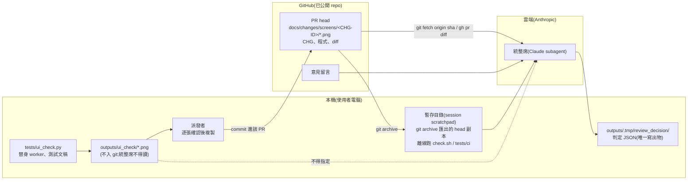
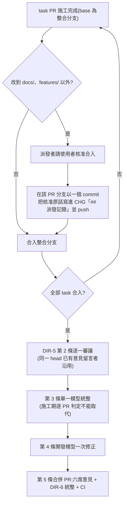

# CHG-20261030-02 — 統整席讀 repo 內截圖、可在暫存目錄跑測試;DIR-5 補明適用修訂與合入前記錄核准

- 專案:podcast-studio
- 分支(Branch):main
- 日期:2026-10-30(UTC+0)
- 類型:治理規則變更(directive 修訂:DIR-5、DIR-6;Guideline §8 同步)
- 風險分級:高(只改治理文件,不改程式與治理基礎設施;但命中高風險清單的**安全相關**:(1) DIR-6 第 10 條的資料外送範圍擴大——UI 截圖由不入 git 的 `outputs/ui_check/` 改為 commit 進已公開的 repo,並送給雲端統整席;(2) 統整席(雲端 Claude subagent)獲准在本機暫存目錄執行 PR head 的程式(repo 內既有測試)。安全影響 security-boundary 答「是」。依 CHG-20261028-01、CHG-20261028-02 先例判級就高不就低)
- 提出者:使用者(2026-10-30 對 CHG-20261029-01 修訂 1 DIR-5 統整報告 U-2~U-4 的決定,原話見「## 動機」)
- 實作者:主 agent 派發(DIR-3);實際工作者記於「## 派發記錄」
- 驗收者:獨立 Claude subagent(不參與起草與施工、不看實作者自述)+ 使用者確認條文
- Autonomy:halt
- Commit/PR:草案 PR 待開(分支 `docs/CHG-20261030-02-draft`)
- 重複性檢查(Recurrence check):不是首次——CHG-20261029-01 修訂 1 施工發生的程序偏差(統整報告 §3 (a) 逐 PR 審議取代批次統整、(b) task PR 合入整合分支前沒有逐筆核准紀錄、(c) 統整席讀 `outputs/ui_check/*.png`)都是現行 DIR-5、DIR-6 條文沒有寫清楚或沒有可行替代做法所致;DIR-5、DIR-6 前次修訂見 CHG-20261028-02。本筆以修訂 directive 處理,不另建 KN
- Diagrams:見「## 設計圖」節
- Mockup: skipped — 本筆不改任何畫面,只改治理規則
- Security-impact:見「## 安全影響」節
- Behaviour spec / Interaction spec:不適用(docs-only:只改 `docs/` 下的治理文件,不改程式、測試、`features/` 與治理基礎設施)
- Skill: ai-sdlc v1.66
- 關聯:DIR-5(批次審議;情境、第 3 條,新增第 8 條)、DIR-6(統整席;第 3、10 條,新增第 11、12 條)、DIR-2 第 3 條(程式 PR 合入須使用者核准;本筆不改);CHG-20261029-01「## 後續改善」U-2~U-4 一項(本筆的來源紀錄);統整報告 `docs/changes/review/CHG-20261029-01-rev1-summary.md` §3 (a)(b)(c)、§5 U-2~U-4;CHG-20261022-02(MCP 註冊)仍未收尾,使用者 2026-10-30 選「照常並行(Recommended)」,本筆與它互不相依

## 動機

CHG-20261029-01 修訂 1 的 DIR-5 統整報告(`docs/changes/review/CHG-20261029-01-rev1-summary.md`)核實三項程序偏差,並列為需使用者決定的 U-2~U-4:

1. **§3 (a)**:修訂 1 的六個 task PR 在施工期逐 PR 跑六席意見與 DIR-6 統整判定、判定後就合入整合分支,全部完成後沒有做 DIR-5 第 3 條的單一模型統整,第 4 條的一次修正也改成逐 PR 修正。DIR-5 的情境「已過確認閘的 CHG」沒有排除修訂,但條文沒有明說。
2. **§3 (b)**:#111、#112 判定後 3~4 秒就合入整合分支,合入前沒有使用者核准紀錄(事後追認);#116 改到程式路徑,CHG 原本也沒有核准紀錄。改到程式路徑的 PR 依 DIR-2 第 3 條須使用者核准,但沒有規定核准要先寫進帳本,事後無法由 repo 核對順序。
3. **§3 (c)**:#114、#115 的統整席讀了 `outputs/ui_check/*.png`,超出 DIR-6 第 10 條的資料外送範圍(明列排除 `outputs/`)。另 §5 U-3:統整席曾在 repo 外的暫存副本執行測試,DIR-6 第 3 條「只讀」沒有明示允許或禁止。

使用者 2026-10-30 的決定(原話照錄,選項標籤與說明):

- U-2 選「截圖改存 repo」,說明:「Interaction spec 截圖 commit 進 repo,統整席讀 repo 內檔」。
- U-3 選「明示允許 (Recommended)」,說明:「寫明界線：只在暫存目錄、不改 repo、不連網」。
- U-4 選「修訂 DIR-5 並補一條 (Recommended)」,說明:「DIR-5 補明 CHG 修訂也適用、逐 PR 審議不能取代第 3 條;另補『程式 task PR 合入前先在派發記錄寫核准原話』(另開帳本修訂)」。

本 session 使用者 2026-10-30 追加選擇(原話為選項標籤):

- 修訂路線:「開 CHG(Recommended)」——開 CHG-20261030-02,只改 docs,同步 Guideline §8。
- U-2 做法:「派發者複製進 docs(Recommended)」——`tests/ui_check.py` 不改;派發者把要給統整席看的截圖從 `outputs/ui_check/` 複製到 `docs/changes/screens/<CHG-ID>/` 並 commit 進該 PR,統整席只讀 head 內檔。
- 未收尾的 CHG-20261022-02:「照常並行(Recommended)」。

## 使用者故事

1. 作為使用者,統整席要核對畫面時看的是 commit 進 PR 的截圖(`docs/changes/screens/<CHG-ID>/`),不讀 `outputs/`,以便送出本機的資料都在 DIR-6 第 10 條明列的範圍內,且我在 PR 上看得到送了什麼。
2. 作為使用者,統整席可以在暫存目錄匯出 PR head 副本、離線執行 repo 內既有測試來核對發現,但不改 repo、不連網,唯一寫出物仍是判定 JSON,以便判定更可靠又不擴大副作用。
3. 作為使用者,CHG 修訂(修訂 n)的施工同樣走 DIR-5;施工期就算逐 PR 跑過意見或判定,全部完成後仍要做單一模型統整與一次修正,以便跨 task 的問題有人整體檢視。
4. 作為使用者,改到程式路徑的 task PR 合入整合分支之前,派發者先把我的核准原話寫進 CHG「## 派發記錄」並 commit,以便事後能由 commit 時間核對「先核准、後合入」。

## 決策與取捨

> 依使用者 2026-10-26 原則「如果多次審議都無交集 只採最低限度」:只寫使用者三項決定所需的條文;能用現有條文涵蓋的不新增。

| 決策 | 選項 | 前提假設 | 為何這樣選 |
|------|------|----------|------------|
| 統整席怎麼看畫面(U-2) | (a) 維持排除 `outputs/`;(b) 第 10 條納入 `outputs/ui_check/`;(c) 截圖改存 repo | 使用者 2026-10-30 選「截圖改存 repo」,做法選「派發者複製進 docs(Recommended)」 | **使用者決定**:(c)。`tests/ui_check.py` 不改;派發者複製截圖進 `docs/changes/screens/<CHG-ID>/` 並 commit 進該 PR;第 10 條明列這些截圖屬「head 的檔案內容」,`outputs/` 仍排除 |
| 截圖目錄與檔名 | 每個 CHG 一個目錄 vs 全 repo 一個目錄 | 修訂 n 與原 CHG 共用 CHG 編號;`docs/changes/mockups/<CHG-ID>/` 已有每個 CHG 一個目錄的前例 | **代決**:`docs/changes/screens/<CHG-ID>/<task>-<原檔名>`(例 `T14-fusion-rows.png`);task 編號在同一 CHG 內不重複(修訂延續編號),檔名不互蓋 |
| 複製哪些截圖 | 整批 `outputs/ui_check/` vs 只複製要給統整席核對的 | 截圖 commit 後永久留在 git 歷史並隨 repo 公開;`mockups/CHG-20261029-01/` 一個 CHG 約 1.7 MB | **代決**:只複製該 PR 要給統整席核對的截圖(與該 task 的 Interaction spec 或畫面草稿相關者),不整批複製 |
| 複製的時點 | 跑意見前 vs 跑意見後 | 意見留言與統整判定都綁定 head sha;複製會產生新 commit | **代決**:複製並 commit 後,才跑 `local_review.py` 與派統整席(避免 CHG-20261029-01 統整報告 §3 (d) 那種「審到舊 head」) |
| 複製前的確認 | 不確認 vs 派發者逐張確認 | 截圖進公開 repo 等於公開;`tests/ui_check.py` 以替身 worker、測試文稿與暫存目錄啟動伺服器 | **代決**:派發者複製前確認截圖由 repo 內測試以替身 / 測試文稿產生,畫面不含使用者聲線檔、`config/studio.db`、`projects/` 使用者專案的內容;不符就不複製 |
| U-3 條文放在哪 | (a) 改寫第 3 條;(b) 第 3 條加引用 + 新增一條 | 第 3 條「只讀」「唯一寫出物」是現行核心句,不宜拆散 | **代決**:(b)。第 3 條「只讀」句末補「匯出暫存副本與執行測試見第 12 條」;新增第 12 條寫界線。U-2 的派發者複製程序另立第 11 條,第 10 條只改範圍 |
| 匯出 head 副本的方式 | (a) `git archive`;(b) `git worktree add` | `git worktree add` 會在主 repo 的 `.git/worktrees/` 登記並需事後移除(CHG-20261028-01 的 `.review/` 就是為此另寫安全移除);`git archive <sha> \| tar -x -C <暫存目錄>` 只讀 git 物件、不在 repo 留登記;`git fetch origin <head sha>` 是第 3 條既有允許的讀取 | **代決**:只用 `git archive`,不用 `git worktree add`。`git fetch origin <head sha>` 屬第 3 條既有讀取,不另算連網 |
| 可執行的測試範圍(U-3) | (a) repo 內既有測試;(b) 另含統整席自寫的一次性計算 | 使用者說明「寫明界線：只在暫存目錄、不改 repo、不連網」;統整報告 U-3 選項 (a) 原文為「可在 scratchpad 匯出副本執行既有測試」 | **代決**:(a),取窄。只限 `./scripts/check.sh`(含指定路徑或 pytest 參數的子集)與 `python3 -m unittest discover -s tests/ci`;不含 `tests/integration/`(需 repo 外的 `tools/BreezyVoice` 與真模型)、`tests/ui_check.py`(需 Chromium,畫面改由第 11 條處理)、`studio_server.py`、`local_models_mcp.py` 與 `scripts/` 下的治理腳本;不含統整席自寫的程式 |
| 「不連網」的界定 | 只靠指示 vs 加技術手段 | `./scripts/check.sh` 以 `uv run --with …` 解析依賴,本機快取不足時會向 PyPI 下載;測試本身以替身取代模型與 `gh`,只連 127.0.0.1 | **代決**:不連網 = 不對本機(127.0.0.1)以外的位址連線;`./scripts/check.sh` 一律帶 `UV_OFFLINE=1`,快取不足而無法執行時,在判定 JSON 記「無法離線執行」,不得改為連網執行。未以 sandbox 等技術手段強制,列為殘留風險(見「## 安全影響」) |
| 測試輸出算不算外送範圍內 | 另立例外 vs 歸入第 10 條 | 副本只含 head 的追蹤檔,測試只讀副本內檔案,輸出是 head 檔案內容的衍生 | **代決**:歸入第 10 條範圍,第 10 條明寫「依第 12 條執行 repo 內既有測試的輸出」;副本不得放在 repo 內或 `outputs/`,不要求統整席清理(暫存目錄隨 session 清理) |
| DIR-5 是否適用修訂(U-4) | 補明 vs 不改 | DIR-5 情境「已過確認閘的 CHG」沒有排除修訂(統整報告 §3 (a)) | **使用者決定**:補明。情境改為「已過確認閘的 CHG(含 CHG 修訂(修訂 n)),自 CHG-20261022-04 T3 起的施工」 |
| 逐 PR 判定與第 3 條的關係(U-4) | 補明不能取代 vs 列為正式替代流程 | 使用者選 (a)「逐 PR 審議不能取代第 3 條」 | **使用者決定**:第 3 條補一句:施工期即使逐 PR 跑過意見或統整判定(偏離第 1 條),仍須做本條的單一模型統整與第 4 條的一次修正。**代決**:同一 head 已跑過的意見留言可作為第 2 條的審議結果,不必重跑 |
| 合入前記錄核准(U-4) | 新增 DIR-5 第 8 條 vs 寫進 DIR-2 第 3 條 | 使用者說明「另補『程式 task PR 合入前先在派發記錄寫核准原話』」;task PR 合入整合分支是 DIR-5 特有流程(不跑 CI、DIR-4 預授權不適用) | **代決**:新增 DIR-5 第 8 條;DIR-2 第 3 條已規定程式 PR 須使用者核准,**不改 DIR-2**(取最低限度),由 DIR-5 第 8 條引用 DIR-2 第 3 條 |
| 第 8 條的記錄方式 | 寫在哪個 commit | 記錄 commit 若進 task PR,會產生新 head;DIR-5 的審議在全部 task 完成後才跑,不受影響 | **代決**:派發者在該 task PR 的分支以一個只改 CHG「## 派發記錄」的 commit 寫入核准原話(以選項核准時寫選項標籤與問題原文),push 後再合入;此 commit 不因此要求重跑意見與統整 |
| 本筆自身適用哪一版規則 | 新規則 vs 現行規則 | 新規則自 T1 合進 main 起才存在於 main;現行 DIR-5 情境「已過確認閘的 CHG」涵蓋本筆 T1 | **代決**:草案 PR 與 T1 PR 依現行 DIR-1、DIR-4、DIR-5、DIR-6 審議與 merge(統整席不讀 `outputs/`、不執行測試);本筆 T1 適用現行 DIR-5 第 1~5 條,只有「單一 task 直接合 main」一點是偏離,須使用者在確認閘明示核准(見下列「施工方式」與代決 19),不核准時依 DIR-5 開整合分支;新條文自 T1 合進 main 之後的下一個 PR 起生效;既往偏差不追溯 |
| 施工方式 | (a) 依 DIR-5 開整合分支 `chg/CHG-20261030-02-impl`,T1 PR 合入整合分支後逐一審議、單一模型統整、一次修正,再以合併 PR 合進 main;(b) 單一 task PR 直接合 main | 本筆只有一個 docs-only task;條文需同時生效。現行 DIR-5 情境涵蓋本筆 T1,第 1~5 條沒有單一 task 或 docs-only 的例外;依 DIR-2 第 3 條「停點只准加嚴」,agent 不得自行放寬。前例:#79、#122 也是單一 task 直接合 main,但前例不能取代使用者明示 | **代決(偏離 DIR-5 第 1~5 條的例外,須使用者在確認閘明示核准)**:(b),單一 task T1,分支 `docs/CHG-20261030-02-t1`,以一個 PR 合進 main(DIR-2 第 1 條),該 PR 跑六席意見、DIR-6 統整與 CI 四項。使用者不核准時改採 (a)。本例外只限本筆,不修改 DIR-5(見代決 18、19) |
| 結構文件 | 不改 vs `directory.md` 補新目錄 | `docs/structure/directory.md` 已有 `docs/changes/review/` 一列 | **代決**:`directory.md` 職責表新增 `docs/changes/screens/` 一列;其餘結構文件不改 |
| 風險分級 | 中 vs 高 | 只改文件,但擴大雲端與公開 repo 的資料範圍、允許統整席執行 PR 程式 | **代決**:高 |

**代決事項**(使用者決定推導不出細節,由 agent 先決定,**確認閘須由使用者逐條覆核**):

> 起草後、送審前,使用者 2026-10-30 已先就三項作答(原話為選項標籤):代決 1 風險分級「高(Recommended)」;代決 5 截圖隨 repo 公開「同意公開(Recommended)」;代決 8 統整席可執行範圍「只跑既有測試(Recommended)」。其餘代決事項仍待確認閘逐條覆核。

1. 風險分級判「高」(安全相關:資料外送範圍擴大、統整席執行 PR head 程式;只改文件)。
2. 截圖放 `docs/changes/screens/<CHG-ID>/<task>-<原檔名>`(例 `T14-fusion-rows.png`)。
3. 只複製該 PR 要給統整席核對的截圖,不整批複製 `outputs/ui_check/`。
4. 截圖複製並 commit 後才跑 `local_review.py` 與派統整席。
5. 派發者複製前確認:由 repo 內測試以替身 / 測試文稿產生,不含聲線檔、`config/studio.db`、`projects/` 使用者專案內容;並知悉截圖 commit 後隨 repo 公開。
6. DIR-6 結構:第 10 條只改範圍;新增第 11 條(截圖)、第 12 條(暫存副本執行測試);第 3 條「只讀」句補引用第 12 條。
7. 匯出 head 副本只用 `git archive`,不用 `git worktree add`;`git fetch origin <head sha>` 屬第 3 條既有讀取。
8. 可執行的測試只限 `./scripts/check.sh`(含子集)與 `python3 -m unittest discover -s tests/ci`;排除 `tests/integration/`、`tests/ui_check.py`、伺服器與治理腳本、統整席自寫的程式。
9. 「不連網」= 不對 127.0.0.1 以外連線;`./scripts/check.sh` 帶 `UV_OFFLINE=1`,快取不足時記「無法離線執行」,不得改為連網。
10. 不連網只以條文約束,不以 sandbox 強制(殘留風險)。
11. 測試輸出歸入第 10 條範圍;副本不得放在 repo 內或 `outputs/`,不要求統整席清理。
12. DIR-5 情境補「含 CHG 修訂(修訂 n)」;第 3 條補「逐 PR 判定不能取代單一模型統整與第 4 條一次修正」。
13. 同一 head 已跑過的意見留言可作為 DIR-5 第 2 條的審議結果,不必重跑。
14. 新增 DIR-5 第 8 條(合入前記錄核准);適用範圍只限合入整合分支、改到 `docs/`、`features/` 以外路徑的 task PR。
15. 第 8 條的記錄以一個只改「## 派發記錄」的 commit 寫進該 task PR 分支,push 後再合入;以選項核准時寫選項標籤與問題原文;此 commit 不要求重跑意見與統整。
16. 不改 DIR-2(第 3 條已涵蓋核准要求),由 DIR-5 第 8 條引用。
17. Guideline §8 同步兩處(程式 PR 核准一項、本機審議一項),版本升 v1.13;`docs/structure/directory.md` 新增 `docs/changes/screens/` 一列。
18. 本筆自身依現行 DIR-1、DIR-4、DIR-5、DIR-6 審議與 merge;本筆 T1 在現行 DIR-5 情境內,適用第 1~5 條,唯一偏離是代決 19 的「單一 task 直接合 main」,須使用者明示核准,不核准時依 DIR-5 開整合分支;新條文自 T1 合進 main 之後的下一個 PR 起生效;既往偏差不追溯。
19. **偏離 DIR-5 第 1~5 條、須使用者在確認閘明示核准的例外**:單一 task T1,以 `docs/CHG-20261030-02-t1` 分支一個 PR 合進 main,不開整合分支;該 PR 跑六席意見、DIR-6 統整與 CI 四項。前例 #79、#122 有同樣做法,但前例不能取代使用者明示。使用者不核准時改依 DIR-5 開整合分支 `chg/CHG-20261030-02-impl`(T1 PR 合入整合分支,全部完成後逐一審議、單一模型統整、一次修正,再以合併 PR 合進 main)。本例外只限本筆,不修改 DIR-5;與代決 18 互相引用。

## 設計圖

### (1) 統整席讀取資料的範圍(變更後)

### (2) DIR-5 task PR 合入整合分支(變更後)

## 安全影響

| 類別 | 是否觸及 | 影響範圍 / 理由 |
|------|----------|-----------------|
| irreversible-delete | 否 | 只改治理文件;第 12 條不准統整席改 repo,副本放在暫存目錄,不要求刪除;`git archive` 不在 repo 留登記,無需移除動作 |
| payments | 否 | 無金流 |
| prod-migration | 否 | 不改資料、設定資料庫、專案檔、CI 設定或部署腳本 |
| security-boundary | **是** | (a) **截圖進公開 repo**:原本只留在本機(`outputs/` 不入 git)的 UI 截圖,commit 後隨 repo 公開並永久留在 git 歷史。對策:只複製要核對的截圖;派發者複製前確認由 repo 內測試以替身 / 測試文稿產生,不含聲線檔、`config/studio.db`、`projects/` 內容;`docs/changes/mockups/` 已有同類截圖入 repo 的前例(CHG-20261030-01 的 `before-home.png` 以隔離伺服器拍攝)。(b) **雲端統整席讀截圖**:截圖屬 head 檔案內容,在第 10 條範圍內;`outputs/` 仍排除,統整席 prompt 不得指定 `outputs/` 下任何路徑。(c) **統整席執行 PR head 程式**:雲端 Claude subagent 在本機執行 repo 內既有測試,PR 內容若含惡意或被 prompt injection 誘導的指令,可能在本機執行。對策:只限兩個既有測試指令,不得執行統整席自寫的程式、伺服器或治理腳本;只在暫存目錄、不改 repo;`review_decision.py` 拒絕 fork 與非擁有者 PR,PR 作者只有擁有者;同一批測試施工者在派發者獨立驗證時已在本機執行過(`./scripts/check.sh`),CI `program` job 也在 GitHub runner 執行,執行 PR 測試不是新的暴露類別。(d) **不連網**:`UV_OFFLINE=1` 只讓 uv 不下載,測試程式本身的網路呼叫沒有被技術手段阻擋,目前只靠條文與既有測試以替身取代模型與 `gh` 約束——殘留風險,日後若要強制(例:macOS `sandbox-exec` 禁網)另開 CHG。(e) 測試輸出可能含暫存目錄的絕對路徑(含本機使用者名稱),屬第 10 條範圍內的衍生資料 |

## 修改指引

### 目標

依使用者 2026-10-30 對 U-2~U-4 的決定修訂 DIR-5、DIR-6,同步 INDEX、Guideline §8 與 `docs/structure/directory.md`;不改程式、測試、`features/` 與治理基礎設施。

### 影響範圍

- 規則:`docs/knowledge/directives.md`(DIR-5 情境、第 3 條、新增第 8 條;DIR-6 第 3、10 條、新增第 11、12 條;舊敘述原文移入各條「歷史」)、`docs/knowledge/INDEX.md`(DIR-5、DIR-6 一句規則)
- 帳本:`docs/ai-guideline.md`(表頭版本、§8 CI/CD 約定兩項、§11 新增 v1.13 列)
- 結構文件:`docs/structure/directory.md`(職責表新增 `docs/changes/screens/` 一列)
- 不改:`tests/ui_check.py`(截圖仍寫 `outputs/ui_check/`)、`scripts/`、`tests/`、`.github/`、`.ai-sdlc/`、`features/`、DIR-1~4、DIR-7、`docs/changes/screens/`(本筆不建目錄、不放截圖;第一個使用者建立)

### Global Constraints(全域約束——每個 task 都要遵守)

- 只改「影響範圍」列出的四個檔案與本 CHG 自身的記錄節。
- 依 `directives.md` 表頭規則:同一規則只留一條現行版本;被改寫的條文把**原文全文**移入該條「歷史」,歷史條目記日期、依據(本 CHG 與使用者原話),不摘要。新增的條文在「歷史」記「新增第 n 條(無原敘述)」。
- DIR-6 第 10 條須仍以 `  10. **統整席的資料外送例外**` 開頭(`tests/ci/test_review_gate.py` 以此前綴找出該條,並斷言 compliance 席參考資料含該行全文、未被截斷)。
- `scripts/local_review.py` compliance 席參考資料(`directives.md` 去除「歷史」後 + Guideline §8)須在 `COMPLIANCE_REF_LIMIT`(20000 字)以內;本 CHG 起草時為 15061 字。
- 不寫入 KN-1 列出的狀態觸發字與 PEM 私鑰區塊的開頭行原文。
- 使用者面文字、文件一律繁體中文與台灣用語;標點沿用 `directives.md` 現行寫法。

### DIR-6 修訂(新條文全文草案)

第 3 條(改寫;只在「統整席只讀」句加入引用,其餘逐字不變):

> 3. 統整席讀取:該 head 的意見留言全文、CHG 全文(含「## 審議」節與派發記錄)、完整程式(`gh pr diff`;過大時 `git fetch origin <head sha>` 後以 `git show <head>:<路徑>` 讀取)。統整席只讀,不改檔、不另開 PR、不貼留言;唯一寫出物是判定 JSON(`outputs/.tmp/review_decision/pr-<編號>-<sha12>.json`,格式見 `scripts/review_decision.py --schema`)。在暫存目錄匯出 head 副本並執行 repo 內既有測試,依第 12 條。

第 10 條(改寫;範圍句補兩項、補一句 `outputs/` 禁止指定):

> 10. **統整席的資料外送例外**:統整席是 Claude subagent(雲端,Anthropic),讀取的待審資料會送出本機。這是 DIR-1 第 9 條(Codex 席,只限審議席位)之外、另一項**使用者明示**的資料外送例外(使用者 2026-10-28 選擇統整席為「Opus medium(獨立子代理)」,確認閘原話「全部照草案核准」)。範圍只限:本 repo(已公開)PR 的意見留言、CHG 全文、PR diff 與 head 的檔案內容(含 head 內 `docs/changes/screens/<CHG-ID>/` 的畫面截圖,第 11 條;以及依第 12 條執行 repo 內既有測試的輸出);不含 `config/studio.db`、`outputs/` 產出物(含 `outputs/ui_check/` 截圖)、使用者聲線檔或其他 repo 外的資料,也不擴及審議以外的用途。統整席 prompt 不得指定 `outputs/` 下任何路徑。施工者本來就是 Claude subagent(DIR-3),統整席不是新的資料去處。

第 11 條(新增):

> 11. **畫面截圖改由 repo 內檔提供**:要給統整席核對畫面時,派發者在跑意見(`local_review.py`)之前,把 repo 內測試(如 `tests/ui_check.py`)寫到 `outputs/ui_check/` 的截圖中、該 PR 需要核對的幾張,複製到 `docs/changes/screens/<CHG-ID>/<task>-<原檔名>` 並 commit 進該 PR;統整席只以 `git show <head>:<路徑>` 或第 12 條的副本讀 head 內的截圖。複製前派發者確認截圖由 repo 內測試以替身 / 測試文稿產生,畫面不含使用者聲線檔、`config/studio.db` 或 `projects/` 使用者專案的內容(截圖 commit 後隨 repo 公開);不符就不複製。`tests/ui_check.py` 的截圖位置不變。

第 12 條(新增):

> 12. **暫存副本執行測試**:統整席可在 repo 外的暫存目錄(如 session scratchpad)以 `git archive <head sha> | tar -x -C <暫存目錄>` 匯出 head 副本(不用 `git worktree add`),在副本內執行 repo 內既有測試:`UV_OFFLINE=1 ./scripts/check.sh`(可帶測試路徑或 pytest 參數)與 `python3 -m unittest discover -s tests/ci`。界線:只在暫存目錄;不改 repo(含主工作副本、`.git` 的 ref 與 PR 分支;`git fetch origin <head sha>` 屬第 3 條既有讀取);不連網(不對 127.0.0.1 以外的位址連線;依賴快取不足而無法離線執行時,在判定 JSON 記「無法離線執行」,不得改為連網);不執行 `tests/integration/`、`tests/ui_check.py`、`studio_server.py`、`local_models_mcp.py`、`scripts/` 下的治理腳本或統整席自寫的程式。唯一寫出物仍是判定 JSON;副本不得放在 repo 內或 `outputs/`。

「歷史」新增一筆(附加在 DIR-6「歷史」末尾):

> - 2026-10-30 依 CHG-20261030-02(使用者 2026-10-30 對 CHG-20261029-01 修訂 1 統整報告 U-2、U-3 的決定,原話:U-2「截圖改存 repo」,說明「Interaction spec 截圖 commit 進 repo,統整席讀 repo 內檔」,做法「派發者複製進 docs(Recommended)」;U-3「明示允許 (Recommended)」,說明「寫明界線：只在暫存目錄、不改 repo、不連網」)修訂第 3、10 條,新增第 11、12 條(無原敘述)。原敘述:
>   - 第 3 條:(現行第 3 條原文全文)
>   - 第 10 條:(現行第 10 條原文全文)

### DIR-5 修訂(新條文全文草案)

情境(改寫):

> - 情境:已過確認閘的 CHG(含 CHG 修訂(修訂 n)的施工),自 CHG-20261022-04 T3 起的施工。

第 3 條(改寫;句末補一句,其餘逐字不變):

> 3. 審議全部完成後,由**單一模型**(預設 Opus、effort medium,與施工者不同的子代理;使用者可改指定)讀取全部審議留言,統整成一份報告:每項發現的出處(PR、席位)、是否成立、跨 task 的共同問題、建議修正。報告寫在整合分支的 `docs/changes/review/<CHG-ID>-summary.md`(不放在 `docs/changes/` 根目錄,避免符合 CI `chg` 檢查的 CHG 檔名規則)。此報告是施工期的修正依據,不是合併判定;合併判定見第 5 條。施工期即使對個別 task PR 跑過意見或統整判定(DIR-6),仍須在全部 task 完成後做本條的統整與第 4 條的一次修正,逐 PR 的判定不能取代;同一 head 已貼出的意見留言可作為第 2 條的審議結果,不必重跑。

第 8 條(新增):

> 8. **合入前先記錄核准**:改到 `docs/`、`features/` 以外路徑的 task PR,合入整合分支前須有使用者核准(DIR-2 第 3 條)。派發者取得核准後,先在該 PR 的分支以一個只改 CHG「## 派發記錄」的 commit 寫入使用者核准原話(以選項核准時寫選項標籤與問題原文)並 push,再合入;順序可由該 commit 時間早於合入時間核對。此 commit 不要求重跑意見與統整。

「歷史」新增一筆(附加在 DIR-5「歷史」末尾):

> - 2026-10-30 依 CHG-20261030-02(使用者 2026-10-30 對 CHG-20261029-01 修訂 1 統整報告 U-4 的決定,原話:「修訂 DIR-5 並補一條 (Recommended)」,說明「DIR-5 補明 CHG 修訂也適用、逐 PR 審議不能取代第 3 條;另補『程式 task PR 合入前先在派發記錄寫核准原話』(另開帳本修訂)」)修訂情境與第 3 條,新增第 8 條(無原敘述)。原敘述:
>   - 情境:(現行情境原文全文)
>   - 第 3 條:(現行第 3 條原文全文)

### INDEX.md

| id | 「一句規則」新文字 |
|----|--------------------|
| DIR-5 | task PR 先合進整合分支(程式 task PR 合入前先在派發記錄寫核准原話並 commit);全部完成後逐一審議,單一模型統整,開發模型一次修正,再以一個 PR 合進 main(合併 PR 依統整席判定,DIR-6);CHG 修訂同樣適用,施工期逐 PR 判定不能取代統整與一次修正 |
| DIR-6 | 六席只提供意見(fail、no-answer 不擋);派獨立 Opus medium 子代理統整並判定 merge / fix,以 review_decision.py 貼出;CI review 看該判定;連續兩輪 fix 交使用者;統整席不讀 outputs/,畫面截圖由派發者複製進 docs/changes/screens/;可在暫存目錄匯出 head 離線跑 repo 內既有測試 |

其餘列、錨點與 `_entries` 計數不變(標題不改,錨點不變)。

### Guideline(`docs/ai-guideline.md`)

- 表頭「版本:v1.12」改為「版本:v1.13」。
- §8 CI/CD 約定「改到任何程式路徑的 PR」一項,句末補:「DIR-5 整合分支的 task PR 同樣適用:合入前先在 CHG「## 派發記錄」寫入使用者核准原話並 commit,再合入(DIR-5 第 8 條,CHG-20261030-02)。」
- §8 CI/CD 約定「本機審議」一項,把「範圍只限本 repo(已公開)PR 的意見留言、CHG 全文、diff 與 head 檔案內容,不含 `config/studio.db`、`outputs/`、聲線檔等repo 外資料;」改為:「範圍只限本 repo(已公開)PR 的意見留言、CHG 全文、diff 與 head 檔案內容(含派發者複製進 `docs/changes/screens/<CHG-ID>/` 的畫面截圖,DIR-6 第 11 條),不含 `config/studio.db`、`outputs/`(統整席 prompt 不得指定 `outputs/` 下的路徑)、聲線檔等 repo 外資料;統整席可在暫存目錄以 `git archive` 匯出 head 副本,離線執行 repo 內既有測試,不改 repo、不連網,唯一寫出物仍是判定 JSON(DIR-6 第 12 條);」其餘逐字不變。
- §11 新增一列:`| v1.13 | 2026-10-30 | §8 CI/CD 約定:程式 PR 核准一項補 DIR-5 整合分支 task PR 合入前先記錄核准原話;本機審議一項補統整席讀 repo 內截圖(`docs/changes/screens/`)與暫存副本離線執行既有測試 | 使用者 2026-10-30 對 CHG-20261029-01 修訂 1 統整報告 U-2~U-4 的決定;CHG-20261030-02;DIR-5、DIR-6 |`

### 結構文件(`docs/structure/directory.md`)

職責表在 `docs/changes/review/` 列之後新增一列:

> | `docs/changes/screens/` | 給統整席核對的畫面截圖(`<CHG-ID>/<task>-<原檔名>`,由派發者自 `outputs/ui_check/` 複製並 commit 進該 PR,DIR-6 第 11 條) | 檔名不符 `CHG-*.md`,不受 `doc_integrity_check` 的 CHG 欄位檢查與 `plan_check_changed.py` 檢查;`docs/` 下非 `*.py`、`*.sh`,屬 `review_gate.py` 免審議路徑;截圖隨 repo 公開(CHG-20261030-02) | 〔推論〕(本筆不建目錄,第一個使用者建立) |

### CI 影響查核(起草時以唯讀方式查 `scripts/ci/` 與 vendored 腳本,不改)

- `scripts/ci/plan_check_changed.py`:`CHG_FILE_RE = ^docs/changes/CHG-[^/]*\.md$`,`existing_ids()` 以 `git ls-tree --name-only <head> docs/changes/`(非遞迴)比對 `^docs/changes/(CHG-\d{8}-\d{2})\.md$`——`docs/changes/screens/<CHG-ID>/*.png` 含斜線、副檔名不是 `.md`,兩者都不符合,不被當成 CHG。
- `scripts/ci/review_gate.py`:`CHG_FILE_RE = ^docs/changes/CHG-\d{8}-\d{2}\.md$` 不符合;`EXEMPT_PREFIXES = ("docs/", "features/")`,截圖不是 `*.py`、`*.sh`,屬免審議路徑,不會讓 PR 變成「改到程式路徑」;是否需要審議仍由 PR 的其他檔案與 CHG 分級決定。
- `doc_integrity_check.py`:CHG↔ACC 檢查以 `(docs / "changes").glob("CHG-*.md")`(非遞迴),子目錄不在範圍。
- `scripts/ci/commit_check.py`:commit 只改 `docs/knowledge/` 才免引用 CHG;複製截圖的 commit 須帶 CHG 編號(派發者照 DIR-2 第 1 條即可)。
- 二進位檔進 `docs/changes/` 子目錄的前例:`docs/changes/mockups/CHG-20261030-01/*.png`(PR #121)CI 四項全綠。

### Tasks(checkbox=續作點)

- [ ] T1. 修訂 DIR-5、DIR-6 並同步 INDEX、Guideline §8 與 directory.md
  - interfaces: consumes 本 CHG「### DIR-6 修訂」「### DIR-5 修訂」「### INDEX.md」「### Guideline」「### 結構文件」五節(含使用者在確認閘的修改) / produces `docs/knowledge/directives.md`(DIR-5 情境、第 3 條改寫、新增第 8 條;DIR-6 第 3、10 條改寫、新增第 11、12 條;舊敘述原文移入各條「歷史」)、`docs/knowledge/INDEX.md`(DIR-5、DIR-6 一句規則)、`docs/ai-guideline.md`(v1.13;§8 兩項;§11 一列)、`docs/structure/directory.md`(新增 `docs/changes/screens/` 一列);分支 `docs/CHG-20261030-02-t1`,commit 訊息帶 CHG-20261030-02
  - test: `python3 .ai-sdlc/skills/ai-sdlc-autopilot/scripts/doc_integrity_check.py --repo .` exit 0;`python3 scripts/ci/plan_check_changed.py --repo . --range origin/main..HEAD` exit 0;`python3 -m unittest discover -s tests/ci` 全過(含 `test_compliance_ref_contains_dir6_and_guideline_8_untruncated`:DIR-6 第 10 條前綴不變、compliance 席參考資料未被截斷);以 `grep -F` 逐條確認修改指引的新條文全文都出現在 `directives.md` 現行條文(「歷史」以外),被改寫條文的舊原文都出現在該條「歷史」;INDEX 各列連結的錨點在 `directives.md`、`patterns.md` 都存在;`git diff --name-only origin/main...HEAD` 只有影響範圍列出的四個檔案與本 CHG

### Acceptance operation
- operate: (1) T1 合進 main 後,獨立 Claude subagent(未參與起草與施工)讀 main 上的 `directives.md`、`INDEX.md`、`ai-guideline.md`、`directory.md` 與本 CHG「## 修改指引」;(2) 執行 `python3 .ai-sdlc/skills/ai-sdlc-autopilot/scripts/doc_integrity_check.py --repo .` 與 `python3 -m unittest discover -s tests/ci`;(3) 以 `python3 -c` 呼叫 `scripts/local_review.py` 的 `seat_config("高", set())["compliance"]`,量 `ref` 長度
- observe: (1) 修改指引每一條新條文與 main 上的現行條文逐字相同(確認閘若有修改,以修改後為準);DIR-5、DIR-6「歷史」各有一筆 2026-10-30 條目,含被改寫條文的原文全文;DIR-2 與 DIR-1、DIR-3、DIR-4、DIR-7 逐字未變;(2) 兩項指令 exit 0;(3) 長度 ≤ 20000 字
- pass: 三項 observe 全部成立;使用者看過 DIR-5 第 8 條與 DIR-6 第 10~12 條現行文字並確認

### 本機閘
- cmd: python3 -m unittest discover -s tests/ci
- pass: exit 0

### 結構文件更新

- [ ] `docs/structure/directory.md`:職責表新增 `docs/changes/screens/` 一列(見 T1)
- [ ] `docs/ai-guideline.md`:§8 兩項、§11 v1.13(見 T1)
- `docs/structure/logical.md`、`design.md`、`data.md`:不需更新——三份只記 CI/CD 流程與 `review_gate.py` 的判定,不記統整席的資料範圍與 DIR-5 合入記錄方式(施工時以 `grep -n "統整席\|outputs/ui_check\|整合分支" docs/structure/*.md` 複查)

### 風險與回滾

- 風險:(1) **截圖公開**:派發者確認不周時,含使用者內容的截圖可能進公開 repo 並留在 git 歷史 → 只複製要核對的幾張、逐張確認,只用替身與測試文稿產生的截圖;一旦誤 commit,移除需改寫歷史,屬使用者決定的事項。(2) **統整席執行程式**:見「## 安全影響」(c)(d);不連網沒有技術強制。(3) **repo 變大**:截圖永久留在 git 歷史 → 只複製必要截圖。(4) **派發者忘記先複製截圖**:統整席照第 10 條不得讀 `outputs/`,只能依 mockup 與 `tests/ui_check.py` 斷言判斷,屬保守失敗。(5) **第 8 條增加一次 commit**:每個程式 task PR 合入前多一個帳本 commit;若在施工期逐 PR 審議的情境下補 commit,head 會變——第 8 條明訂不要求重跑,但 CI `review` 檢查不適用於整合分支,不受影響。(6) **compliance 席參考資料變長**:接近 `COMPLIANCE_REF_LIMIT` 時會被截斷 → T1 的 test 量測,超過時停下回報,不自行刪條文。
- 回滾方式:`git revert` T1 的 squash commit,四個檔案回到修訂前;已複製進 `docs/changes/screens/` 的截圖(若有)不隨回滾刪除,需另開 CHG 決定。

## 派發記錄

> 依 DIR-3:主 agent 只派發。審查與審議結論不記在本節,一律見對應 PR 的審議留言與「## 審議」節。

| task | 施工者 | 派發者獨立驗證 | PR | 備註 |
|------|--------|----------------|----|------|
| 草案 | Claude subagent(Opus、effort medium) | — | 草案 PR 待開(分支 `docs/CHG-20261030-02-draft`) | DIR-3 第 2 條例外:治理文件草案直接派 Claude subagent。起草者自跑 `doc_integrity_check.py` 與 `autopilot_runner.py plan-check --chg`(未 commit,`plan_check_changed.py` 無法對範圍執行);唯讀查核 `scripts/ci/` 與 vendored 腳本,未改 |
| 草案修正(統整席 F-1) | Claude subagent(Opus medium) | — | #124 | 依 PR #124 統整判定 F-1:決策表「施工方式」「本筆自身適用哪一版規則」兩列與代決 18、19 改寫——單一 task 直接合 main 明寫為偏離 DIR-5 第 1~5 條、須使用者在確認閘明示核准的例外,不核准時改依 DIR-5 開整合分支 `chg/CHG-20261030-02-impl`;不改 `directives.md` |

## 審議

草案 PR #124:第 1 輪 head `f7e7164` 六席意見——risk pass、impact fail(無證據)、drift / compliance / security / consistency concern;統整判定 fix(F-1:單一 task 直接合 main 偏離 DIR-5 第 1~5 條,須寫成使用者在確認閘明示核准的例外)。

## 後續改善(不屬本筆範圍,另開 CHG)

- 「不連網」以技術手段強制(例:以 macOS `sandbox-exec` 禁網執行暫存副本的測試),本筆只以條文約束。
- `tests/ui_check.py` 直接把指定截圖寫到 `docs/changes/screens/<CHG-ID>/`(本筆依使用者選擇由派發者手動複製,不改測試)。

## 狀態

草稿(2026-10-30)——等待確認閘:代決事項 1~19、風險分級「高」、「## 修改指引」各節新條文全文。確認閘核准前不施工 T1、不改 `directives.md`、`INDEX.md`、`ai-guideline.md`、`directory.md`。
