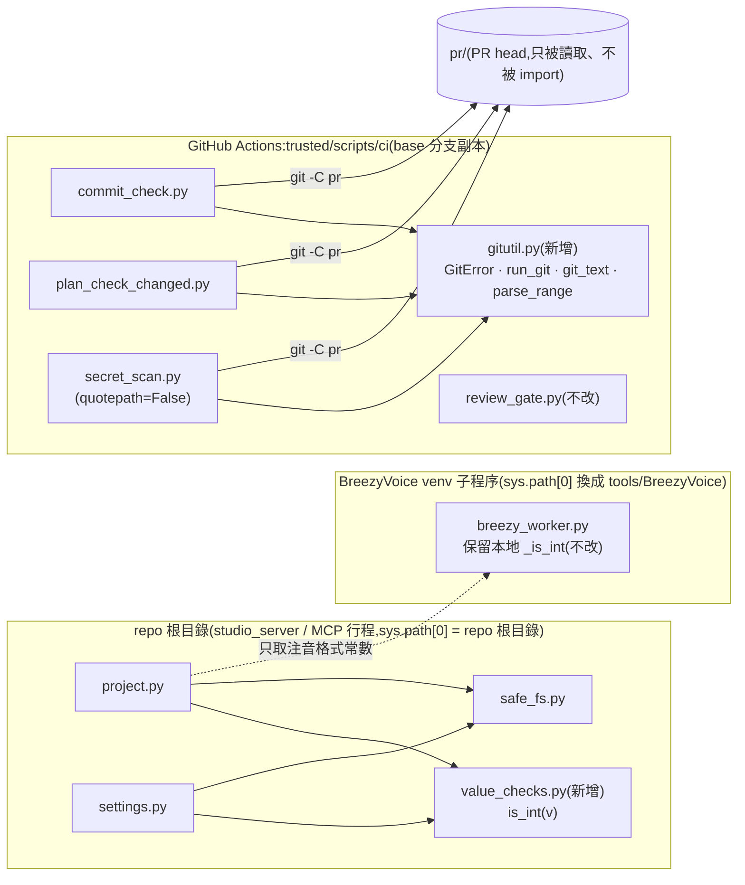
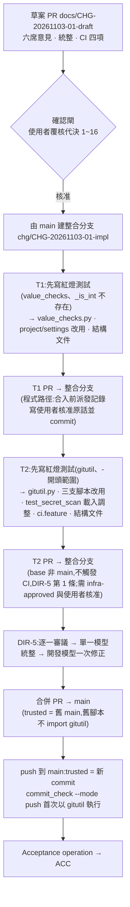

# CHG-20261103-01 — 抽出重複函式:根目錄 `value_checks.is_int` 與 CI 腳本共用 `scripts/ci/gitutil.py`

- 專案:podcast-studio
- 分支(Branch):main
- 日期:2026-11-03(UTC+0)
- 類型:重構(產品程式:新增根目錄模組 `value_checks.py`,`project.py`、`settings.py` 改用)+ 治理基礎設施變更(新增 `scripts/ci/gitutil.py`,`scripts/ci/commit_check.py`、`plan_check_changed.py`、`secret_scan.py` 改用;`tests/ci/` 擴充);唯一刻意的行為變更見代決 9
- 提出者:使用者(2026-11-03 指示,原話見「## 動機」)
- 實作者:主 agent 派發(DIR-3);草案由 Claude subagent 起草(DIR-3 第 2 條例外);T1、T2 依 DIR-3 第 2 條例外二直接派 Claude subagent;實際工作者記於「## 派發記錄」
- 驗收者:獨立 Claude subagent(不參與起草、施工、審議與統整,不看實作者自述)+ 使用者確認
- 風險分級:高(命中高風險清單的**安全相關**:(1) `secret_scan.py` 是 CI 的秘密掃描關卡,本筆改動它執行 git 的路徑;(2) `parse_range()` 合併後採較嚴格版本,`commit_check.py`、`plan_check_changed.py` 對 `-` 開頭的範圍改為拒絕,屬安全邊界調整;(3) 改到治理基礎設施 `scripts/ci/`、`tests/ci/`(DIR-2 第 3 條);(4) 新增跨模組共用介面(根目錄 `value_checks`、`scripts/ci/gitutil`),CI 新增「從 trusted 副本載入同目錄共用模組」這個載入路徑。不新增網路呼叫、不送資料出本機。安全影響 security-boundary 答「是」)
- Autonomy:halt
- Commit/PR:草案分支 `docs/CHG-20261103-01-draft`(PR #150);施工整合分支 `chg/CHG-20261103-01-impl`(DIR-5,確認閘後由 main 建立);T1 分支 `chg/CHG-20261103-01-T1`、T2 分支 `chg/CHG-20261103-01-T2`(PR base 皆為整合分支)
- 重複性檢查(Recurrence check):首次——本 repo 先前沒有以「抽出重複函式」為動機的 CHG;未見於 KN,不另建 KN
- Diagrams:見「## 設計圖」節
- Mockup: skipped — 本筆不改任何畫面,只改內部模組與 CI 腳本
- Security-impact:見「## 安全影響」節
- Behaviour spec / Interaction spec:Behaviour spec 為 `features/ci.feature`(T2 新增一個場景,草案見「### Behaviour spec」;T1 為純重構,不新增場景);Interaction spec 不適用(不改畫面)
- Skill: ai-sdlc v1.66
- 關聯:DIR-2 第 3 條(`infra-approved`)與程式 PR 合入需使用者核准、DIR-3 第 2 條例外二、DIR-5(整合分支)、DIR-7(本機寫入者不在威脅模型)、KN-1;Guideline §8(不送資料出本機、PEP 723 單檔 script、治理基礎設施路徑清單;本筆不改 Guideline);code-struct 結構分析(`docs/code-struct/`,本機產出、未入 git,本筆不改)

## 動機

使用者 2026-11-03 先看了 code-struct 分析找到的重複函式,接著要求開 CHG,原話照錄:

- 「開 CHG 抽共用函式」

派發者再以選項詢問範圍,問題原文「CHG 範圍要怎麼定?」,使用者選「兩者都做」(選項說明原文:「另外新增根目錄小模組放 is_int 給 project/settings 共用,breezy_worker 保留本地副本。仍是高風險,多一個 task」)。同一輪較早的另一題,使用者指示「排除 tools/」,與本筆無關(本筆本來就不碰 `tools/`)。

派發者查證、起草者 2026-11-03 重驗的事實:

A. `_is_int(v)` 有三份,內容逐字相同(`return isinstance(v, int) and not isinstance(v, bool)`):`breezy_worker.py:274`、`project.py:296`、`settings.py:208`。呼叫點:`project.py` 五行(304、321、476、478、526)、`settings.py` 兩行(329、333)、`breezy_worker.py` 三行(283、303、315)。repo 內(`tools/` 以外)沒有其他檔案或測試引用 `project._is_int`、`settings._is_int`。`project.py`、`settings.py` 都已 `import safe_fs`,`project.py` 另 `import breezy_worker`。
B. `breezy_worker.py` 由 BreezyVoice venv(`tools/BreezyVoice/.venv`)執行;`main()` 第 850–851 行把 `sys.path[0]` 換成 cwd(`tools/BreezyVoice`),註解寫明是為了避免 repo 內同名模組遮蔽 BreezyVoice;`docs/structure/directory.md` 也記載它「不 import repo 內其他模組」。所以它的 `_is_int` 保留本地副本,本筆不改 `breezy_worker.py`。
C. `scripts/ci/commit_check.py:41`、`plan_check_changed.py:51` 的 `git(repo, *args) -> str` 相同(`git -C <repo> <args>`,失敗丟 `GitError("git <args> 失敗:<stderr>")`,stdout 以 utf-8 replace 解碼);`secret_scan.py:150` 的 `git()` 多帶 `-c core.quotepath=false` 並回傳 bytes,錯誤訊息的 `<args>` 不含 `-c core.quotepath=false`。三支各自定義相同的 `class GitError(Exception)`(docstring「git 指令執行失敗。」;commit_check:37、plan_check_changed:47、secret_scan:142)。
D. `parse_range()`:`commit_check.py:90`、`plan_check_changed.py:88` 相同;`secret_scan.py:251` 另外拒絕 base 或 head 以 `-` 開頭(避免被 git 當成選項)。使用者同意合併時採較嚴格版本 → `commit_check.py` 與 `plan_check_changed.py` 對 `-` 開頭的範圍改為回 `None`,依各腳本既有路徑印「參數錯誤:--range 必須是 <base>..<head> 格式,收到:…」並 exit 2。這是本筆唯一刻意的行為變更;CI 的範圍來自 workflow 的 `BASE_SHA`/`HEAD_SHA`/`github.event.before`(40 位十六進位 SHA),不會以 `-` 開頭。
E. CI(`.github/workflows/ci.yml`)從 base 分支 checkout 到 `trusted/`,以 `python3 trusted/scripts/ci/<x>.py --repo pr …` 執行;直接執行腳本時 `sys.path[0]` 是 `trusted/scripts/ci`,所以同目錄的共用模組從 trusted 副本載入,不會讀到 PR 內容。CI 只對 base 為 main 的 PR 與 push 到 main 觸發(`on: pull_request: branches: [main]`、`push: branches: [main]`);T1、T2 等 task PR 的 base 是整合分支,不觸發 CI(DIR-5 第 1 條)。引入共用模組後第一個跑 CI 的是合併 PR,其 trusted 取 `pull_request.base.sha`,即舊 main(舊腳本不 import 新模組),不受影響;push 到 main 時 trusted 是該次 push 的 commit,已含新模組;之後任何 base 為 main 的 PR(含 revert PR)的 trusted 都已含新模組。`.ai-sdlc/SHA256SUMS` 只涵蓋 `.ai-sdlc/`。
F. `scripts/ci/` 屬治理基礎設施(DIR-2 第 3 條),PR 需擁有者 `infra-approved` 留言;程式 PR 合入一律等使用者核准(DIR-2)。`tests/ci/` 現有 `test_commit_check.py`、`test_plan_check_changed.py`、`test_secret_scan.py`;`tests/` 有 `test_project.py`、`test_settings.py`。
G.(起草者補查)`tests/ci/test_secret_scan.py` 以 `importlib.util.spec_from_file_location` 直接載入 `secret_scan.py`,沒有把 `scripts/ci/` 放進 `sys.path`;`secret_scan.py` 改成 import 同目錄模組後,這種載入方式會找不到 `gitutil`,測試須配合調整(代決 8)。`test_plan_check_changed.py` 的 `test_status_section_parsing` 已在 import 前暫時把 `scripts/ci/` 插入 `sys.path`,不受影響;`test_commit_check.py` 只以子程序執行腳本。
H.(起草者補查)argparse 會把 `--range -x..HEAD` 的 `-x..HEAD` 當成選項而先行報錯(exit 2);要讓 `-` 開頭的值真的進到 `parse_range()`,測試須寫成 `--range=-x..HEAD`,或讓 head 以 `-` 開頭(`--range HEAD..-x`)。修改前這兩種寫法在 `commit_check.py`、`plan_check_changed.py` 會把值交給 git,由 git 報錯後以「git 錯誤:…」exit 2,退出碼相同但訊息不同;紅燈測試以 stderr 是否含「參數錯誤:--range」區分。
I.(起草者補查)`scripts/ci/review_gate.py`、`scripts/local_review.py`、`scripts/review_decision.py` 沒有自己的 `git()`、`GitError`、`parse_range()`;vendored `doc_integrity_check.py` 有自己的 `git()`,屬 `.ai-sdlc/`,不改。`commit_check.py`、`secret_scan.py` 的 `subprocess` 只用在 `git()` 內。

## 使用者故事

1. 作為使用者,`project.py` 與 `settings.py` 判斷「真正的整數(不含 bool)」只有一個來源 `value_checks.is_int`,以便日後修改規則只改一處;網頁、MCP 與專案資料的驗證結果與修改前完全相同。
2. 作為使用者,BreezyVoice worker 照舊在自己的 venv 執行、不 import repo 內模組,以便不引入同名模組遮蔽 BreezyVoice 的風險。
3. 作為使用者,三支 CI 腳本共用 `scripts/ci/gitutil.py` 的 `GitError`、`parse_range` 與 git 執行函式,以便 git 呼叫與範圍檢查只維護一份;CI 仍從 base 分支的 trusted 副本載入共用模組,PR 內容無法替換它。
4. 作為使用者,三支 CI 腳本的錯誤訊息、退出碼與輸出格式不變;唯一差別是 `commit_check.py`、`plan_check_changed.py` 也拒絕以 `-` 開頭的範圍(與 `secret_scan.py` 一致),以便範圍值不會被 git 當成選項。

## 決策與取捨

> 依使用者 2026-10-26 原則「如果多次審議都無交集 只採最低限度」:只抽使用者看過、事實 A~D 列出的重複函式;git 呼叫的既有差異(quotepath、回傳型別)維持原樣,不順便統一。

| 決策 | 選項 | 前提假設 | 為何這樣選 |
|------|------|----------|------------|
| `is_int` 放哪 | (a) 根目錄新模組 `value_checks.py`;(b) 放進 `safe_fs.py`;(c) `settings.py` import `project._is_int` | `safe_fs` 是安全路徑工具,職責不同;`settings` 依賴 `project` 會新增產品模組間相依;使用者選項說明寫「另外新增根目錄小模組」 | **代決**:(a)。只用標準函式庫、不 import repo 內其他模組,比照 `safe_fs.py`、`names.py` |
| `breezy_worker.py` 的副本 | (a) 保留本地副本、不改;(b) 也改 import `value_checks` | 事實 B:worker 刻意把 `sys.path[0]` 換成 BreezyVoice 目錄,import 根目錄模組會失敗或須再改 sys.path | **代決**:(a)。使用者選項說明亦寫「breezy_worker 保留本地副本」 |
| 呼叫點寫法 | (a) `import value_checks`,呼叫點改為 `value_checks.is_int(…)`;(b) `from value_checks import is_int as _is_int`,呼叫點不動 | repo 內共用模組一律 `import safe_fs`、`import names` 後以 `模組.名稱` 呼叫;(b) diff 最小,但留下看似本檔私有的別名 | **代決**:(a)。與既有寫法一致、`grep value_checks.is_int` 可找到全部呼叫點;`project.py` 的 `_is_int`、`settings.py` 的 `_is_int` 定義刪除 |
| `value_checks.py` 檔頭 | 有 / 無 PEP 723 檔頭 | 它是被 import 的模組,不是 `uv run --script` 入口;`safe_fs.py` 沒有 PEP 723 檔頭,以繁中模組 docstring 寫用途與介面 | **代決**:無 PEP 723 檔頭;docstring 比照 `safe_fs.py`(用途、只用標準庫、介面一行) |
| CI 共用模組放哪 | (a) `scripts/ci/gitutil.py`(同目錄);(b) `scripts/` 或 repo 根目錄 | 事實 E:直接執行腳本時只有腳本所在目錄在 `sys.path[0]`,同目錄才會從 trusted 副本載入 | **代決**:(a) |
| git 執行函式的介面 | (a) `run_git(repo, *args, quotepath=True) -> bytes` 加回 str 的 `git_text(repo, *args)`;(b) 統一成一種行為 | 事實 C:secret_scan 帶 `-c core.quotepath=false` 回 bytes,另兩支不帶、回 str;統一 quotepath 會改變非 ASCII 路徑在 commit_check / plan_check_changed 的 git 輸出(八進位跳脫 ↔ 原字),屬本筆範圍外的行為變更 | **代決**:(a)。`quotepath=False` 時才加 `-c core.quotepath=false`;各腳本維持原本的旗標與回傳型別,行為不變 |
| 腳本內的名稱 | (a) 保留本地名稱 `git`(commit_check / plan_check_changed 以 `from gitutil import GitError, git_text as git, parse_range`;secret_scan 留一個一行包裝 `git()` 呼叫 `run_git(…, quotepath=False)`);(b) 呼叫點全部改名 | 呼叫點多、`except GitError` 不須改;(a) diff 集中在定義處 | **代決**:(a)。`GitError` 三支都直接取自 `gitutil`,是同一個類別物件 |
| 腳本怎麼找到 `gitutil` | (a) 直接 `from gitutil import …`,依賴「直接執行時腳本目錄在 `sys.path[0]`」;(b) 腳本自己把 `Path(__file__).parent` 插入 `sys.path` | (b) 在被 import(測試)時也會改動呼叫端的 `sys.path`;(a) 在 CI 的載入來源最單純(只會是 trusted 副本);事實 G | **代決**:(a)。腳本不操作 `sys.path`;`test_secret_scan.py` 載入前暫時把 `scripts/ci/` 插入 `sys.path`、載入後移除(比照 `test_plan_check_changed.py` 既有寫法)。以 `python3 -P` 或設 `PYTHONSAFEPATH` 執行時會 import 失敗(exit 1,失敗即擋,見風險) |
| `parse_range` 版本 | (a) 採 secret_scan 的嚴格版;(b) 採寬鬆版;(c) 各自保留 | 使用者同意合併時採較嚴格版本;事實 D:CI 的範圍不會以 `-` 開頭 | **代決**:(a)。commit_check、plan_check_changed 的 `-` 開頭範圍改回 `None` → 既有「參數錯誤」訊息 + exit 2。本筆唯一刻意的行為變更 |
| 錯誤訊息、退出碼、輸出格式 | 不變 vs 順便整理 | 下游(CI 記錄、使用者)讀這些文字;不屬使用者要求 | **代決**:逐字不變(代決 9 的 `-` 範圍除外)。`GitError` 訊息格式「git <args> 失敗:<stderr>」,`<args>` 不含 `-c core.quotepath=false`(維持 secret_scan 現行) |
| 不改的重複 | — | 事實 I:`review_gate.py`、`local_review.py`、`review_decision.py` 沒有同類重複;vendored `doc_integrity_check.py` 不得改 | **代決**:本筆只動事實 A~D 列出的函式;不改 `breezy_worker.py`、`.ai-sdlc/`、`.github/` |
| 施工方式 | (a) DIR-5 整合分支、T1 / T2 兩個 task PR;(b) 單一 PR | 高風險、兩類檔案(產品程式 / 治理基礎設施);DIR-5 第 1~5 條沒有例外 | **決定**:(a),依 DIR-5,不需偏離 |
| 施工者 | 本機模型先試 vs 直接派 Claude subagent | DIR-3 第 2 條例外二:中高風險程式 task 可直接派 Claude subagent | **代決**:T1、T2 直接派 Claude subagent |
| 結構文件 | 只同步 `directory.md`、`design.md` vs 另含 `logical.md` | `logical.md` 第 310 行列出 `project` 的模組相依、第 24 行列出 `settings.py` 依賴,加入 `value_checks` 後會失真 | **代決**:三份都同步(T1 改三份、T2 改 `directory.md`、`design.md`) |

**代決事項**(使用者原話推導不出細節,由 agent 先決定,**確認閘須由使用者逐條覆核**):

1. 風險分級判「高」(安全相關:改到秘密掃描關卡的 git 執行路徑、收緊 `parse_range`、改治理基礎設施、新增跨模組共用介面與 CI 的同目錄模組載入路徑;不新增網路呼叫)。
2. 根目錄新模組 `value_checks.py` 提供 `is_int(v) -> bool`;只用標準函式庫、不 import repo 內其他模組、無 PEP 723 檔頭,docstring 比照 `safe_fs.py`。
3. `project.py`、`settings.py` 以 `import value_checks` 匯入,七個呼叫點改為 `value_checks.is_int(…)`,刪除各自的 `_is_int` 定義。
4. `breezy_worker.py` 不改,保留本地 `_is_int`(事實 B)。
5. 新增 `scripts/ci/gitutil.py`:`GitError`、`run_git(repo, *args, quotepath=True) -> bytes`、`git_text(repo, *args) -> str`、`parse_range(text)`(嚴格版);只用標準函式庫、不 import repo 內其他模組。
6. 不統一 `core.quotepath`:commit_check、plan_check_changed 仍不帶,secret_scan 仍帶(會改變非 ASCII 路徑的輸出,屬範圍外;列入「## 後續改善」)。
7. 三支腳本保留本地名稱 `git`(代決表「腳本內的名稱」列);刪除各自的 `GitError`、`git()` 本體、`parse_range()`;移除因此不再使用的 `import subprocess`(commit_check、secret_scan;plan_check_changed 第 128 行執行 runner 仍要用,保留)。
8. 腳本不操作 `sys.path`,以 `from gitutil import …` 匯入;`tests/ci/test_secret_scan.py` 載入方式配合調整(事實 G)。
9. `parse_range` 採嚴格版;commit_check、plan_check_changed 對 `-` 開頭範圍改為「參數錯誤」+ exit 2(本筆唯一刻意的行為變更)。
10. 三支腳本其餘錯誤訊息、退出碼、輸出格式逐字不變;以新舊版對照測試確認(T2 test (4))。
11. 施工依 DIR-5 開整合分支 `chg/CHG-20261103-01-impl`;T1 value_checks(產品程式)、T2 gitutil(治理基礎設施);兩者沒有相依,依序施工。
12. T1、T2 直接派 Claude subagent(DIR-3 第 2 條例外二)。
13. 新增測試檔 `tests/test_value_checks.py`(pytest)、`tests/ci/test_gitutil.py`(unittest);既有三支 CI 腳本的測試各加 `-` 開頭範圍案例。
14. `features/ci.feature` 新增一個場景(T2,草案見「### Behaviour spec」)。
15. 結構文件:T1 同步 `directory.md`、`design.md`、`logical.md`;T2 同步 `directory.md`、`design.md`。Guideline 不改(§8 治理基礎設施路徑以 `scripts/ci/` 前綴涵蓋新檔)。
16. 本筆所有 PR 依 main 現行 DIR-1 與現行 `scripts/local_review.py` 審議;本筆不改審議流程。

## 設計圖

### (1) 受影響模組架構(變更後)



### (2) 本次變更的流程(施工與 CI 載入)



## 安全影響

| 類別 | 是否觸及 | 影響範圍 / 理由 |
|------|----------|-----------------|
| irreversible-delete | 否 | 不刪除任何使用者資料或檔案;刪除的只是程式內重複的函式定義,可由 `git revert` 還原 |
| payments | 否 | 無金流 |
| prod-migration | 否 | 不改資料、`config/studio.db`、設定 schema、專案檔格式、CI workflow(`.github/`)或部署腳本;`project`、`settings` 的驗證結果不變 |
| security-boundary | **是** | (a) **秘密掃描關卡的 git 執行路徑**:`secret_scan.py` 改經 `gitutil.run_git(…, quotepath=False)` 執行 git;必須仍帶 `-c core.quotepath=false`、回傳 bytes、失敗丟同一格式的 `GitError`,掃描範圍與判定不變。對策:T2 L2 斷言 secret_scan 的 git 呼叫帶該旗標,非 ASCII 檔名的秘密以原字路徑回報;新舊版對照(T2 test (4))。(b) **`parse_range` 收緊**:commit_check、plan_check_changed 對 `-` 開頭的 base / head 改為拒絕(exit 2),避免範圍值被 git 當成選項;只會更嚴,CI 的 SHA 範圍不受影響。(c) **CI 新增同目錄模組載入路徑**:三支腳本 import `trusted/scripts/ci/gitutil.py`;直接執行時 `sys.path[0]` 是 trusted 副本目錄,PR 內容不在 `sys.path`,無法以同名模組替換(事實 E)。T2 等 task PR 的 base 是整合分支,不觸發 CI(ci.yml 只對 base 為 main 的 PR 與 push 到 main 觸發;DIR-5 第 1 條);只有合併 PR 以舊 main 的腳本執行,不載入新模組;合併後 push 到 main 與之後 base 為 main 的 PR 才從 trusted 載入。殘留:若日後 CI 改從 `pr/` 執行腳本或改用 `python3 -P` / `PYTHONSAFEPATH`,載入來源或成敗會改變——前者是信任邊界變更(須另開 CHG),後者 import 失敗、exit 1、CI 變紅(失敗即擋)。(d) **產品程式**:`value_checks` 只做型別判斷,不讀寫檔案、不開網路;`breezy_worker` 不改,BreezyVoice 子程序的 `sys.path` 不變。本機寫入者替換模組檔屬 DIR-7 威脅模型外。不新增網路呼叫、不送資料出本機 |

## 修改指引

### 目標

依使用者 2026-11-03 指示「開 CHG 抽共用函式」並選「兩者都做」:(1) 新增根目錄 `value_checks.py`,`project.py`、`settings.py` 共用 `is_int`,`breezy_worker.py` 保留本地副本;(2) 新增 `scripts/ci/gitutil.py`,三支 CI 腳本共用 `GitError`、`parse_range`(嚴格版)與 git 執行函式,其餘行為不變。

### 影響範圍

| 受影響項 | 類型 | 改動 | 連帶影響 |
|----------|------|------|----------|
| `value_checks.py`(新增) | 設計 / 目錄 | `is_int(v) -> bool` | `project`、`settings` 新增相依 |
| `project.py` | 設計 | `import value_checks`;五個呼叫點改 `value_checks.is_int`;刪 `_is_int` | 驗證結果不變 |
| `settings.py` | 設計 | `import value_checks`;兩個呼叫點改 `value_checks.is_int`;刪 `_is_int` | 驗證結果不變 |
| `tests/test_value_checks.py`(新增) | 目錄 | T1 測試 | — |
| `scripts/ci/gitutil.py`(新增) | 設計 / 目錄 | `GitError`、`run_git`、`git_text`、`parse_range` | CI 從 trusted 載入 |
| `scripts/ci/commit_check.py`、`plan_check_changed.py` | 設計 | 改用 gitutil;`-` 開頭範圍改為 exit 2 | 代決 9 |
| `scripts/ci/secret_scan.py` | 設計 | 改用 gitutil(`quotepath=False`) | 行為不變 |
| `tests/ci/test_gitutil.py`(新增)、`test_commit_check.py`、`test_plan_check_changed.py`、`test_secret_scan.py` | 目錄 | T2 測試;`test_secret_scan.py` 載入方式調整 | — |
| `features/ci.feature` | 行為 | 新增一個場景 | — |
| `docs/structure/directory.md`、`design.md`、`logical.md` | 結構文件 | 見「### 結構文件更新」 | — |

不改:`breezy_worker.py`、`tools/`、`.github/`、`.ai-sdlc/`、`scripts/ci/review_gate.py`、`scripts/ci/secret_allowlist.txt`、`scripts/local_review.py`、`scripts/review_decision.py`、`scripts/deploy_local.sh`、`scripts/check.sh`、`docs/ai-guideline.md`、`docs/knowledge/`、其他產品程式與測試。

### 契約清單

| 契約 | 提供方 | 讀取方 | 本筆變更 | 契約測試(路徑/無) |
|------|--------|--------|----------|----------------------|
| `value_checks.is_int(v) -> bool`(int 且非 bool 才為 True) | `value_checks.py` | `project.py`、`settings.py` | 新增 | `tests/test_value_checks.py` |
| `project` / `settings` 的驗證錯誤(百分比、標註範圍、合音、`num_ctx`、`steps`) | `project.py`、`settings.py` | 網頁 API、MCP、`nodes`、`tts_service` | 不改 | `tests/test_project.py`、`tests/test_settings.py` |
| `gitutil.GitError`(訊息「git <args> 失敗:<stderr>」) | `scripts/ci/gitutil.py` | 三支 CI 腳本的 `except GitError` | 新增(取代三份) | `tests/ci/test_gitutil.py` |
| `gitutil.run_git(repo, *args, quotepath=True) -> bytes`、`git_text(repo, *args) -> str` | `scripts/ci/gitutil.py` | 三支 CI 腳本 | 新增 | `tests/ci/test_gitutil.py` |
| `gitutil.parse_range(text) -> tuple[str, str] \| None`(嚴格版) | `scripts/ci/gitutil.py` | 三支 CI 腳本 | 新增 | `tests/ci/test_gitutil.py` |
| CLI `--range` 不合格:stderr「參數錯誤:--range 必須是 <base>..<head> 格式,收到:…」、exit 2 | 三支 CI 腳本 | `.github/workflows/ci.yml`、使用者 | 修改(commit_check、plan_check_changed 加擋 `-` 開頭) | `tests/ci/test_commit_check.py`、`test_plan_check_changed.py`、`test_secret_scan.py` |
| 三支 CI 腳本其餘 stdout / stderr 文字與退出碼 | 三支 CI 腳本 | CI 記錄、使用者 | 不改 | 既有 `tests/ci/test_*.py` + T2 test (4) 新舊版對照 |
| CI 以 `python3 trusted/scripts/ci/<x>.py` 執行 | `.github/workflows/ci.yml` | 三支 CI 腳本 | 不改 | 無(Acceptance operation (3) 觀察 CI) |

### Global Constraints(全域約束——每個 task 都要遵守)

- 不改 `breezy_worker.py`、`tools/`、`.github/`、`.ai-sdlc/`、`scripts/ci/review_gate.py`、`scripts/local_review.py`、`scripts/review_decision.py`、`scripts/deploy_local.sh`、`docs/ai-guideline.md`、`docs/knowledge/`。
- `value_checks.py`、`scripts/ci/gitutil.py` 只用 Python 標準函式庫,不 import repo 內其他模組,不加 PEP 723 檔頭;模組 docstring 以繁體中文寫用途與介面。
- 不新增任何網路呼叫(不新增 `urllib`、`socket`、`http` 用法或對外子程序)。
- 三支 CI 腳本的錯誤訊息、退出碼、輸出格式逐字不變,唯一例外是代決 9(commit_check、plan_check_changed 對 `-` 開頭範圍改為「參數錯誤」+ exit 2)。
- `secret_scan.py` 的 git 呼叫一律帶 `-c core.quotepath=false` 且取 bytes;`commit_check.py`、`plan_check_changed.py` 的 git 呼叫一律不帶該旗標且以 utf-8 replace 解碼。
- 三支 CI 腳本不操作 `sys.path`;`GitError` 一律取自 `gitutil`(三支腳本的 `GitError` 是同一個類別物件)。
- 測試不碰全域 git 設定(沿用各測試檔的 `GIT_ENV` 隔離),不呼叫真實 `gh`、Ollama、BreezyVoice。
- 每個 task 先寫會紅的測試並確認紅燈,再改程式(TDD)。
- 程式 task PR 合入整合分支前,先在本 CHG「## 派發記錄」寫入使用者核准原話並 commit(DIR-5 第 8 條);T2 另需擁有者 `infra-approved` 留言(DIR-2 第 3 條)。
- 使用者面文字、註解、文件一律繁體中文與台灣用語;本 CHG 與 commit 訊息不寫 KN-1 列出的狀態觸發字與 PEM 私鑰區塊開頭行原文。

### `value_checks` 設計(T1 依此施工)

- 檔案:repo 根目錄 `value_checks.py`;首行繁中模組 docstring(用途:跨模組共用的值檢查;只用標準庫,不 import repo 內其他模組;`breezy_worker.py` 因在 BreezyVoice venv 以自己的 `sys.path` 執行,保留本地副本;介面一行),`from __future__ import annotations`。
- `is_int(v) -> bool`:`return isinstance(v, int) and not isinstance(v, bool)`,與三份既有實作逐字等價。
- `project.py`:在既有 `import names`、`import safe_fs` 一帶加 `import value_checks`(依字母順序);刪除第 296 行 `_is_int` 定義;第 304、321、476、478、526 行的 `_is_int(` 改為 `value_checks.is_int(`。
- `settings.py`:在 `import safe_fs` 後加 `import value_checks`;刪除第 208 行 `_is_int` 定義;第 329、333 行改為 `value_checks.is_int(`。

### `gitutil` 設計(T2 依此施工)

- 檔案:`scripts/ci/gitutil.py`;繁中模組 docstring(用途:CI 腳本共用的 git 執行與範圍解析;只用標準庫;CI 以 `python3 trusted/scripts/ci/<x>.py` 執行時從 trusted 副本同目錄載入;介面清單)。
- `class GitError(Exception)`:docstring「git 指令執行失敗。」。
- `run_git(repo: Path, *args: str, quotepath: bool = True) -> bytes`:指令為 `["git", "-C", str(repo)]`,`quotepath` 為 False 時接 `["-c", "core.quotepath=false"]`,再接 `args`;`subprocess.run(…, stdout=PIPE, stderr=PIPE)`;returncode 非 0 時丟 `GitError("git {} 失敗:{}".format(" ".join(args), stderr.decode("utf-8", "replace").strip()))`(`args` 不含 `-c` 旗標);回傳 stdout bytes。
- `git_text(repo: Path, *args: str) -> str`:`run_git(repo, *args).decode("utf-8", "replace")`(不帶 quotepath 旗標,等同 commit_check / plan_check_changed 現行 `git()`)。
- `parse_range(text: str)`:等同 `secret_scan.py:251` 現行實作——不含 `..` 或含 `...` 回 None;以第一個 `..` 切開,base 或 head 為空、或以 `-` 開頭回 None;否則回 `(base, head)`。
- `commit_check.py`、`plan_check_changed.py`:`from gitutil import GitError, git_text as git, parse_range`;刪除本地 `GitError`、`git()`、`parse_range()`。
- `secret_scan.py`:`from gitutil import GitError, parse_range, run_git`;本地 `git(repo, *args) -> bytes` 改為一行包裝 `return run_git(repo, *args, quotepath=False)`(保留 docstring 或註解說明為何帶 quotepath);刪除本地 `GitError`、`parse_range()`。
- `tests/ci/test_secret_scan.py`:`exec_module` 前把 `scripts/ci/` 插入 `sys.path`,之後移除(try / finally)。

### Tasks(checkbox=續作點)

- [ ] T1. 新增 `value_checks.is_int`,`project.py`、`settings.py` 改用並刪除 `_is_int`,同步結構文件
  - interfaces: consumes 本 CHG「### `value_checks` 設計」(含確認閘的修改) / produces `value_checks.py`(`is_int(v) -> bool`)、`project.py` 與 `settings.py`(`import value_checks`,無 `_is_int`)、`tests/test_value_checks.py`、`docs/structure/{directory,design,logical}.md`;分支 `chg/CHG-20261103-01-T1`,PR base 整合分支 `chg/CHG-20261103-01-impl`;commit 訊息帶 CHG-20261103-01
  - test: 紅燈先行——先新增 `tests/test_value_checks.py`(含 L1 案例,以及 `not hasattr(project, "_is_int")`、`not hasattr(settings, "_is_int")`、`project.value_checks is value_checks`、`settings.value_checks is value_checks`),以 `UV_OFFLINE=1 ./scripts/check.sh tests/test_value_checks.py` 確認失敗後再改程式;完成後 (1) `UV_OFFLINE=1 ./scripts/check.sh tests/test_value_checks.py tests/test_project.py tests/test_settings.py` 全過;(2) `UV_OFFLINE=1 ./scripts/check.sh` 全過;(3) `grep -rn "def _is_int" --include='*.py' . | grep -v '^./tools/'` 只剩 `./breezy_worker.py`,`grep -rn "_is_int" project.py settings.py` 無輸出;(4) `git diff --name-only chg/CHG-20261103-01-impl...HEAD` 只含 `value_checks.py`、`project.py`、`settings.py`、`tests/test_value_checks.py`、三份結構文件;(5) `python3 .ai-sdlc/skills/ai-sdlc-autopilot/scripts/doc_integrity_check.py --repo .` exit 0
  - L1: `value_checks.is_int`:`0`、`1`、`-3`、`2**70` → True;`True`、`False`、`1.0`、`"1"`、`None`、`[1]` → False
  - L2: 讀取方側——`project.check_percent(True, …)` 與 `settings.validate()` 對 `num_ctx: True`、`steps: 1.0` 仍判不合格(既有 `tests/test_project.py`、`tests/test_settings.py` 全過);`project.value_checks`、`settings.value_checks` 與 `value_checks` 是同一模組物件
  - L3: 不適用(純內部重構,使用者可見行為不變,不新增 `.feature` 場景)
  - L4: 不適用(沒有新的端到端路徑;網頁專案與設定 API 的既有測試(`tests/test_server_projects.py`、`tests/test_server_config.py`,經 TestClient 跑真的 `studio_server`)在 test (2) 內一併執行)
- [ ] T2. 新增 `scripts/ci/gitutil.py`,三支 CI 腳本改用,擴充測試與 `features/ci.feature`,同步結構文件
  - interfaces: consumes 本 CHG「### `gitutil` 設計」與「### Behaviour spec」(含確認閘的修改) / produces `scripts/ci/gitutil.py`(`GitError`、`run_git`、`git_text`、`parse_range`)、改用後的 `commit_check.py`、`plan_check_changed.py`、`secret_scan.py`、`tests/ci/test_gitutil.py`、擴充的 `tests/ci/test_{commit_check,plan_check_changed,secret_scan}.py`、`features/ci.feature` 一個新場景、`docs/structure/{directory,design}.md`;分支 `chg/CHG-20261103-01-T2`,PR base 整合分支;commit 訊息帶 CHG-20261103-01
  - test: 紅燈先行——先新增 `tests/ci/test_gitutil.py` 與三支腳本的 `-` 開頭範圍案例(`--range=-x..HEAD`、`--range HEAD..-x`,斷言 exit 2 且 stderr 含「參數錯誤:--range」;事實 H),確認 gitutil 測試與 commit_check / plan_check_changed 的新案例失敗(secret_scan 案例修改前即通過,作為不退步保護)後再改程式;完成後 (1) `python3 -m unittest discover -s tests/ci` 全過;(2) `UV_OFFLINE=1 ./scripts/check.sh` 全過;(3) `grep -n "class GitError\|def parse_range\|subprocess.run" scripts/ci/commit_check.py scripts/ci/plan_check_changed.py scripts/ci/secret_scan.py` 不含 `class GitError`、`def parse_range`,且 `subprocess.run` 不出現在 git 包裝內;(4) 新舊版對照:以 `git show chg/CHG-20261103-01-impl:scripts/ci/<x>.py` 取出三支舊版放進 session 暫存目錄,在同一個暫存 git repo(含未引用 CHG 的 commit、合法 CHG 的 commit、非 ASCII 檔名、測試用秘密樣本——樣本以字串拼接產生,不寫進 repo)對新舊版執行同一組參數(合法範圍、`nodots`、`a...b`、`nosuch..HEAD`、`--mode push`),stdout、stderr、exit code 逐字相同;只有 `-` 開頭範圍在 commit_check、plan_check_changed 不同(舊版「git 錯誤」、新版「參數錯誤」);(5) `git diff --name-only chg/CHG-20261103-01-impl...HEAD` 只含影響範圍列出的 T2 檔案;(6) `python3 .ai-sdlc/skills/ai-sdlc-autopilot/scripts/doc_integrity_check.py --repo .` exit 0
  - L1: `parse_range`:`a..b` → `("a", "b")`;`nodots`、`a...b`、`..b`、`a..`、`-x..b`、`a..-x` → None;`run_git` 在暫存 repo 對非 ASCII 檔名:預設(`quotepath=True`)`ls-files` 輸出為八進位跳脫,`quotepath=False` 為原字 UTF-8 bytes;失敗時丟 `GitError`,訊息以「git ls-files --bogus 失敗:」開頭且不含 `core.quotepath`;`git_text` 回 str 且等於 `run_git(...).decode("utf-8", "replace")`
  - L2: 提供方與讀取方雙側——`commit_check.GitError`、`plan_check_changed.GitError`、`secret_scan.GitError` 皆 `is gitutil.GitError`;`secret_scan.git` 對非 ASCII 檔名回原字路徑(帶 quotepath 旗標),commit_check / plan_check_changed 的 `git` 不帶旗標;三支腳本以子程序執行時,`-` 開頭範圍皆印「參數錯誤:--range 必須是 <base>..<head> 格式,收到:…」並 exit 2
  - L3: `features/ci.feature` 新場景「CI 腳本拒絕以 - 開頭的範圍」(見「### Behaviour spec」)
  - L4: 三支腳本以真實子程序(`python3 scripts/ci/<x>.py`)對暫存 git repo 執行(test (4) 新舊版對照);真實 CI 載入 trusted 副本的觀察列於「### Acceptance operation」(3)

### Behaviour spec

- feature: features/ci.feature

既有檔;T2 新增下列場景,施工者可補場景,不得刪減既有場景。

```gherkin
  場景: CI 腳本拒絕以 - 開頭的範圍
    假設 commit_check、plan_check_changed、secret_scan 共用 scripts/ci/gitutil.py 的 parse_range
    當 以 --range=-x..HEAD 或 --range HEAD..-x 執行任一支腳本
    那麼 腳本不呼叫 git 處理該範圍,stderr 印出「參數錯誤:--range 必須是 <base>..<head> 格式」
    而且 退出碼為 2
```

### Acceptance operation

- operate: (1) 合併 PR 合進 main 後,獨立 Claude subagent(未參與起草、施工、審議與統整)在 main 的乾淨工作副本執行 `UV_OFFLINE=1 ./scripts/check.sh`、`python3 -m unittest discover -s tests/ci`、`python3 .ai-sdlc/skills/ai-sdlc-autopilot/scripts/doc_integrity_check.py --repo .`;(2) 對 main 上三支 CI 腳本分別以 `--range=-x..HEAD`、`--range HEAD..-x` 執行(plan_check_changed 另帶 `--repo .`),再以合法範圍 `<合併 PR 合入前的 main>..<合併 PR 的 squash commit>` 執行,並以 `git show <合併 PR 合入前的 main>:scripts/ci/<x>.py` 取出舊版於 session 暫存目錄執行同一合法範圍;(3) 以 `gh run list --branch main --limit 3` 與 `gh run view <id>` 查看合併 PR squash commit 在 main 上的 push 觸發的 CI 執行(此時 trusted 為新 commit,`commit_check --mode push` 與 `secret_scan` 首次以 `gitutil` 執行);(4) 執行 `grep -rn "def _is_int\|class GitError\|def parse_range" --include='*.py' . | grep -v '^./tools/'` 與 `git diff --name-only <合併 PR 合入前的 main>..<squash commit>`
- observe: (1) 三項指令 exit 0;(2) `-` 開頭範圍三支皆 exit 2,stderr 含「參數錯誤:--range 必須是 <base>..<head> 格式」;合法範圍新舊版 stdout、stderr、exit code 逐字相同;(3) 該次 push 的 CI 各 job 成功,`document`、`push 到 main 的 commit 引用檢查` 步驟沒有 `ModuleNotFoundError`;(4) `def _is_int` 只出現在 `breezy_worker.py`,`class GitError`、`def parse_range` 只出現在 `scripts/ci/gitutil.py`;變更檔案只含影響範圍所列檔案、本 CHG、DIR-5 統整報告
- pass: 四項 observe 全部成立;使用者看過 observe (2) 的 `-` 開頭範圍輸出並確認

### 本機閘

- cmd: python3 -m unittest discover -s tests/ci && UV_OFFLINE=1 ./scripts/check.sh
- pass: exit 0

### 結構文件更新

- [ ] `docs/structure/directory.md`(T1):樹狀圖根目錄加 `value_checks.py` 一行(「跨模組共用的值檢查:is_int(project、settings 共用;breezy_worker 保留本地副本)」);職責表「根目錄 CHG-20261022-04 模組」列之後補 `value_checks.py`(只用標準庫,不 import repo 內其他模組;`project`、`settings` 共用);表頭加一行更新註記
- [ ] `docs/structure/design.md`(T1):關鍵元件表加 `value_checks`(`is_int`)一列;表頭加一行更新註記
- [ ] `docs/structure/logical.md`(T1):第 310 行相依說明 `project` → 加 `value_checks`,並補 `settings` → `safe_fs`、`value_checks`;第 24 行 `settings.py` 依賴欄補 `value_checks`;表頭加一行更新註記
- [ ] `docs/structure/directory.md`(T2):樹狀圖 `scripts/ci/` 加 `gitutil.py` 一行(「CI 腳本共用:GitError、git 執行、範圍解析」);職責表 `scripts/ci/` 列補 `gitutil.py`(commit_check、plan_check_changed、secret_scan 共用;CI 從 trusted 副本同目錄載入)
- [ ] `docs/structure/design.md`(T2):設計決策表新增「CI 腳本共用 `scripts/ci/gitutil.py`」一列(同目錄、腳本不改 `sys.path`、CI 從 trusted 載入;quotepath 差異保留;`parse_range` 採嚴格版)
- `docs/structure/data.md`:不需更新——不改資料格式(以 `grep -n "is_int\|gitutil" docs/structure/data.md` 複查無相關記載)
- `docs/ai-guideline.md`:不需更新——§8 的治理基礎設施路徑以 `scripts/ci/` 前綴涵蓋 `gitutil.py`,不改需求與約定

### 風險與回滾

- 風險:(1) **CI 首次以 gitutil 執行在 push 到 main 時才發生**:合併 PR 的 CI 仍跑舊腳本,若 `gitutil` 在 CI 環境有問題,要到 push 事件才出現 → 本機以 `python3 scripts/ci/<x>.py` 子程序實跑(T2 test (4)),並於 Acceptance observe (3) 確認;出問題時 `git revert` 合併 PR。注意 revert PR 的 pull_request CI 會以 trusted = 已含 gitutil 的 main 執行(ci.yml 的 trusted 取 `pull_request.base.sha`);若問題出在 gitutil 本身,revert PR 同樣會紅燈、被 main ruleset 擋下,此時停下交使用者決定處置方式。(2) **`-P` / `PYTHONSAFEPATH`**:以這兩種方式執行時腳本目錄不在 `sys.path`,import 失敗、exit 1,CI 變紅(失敗即擋,不會略過檢查)。(3) **手動帶 `-` 開頭範圍的既有用法**:commit_check、plan_check_changed 由「git 錯誤」exit 2 改為「參數錯誤」exit 2,退出碼相同,只有訊息不同;CI 的 SHA 範圍不受影響。(4) **測試載入方式**:其他以 `spec_from_file_location` 載入 CI 腳本的測試若漏改,會 `ModuleNotFoundError` → test (1) 全套執行即可發現。(5) **`value_checks` 名稱遮蔽**:根目錄在 `studio_server` / MCP 行程的 `sys.path[0]`,第三方同名套件不會遮蔽它;BreezyVoice 子程序不 import 它。(6) **呼叫點漏改**:刪除 `_is_int` 後漏改的呼叫點會 `NameError` → test (2)(3) 與 Acceptance observe (4)。
- 回滾方式:`git revert` 合併 PR 的 squash commit——`value_checks.py`、`gitutil.py` 移除,各檔回到各自的本地定義,`parse_range` 回到修改前的寬鬆版。revert PR 的 CI 以已含 gitutil 的 main 為 trusted 執行;若 gitutil 本身有問題致 revert PR 紅燈、被 main ruleset 擋下,停下交使用者決定處置方式(見風險 (1))。

### 執行計畫(DIR-5)

1. 草案 PR(`docs/CHG-20261103-01-draft`)依 main 現行規則與腳本審議並合入 main;確認閘由使用者逐條覆核代決 1~16。
2. 確認閘核准後由 main 開整合分支 `chg/CHG-20261103-01-impl`。
3. T1(`chg/CHG-20261103-01-T1`,產品程式)→ PR base 整合分支;合入前依 DIR-5 第 8 條取得使用者核准並先把核准原話 commit 進「## 派發記錄」。
4. T2(`chg/CHG-20261103-01-T2`,治理基礎設施)→ PR base 整合分支(base 非 main,不觸發 CI,DIR-5 第 1 條);需擁有者 `infra-approved`;合入前同第 3 步取得使用者核准並 commit 原話。
5. T1、T2 合入後依 DIR-5 第 2 條逐一審議,第 3 條由單一模型統整成 `docs/changes/review/CHG-20261103-01-summary.md`,第 4 條開發模型一次修正。
6. 合併 PR(整合分支 → main):六席意見、DIR-6 統整、CI 四項;改到治理基礎設施,需擁有者 `infra-approved`;改到程式路徑,merge 前停下等使用者核准。
7. 合併 PR 合入 main 後依「### Acceptance operation」驗收,ACC 收尾。

## 後續改善(不屬本筆範圍,另開 CHG)

- 是否統一三支 CI 腳本的 `core.quotepath`(commit_check、plan_check_changed 改帶 `-c core.quotepath=false`):會改變非 ASCII 路徑在兩支腳本的 git 輸出與訊息,需另行評估(代決 6)。

## 派發記錄

> 依 DIR-3:主 agent 只派發。審查與審議結論不記在本節,一律見對應 PR 的審議留言與「## 審議」節。

| task | 施工者 | 派發者獨立驗證 | PR | 備註 |
|------|--------|----------------|----|------|
| 草案 | Claude subagent(DIR-3 第 2 條例外:治理文件草案直接派 Claude subagent) | — | 分支 `docs/CHG-20261103-01-draft`(PR #150) | 只新增本 CHG;唯讀查 `project.py`、`settings.py`、`breezy_worker.py`、`safe_fs.py`、`scripts/ci/` 三支腳本與 `review_gate.py`、`tests/ci/` 三個測試檔、`tests/conftest.py`、`.github/workflows/ci.yml`、`features/ci.feature`、結構文件,未改其他檔案;補查事實 G~I |

## 審議

確認閘(2026-11-03,使用者在草案 PR 開立前覆核;問題原文與作答逐字照錄):

1. 問「代決 1~16 照草案核准，並開草案 PR 送審嗎?」——使用者答「照草案核准」。

草案 PR #150 第 1 輪 head `46b02f0`:六席意見 risk concern、impact pass、drift pass、compliance concern、security pass、consistency concern(risk、consistency 由 Opus 子代理分 3 組作答;各席意見見 PR 留言)。統整判定 fix(統整席 Opus medium),修項 F1(「### 風險與回滾」補 revert PR 的 CI 以已含 gitutil 的 main 為 trusted、可能同樣被擋時停下交使用者)、F2(task PR 的 base 為整合分支不觸發 CI,只有合併 PR 以舊 main 腳本執行;設計圖 (2) 節點 G、安全影響 (c)、事實 E、執行計畫第 4 步一致改寫);無需使用者決定事項。由原起草者一次修正,第 2 輪重跑意見與統整(DIR-6 第 7 條)。

## 狀態

草稿(2026-11-03)——確認閘核准(見「## 審議」);待草案 PR 審議。
