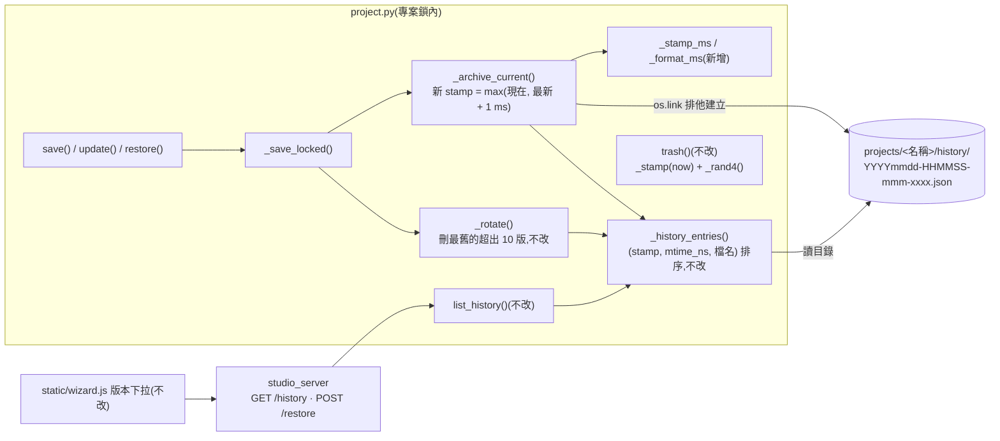
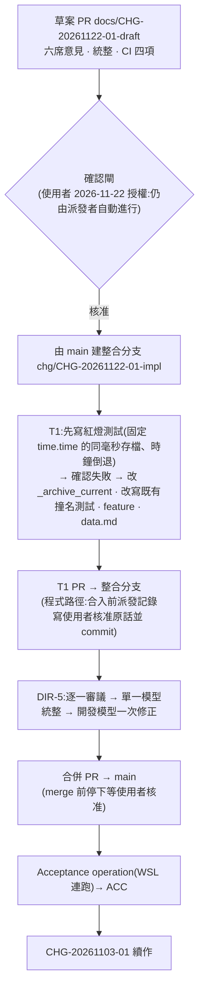

# CHG-20261122-01 — 專案版本 id 在同一毫秒內存檔時順序錯亂:版本時間戳改為嚴格遞增

- 專案:podcast-studio
- 分支(Branch):main
- 日期:2026-11-22(UTC+0)
- 類型:缺陷修正(產品程式:`project.py` 的版本 id 產生;`tests/test_project.py` 擴充並調整一個既有測試;`features/timeline_editor.feature` 加一個場景;`docs/structure/data.md` 補一行)
- 提出者:使用者(2026-11-22 指示,原話見「## 動機」)
- 實作者:主 agent 派發(DIR-3);草案由 Claude subagent 起草(DIR-3 第 2 條例外);T1 依 DIR-3 第 2 條例外二直接派 Claude subagent;實際工作者記於「## 派發記錄」
- 驗收者:獨立 Claude subagent(不參與起草、施工、審議與統整,不看實作者自述)+ 使用者確認
- 風險分級:高(命中高風險清單的**刪除或不可逆動作**:本筆改的是 `_rotate()` 選擇刪除對象所依據的排序輸入(新版本 id 的時間戳),排序錯就會刪錯版本,且刪除不可復原;依 CHG-20261022-04 將「history 超過 10 版自動刪最舊版」列為「刪除(有限)」而判高的先例,判級就高不就低。刪除規則「超過 10 版刪最舊」本身不變;不改版本 id 格式、專案檔格式、HTTP / MCP 介面、跨模組介面、設定或治理基礎設施;不涉安全邊界;不新增網路呼叫、不送資料出本機)
- Autonomy:halt(確認閘依使用者 2026-11-22 授權仍由派發者自動進行,見「## 審議」;改到程式路徑,T1 PR 合入整合分支前與合併 PR merge 前一律停下等使用者核准(DIR-2 第 3 條、DIR-5 第 8 條),不因該授權放寬)
- Commit/PR:草案分支 `docs/CHG-20261122-01-draft`;施工整合分支 `chg/CHG-20261122-01-impl`(DIR-5,確認閘後由 main 建立);T1 分支 `chg/CHG-20261122-01-T1`(PR base 為整合分支)
- 重複性檢查(Recurrence check):相近先例——ADP-8(`taiwan_ai.stamp()` 秒級時間戳撞名,CHG-20261022-01 T2 改為毫秒 + 隨機碼)處理的是「撞名覆寫」,本筆是「同毫秒的排序」,性質不同;未見於 KN,首次發生,不另建 KN
- Diagrams:見「## 設計圖」節
- Mockup: skipped — 本筆不改任何畫面;網頁版本下拉選單的程式不改,只是收到的清單順序回到正確
- Security-impact:見「## 安全影響」節
- Behaviour spec / Interaction spec:Behaviour spec 為 `features/timeline_editor.feature`(T1 新增一個場景,草案見「### Behaviour spec」);Interaction spec 不適用(不改畫面)
- Skill: ai-sdlc v1.69.1
- 關聯:CHG-20261103-01(進行中;其本機閘「`UV_OFFLINE=1 ./scripts/check.sh` 全過」被本缺陷擋住,本筆合入 main 後才續作,見「## 動機」);CHG-20261022-04(history 10 版與版本 id 格式的來源);ADP-8(相近但不同,見重複性檢查);DIR-2 第 3 條(程式 PR 合入需使用者核准)、DIR-3 第 2 條例外與例外二、DIR-5(整合分支、第 8 條)、DIR-7 第 4 條(資料誤刪缺陷在範圍內)、KN-1;Guideline §8(本筆不改 Guideline;不涉 §9 ADP 待補項)

## 動機

使用者 2026-11-22 指示,原話照錄:

- 「先開 CHG 修排序」

背景:主 agent 進場握手(`docs/worklog/`,本機、未入 git)時,在 WSL 跑本機閘發現 main 既有一個測試穩定失敗;該失敗擋住 CHG-20261103-01 的本機閘,而依 Guideline §8 不得在 CHG-20261103-01 順手修,因此另開本筆。本筆合入 main 後,CHG-20261103-01 才續作(由新的 main 建其整合分支)。

派發者 2026-11-22 觀察、起草者 2026-11-22 重驗的事實:

A.(派發者觀察)WSL2 Ubuntu(核心 6.6.87.2-microsoft-standard-WSL2、uv 0.13.9、`~/work/podcast-studio` detach 在 main `8ac06a3`)執行 `./scripts/check.sh`:1 failed / 1717 passed / 16 skipped;失敗的是 `tests/test_project.py::test_eleventh_save_keeps_10_history`(第 341 行),斷言 `pj.list_history("夜市的味道") == ids[2:]`(第 350 行)不成立。單獨連跑 8 次,8 次失敗。同一 commit 在 GitHub CI(ubuntu-latest)為 success。
B.(起草者重驗,2026-11-22)在同一 WSL 工作副本以 `UV_OFFLINE=1 ./scripts/check.sh tests/test_project.py -k "eleventh_save or clock_and_random"` 重跑,同一斷言失敗(這次差異出在 index 1:`…-112718-884-2ab4` ≠ `…-112718-884-9674`;派發者那次在 index 0)。差異的位置每次不同,與「同毫秒時排序落到隨機尾碼」一致。同一環境 `/boot/config-<核心版本>` 為 `CONFIG_HZ=250`;連續建 200 個檔,`st_mtime_ns` 只有 2 個不同值、間隔 4.0 ms——檔案時間戳的粒度是核心 tick(4 ms),不是奈秒。
C.(程式,`project.py`)版本 id = `_stamp()`(第 1007 行,UTC 到毫秒 `YYYYmmdd-HHMMSS-mmm`,毫秒取 `microsecond // 1000`)+ `-` + `_rand4()`(第 1013 行,`secrets.token_hex(2)`)。`_archive_current()`(第 1186 行)每次嘗試都重算 `f"{_stamp()}-{_rand4()}"`,以 `safe_fs.link`(硬連結)排他建立 `history/<vid>.json`,`FileExistsError` 時重試至多 `LINK_TRIES`(16)次。`_history_entries()`(第 1203 行)以 `(stamp, st_mtime_ns, 檔名)` 排序。`_rotate()`(第 1213 行)刪除 `entries[:len - HISTORY_KEEP]`(`HISTORY_KEEP = 10`,第 121 行)。`list_history()`(第 1286 行)文件寫「回傳版本 id(舊到新)」,即 `_history_entries` 的順序。常數 `STAMP_RE`、`HISTORY_RE`、`VERSION_RE`、`TRASH_RE` 在第 171~174 行。
D.(程式)history 檔是 `os.link` 的硬連結,`st_mtime_ns` 是該版本當初被寫成 `project.json` 的時間(`_write_atomic` 寫暫存檔再 `os.replace`)。同一毫秒內連續存檔時 stamp 相同;mtime 又落在同一個 4 ms tick 內也相同;排序於是由隨機 4 碼尾碼決定。〔推論〕GitHub CI 機器較慢,連續存檔不落在同一毫秒,所以 CI 綠;WSL 機器快,12 次存檔有多次落在同一毫秒。
E.(程式)`_archive_current()` 只被 `_save_locked()`(第 1248 行)呼叫;`_save_locked()` 只在 `save()`(第 1231 行)與 `update()`(第 1258 行)持有專案鎖(`_project_lock`,`fcntl.flock`,跨執行緒也跨行程)時呼叫;`restore()` 經 `save()`。所以「讀 history 最新 stamp → 建新版本檔」在同一把鎖內完成,不會與同專案的另一次存檔交錯。
F.(後果)(1) `list_history()` 的「舊到新」順序錯;網頁版本下拉選單(`static/wizard.js` 第 314 行 `versions()`)把清單反轉後由新到舊列出,順序同樣錯,「還原上一個版本」可能選到較舊的版本。(2) `_rotate()` 依同一排序刪掉最前面的項目,可能刪掉較新的版本、留下較舊的——正常使用(快速連續存檔)就會發生的資料誤刪,屬 DIR-7 第 4 條「仍在範圍」的缺陷。
G.(起草者補查)`trash()`(第 1365 行)以 `f"{name}-{_stamp(now)}-{_rand4()}"` 命名回收項目,同樣可能在同一毫秒產生相同 stamp;但 `.trash/` 的清除(`_clean_trash`,第 1398 行起)只看「時間戳距今是否滿 `TRASH_DAYS` 天」,不依項目之間的先後排序刪除,也沒有依序列出回收項目的介面;撞名由 `lstat` 檢查 + 重取隨機碼處理。所以不同病,本筆不改(代決 7)。
H.(起草者補查)既有測試 `test_history_names_unique_when_clock_and_random_collide`(`tests/test_project.py` 第 368 行)把 `time.time` 固定、`_rand4` 依序回 `aaaa, aaaa, aaaa, bbbb, cccc`,斷言三次版本 id 尾碼依序為 `-aaaa`、`-bbbb`、`-cccc`——這依賴「同一 stamp 撞名才重試」。本筆讓第二次起的 stamp 加 1 毫秒,第二、三次就不再撞名,這個測試的斷言必須配合修改(代決 6)。
I.(起草者補查)`docs/structure/data.md` 第 80 行記載 history 檔名格式「`YYYYmmdd-HHMMSS-<毫秒>-<4 碼隨機>.json`,UTC,只保留最近 10 個」,沒有寫排序或遞增規則;`design.md` 第 44、331 行只寫「history 10 版」;`directory.md` 第 116 行只寫「最近 10 版」;`project.py` 模組 docstring 第 7 行同 data.md。

## 使用者故事

1. 作為使用者,不論存檔多快,版本清單一律依實際存檔先後排列,以便「還原上一個版本」拿到的就是上一個版本。
2. 作為使用者,history 超過 10 版時刪掉的一定是最舊的那幾版,以便不會在正常快速存檔時丟掉較新的版本。
3. 作為使用者,既有的版本檔、版本 id 格式與還原功能照舊可用,以便修正前留下的 history 不必轉換。

## 決策與取捨

> 依使用者 2026-10-26 原則「如果多次審議都無交集 只採最低限度」:只修版本 id 的產生,不改格式、不改排序鍵、不擴及 `trash()`。

| 決策 | 選項 | 前提假設 | 為何這樣選 |
|------|------|----------|------------|
| 修在哪一層 | (a) 產生 vid 時確保新 stamp 嚴格大於 history 現有最新 stamp(現在時間 ≤ 最新 stamp 時改用最新 stamp + 1 毫秒);(b) 版本 id 加序號欄位;(c) 排序改用 inode ctime 或行程內單調時鐘 | 事實 E:產生 vid 時已持專案鎖,讀最新 stamp 與建檔不會交錯;(b) 要改 `STAMP_RE`/`HISTORY_RE`/`VERSION_RE`、相容既有檔、網頁標籤解析與 `load_version` 驗證,範圍大;(c) ctime 與 mtime 同受 4 ms tick 粒度限制(事實 B),單調時鐘不跨行程、重開機歸零,也不在檔名裡 | **代決**:(a)。格式不變,既有檔、`load_version`、網頁還原與標籤解析都不受影響 |
| 時間計算方式 | (a) 以整數毫秒運算(解析 stamp 成整數毫秒、比較、加 1、格式化回字串);(b) 沿用 `_parse_stamp()` 的浮點秒數加 0.001 | 浮點加 0.001 再取 `microsecond // 1000` 可能落回同一毫秒(例 `.123999…`);整數毫秒精確 | **代決**:(a)。新增小函式處理整數毫秒;`_stamp()`、`_parse_stamp()` 不改(`trash()`、`_clean_trash()` 照用) |
| stamp 在重試迴圈內外 | (a) 迴圈前算一次,重試只換隨機碼;(b) 每次重試重算 | 鎖內 history 不變,重算結果相同;(a) 意圖清楚 | **代決**:(a) |
| 排序鍵 | (a) `_history_entries()` 維持 `(stamp, st_mtime_ns, 檔名)`;(b) 改成只看 stamp | 修正後新檔 stamp 唯一;既有已同 stamp 的舊檔仍需要 mtime 輔助;(b) 屬範圍外改動 | **代決**:(a),不改 |
| 時鐘倒退 | (a) 新 stamp 取 max(現在, 最新 + 1 毫秒),時鐘倒退期間版本時間戳會超前實際時間;(b) 偵測倒退時報錯拒絕存檔 | 存檔不能因系統時間被調整而失敗;順序正確比標籤時間精確重要 | **代決**:(a)。網頁下拉的時間標籤在倒退期間會顯示比實際稍晚的時間,記於風險 |
| 既有測試 `test_history_names_unique_when_clock_and_random_collide` | (a) 改斷言:固定時間下 stamp 依序 `…-000`、`…-001`、`…-002`;撞名重試改以「history 內已有同名的非一般檔項目(目錄)」觸發;(b) 刪除該測試 | 事實 H;`_history_entries` 只收一般檔,同名目錄不計入最新 stamp,卻會讓 `link` 丟 `FileExistsError`,重試路徑仍可測 | **代決**:(a)。測試目的(撞名不覆寫、重試換隨機碼)保留 |
| `trash()` 是否一併修 | (a) 不改,列後續改善;(b) 一併改 | 事實 G:回收區不依先後排序刪除,沒有本筆的誤刪問題 | **代決**:(a) |
| 施工方式 | (a) DIR-5 整合分支 + 單一 task PR;(b) 單一 task 直接合 main | DIR-5 第 1~5 條沒有例外;偏離須使用者明示核准 | **決定**:(a),依 DIR-5 |
| 施工者 | 本機模型先試 vs 直接派 Claude subagent | DIR-3 第 2 條例外二:中風險程式 task 可直接派 | **代決**:直接派 Claude subagent |

**代決事項**(使用者原話推導不出細節,由 agent 先決定;改判高之後,確認閘依使用者 2026-11-22 原話「仍由你自動進行」由派發者自動進行,見「## 審議」):

1. 風險分級判「高」:命中高風險清單「刪除或不可逆動作」——改到 `_rotate()` 選刪除對象所依據的排序輸入,依 CHG-20261022-04「刪除(有限)」先例判高;Autonomy 為 halt。(第 1 輪草案自評「中」,依草案 PR #151 第 1 輪統整判定 F-1 改判。)
2. 版本 id 格式、`STAMP_RE`、`HISTORY_RE`、`VERSION_RE`、`TRASH_RE` 不改;既有 history 檔不轉換。
3. `_archive_current()` 在重試迴圈前算一次 stamp:取現在時間的 stamp;history 內已有版本檔且現在時間 ≤ 最新 stamp 時,改用最新 stamp + 1 毫秒。重試只換隨機碼。
4. 以整數毫秒運算(新增 `_stamp_ms(s) -> int`、`_format_ms(ms) -> str` 兩個小函式,或等價實作);`_stamp()`、`_parse_stamp()` 不改。
5. `_history_entries()`、`_rotate()`、`list_history()`、`load_version()` 不改。
6. 既有測試 `test_history_names_unique_when_clock_and_random_collide` 依決策表改寫,不刪除。
7. `trash()` 不改(事實 G),列入「## 後續改善」。
8. 新增確定性測試(固定 `time.time`)覆蓋同毫秒連續存檔、時鐘倒退、輪替刪最舊;紅燈先行。
9. `features/timeline_editor.feature` 新增一個場景(草案見「### Behaviour spec」)。
10. 結構文件只補 `docs/structure/data.md` 第 80 行一句,並同步 `project.py` 模組 docstring 第 7 行;其餘結構文件不需更新(事實 I)。
11. 施工依 DIR-5 開整合分支 `chg/CHG-20261122-01-impl`,單一 task T1,直接派 Claude subagent(DIR-3 第 2 條例外二)。
12. 本筆合入 main 後,CHG-20261103-01 才續作;本筆不改 CHG-20261103-01 的任何內容。

## 設計圖

### (1) 受影響模組架構(變更後)



### (2) 本次變更的流程



## 安全影響

| 類別 | 是否觸及 | 影響範圍 / 理由 |
|------|----------|-----------------|
| irreversible-delete | **是(有限)** | 影響範圍:`_rotate()` 刪除 `history/` 內超出 10 版的版本檔(不可復原);本筆改的是刪除對象選取所依據的排序輸入(新版本 id 的時間戳),刪除規則「超過 10 版刪最舊」與刪除程式不改,不新增刪除路徑、不擴大刪除範圍(只限單一專案的 `history/` 版本檔)。修正前的缺陷會誤刪較新版本(事實 F)。對策:(1) 新 stamp 只在已持專案鎖的 `_archive_current()` 內計算,讀最新 stamp 與建檔不交錯(事實 E);(2) 以整數毫秒運算,避免浮點誤差落回同一毫秒;(3) T1 L2 (a)(b) 斷言同毫秒與時鐘倒退下 `list_history()` 順序正確、被刪的是最舊版本;(4) Acceptance operation (3) 不 sleep 連續存檔 30 次,核對 history 只剩最後 10 版且順序相同。殘留:修正前已存在、stamp 相同的舊版本檔之間順序仍不確定,直到它們被輪替出去(至多 10 個檔);回滾後的排序問題見「### 風險與回滾」 |
| payments | 否 | 無金流 |
| prod-migration | 否 | 不改專案檔格式、版本 id 格式、`config/studio.db`、設定 schema;既有 history 檔不轉換、照常可讀可還原 |
| security-boundary | 否 | 不改 HTTP 端點、Host / Origin / Token 中介層、`safe_fs` 防護、符號連結檢查或鎖;新程式只在已持專案鎖時讀 history 目錄的檔名(既有 `_history_entries()`)。不新增網路呼叫、不送資料出本機 |

## 修改指引

### 目標

依使用者 2026-11-22 指示「先開 CHG 修排序」:讓同一專案的版本 id 時間戳嚴格遞增,`list_history()` 的順序與 `_rotate()` 的刪除對象在任何存檔速度下都正確;不改版本 id 格式。

### 影響範圍

| 受影響項 | 類型 | 改動 | 連帶影響 |
|----------|------|------|----------|
| `project.py` `_archive_current()` | 設計 | 迴圈前算出嚴格遞增的 stamp | `save`、`update`、`restore` 產生的版本 id |
| `project.py` 新增 `_stamp_ms()`、`_format_ms()`(或等價) | 設計 | 整數毫秒解析與格式化 | 只供 `_archive_current()` 使用 |
| `project.py` 模組 docstring 第 7 行 | 文件 | 補「同一專案內時間戳嚴格遞增」 | — |
| `tests/test_project.py` | 測試 | 新增確定性測試;改寫 `test_history_names_unique_when_clock_and_random_collide` | — |
| `features/timeline_editor.feature` | 行為 | 新增一個場景 | — |
| `docs/structure/data.md` | 結構文件 | 第 80 行補一句、表頭加更新註記 | — |

不改:`_stamp()`、`_parse_stamp()`、`_rand4()`、`_history_entries()`、`_rotate()`、`list_history()`、`load_version()`、`trash()`、`_clean_trash()`、`STAMP_RE` 等常數、`studio_server.py`、`static/`、`nodes.py`、`local_models_mcp.py`、`taiwan_ai.py`、`scripts/`、`.github/`、`.ai-sdlc/`、`docs/ai-guideline.md`、`docs/knowledge/`、CHG-20261103-01。

與 CHG-20261103-01 的交集:兩筆都改 `project.py`,但 CHG-20261103-01 T1 改的是 `_is_int` 定義與呼叫點(約第 296~526 行),本筆改的是第 1007~1200 行一帶,文字不重疊;CHG-20261103-01 續作時由含本筆的 main 建整合分支,不需合併衝突處理。

### 契約清單

| 契約 | 提供方 | 讀取方 | 本筆變更 | 契約測試(路徑/無) |
|------|--------|--------|----------|----------------------|
| 版本 id 格式 `YYYYmmdd-HHMMSS-mmm-xxxx`(`VERSION_RE`、`HISTORY_RE`) | `project.py` | `load_version`、`studio_server` 還原端點、`static/wizard.js` 標籤解析 | 不改 | `tests/test_project.py`(既有 `HISTORY_RE.fullmatch` 斷言) |
| 同一專案的新版本 id 的時間戳嚴格大於 history 內既有最新時間戳 | `project._archive_current` | `_history_entries`、`list_history`、`_rotate` | 新增(保證) | `tests/test_project.py`(T1 新增) |
| `list_history(name)` 回傳舊到新 | `project.py` | `GET /api/projects/{p}/history`、網頁版本下拉 | 不改(修正後在同毫秒存檔下也成立) | `tests/test_project.py` |
| history 只保留最近 `HISTORY_KEEP` 個,刪最舊 | `project._rotate` | 使用者 | 不改(修正後在同毫秒存檔下也成立) | `tests/test_project.py` |
| `save()` / `update()` 回傳這次移入 history 的版本 id | `project.py` | `studio_server`、`nodes` | 不改 | 既有 `tests/test_project.py`、`tests/test_nodes.py` |

### Global Constraints(全域約束——每個 task 都要遵守)

- 不改版本 id 格式與 `STAMP_RE`、`HISTORY_RE`、`VERSION_RE`、`TRASH_RE`;不轉換、不搬移、不刪除既有 history 檔(除 `_rotate()` 既有規則)。
- 新 stamp 的計算只在已持專案鎖的路徑(`_save_locked()` → `_archive_current()`)內進行;不另加鎖、不改鎖。
- 不改 `_history_entries()`、`_rotate()`、`list_history()`、`load_version()`、`trash()`、`_stamp()`、`_parse_stamp()` 的行為。
- 時間運算以整數毫秒進行,不以浮點秒數加減。
- 不新增網路呼叫、不新增依賴;維持 `safe_fs` 以 fd 存取 history 目錄。
- 測試以 monkeypatch 固定 `project.time.time`,不依賴機器快慢;不呼叫真實 Ollama、BreezyVoice。
- 先寫會紅的測試並確認紅燈,再改程式(TDD)。
- T1 PR 合入整合分支前,先在本 CHG「## 派發記錄」寫入使用者核准原話並 commit(DIR-5 第 8 條)。
- 使用者面文字、註解、文件一律繁體中文與台灣用語;本 CHG 與 commit 訊息不寫 KN-1 列出的狀態觸發字。

### 版本 stamp 設計(T1 依此施工)

- `_stamp_ms(s: str) -> int`:把 `YYYYmmdd-HHMMSS-mmm` 解析成自 epoch 起的整數毫秒(UTC;秒數部分以 `calendar.timegm` 或 `datetime` 差值取整數,再加毫秒)。
- `_format_ms(ms: int) -> str`:整數毫秒格式化回 `YYYYmmdd-HHMMSS-mmm`(UTC;例:`datetime(1970, 1, 1, tzinfo=timezone.utc) + timedelta(milliseconds=ms)`)。對任何 `_stamp()` 產生的字串 `s`,`_format_ms(_stamp_ms(s)) == s`。
- `_archive_current(pfd, hfd)`:在 `for _ in range(LINK_TRIES)` 之前:`now = _stamp()`;`entries = _history_entries(hfd)`;若 `entries` 非空,`latest = max(_stamp_ms(e[0]) for e in entries)`,當 `_stamp_ms(now) <= latest` 時 `now = _format_ms(latest + 1)`。迴圈內 `vid = f"{now}-{_rand4()}"`,其餘不變。
- 模組 docstring 第 7 行補:同一專案內版本時間戳嚴格遞增(同一毫秒或時鐘倒退時取既有最新時間戳 + 1 毫秒)。

### Tasks(checkbox=續作點)

- [ ] T1. 版本 stamp 改為同專案內嚴格遞增,補測試、feature 場景與結構文件
  - interfaces: consumes 本 CHG「### 版本 stamp 設計」與「### Behaviour spec」(含確認閘的修改) / produces `project.py`(`_archive_current()` 嚴格遞增 stamp、新增 `_stamp_ms()`、`_format_ms()`、docstring 一行)、`tests/test_project.py`(新增測試、改寫一個既有測試)、`features/timeline_editor.feature`(一個新場景)、`docs/structure/data.md`;分支 `chg/CHG-20261122-01-T1`,PR base 整合分支 `chg/CHG-20261122-01-impl`;commit 訊息帶 CHG-20261122-01
  - test: 紅燈先行——先新增下列 L1、L2 測試,在修改前以 `UV_OFFLINE=1 ./scripts/check.sh tests/test_project.py` 確認新測試失敗(固定時間的測試在任何機器都會紅),再改程式;完成後 (1) `UV_OFFLINE=1 ./scripts/check.sh tests/test_project.py` 全過;(2) 在 WSL(事實 A 的環境)以 `for i in $(seq 1 20); do UV_OFFLINE=1 ./scripts/check.sh tests/test_project.py -k eleventh_save -q || exit 1; done` 連跑 20 次全過;(3) `UV_OFFLINE=1 ./scripts/check.sh` 全過;(4) `git diff --name-only chg/CHG-20261122-01-impl...HEAD` 只含 `project.py`、`tests/test_project.py`、`features/timeline_editor.feature`、`docs/structure/data.md`;(5) `git diff chg/CHG-20261122-01-impl...HEAD -- project.py` 不含 `STAMP_RE`、`HISTORY_RE`、`VERSION_RE`、`def _rotate`、`def _history_entries`、`def trash` 的改動;(6) `python3 .ai-sdlc/skills/ai-sdlc-autopilot/scripts/doc_integrity_check.py --repo .` exit 0
  - L1: `_stamp_ms` / `_format_ms`:`_format_ms(_stamp_ms(s)) == s`(含 `…-000`、`…-999`);`_format_ms(_stamp_ms("20261027-235959-999") + 1) == "20261028-000000-000"`(跨日進位);`_stamp_ms(_stamp(t))` 與 `int(t * 1000)` 對整數毫秒的 `t` 相同
  - L2: 提供方與讀取方雙側——(a) 固定 `pj.time.time` 為 `BASE`,同一專案連續存檔 12 次:回傳的版本 id(去掉第一次的 `None`)依序 stamp 為 `20261027-120000-000`、`-001`、…,嚴格遞增;`list_history()` 等於最後 10 個回傳值且順序相同;被刪的是最舊的 1 個;`history/` 內最新檔的內容是倒數第二次存檔前的專案檔。(b) 時鐘倒退:先以 `BASE + 10 秒` 存檔兩次,再把時間改為 `BASE` 存檔:新版本 stamp 為前一個 stamp + 1 毫秒,`list_history()` 最後一個是它。(c) 改寫後的 `test_history_names_unique_when_clock_and_random_collide`:固定時間為 `BASE`,首次存檔後在 `history/` 建立名為 `20261027-120000-001-aaaa.json` 的目錄,`_rand4` 依序回 `aaaa, aaaa, bbbb, cccc`;之後三次存檔的版本 id 依序為 `20261027-120000-000-aaaa`、`20261027-120000-001-bbbb`(撞名重試換隨機碼、不覆寫該目錄)、`20261027-120000-002-cccc`,三者互不相同。(d) `update()`、`restore()` 產生的版本 id 也遵守 (a) 的遞增(各一個案例)
  - L3: `features/timeline_editor.feature` 新場景「同一毫秒內連續存檔的版本順序」(見「### Behaviour spec」)
  - L4: 不適用(沒有新的端到端路徑;網頁版本清單與還原端點的既有測試在 test (3) 內經 TestClient 跑真的 `studio_server`)

### Behaviour spec

- feature: features/timeline_editor.feature

既有檔;T1 在「存檔保留版本」場景之後新增下列場景,施工者可補場景,不得刪減既有場景。

```gherkin
  場景: 同一毫秒內連續存檔的版本順序
    假設 專案在同一毫秒內連續存檔 12 次
    那麼 版本清單只有最近 10 個,且依存檔先後排列
    而且 被刪掉的是最舊的版本
```

### Acceptance operation

- operate: (1) 合併 PR 合進 main 後,獨立 Claude subagent(未參與起草、施工、審議與統整)在 WSL(事實 A 的環境,工作副本 detach 到合併後的 main)執行 `UV_OFFLINE=1 ./scripts/check.sh`;(2) 同一環境以 `for i in $(seq 1 20); do UV_OFFLINE=1 ./scripts/check.sh tests/test_project.py -k "eleventh_save or clock or history" -q || exit 1; done` 連跑 20 次;(3) 在 session 暫存目錄設 `pj.ROOT` 指向暫存 repo 根目錄,以 Python 對同一專案不 sleep 連續 `save()` 30 次,印出每次回傳的版本 id、`list_history()` 與 `history/` 目錄內容;(4) `python3 .ai-sdlc/skills/ai-sdlc-autopilot/scripts/doc_integrity_check.py --repo .` 與 `git diff --name-only <合併 PR 合入前的 main>..<squash commit>`
- observe: (1) 全部通過(0 failed);(2) 20 次全過;(3) 回傳的版本 id 去掉 `None` 後 stamp 嚴格遞增、全部符合 `VERSION_RE`;`list_history()` 等於最後 10 個回傳值且順序相同;`history/` 只有這 10 個 `.json`;(4) exit 0;變更檔案只含影響範圍所列檔案、本 CHG、DIR-5 統整報告
- pass: 四項 observe 全部成立;使用者看過 observe (3) 的輸出並確認

### 本機閘

- cmd: UV_OFFLINE=1 ./scripts/check.sh
- pass: exit 0(在事實 A 的 WSL 環境執行)

### 結構文件更新

- [ ] `docs/structure/data.md`(T1):第 80 行 history 描述後補「同一專案內版本時間戳嚴格遞增:同一毫秒內存檔或系統時鐘倒退時,取 history 內最新時間戳 + 1 毫秒,所以時間戳可能略晚於實際存檔時間(CHG-20261122-01)」;表頭加一行更新註記
- `docs/structure/design.md`、`directory.md`、`logical.md`:不需更新——只寫「history 10 版」,沒有版本 id 產生規則的記載(事實 I;以 `grep -n "history\|版本 id\|毫秒" docs/structure/*.md` 複查)
- `docs/ai-guideline.md`:不需更新——不改需求與約定,不涉 §9 ADP 待補項

### 風險與回滾

- 風險:(1) **時鐘倒退期間標籤超前**:系統時間被往回調後,新版本 stamp 取最新 + 1 毫秒,網頁版本下拉顯示的時間會比實際存檔時間晚,直到實際時間追上;順序正確,資料不受影響。(2) **未來時間戳的舊檔**:若 history 內有時間戳遠在未來的檔(例如曾經系統時間錯誤),之後的版本都接在它後面、每次加 1 毫秒;超前的時間戳會被後續每個版本繼承,即使原檔被輪替出去也一樣,要到實際時間追上才結束,失真期間可能遠長於 10 次存檔。這段期間只有時間標籤失真,順序與刪除對象仍正確。(3) **修正前已同 stamp 的舊檔**:順序仍由 mtime 與隨機碼決定,至多 10 個檔,隨輪替消失;不追溯修正。(4) **其他撞名路徑**:`trash()` 仍可能在同一毫秒產生相同 stamp,但不依排序刪除(事實 G),列後續改善。(5) **既有測試改寫**:`test_history_names_unique_when_clock_and_random_collide` 改以同名目錄觸發重試;若 `safe_fs.link` 對目錄目標不丟 `FileExistsError`,該測試會紅 → 施工者以紅燈先行確認後調整觸發方式,不刪測試。
- 回滾方式:`git revert` 合併 PR 的 squash commit;版本 id 格式未變,修正後產生的 history 檔在回滾後照常可讀可還原。注意:回滾後新存檔改用實際時間,若 history 內有修正期間產生、時間戳超前實際時間的檔(同毫秒連續存檔或時鐘倒退所致),新版本會排在它們之前,`_rotate()` 可能又刪到較新的版本。處置(最低限度):回滾前,派發者對各專案 `history/` 列出檔名,確認沒有任何時間戳晚於當下實際時間;若有,等實際時間超過其中最晚的時間戳後再合入回滾。

### 執行計畫(DIR-5)

1. 草案 PR(`docs/CHG-20261122-01-draft`)依 main 現行規則與腳本審議並合入 main;改判高之後,確認閘依使用者 2026-11-22 原話「仍由你自動進行」由派發者自動進行(見「## 審議」);程式 PR 合入與合併 PR merge 的停點不變。
2. 確認閘後由 main 開整合分支 `chg/CHG-20261122-01-impl`。
3. T1(`chg/CHG-20261122-01-T1`,產品程式)→ PR base 整合分支;合入前依 DIR-5 第 8 條取得使用者核准並先把核准原話 commit 進「## 派發記錄」。
4. T1 合入後依 DIR-5 第 2 條審議,第 3 條由單一模型統整成 `docs/changes/review/CHG-20261122-01-summary.md`,第 4 條開發模型一次修正。
5. 合併 PR(整合分支 → main):六席意見、DIR-6 統整、CI 四項;改到程式路徑,merge 前停下等使用者核准。
6. 合併 PR 合入 main 後依「### Acceptance operation」驗收,ACC 收尾;之後 CHG-20261103-01 續作。

## 後續改善(不屬本筆範圍,另開 CHG)

- `trash()` 的回收項目名稱在同一毫秒內可能共用 stamp(事實 G):目前不影響清除與還原,若日後新增「依刪除先後列出回收區」之類的功能,需比照本筆讓 stamp 遞增(代決 7)。

## 派發記錄

> 依 DIR-3:主 agent 只派發。審查與審議結論不記在本節,一律見對應 PR 的審議留言與「## 審議」節。

| task | 施工者 | 派發者獨立驗證 | PR | 備註 |
|------|--------|----------------|----|------|
| 草案 | Claude subagent(DIR-3 第 2 條例外:治理文件草案直接派 Claude subagent) | — | 分支 `docs/CHG-20261122-01-draft` | 只新增本 CHG;唯讀查 `project.py`、`tests/test_project.py`、`static/wizard.js`、`features/timeline_editor.feature`、結構文件;在 WSL 工作副本唯讀重跑失敗測試並量測檔案時間戳粒度(事實 B),未改其他檔案 |
| 草案第 1 輪修正 | 原起草者(Claude subagent) | — | 分支 `docs/CHG-20261122-01-draft`(PR #151) | 依草案 PR #151 第 1 輪 DIR-6 統整判定 F-1~F-5 一次修正(風險改判高、Autonomy 改 halt、irreversible-delete 改「是(有限)」、風險 (2) 與回滾方式補寫、確認閘授權依使用者原話改寫),並修正事實 A 的行號;設計內容(代決 2~12、版本 stamp 設計、Tasks)不改。第 1 輪席位安排:impact、drift 因本機無 Ollama 記 no-answer(使用者原話「Ollama 席位先記 no-answer,其他照跑」);security、compliance 因本機未安裝 Codex 改由 Opus 代答(腳本標示為「額度用盡」,實際原因是未安裝);其中 compliance 的參考資料須完整送達、超過 Opus 單份上限,未派發,記 no-answer;審議在 worktree 內 main 的 clone 執行(hook 禁止寫入主工作副本) |

## 審議

確認閘:待進行。使用者 2026-11-22 原話照錄:「自動審議這種不重要的內容」——派發者據此理解為:本筆草案的確認閘(代決 1~12 的覆核)與草案 PR 的審議(六席意見、統整判定)由派發者自動進行,不逐條停下詢問使用者;結果照例記於本節。草案 PR #151 第 1 輪統整判定將風險改判高,並提出需使用者決定事項「改判高之後,確認閘是否仍可由派發者自動進行」;使用者 2026-11-22 原話照錄:「仍由你自動進行」。所以改判高之後,確認閘仍由派發者依此授權自動進行。此授權只及於本筆的確認閘與審議,不放寬 DIR-2 第 3 條、DIR-5 第 8 條:T1 PR 合入整合分支前、合併 PR merge 前仍停下等使用者核准;DIR-4 第 2 條「不適用」清單(統整判定列有需使用者決定事項、同一 PR 連續兩輪判定 fix 等)照常停下。

## 狀態

草稿(2026-11-22)——待確認閘。
