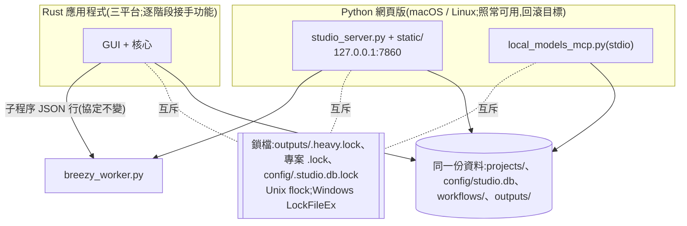

# CHG-20261122-02 — 架構調整:跨平台、Rust 原生 GUI 應用程式、逐步替換的決策與遷移路線圖

- 專案:podcast-studio
- 分支(Branch):main
- 日期:2026-11-22(UTC+0)
- 類型:需求與架構變更(只改 `docs/ai-guideline.md`,v1.17 → v1.18;不改程式、測試、`features/`、治理基礎設施,也不改 `docs/structure/*.md`——理由見代決 23)
- 提出者:使用者(2026-11-22 指示與四題選項,原話見「## 動機」)
- 實作者:主 agent 派發(DIR-3);草案與 Guideline v1.18 修訂由 Claude subagent 起草(DIR-3 第 2 條例外:CHG / Guideline 修訂草案直接派 Claude subagent);實際工作者記於「## 派發記錄」
- 驗收者:獨立 Claude subagent(不參與起草與審議,不看起草者自述)+ 使用者確認條文
- 風險分級:高(命中高風險清單:(1) **架構層級**——改變產品形態(網頁 → 原生桌面應用程式)、程式語言與支援平台;(2) **技術約束變更**——改寫 Guideline §8「依賴」並新增「技術約束」,約束之後全部施工 CHG;(3) **安全邊界規範**——§5 安全要求由「網頁只監聽 `127.0.0.1`」改為「應用程式不開監聽埠」,並規定路徑防護在 Windows 的對應語意;(4) **資料模型與跨模組介面**——承諾 Rust 與 Python 兩套實作讀寫同一份專案檔、設定資料庫與鎖檔,`breezy_worker` 的 JSON 協定成為跨語言契約。本筆只改文件,不新增網路呼叫、不送資料出本機;可由 `git revert` 完整還原)
- Autonomy:halt(高風險;確認閘逐條由使用者覆核代決 1~26,草案 PR 合入 main 前停下)
- Commit/PR:草案分支 `docs/CHG-20261122-02-draft`(自 origin/main `8ac06a3`;PR 待開);本筆只有 T1(Guideline v1.18 修訂,隨草案一起送審,見代決 25)
- 重複性檢查(Recurrence check):首次——本 repo 先前沒有以「換程式語言 / 跨平台 / 改產品形態」為動機的 CHG;未見於 KN,不另建 KN
- Diagrams:見「## 設計圖」節(目標架構、過渡期並存與資料共用)
- Mockup: skipped — 本筆不定任何畫面;Rust GUI 的畫面草稿由路線圖階段 2 起各階段 CHG 提出
- Security-impact:見「## 安全影響」節
- Behaviour spec / Interaction spec:不適用(docs-only:只改 `docs/ai-guideline.md` 與本 CHG)
- Skill: ai-sdlc v1.69.1
- 關聯:DIR-1~7(審議、PR 流程、派發、預授權、批次審議、統整席、威脅模型;本筆不改任何 DIR);KN-1(本 CHG 全文不寫狀態觸發字);Guideline §1、§2、§4(新增 4.7)、§5、§6、§7、§8、§11;§9 ADP-3、ADP-4、ADP-7 與遷移的關係見代決 22(不修);進行中的 CHG-20261122-01(history 版本排序,Python)、CHG-20261103-01(抽共用函式,Python,T1 / T2 未開工)見代決 24;`PODCAST_STUDIO.md §7`(外部依賴)

## 動機

使用者 2026-11-22 指示,原話照錄:

1. 「架構調整為跨平台 高效率」
2. 「並且不必把前後端分離為硬性規定,可為應用程式」
3. 「建議採取rust」

主 agent 以選項確認,問題原文與使用者所選選項逐字照錄:

- 問「跨平台要涵蓋哪些作業系統?」——使用者選「macOS + Windows + Linux (Recommended)」(選項說明:三平台都列為支援並進 CI 矩陣測試)
- 問「改成 Rust 的方式?」——使用者選「逐步替換 (Recommended)」(選項說明:先建 Rust 核心,一個模組一個 CHG 換掉 Python;過渡期兩邊並存,每步可驗收、可回滾)
- 問「應用程式形態?」——使用者選「純 Rust 原生 GUI」(選項說明:egui / Slint 等重寫介面,捨棄現有約 7k 行前端;使用者沒選 Tauri,也沒選 Rust 本機網頁伺服器)
- 問「mflux(MLX)只能在 Apple Silicon 跑,Windows / Linux 上的封面生圖?」——使用者選「換跨平台生圖後端 (Recommended)」(選項說明:Mac 續用 mflux;Windows / Linux 改用跨平台本機引擎,例如 stable-diffusion.cpp,由需求分析比較後定案)

派發者提供、起草者 2026-11-22 於 `origin/main` `8ac06a3` 重驗的事實(來源等級標於句首):

A. 〔觀察〕程式量:repo 根目錄 Python 16 檔合計 10050 行(`studio_server` 2280、`project` 1474、`settings` 1464、`breezy_worker` 878、`tts_service` 740、`media` 670、`mcp_registry` 622、`nodes` 500、`executor` 322、`taiwan_ai` 256、`fusion` 250、`safe_fs` 218、`local_models_mcp` 125、`timeline` 121、`heavy_lock` 81、`names` 49);前端 `static/` 合計 7654 行,其中 JS 6415 行(`app.js` 2326、`edit.js` 1867、`timeline.js` 985、`project.js` 874、`wizard.js` 363)、`style.css` 685、`index.html` 554。派發者所說「Python 約 11k 行」若含 `tests/`、`scripts/` 才接近;產品程式本身約 10k。
B. 〔觀察〕平台綁定:**直接** import `fcntl` 的是 `heavy_lock.py:24`、`project.py:92`、`settings.py:89`(三者都用 `fcntl.flock`,不是 `lockf`);**直接** import `pwd` 的是 `mcp_registry.py:50`(`pwd.getpwuid`)。`studio_server`(import `heavy_lock`)、`taiwan_ai`(import `settings`)、`media`(import `taiwan_ai`)、`local_models_mcp`(import `heavy_lock`)是**間接**失敗。另 `safe_fs.py` 全面依賴 `dir_fd`、`O_NOFOLLOW`、`O_DIRECTORY`,`media.py`、`project.py`、`tts_service.py`、`nodes.py` 也直接用到 `O_NOFOLLOW` / `dir_fd`;`taiwan_ai.py:180` 以 `getattr(os, "O_NOFOLLOW", 0)` 防呆。與派發者清單的差異:`media`、`studio_server`、`taiwan_ai` 不是直接 import,而是經相依失敗;派發者清單未列 `safe_fs`、`tts_service`、`nodes`、`local_models_mcp`。〔未重驗〕2026-11-22 Windows 上 `check.sh` 收集階段 22 個錯誤為派發者回報,起草者未在 Windows 重跑。
C. 〔觀察〕外部引擎:mflux 路徑寫死 `~/.local/bin/mflux-generate`(`taiwan_ai.py:51`),依賴 Apple MLX;封面字型寫死 `/System/Library/Fonts/STHeiti Medium.ttc`(`media.py:17`);BreezyVoice 以 `tools/BreezyVoice/.venv` 的 Python 執行 `breezy_worker.py`(含後製 `shape` 子命令,依賴 venv 內 numpy / scipy / librosa,見 CHG-20261029-01);Ollama 走 `localhost:11434` HTTP;**ffmpeg 取自 Python 套件 `imageio_ffmpeg.get_ffmpeg_exe()`**(`media.py:11,275,497,649`、`tts_service.py:60`),不是系統 ffmpeg——與派發者「ffmpeg 本身跨平台」的說法一致,但現行取得方式綁在 Python 套件上。
D. 〔觀察〕資料格式:專案檔 `projects/<名稱>/project.json` 的 `SCHEMA_VERSION = 2`(`project.py:118`),`history/` 保留 `HISTORY_KEEP = 10`(`project.py:121`),每專案 `.lock` 以 `fcntl.flock` 序列化存檔;設定資料庫 `config/studio.db` 為 SQLite `SCHEMA_VERSION = "3"`(`settings.py:108`)、`journal_mode=WAL`、`busy_timeout=5000`,初始化鎖 `config/.studio.db.lock`;重型工作鎖 `outputs/.heavy.lock`(`heavy_lock.py`)。`docs/structure/data.md` 第 17 行節標題仍寫「schema v2」,第 166 行起的 CHG-20261029-01 節才記 schema 3,屬結構文件內部不一致(本筆不改,見「## 後續改善」)。
E. 〔觀察〕網頁安全:`studio_server.py:252-255` 只綁 `127.0.0.1:7860`,所有請求檢查 `Host`,改變狀態的請求另查 `Origin` 與 `X-Studio-Token`;MCP 只走 stdio(`local_models_mcp.py` 的 `busy()` 取 `heavy_lock` 並把 stdout 導向 stderr)。
F. 〔觀察〕CI:`.github/workflows/ci.yml` 四個 job(`document`、`chg`、`program`、`review`)全部 `runs-on: ubuntu-latest`;`program` job 跑 `py_compile`、`ruff`、`scripts/check.sh`、`tests/ci` 單元測試;治理腳本(`scripts/ci/*.py`、`scripts/local_review.py`、`scripts/review_decision.py`)與 vendored `.ai-sdlc/` 都是 Python;`scripts/check.sh`、`scripts/deploy_local.sh` 是 bash。
G. 〔觀察〕MCP 伺服器 `local_models_mcp.py`(stdio,6 個工具)在需求範圍(Guideline §1、§2、FR-8~13)。`mcp_registry.py` 以 `~/.local/bin/claude`、`~/.local/bin/codex` 找官方 CLI(FR-22)。
H. 〔觀察〕Guideline §2「納入」第一行仍寫 Gradio `podcast_studio.py`,與 v1.6 起的現況(`studio_server.py` + `static/`)不符;本筆只在新節註記,不改該行。

## 使用者故事

1. 作為使用者,我可以在 macOS、Windows、Linux 任一台電腦上用同一個應用程式完成一集 podcast(文稿 → 語音 → 封面 → 剪輯 → 匯出),全程離線。
2. 作為使用者,我拿到的是一個原生桌面應用程式,不必開瀏覽器、不必先啟動本機網頁伺服器;啟動快、操作時間軸不卡頓(具體數字由我訂,見 Guideline §6 Q5)。
3. 作為使用者,我既有的專案(`projects/`)、設定資料庫(`config/studio.db`)與工作流程(`workflows/`)不必重建,新應用程式直接打開。
4. 作為使用者,遷移期間現行 Python 網頁版照常可用;每一個遷移階段都能單獨驗收,出問題時可回到上一步。
5. 作為使用者,Windows、Linux 上的封面也由本機引擎產生;Mac 上照舊用 mflux。
6. 作為 MCP client(Claude Code / Codex),工具名稱、參數與回傳格式(FR-8~13)在遷移前後不變。

## 決策與取捨

> 依使用者 2026-10-26 原則「如果多次審議都無交集 只採最低限度」:本筆只定方向、約束、比較結論與路線圖;不寫 crate 版本號、不寫程式,細節由各階段 CHG 在實測後定案。凡依記憶而非本 repo 可讀證據寫出的第三方事實(授權、功能、平台支援),一律標〔推論〕並列為該階段 CHG 開工前的查證項。

### 1. GUI 框架比較(代決 3)

| 準則 | egui / eframe | Slint | iced |
|------|---------------|-------|------|
| 繁中字型 | 〔推論〕預設字型不含 CJK,須自行載入字型檔(可隨附開源繁中字型);好處是三平台顯示一致 | 〔推論〕使用系統字型並有後備機制,CJK 通常直接可顯示 | 〔推論〕以 cosmic-text 做字型後備,CJK 通常直接可顯示 |
| 輸入法(IME,注音 / 倉頡等) | 〔推論〕經 winit 支援組字與候選字;歷來在部分平台有候選窗位置、組字顯示的問題回報,需三平台實測 | 〔推論〕支援(winit 或 Qt 後端);需實測 | 〔推論〕較新版本才補上輸入法支援,成熟度最需實測 |
| 時間軸 / 波形 / 節點畫布等自繪元件 | 〔推論〕立即模式 + `Painter` 直接畫形狀與 mesh,最適合大量自繪;社群已有節點圖元件 | 〔推論〕宣告式 `.slint` 語言,自繪多半以 `Path` 或把 Rust 繪好的影像餵進去,大量動態圖元較不自然 | 〔推論〕`Canvas` 元件含快取,適合波形;Elm 架構,狀態管理清楚但樣板較多 |
| 跨平台 | 〔推論〕macOS / Windows / Linux(X11、Wayland),wgpu 或 OpenGL 繪製 | 〔推論〕三平台,另有嵌入式;多種繪製後端 | 〔推論〕三平台,wgpu 繪製 |
| 授權 | 〔推論〕MIT OR Apache-2.0 | 〔推論〕三擇一:GPLv3、免權利金授權(附條件,如標示來源)、商業授權——條件需逐條查證 | 〔推論〕MIT |
| 其他 | 〔推論〕AccessKit 無障礙;每次互動重繪,閒置時可停繪以省電 | 〔推論〕UI 與邏輯分離、適合表單類畫面 | 〔推論〕API 改版較頻繁 |

**推薦 egui / eframe**(代決 3):本產品的核心畫面是時間軸、波形、語調折線、節點畫布等大量自繪元件,egui 在這一點最直接;授權最寬鬆;繁中字型以隨附字型解決,反而讓三平台一致。主要風險是 **IME 品質**——定案條件為階段 2 原型在三平台實機以注音輸入法完成「組字、候選字選取、游標位置正確、選字後文字正確」;不合格時改用 iced(第二順位),仍不合格再評估 Slint(授權條件需先查證)。

### 2. Rust 與現有 Python 的整合方式(過渡期,代決 4、5)

| 選項 | 說明 | 優點 | 缺點 |
|------|------|------|------|
| (a) **兩個程式只共用資料檔**;Rust 應用程式需要 Python 時以**子程序 + JSON 行協定(stdin / stdout)**呼叫 | Python 網頁版照常運作;Rust 應用程式各階段接手一塊功能;BreezyVoice worker 沿用現行 JSON 協定 | 不開埠、崩潰隔離、與現行 `tts_service` ↔ `breezy_worker` 模式相同;Windows 不需要 Python 網頁版 | 遷移期 Python 程式不會逐步變少,要到退役階段才刪(見代決 5) |
| (b) PyO3 把 Python 嵌入 Rust | Rust 行程內直接呼叫 Python 模組 | 呼叫成本低 | 綁定 Python 版本與 ABI、三平台打包困難;Python 模組在 Windows 本來就 import 失敗(事實 B),嵌入解決不了 |
| (c) Rust GUI 當 Python `studio_server` 的 HTTP client,再逐一替換後端 | 典型「由外而內」替換 | 早期就有 Rust 介面 | 保留 HTTP 監聽埠,與「原生應用程式」相違;Windows 上後端跑不起來(事實 B),Windows 要到最後才可用 |
| (d) Python 網頁版改呼叫 Rust CLI,逐模組換掉 Python 內部實作 | 字面上最接近「一個模組一個 CHG 換掉 Python」 | 每步都在使用者實際使用的版本生效 | 要寫一層最後會丟掉的膠水;網頁前端最終仍要全部捨棄,工作量重複 |

**代決 4**:採 (a)。BreezyVoice 永遠是外部程序(使用者已知前提);其他 Python 元件(如 OpenCC,見代決 9)若過渡期需要,也只以子程序呼叫,不嵌入。
**代決 5**:「一個模組一個 CHG 換掉 Python」解讀為「**一個階段一筆 CHG,把一組 Python 模組的功能移到 Rust 核心並以並行比對證明等價,Rust 應用程式接手該功能**」;Python 模組的檔案在 Python 網頁版退役階段(階段 9)才刪除,在此之前兩邊並存、Python 版就是回滾目標。若使用者要的是字面上的 (d),確認閘請改選,路線圖需重排。

### 3. 跨平台生圖後端(代決 6)

| 選項 | 說明 | 評估 |
|------|------|------|
| **stable-diffusion.cpp**(`sd` 命令列) | 〔推論〕C/C++(ggml),MIT;支援 FLUX.1-schnell 等模型的 GGUF 量化;CPU、CUDA、Vulkan、Metal 後端;有三平台預建執行檔 | 可與 mflux 一樣以外部程序呼叫(崩潰隔離、記憶體可回收、適用重型工作鎖);可沿用同一模型家族 FLUX.1-schnell,封面風格最接近現況 |
| diffusers(Python / PyTorch) | 〔推論〕Apache-2.0;需另一個大型 Python 環境 | 又多一個 venv 與 CUDA 相依,與「新程式以 Rust」方向相反 |
| ComfyUI | 〔推論〕GPL-3.0;以本機 HTTP 伺服器運作 | 會開監聽埠、相依龐大,違反安全不變式 2 |
| candle(Rust ML 函式庫)行程內推論 | 〔推論〕Apache-2.0 / MIT;有 SD / FLUX 範例 | 行程內推論使應用程式記憶體峰值與崩潰風險上升,違反代決 7「外部引擎不嵌入」;成熟度不及 sd.cpp |
| Ollama 生圖 | 〔未知〕Ollama 是否、在哪些平台提供生圖 | 若日後可用,可統一成單一引擎;目前不列入 |

**代決 6**:Windows / Linux 採 stable-diffusion.cpp 命令列,模型沿用 FLUX.1-schnell(GGUF 量化),輸出尺寸流程同 FR-4(1360×768 → 1920×1080);macOS 續用 mflux;後端由設定頁的「生圖」角色選擇(預設依平台)。顯示卡需求、量化等級與實際耗時〔未知〕,由階段 5 在使用者實機量測(Guideline §6 Q6)。

### 4. 其他外部引擎與平台差異

| 決策 | 選項 | 前提假設 | 為何這樣選 |
|------|------|----------|------------|
| Ollama(代決 8) | (a) 維持 HTTP `localhost:11434`;(b) 改用其他推理引擎 | Ollama 三平台都有;現況唯一的執行期網路呼叫就是它 | **代決**:(a)。Rust 端 HTTP client 只允許連 loopback 位址(設定值不是 loopback 一律拒絕),逾時沿用 1800 秒 |
| OpenCC(代決 9) | (a) Rust 綁定或純 Rust 實作;(b) 過渡期以子程序呼叫 Python OpenCC | FR-1 要求 `s2twp`,輸出須與現況逐字一致 | **代決**:階段 3 比較後定案,條件是對同一語料與 Python OpenCC 逐字一致;不一致時採 (b) |
| ffmpeg(代決 10) | (a) 外部 ffmpeg 執行檔(子程序);(b) 連結 libav*(ffmpeg-next 類);(c) 純 Rust 編解碼 | 事實 C:現況是 `imageio_ffmpeg` 附帶的執行檔;(b) 在 Windows 建置困難且授權混入連結層;(c) 〔推論〕沒有成熟的純 Rust H.264 / AAC 編碼器 | **代決**:(a)。尋找順序:設定頁指定路徑 → PATH;過渡期可沿用 `imageio_ffmpeg` 執行檔的路徑。隨附 ffmpeg 與其授權(GPL / LGPL 版本差異)〔未知〕,於發佈階段處理。波形與播放用的音訊解碼在 Rust 內完成(WAV 為主),不經 ffmpeg |
| 外部引擎呼叫形式(代決 7) | 外部程序 vs FFI 嵌入 | 崩潰隔離、記憶體回收(§5 24 GB 一次一個重型工作) | **代決**:Ollama 走 loopback HTTP,其餘(BreezyVoice、mflux、sd.cpp、ffmpeg)一律外部程序,argv 清單、不經 shell |
| 專案檔 / 設定檔相容(代決 11) | (a) 讀寫既有格式與 schema 版本;(b) 新格式 + 匯入 | 使用者要求不得重建資料;事實 D | **代決**:(a)。Rust 以等同規則驗證(未知鍵拒絕、上限、`schema_version` 規則);新 schema 版本只能由之後的 CHG 定義,且必須兩套實作同時支援或明訂 Python 版不再寫入 |
| 資料位置(代決 12) | (a) 沿用 repo 目錄下的 `projects/`、`config/`、`outputs/`、`workflows/`;(b) 改用各平台使用者資料目錄 | 過渡期兩套實作要看同一份資料 | **代決**:過渡期 (a),資料根目錄可由啟動參數指定;(b) 待使用者回答(Guideline §6 Q9),改的話以複製方式移轉、不搬移原檔 |
| 檔案鎖(代決 13) | (a) Unix 用 `flock`、Windows 用 `LockFileEx`,鎖專用鎖檔;(b) 改用其他協調方式 | 事實 B、D:Python 三處都是 `fcntl.flock`;過渡期兩套實作要互斥;〔推論〕Windows 的 `LockFileEx` 是強制鎖,鎖到資料檔會擋住別的行程讀取 | **代決**:(a)。沿用同一組鎖檔路徑(`outputs/.heavy.lock`、專案 `.lock`、`config/.studio.db.lock`),只鎖鎖檔、不鎖資料檔;Unix 上 Rust 必須用 `flock` 語意(不是 POSIX 記錄鎖),以跨語言互斥測試證明;Windows 上 Python 版本來就不執行(事實 B),沒有跨語言互斥問題 |
| 安全路徑(代決 14) | (a) 以能力式目錄存取(如 cap-std 類 crate)實作「自受信根目錄逐層開啟」;(b) 自行以平台 API 實作;(c) 路徑字串檢查 | DIR-7:本機寫入者不在威脅模型,但既有 `safe_fs` 防護保留不回退;(c) 等於回退 | **代決**:(a) 為首選,(b) 為備案;語意不變式見「## 安全影響」第 4 點;名稱規則另加 Windows 保留名稱(`CON`、`PRN`、`AUX`、`NUL`、`COM1`~`COM9`、`LPT1`~`LPT9`)、結尾句點與空白、`\`、`:`(替代資料流)與不分大小寫的同名衝突。〔推論〕Windows 的連結種類(符號連結、junction)在所選 crate 下是否都被拒絕,由階段 1 測試證明 |
| 字型(代決 15) | (a) 隨附開源繁中字型(如 SIL OFL 授權者),GUI 與封面標題共用;(b) 各平台系統字型 | 事實 C:STHeiti 只在 macOS;egui 須自行載入字型 | **代決**:(a)。macOS 封面標題外觀會與現在不同;是否保留 macOS 用 STHeiti 的選項待使用者回答(Guideline §6 Q11) |
| BreezyVoice 三平台(代決 16) | (a) 維持外部程序,各平台各自重建 venv;(b) Windows / Linux 不提供語音 | 使用者已知 BreezyVoice 只能當外部程序;Windows / Linux 重建可行性與 CPU 速度〔未知〕 | **代決**:(a) 為目標,FR-15 修改為三平台重建;階段 4 實測不可行時停下交使用者(Guideline §6 Q10)。`breezy_worker.py` 的 JSON 協定不變,成為 Rust ↔ Python 的跨語言契約 |
| 後製 `shape`(代決 17) | (a) 留在 `breezy_worker.py`(venv 內 Python);(b) 移植到 Rust | 事實 C:依賴 librosa 等;CHG-20261029-01 的量測門檻以現行實作為準 | **代決**:(a)。移植與否另開 CHG 評估,本路線圖不排 |

### 5. MCP 伺服器與治理工具的遷移範圍(代決 18、19)

- **代決 18**:MCP 伺服器納入遷移(階段 8),以 Rust 寫 stdio 伺服器(〔推論〕可用官方 Rust SDK),共用 Rust 核心、設定資料庫與重型工作鎖;工具名稱、參數、回傳與 stdout 只有 JSON-RPC 的規則(FR-8~13、§5 MCP 協定)不變;client 端註冊指令改為指向新執行檔(FR-22 由同階段處理)。理由:Python 版在 Windows 無法執行(事實 B),而 MCP 屬需求範圍(事實 G)。不遷移的替代方案:只把 Python MCP 的 `fcntl` / `pwd` 改成跨平台寫法,長期維持 Python——確認閘可改選。
- **代決 19**:治理 CI 與審議工具(`scripts/ci/`、`scripts/local_review.py`、`scripts/review_decision.py`、`scripts/check.sh`、`scripts/deploy_local.sh`)與 vendored `.ai-sdlc/` **不遷移**,維持 Python / bash。理由:不是產品、使用者面沒有效益;只在 ubuntu CI 與使用者 macOS 執行;vendored 腳本不得改(CHG-20261022-03 全域約束)。因此 CHG-20261103-01 T2 不受影響。

### 6. CI(代決 20)

- 新增 Rust job,矩陣 `ubuntu-latest`、`macos-latest`、`windows-latest`:`cargo fmt --check`、`cargo clippy`(警告視為錯誤)、`cargo test`、`cargo build --release`;工具鏈以 `rust-toolchain.toml` 釘版本。
- 既有四項 check 不變;Python 產品測試維持 ubuntu(過渡期 Python 版只支援 macOS / Linux,不擴 Windows)。
- Rust job 是否列入 main ruleset 的必要檢查:**代決**為列入(階段 1 起),由階段 1 CHG 修改 `.github/workflows/ci.yml` 並更新 Guideline §5「開發流程」、§8 CI/CD「四項 check」的文字;改 `.github/` 屬治理基礎設施,需擁有者 `infra-approved`(DIR-2 第 3 條),ruleset 設定由使用者在 GitHub 操作。
- 〔推論〕repo 已公開(DIR-1 第 13 條記載「本 repo(已公開)」),GitHub-hosted runner 不另計費;runner 沒有 GPU、Ollama 與模型,外部引擎在 CI 一律以替身測試;真實引擎只在使用者實機驗證(Guideline §6 Q6)。

### 7. 路線圖、治理與進行中工作(代決 21~26)

- **代決 21**:路線圖分 9 階段(見「## 遷移路線圖」),每階段將來各開一筆 CHG,本筆只寫佔位,不佔用實際編號;各階段開工前,該階段牽涉的 Guideline §6 Q 須有答案。
- **代決 22**:移植以「行為等價」為準,**包含** §9 已知缺陷:ADP-3(長標題超出底部帶狀區)、ADP-4(清 Markdown 時刪掉 `-`、`_`、`|`)、ADP-7(`make_video` 帶 script 時只吃 WAV)等,在 Rust 版照現行行為移植,不順手修;要修就在該階段 CHG 或另開 CHG 明確引用 ADP 編號(Guideline §8)。CHG-20261122-01 修正後的 history 排序規則是 Rust 版的等價基準。
- **代決 23**:本筆**不改** `docs/structure/*.md`。理由:結構文件是對照程式反推的現況(〔觀察〕),Rust 程式尚不存在,提前寫入目標架構會把不存在的東西標成現況;目標架構記在本 CHG「## 設計圖」,各階段施工 CHG 在程式落地時同步結構文件(同時滿足 doc-integrity 的結構同步檢查)。
- **代決 24**:進行中的兩筆照常完成——CHG-20261122-01(history 版本 id 同一毫秒內排序錯亂、輪替可能刪到較新版本)修的是使用者現在就在用的 Python 版資料正確性,且其結果是 Rust 移植的等價基準;CHG-20261103-01 的 T1(`value_checks.is_int`)改動小、遷移期 Python 版仍在使用,T2(`scripts/ci/gitutil.py`)依代決 19 不在遷移範圍。兩筆都不必等本筆。
- **代決 25**:本筆只有一個 task(T1:Guideline v1.18 修訂),隨草案分支一起送審,草案 PR 合入 main 即完成;不另開整合分支(偏離 DIR-5 第 1~5 條的整合分支流程,須使用者在確認閘明示核准;不核准時依 DIR-5 開整合分支,T1 改以 task PR 合入)。
- **代決 26**:過渡期 Python 網頁版只做缺陷修正與小改,**不再新增功能**,除非使用者明示;§4.6 可選功能日後若被提起,預設做在 Rust 應用程式。

**代決事項**(使用者原話推導不出細節,由 agent 先決定,**確認閘須由使用者逐條覆核**):

1. 風險分級判「高」(架構層級、技術約束、安全邊界規範、資料相容與跨語言契約);Autonomy halt。
2. 三平台的最低版本、CPU 架構與 Linux 視窗系統先標〔未知〕(Guideline §6 Q7),不在本筆定案。
3. GUI 框架推薦 egui / eframe;以階段 2 三平台注音輸入法實測為定案條件,不合格依序改評 iced、Slint。
4. 過渡期整合採「兩個程式只共用資料檔 + 必要時子程序 JSON 行協定」,不用 PyO3、不讓 Rust GUI 當 HTTP client。
5. 「一個模組一個 CHG 換掉 Python」解讀為「一個階段一筆 CHG,功能移到 Rust 並以並行比對證明等價」;Python 檔案到階段 9 才刪。
6. Windows / Linux 生圖採 stable-diffusion.cpp 命令列 + FLUX.1-schnell GGUF;macOS 續用 mflux。
7. 外部引擎一律外部程序(Ollama 例外,走 loopback HTTP),不以 FFI 嵌入。
8. Ollama 維持 HTTP,Rust client 只允許 loopback 位址。
9. OpenCC 在階段 3 比較後定案,條件是與 Python OpenCC 逐字一致。
10. ffmpeg 維持外部執行檔;隨附與授權於發佈階段處理。
11. 專案檔、設定資料庫、工作流程 JSON 沿用既有格式與 schema 版本,不另立新格式。
12. 過渡期資料根目錄沿用 repo 目錄(可由啟動參數指定);改用使用者資料目錄待 Q9。
13. 檔案鎖沿用同一組鎖檔,Unix `flock`、Windows `LockFileEx`,只鎖鎖檔;Unix 以跨語言互斥測試證明。
14. 安全路徑以能力式目錄存取實作,語意等同 `safe_fs`;名稱規則補 Windows 保留名稱與字元。
15. GUI 與封面標題共用隨附開源繁中字型;是否保留 macOS STHeiti 待 Q11。
16. BreezyVoice 三平台各自重建(FR-15 修改);不可行時停下交使用者。
17. 後製 `shape` 留在 `breezy_worker.py`,本路線圖不移植。
18. MCP 伺服器納入遷移(階段 8),工具契約不變。
19. 治理 CI 與審議工具、vendored `.ai-sdlc/` 不遷移。
20. CI 新增三平台 Rust job,階段 1 起列入必要檢查;既有四項不變;Python 測試維持 ubuntu。
21. 路線圖 9 階段,每階段一筆 CHG(編號待開);階段開工前相關 Q 須有答案。
22. 移植以行為等價為準,含 §9 已知缺陷;修缺陷須引用 ADP 編號另行處理。
23. 本筆不改結構文件,由各階段施工 CHG 同步。
24. CHG-20261122-01、CHG-20261103-01 照常完成,不等本筆。
25. 本筆只有 T1(Guideline v1.18),隨草案 PR 合入 main,不另開整合分支(偏離 DIR-5,須確認閘明示核准)。
26. 過渡期 Python 網頁版不再新增功能(缺陷修正與小改除外),除非使用者明示。

## 遷移路線圖

> 每階段將來各開一筆 CHG,以「階段 n CHG(待開)」佔位;實際編號在開立時依日期取號。每階段都可單獨驗收,且回滾不影響 Python 網頁版(Python 版到階段 9 前不動,除既有 CHG 的缺陷修正)。〔未知〕的目標數字依 Guideline §6 Q5。

| 階段 | 佔位 | 目標 | 範圍 | 退出條件 | 回滾 |
|------|------|------|------|----------|------|
| 1 | 階段 1 CHG(待開) | Rust workspace 骨架 + 三平台 CI + 資料層,與 Python 版並行比對 | workspace(目錄配置由該 CHG 定,例:根目錄 `Cargo.toml` + `crates/`)、`rust-toolchain.toml`、`Cargo.lock`;核心 crate:名稱規則、專案檔 schema 2 讀取 / 驗證 / 寫出、`history/` 輪替(以 CHG-20261122-01 修正後規則為準)、專案鎖、重型工作鎖、安全路徑層、設定資料庫 schema 3 **唯讀**;比對工具;CI Rust job(代決 20);不含 GUI | (1) CI 三平台全綠;(2) 比對語料(fixture)上,Rust 與 Python 的接受 / 拒絕與錯誤類別一致;Rust 寫出的專案檔 Python 能載入且內容相同,反之亦然;(3) 在使用者 Mac 上以**唯讀**方式載入全部既有專案與 `config/studio.db`,與 Python 載入結果相同,且前後檔案雜湊不變;(4) macOS / Linux 跨語言鎖互斥測試通過;Windows 上安全路徑拒絕符號連結與 junction 的測試通過 | revert 合併 PR,刪除 Rust 目錄與 CI job;Python 版與使用者資料未被寫入,不受影響 |
| 2 | 階段 2 CHG(待開) | GUI 框架定案 + 應用程式殼 | 原型實測(代決 3 的 IME、字型、2000 片段時間軸繪製);應用程式殼:首頁兩張卡片、右上角設定圖示、底部免責說明與授權連結(FR-31、34 外殼)、唯讀開啟專案並顯示時間軸;量測 §5 效能五項指標的 Python 版與 Rust 版基準值;畫面草稿(mockup) | 使用者在每個可用平台實機確認注音輸入正確(Q6);框架定案寫入 Guideline §8;效能基準值記入 CHG | revert;Python 版不受影響 |
| 3 | 階段 3 CHG(待開) | 設定、Ollama 與文稿 | 設定資料庫 schema 3 讀寫與設定頁(FR-21、23、40 合音詞庫);Ollama loopback client;OpenCC 定案(代決 9);文稿產生與 AI 修改(FR-1、2);外部程序管理(逾時、取消、重型工作鎖、離線環境變數) | 與 Python 版同時開啟時設定互通(任一方改、另一方讀到);文稿產生在三平台可用;OpenCC 逐字一致 | revert;設定資料庫格式不變,Python 版照常讀寫 |
| 4 | 階段 4 CHG(待開) | 語音 | Rust ↔ `breezy_worker.py` JSON 協定(不變);逐句合成、停頓、聲調、語速、連音、清晰度、語調、合音的參數流(FR-3、25~28、33、36~39);BreezyVoice 三平台重建方式(FR-15 修改) | 以 CHG-20261029-01 等既有量測門檻在 Rust 版重測通過;合成期間 worker 對外連線 0;Windows / Linux 可行性有結論(Q10) | revert;worker 與 venv 不變 |
| 5 | 階段 5 CHG(待開) | 封面 | macOS mflux、Windows / Linux stable-diffusion.cpp(代決 6);標題疊字(代決 15);FR-4、10 | 三平台封面 1920×1080、標題落在底部帶狀區(ADP-3 行為照舊,代決 22);生圖期間不與其他重型工作重疊 | revert;不影響 mflux 與 Python 版 |
| 6 | 階段 6 CHG(待開) | 時間軸編輯器、預覽、匯出 | 完整模式、時間軸三軌、波形、語調關鍵點、拖拉空隙、預覽播放、匯出 MP4 + SRT(FR-5、6、24、26、28~30、35);ffmpeg 外部程序(代決 10) | §7 既有 FR-5/6/12、26、28~30 的量測條件改寫為 Rust 版並在三平台通過;效能指標(3)(4)(5)達到 Q5 的目標 | revert;Python 版照常 |
| 7 | 階段 7 CHG(待開) | 精靈與進階流程 | 步驟精靈(FR-32,直接讀 `workflows/default.json`)、節點畫布(FR-16~20)、作業系統檔案拖放(FR-19) | §7 FR-16~20、32 條件改寫為 Rust 版並通過 | revert |
| 8 | 階段 8 CHG(待開) | MCP 伺服器 Rust 版與 MCP 註冊(若代決 18 核准) | stdio MCP 伺服器(FR-8~13)、MCP 註冊管理(FR-22,依平台尋找 CLI) | 工具清單與回傳與 Python 版逐項相同;stdout 只有 JSON-RPC;三平台註冊 / 移除只經官方 CLI | client 註冊改回 Python 版;revert |
| 9 | 階段 9 CHG(待開) | Python 產品程式退役與發佈 | 依 Q12 刪除 `studio_server.py`、`static/` 與已移植的 Python 模組(保留 `breezy_worker.py`);更新 `AGENTS.md`、`PODCAST_STUDIO.md`、Guideline §2、§5、§7、結構文件;發佈方式依 Q8 | Rust 版涵蓋 §4 全部有效 FR 且 §7 條件皆有 Rust 版 ACC;使用者確認退役 | revert 退役 PR 即恢復 Python 版 |

## 設計圖

### (1) 目標架構(階段 9 完成後)

### (2) 過渡期並存(階段 1~8)

## 安全影響

| 類別 | 是否觸及 | 影響範圍 / 理由 |
|------|----------|-----------------|
| irreversible-delete | 否 | 本筆只改文件;路線圖承諾不要求重建資料、資料移轉以複製進行(代決 11、12),Python 檔案的刪除在階段 9 另經確認 |
| payments | 否 | 無金流 |
| prod-migration | 否 | 本筆不改資料、`config/studio.db`、專案檔格式、CI workflow 或部署腳本;資料相容是對之後階段的約束(代決 11) |
| security-boundary | **是**(規範層,本筆不改程式) | 改寫 Guideline §5 安全要求,並規定遷移後必須維持的不變式,各階段 CHG 須逐條對照:**(1) 不送資料出本機**——執行期唯一的網路呼叫仍是 Ollama,且只允許 loopback 位址;新增任何網路呼叫仍屬高風險(§8);BreezyVoice、mflux、stable-diffusion.cpp 子程序維持離線環境變數(`HF_HUB_OFFLINE=1`、`TRANSFORMERS_OFFLINE=1`,ADP-12),不得在執行期下載模型;建置期下載(crate、模型檔、BreezyVoice 重建)比照 `setup_breezyvoice.sh` 例外,`Cargo.lock` 釘版本。**(2) 不開監聽埠**——原生應用程式取代「網頁只監聽 `127.0.0.1`」:Rust 應用程式不建立任何監聽 socket,所以 `Host` / `Origin` / `X-Studio-Token` 檢查不再需要;驗收以作業系統工具確認行程沒有 LISTEN 狀態的 socket;過渡期 Python 網頁版的既有防護不變。MCP 只走 stdio。**(3) 外部程序**——一律 argv 清單、不經 shell;使用者輸入不得成為 argv 中的選項(以 `--` 分隔或改走 stdin / 檔案),比照現行 ffmpeg 以 stdin 傳入的做法。**(4) 路徑防護**——語意等同 `safe_fs`:自受信根目錄逐層開啟、任一層是連結即拒絕、最後一層須為一般檔、後續讀寫只用已開啟的 handle;名稱檢查補 Windows 保留名稱、`\`、`:`、結尾句點與空白;DIR-7 照舊(本機寫入者不在威脅模型),但既有防護不回退。**(5) 檔案拖放**——取代 HTTP 上傳:白名單副檔名、200 MB 上限、檔名由程式重新產生、只寫 `outputs/uploads/`(FR-19)。**(6) 審議資料外送**——Rust 程式的審議照 DIR-1、DIR-6 現行範圍;階段 1 的「唯讀載入使用者既有專案」比對只在使用者本機執行,結果只記通過與否與數量,不得把 `projects/`、`config/studio.db` 內容寫進 PR、CHG 或送審資料。**(7) 供應鏈**——新增 crate 須在該階段 CHG 列出用途與授權;是否導入授權 / 漏洞稽核工具由階段 1 CHG 決定 |

## 修改指引

### 目標

依使用者 2026-11-22 指示與四題選項,把「跨平台(三平台)、Rust、原生 GUI 應用程式、逐步替換、跨平台生圖後端」寫進 Guideline 的需求與約束(v1.18),並以本 CHG 記錄比較、代決與遷移路線圖,供確認閘逐條覆核。

### 影響範圍

| 受影響項 | 類型 | 改動 | 連帶影響 |
|----------|------|------|----------|
| `docs/ai-guideline.md` | 需求 / 約束 | 表頭版本 v1.18 與狀態註記;§1 新增架構調整目標;§2 新增「遷移範圍」;§4 新增 4.7(既有 FR 影響與處置);§5 加一行指向 §6.1;§6 新增 6.1「非功能需求:v1.18 新增與改寫」(屬 §5 內容,因 `scripts/local_review.py` 送審的 §5 參考資料上限 3000 字而放在 §6 之下)與 v1.18 限制、Q5~Q12;§7 新增 v1.18 註記;§8 新增「技術約束」、改寫「依賴」(保留 v1.17 原文);§11 新增 v1.18 列 | 確認閘核准且合入 main 後,之後所有 CHG 依新約束;Python 版既有條文繼續適用於尚未遷移的部分 |
| `docs/changes/CHG-20261122-02.md`(本檔) | 變更紀錄 | 新增 | — |

不改:程式、測試、`features/`、`static/`、`.github/`、`scripts/`、`.ai-sdlc/`、`docs/structure/*.md`(代決 23)、`docs/knowledge/`、`AGENTS.md`、`PODCAST_STUDIO.md`、§9 ADP 各項、§4 既有 FR 的原文(只在 4.7 另列影響與處置)。

### Global Constraints(全域約束——每個 task 都要遵守)

- 只改 `docs/ai-guideline.md` 與本 CHG;不改任何程式、測試與治理基礎設施。
- 不刪除既有需求:既有 FR 原文、§5 既有列、§7 既有條件逐字保留;改寫只以新增節、新增列與註記表達。
- §9 ADP 各項不改、不順手修(Guideline §8)。
- 依記憶寫出的第三方事實標〔推論〕;不知道的標〔未知〕;不自編效能數字當定案。
- 使用者面文字、文件一律繁體中文與台灣用語;本 CHG 全文不寫 KN-1 列出的狀態觸發字與 PEM 私鑰區塊開頭行原文。

### Tasks(checkbox=續作點)

- [ ] T1. Guideline v1.18 修訂(§1、§2、§4.7、§5、§6、§7、§8、§11 與表頭),隨草案分支 `docs/CHG-20261122-02-draft` 送審(代決 25)
  - 施工者:Claude subagent(DIR-3 第 2 條例外:Guideline 修訂草案直接派 Claude subagent)
  - interfaces: consumes 本 CHG「## 決策與取捨」「## 遷移路線圖」(含確認閘的修改) / produces `docs/ai-guideline.md`(版本 v1.18);commit 訊息帶 CHG-20261122-02
  - test: (1) `python3 .ai-sdlc/skills/ai-sdlc-autopilot/scripts/doc_integrity_check.py --repo .` exit 0;(2) `git diff --name-only origin/main...HEAD` 只有 `docs/ai-guideline.md` 與本 CHG;(3) `git diff -U0 origin/main...HEAD -- docs/ai-guideline.md` 的刪除行只有表頭版本行、狀態行與 §8「依賴」一行(其原文以「v1.17 原文」保留在新行內);(4) `grep -c '^| v1.18 |' docs/ai-guideline.md` 為 1,`grep -c '版本:v1.18' docs/ai-guideline.md` 為 1;(5) 本 CHG 全文 `grep -c` KN-1 觸發字為 0

### Behaviour spec

不適用(docs-only)。

### Acceptance operation

- operate: (1) 草案 PR 合入 main 後,獨立 Claude subagent(未參與起草與審議)讀 main 上的 `docs/ai-guideline.md` 與本 CHG;(2) 執行 `python3 .ai-sdlc/skills/ai-sdlc-autopilot/scripts/doc_integrity_check.py --repo .`;(3) 執行 `git diff <合入前的 main>..<合入的 squash commit> -- docs/ai-guideline.md` 與同範圍 `git diff --name-only`
- observe: (1) Guideline v1.18 各節內容與本 CHG 代決 1~26(含確認閘修改)一致,使用者原話與「## 動機」逐字相同;(2) exit 0;(3) 既有 FR、§5 既有列、§7 既有條件、§9 未被刪改;範圍內只有兩個檔
- pass: 三項 observe 全部成立;使用者確認 Guideline v1.18 條文

### 本機閘

- cmd: python3 .ai-sdlc/skills/ai-sdlc-autopilot/scripts/doc_integrity_check.py --repo .
- pass: exit 0

### 結構文件更新

本筆不改 `docs/structure/*.md`(代決 23):結構文件記載的是對照程式反推的現況,Rust 程式尚不存在;目標架構記在本 CHG「## 設計圖」,由路線圖各階段施工 CHG 在程式落地時同步。

### 風險與回滾

- 風險:(1) **IME 不合格**——三個 GUI 框架的繁中輸入法支援都只有〔推論〕,階段 2 可能三者都不理想 → 代決 3 的退路依序評估,仍不合格時停下交使用者(可能需重新考慮使用者未選的 Tauri 等形態)。(2) **Windows / Linux 語音不可行或過慢**(Q10)→ 階段 4 停下交使用者。(3) **兩套實作並存期過長**——每項功能有兩份程式、審議與測試成本加倍 → 代決 26 凍結 Python 版新功能;路線圖每階段有明確退出條件。(4) **跨語言鎖語意不一致**造成資料毀損(DIR-7 仍在範圍的資料毀損類)→ 階段 1 以跨語言互斥測試為退出條件,未通過前 Rust 不寫使用者資料。(5) **本機審議席對 Rust 的審查能力**〔未知〕(Ollama 席多以 Python 經驗為主)→ 不在本筆處理,階段 1 起觀察審議意見品質,必要時另開 CHG 調整席位。(6) **效能目標未定**(Q5)→ 指標先量測不判定,不阻擋階段 1。(7) **第三方事實有誤**(授權、平台支援)→ 一律標〔推論〕,各階段開工前查證。
- 回滾方式:`git revert` 草案 PR 的 squash commit,Guideline 回到 v1.17;本筆不改程式與資料,無其他殘留。

## 後續改善(不屬本筆範圍,另開 CHG)

- Guideline §2「納入」第一行仍寫 Gradio `podcast_studio.py`(事實 H),與 v1.6 起的現況不符。
- `docs/structure/data.md` 第 17 行節標題寫設定資料庫「schema v2」,程式與同檔後段為 schema 3(事實 D)。
- `AGENTS.md`「執行」一節的啟動指令,在 Rust 應用程式可用時需更新(路線圖階段 2 起由各階段 CHG 處理)。

## 派發記錄

> 依 DIR-3:主 agent 只派發。審查與審議結論不記在本節,一律見對應 PR 的審議留言與「## 審議」節。

| task | 施工者 | 派發者獨立驗證 | PR | 備註 |
|------|--------|----------------|----|------|
| 草案 + T1 | Claude subagent(DIR-3 第 2 條例外:CHG / Guideline 修訂草案直接派 Claude subagent) | — | 分支 `docs/CHG-20261122-02-draft`(PR 待開) | 新增本 CHG、修改 `docs/ai-guideline.md`(v1.17 → v1.18);唯讀查 `AGENTS.md`、Guideline 全文、`docs/knowledge/`、`docs/structure/*.md`、CHG-20261103-01、CHG-20261029-01、CHG-20261101-01、`PODCAST_STUDIO.md`、根目錄 Python 檔的 import 與平台相依、`static/` 行數、`.github/workflows/ci.yml`;重驗事實 A~H(與派發者說法的差異見事實 A、B、C)。起草者 session 的防護規則不允許寫入其他 worktree,兩個檔案在起草者 scratchpad 的分支副本中完成並通過本機閘,由派發者複製進 worktree |

## 審議

確認閘待進行。本筆是架構決策,不屬使用者說的「不重要的內容」,確認閘須由使用者逐條覆核代決 1~26,並回答或暫緩 Guideline §6 Q5~Q12。

## 狀態

草稿(2026-11-22)——待確認閘。
