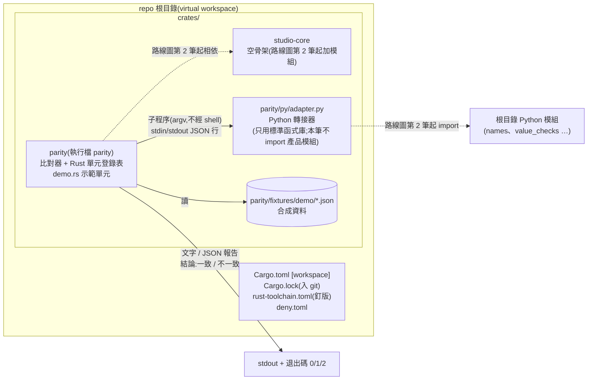
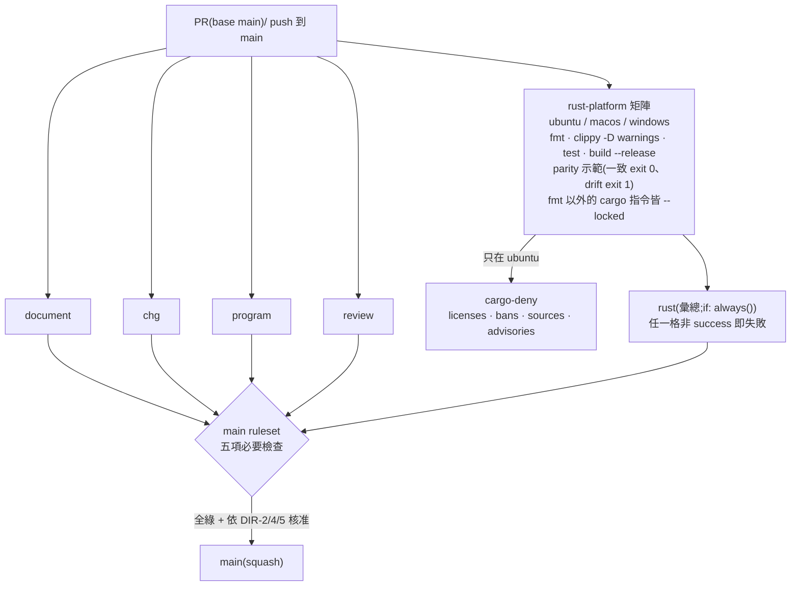
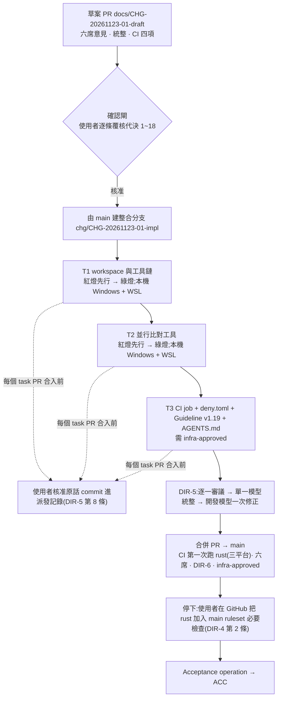

# CHG-20261123-01 — Rust 遷移路線圖第 1 筆:Cargo workspace 骨架、並行比對工具與三平台 CI

- 專案:podcast-studio
- 分支(Branch):main
- 日期:2026-11-23(UTC+0)
- 類型:新增程式骨架(Rust workspace、工具鏈釘版、並行比對工具,不含任何產品模組功能)+ 治理基礎設施變更(`.github/workflows/ci.yml` 新增 Rust job 並列入 main ruleset 必要檢查)+ 需求文件修訂(Guideline v1.18 → v1.19,只改 §5「開發流程」列、§8 CI/CD「四項 check」文字與 §11)
- 提出者:使用者(2026-11-23 指示,原話見「## 動機」)
- 實作者:主 agent 派發(DIR-3);草案由 Claude subagent 起草(DIR-3 第 2 條例外:治理文件草案直接派 Claude subagent);T1~T3 依 DIR-3 第 2 條例外二直接派 Claude subagent(代決 16);實際工作者記於「## 派發記錄」
- 驗收者:獨立 Claude subagent(不參與起草、施工、審議與統整,不看實作者自述)+ 使用者確認
- 風險分級:高(命中高風險清單:(1) **改 CI 治理基礎設施**——修改 `.github/workflows/ci.yml`(DIR-2 第 3 條),新增一個會執行 PR 提供程式碼的 job,並新增 main ruleset 必要檢查;(2) **技術約束與開發流程**——改寫 Guideline §5「開發流程」與 §8 CI/CD 的必要檢查清單,約束之後全部 PR;(3) **供應鏈**——首次引入 Rust 工具鏈、crate 相依與稽核工具,CI 建置期自網路下載;(4) **跨語言介面**——並行比對工具的 JSON 行協定與 fixture 格式,是之後路線圖第 2~23 筆共用的契約。不新增執行期網路呼叫、不送資料出本機;可由 `git revert` 完整還原,ruleset 由使用者改回)
- Autonomy:halt;確認閘 2026-11-23 已過(使用者答「All as recommended」,代決 1~18 全部照推薦,見「## 審議」)。草案 PR(只改 `docs/`)於六席審議、DIR-6 統整判定 merge、CI 四項全綠後,依 DIR-4 預授權與使用者常設指示「不再詢問，全部自動繼續」合入;此方式只限本草案 docs-only PR,T1~T3 程式 task PR 與合併 PR 依代決 1 所列停點,ruleset 變更仍停下由使用者操作
- Commit/PR:草案分支 `docs/CHG-20261123-01-draft`(自 origin/main `894487b` 起草;PR #161,base main);施工整合分支 `chg/CHG-20261123-01-impl`(DIR-5,確認閘核准後由 main 建立);task 分支 `chg/CHG-20261123-01-T1`~`T3`(PR base 皆為整合分支)
- 重複性檢查(Recurrence check):首次——本 repo 先前沒有 Rust 程式、Cargo workspace 或多平台 CI 的 CHG;未見於 KN,不另建 KN
- Diagrams:見「## 設計圖」節
- Mockup: skipped — 本筆沒有任何畫面;比對工具是命令列,輸出為文字報告
- Security-impact:見「## 安全影響」節
- Behaviour spec / Interaction spec:Behaviour spec 為 `features/parity.feature`(T2 新增)與 `features/ci.feature`(T3 新增一個場景),草案見「### Behaviour spec」;Interaction spec 不適用(不改畫面)
- Skill: ai-sdlc v1.69.1
- 關聯:CHG-20261122-02(遷移路線圖第 1 筆;路線圖共通規則 (1)~(8);代決 3、5、19、20、23;安全影響 (1)~(7),尤其 (7) 供應鏈;Guideline §6 Q5~Q12);DIR-2 第 3 條(`infra-approved`、程式 PR 合入需使用者核准)、DIR-3 第 2 條例外與例外二、DIR-4 第 2 條(改 ruleset 須停下問使用者)、DIR-5(整合分支)、DIR-6、DIR-7;KN-1(本 CHG 全文不寫狀態觸發字);Guideline §5、§6.1、§8「技術約束」「CI/CD」、§11

## 動機

使用者 2026-11-23 回答派發者的問題,原話照錄:

- 問「Start roadmap CHG 1 (Rust skeleton and 3-platform CI) next?」——使用者答「Start CHG 1」

所指為 CHG-20261122-02「## 遷移路線圖」階段一第 1 列(以下稱「路線圖第 1 筆」),該列原文要點:

- 模組 / 單元:骨架與三平台 CI(不對應單一 Python 模組:之後每筆共用的 workspace、工具鏈、比對工具與 CI 必須先有)
- 範圍:workspace(目錄配置由該 CHG 定,例:根目錄 `Cargo.toml` + `crates/`)、`rust-toolchain.toml`、`Cargo.lock`;並行比對工具;CI Rust job 並列入必要檢查(代決 20,改 `.github/workflows/ci.yml`、更新 Guideline §5「開發流程」與 §8 CI/CD「四項 check」文字);是否導入授權 / 漏洞稽核工具(安全影響 (7));不含任何模組功能
- 退出條件:CI 三平台全綠;比對工具以示範 fixture 產出「一致 / 不一致」報告
- 回滾:revert 合併 PR,刪除 Rust 目錄與 CI job;Python 版與使用者資料未被寫入,不受影響

起草者 2026-11-23 於 origin/main `894487b` 查證的事實(來源等級標於句首):

A. 〔觀察〕repo 目前沒有任何 Rust 檔案:沒有 `Cargo.toml`、`Cargo.lock`、`rust-toolchain.toml`、`*.rs`;`.gitignore` 沒有 `target/`。根目錄是平鋪的 Python 檔(`docs/structure/directory.md`「`/`(根目錄 `.py`)」列)。
B. 〔觀察〕`.github/workflows/ci.yml` 四個 job(`document`、`chg`、`program`、`review`)全部 `runs-on: ubuntu-latest`;只對 base 為 main 的 PR 與 push 到 main 觸發(`on: pull_request: branches: [main]`、`push: branches: [main]`);頂層權限 `contents: read`;checkout 一律 `persist-credentials: false`;第三方 action 以 40 位 SHA 釘選(`actions/checkout` `3d3c42e…` v7.0.1、`actions/setup-python` `6d4fd22…` v7.1.0)。`program` job 執行 PR 提供的程式碼,檔頭註解記為已接受的殘留風險(CHG-20261022-03 安全影響 (q))。
C. 〔觀察〕`program` job 以 `find . -name '*.py' -not -path './.ai-sdlc/*' …| xargs python -m py_compile` 與 `ruff check --select E9,F --extend-exclude .ai-sdlc .` 檢查全部 Python 檔;`scripts/check.sh` 以 uv 暫時環境跑 `pytest tests/`。repo 內新增的任何 `.py`(含比對工具的 Python 轉接器)會自動落入這兩項檢查。
D. 〔觀察〕Guideline §5「開發流程(v1.4)」列與 §8 CI/CD 第二點都寫「`document`、`chg`、`program`、`review` 四項 check」;同樣的「四項」字樣另見 `docs/knowledge/directives.md` DIR-4 第 1 條、DIR-5 第 1、5 條,`docs/structure/directory.md` `.github/workflows/ci.yml` 列,`docs/structure/design.md`「main 保護以 ruleset 強制」列,`docs/structure/logical.md` 開發流程節(第 345、363、364、372 行),`ci.yml` 第 1 行註解。
E. 〔觀察〕本機 Rust 工具鏈(起草者所在的 Windows 11 Pro 10.0.26300 開發機,2026-11-23 實查):Git Bash 與 PowerShell 的 PATH 上都找不到 `rustc`、`cargo`、`rustup`;`%USERPROFILE%\.cargo\bin` 存在,內有 rustup 1.23.1(2020-11-30),預設工具鏈 `stable-x86_64-pc-windows-msvc` 為 rustc 1.50.0(2021-02-10)、cargo 1.50.0(2021-02-04)。另有 Visual Studio Build Tools 2022(含 VC 工具,MSVC 連結器可用)、Python 3.12.10(`python`;`python3` 是 `WindowsApps` 下的商店別名)、uv 0.13.9。同機 WSL Ubuntu(核心 6.6.87.2-microsoft-standard-WSL2)沒有 `cargo`、`rustc`、`rustup`,也沒有 `~/.cargo/bin`。使用者 macOS(Apple M5 Pro)上是否有 Rust〔未知〕,起草者無法存取。
F. 〔觀察〕rustc 1.50 早於 Rust 2024 edition(〔觀察〕自 1.85.0 起穩定;T1 以 rustc 1.100.0 隨附文件 `share/doc/rust/html/releases.md` 的 Version 1.85.0(2025-02-20)節查證),本機現有工具鏈無法建置本筆的 workspace;rustup 1.23 已支援 `rust-toolchain.toml` 檔名(〔推論〕該檔名自 rustup 1.23.0 起支援),但版本過舊,建議先 `rustup self update`。
G. 〔推論〕GitHub 代管 runner(`ubuntu-latest`、`macos-latest`、`windows-latest`)預載 rustup 與某一版 stable Rust;實際預載版本與 runner 映像更新節奏不由本 repo 控制,所以以 `rust-toolchain.toml` 釘版本,由 rustup 依該檔安裝(建置期下載)。T3 第一次跑 CI 時以 `rustup show` 的輸出確認。
H. 〔觀察〕現行 Python 產品模組在 Windows 無法 import(CHG-20261122-02 事實 B:`fcntl`、`pwd`、`dir_fd` 等);本筆的示範單元只用 Python 標準函式庫、不 import 任何產品模組,三平台都能跑。之後各模組 CHG 的比對在 Windows 是否可跑,取決於該模組能否在 Windows import,由該筆決定。

## 使用者故事

1. 作為使用者,repo 有一個可在 macOS、Windows、Linux 建置與測試的 Rust workspace,工具鏈版本與 crate 版本都釘死,以便之後每一筆遷移 CHG 只需在這個骨架上新增模組。
2. 作為使用者,每一筆遷移 CHG 都用同一個並行比對工具,把同一組 fixture 交給 Python 模組與 Rust 對應單元,得到「一致 / 不一致」報告與不一致案例清單,以便判斷 Rust 版是否與 Python 版行為等價。
3. 作為使用者,任何 PR 在 merge 進 main 前,Rust 程式都要在三平台通過格式、lint、測試、release 建置與比對工具示範;這一項由 main ruleset 強制,和既有四項一樣不能略過。
4. 作為使用者,引入的 crate 都有用途與授權記錄,授權與已知漏洞由工具在 CI 檢查,以便不會無意間引入不相容授權或已知有漏洞的版本。
5. 作為使用者,Python 網頁版、MCP 伺服器與我的資料完全不受本筆影響。

## 決策與取捨

> 依使用者 2026-10-26 原則「如果多次審議都無交集 只採最低限度」:本筆只做路線圖第 1 筆列出的四件事(workspace 與工具鏈、比對工具、CI Rust job 與必要檢查、稽核工具決定),不寫任何產品模組功能、不改 `scripts/` 既有治理工具(CHG-20261122-02 代決 19)。凡依記憶而非本 repo 可讀證據寫出的第三方事實(版本號、授權、runner 預載內容),一律標〔推論〕並列為該 task 開工時的查證項。

### 1. workspace 目錄配置(代決 2)

| 選項 | 說明 | 優點 | 缺點 |
|------|------|------|------|
| (a) **根目錄 virtual workspace**:根目錄 `Cargo.toml`(只有 `[workspace]`)、`Cargo.lock`、`rust-toolchain.toml`、`deny.toml`,成員放 `crates/<名稱>/` | 路線圖第 1 筆列的例子 | 終態(路線圖第 24 筆 Python 退役後)Rust 是主體,不必再搬一次;`cargo` 指令在 repo 根目錄直接可用;rustup 由工作目錄往上找 `rust-toolchain.toml`,放根目錄時 repo 內任何位置都套用同一個釘版 | 過渡期根目錄同時有 Python 平鋪檔與 Rust 設定檔,檔案較多 |
| (b) `rust/` 子目錄自成 workspace | 全部 Rust 相關檔案放 `rust/` 之下 | 過渡期根目錄較乾淨 | 每個指令、CI 步驟都要 `cd rust` 或 `--manifest-path`;在根目錄執行 `cargo` 不會套用釘版;退役時要搬目錄,所有路徑再改一次 |
| (c) 根目錄單一 package(非 workspace) | 一個 crate 包全部 | 最簡單 | GUI、核心、MCP、比對工具之後要拆 crate 時得重整;比對工具的相依會混進產品 crate |

**代決 2**:採 (a)。本筆成員兩個:`crates/studio-core`(產品核心的空骨架,只有 crate 層級說明文件,不含任何函式;路線圖第 2 筆起逐模組加入)與 `crates/parity`(並行比對工具,見下節)。`target/` 加入 `.gitignore`。crate 命名一律 kebab-case,目錄名與 package 名相同。

### 2. 工具鏈(代決 3)

- `rust-toolchain.toml`:`channel` 釘**完整版號**(`x.y.z`,不寫 `stable`),`components = ["rustfmt", "clippy"]`,`profile = "minimal"`;版號取 T1 開工當日最新的 stable 版,T1 施工者以 Rust 官方發佈公告查證後寫入,並把查證來源記在「## 派發記錄」。起草者〔推論〕目前的 stable 約在 1.9x~1.100 之間,未查證,不作為定案;T1 查證後為〔觀察〕1.100.0(2026-11-12 發佈,來源見「## 派發記錄」T1 列)。
- workspace `Cargo.toml` 的 `[workspace.package]`:`edition = "2024"`、`rust-version` 與 `rust-toolchain.toml` 同版號、`license` 留白(本 repo 尚無授權宣告,不在本筆決定);各成員 `edition.workspace = true`。
- 升級工具鏈另開 CHG(只改 `rust-toolchain.toml`、`rust-version` 與因此需要的程式調整)。

### 3. 並行比對工具的形態(代決 5)

| 選項 | 說明 | 優點 | 缺點 |
|------|------|------|------|
| (a) **比對器與 Rust 端用 Rust,Python 端用轉接器腳本** | `crates/parity` 產出執行檔 `parity`:同行程呼叫 Rust 單元;以子程序執行 `crates/parity/py/adapter.py` 取得 Python 結果;比對並輸出報告 | 符合 Guideline §8「新程式以 Rust 撰寫」;Rust 端不必另寫 CLI 包裝;Python 端只負責「import 被比對的模組、把結果轉成協定」 | Rust 單元 panic 要攔截(`catch_unwind`) |
| (b) 比對器用 Python 腳本 | Python 腳本 import 模組取得 Python 結果,再以子程序呼叫 Rust CLI | 比對邏輯可直接用 Python 測試工具 | 每個 Rust 單元都要多一個 CLI 包裝;新程式寫成 Python 與 §8 相違;比對器本身在路線圖第 24 筆後還要再改寫 |
| (c) 兩者都做 | Rust 與 Python 各一套比對器 | — | 兩套比對規則會分岔,維護加倍 |

**代決 5**:採 (a)。Python 轉接器只用標準函式庫;路線圖第 2 筆起可 import 被比對的產品模組;本筆不 import 任何產品模組;不加 PEP 723 檔頭(它是被比對器以子程序呼叫的程式,之後各模組 CHG 若需要第三方套件,由該筆決定執行方式)。

### 4. 比對協定、判定規則與報告(代決 6)

- **fixture 檔**:JSON,一檔一個單元,放 `crates/parity/fixtures/<單元>/<名稱>.json`,格式 `{"unit": "<單元名>", "cases": [{"id": "<案例 id>", "input": <任意 JSON>}, …]}`;案例 id 在檔內唯一;fixture 只放合成資料,不得放使用者資料(安全影響 (6) 延續 CHG-20261122-02 安全影響 (6))。
- **JSON 行協定**(Python 轉接器的 stdin / stdout,UTF-8、一行一個 JSON 物件、換行一律 `\n`):請求 `{"id": …, "input": …}`;回應三種之一——`{"id": …, "outcome": "ok", "value": <JSON>}`、`{"id": …, "outcome": "reject", "code": "<拒絕代碼>"}`、`{"id": …, "outcome": "error", "class": "<錯誤類別>"}`。轉接器以 `--unit <單元名>` 啟動;單元名不存在時在 stderr 印錯誤、exit 2。Rust 端以同一組型別(`Outcome::Ok(Value)`、`Outcome::Reject(code)`、`Outcome::Error(class)`)同行程回傳;Rust 單元 panic 記為 `error`、類別 `panic`。
- **判定**:逐案例比對——兩邊 `outcome` 相同,且 `ok` 時 `value` 以 JSON 值完全相等(數字依 serde_json 的值比較,不做容差)、`reject` 時 `code` 相同、`error` 時 `class` 相同,才算一致;人看的錯誤訊息文字不比對。容差或欄位忽略規則若之後需要,由該模組 CHG 以單元設定加入,本筆不提供。
- **拒絕代碼與錯誤類別**:由各單元在兩邊各自定義同一組字串(例:Python `ValueError` 依情境對應到 `reject` 的某個代碼,未預期的例外對應 `error` 與例外類別名稱);對應表寫在該單元的轉接程式內,並列入該模組 CHG 的契約清單。
- **報告**:預設文字輸出到 stdout,含單元名、fixture 路徑、案例數、一致數、不一致數、每個不一致案例的 id 與兩邊結果摘要,最後一行固定為「結論:一致」或「結論:不一致」;`--format json` 改輸出同內容的 JSON。工具不寫任何檔案。
- **退出碼**:0 = 全部一致;1 = 至少一個不一致;2 = 參數錯誤、fixture 格式錯誤、Python 轉接器啟動失敗 / 逾時 / 回應格式錯誤 / 回應 id 與請求不符。
- **Python 直譯器**:依序取 `--python <路徑>`、環境變數 `PARITY_PYTHON`、預設值(Windows 為 `python`,其他平台為 `python3`;事實 E:Windows 的 `python3` 可能是商店別名);子程序一律以 argv 清單啟動、不經 shell;設 `PYTHONUTF8=1`、`PYTHONDONTWRITEBYTECODE=1`;單次執行逾時預設 60 秒(`--timeout <秒>` 可調),逾時即終止子程序並 exit 2。
- **命令列**:`parity run --unit <單元名> --fixture <檔案> [--python <路徑>] [--timeout <秒>] [--format text|json]`;`parity list` 列出 Rust 端已登錄的單元。參數以標準函式庫解析(代決 4,不引入 clap)。

### 5. 示範單元(代決 7)

| 單元 | 規則 | 用途 |
|------|------|------|
| `demo.parse_count` | 輸入須為 JSON 字串;字串只含 ASCII 數字 0–9 且非空 → 轉成整數,1~1000 回 `ok`(整數),0 或大於 1000 回 `reject` `out_of_range`;字串含其他字元或為空回 `reject` `not_digits`;輸入不是字串回 `error` `type` | 兩邊規則相同,示範「結論:一致」 |
| `demo.parse_count_drift` | 同上,但 Python 端上限 1000、Rust 端上限 999(刻意不同) | 只用來證明工具能抓到差異,示範「結論:不一致」(案例 `edge_1000`) |

兩個示範單元都只存在於比對工具內(Rust 在 `crates/parity/src/demo.rs`,Python 在轉接器內),不屬任何產品模組;之後保留作為比對工具的自我測試,不得被產品程式引用。示範 fixture:`crates/parity/fixtures/demo/parse_count.json`(至少含 `plain_3`、`edge_1`、`edge_1000`、`zero`、`over_1001`、`letters`、`empty`、`not_string_number`、`not_string_null` 九案)與 `crates/parity/fixtures/demo/parse_count_drift.json`(同九案)。

### 6. CI Rust job 與必要檢查(代決 8、9)

| 選項 | 說明 | 優點 | 缺點 |
|------|------|------|------|
| (a) **矩陣 job + 彙總 job**:矩陣 job `rust-platform`(三平台各一格)跑全部檢查;彙總 job `rust` `needs: rust-platform`、`if: always()`,矩陣任一格結果不是 success 就失敗 | ruleset 只新增一個必要檢查 `rust` | 必要檢查名稱固定為一個,日後增減平台或改矩陣不必改 ruleset;任一平台失敗、取消或被略過都會讓 `rust` 失敗 | 多一個極小的 job |
| (b) 只有矩陣 job,三個 check 名稱(`rust (ubuntu-latest)` 等)各列為必要檢查 | — | 少一個 job | 必要檢查增為三項,矩陣名稱一改就要同步改 ruleset(DIR-4 第 2 條每次都要停下) |

**代決 8**:採 (a);main ruleset 的必要檢查由四項增為**五項**(`document`、`chg`、`program`、`review`、`rust`)。ruleset 的設定由使用者在 GitHub 操作(DIR-4 第 2 條),時點見「### 執行計畫(DIR-5)」第 8 步:合併 PR 合入 main 之後才加,避免 main 尚無 `rust` job 時所有 PR 卡在等待不存在的檢查。

**代決 9**(`rust-platform` 每一格的步驟):
1. 只取 PR head 到 `pr/`(`persist-credentials: false`,沿用既有釘選 SHA);不取 `trusted/`——本 job 與 `program` 相同,本質就是執行 PR 提供的程式碼,不是治理檢查(安全影響 security-boundary (a))。
2. `actions/setup-python`(沿用既有釘選 SHA,3.11)供比對工具的 Python 轉接器使用。
3. `rustup show` 後以 `rustup toolchain install`(依 `rust-toolchain.toml`)安裝釘版工具鏈;不新增任何第三方 action(不用 `dtolnay/rust-toolchain` 等)。
4. `cargo fmt --all --check`
5. `cargo clippy --workspace --all-targets --locked -- -D warnings`
6. `cargo test --workspace --locked`
7. `cargo build --workspace --release --locked`
8. 比對工具示範:`cargo run --locked --release -p parity -- run --unit demo.parse_count --fixture crates/parity/fixtures/demo/parse_count.json` 須 exit 0 且最後一行為「結論:一致」;`demo.parse_count_drift` 須 exit 1 且報告含 `edge_1000`(反向斷言由步驟內的 shell 判斷,不是 `continue-on-error`)。
9. 只在 `ubuntu-latest` 那一格:`cargo install --locked cargo-deny@<釘版>` 後執行 `cargo deny --locked check`(與 T3 test (1) 同一指令;代決 10)。

其他:`runs-on: ${{ matrix.os }}`、`strategy.fail-fast: false`、`defaults.run.shell: bash`(Windows 也用 bash)、`timeout-minutes: 30`;job 權限沿用頂層 `contents: read`,不注入任何秘密;觸發條件不變(只對 base 為 main 的 PR 與 push 到 main);不加快取(不新增 `actions/cache`;建置時間待 T3 實測後另議,見「## 後續改善」)。既有四個 job 不改一行;`ci.yml` 第 1 行註解與檔頭信任模型註解補上 `rust` job 的說明。

### 7. 授權 / 漏洞稽核工具(代決 10)

| 選項 | 涵蓋 | 優點 | 缺點 |
|------|------|------|------|
| (a) **cargo-deny** | 授權白名單(`licenses`)、禁用 crate 與重複版本(`bans`)、來源限制(`sources`,只允許 crates.io)、RustSec 漏洞公告(`advisories`) | 一個工具涵蓋安全影響 (7) 要的授權與漏洞兩面;設定檔 `deny.toml` 入 git、可審議 | CI 每次以 `cargo install --locked` 自原始碼建置(〔推論〕數分鐘);`advisories` 需在 CI 下載公告資料庫;新公告可能讓與本 PR 無關的 PR 變紅 |
| (b) cargo-audit | 只有漏洞公告 | 單純 | 不檢查授權,授權仍要人工列 |
| (c) 不導入,只在各 CHG 人工列用途與授權 | — | 無額外 CI 時間與下載 | 遞移相依的授權與漏洞沒有機器把關;隨路線圖 crate 增加,人工列舉會漏 |

**代決 10**:採 (a)。
- 版本:`cargo install --locked cargo-deny@<釘版>`,版號由 T3 施工者查證後寫入 `ci.yml` 與派發記錄;以 crates.io 原始碼建置,由 cargo 以 cargo-deny 自身的 lock 檔與 crate 校驗碼驗證,不下載預建執行檔(避免另行維護雜湊)。
- 只在 `ubuntu-latest` 一格執行,`deny.toml` 的 `[graph] targets` 列出三平台的目標三元組(x86_64 / aarch64 的 `apple-darwin`、`pc-windows-msvc`、`unknown-linux-gnu`),讓平台專屬相依也被檢查。
- `licenses`:白名單初稿為 MIT、Apache-2.0、Apache-2.0 WITH LLVM-exception、BSD-2-Clause、BSD-3-Clause、ISC、Zlib、Unicode-3.0、BSL-1.0、Unlicense;不列任何 copyleft 授權(GPL、LGPL、AGPL、MPL);T3 依 T2 鎖定的實際相依調整,只允許刪減或補列非 copyleft 的寬鬆授權,補列時在派發記錄寫明是哪個 crate 需要。
- `bans`:`multiple-versions = "warn"`、`wildcards = "deny"`;`sources`:`unknown-registry = "deny"`、`unknown-git = "deny"`(不允許 git 相依)。
- `advisories`:漏洞公告一律擋下(`cargo deny check` 失敗即 job 失敗);日後真的出現與 PR 無關的新公告時,處置是另開 CHG 升級該 crate,或在 `deny.toml` 以具名條目豁免(豁免本身須經 CHG),不改成不阻擋。

### 8. 相依 crate(代決 4)

本筆只引入 `serde`(啟用 `derive`)與 `serde_json`,只給 `crates/parity` 用;`crates/studio-core` 沒有任何相依。命令列參數以標準函式庫解析,不引入 `clap` 等;測試只用內建 `#[test]` 與標準函式庫,不引入測試框架 crate。〔推論〕`serde`、`serde_json` 及其遞移相依(`serde_derive`、`proc-macro2`、`quote`、`syn`、`unicode-ident`、`itoa`、`ryu`、`memchr` 等)的授權為 MIT OR Apache-2.0、或含 Unicode-3.0、BSL-1.0、Unlicense 的寬鬆組合;T2 以 `cargo metadata --locked` 列出實際清單(名稱、版本、授權)寫進「## 派發記錄」,T3 由 cargo-deny 機器檢查。

### 9. 本機開發環境(代決 12、13)

- 本機需要的東西:rustup(官方工具鏈管理器);Windows 另需 MSVC 連結器(Visual Studio Build Tools,含 C++ 工具);macOS 另需 Xcode Command Line Tools;比對工具需要 Python 3(本 repo 既有需求)。
- 安裝與更新由使用者自己操作(下載屬使用者決定),本筆不替使用者安裝:已有舊 rustup 時先 `rustup self update`;之後在 repo 內第一次執行 `cargo` 時,rustup 依 `rust-toolchain.toml` 自動下載釘版工具鏈。Windows 開發機須把 `%USERPROFILE%\.cargo\bin` 加入 PATH(事實 E:目前不在 PATH 上)。
- 本機閘以 cargo 指令執行(見「### 本機閘」),**不改 `scripts/check.sh`**(CHG-20261122-02 代決 19:治理與測試工具的調整待 Rust 版完成後另開 CHG)。
- **代決 13**:`AGENTS.md`「執行」一節加三行(`cargo fmt --all --check`、`cargo clippy …`、`cargo test --workspace --locked`)與一句外部依賴說明(rustup;Windows 需 MSVC Build Tools),讓之後進場的 agent 知道 Rust 本機閘;`PODCAST_STUDIO.md` 不改(Guideline §6 Q4:人寫的設計文件只引用、不改)。

### 10. Guideline 與知識庫的文字同步(代決 14、15)

- **代決 14**:Guideline v1.18 → v1.19,只改三處:§5「開發流程(v1.4)」列改為五項 check(`document`、`chg`、`program`、`review`、`rust`),來源欄加「CHG-20261123-01」;§8 CI/CD 第二點「四項 check」改為「五項 check」並補一句「`rust` 為三平台 Rust 格式、lint、測試、release 建置、比對工具示範與 cargo-deny 稽核」;§11 新增 v1.19 列,並記下兩處被改的 v1.18 原文。§5 本體改後仍須在 3000 字以內(目前約 1650 字;`scripts/local_review.py` 送審的 §5 參考資料上限)。§6.1「跨平台」列已寫 CI 矩陣三平台,不改。
- **代決 15**:`docs/knowledge/directives.md` DIR-4 第 1 條「CI 四項(document、chg、program、review)全綠」與 DIR-5 第 1、5 條的「CI 四項」字樣,**本筆不改**,列為需使用者決定的事項(改 DIR 須使用者原話):建議另以帳本修訂把三處改為「CI 必要檢查全綠(main ruleset 所列各項)」,避免日後增減必要檢查時再改 DIR;本筆合入後到 DIR 改寫前,實際是否能 merge 由 ruleset 強制,不受 DIR 字面的「四項」影響。

### 11. 施工方式與驗證平台(代決 11、16)

- **代決 11**:task PR 的 base 是整合分支,依 DIR-5 第 1 條不觸發 CI,三平台的 CI 結果要到合併 PR 才第一次出現。因此:施工者在每個 task 於本機至少兩個平台實跑 L1~L2(Windows 開發機與 WSL Ubuntu,事實 E;須先依 §9 安裝工具鏈);macOS 由使用者 Mac 或合併 PR 的 CI 證明。合併 PR 的 CI 若有平台紅燈,依 DIR-6 第 7 條由開發模型修正後重跑意見與統整;同一 PR 連續兩輪判定 fix 交使用者(DIR-4 第 2 條)。
- **代決 16**:施工依 DIR-5 開整合分支,T1~T3 依序施工(T2 依賴 T1 的 workspace;T3 依賴 T1、T2 的指令與示範 fixture);T1~T3 直接派 Claude subagent(DIR-3 第 2 條例外二)。

**代決事項**(使用者原話推導不出細節,由 agent 先決定;確認閘 2026-11-23 由使用者覆核,結果標於各條末尾,答覆原話見「## 審議」):

1. 風險分級判「高」(改 CI 治理基礎設施與必要檢查、改開發流程約束、首次引入工具鏈與 crate 供應鏈、建立跨語言比對契約;不新增執行期網路呼叫),Autonomy halt。停點:確認閘;T1~T3 各 task PR 合入整合分支前使用者核准(DIR-5 第 8 條,三者都改到程式路徑);T3 另需擁有者 `infra-approved`(DIR-2 第 3 條);合併 PR 依 DIR-5 第 5 條、DIR-4 第 1 條(統整判定 merge、CI 全綠;另需 `infra-approved`);**ruleset 新增必要檢查一律停下由使用者操作**(DIR-4 第 2 條)。——使用者確認(2026-11-23)
2. workspace 配置採根目錄 virtual workspace + `crates/`,成員 `crates/studio-core`(空骨架)與 `crates/parity`;`target/` 加入 `.gitignore`(替代:`rust/` 子目錄)。——使用者確認(2026-11-23)
3. `rust-toolchain.toml` 釘 T1 開工當日最新 stable 的完整版號(T1 查證),含 rustfmt、clippy,profile minimal;edition 2024;`rust-version` 同版號;升級另開 CHG。——使用者確認(2026-11-23)
4. 相依只引入 `serde`(derive)與 `serde_json`,只給 `crates/parity`;命令列以標準函式庫解析,不引入 clap 與測試框架 crate;實際遞移相依清單與授權由 T2 列入派發記錄。——使用者確認(2026-11-23)
5. 比對工具形態:比對器與 Rust 端用 Rust(`crates/parity`,執行檔 `parity`),Python 端為轉接器 `crates/parity/py/adapter.py`(只用標準函式庫;路線圖第 2 筆起可 import 被比對的產品模組;本筆不 import 任何產品模組),以子程序 + JSON 行協定呼叫(替代:Python 比對器、兩者都做)。——使用者確認(2026-11-23)
6. 比對協定與判定:fixture JSON 格式、三種結果(ok / reject / error)、`value` JSON 完全相等、`code` 與 `class` 字串相等、不比對訊息文字;文字報告(`--format json` 可選)、不寫檔;退出碼 0 / 1 / 2;直譯器尋找順序 `--python` → `PARITY_PYTHON` → Windows `python`、其他 `python3`;逾時預設 60 秒。——使用者確認(2026-11-23)
7. 示範單元 `demo.parse_count`(兩邊一致)與 `demo.parse_count_drift`(刻意不一致,證明工具會回報),只存在於比對工具內,保留作工具自我測試。——使用者確認(2026-11-23)
8. CI 採矩陣 job `rust-platform` + 彙總 job `rust`,ruleset 只新增一個必要檢查 `rust`,必要檢查變為五項;ruleset 於合併 PR 合入 main 後由使用者設定(替代:三個矩陣 check 名稱各列必要檢查)。——使用者確認(2026-11-23)
9. `rust-platform` 三平台(`ubuntu-latest`、`macos-latest`、`windows-latest`)每格跑 fmt、clippy(警告視為錯誤)、test、release build、比對工具兩個示範,會解析相依的 cargo 指令一律帶 `--locked`(`cargo fmt` 除外);ubuntu 一格另跑 `cargo deny --locked check`;只取 PR head、不取 trusted;不新增第三方 action、不加快取;`fail-fast: false`、shell bash、逾時 30 分鐘;既有四個 job 不改。——使用者確認(2026-11-23)
10. 導入 cargo-deny(licenses、bans、sources、advisories 全部阻擋),只在 ubuntu 一格以 `cargo install --locked` 釘版安裝,`deny.toml` 涵蓋三平台目標、授權白名單不含 copyleft、只允許 crates.io 來源;漏洞公告豁免須經 CHG(替代:cargo-audit、不導入)。——使用者確認(2026-11-23)
11. 三平台驗證來源:施工期本機 Windows 與 WSL Ubuntu 實跑,macOS 由使用者 Mac 或合併 PR CI;合併 PR CI 平台紅燈依 DIR-6 第 7 條修正。——使用者確認(2026-11-23)
12. 本機工具鏈由使用者自行安裝 / 更新(rustup;Windows 需 MSVC Build Tools 並把 `%USERPROFILE%\.cargo\bin` 加入 PATH);本機閘用 cargo 指令,不改 `scripts/check.sh`。——使用者確認(2026-11-23)
13. `AGENTS.md`「執行」一節補 Rust 本機閘三行與外部依賴一句;`PODCAST_STUDIO.md` 不改。——使用者確認(2026-11-23)
14. Guideline v1.19:只改 §5「開發流程」列(五項 check)、§8 CI/CD 第二點(五項 check 與 `rust` 說明)與 §11 新增列(記下 v1.18 原文)。——使用者確認(2026-11-23)
15. DIR-4 第 1 條、DIR-5 第 1、5 條的「CI 四項」字樣本筆不改;建議另以帳本修訂改為「CI 必要檢查全綠」,需使用者決定是否修訂。——使用者確認(2026-11-23):照推薦另以帳本修訂把三處改為「CI 必要檢查全綠」,本筆不改,另開 CHG(見「## 後續改善」)
16. 施工依 DIR-5 整合分支 `chg/CHG-20261123-01-impl`,T1 → T2 → T3 依序;T1~T3 直接派 Claude subagent(DIR-3 第 2 條例外二)。——使用者確認(2026-11-23)
17. 結構文件:T1 同步 `directory.md`;T2 同步 `directory.md`、`design.md`;T3 同步 `directory.md`、`design.md`、`logical.md`(必要檢查改五項、`rust` job、信任模型的 job 差異)。`data.md` 不需更新(不改資料格式)。CHG-20261122-02 代決 23(結構文件只記程式現況)在本筆適用:程式落地的部分才寫入。——使用者確認(2026-11-23)
18. 新增 Behaviour spec:`features/parity.feature`(T2,比對工具一致 / 不一致 / 轉接器錯誤三個場景)與 `features/ci.feature` 一個新場景(T3,Rust 三平台任一失敗讓 `rust` 檢查變紅)。——使用者確認(2026-11-23)

## 設計圖

### (1) 本筆完成後的 Rust workspace 與比對工具



### (2) CI 與 main 保護(本筆之後)



### (3) 本次變更的施工流程



## 安全影響

| 類別 | 是否觸及 | 影響範圍 / 理由 |
|------|----------|-----------------|
| irreversible-delete | 否 | 不刪除任何使用者資料或檔案;新增的檔案都可由 `git revert` 移除;比對工具不寫檔 |
| payments | 否 | 無金流 |
| prod-migration | 否 | 不改 `config/studio.db`、專案檔、工作流程 JSON 的格式或內容;不改部署腳本;比對工具只讀 repo 內合成 fixture |
| security-boundary | **是** | (a) **CI 新增執行 PR 程式碼的 job**:`rust-platform` 會建置並執行 PR 提供的 Rust 程式(含 `build.rs`、程序巨集、測試與比對工具),性質與 `program` job 相同(CHG-20261022-03 安全影響 (q) 已接受的殘留風險);補償控制沿用:代管 runner、頂層 `contents: read`、不注入任何秘密、`persist-credentials: false`、治理路徑需 `infra-approved`、程式變更依 DIR-2 / DIR-4 / DIR-5 核准。新增的面:執行環境擴及 macOS 與 Windows runner(同樣是 GitHub 代管、同樣權限)。(b) **必要檢查變更**:main ruleset 由四項增為五項,只會更嚴;ruleset 由使用者操作(DIR-4 第 2 條),本筆的程式與 agent 都不改 ruleset。設定前的空窗期(合併 PR 合入到使用者設定 ruleset 之間)`rust` 會執行但不強制,ACC 以讀取 ruleset 確認已設定。(c) **供應鏈(延續 CHG-20261122-02 安全影響 (7))**:建置期才自網路下載——rustup 自 Rust 官方發佈站下載釘版工具鏈(〔推論〕rustup 以發佈清單的 SHA-256 驗證下載內容)、cargo 自 crates.io 下載 crate(以 `Cargo.lock` 記錄的校驗碼驗證)、cargo-deny 自 crates.io 原始碼建置、cargo-deny 的 `advisories` 自 GitHub 下載 RustSec 公告資料庫;會解析相依的 cargo 指令帶 `--locked`(`cargo fmt` 除外;lock 檔與 `Cargo.toml` 不符即失敗,不會在 CI 靜默更新版本);`sources` 只允許 crates.io、禁止 git 相依;授權白名單不含 copyleft;新增 crate 的用途與授權由引入它的 task 列入派發記錄。(d) **執行期**:產品執行期不新增任何網路呼叫、不開監聽埠(Guideline §6.1「安全(應用程式)」);`studio-core` 是空骨架;比對工具只以 argv 清單啟動 Python 轉接器(不經 shell)、只讀 repo 內 fixture、不寫檔、有逾時;fixture 只放合成資料,使用者資料的唯讀比對(路線圖第 5、9 筆)不在本筆,且依 CHG-20261122-02 安全影響 (6) 只在使用者本機執行、結果只記通過與否與數量。(e) **本機寫入者**:替換本機 `rust-toolchain.toml`、fixture 或轉接器屬 DIR-7 威脅模型外。不送資料出本機 |

## 修改指引

### 目標

依使用者 2026-11-23「Start CHG 1」與 CHG-20261122-02 路線圖第 1 筆:建立 Rust workspace 骨架與釘版工具鏈、可供之後每筆遷移 CHG 共用的並行比對工具(本筆只以示範單元驗證)、三平台 CI Rust job 並列為 main 必要檢查、以 cargo-deny 檢查授權與漏洞,並同步 Guideline v1.19、`AGENTS.md` 與結構文件。不含任何產品模組功能。

### 影響範圍

| 受影響項 | 類型 | 改動 | 連帶影響 |
|----------|------|------|----------|
| `Cargo.toml`(新增,根目錄) | 目錄 / 設計 | virtual workspace:`members = ["crates/*"]`、`resolver = "3"`(〔觀察〕edition 2024 預設的解析器版本,需 Rust 1.84 以上;virtual workspace 沒有 package edition,須在 `[workspace]` 明寫;T1 以 cargo 1.100.0 隨附文件 `cargo/reference/resolver.html`「Resolver versions」節與 `releases.md` Version 1.84.0 節查證)、`[workspace.package]`、`[workspace.dependencies]` | 之後各筆在此加成員與相依 |
| `rust-toolchain.toml`(新增) | 目錄 | 釘版工具鏈(代決 3) | 本機與 CI 都套用 |
| `Cargo.lock`(新增) | 目錄 | 由 cargo 產生並入 git | 會解析相依的 cargo 指令帶 `--locked`(`cargo fmt` 除外) |
| `crates/studio-core/`(新增) | 設計 / 目錄 | `Cargo.toml`、`src/lib.rs`(只有 crate 說明文件) | 路線圖第 2 筆起加模組 |
| `crates/parity/`(新增) | 設計 / 目錄 | 比對器、協定型別、Rust 單元登錄表、`demo.rs`、`py/adapter.py`、`fixtures/demo/`、`tests/` | 之後各筆登錄單元 |
| `tests/test_parity_adapter.py`(新增) | 目錄 | Python 轉接器的 pytest(由 `scripts/check.sh` 收集) | `program` job 一併執行 |
| `.gitignore` | 目錄 | 加 `/target/` | — |
| `deny.toml`(新增,根目錄) | 設計 | cargo-deny 設定(代決 10) | — |
| `.github/workflows/ci.yml` | 治理基礎設施 | 新增 `rust-platform`、`rust` 兩個 job;檔頭註解補說明;既有四個 job 不改 | 需 `infra-approved`;ruleset 由使用者加 `rust` |
| `features/parity.feature`(新增)、`features/ci.feature` | 行為 | 見「### Behaviour spec」 | — |
| `docs/ai-guideline.md` | 需求 / 約束 | v1.19:§5「開發流程」列、§8 CI/CD 第二點、§11(代決 14) | — |
| `AGENTS.md` | 治理入口 | 「執行」一節補 Rust 本機閘與外部依賴(代決 13) | — |
| `docs/structure/directory.md`、`design.md`、`logical.md` | 結構文件 | 見「### 結構文件更新」 | — |

不改:任何根目錄 Python 產品模組、`static/`、`breezy_worker.py`、`tools/`、`scripts/`(含 `scripts/ci/`、`scripts/check.sh`、`scripts/local_review.py`、`scripts/review_decision.py`、`scripts/deploy_local.sh`)、`tests/ci/`、`.ai-sdlc/`、`docs/knowledge/`(代決 15)、`docs/structure/data.md`、`PODCAST_STUDIO.md`、Guideline 其餘各節與 §9 ADP 各項、既有 CI 四個 job 的步驟。

### 契約清單

| 契約 | 提供方 | 讀取方 | 本筆變更 | 契約測試(路徑/無) |
|------|--------|--------|----------|----------------------|
| 比對 fixture 檔格式 `{"unit", "cases": [{"id", "input"}]}` | fixture 作者(各 CHG) | `parity` 比對器 | 新增 | `crates/parity/tests/fixture_format.rs` |
| JSON 行協定(請求 `{"id","input"}`;回應 `ok` / `reject` / `error` 三型) | Python 轉接器 `crates/parity/py/adapter.py` | `parity` 比對器 | 新增 | `crates/parity/tests/protocol.rs`(Rust 側解析)、`tests/test_parity_adapter.py`(Python 側輸出) |
| Rust 單元介面(登錄名 → `fn(&serde_json::Value) -> Outcome`) | `crates/parity` 單元登錄表(之後各筆的 Rust 單元) | `parity` 比對器 | 新增 | `crates/parity/tests/registry.rs` |
| `parity` 命令列、文字報告最後一行「結論:一致 / 不一致」、退出碼 0 / 1 / 2 | `parity` 執行檔 | CI `rust-platform` 步驟、各模組 CHG 的驗收、使用者 | 新增 | `crates/parity/tests/cli.rs` |
| 示範單元 `demo.parse_count`、`demo.parse_count_drift` 的規則(代決 7) | `crates/parity/src/demo.rs` 與轉接器 | 比對工具自我測試、CI 示範步驟 | 新增 | `crates/parity/tests/cli.rs`、`tests/test_parity_adapter.py` |
| CI 必要檢查名稱 `rust`(彙總 job) | `.github/workflows/ci.yml` | main ruleset(使用者設定) | 新增 | 無(Acceptance operation (3)(4) 觀察 CI 與 ruleset) |
| `rust-toolchain.toml` 版號、`Cargo.lock` | repo 根目錄 | 本機 cargo、CI | 新增 | 無(會解析相依的 cargo 指令帶 `--locked`,`cargo fmt` 除外;CI 失敗即擋) |
| `deny.toml` 授權白名單與來源限制 | repo 根目錄 | cargo-deny(CI) | 新增 | 無(CI `cargo deny check`;Acceptance operation (2)) |

### Global Constraints(全域約束——每個 task 都要遵守)

- 不改任何根目錄 Python 產品模組、`static/`、`breezy_worker.py`、`tools/`、`scripts/`、`tests/ci/`、`.ai-sdlc/`、`docs/knowledge/`、`PODCAST_STUDIO.md`;不改 Guideline 代決 14 以外的條文;不改 CI 既有四個 job 的步驟。
- 不含任何產品模組功能:`studio-core` 只有 crate 說明文件;`parity` 只有比對器與示範單元;轉接器只用標準函式庫;路線圖第 2 筆起可 import 被比對的產品模組;本筆不 import 任何產品模組。
- 不新增執行期網路呼叫(Rust 程式與轉接器不使用 socket、HTTP client 或對外子程序;比對器唯一的子程序是 Python 轉接器)。
- 會解析相依的 cargo 指令(本機閘、CI)一律帶 `--locked`,`cargo fmt` 除外(它不解析相依、不接受 `--locked`);新增 crate 只限代決 4 所列;不使用 git 相依、不使用 crates.io 以外的 registry。
- Rust 程式不得有 `unsafe`(`studio-core`、`parity` 的 crate 根加 `#![forbid(unsafe_code)]`);clippy 警告視為錯誤。
- 子程序一律以 argv 清單啟動、不經 shell,設逾時;比對工具不寫任何檔案。
- fixture 只放合成資料,不得放使用者的專案、設定資料庫或任何 `outputs/` 內容。
- 三平台路徑與換行:程式不寫死 `/` 或 `\` 分隔(用 `Path` 組路徑);協定解析容許 `\r\n` 行尾;轉接器把 stdout 設為 UTF-8、換行 `\n`。
- 每個 task 先寫會紅的測試並確認紅燈,再寫程式(TDD);紅燈與綠燈 commit 分開,記在派發記錄。
- 程式 task PR 合入整合分支前,先在本 CHG「## 派發記錄」寫入使用者核准原話並 commit(DIR-5 第 8 條);T3 另需擁有者 `infra-approved` 留言(DIR-2 第 3 條)。
- 任何 agent 不得修改 GitHub ruleset 或 repo 設定(DIR-4 第 2 條);ACC 只以唯讀方式讀取 ruleset。
- 使用者面文字、程式註解、文件一律繁體中文與台灣用語(Rust 的型別與函式名稱用英文);本 CHG 與 commit 訊息不寫 KN-1 列出的狀態觸發字與 PEM 私鑰區塊開頭行原文。

### `parity` 設計(T2 依此施工)

- `crates/parity/src/lib.rs`:協定型別 `Outcome`(`Ok(serde_json::Value)`、`Reject { code: String }`、`Error { class: String }`)、`Case { id, input }`、`Fixture { unit, cases }`;`Registry`(單元名 → `fn(&serde_json::Value) -> Outcome`);`compare(fixture, rust_results, py_results) -> Report`;`Report` 的文字與 JSON 輸出。Rust 單元以 `std::panic::catch_unwind` 包住,panic 記為 `Error { class: "panic" }`。
- `crates/parity/src/py.rs`:啟動 Python 轉接器(`Command` argv 清單,`--unit <名>`),逐行寫入請求、讀回回應;檢查回應 id 依序對應請求、每行為合法回應;逾時終止子程序。
- `crates/parity/src/main.rs`:命令列 `run`、`list`(代決 6),參數錯誤印繁中訊息到 stderr、exit 2。
- `crates/parity/src/demo.rs`:`demo.parse_count`、`demo.parse_count_drift`(代決 7)。
- `crates/parity/py/adapter.py`:`--unit` 參數、單元登錄字典、逐行讀 stdin、輸出回應;未知單元 exit 2;stdout `reconfigure(encoding="utf-8", newline="\n")`;繁中模組 docstring 寫用途、協定與「只用標準函式庫;路線圖第 2 筆起可 import 被比對的產品模組;本筆不 import 任何產品模組」。

### Tasks(checkbox=續作點)

- [x] T1. Cargo workspace 骨架與釘版工具鏈(`Cargo.toml`、`rust-toolchain.toml`、`Cargo.lock`、`crates/studio-core`、`.gitignore`),同步 `directory.md`
  - interfaces: consumes 本 CHG 代決 2、3(含確認閘的修改) / produces 根目錄 `Cargo.toml`(virtual workspace)、`rust-toolchain.toml`、`Cargo.lock`、`crates/studio-core/{Cargo.toml,src/lib.rs,tests/skeleton.rs}`、`.gitignore` 的 `/target/`、`docs/structure/directory.md`;分支 `chg/CHG-20261123-01-T1`,PR base 整合分支 `chg/CHG-20261123-01-impl`;commit 訊息帶 CHG-20261123-01
  - test: 紅燈先行——先新增 `crates/studio-core/tests/skeleton.rs`(斷言 crate 可被連結、`env!("CARGO_PKG_RUST_VERSION")` 與 `rust-toolchain.toml` 的版號相同)與只含 `[workspace]` 的根 `Cargo.toml`,以 `cargo test --workspace` 確認失敗(找不到 `studio-core` 成員或版號不符)後再補齊;完成後 (1) 在 Windows 開發機與 WSL Ubuntu 各跑 `cargo fmt --all --check`、`cargo clippy --workspace --all-targets --locked -- -D warnings`、`cargo test --workspace --locked`、`cargo build --workspace --release --locked` 全過;(2) `rustup show` 顯示使用中的工具鏈即 `rust-toolchain.toml` 所釘版號;(3) `git status --porcelain` 在建置後不出現 `target/`;(4) `git diff --name-only chg/CHG-20261123-01-impl...HEAD` 只含本 task 的檔案與本 CHG;(5) `python .ai-sdlc/skills/ai-sdlc-autopilot/scripts/doc_integrity_check.py --repo .` exit 0
  - L1: `crates/studio-core/tests/skeleton.rs`:crate 可連結;`CARGO_PKG_RUST_VERSION` 與 `rust-toolchain.toml` 版號一致(測試內讀 workspace 根的 `rust-toolchain.toml` 字串比對)
  - L2: 不適用(本 task 沒有跨模組介面;`studio-core` 沒有任何公開函式)
  - L3: 不適用(沒有使用者可見行為)
  - L4: 不適用(沒有端到端路徑;三平台建置由 T3 的 CI 與合併 PR 證明)
- [ ] T2. 並行比對工具 `crates/parity`(比對器、協定、Rust 單元登錄、示範單元、Python 轉接器、示範 fixture),新增 `features/parity.feature`,同步 `directory.md`、`design.md`
  - interfaces: consumes T1 的 workspace 與本 CHG「### `parity` 設計」、代決 4~7 / produces `crates/parity/{Cargo.toml,src/{lib,main,py,demo}.rs,py/adapter.py,fixtures/demo/{parse_count,parse_count_drift}.json,tests/{fixture_format,protocol,registry,cli}.rs}`、`tests/test_parity_adapter.py`、`Cargo.lock`(新增 `serde`、`serde_json` 及其遞移相依)、`features/parity.feature`、`docs/structure/{directory,design}.md`;分支 `chg/CHG-20261123-01-T2`,PR base 整合分支;commit 訊息帶 CHG-20261123-01
  - test: 紅燈先行——先新增 `crates/parity/tests/*.rs` 與 `tests/test_parity_adapter.py`,以 `cargo test -p parity --locked` 與 `UV_OFFLINE=1 ./scripts/check.sh tests/test_parity_adapter.py`(Windows 上以 `uv run --no-project --with pytest python -m pytest -q -p no:cacheprovider tests/test_parity_adapter.py`)確認失敗後再寫程式;完成後 (1) Windows 開發機與 WSL Ubuntu 各跑四項 cargo 指令(同 T1 test (1))全過;(2) `cargo run --locked --release -p parity -- run --unit demo.parse_count --fixture crates/parity/fixtures/demo/parse_count.json` exit 0、最後一行「結論:一致」;`demo.parse_count_drift` exit 1、報告含 `edge_1000`;(3) WSL 上 `UV_OFFLINE=1 ./scripts/check.sh` 全過(含新測試);(4) `cargo metadata --locked --format-version 1` 列出的全部 package(名稱、版本、授權)寫入派發記錄,且只有 `serde`、`serde_json` 是直接相依;(5) `grep -rn "unsafe" crates/` 只出現在 `forbid(unsafe_code)`;(6) `git diff --name-only chg/CHG-20261123-01-impl...HEAD` 只含本 task 的檔案與本 CHG;(7) `doc_integrity_check.py --repo .` exit 0
  - L1: 比對器:兩邊結果相同 → 一致;`outcome` 不同、`value` 不同(含整數 1 與浮點 1.0)、`code` 不同、`class` 不同 → 各自不一致;訊息文字不同但其餘相同 → 一致;Rust 單元 panic → `Error{class:"panic"}`。fixture 解析:缺 `unit`、缺 `cases`、案例 id 重複、非 JSON → exit 2 的錯誤。協定解析:`\r\n` 行尾可解析;未知 `outcome`、缺 `id`、id 順序不符 → 錯誤。示範單元九案的期望結果(兩邊各測一次:Rust 在 `cli.rs`/`registry.rs`,Python 在 `tests/test_parity_adapter.py`)
  - L2: 提供方與讀取方雙側——Python 轉接器實際輸出的每一行都能被 Rust 協定解析器接受(`protocol.rs` 以子程序啟動真的 `adapter.py`);Rust 登錄表的單元名集合包含兩個示範單元,轉接器對同名單元有回應、對未知單元 exit 2
  - L3: `features/parity.feature` 三個場景(見「### Behaviour spec」)
  - L4: `cli.rs` 以真的 `parity` 執行檔與真的 Python 直譯器跑兩個示範 fixture,斷言退出碼與報告最後一行;直譯器不存在(`--python` 指向不存在的路徑)與轉接器逾時(測試用 `--timeout 1` 搭配轉接器的測試專用睡眠單元 `demo.sleep`,只在環境變數 `PARITY_TEST_SLEEP=1` 時登錄)→ exit 2 與繁中錯誤訊息
- [ ] T3. CI Rust job(`rust-platform` 三平台矩陣 + 彙總 `rust`)、`deny.toml`、Guideline v1.19、`AGENTS.md`、`features/ci.feature` 新場景,同步 `directory.md`、`design.md`、`logical.md`
  - interfaces: consumes T1、T2 的 cargo 指令與示範 fixture、本 CHG 代決 8~10、13、14 / produces `.github/workflows/ci.yml`(新增兩個 job)、`deny.toml`、`docs/ai-guideline.md`(v1.19)、`AGENTS.md`、`features/ci.feature` 一個新場景、`docs/structure/{directory,design,logical}.md`;分支 `chg/CHG-20261123-01-T3`,PR base 整合分支;commit 訊息帶 CHG-20261123-01
  - test: 紅燈先行——先新增 `features/ci.feature` 新場景,並在 WSL 以 `cargo deny check` 對刻意加入的違規設定(暫時把白名單清空,只在本機、不 commit)確認會失敗,再寫正式 `deny.toml` 與 workflow;完成後 (1) WSL 上 `cargo install --locked cargo-deny@<釘版>` 後 `cargo deny --locked check` exit 0;(2) `uv run --no-project --with pyyaml python -c "import yaml; yaml.safe_load(open('.github/workflows/ci.yml', encoding='utf-8'))"` exit 0(語法可解析);`git diff chg/CHG-20261123-01-impl...HEAD -- .github/workflows/ci.yml` 顯示既有四個 job 沒有任何一行改動(只有檔尾新增兩個 job 與檔頭註解);(3) `grep -n "uses:" .github/workflows/ci.yml` 的每一行都是既有兩個 action 的 40 位 SHA;`grep -n -- "--locked" .github/workflows/ci.yml` 涵蓋 `cargo fmt` 以外的每一個 cargo 指令;(4) Guideline:`git diff -U0 chg/CHG-20261123-01-impl...HEAD -- docs/ai-guideline.md` 的刪除行只有表頭版本行、§5「開發流程」列、§8 CI/CD 第二點,三者的 v1.18 原文記在 §11 v1.19 列;§5 本體字數 ≤ 3000;(5) `python3 -m unittest discover -s tests/ci` 與 `UV_OFFLINE=1 ./scripts/check.sh` 全過(證明既有治理測試不受影響);(6) `git diff --name-only chg/CHG-20261123-01-impl...HEAD` 只含本 task 的檔案與本 CHG;(7) `doc_integrity_check.py --repo .` exit 0
  - L1: `deny.toml`:對 T2 鎖定的相依 `cargo deny check licenses bans sources advisories` 全過;白名單不含 GPL、LGPL、AGPL、MPL 字樣(`grep` 斷言)
  - L2: workflow 與 ruleset 的介面——彙總 job 的名稱字串恰為 `rust`、`needs: rust-platform`、`if: always()`,且其步驟在 `needs.rust-platform.result` 不是 `success` 時 exit 1(以本機 bash 對該步驟的 script 段分別代入 `success`、`failure`、`cancelled`、`skipped` 執行斷言)
  - L3: `features/ci.feature` 新場景「Rust 三平台任一失敗讓 rust 檢查變紅」(見「### Behaviour spec」)
  - L4: 真實 CI 只在合併 PR 第一次執行,觀察列於「### Acceptance operation」(1)(3);task 階段不另開以 main 為 base 的 PR(DIR-5 第 1 條)

### Behaviour spec

- feature: features/parity.feature
- feature: features/ci.feature

`features/parity.feature` 為 T2 新增;`features/ci.feature` 為既有檔,T3 新增下列最後一個場景,施工者可補場景,不得刪減既有場景。

```gherkin
功能: Rust 遷移的並行比對工具

  場景: 兩邊結果一致
    假設 示範單元 demo.parse_count 在 Python 轉接器與 Rust 單元的規則相同
    當 以 parity run 對 crates/parity/fixtures/demo/parse_count.json 執行比對
    那麼 報告列出案例數、一致數與不一致數 0
    而且 最後一行為「結論:一致」,退出碼為 0

  場景: 兩邊結果不一致
    假設 示範單元 demo.parse_count_drift 的 Rust 端上限刻意比 Python 端少 1
    當 以 parity run 對 crates/parity/fixtures/demo/parse_count_drift.json 執行比對
    那麼 報告列出不一致案例 edge_1000 與兩邊結果摘要
    而且 最後一行為「結論:不一致」,退出碼為 1

  場景: Python 轉接器無法執行
    假設 --python 指向不存在的直譯器,或轉接器超過逾時仍未回應
    當 以 parity run 執行比對
    那麼 stderr 印出繁體中文錯誤原因,不輸出結論
    而且 退出碼為 2
```

```gherkin
  場景: Rust 三平台任一失敗讓 rust 檢查變紅
    假設 PR 的 Rust 程式在 ubuntu、macos、windows 其中一個平台的 fmt、clippy、test、release 建置、比對工具示範或 cargo-deny 失敗
    當 CI 執行 rust-platform 矩陣與彙總 job rust
    那麼 rust 檢查失敗
    而且 main ruleset 把 rust 列為必要檢查,PR 不能 merge
```

### Acceptance operation

- operate: (1) 合併 PR 合入 main 後,獨立 Claude subagent(未參與起草、施工、審議與統整)以 `gh run list --branch main --limit 3` 與 `gh run view <id> --json jobs` 查看合併 PR squash commit 的 push 觸發的 CI,以及合併 PR 最後一個 head 的 pull_request 觸發的 CI;(2) 在 main 的乾淨工作副本(macOS 或 Linux,已依代決 12 安裝工具鏈)執行 `cargo fmt --all --check`、`cargo clippy --workspace --all-targets --locked -- -D warnings`、`cargo test --workspace --locked`,以及兩次 `cargo run --locked --release -p parity -- run …`(兩個示範 fixture);另執行 `python3 .ai-sdlc/skills/ai-sdlc-autopilot/scripts/doc_integrity_check.py --repo .` 與 `UV_OFFLINE=1 ./scripts/check.sh`;(3) 在某個測試分支故意讓 Windows 專屬的檢查失敗(例:只在 `cfg(windows)` 下失敗的測試)開一個 base 為 main 的 draft PR,以 `gh pr checks <PR 編號>` 觀察各檢查狀態後關閉 PR 並刪除分支(不 merge);(4) 以 `gh api repos/kamira/podcast-studio/rulesets` 與 `gh api repos/kamira/podcast-studio/rulesets/<id>` 唯讀讀取 main ruleset;(5) `git diff --name-only <合併 PR 合入前的 main>..<squash commit>`
- observe: (1) `rust-platform` 三格(ubuntu、macos、windows)與 `rust` 皆 success,ubuntu 那格的 cargo-deny 步驟 success;既有四項 job 也都 success;(2) 指令全部 exit 0;`demo.parse_count` 最後一行「結論:一致」、exit 0;`demo.parse_count_drift` 最後一行「結論:不一致」、exit 1 且報告含 `edge_1000`;(3) `gh pr checks` 顯示 `rust-platform (windows-latest)` 失敗、另兩格成功,`rust` 失敗;(4) main ruleset 的必要檢查恰為 `document`、`chg`、`program`、`review`、`rust` 五項(由此證明 `rust` 失敗時 PR 不能 merge);(5) 變更檔案只含影響範圍所列檔案、本 CHG 與 DIR-5 統整報告
- pass: 五項 observe 全部成立;使用者確認 ruleset 已加入 `rust` 並看過 observe (3) 的紅燈結果

### 本機閘

- cmd: cargo fmt --all --check && cargo clippy --workspace --all-targets --locked -- -D warnings && cargo test --workspace --locked && python .ai-sdlc/skills/ai-sdlc-autopilot/scripts/doc_integrity_check.py --repo .
- pass: exit 0(WSL / macOS 另跑 `UV_OFFLINE=1 ./scripts/check.sh`,exit 0)

### 結構文件更新

- [x] `docs/structure/directory.md`(T1):表頭加更新註記;樹狀圖根目錄加 `Cargo.toml`、`Cargo.lock`、`rust-toolchain.toml`、`crates/studio-core/`;`.gitignore` 說明補 `target/`;職責表新增「`Cargo.toml`、`Cargo.lock`、`rust-toolchain.toml`(Rust workspace 與釘版工具鏈)」「`crates/studio-core/`」兩列;「`/`(根目錄 `.py`)」列補一句「Rust 程式在 `crates/`(CHG-20261123-01 起)」
- [ ] `docs/structure/directory.md`(T2):樹狀圖加 `crates/parity/`(含 `py/adapter.py`、`fixtures/demo/`)、`tests/test_parity_adapter.py`、`features/parity.feature`;職責表新增 `crates/parity/` 一列(比對器、協定、示範單元;fixture 只放合成資料);表頭加更新註記
- [ ] `docs/structure/design.md`(T2):關鍵元件表加 `parity`(比對器與 Python 轉接器);設計決策表新增「並行比對工具:Rust 比對器 + Python 轉接器、JSON 行協定」一列;表頭加更新註記
- [ ] `docs/structure/directory.md`(T3):樹狀圖加 `deny.toml`;`.github/workflows/ci.yml` 列改為六個 job(含 `rust-platform`、`rust`)、ruleset 要求五項;表頭加更新註記
- [ ] `docs/structure/design.md`(T3):「CI 平台:GitHub Actions 代管 ubuntu runner」列補「Rust job 另用 macOS、Windows 代管 runner」;「main 保護以 ruleset 強制」列改五項;新增「cargo-deny 稽核」「矩陣 + 彙總 job」兩列;表頭加更新註記
- [ ] `docs/structure/logical.md`(T3):開發流程節的 Mermaid 圖加 `rust-platform`、`rust` 與 ruleset 五項;「四個 job 都先把 PR head 取到 `pr/`、base 取到 `trusted/`」改寫為四個治理相關 job 如此、`rust-platform` 只取 PR head;ruleset 列改五項;「CI 四項」段改「CI 五項」並補 `rust` 說明;表頭加更新註記
- `docs/structure/data.md`:不需更新——不改資料格式

### 風險與回滾

- 風險:(1) **三平台 CI 第一次在合併 PR 才執行**(DIR-5 第 1 條)→ 施工期本機 Windows + WSL 實跑(代決 11);合併 PR 紅燈依 DIR-6 第 7 條修正。(2) **ruleset 空窗與順序**:若使用者在 main 還沒有 `rust` job 時就把它設為必要檢查,所有 PR 會卡在等待;反之合入後忘記設定,`rust` 不強制 → 執行計畫第 8 步明定順序,ACC observe (4) 確認已設定;空窗期派發者不依 DIR-4 合入任何 `rust` 不是 success 的 PR,DIR-4 改寫前依 DIR-4 合入一律以五項全綠為條件(執行計畫第 7、8 步之間,只加嚴、不改 DIR)。(3) **advisories 讓無關 PR 變紅**:新公告發佈時,包括只改 `docs/` 的 PR 也會因 `rust` 失敗無法 merge → 代決 10 的處置(另開 CHG 升級或具名豁免);若頻繁發生,另開 CHG 評估把 advisories 移到排程工作。(4) **CI 時間增加**:三平台全量建置加上 `cargo install cargo-deny`,〔推論〕每個 PR 多數分鐘 → 不加快取先實測,見「## 後續改善」。(5) **runner 映像變動**:`*-latest` 映像更新可能改變預載工具或 Python 版本 → 工具鏈由 `rust-toolchain.toml` 釘版、Python 由 `setup-python` 釘 3.11,映像本身不釘(與既有四個 job 一致)。(6) **Windows 差異**:換行、路徑分隔、`python3` 商店別名、主控台編碼 → Global Constraints 與代決 6 的直譯器規則;CI Windows 格會抓到。(7) **本機工具鏈缺漏**:事實 E 本機 rustc 1.50 無法建置 → 施工前由使用者依代決 12 更新;施工者在派發記錄記下實際使用的 `rustc --version`。(8) **比對工具的協定成為之後 22 筆的共同依賴**,之後要改協定會牽動已登錄的單元 → 協定欄位刻意最少;擴充(容差、忽略欄位)只以新增選用欄位進行,不改既有欄位語意。(9) **cargo-deny 自原始碼建置的相依**本身也是供應鏈 → 以 `--locked` 使用其發佈時的 lock 檔、釘版號。
- 回滾方式:`git revert` 合併 PR 的 squash commit——移除 `Cargo.toml`、`Cargo.lock`、`rust-toolchain.toml`、`deny.toml`、`crates/`、`tests/test_parity_adapter.py`、`features/parity.feature` 與 CI 兩個 job,Guideline 回到 v1.18、`AGENTS.md` 與結構文件回到合入前。**revert 前須先由使用者把 `rust` 從 main ruleset 的必要檢查移除**(否則 revert PR 本身會因沒有 `rust` 檢查而卡住);Python 版與使用者資料未被寫入,不受影響。

### 執行計畫(DIR-5)

1. 確認閘(2026-11-23 已過,代決 1~18 全部照推薦);草案 PR(`docs/CHG-20261123-01-draft`,PR #161)依 main 現行規則與腳本審議,DIR-6 統整判定 merge、CI 四項全綠後依 DIR-4 預授權與使用者常設指示合入 main(只限本草案 docs-only PR)。
2. 確認閘核准、且使用者依代決 12 完成本機工具鏈更新後,由 main 開整合分支 `chg/CHG-20261123-01-impl`。
3. T1(`chg/CHG-20261123-01-T1`)→ PR base 整合分支;合入前依 DIR-5 第 8 條取得使用者核准並先把核准原話 commit 進「## 派發記錄」。
4. T2(`chg/CHG-20261123-01-T2`)→ 同第 3 步。
5. T3(`chg/CHG-20261123-01-T3`,治理基礎設施)→ PR base 整合分支(base 非 main,不觸發 CI);需擁有者 `infra-approved`;合入前同第 3 步。
6. T1~T3 合入後依 DIR-5 第 2 條逐一審議,第 3 條由單一模型統整成 `docs/changes/review/CHG-20261123-01-summary.md`,第 4 條開發模型一次修正。
7. 合併 PR(整合分支 → main):CI 第一次執行 `rust`(三平台);六席意見、DIR-6 統整、擁有者 `infra-approved`;依 DIR-5 第 5 條與 DIR-4 第 1 條 merge(CI 此時為五個 job 全綠,但 ruleset 仍只強制四項)。
   - 合併 PR 合入到使用者設定 ruleset(第 8 步)之間的空窗期,派發者不依 DIR-4 合入任何 `rust` 不是 success 的 PR;DIR-4 改寫前,依 DIR-4 合入一律以五項(`document`、`chg`、`program`、`review`、`rust`)全綠為條件(只加嚴,不改 DIR)。
8. **停下**:請使用者在 GitHub 把 `rust` 加入 main ruleset 的必要檢查(DIR-4 第 2 條);派發者不代為操作。
9. 依「### Acceptance operation」驗收,ACC 收尾。

## 後續改善(不屬本筆範圍,另開 CHG)

- 帳本修訂:DIR-4 第 1 條、DIR-5 第 1、5 條的「CI 四項」改為「CI 必要檢查全綠」(代決 15,使用者 2026-11-23 確認照推薦另開 CHG;本筆不改)。
- CI 建置快取(`actions/cache` 或 `Swatinem/rust-cache` 類):T3 實測建置時間後評估,新增 action 須釘 SHA 並另經審議。
- cargo-deny 安裝方式改為預建執行檔 + 雜湊驗證,以縮短 CI 時間(若 (a) 實測過慢)。
- `scripts/check.sh` 與本機審議工具是否納入 cargo 指令:依 CHG-20261122-02 代決 19,待 Rust 版完成、合入 main 後另開 CHG。
- 本 repo 的授權宣告(`Cargo.toml` 的 `license` 欄與 LICENSE 檔):與路線圖第 24 筆(發佈,Guideline §6 Q8)一併決定。

## 派發記錄

> 依 DIR-3:主 agent 只派發。審查與審議結論不記在本節,一律見對應 PR 的審議留言與「## 審議」節。

| task | 施工者 | 派發者獨立驗證 | PR | 備註 |
|------|--------|----------------|----|------|
| 草案 | Claude subagent(DIR-3 第 2 條例外:治理文件草案直接派 Claude subagent) | — | 分支 `docs/CHG-20261123-01-draft`(draft PR,base main) | 只新增本 CHG;唯讀查 `AGENTS.md`、Guideline v1.18(§1、§2、§5、§6、§6.1、§8、§11)、`docs/knowledge/INDEX.md`、`directives.md`(DIR-1~7)、`patterns.md`(KN-1、KN-2)、CHG-20261122-02 全文、CHG-20261103-01(格式範本)、`.github/workflows/ci.yml`、`scripts/check.sh`、`scripts/ci/plan_check_changed.py`、vendored plan-check 規則(`lib/plan.py`)、`docs/structure/{directory,design,logical}.md`;本機實查 Rust 工具鏈(事實 E),未安裝或更新任何東西 |
| 草案合入 main | — | — | PR #161(squash 合入 main `42c3630`) | 依 DIR-4 預授權 merge:確認閘 2026-11-23 已過(使用者原話「All as recommended」);head `f230987` 已有六席意見留言,DIR-6 第 2 輪統整判定 merge;CI 四項全綠;另依使用者常設指示「不再詢問，全部自動繼續」(只限本草案 docs-only PR;PR 留言已註明)。DIR-4 第 4 條要求的帳本註記,合入時為避免改動已審 head 而延後,於整合分支開立時補記 |
| 整合分支與工具鏈 | 主 agent | — | 分支 `chg/CHG-20261123-01-impl`(2026-11-23 由 main `42c3630` 建立) | 使用者 2026-11-23 回覆「目前無法操作」後,派發者問「要我現在代為更新 Rust 並開始 T1 嗎?回覆「你更新」或「等我」。」,使用者原話「你更新」;派發者於使用者目錄執行 `rustup self update`(1.23.1 → 1.29.3)與 `rustup update stable`(rustc 1.50.0 → 1.100.0,2026-11-09),未改系統 PATH |
| T1 | Claude subagent(DIR-3 第 2 條例外二,代決 16) | — | 分支 `chg/CHG-20261123-01-T1`(PR base `chg/CHG-20261123-01-impl`) | 紅燈 `bfc6b2f`:只含 `[workspace]` 的根 `Cargo.toml` + `crates/studio-core/tests/skeleton.rs`,`cargo test --workspace` exit 101(「The manifest is virtual, and the workspace has no members.」);綠燈 `dd0edb9`。**釘版查證**(2026-11-23):`rustup check` 顯示 stable 為 1.100.0;Rust 官方發佈清單 `static.rust-lang.org/dist/channel-rust-stable.toml` 的 `date = "2026-11-12"`、`[pkg.rust] version = "1.100.0 (0ef1bc386 2026-11-09)"`;官方部落格 releases 頁最新一篇為 Rust 1.100.0 發佈公告 → 釘 `1.100.0`。實測版號:rustup 1.29.3、rustc 1.100.0(0ef1bc386 2026-11-09)、cargo 1.100.0(3acc79c0c 2026-11-05)、rustfmt 1.11.0-stable、clippy 0.1.100;`rustup show active-toolchain` 為 `1.100.0-x86_64-pc-windows-msvc (overridden by …rust-toolchain.toml)`(首次執行 cargo 時 rustup 依該檔自動安裝)。Windows 開發機四項 cargo 指令(`fmt --all --check`、`clippy --workspace --all-targets --locked -- -D warnings`、`test --workspace --locked`、`build --workspace --release --locked`)exit 0,skeleton 2 passed;另在暫存副本把 `rust-version` 改為 1.99.0、`channel` 改為 `stable`,兩個測試各自失敗(反向確認)。**本機限制**:此開發機上 cargo 無法在 `Documents` 下的工作副本建立檔案(不產生 `Cargo.lock`、`target/`,且無任何輸出、exit 0;同一 workspace 複製到暫存目錄則正常),原因〔未知〕;因此 `Cargo.lock` 由暫存副本產生後複製(內容只有 `studio-core` 一筆),四項指令以 `CARGO_TARGET_DIR` 指向工作副本外執行,並逐項核對輸出確有編譯與測試結果;test (3) 以手動建立的 `target/debug/` 檔案確認 `git status --porcelain` 不列出、`git check-ignore` 命中 `.gitignore` 的 `/target/`。WSL Ubuntu 沒有 Rust 工具鏈,本 task 未在 WSL 跑 cargo(代決 11 的第二平台待補,由使用者決定是否在 WSL 安裝或改由合併 PR 的 CI 證明)。新增 crate:無(`studio-core` 沒有任何相依) |

## 審議

### 確認閘紀錄(2026-11-23)

派發者把代決 1~18 分兩層呈現給使用者——第一層:代決 8、10、15、「### Acceptance operation」(3) 的故意失敗 draft PR 驗收方式、代決 2 與 5;第二層:其餘代決——並附本機工具鏈實查結果(事實 E)與使用者須操作事項(T3 `infra-approved`、合併 PR 合入後在 main ruleset 加 `rust`、本機 `rustup self update` / `rustup update stable` 並把 `%USERPROFILE%\.cargo\bin` 加入 PATH)。問題原文與使用者原話逐字照錄:

- 問「確認閘要怎麼過?可以回「全部照推薦」、「改第 N 條:…」或「先不做」。代決 15 請一併回答要不要另開帳本修訂。」
- 使用者答「All as recommended」

依答覆:代決 1~18 全部照推薦,無修改。其中代決 15 照推薦——另以帳本修訂把 DIR-4 第 1 條、DIR-5 第 1、5 條的「CI 四項」改為「CI 必要檢查全綠」,本筆不改,另開 CHG(列於「## 後續改善」);「### Acceptance operation」(3) 以故意讓 Windows 失敗的 draft PR(base main,觀察後關閉、不 merge)驗收 `rust` 紅燈,使用者接受此驗收方式。

### 草案 PR 合入方式

草案 PR #161 只改 `docs/`(本 CHG),於六席審議、DIR-6 統整判定 merge、CI 四項全綠後,依 DIR-4 預授權與使用者常設指示「不再詢問，全部自動繼續」合入,不再停下。此方式只限本草案 docs-only PR;T1~T3 程式 task PR、合併 PR 依代決 1 所列停點,ruleset 變更依 DIR-4 第 2 條停下由使用者操作。

### DIR-6 第 1 輪(head `172da4c`)

統整判定 fix(F-1~F-4),本 commit 為一次修正:F-1 `--locked` 與 `cargo fmt` 矛盾——Global Constraints、代決 9、T3 test (3)、設計圖 (2)(連同影響範圍、契約清單、安全影響 (c) 的同義句)改為「會解析相依的 cargo 指令一律帶 `--locked`,`cargo fmt` 除外」,代決 9 第 9 步 cargo-deny 指令改為與 T3 test (1) 相同的 `cargo deny --locked check`;F-2 Acceptance operate / observe (3) 改以 `gh pr checks` 觀察 windows 一格失敗、另兩格成功、`rust` 失敗,「不能 merge」改由 observe (4) 的 ruleset 必要檢查證明;F-3 轉接器用語統一為「只用標準函式庫;路線圖第 2 筆起可 import 被比對的產品模組;本筆不 import 任何產品模組」(代決 5 說明、代決事項 5、設計圖 (1)、Global Constraints、`parity` 設計);F-4 執行計畫第 7、8 步之間與風險 (2) 補空窗期規則(派發者不依 DIR-4 合入 `rust` 非 success 的 PR;DIR-4 改寫前依 DIR-4 合入以五項全綠為條件,只加嚴、不改 DIR)。

## 狀態

草稿——確認閘 2026-11-23 已過(代決 1~18 全部照推薦,見「## 審議」);待草案 PR #161 審議(六席意見、DIR-6 統整)與合入 main。合入後依「### 執行計畫(DIR-5)」第 2 步,待使用者完成本機工具鏈更新再開整合分支;尚未寫任何程式。
