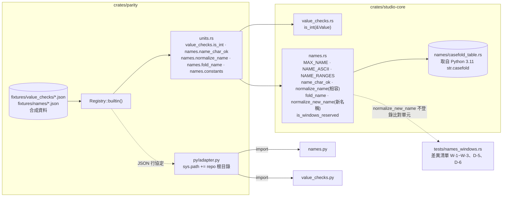
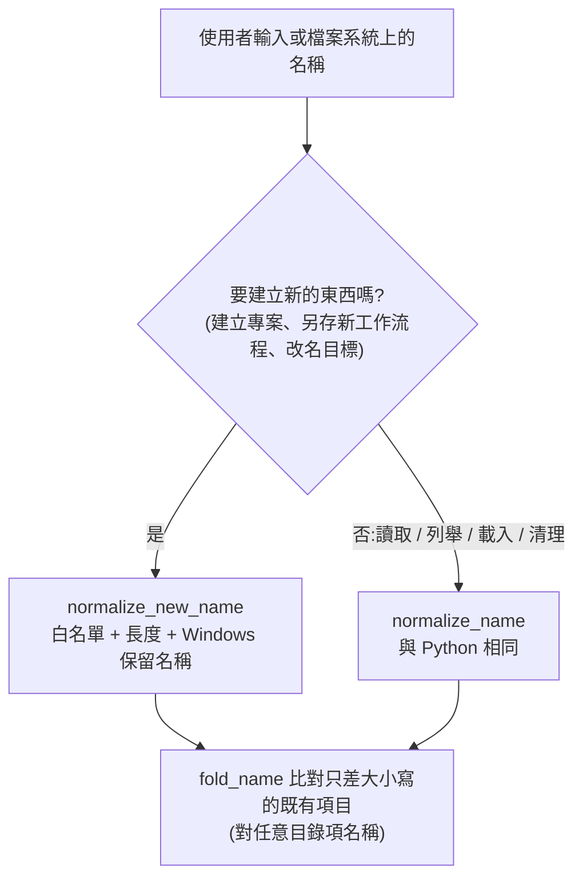
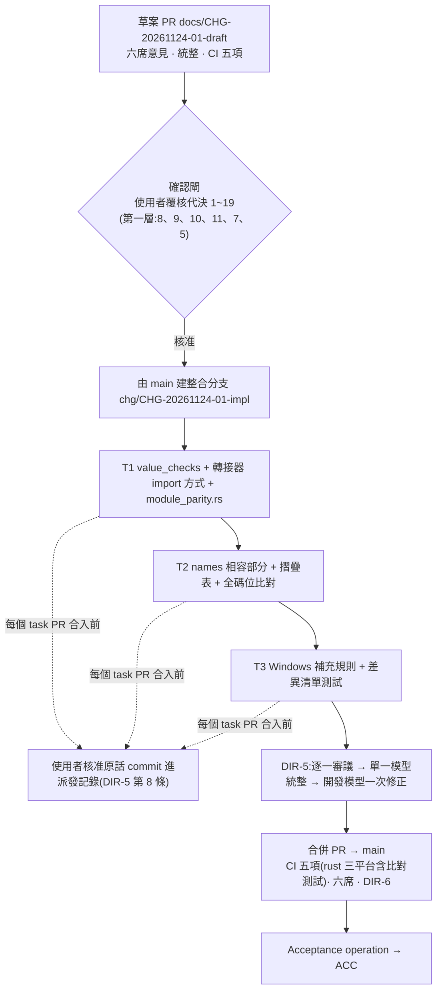

# CHG-20261124-01 — Rust 遷移路線圖第 2 筆:`names` + `value_checks` 移植到 `studio-core`(含 Windows 補充名稱規則)

- 專案:podcast-studio
- 分支(Branch):main
- 日期:2026-11-24(UTC+0)
- 類型:新增程式(`crates/studio-core` 加入 `value_checks`、`names` 兩個模組的 Rust 版;`crates/parity` 登錄對應的比對單元、Python 轉接器加入對應單元並 import 兩個產品模組、新增比對 fixture);**不改任何根目錄 Python 產品檔**;不改 CI、不改 Guideline
- 提出者:使用者(2026-11-23 選「併入 names 那筆」,原話見「## 動機」)
- 實作者:主 agent 派發(DIR-3);草案由 Claude subagent 起草(DIR-3 第 2 條例外:治理文件草案直接派 Claude subagent);T1~T3 建議依 DIR-3 第 2 條例外二直接派 Claude subagent(代決 2);實際工作者記於「## 派發記錄」
- 驗收者:獨立 Claude subagent(不參與起草、施工、審議與統整,不看實作者自述)+ 使用者確認
- 風險分級:高(理由見「## 決策與取捨」代決 1;要點:(1) **安全邊界**——名稱規則是路徑防護的一環(CHG-20261122-02 安全影響 (4)、Guideline §6.1「安全(應用程式)」列),本筆移植它並**刻意新增**一條比 Python 版嚴格的規則(Windows 保留名稱);(2) **刻意的跨語言行為差異**——路線圖以「行為等價」為準(CHG-20261122-02 代決 22),本筆是第一筆有意不等價的移植,差異的範圍與比對方式需使用者決定;(3) **跨語言契約**——第一次讓 Python 轉接器 import 產品模組,並登錄之後各筆都會依賴的 `names` / `value_checks` Rust API。不新增執行期網路呼叫、不送資料出本機、不改 CI;可由 `git revert` 完整還原)
- Autonomy:halt;確認閘 2026-11-25 已過(派發者分四題詢問,使用者答「照建議 (Recommended)」三題、「全部照建議 (Recommended)」一題,代決 1~19 全部照推薦,另採第 2 輪統整建議的交接與兩處文字更正,見「## 審議 › 確認閘紀錄(2026-11-25)」)
- Commit/PR:草案分支 `docs/CHG-20261124-01-draft`(自 origin/main `bbc6b4c` 起草;PR #169,draft,base main);施工整合分支 `chg/CHG-20261124-01-impl`(DIR-5,確認閘核准後由 main 建立);task 分支 `chg/CHG-20261124-01-T1`~`T3`(PR base 皆為整合分支):T1 PR #171(squash 合入整合分支 `f5ea7e8`)、T2 PR #172(`23461f0`)、T3 PR #173(`e6b3107`);DIR-5 統整報告 `docs/changes/review/CHG-20261124-01-summary.md`(整合分支 `ed95d69`);合併 PR #174(squash 合入 main `0dc595a`);驗收報告 ACC-20261125-02 由收尾帳本 PR 提交
- 重複性檢查(Recurrence check):首次——本 repo 先前沒有移植產品模組到 Rust 的 CHG;CHG-20261123-01 建立了比對工具但只有示範單元。未見於 KN,不另建 KN
- Diagrams:見「## 設計圖」節
- Mockup: skipped — 本筆沒有任何畫面;名稱規則的使用者可見訊息由之後的畫面 CHG(路線圖第 17、18、21 筆)處理
- Security-impact:見「## 安全影響」節
- Behaviour spec / Interaction spec:Behaviour spec 為 `features/names.feature`(T1 新增,T2、T3 各補場景),草案見「### Behaviour spec」;Interaction spec 不適用(不改畫面)
- Skill: ai-sdlc v1.69.1
- 關聯:CHG-20261122-02(遷移路線圖第 2 列;路線圖共通規則 (1)~(8);代決 14、22;事實 I、J;安全影響 (4)(6)(7));CHG-20261123-01(路線圖第 1 筆:workspace、比對工具 `parity`、fixture 格式、JSON 行協定、Rust 單元登錄表、CI `rust` job;本筆是第一個使用它的模組);CHG-20261103-01(`value_checks.is_int` 的來源,ACC-20261123-01);CHG-20261022-04 T2(`names.py` 由 `studio_server.py` 移出);ACC-20261124-01;DIR-2、DIR-3 第 2 條例外與例外二、DIR-4、DIR-5、DIR-6、DIR-7;KN-1(本 CHG 全文不寫狀態觸發字);Guideline §2 遷移範圍、§6.1、§7、§8「技術約束」

## 動機

使用者 2026-11-23 回答派發者的問題時選「併入 names 那筆」,把 `value_checks`(13 行)併入 `names` 這一筆(CHG-20261122-02「## 遷移路線圖」階段一第 2 列,以下稱「路線圖第 2 筆」)。該列原文要點:

- 模組 / 單元:`names` + `value_checks`
- 目標:名稱規則與共用數值檢查
- 範圍:專案名稱與檔名規則;補 Windows 保留名稱、結尾句點與空白、`\`、`:`、不分大小寫同名衝突(代決 14);`value_checks.is_int` 等(事實 I)
- 退出條件:比對 fixture 上接受 / 拒絕與錯誤類別一致(兩個模組各自比對);**Windows 補充規則造成的差異逐條列在該 CHG**
- 回滾:revert

路線圖第 1 筆(CHG-20261123-01)已於 2026-11-24 收尾(ACC-20261124-01 判定通過;main ruleset 必要檢查五項含 `rust`),本筆在其骨架上開工。

起草者 2026-11-24 於 origin/main `bbc6b4c` 查證的事實(來源等級標於句首):

A. 〔觀察〕`names.py` 共 49 行,只 import `__future__`。公開名稱:`MAX_NAME = 64`(第 18 行);`NAME_ASCII`(第 19 行,`frozenset`,ASCII 大小寫字母、數字、`-`、`_` 共 64 字);`NAME_RANGES`(第 20~27 行,6 組閉區間:`0x4E00–0x9FFF` CJK 統一漢字、`0x3400–0x4DBF` 擴充 A、`0x3041–0x3096` 平假名、`0x30A1–0x30FA` 片假名(不含 `・` U+30FB)、`0x30FC` 長音符「ー」、`0x3005` 疊字符「々」);`name_char_ok(ch)`(第 30~35 行);`normalize_name(name)`(第 38~44 行);`fold_name(name)`(第 47~49 行)。模組 docstring(第 2~15 行)寫明:不做正規化或編碼轉換、長度以字數計 1~64、不用 `\w` 也不用 Unicode 類別。
B. 〔觀察〕各函式的現行行為(起草者以 Windows 開發機 Python 3.12.10、`unicodedata.unidata_version` 15.0.0 實跑確認):
   - `name_char_ok(ch)`:`ch in NAME_ASCII` 為真即回 `True`(第 32~33 行);否則 `ord(ch)` 落在任一區間回 `True`、其餘 `False`(第 34~35 行)。輸入不是長度 1 的字串時:`""`、`"ab"`、`5`、`None` 都在 `ord()` 丟 `TypeError`;`[1]` 在 `in frozenset` 就丟 `TypeError`(不可雜湊)。全部碼位中白名單共 27826 個(64 + 20992 + 6592 + 86 + 90 + 1 + 1)。
   - `normalize_name(name)`:不是 `str` 或 `len(name)` 不在 1~64 回 `None`(第 40~41 行;`len` 以 Unicode 碼位計,64 個 CJK 字合格);任一字元不在白名單回 `None`(第 42~43 行);否則回傳**原字串本身**(第 44 行,不做任何轉換)。不丟例外。含單獨代理碼位(lone surrogate,如 `"\ud800"`)的字串回 `None`。
   - `fold_name(name)`:回傳 `name.casefold()`(第 49 行),即 Unicode 完整大小寫摺疊(CaseFolding.txt 狀態 C + F);不檢查輸入。非字串輸入(`1`、`None`)丟 `AttributeError`。實例:`ß`(U+00DF)與 `ẞ`(U+1E9E)→ `ss`、`K`(U+212A,KELVIN SIGN)→ `k`、`ſ`(U+017F)→ `s`、`ff`(U+FB00)→ `ff`、`st`(U+FB06)→ `st`、`İ`(U+0130)→ `i` + U+0307、`Σ` 與 `ς` → `σ`、`ꭰ`(U+AB70)→ `Ꭰ`(U+13A0,切羅基文摺疊到大寫)、`Ａ`(U+FF21)→ `ａ`(U+FF41)、`ʼn`(U+0149)→ U+02BC + `n`。在 Unicode 15.0 下,摺疊後與原字不同的碼位共 1530 個;**非 ASCII 而摺疊後全為 ASCII** 的只有 11 個:U+00DF、U+017F、U+1E9E、U+212A、U+FB00~U+FB06。白名單內的字元除 ASCII 大寫字母外,摺疊後都等於自己。
C. 〔觀察〕`value_checks.py` 共 13 行,只 import `__future__`;唯一公開函式 `is_int(v)`(第 12~13 行):`isinstance(v, int) and not isinstance(v, bool)`。Python 的 `int` 沒有上限,`2**70` 回 `True`;`True`、`False`、`1.0`、`"1"`、`None`、`[1]` 回 `False`(`tests/test_value_checks.py` 第 19~26 行)。不丟例外。
D. 〔觀察〕呼叫端(`git grep` 結果):
   - `names.normalize_name`:`project.check_name`(`project.py:217-222`,`None` 時丟 `ProjectError(NAME_HINT)`)、`project.list_projects` 類列舉略過不合格目錄(`project.py:1373`)、啟動清理略過並警告(`project.py:1491-1493`)、`nodes._send_to_library` 丟 `ValueError`(`nodes.py:393-394`)、`studio_server` 工作流程 GET / PUT(`studio_server.py:1330`、`1356`,經別名 `_normalize_name`,`None` 時回 400)。
   - `names.fold_name`:`project._case_variant` 對 `os.scandir` 列出的**任意目錄項名稱**(未經白名單)取摺疊鍵比對(`project.py:1043-1050`),有只差大小寫者建立時丟 `ProjectExists`、讀取時丟 `ProjectNotFound`(`project.py:1053-1058`);`studio_server` 工作流程 `_case_variant` 同樣對任意 `*.json` 檔名主幹取摺疊鍵(`studio_server.py:1310-1327`,回 409);合成、執行旗標、專案鎖以摺疊鍵當字典鍵(`studio_server.py:1518`、`1532`、`1554`、`1618`、`1857`)。
   - 常數:`studio_server.py:283-285`(`MAX_WORKFLOW_NAME`、`WORKFLOW_NAME_ASCII`、`WORKFLOW_NAME_RANGES` 別名)、`nodes.py:496`(`max_len=names.MAX_NAME`)。
   - `value_checks.is_int`:`project.py:302`、`319`、`474`、`476`、`524`(都接範圍檢查,上限至多為文稿長度);`settings.py:326`、`330`(`num_ctx`、`steps` 接範圍檢查)。`breezy_worker.py:274` 有本地副本 `_is_int`(在 BreezyVoice venv 執行,不 import 本模組;路線圖不移植 `breezy_worker.py`)。
   - 既有測試:`tests/test_value_checks.py`(L1、L2)、`tests/test_server_files.py:442-472`(`GOOD_NAMES`、`BAD_NAMES` 與「不用 `\w` / Unicode 類別」)、`tests/test_project.py:152-156`(`studio_server` 別名與 `names` 為同一物件)、`tests/test_static.py:236`(前端 `static/app.js:56` 的 `WORKFLOW_NAME_RE` 與伺服器結果比對)。
E. 〔觀察〕白名單已排除 `\`、`:`、`.`、半形與全形空白、`/`、控制字元與 `*?"<>|`(`BAD_NAMES` 涵蓋其中多數)。因此代決 14 列的 Windows 項目中,**結尾句點與空白、`\`、`:`(替代資料流)、帶副檔名的保留名稱(如 `CON.txt`)在 Python 版本來就不合格**;只有「整個名稱等於保留裝置名」(如 `CON`、`com1`,全為 ASCII 英數)目前會被 Python 版接受。不分大小寫的同名衝突已由 `fold_name` + 呼叫端的 `_case_variant` 處理(事實 D)。
F. 〔觀察〕比對工具的現況(CHG-20261123-01):Rust 比對器以 serde_json 讀 fixture 成 `serde_json::Value`,再以 `json!({"id", "input"}).to_string()` 重新序列化成請求送給 Python 轉接器(`crates/parity/src/lib.rs` `encode_request`、`crates/parity/src/py.rs:141-162`)——Python 端收到的是 serde_json **重新輸出**的 JSON,不是 fixture 原文。轉接器 `crates/parity/py/adapter.py` 目前只用標準函式庫,`tests/test_parity_adapter.py`(第 173~186 行)以 AST 斷言它只 import `sys.stdlib_module_names` 內的模組;`crates/parity/tests/registry.rs` 的 `adapter_answers_every_registered_unit`(第 168~183 行)對**每個**已登錄單元送 `"5"` 並斷言回 `ok 5`。`crates/studio-core` 目前沒有任何相依、沒有任何函式;`crates/parity` 不相依 `studio-core`。
G. 〔推論〕serde_json(未開 `arbitrary_precision`)把超出 `u64` / `i64` 範圍的整數字面值解析為 `f64`,並把 `-0` 解析為 `f64` 的 `-0.0`;Python `json.loads` 對兩者都給 `int`(起草者已實測 Python 端:`json.loads("-0")` 為 `int` 0,`is_int` 為 `True`;`is_int(json.loads("18446744073709551616"))` 為 `True`)。Rust 端行為由 T1 以測試查證後改記〔觀察〕。由事實 F,這兩類值經比對工具時,兩邊都收到浮點數,**比對會顯示一致但沒有測到真正的差異**。
H. 〔觀察〕CI `rust-platform` 三格都以 `actions/setup-python` 安裝 Python 3.11(`.github/workflows/ci.yml:223`),`cargo test --workspace --locked`(第 235 行)會執行 `crates/parity/tests/*.rs` 中以子程序啟動真轉接器的測試。各環境的 Python:Windows 開發機 3.12.10(Unicode 15.0.0,觀察);WSL Ubuntu 3.14.4(ACC-20261124-01 環境二;〔推論〕Unicode 16.0.0);CI 3.11(〔推論〕Unicode 14.0.0);使用者 Mac 的 Python 版本〔未知〕。`str.casefold` 的結果隨 Unicode 版本變:新版本新增的有大小寫字元(例:〔推論〕Unicode 16.0 的 Garay 文字),在舊版 Python 摺疊後等於自己。
I. 〔觀察〕Guideline §7 沒有任何一條驗收條件直接對應 `names` 或 `value_checks`:與名稱相關的只有 FR-18「流程可存檔 / 載入;同名存檔須確認才覆寫」,它是工作流程存檔畫面的端到端條件,路線圖把 FR-16~20 的 §7 改寫交給第 21 筆(節點畫布、檔案拖放與工作流程存檔)。專案名稱沒有獨立的 §7 條件。
J. 〔觀察〕`names.py`、`value_checks.py` 只 import 標準函式庫,三平台都能 import(不像 `project`、`settings` 依賴 `fcntl`),所以本筆的比對可在 Windows、macOS、Linux 都執行(CHG-20261123-01 事實 H 留給本筆決定的事項)。

## 使用者故事

1. 作為使用者,Rust 應用程式判斷「專案名稱 / 工作流程名稱合不合格」與「兩個名稱是否只差大小寫」的結果,和 Python 網頁版完全相同,以便同一份 `projects/`、`workflows/` 兩邊看到的清單一致,不必重建或改名任何既有資料。
2. 作為使用者,在 Windows 上(以及在 macOS / Linux 上建立、之後帶到 Windows 的資料)不會產生 `CON`、`NUL`、`COM1` 這類 Windows 無法建立或開啟的專案 / 工作流程名稱,以便同一份資料在三平台都能打開。
3. 作為使用者,Rust 版與 Python 版刻意不同的地方逐條列在本 CHG,且由自動測試鎖住,以便知道差異在哪裡、為什麼。
4. 作為使用者,`value_checks.is_int` 這類被多處共用的數值檢查在 Rust 版有同一個判斷來源,之後 `project`、`settings` 移植時直接沿用。
5. 作為使用者,Python 網頁版、MCP 伺服器與我的資料完全不受本筆影響。

## 決策與取捨

> 依使用者 2026-10-26 原則「如果多次審議都無交集 只採最低限度」:本筆只移植 `names`、`value_checks` 兩個模組的公開介面並登錄比對單元,加上路線圖指定的 Windows 補充名稱規則;不移植任何呼叫端(`project`、`studio_server`、`nodes` 等依路線圖各自一筆),不改 CI、不改 Guideline。凡依記憶而非本 repo 可讀證據寫出的第三方事實(serde_json 行為、Unicode 版本、Windows 保留名稱清單),一律標〔推論〕並列為該 task 開工時的查證項。

### 1. Rust 模組配置與 API(代決 3)

| Python | Rust(`crates/studio-core`) | 等價範圍 |
|--------|------------------------------|----------|
| `value_checks.is_int(v)` | `studio_core::value_checks::is_int(v: &serde_json::Value) -> bool`:`Value::Number` 且 `is_i64() \|\| is_u64()` 為真才回 `true`;`Bool`、浮點、字串、`null`、陣列、物件回 `false` | 在 `serde_json::Value` 能表示的範圍內與 Python 等價;JSON 原文層級的差異見代決 5 |
| `names.MAX_NAME` | `pub const MAX_NAME: usize = 64` | 相同 |
| `names.NAME_ASCII` | `pub const NAME_ASCII: &str`(依碼位排序的 64 字) | 集合相同 |
| `names.NAME_RANGES` | `pub const NAME_RANGES: &[(u32, u32)]`(順序與 Python 相同的 6 組) | 相同 |
| `names.name_char_ok(ch)` | `pub fn name_char_ok(ch: char) -> bool` | 對全部 Unicode 純量值相同(型別保證輸入恰為一個字元;Python 的 `TypeError` 情形在比對單元以 `error type` 表示) |
| `names.normalize_name(name)` | `pub fn normalize_name(name: &str) -> Option<&str>`:長度以 `chars().count()` 計 1~`MAX_NAME`、逐字 `name_char_ok`,合格回傳原字串切片 | 對全部合法 UTF-8 字串相同;非字串輸入與單獨代理碼位見代決 6、事實 B |
| `names.fold_name(name)` | `pub fn fold_name(name: &str) -> String`:Unicode 完整大小寫摺疊(C + F) | 見代決 7 |
| (無,本筆新增) | `pub fn is_windows_reserved(name: &str) -> bool`、`pub fn normalize_new_name(name: &str) -> Result<&str, NewNameError>`(`NewNameError::{Invalid, Reserved}`) | **刻意不等價**,見代決 8~11 |

**代決 3**:模組放 `crates/studio-core/src/value_checks.rs` 與 `crates/studio-core/src/names.rs`(摺疊表另放 `crates/studio-core/src/names/casefold_table.rs`,由 `names.rs` 以子模組引入),`lib.rs` 以 `pub mod` 公開。`normalize_name` 回 `Option<&str>` 照 Python 的「合格回原字串、否則 `None`」,不另設錯誤原因(Python 呼叫端只用一句 `NAME_HINT`,原因分類對等價無益);需要分辨原因的只有新增的 `normalize_new_name`,以 `NewNameError` 區分「不合白名單」與「Windows 保留名稱」,供之後的畫面顯示不同訊息。替代:(b) `normalize_name` 也回 `Result<&str, NameError>` 細分空字串 / 過長 / 字元不合格——比 Python 多出資訊,比對時仍要收斂成一個拒絕代碼,目前沒有讀取方需要;(c) 只提供 `normalize_new_name` 一個函式、以參數切換相容模式——呼叫端容易選錯模式,審查時看不出用的是哪一套。

### 2. `studio-core` 的相依與 `parity` 對 `studio-core` 的相依(代決 4)

| 選項 | 說明 | 優點 | 缺點 |
|------|------|------|------|
| (a) **`studio-core` 相依 `serde_json`**(沿用 workspace 已鎖定的 1.0.154,不新增 package);`parity` 以 path 相依 `studio-core` | `is_int` 直接吃 `&serde_json::Value` | 之後 `project`(路線圖第 5 筆)、`settings`(第 9 筆)讀 JSON 後的檢查直接沿用;`Cargo.lock` 不新增任何 package、`deny.toml` 不必改(授權 MIT OR Apache-2.0 已在白名單,CHG-20261123-01 派發記錄 T2 列) | `studio-core` 從「沒有任何相依」變成有一個相依,需改它 `Cargo.toml` 的註解 |
| (b) `studio-core` 自訂一個小型列舉(如 `JsonScalar`)當 `is_int` 參數 | 不引入 serde_json | `studio-core` 維持零相依 | 之後讀 JSON 的模組還是要 serde_json;多一層轉換,比對單元也要轉換 |
| (c) `is_int` 只放在 `parity` 的比對單元內 | — | 不動 `studio-core` | 違反「Rust 對應單元在產品核心」的路線圖粒度;之後各筆沒有單一判斷來源 |

**代決 4**:採 (a)。新增的直接相依只有 `studio-core → serde_json`(既有版本)與 `parity → studio-core`(workspace 內 path 相依);依共通規則 (6) 記錄:`serde_json` 1.0.154,MIT OR Apache-2.0,用途「`value_checks::is_int` 的輸入型別」。T1 以 `cargo metadata --locked` 確認 package 清單與合入前相同,寫入派發記錄。

### 3. `is_int` 的值域與 JSON 原文層級的差異(代決 5)

事實 F、G:經 serde_json 解析後,`-0` 與超出 `u64` 範圍的整數(例 `18446744073709551616`)在 Rust 變成浮點數,`is_int` 回 `false`;Python `json.loads` 給 `int`,`is_int` 回 `True`。這是「JSON 解析器」的差異,不是 `is_int` 本身的差異,而且比對工具的管線會把它遮蔽(事實 F)。

| 選項 | 說明 | 優點 | 缺點 |
|------|------|------|------|
| (a) **`is_int` 以 `serde_json::Value` 為值域,與 Python 在此值域內等價;JSON 原文層級的兩類差異列為已知差異,交路線圖第 5 筆(`project`)、第 9 筆(`settings`)在讀 JSON 時決定處置** | 本筆以 Rust 測試鎖住 serde_json 對 `-0`、`18446744073709551616`、`1e2`、`1.0` 的解析結果(把事實 G 由〔推論〕改為〔觀察〕),比對 fixture 不放這兩類值 | 不動 CHG-20261123-01 的比對協定;實際影響小:現有呼叫端都接範圍檢查(事實 D),超出 `u64` 的整數在兩邊最後都被拒,只有 `-0` 會在 Python 被當成 0 接受、在 Rust 被拒 | 差異要到第 5、9 筆才處理;那兩筆須記得本條 |
| (b) 對 `studio-core` 開 serde_json 的 `arbitrary_precision` | Number 保留原文,`is_int` 以原文判斷是否為整數字面值 | 與 Python 完全等價(含 `-0`、大整數) | cargo feature 在 workspace 內統一,會連帶改變 `parity` 的 `Value` 比較與輸出(CHG-20261123-01 代決 6「數字依 serde_json 的值比較」),等於改比對契約 |
| (c) 另登錄一個「以 JSON 原文為輸入」的比對單元(輸入是字串,兩邊各自解析再呼叫 `is_int`) | 讓比對工具真正測到差異 | 差異可見 | 比對結果必定不一致,與「結論:一致」的退出條件衝突,需另一套標記(見代決 11) |

**代決 5**:採 (a)。「已知差異」寫入「### 行為差異清單」第 D-5、D-6 條;T1 的 Rust 測試 `crates/studio-core/tests/value_checks.rs` 斷言 serde_json 實際解析結果(若與事實 G 不符,施工者停下回報,由派發者修訂本條)。

### 4. 比對單元的粒度、拒絕代碼與錯誤類別(代決 6)

**代決 6**:一個公開函式一個比對單元,另加一個常數單元,共五個;fixture 一單元一檔(CHG-20261123-01 代決 6)。

| 單元名 | fixture | 輸入 | `ok` 的 `value` | `reject` | `error` |
|--------|---------|------|-----------------|----------|---------|
| `value_checks.is_int` | `crates/parity/fixtures/value_checks/is_int.json` | 任意 JSON | `true` / `false` | 無 | 無 |
| `names.name_char_ok` | `crates/parity/fixtures/names/name_char_ok.json` | JSON 字串,恰為一個碼位 | `true` / `false` | 無 | `type`:輸入不是恰好一個碼位的字串(Python 端為 `TypeError`,事實 B) |
| `names.normalize_name` | `crates/parity/fixtures/names/normalize_name.json` | 任意 JSON | 原字串 | `invalid`(Python 回 `None`;含非字串輸入) | 無 |
| `names.fold_name` | `crates/parity/fixtures/names/fold_name.json` | JSON 字串 | 摺疊後字串 | 無 | `type`:非字串輸入(Python 端為 `AttributeError`) |
| `names.constants` | `crates/parity/fixtures/names/constants.json` | `null`(忽略) | `{"max_name": 64, "ascii": "<依碼位排序的 64 字>", "ranges": [[lo, hi], …]}`(順序同 `NAME_RANGES`) | 無 | 無 |

- Python 轉接器的單元函式呼叫**真正的** `names` / `value_checks` 函式,只做結果轉換:`None` → `Reject("invalid")`;`TypeError`、`AttributeError` → `UnitError("type")`;其他例外照 CHG-20261123-01 代決 6 回報例外類別名稱(預期不會發生,發生即不一致)。
- Rust 單元放 `crates/parity/src/units.rs`(不放 `studio-core`,讓產品核心不依賴比對協定型別),呼叫 `studio_core` 的函式並做同樣轉換;在 `Registry::builtin()` 登錄。
- 替代:(b) 一個模組一個單元(輸入帶函式名)——一個 fixture 混多個函式,案例 id 與結果型別不一致,報告較難讀;(c) 不比對常數——常數是 `studio_server`、`nodes`、前端 `WORKFLOW_NAME_RE` 的共同來源,漂移時其他單元的 fixture 不一定測得到(例:區間端點)。

### 5. `fold_name` 的實作方式(代決 7)

事實 B、D:`fold_name` 被用在**未經白名單的**目錄項名稱上(`_case_variant`),所以 Rust 版必須對任意字串與 `str.casefold` 相同,不能只處理 ASCII。Rust 標準函式庫只有 `to_lowercase`(不等於 casefold:`ß` 不變、希臘文結尾 `ς` 依上下文、切羅基文方向相反)。

| 選項 | 說明 | 優點 | 缺點 |
|------|------|------|------|
| (a) **repo 內的摺疊表**:`crates/studio-core/src/names/casefold_table.rs`,以「碼位 → 摺疊結果」排序陣列表示(〔觀察〕Unicode 15.0 下 1530 筆)(施工期補記:實際的表以 CPython 3.11.18、Unicode 14.0.0 產生,同為 1530 筆,見表頭),二分搜尋 | 表的內容取自 Python `str.casefold` 逐碼位輸出,**基準為 CI 所用的 Python 3.11**;檔頭註解記產生時的 Python 版本、`unicodedata.unidata_version`、一行產生指令與表內容的 SHA-256;不新增 Python 檔、不新增 crate | 等價基準就是被比對的 Python 實作;不增加供應鏈;以全碼位測試證明(見下) | 表約 1500 筆、數十 KB 原始碼;Unicode 升版需重產(另開 CHG) |
| (b) 引入 crate(如 `caseless`) | 第三方實作 Unicode 預設大小寫摺疊 | 程式少 | 新增供應鏈與授權記錄;crate 採用的 Unicode 版本〔未知〕,不一定與 CI 的 Python 3.11 相同 |
| (c) 只做 ASCII 小寫,其餘原樣 | — | 最簡單 | 與 Python 不等價:`straße` 這類目錄在 Python 被判為與 `STRASSE` 衝突、在 Rust 不衝突;差異會擴及第 5、21 筆 |

**代決 7**:採 (a)。正確性以兩道測試證明:
- **全碼位比對**(L2,`crates/parity/tests/names_exhaustive.rs`):以子程序啟動真轉接器,對 U+0000~U+10FFFF 全部 Unicode 純量值(排除 U+D800~U+DFFF)比對 `names.fold_name` 與 `names.name_char_ok` 兩邊結果(分批方式見「### 風險與回滾」(5),不一致時須指出碼位);`fold_name` 的比對規則:執行中 Python 的 `unicodedata.unidata_version` 等於表頭記載的版本時一律比對;版本不同時,若環境變數 `GITHUB_ACTIONS` 為 `true`(CI)即**判失敗**、不略過,只有在本機(非 CI)才印出「略過:Python Unicode 版本 X 與摺疊表 Y 不同」並列出差異碼位數量、不判失敗(理由:`cargo test` 預設不顯示通過測試的輸出,CI 若因直譯器變動而略過,三平台仍會全綠,等價就沒有保證)。CI 用的直譯器:未設 `PARITY_PYTHON` 時,依 `crates/parity/src/py.rs` 第 25~29 行 `resolve_python` 的預設值(非 Windows 為 `python3`,Windows 為 `python`),即 `rust-platform` 以 `actions/setup-python` 安裝的 3.11(`.github/workflows/ci.yml` 第 223 行)。`name_char_ok` 不受 Unicode 版本影響,一律比對。
- **fixture 比對**:`fold_name.json` 只收在 Unicode 14.0~16.0 摺疊結果都相同的字元(事實 H),使本機 Python 3.12 / 3.14 跑 `parity run` 也得「結論:一致」。

〔未知〕:CI 的 Python 3.11 實際 `unidata_version`(〔推論〕14.0.0),T2 第一步以 `UV_PYTHON_DOWNLOADS=never uv python find 3.11` 找出本機已安裝的 3.11,再以該直譯器執行 `python -c "import unicodedata; print(unicodedata.unidata_version)"` 查證後寫入派發記錄(找不到時停下回報派發者,不得自行下載直譯器;要下載須經使用者同意並記入派發記錄,代決 7、F7);使用者 Mac 的 Python 版本〔未知〕,不影響 CI 判定。施工期補記:T2 以 uv 安裝的 CPython 3.11.18 查證為 14.0.0(派發記錄 T1、T2 列)。

### 6. Windows 補充規則:差異逐條清單(代決 8 的前提)

依事實 E,代決 14 列的六類 Windows 項目逐條判定如下(「差異」指 Rust 新名稱規則與 Python `normalize_name` 的結果不同):

| 編號 | Windows 項目 | Python 現況 | Rust `normalize_name`(相容) | Rust `normalize_new_name`(新名稱) | 差異 |
|------|--------------|-------------|------------------------------|-------------------------------------|------|
| W-1 | 保留裝置名 `CON`、`PRN`、`AUX`、`NUL`(整個名稱相等,ASCII 不分大小寫,例 `con`、`Nul`) | 接受 | 接受 | 拒絕(`Reserved`) | **有** |
| W-2 | `COM1`~`COM9`、`LPT1`~`LPT9`(同上,例 `com1`、`Lpt9`) | 接受 | 接受 | 拒絕(`Reserved`) | **有** |
| W-3 | `COM0`、`LPT0`(〔推論〕Microsoft 現行檔名規範文件把它們與上標數字形式一併列為保留;代決 10 已於確認閘 2026-11-25 決定納入) | 接受 | 接受 | 拒絕(`Reserved`) | **有** |
| W-4 | 帶副檔名的保留名稱(`CON.txt`、`nul.json`)、上標數字形式(`COM¹`)、`CONIN$`、`CONOUT$`、`CLOCK$` | 拒絕(`.`、`¹`、`$` 不在白名單) | 拒絕 | 拒絕(`Invalid`) | 無 |
| W-5 | 結尾句點、結尾空白、`\`、`:`(替代資料流)、`/`、`*?"<>|`、控制字元 | 拒絕(白名單) | 拒絕 | 拒絕(`Invalid`) | 無 |
| W-6 | 不分大小寫的同名衝突 | 由 `fold_name` + 呼叫端 `_case_variant` 拒絕(事實 D);〔推論〕`casefold` 比 NTFS 的大寫對照表更廣(例 `ß` 與 `ss` 在 NTFS 不算同名、在 `casefold` 算),多數情形只會多擋;但可能有反例:U+0131(`ı`)在 NTFS 大寫對照中可能對到 `I`,`casefold` 卻不把 `ı` 摺成 `i`,所以磁碟上若已有含 `ı` 的目錄(白名單外字元,由應用程式以外的方式建立),它與白名單內含 `i` 的名稱在 NTFS 上可能衝突、`fold_name` 卻判為不同。這與 Python 現況相同,不是 Rust 引入的差異;查證交路線圖第 3 筆(`safe_fs`) | `fold_name` 與 Python 相同(代決 7) | 不在名稱函式內判斷,沿用呼叫端以 `fold_name` 比對 | 無 |
| W-7 | 名稱是保留名稱的**前綴或延伸**(`CONX`、`CON1`、`COM10`、`LPT`、`NULL`、`AUXX`) | 接受 | 接受 | 接受 | 無(邊界案例,列入測試) |

結論:**會造成差異的只有 W-1、W-2、W-3**,總數為保留名稱集合內每個名稱的全部 ASCII 大小寫組合(每個名稱 3 個字母,`COM`、`LPT` 後面的數字沒有大小寫之分,所以每個名稱 8 種寫法;代決 10 確認閘 2026-11-25 採 (a) 24 個名稱,共 24×8=192 種寫法;未採的 (b) 為 22×8=176 種)。路徑長度上限(Windows `MAX_PATH`)屬整條路徑而非名稱,交路線圖第 3 筆(`safe_fs`)。

### 7. Windows 保留名稱:適用平台(代決 8)

| 選項 | 說明 | 優點 | 缺點 |
|------|------|------|------|
| (a) **三平台都套用** | `normalize_new_name` 不分平台拒絕保留名稱 | 同一份資料在三平台都能開(使用者故事 2;資料位置 Q9 未定前,`projects/` 可能被複製到另一平台);行為不隨平台變,測試與文件只有一套;macOS / Linux 的 CI 格也測得到 | macOS / Linux 使用者不能新建名叫 `con` 的專案(Python 網頁版仍可) |
| (b) 只在 Windows(`cfg(windows)`)套用 | 其他平台與 Python 完全相同 | macOS / Linux 與 Python 零差異 | 在 macOS 建立的 `con` 專案帶到 Windows 打不開;平台判斷散到名稱規則中(Guideline §8「平台差異集中在少數模組」雖允許,但多一個需要三平台各測一次的分支) |

**代決 8**:採 (a)。確認閘 2026-11-25 使用者照推薦核准。

### 8. Windows 保留名稱:適用時機(代決 9)

| 選項 | 說明 | 優點 | 缺點 |
|------|------|------|------|
| (a) **只擋「新名稱」**:建立專案、另存新工作流程、改名的目標名稱用 `normalize_new_name`;讀取、列舉、載入、清理、比對既有名稱用相容的 `normalize_name` | 兩個函式並存,用途寫進 API 文件與「### 呼叫端指引」 | 符合 Guideline §6.1「資料相容」——既有資料不必改名;在 macOS / Linux 上,Python 網頁版已建立的 `con` 專案在 Rust 版仍看得到、打得開(只是不能再建同名新專案)。〔推論〕在 Windows 上,名稱為保留裝置名的既有項目以一般路徑開啟時,可能被解讀為裝置而非目錄(Python 網頁版依賴 `fcntl`、不在 Windows 執行,這類項目只會從其他平台帶過來);Windows 上的實際開啟行為由路線圖第 3 筆(`safe_fs`)以測試確認(見「## 後續改善」) | 呼叫端要選對函式;由之後各筆依「### 呼叫端指引」遵守,並在該筆比對 |
| (b) 一律擋(讀取也擋) | 只有一個函式 | 規則最簡單 | `con` 專案在 Rust 版的列表中消失(`project.py:1373` 的略過邏輯),違反「不得要求使用者重建或手動轉換資料」 |
| (c) 讀取也擋,但列表顯示「名稱不相容」提示 | — | 使用者看得到 | 需要畫面與資料修復流程,超出本筆範圍 |

**代決 9**:採 (a)。確認閘 2026-11-25 使用者照推薦核准。

### 9. 保留名稱集合(代決 10)

| 選項 | 集合 |
|------|------|
| (a) **CHG-20261122-02 代決 14 原列 + `COM0`、`LPT0`**:`CON`、`PRN`、`AUX`、`NUL`、`COM0`~`COM9`、`LPT0`~`LPT9`,共 24 個,ASCII 不分大小寫、整個名稱相等才算 | 涵蓋〔推論〕Microsoft 現行文件列出、且能通過白名單的全部形式;多擋兩個名稱的代價極小 |
| (b) 只照代決 14 原列:`CON`、`PRN`、`AUX`、`NUL`、`COM1`~`COM9`、`LPT1`~`LPT9`,共 22 個 | 與路線圖原文逐字相同;`COM0`、`LPT0` 在某些 Windows 版本是否真的保留〔未知〕 |

**代決 10**:採 (a)。上標數字形式與帶 `$` 的裝置名因白名單已拒,不列入集合(W-4)。

### 10. 比對工具如何處理刻意的差異(代決 11)

| 選項 | 說明 | 優點 | 缺點 |
|------|------|------|------|
| (a) **比對單元只登錄相容函式;差異以 Rust 自己的測試鎖住** | 比對單元 `names.normalize_name` 對應 Rust 的相容 `normalize_name`,fixture 全部案例預期一致(含 `CON`、`com1` 等保留名稱,兩邊都接受);新增 `crates/studio-core/tests/names_windows.rs`:(1) 對代決 10 集合內每個名稱的**全部** ASCII 大小寫組合斷言 `normalize_name` 接受、`normalize_new_name` 回 `Err(Reserved)`;(2) 對 W-4、W-5、W-7 逐例斷言;另在 `crates/parity/tests/names_differences.rs` 以真轉接器確認同一批保留名稱在 **Python 端** `normalize_name` 確實接受(證明清單中的差異是真的差異,不是兩邊都拒) | fixture 格式、JSON 行協定、退出碼(CHG-20261123-01 契約)都不改;「結論:一致」維持唯一意義;差異清單由測試機器檢查 | 差異不出現在 `parity run` 報告中,要看測試與本 CHG 清單 |
| (b) fixture 案例加選用欄位(如 `"expect": "diff"`),比對器把標記的不一致算成預期 | 擴充 CHG-20261123-01 的 fixture 格式與報告 | 差異出現在同一份報告 | 改比對工具與其契約測試(`crates/parity/tests/fixture_format.rs`、`crates/parity/tests/cli.rs`),等於在本筆夾帶比對工具的功能變更;「一致」的定義變複雜,之後各筆可能濫用標記掩蓋真不一致 |
| (c) 把 `normalize_new_name` 也登錄成比對單元,另開一份預期不一致的 fixture | — | 不改格式 | `parity run` 必定 exit 1,CI 與驗收要反向斷言;容易和真正的回歸混淆 |

**代決 11**:採 (a)。確認閘 2026-11-25 使用者照推薦核准(與代決 8、9、10 同一題)。D-5、D-6(代決 5)同樣不進 fixture,以 Rust 測試鎖住。

### 11. 比對在 CI 的執行方式(代決 12)

| 選項 | 說明 | 優點 | 缺點 |
|------|------|------|------|
| (a) **不改 `.github/workflows/ci.yml`**;新增 `crates/parity/tests/module_parity.rs`:列舉 `crates/parity/fixtures/` 下 `demo/` 以外的每個 fixture,以函式庫 API 與真轉接器跑完整比對,斷言全部一致 | 由既有 `cargo test --workspace --locked` 步驟在三平台執行(事實 H) | 不觸及治理基礎設施(不需 `infra-approved`);之後各筆只要加 fixture 就自動納入 | CI 日誌中看到的是測試名稱,不是 `parity run` 的文字報告(失敗訊息由測試印出不一致案例) |
| (b) `rust-platform` 增加 `parity run` 步驟 | 每個 fixture 一行 | 報告直接出現在 CI | 改 `ci.yml` = 治理基礎設施變更,需 `infra-approved`、風險與停點加重;每筆都要改 CI |

**代決 12**:採 (a)。

### 12. Python 轉接器與既有比對工具測試的調整(代決 13)

本筆第一次讓轉接器 import 產品模組(CHG-20261123-01 代決 5「路線圖第 2 筆起可 import 被比對的產品模組」)。需要的調整:

- `crates/parity/py/adapter.py`:以 `Path(__file__).resolve().parents[3]`(repo 根目錄)插入 `sys.path[0]` 後 `import names`、`import value_checks`;新增五個單元函式並在 `build_units()` 登錄;模組 docstring 把「本筆不 import 任何產品模組」改為列出目前 import 的產品模組與條件(只 import 不依賴 `fcntl` 等平台模組者,三平台都能載入)。
- `tests/test_parity_adapter.py`:「只 import 標準函式庫」的 AST 斷言改為「標準函式庫 ∪ 明列的產品模組集合 `{"names", "value_checks"}`」,集合以外的仍失敗;加入五個單元的 Python 端案例。
- `crates/parity/tests/registry.rs` 的 `adapter_answers_every_registered_unit`:改為對每個已登錄單元斷言「轉接器有回應、id 對應、回應合法」,`ok 5` 的斷言只保留給 `demo.*` 單元。
- 這三個檔屬比對工具,不是產品 Python 檔;共通規則 (3)「不改 Python 檔案」指根目錄產品模組與其既有測試(見代決 14)。

**代決 13**:照上列調整;替代:轉接器以子程序另起直譯器 import 產品模組(多一層程序,無實益)、或以 `importlib` 迴避 AST 斷言(等於繞過既有約束,不採)。

### 13. Python 檔案不修改(共通規則 (3);代決 14)

**代決 14**:本筆不修改、不刪除任何根目錄 Python 產品檔(`names.py`、`value_checks.py`、`project.py`、`settings.py`、`studio_server.py`、`nodes.py`、`breezy_worker.py` 等)、`static/`,也不修改既有的產品測試(`tests/test_value_checks.py`、`tests/test_server_files.py`、`tests/test_project.py`、`tests/test_static.py`)。Python 網頁版的名稱規則**維持現狀**(仍接受 `con`),不為了與 Rust 新名稱規則一致而改 Python(Guideline §8 過渡期:Python 網頁版只做缺陷修正與小改;保留名稱在 macOS / Linux 上不是缺陷)。唯一例外為代決 13 列的比對工具檔案。驗收以 `git diff --name-only` 斷言(見「### Acceptance operation」)。

### 14. Guideline §7 條件改寫(共通規則 (7);代決 15)

**代決 15**:依事實 I,§7 沒有任何條件對應 `names` 或 `value_checks`,共通規則 (7) 在本筆**不適用**,本筆不改 Guideline(含 §7、§11 與表頭版本)。與名稱相關的 FR-18「同名存檔須確認才覆寫」由路線圖第 21 筆改寫;該筆須同時遵守本筆「### 呼叫端指引」。若審議或使用者認為應在 §7 新增「名稱規則」的 Rust 版條件,屬新增驗收條件,另以 Guideline 修訂處理。

### 15. 施工方式、結構文件與行為規格(代決 2、16、17、18、19)

- **代決 2**:施工依 DIR-5 開整合分支 `chg/CHG-20261124-01-impl`,T1 → T2 → T3 依序(T2 依賴 T1 建立的轉接器 import 方式與 `module_parity.rs`;T3 依賴 T2 的 `names.rs`);T1~T3 依 DIR-3 第 2 條例外二直接派 Claude subagent(高風險程式 task)。
- **代決 16**:三平台驗證來源沿用 CHG-20261123-01 代決 11 與其施工期補記:施工者在 Windows 開發機與 WSL Ubuntu(ACC-20261124-01 已確認 WSL 有 Rust 工具鏈與 `cc`)各跑本機閘;macOS 由合併 PR 的 CI 證明。Windows 開發機上 cargo 須在 `Documents` 以外的工作副本執行(CHG-20261123-01 派發記錄 T1 列的本機現象,原因〔未知〕),並逐項核對確有編譯與測試輸出。
- **代決 17**:結構文件——T1 同步 `directory.md`(`studio-core` 不再是空骨架、新 fixture 目錄)、`design.md`(關鍵元件表 `names`、`value_checks` 列補 Rust 對應;`parity` 列補「轉接器 import 產品模組」);T2 同步 `design.md`(摺疊表、全碼位測試);T3 同步 `design.md`(設計決策表新增「Windows 保留名稱只擋新名稱、三平台一致」與「刻意差異以 Rust 測試鎖住、不進比對 fixture」兩列)。`data.md`(不改資料格式)、`logical.md`(不改流程)不需更新。CHG-20261122-02 代決 23(結構文件只記程式現況)適用。
- **代決 18**:Behaviour spec 新增 `features/names.feature`(T1 一個場景、T2 兩個、T3 兩個,見「### Behaviour spec」)。
- **代決 19**:「### 呼叫端指引」只寫給之後各筆遵守的約定,本筆不移植任何呼叫端;各筆移植時若要偏離,須在該筆 CHG 以代決提出並引用本條。

**代決事項**(使用者原話推導不出細節,由 agent 先決定;確認閘 2026-11-25 已由使用者覆核,全部照推薦(見「## 審議 › 確認閘紀錄」)。建議分兩層呈現——第一層:代決 8、9、10、11(Windows 差異的範圍、保留名稱集合與比對方式,路線圖要求逐條列出並由使用者定;代決 10 在 CHG-20261122-02 代決 14 原列之外多加 `COM0`、`LPT0`)、代決 7(摺疊表)、代決 5(`-0` 與大整數的已知差異);第二層:其餘):

1. 風險分級判「高」:命中安全邊界(名稱規則屬路徑防護,且本筆新增比 Python 嚴格的規則)、刻意的跨語言行為差異(第一筆偏離 CHG-20261122-02 代決 22 的行為等價)、跨語言契約(轉接器首次 import 產品模組、`names` / `value_checks` Rust API 為之後各筆的依賴)。不因「不改 CI、不改資料」自評降級:安全邊界與跨語言契約任一命中即為高。Autonomy halt;停點:確認閘;T1~T3 各 task PR 合入整合分支前使用者核准(DIR-5 第 8 條,三者都改程式路徑);合併 PR 依 DIR-5 第 5 條、DIR-4 第 1 條(統整判定 merge、CI 五項全綠)。本筆不改治理基礎設施路徑,不需 `infra-approved`;不改 ruleset。
2. 施工依 DIR-5 整合分支 `chg/CHG-20261124-01-impl`,T1(`value_checks`)→ T2(`names` 相容部分)→ T3(Windows 補充規則)依序;T1~T3 直接派 Claude subagent(DIR-3 第 2 條例外二)。
3. Rust 模組 `studio_core::value_checks`、`studio_core::names`(摺疊表為子模組);`normalize_name` 回 `Option<&str>` 與 Python 對應,新增 `normalize_new_name` 以 `NewNameError::{Invalid, Reserved}` 區分原因;常數以 `const` 公開(替代:全部回 `Result` 細分原因;單一函式加模式參數)。
4. `studio-core` 相依 `serde_json`(沿用已鎖定的 1.0.154,不新增 package,MIT OR Apache-2.0),`parity` 以 path 相依 `studio-core`(替代:自訂列舉;`is_int` 只放比對單元)。
5. `is_int` 以 `serde_json::Value` 為值域;`-0` 與超出 `u64` 的整數屬 JSON 解析層級的已知差異(D-5、D-6),以 Rust 測試鎖住、不進 fixture,交路線圖第 5、9 筆讀 JSON 時決定處置;不開 `arbitrary_precision`(替代:開 `arbitrary_precision`;另登錄原文輸入單元)。
6. 比對單元五個:`value_checks.is_int`、`names.name_char_ok`、`names.normalize_name`、`names.fold_name`、`names.constants`;拒絕代碼 `invalid`、錯誤類別 `type`(對應表見代決 6);Rust 單元放 `crates/parity/src/units.rs`(替代:一模組一單元;不比對常數)。
7. `fold_name` 以 repo 內摺疊表實作,表取自 Python 3.11 `str.casefold` 逐碼位輸出,不新增 crate、不新增 Python 檔;以全碼位比對測試(Python Unicode 版本相符時)與 Unicode 14~16 穩定字元的 fixture 證明(替代:`caseless` 類 crate;只做 ASCII 小寫)。
8. Windows 保留名稱規則**三平台都套用**(替代:只在 Windows 以 `cfg(windows)` 套用)。
9. Windows 保留名稱**只擋新名稱**(`normalize_new_name`:建立、另存新檔、改名目標);讀取、列舉、載入、清理、比對既有名稱用相容的 `normalize_name`,在 macOS / Linux 上既有 `con` 專案在 Rust 版仍可開啟;Windows 上的開啟行為〔推論〕可能被解讀為裝置,交路線圖第 3 筆測試(替代:讀取也擋;讀取也擋但顯示提示)。
10. 保留名稱集合 24 個:`CON`、`PRN`、`AUX`、`NUL`、`COM0`~`COM9`、`LPT0`~`LPT9`,ASCII 不分大小寫、整個名稱相等才算(替代:不含 `COM0`、`LPT0` 的 22 個)。
11. 刻意差異不進比對 fixture:比對單元只登錄相容函式(fixture 全部預期一致);差異由 `crates/studio-core/tests/names_windows.rs` 逐條鎖住,並以 `crates/parity/tests/names_differences.rs` 確認 Python 端確實接受清單內的名稱;不改 fixture 格式與比對協定(替代:fixture 加 `expect: diff` 選用欄位;另開預期不一致的 fixture)。
12. 不改 `ci.yml`;以 `crates/parity/tests/module_parity.rs` 在 `cargo test` 中對 `demo/` 以外全部 fixture 跑真轉接器比對,三平台 CI 自動執行(替代:`rust-platform` 加 `parity run` 步驟)。
13. 轉接器加 repo 根目錄到 `sys.path` 並 import `names`、`value_checks`;`tests/test_parity_adapter.py` 的 import 斷言改為「標準函式庫 ∪ 明列產品模組」;`registry.rs` 的逐單元 `ok 5` 斷言只留給 `demo.*`。
14. 不修改任何根目錄 Python 產品檔、`static/` 與既有產品測試;Python 網頁版名稱規則維持現狀;例外只有代決 13 的比對工具檔案。
15. Guideline §7 沒有條件對應本筆兩個模組,共通規則 (7) 不適用,本筆不改 Guideline;FR-18 由路線圖第 21 筆處理並須遵守「### 呼叫端指引」。
16. 三平台驗證:Windows 開發機(`Documents` 以外的工作副本)與 WSL Ubuntu 實跑本機閘,macOS 由合併 PR CI 證明;合併 PR CI 平台紅燈依 DIR-6 第 7 條修正。
17. 結構文件:T1 同步 `directory.md`、`design.md`;T2、T3 同步 `design.md`;`data.md`、`logical.md` 不需更新。
18. 新增 Behaviour spec `features/names.feature`(五個場景,分屬 T1~T3)。
19. 「### 呼叫端指引」為之後各筆的約定;偏離須在該筆以代決提出。

## 設計圖

### (1) 本筆完成後的模組與比對



### (2) 之後各筆呼叫端選用哪個函式



### (3) 本次變更的施工流程



## 安全影響

| 類別 | 是否觸及 | 影響範圍 / 理由 |
|------|----------|-----------------|
| irreversible-delete | 否 | 不刪除任何使用者資料或檔案;本筆的 Rust 程式不做任何檔案系統操作(名稱函式是純函式);比對工具不寫檔 |
| payments | 否 | 無金流 |
| prod-migration | 否 | 不改 `projects/`、`config/studio.db`、`workflows/` 的格式或內容;既有名稱(含 `con` 這類 Windows 保留名稱)在 Rust 相容函式下照常合格(代決 9),不要求使用者改名 |
| security-boundary | **是** | (a) **名稱規則是路徑防護的一部分**(CHG-20261122-02 安全影響 (4)、Guideline §6.1):白名單擋掉 `.`、`..`、`/`、`\`、`:`、控制字元、零寬與方向覆寫字元,是防止路徑穿越與混淆名稱的第一道檢查。本筆的 Rust 相容函式須與 Python **完全相同**(以全碼位與 fixture 比對證明),不得放寬任何字元;新增的 `normalize_new_name` 只會**更嚴**(多擋代決 10 的保留名稱集合(確認閘 2026-11-25 決定 24 個名稱)的大小寫組合,共 192 種寫法)。(b) **只差大小寫的衝突檢查**:`fold_name` 若與 Python 不同,會讓兩個應衝突的名稱在 Rust 判為不同(不分大小寫的檔案系統上指向同一目錄,造成覆寫或誤讀),所以以全碼位比對證明等價(代決 7)。(c) **轉接器 import 產品模組**:轉接器把 repo 根目錄加入 `sys.path`,執行的是 repo 內受版本控制的程式;CI 中 `rust-platform` 本來就執行 PR 提供的程式碼(CHG-20261123-01 安全影響 (a)),本筆沒有擴大該面;替換本機 repo 檔案屬 DIR-7 威脅模型外。(d) **執行期**:不新增任何網路呼叫、不開監聽埠、不啟動子程序(產品程式);比對工具的唯一子程序仍是 Python 轉接器。(e) **供應鏈**:不新增任何 package(`Cargo.lock` 的 package 集合不變,代決 4),不新增 crates.io 以外來源;摺疊表取自本機 Python 輸出,不下載任何資料。(f) **fixture 只放合成資料**,不含使用者的專案名稱或目錄清單。不送資料出本機 |

## 修改指引

### 目標

依使用者 2026-11-23「併入 names 那筆」與 CHG-20261122-02 路線圖第 2 筆:把 `value_checks.is_int` 與 `names` 的公開介面移植到 `crates/studio-core`,以並行比對證明與 Python 等價;依代決 14 補 Windows 保留名稱規則(只擋新名稱、三平台一致),並把會造成差異的項目逐條列出、以測試鎖住。不移植任何呼叫端、不改任何 Python 產品檔、不改 CI 與 Guideline。

### 影響範圍

| 受影響項 | 類型 | 改動 | 連帶影響 |
|----------|------|------|----------|
| `crates/studio-core/Cargo.toml` | 設計 / 目錄 | 加 `serde_json` 相依(T1);註解改寫 | `Cargo.lock` 只改 `studio-core` 的相依列,不新增 package |
| `Cargo.lock` | 設計 | 只多兩條 workspace 內相依邊(`parity` → `studio-core`、`studio-core` → `serde_json`;Global Constraints 一次性例外,T1;DIR-5 一次修正補列) | package 集合不變 |
| `crates/studio-core/src/lib.rs` | 設計 | 加 `pub mod value_checks;`(T1)、`pub mod names;`(T2);crate 說明文件改寫 | 之後各筆在此加模組 |
| `crates/studio-core/src/value_checks.rs`(新增,T1) | 設計 | `is_int` | 路線圖第 5、9 筆讀取 |
| `crates/studio-core/src/names.rs`(新增,T2;T3 擴充) | 設計 | 常數、`name_char_ok`、`normalize_name`、`fold_name`(T2);`is_windows_reserved`、`normalize_new_name`、`NewNameError`(T3) | 路線圖第 5、15、16、21 筆讀取 |
| `crates/studio-core/src/names/casefold_table.rs`(新增,T2) | 設計 | 摺疊表(代決 7) | Unicode 升版另開 CHG |
| `crates/studio-core/tests/{value_checks,names,names_windows}.rs`(新增) | 測試 | T1、T2、T3 各一 | — |
| `crates/parity/Cargo.toml` | 設計 | 加 `studio-core` path 相依(T1) | — |
| `crates/parity/src/units.rs`(新增,T1;T2 擴充)、`crates/parity/src/lib.rs` | 設計 | 五個比對單元;`Registry::builtin()` 登錄 | `parity list` 多出五個單元 |
| `crates/parity/py/adapter.py` | 比對工具 | import `names`、`value_checks`,登錄五個單元(T1、T2);docstring 改寫 | — |
| `crates/parity/fixtures/value_checks/is_int.json`、`crates/parity/fixtures/names/{name_char_ok,normalize_name,fold_name,constants}.json`(新增) | 比對資料 | 合成資料 | — |
| `crates/parity/tests/{module_parity,names_exhaustive,names_differences}.rs`(新增)、`crates/parity/tests/registry.rs` | 測試 | 代決 7、11、12、13 | 由 `cargo test` 在三平台 CI 執行 |
| `tests/test_parity_adapter.py` | 比對工具測試 | import 斷言改寫、五個單元的 Python 端案例(代決 13) | `program` job 一併執行 |
| `features/names.feature`(新增) | 行為 | 見「### Behaviour spec」 | — |
| `docs/structure/directory.md`、`design.md` | 結構文件 | 見「### 結構文件更新」 | — |

不改:任何根目錄 Python 產品檔(`names.py`、`value_checks.py`、`project.py`、`settings.py`、`studio_server.py`、`nodes.py`、`breezy_worker.py` 等)、`static/`、`tests/` 內除 `tests/test_parity_adapter.py` 以外的檔案、`scripts/`、`tests/ci/`、`.github/`、`.ai-sdlc/`、`deny.toml`、`rust-toolchain.toml`、根目錄 `Cargo.toml`、`docs/ai-guideline.md`、`docs/knowledge/`、`docs/structure/{data,logical}.md`、`AGENTS.md`、`PODCAST_STUDIO.md`、比對工具的 fixture 格式、JSON 行協定、報告格式與退出碼(`crates/parity/src/{main,py,demo}.rs`、`crates/parity/tests/{fixture_format,protocol,cli}.rs`)。

### 契約清單

| 契約 | 提供方 | 讀取方 | 本筆變更 | 契約測試(路徑/無) |
|------|--------|--------|----------|----------------------|
| `studio_core::value_checks::is_int(&Value) -> bool` 與 Python `value_checks.is_int` 在 `Value` 值域內等價 | `crates/studio-core` | 路線圖第 5、9 筆;比對單元 `value_checks.is_int` | 新增 | `crates/studio-core/tests/value_checks.rs`、`crates/parity/tests/module_parity.rs`(fixture `is_int.json`) |
| `studio_core::names` 常數、`name_char_ok`、`normalize_name`、`fold_name` 與 Python `names` 等價 | `crates/studio-core` | 路線圖第 5、15、16、21 筆;比對單元 `names.*` | 新增 | `crates/studio-core/tests/names.rs`、`crates/parity/tests/module_parity.rs`、`crates/parity/tests/names_exhaustive.rs` |
| `normalize_new_name` / `is_windows_reserved` / `NewNameError` 的規則(代決 8~10)與「### 行為差異清單」 | `crates/studio-core` | 之後建立名稱的各筆(「### 呼叫端指引」) | 新增 | `crates/studio-core/tests/names_windows.rs`、`crates/parity/tests/names_differences.rs` |
| 比對單元名、輸入、拒絕代碼 `invalid`、錯誤類別 `type`(代決 6 表) | `crates/parity/src/units.rs` 與 `crates/parity/py/adapter.py` | `parity` 比對器、`module_parity.rs`、驗收 | 新增 | `crates/parity/tests/module_parity.rs`、`crates/parity/tests/registry.rs`、`tests/test_parity_adapter.py` |
| 轉接器可 import 的產品模組集合 `{names, value_checks}` | `crates/parity/py/adapter.py` | `tests/test_parity_adapter.py` 的 AST 斷言 | 修改(原為只限標準函式庫) | `tests/test_parity_adapter.py` |
| 摺疊表的 Unicode 版本與來源(表頭註解) | `crates/studio-core/src/names/casefold_table.rs` | `names_exhaustive.rs`(決定是否比對) | 新增 | `crates/parity/tests/names_exhaustive.rs` |
| CHG-20261123-01 的 fixture 格式、JSON 行協定、報告與退出碼 | `crates/parity` | 本筆的 fixture 與測試 | **不變** | 既有 `crates/parity/tests/{fixture_format,protocol,cli}.rs` 不改且須全過 |

### Global Constraints(全域約束——每個 task 都要遵守)

- 不改任何根目錄 Python 產品檔、`static/`、`tests/` 內除 `tests/test_parity_adapter.py` 以外的檔案、`scripts/`、`tests/ci/`、`.github/`、`.ai-sdlc/`、`deny.toml`、`rust-toolchain.toml`、根目錄 `Cargo.toml`、`docs/ai-guideline.md`、`docs/knowledge/`、`docs/structure/{data,logical}.md`、`AGENTS.md`、`PODCAST_STUDIO.md`。
- 不改比對工具的 fixture 格式、JSON 行協定、報告格式與退出碼(CHG-20261123-01 契約);`crates/parity/src/{main,py,demo}.rs` 與 `crates/parity/tests/{fixture_format,protocol,cli}.rs` 不改。
- 不新增 package(`cargo metadata --locked` 的 package 集合與合入前相同,只多 workspace 內相依邊);不使用 git 相依、不使用 crates.io 以外的 registry;會解析相依的 cargo 指令一律帶 `--locked`,`cargo fmt` 除外。**唯一例外**:T1 新增 `studio-core → serde_json` 與 `parity → studio-core` 兩條相依後,以 `cargo update --workspace --offline` 更新 `Cargo.lock` 一次——只更新 workspace 成員的相依列,不升級、不新增任何 package,也不連網;之後的 cargo 指令照舊一律帶 `--locked`。離線更新失敗(依賴快取不足)時停下回報派發者,不得改為連網。此例外是落實已核准的代決 4(`Cargo.lock` 只改相依列、不新增 package),不改任何代決。
- 不新增任何 Python 檔;摺疊表以本機 Python 一行指令輸出後轉成 Rust 原始碼,指令與版本記在表頭與派發記錄。
- 名稱相容函式不得放寬任何字元或長度規則;`normalize_new_name` 只能在相容函式之上**再拒絕**,不得接受相容函式拒絕的名稱(T3 以「凡 `normalize_new_name` 接受者,`normalize_name` 必接受」的測試斷言)。
- `studio-core` 的名稱與數值函式是純函式:不讀寫檔案、不讀環境變數、不分平台(代決 8;不得出現 `cfg(windows)` 等平台條件)。
- Rust 程式不得有 `unsafe`(既有 `#![forbid(unsafe_code)]` 保留);clippy 警告視為錯誤;不得 panic 於任何 `&str` 輸入(以全碼位測試涵蓋)。
- 長度一律以 Unicode 純量值個數計(`chars().count()`),不得以位元組計。
- fixture 只放合成資料,不得放使用者的專案名稱、目錄清單或任何 `projects/`、`workflows/`、`config/`、`outputs/` 內容;fixture 不得含單獨代理碼位(serde_json 無法解析,會讓整份 fixture exit 2)。
- 每個 task 先寫會紅的測試並確認紅燈,再寫程式(TDD);紅燈與綠燈 commit 分開,記在派發記錄。
- Windows 開發機上的 cargo 指令在 `Documents` 以外的工作副本執行,並逐項核對確有編譯與測試輸出(代決 16)。
- 程式 task PR 合入整合分支前,先在本 CHG「## 派發記錄」寫入使用者核准原話並 commit(DIR-5 第 8 條)。
- 任何 agent 不得修改 GitHub ruleset 或 repo 設定(DIR-4 第 2 條)。
- 使用者面文字、程式註解、文件一律繁體中文與台灣用語(Rust 的型別與函式名稱用英文);本 CHG 與 commit 訊息不寫 KN-1 列出的狀態觸發字與 PEM 私鑰區塊開頭行原文。

### 行為差異清單(Rust 與 Python 刻意或已知不同之處;逐條鎖在測試)

| 編號 | 項目 | Python | Rust | 原因 | 鎖住的測試 |
|------|------|--------|------|------|------------|
| D-1 | 新名稱為 `CON`、`PRN`、`AUX`、`NUL`(任何 ASCII 大小寫) | `normalize_name` 接受 | `normalize_name` 接受;`normalize_new_name` 回 `Err(Reserved)` | 代決 8~10,W-1 | `names_windows.rs`、`names_differences.rs` |
| D-2 | 新名稱為 `COM1`~`COM9`、`LPT1`~`LPT9`(任何 ASCII 大小寫) | 同上 | 同上 | W-2 | 同上 |
| D-3 | 新名稱為 `COM0`、`LPT0`(任何 ASCII 大小寫) | 同上 | 同上(代決 10 確認閘 2026-11-25 決定納入) | W-3 | 同上 |
| D-4 | 名稱以外的輸入型別:Python 可收任意物件(非字串回 `None` / 丟例外) | 見事實 B | Rust API 只收 `&str` / `char`,型別錯誤在編譯期擋下 | 語言型別系統;比對單元以 `reject invalid` / `error type` 對應 | `module_parity.rs`(非字串案例) |
| D-5 | JSON 原文 `-0` | `json.loads` 得 `int` 0,`is_int` 為 `True` | serde_json 得浮點(〔推論〕,T1 查證),`is_int` 為 `false` | JSON 解析器差異(代決 5);交路線圖第 5、9 筆 | `crates/studio-core/tests/value_checks.rs` |
| D-6 | JSON 原文中超出 `u64` / 低於 `i64` 範圍的整數 | `int`,`is_int` 為 `True` | serde_json 得浮點(〔推論〕,T1 查證),`is_int` 為 `false` | 同上;現有呼叫端都接小範圍檢查,最終兩邊都拒 | 同上 |
| D-7 | 含單獨代理碼位的名稱(Linux `surrogateescape` 檔名、Windows 不成對 UTF-16 檔名) | `normalize_name` 回 `None`;`fold_name` 保留代理碼位 | `&str` 無法表示;呼叫端以 `OsStr::to_str()` 失敗視為不合格名稱,結果同為拒絕;摺疊鍵不可能與合格名稱相等,衝突判定結果相同(〔推論〕) | 語言字串模型;交路線圖第 3、5 筆讀目錄時遵守 | 無(本筆無檔案系統操作;列入「### 呼叫端指引」) |
| D-8 | 執行中 Python 的 Unicode 版本與摺疊表不同時,新版才有的大小寫字元 | 依該 Python 版本摺疊 | 依表(Python 3.11 基準) | 代決 7;只影響 Unicode 15.0 以後新增的字元 | `names_exhaustive.rs`(本機版本不同時略過並列出差異數量;CI(`GITHUB_ACTIONS=true`)版本不同即失敗) |

`\`、`:`、結尾句點與空白、帶副檔名的保留名稱、不分大小寫的同名衝突**不造成差異**(W-4~W-7)。

### 呼叫端指引(代決 19;之後各筆遵守)

| Python 呼叫端 | 用途 | Rust 對應應使用 | 移植筆數 |
|---------------|------|-----------------|----------|
| `project.check_name`(建立專案) | 新名稱 | `normalize_new_name`(`Reserved` 與 `Invalid` 可給不同訊息) | 第 5 筆 |
| **通則**:任何會產生新的目錄名或檔名的路徑——建立專案、改名的目標名稱、複製或另存為、匯入成新專案、另存新工作流程 | 新名稱 | 一律 `normalize_new_name`;只有既有項目的讀取、列舉、載入、覆寫、清理、刪除與改名來源用 `normalize_name`。註:Python 現行沒有專案改名或複製功能(`project.py` 沒有 rename / copy 函式),本列約束的是之後新增的功能 | 第 5、21 筆與之後新增功能的各筆 |
| `project.check_name`(載入、存檔、改名來源、刪除等既有專案) | 既有名稱 | `normalize_name`(改名目標見通則列) | 第 5 筆 |
| `project.py:1373` 列舉、`project.py:1491` 啟動清理 | 既有名稱 | `normalize_name`;非 UTF-8 目錄項視為不合格(D-7) | 第 5 筆 |
| `project._case_variant`、`studio_server` 工作流程 `_case_variant` | 只差大小寫的衝突 | `fold_name`,對全部目錄項(非 UTF-8 者略過,D-7) | 第 5、21 筆 |
| `studio_server` 工作流程 PUT(另存新工作流程) | 新名稱 | `normalize_new_name` | 第 21 筆 |
| `studio_server` 工作流程 GET、覆寫既有工作流程 | 既有名稱 | `normalize_name` | 第 21 筆 |
| `nodes._send_to_library`(送入既有專案) | 既有名稱 | `normalize_name` | 第 15 筆 |
| 執行旗標、專案鎖的字典鍵 | 摺疊鍵 | `fold_name` | 第 5、16、18 筆 |
| `project` / `settings` 的整數欄位檢查 | 值檢查 | `value_checks::is_int`,並在讀 JSON 時決定 D-5、D-6 的處置 | 第 5、9 筆 |

註(Windows):既有名稱即使通過 `normalize_name`,在 Windows 上開啟、寫入、刪除時,仍須經路線圖第 3 筆 `safe_fs` 的 handle 相對開啟,不得以字串組路徑(〔推論〕保留裝置名以一般路徑開啟可能被解讀為裝置,代決 9)。

### Tasks(checkbox=續作點)

- [x] T1. `value_checks` 移植、比對工具接上產品模組(轉接器 import、`units.rs`、`module_parity.rs`)、`features/names.feature` 第一個場景,同步 `directory.md`、`design.md`
  - interfaces: consumes 本 CHG 代決 3~6、12、13(含確認閘的修改)、CHG-20261123-01 的 `parity` 契約 / produces `crates/studio-core/{Cargo.toml,src/lib.rs,src/value_checks.rs,tests/value_checks.rs}`、`crates/parity/{Cargo.toml,src/lib.rs,src/units.rs,py/adapter.py,fixtures/value_checks/is_int.json,tests/module_parity.rs,tests/registry.rs}`、`tests/test_parity_adapter.py`、`Cargo.lock`(只改相依列)、`features/names.feature`、`docs/structure/{directory,design}.md`;分支 `chg/CHG-20261124-01-T1`,PR base 整合分支 `chg/CHG-20261124-01-impl`;commit 訊息帶 CHG-20261124-01
  - test: 紅燈先行——先新增 `crates/studio-core/tests/value_checks.rs`、`crates/parity/tests/module_parity.rs`、fixture `is_int.json` 與 `tests/test_parity_adapter.py` 的新案例,以 `cargo test --workspace --locked` 與 `uv run --no-project --with pytest python -m pytest -q -p no:cacheprovider tests/test_parity_adapter.py` 確認失敗後再寫程式。紅燈必須是測試失敗或編譯失敗,不得以「lock 檔需要更新」的錯誤充當紅燈(先加相依並依 Global Constraints 的例外執行一次 `cargo update --workspace --offline`,再看紅燈);更新後以 `git diff Cargo.lock` 確認只多出 `studio-core` 的 `dependencies` 列(`serde_json`)與 `parity` 的 `studio-core` 項,差異寫入派發記錄;離線更新失敗即停下回報,不得連網。完成後 (1) Windows 開發機(`Documents` 以外)與 WSL Ubuntu 各跑 `cargo fmt --all --check`、`cargo clippy --workspace --all-targets --locked -- -D warnings`、`cargo test --workspace --locked`、`cargo build --workspace --release --locked` 全過;(2) `cargo run --locked --release -p parity -- run --unit value_checks.is_int --fixture crates/parity/fixtures/value_checks/is_int.json` exit 0、最後一行「結論:一致」;兩個 `demo` 示範結果不變(一致 exit 0、drift exit 1 含 `edge_1000`);(3) `cargo update --workspace --offline` 之後,`cargo metadata --locked --format-version 1` 的 package 集合(名稱、版本)與整合分支合入前相同,寫入派發記錄;(4) serde_json 對 `-0`、`18446744073709551616`、`-9223372036854775809`、`1e2`、`1.0` 的實際解析結果寫入派發記錄,與事實 G 不符時停下回報;(5) WSL 上 `UV_OFFLINE=1 ./scripts/check.sh` 全過;(6) `git diff --name-only chg/CHG-20261124-01-impl...HEAD` 只含本 task 的檔案與本 CHG,且不含任何根目錄 `.py`;(7) `python .ai-sdlc/skills/ai-sdlc-autopilot/scripts/doc_integrity_check.py --repo .` exit 0
  - L1: `is_int`:`0`、`1`、`-3`、`i64::MAX`、`i64::MIN`、`u64::MAX` → `true`;`true`、`false`、`1.0`、`0.0`、`-0.0`、`1e2`、`"1"`、`null`、`[1]`、`{"a":1}` → `false`;D-5、D-6 以 `serde_json::from_str` 解析原文後斷言(鎖住差異)
  - L2: 提供方與讀取方雙側——`module_parity.rs` 以真轉接器跑 `is_int.json` 全部一致;轉接器實際 import 的是 repo 根目錄的 `value_checks.py`(Python 端斷言 `value_checks.__file__` 位於 repo 根目錄);`registry.rs` 對每個已登錄單元確認轉接器有合法回應;`tests/test_parity_adapter.py` 的 AST 斷言對 `{names, value_checks}` 以外的非標準函式庫 import 仍失敗(以暫存副本加一行 `import requests` 反向確認,不 commit)
  - L3: `features/names.feature` 場景「數值檢查兩邊一致」
  - L4: `parity run --unit value_checks.is_int` 以真執行檔與真 Python 直譯器執行,exit 0、最後一行「結論:一致」;`parity list` 列出 `value_checks.is_int`
- [x] T2. `names` 相容部分(常數、`name_char_ok`、`normalize_name`、`fold_name` 與摺疊表)、四個比對單元與 fixture、全碼位比對,`features/names.feature` 補兩個場景,同步 `design.md`
  - interfaces: consumes T1 的轉接器 import 方式、`units.rs`、`module_parity.rs`、本 CHG 代決 3、6、7 / produces `crates/studio-core/{src/lib.rs,src/names.rs,src/names/casefold_table.rs,tests/names.rs}`、`crates/parity/{src/units.rs,src/lib.rs,py/adapter.py,fixtures/names/{name_char_ok,normalize_name,fold_name,constants}.json,tests/module_parity.rs,tests/names_exhaustive.rs}`、`tests/test_parity_adapter.py`、`features/names.feature`、`docs/structure/design.md`;分支 `chg/CHG-20261124-01-T2`,PR base 整合分支;commit 訊息帶 CHG-20261124-01(`module_parity.rs` 為施工期補記:T2 L2 / L4 要求它跑 `names.*` fixture)
  - test: 紅燈先行——先以 `UV_PYTHON_DOWNLOADS=never uv python find 3.11` 找出本機已安裝的 Python 3.11(與「### Acceptance operation」(3) 同一做法),以該路徑執行 `python -c "import unicodedata, sys; print(sys.version, unicodedata.unidata_version)"` 查證 CI 版本的 Unicode 版本並把 `PARITY_PYTHON` 設為該路徑(結果寫入派發記錄);找不到 3.11 時停下回報派發者,不得自行下載直譯器(要下載須經使用者同意並記入派發記錄);再新增 `crates/studio-core/tests/names.rs`、四個 fixture、`names_exhaustive.rs` 與 Python 端案例,確認失敗後再寫程式;摺疊表由 Python 3.11 一行指令輸出、轉成 Rust 原始碼,表頭記 Python 版本、`unidata_version`、指令與 SHA-256;完成後 (1) 同 T1 test (1);(2) 四個 `names.*` fixture 各以 `parity run` 執行 exit 0、最後一行「結論:一致」,且在 Windows 開發機(Python 3.12)與 WSL(Python 3.14)也一致;(3) `names_exhaustive.rs` 在 Python 3.11(`PARITY_PYTHON` 指向上述 `uv python find` 找到的本機 3.11)下對全部碼位比對 `fold_name`、`name_char_ok` 全部一致;在 3.12、3.14 下 `name_char_ok` 全部一致、`fold_name` 印出略過訊息與差異碼位數(寫入派發記錄);(4) fixture 中沒有單獨代理碼位、沒有超過 `u64` 的整數(以測試斷言);(5) 同 T1 test (5)~(7)
  - L1: `name_char_ok` 對每組區間的兩端與兩端外一碼(U+3040、U+3041、U+3096、U+3097、U+30A0、U+30A1、U+30FA、U+30FB、U+30FC、U+30FD、U+3004、U+3005、U+3006、U+33FF、U+3400、U+4DBF、U+4DC0、U+4DFF、U+4E00、U+9FFF、U+A000)與 64 個 ASCII 字元;`normalize_name` 長度 0、1、64、65(ASCII 與 CJK 各一組)、回傳值與輸入為同一切片;`fold_name` 對事實 B 列的每個實例;常數與 Python 逐項相同
  - L2: `module_parity.rs` 跑四個 `names.*` fixture 全部一致;`names_exhaustive.rs` 全碼位比對(代決 7);另一條測試斷言版本不符時的行為——把「執行中 Python 的 Unicode 版本」與「表頭版本」以不同值代入判斷函式,`GITHUB_ACTIONS=true` 時回失敗、未設時回略過(不需真的換直譯器)
  - L3: `features/names.feature` 場景「名稱規則兩邊一致」「只差大小寫的比對鍵與 Python 相同」
  - L4: `parity run` 以真執行檔與真 Python 直譯器跑四個 `names.*` fixture,exit 0
- [x] T3. Windows 補充規則(`is_windows_reserved`、`normalize_new_name`、`NewNameError`)、差異清單測試,`features/names.feature` 補兩個場景,同步 `design.md`
  - interfaces: consumes T2 的 `names.rs`、本 CHG 代決 8~11 與「### 行為差異清單」 / produces `crates/studio-core/{src/lib.rs,src/names.rs,tests/names_windows.rs}`、`crates/parity/tests/names_differences.rs`、`features/names.feature`、`docs/structure/design.md`;分支 `chg/CHG-20261124-01-T3`,PR base 整合分支;commit 訊息帶 CHG-20261124-01(`src/lib.rs` 為施工期補記:只改 crate 說明一行)
  - test: 紅燈先行——先新增 `names_windows.rs`、`names_differences.rs`,確認失敗後再寫程式;完成後 (1) 同 T1 test (1);(2) `grep -rn "cfg(windows)\|cfg(target_os" crates/studio-core/src/` 無輸出(代決 8);(3) 五個比對 fixture 的 `parity run` 結果與 T2 相同(T3 不改任何 fixture 與比對單元);(4) 同 T1 test (5)~(7)
  - L1: 代決 10 集合內每個名稱的全部 ASCII 大小寫組合:`is_windows_reserved` 為 `true`、`normalize_name` 為 `Some`、`normalize_new_name` 為 `Err(Reserved)`;W-7 邊界(`CONX`、`CON1`、`COM10`、`LPT`、`NULL`、`AUXX`、`AUX_`、`NUL-1`)三者皆合格;W-4、W-5 逐例 `normalize_new_name` 為 `Err(Invalid)`;性質測試:對 `names.rs` 測試用的全部合格與不合格名稱,凡 `normalize_new_name` 為 `Ok` 者 `normalize_name` 必為 `Some` 且回同一切片
  - L2: `names_differences.rs` 以真轉接器確認 D-1~D-3 清單內每個名稱在 Python `normalize_name` 下為 `ok`(證明差異是真的);清單筆數與本 CHG「### 行為差異清單」一致(測試內以常數寫明 24 個名稱、192 種寫法)
  - L3: `features/names.feature` 場景「新名稱拒絕 Windows 保留名稱(三平台一致)」「既有的保留名稱仍可讀取」
  - L4: 不適用(本筆沒有使用者操作的端到端路徑;`normalize_new_name` 的讀取方在之後各筆);三平台行為由合併 PR 的 CI 三格執行 `names_windows.rs` 證明

### Behaviour spec

- feature: features/names.feature

`features/names.feature` 為 T1 新增(第一個場景),T2、T3 依序補場景;施工者可補場景,不得刪減已列場景。

```gherkin
# language: zh-TW
功能: 名稱規則與數值檢查的 Rust 移植

  場景: 數值檢查兩邊一致
    假設 value_checks.is_int 的 Python 版與 Rust 版
    當 以 parity run 對 crates/parity/fixtures/value_checks/is_int.json 執行比對
    那麼 整數回 true,布林、浮點、字串、null、陣列與物件回 false
    而且 最後一行為「結論:一致」,退出碼為 0

  場景: 名稱規則兩邊一致
    假設 names 的常數、name_char_ok、normalize_name 的 Python 版與 Rust 版
    當 以 parity run 對 crates/parity/fixtures/names/ 下的 fixture 逐一執行比對
    那麼 白名單邊界、全形字、組合記號、零寬字元、空字串、64 與 65 字、非字串輸入的接受與拒絕兩邊相同
    而且 每份報告最後一行為「結論:一致」

  場景: 只差大小寫的比對鍵與 Python 相同
    假設 目錄中有名稱 straße,使用者要使用名稱 STRASSE
    當 兩邊各以 fold_name 取比對鍵
    那麼 兩個比對鍵都是 strasse,兩邊都判定為只差大小寫的衝突

  場景: 新名稱拒絕 Windows 保留名稱(三平台一致)
    假設 使用者在 macOS、Windows 或 Linux 上要建立名為 con、COM1 或 Lpt9 的專案
    當 以 normalize_new_name 檢查名稱
    那麼 結果為 Windows 保留名稱的拒絕
    而且 名稱 CONX、COM10、NULL 不受影響

  場景: 既有的保留名稱仍可讀取
    假設 projects/ 內已有 Python 網頁版建立的專案 con
    當 以 normalize_name 檢查既有名稱
    那麼 名稱合格,與 Python 版結果相同
```

### Acceptance operation

- operate: (1) 合併 PR 合入 main 後,獨立 Claude subagent(未參與起草、施工、審議與統整)以 `gh run list --branch main --limit 3` 與 `gh run view <id> --json jobs` 查看合併 PR squash commit 的 push 觸發的 CI,以及合併 PR 最後一個 head 的 pull_request 觸發的 CI;(2) 在 main 的乾淨工作副本(WSL Ubuntu 的 Linux 檔案系統,以及 Windows 開發機 `Documents` 以外的位置各一份)執行 `cargo fmt --all --check`、`cargo clippy --workspace --all-targets --locked -- -D warnings`、`cargo test --workspace --locked`,並對五個比對 fixture 各執行一次 `cargo run --locked --release -p parity -- run --unit <單元> --fixture <檔案>`;另執行 `cargo test --locked -p studio-core --test names_windows -- --nocapture` 與 `cargo test --locked -p parity --test names_differences -- --nocapture`;(3) 以 `PARITY_PYTHON` 指向 Python 3.11(`UV_PYTHON_DOWNLOADS=never uv python find 3.11`;找不到即停下回報,不下載)執行 `cargo test --locked -p parity --test names_exhaustive -- --nocapture`;(4) 在 WSL 的同一工作副本以 `python3 -c` 唯讀呼叫 repo 根目錄 `names.normalize_name("con")`;(5) `git diff --name-only <合併 PR 合入前的 main>..<squash commit>`,以及 `git diff --stat <合併 PR 合入前的 main>..<squash commit> -- '*.py' ':(exclude)crates/' ':(exclude)tests/test_parity_adapter.py'`
- observe: (1) `rust-platform` 三格與 `rust` 皆 success(其中 `cargo test` 步驟包含 `module_parity`、`names_exhaustive`、`names_windows`、`names_differences`),既有四項 job 也都 success;(2) 指令全部 exit 0;五個 fixture 的報告最後一行皆為「結論:一致」、exit 0;`names_windows` 與 `names_differences` 全部通過,且輸出的保留名稱數與本 CHG「### 行為差異清單」及代決 10 的決定相同;(3) `names_exhaustive` 對全部碼位比對 `fold_name` 與 `name_char_ok`,不一致數 0,且沒有印出「略過」;(4) Python 回傳 `'con'`(Python 網頁版名稱規則維持現狀);(5) 變更檔案只含「### 影響範圍」所列檔案、本 CHG 與 DIR-5 統整報告;第二個指令無輸出(沒有任何根目錄或 `tests/` 內產品 Python 檔被修改)
- pass: 五項 observe 全部成立;使用者確認看過「### 行為差異清單」與 operate (2) 輸出的保留名稱清單

### 本機閘

- cmd: cargo fmt --all --check && cargo clippy --workspace --all-targets --locked -- -D warnings && cargo test --workspace --locked && python .ai-sdlc/skills/ai-sdlc-autopilot/scripts/doc_integrity_check.py --repo .
- pass: exit 0(WSL / macOS 另跑 `UV_OFFLINE=1 ./scripts/check.sh`,exit 0;T2 起另以 `PARITY_PYTHON` 指向 `UV_PYTHON_DOWNLOADS=never uv python find 3.11` 找到的本機 Python 3.11(找不到即停下回報,不下載)跑 `cargo test --locked -p parity --test names_exhaustive`,exit 0 且未略過)

### 結構文件更新

- [x] `docs/structure/directory.md`(T1):表頭加更新註記;樹狀圖 `crates/studio-core/` 改為「產品核心:`value_checks`(CHG-20261124-01 起)」並列出 `src/value_checks.rs`;`crates/parity/` 補 `src/units.rs`、`fixtures/value_checks/`、`tests/module_parity.rs`;職責表 `crates/studio-core/` 列刪去「沒有任何相依」「不含任何函式」並補 `serde_json` 相依;`features/names.feature` 加入樹狀圖
- [x] `docs/structure/directory.md`(T2):樹狀圖與職責表補 `names` 相關檔案、`fixtures/names/`、`tests/names_exhaustive.rs`,表頭加更新註記(施工期未做,DIR-5 一次修正補做,見 `docs/changes/review/CHG-20261124-01-summary.md` M-1)
- [x] `docs/structure/directory.md`(T3):樹狀圖與職責表補 `tests/names_windows.rs`、`tests/names_differences.rs`,表頭加更新註記(施工期未做,DIR-5 一次修正補做,見 `docs/changes/review/CHG-20261124-01-summary.md` M-1)
- [x] `docs/structure/design.md`(T1):關鍵元件表 `value_checks` 列補「Rust 對應:`studio_core::value_checks`(CHG-20261124-01)」(`names` 的對應到 T2 才補,依 CHG-20261122-02 代決 23 結構文件只記程式現況;確認閘 2026-11-25 文字更正);`parity` 列補「Python 轉接器 import `names`、`value_checks`(repo 根目錄加入 `sys.path`)」;表頭加更新註記
- [x] `docs/structure/design.md`(T2):`names` 列補「Rust 對應:`studio_core::names`(CHG-20261124-01)」與「`fold_name` 以 Python 3.11 `str.casefold` 為基準的摺疊表、全碼位比對」;表頭加更新註記
- [x] `docs/structure/design.md`(T3):設計決策表新增「Windows 保留名稱:只擋新名稱(`normalize_new_name`)、三平台一致」「刻意差異以 Rust 測試鎖住、不進比對 fixture」兩列;表頭加更新註記
- `docs/structure/data.md`:不需更新——不改資料格式
- `docs/structure/logical.md`:不需更新——不改流程與 CI

### 風險與回滾

- 風險:(1) **摺疊表與 Python 版本**:Python 的 `casefold` 隨 Unicode 版本變(事實 H),本機 3.12 / 3.14 與 CI 3.11 結果可能不同 → 表以 CI 的 3.11 為基準,全碼位比對只在版本相符時判定,fixture 只收跨版本穩定的字元,差異列為 D-8;Python 網頁版本身在不同 Python 版本間也有同樣的差異,不是 Rust 引入的。(2) **比對管線遮蔽 JSON 解析差異**(事實 F、G)→ D-5、D-6 不進 fixture,以 Rust 原文解析測試鎖住,並在「### 呼叫端指引」交第 5、9 筆。(3) **呼叫端選錯函式(兩個方向)**:(a) 之後各筆若在讀取路徑用了 `normalize_new_name`,既有 `con` 專案會在 Rust 版消失;(b) 安全上較要緊的反方向——若在建立、改名目標、複製或另存的路徑誤用 `normalize_name`,Windows 保留名稱會被放行 → 依「### 呼叫端指引」的通則列;各筆的比對 fixture 須含保留名稱的既有專案案例,且比對 fixture 或 Rust 測試須含「以保留名稱建立新項目會被拒」的案例(兩者都列入「## 後續改善」第 5、21 筆提醒)。(4) **轉接器 import 產品模組**:之後若被比對的模組依賴 `fcntl` 等,轉接器在 Windows 無法 import → 本筆只 import 三平台可載入的兩個模組(事實 J);之後各筆自行處理,並同步改寫 AST 斷言的明列集合。(5) **全碼位測試耗時**:約 111 萬個碼位經子程序比對,CI 時間增加〔推論〕數秒至數十秒 → `fold_name` 可把多個碼位串成一個字串分批送出(〔推論〕完整大小寫摺疊逐字進行、不依上下文,分批結果等於逐字結果;T2 以測試確認),`name_char_ok` 只能一個請求一個碼位;不一致時測試須指出是哪個碼位;T2 實測時間寫入派發記錄,若單平台超過一分鐘,改為只在 ubuntu 格執行另開 CHG。另須注意 `crates/parity/src/py.rs` 第 20 行 `DEFAULT_TIMEOUT_SECS` 為 60 秒(單次轉接器執行的逾時),而全碼位比對約 111 萬個請求:T2 須以分批、多次啟動轉接器或在測試內明確指定較長逾時等方式處理,並把採用的方式與實測時間寫入派發記錄,不得改動預設逾時(比對工具契約不變)。(6) **`registry.rs` 與 AST 斷言的放寬**可能讓日後誤加的 import 通過 → 明列集合、集合外仍失敗,並以反向確認證明(T1 L2)。(7) **保留名稱清單本身**(`COM0`、`LPT0`、上標形式)依〔推論〕的 Microsoft 文件 → 代決 10 已於確認閘 2026-11-25 決定採 24 個(含 `COM0`、`LPT0`);多擋只影響新名稱。(8) **三平台 CI 第一次在合併 PR 才執行**(DIR-5 第 1 條)→ 施工期 Windows + WSL 實跑(代決 16);合併 PR 紅燈依 DIR-6 第 7 條修正。
- 回滾方式:`git revert` 合併 PR 的 squash commit——移除 `studio-core` 的兩個模組、比對單元、fixture、新測試與 `features/names.feature`,轉接器與 `tests/test_parity_adapter.py`、`registry.rs`、結構文件回到合入前。不需改 ruleset;Python 版與使用者資料未被寫入,不受影響。

### 執行計畫(DIR-5)

1. 確認閘:派發者把代決 1~19 分兩層呈現給使用者(第一層:代決 8、9、10、11、7、5),附「### 行為差異清單」。草案 PR(`docs/CHG-20261124-01-draft`)依 main 現行規則與腳本審議,DIR-6 統整判定 merge、CI 五項全綠後依 DIR-4 合入 main。
2. 確認閘核准後由 main 開整合分支 `chg/CHG-20261124-01-impl`。
3. T1(`chg/CHG-20261124-01-T1`)→ PR base 整合分支;合入前依 DIR-5 第 8 條取得使用者核准並先把核准原話 commit 進「## 派發記錄」。
4. T2(`chg/CHG-20261124-01-T2`)→ 同第 3 步。
5. T3(`chg/CHG-20261124-01-T3`)→ 同第 3 步。
6. T1~T3 合入後依 DIR-5 第 2 條逐一審議,第 3 條由單一模型統整成 `docs/changes/review/CHG-20261124-01-summary.md`,第 4 條開發模型一次修正。
7. 合併 PR(整合分支 → main):CI 五項(`rust` 三平台第一次執行本筆的比對測試);六席意見、DIR-6 統整;依 DIR-5 第 5 條與 DIR-4 第 1 條 merge。
8. 依「### Acceptance operation」驗收,ACC 收尾。

## 後續改善(不屬本筆範圍,另開 CHG)

- 路線圖第 5 筆(`project`)、第 9 筆(`settings`):讀 JSON 時決定 D-5(`-0`)、D-6(超出 `u64` 的整數)的處置;第 5 筆在比對 fixture 加入「既有專案名為保留名稱」的唯讀載入案例,以及「以保留名稱建立新專案會被拒」的案例(比對 fixture 或 Rust 測試,風險 (3));非 UTF-8 目錄項(D-7)的測試須列入該筆 Acceptance operation(確認閘 2026-11-25);第 5 筆出現第一個建立名稱的呼叫端時,以代決重新提出「新名稱是否改用 newtype 強制」(本筆代決 3 不改),在此之前第 5 筆審議須逐一檢查建立路徑的呼叫點是否用 `normalize_new_name`。
- 路線圖第 3 筆(`safe_fs`):Windows 路徑長度上限(`MAX_PATH`)的處理(非 UTF-8 目錄項 D-7 的測試交第 5 筆);Windows 上開啟既有保留名稱項目的行為(可以開啟,或明確回報無法開啟)須有測試,且須列入該筆 Acceptance operation(代決 9;確認閘 2026-11-25);W-6 的 NTFS 大小寫對照與 `casefold` 差異(例 U+0131)查證。
- 路線圖第 21 筆:FR-18 的 §7 條件改寫時,另存新工作流程使用 `normalize_new_name`,並須有「以保留名稱另存新工作流程會被拒」的案例(比對 fixture 或 Rust 測試,風險 (3));前端提示訊息區分「不合白名單」與「Windows 保留名稱」;該筆審議須逐一檢查建立路徑(另存新工作流程等)的呼叫點是否用 `normalize_new_name`(newtype 是否採用依第 5 筆的代決)。
- 摺疊表的 Unicode 版本升級(CI 的 Python 版本升級時一併評估),另開 CHG。
- Python 網頁版是否也拒絕 Windows 保留名稱:本筆不改(代決 14);若使用者希望兩版新名稱規則一致,另開 CHG(屬 Python 版小改)。

## 派發記錄

> 依 DIR-3:主 agent 只派發。審查與審議結論不記在本節,一律見對應 PR 的審議留言與「## 審議」節。

| task | 施工者 | 派發者獨立驗證 | PR | 備註 |
|------|--------|----------------|----|------|
| 草案 | Claude subagent(DIR-3 第 2 條例外:治理文件草案直接派 Claude subagent) | — | 分支 `docs/CHG-20261124-01-draft`(自 origin/main `bbc6b4c`;PR #169,draft,base main) | 只新增本 CHG;唯讀查 `AGENTS.md`、Guideline v1.19(§2、§5、§6、§6.1、§7、§8、§9)、`docs/knowledge/INDEX.md`、`directives.md`(DIR-1~7)、`patterns.md`(KN-1、KN-2)、CHG-20261122-02(路線圖第 2 列、共通規則、代決 14、事實 I、J)、CHG-20261123-01 全文(格式範本)、ACC-20261124-01、`names.py`、`value_checks.py`、`git grep` 列出的全部呼叫端與既有測試、`crates/parity`(`lib.rs`、`py.rs`、`demo.rs`、`py/adapter.py`、`tests/registry.rs`)、`crates/studio-core`、`.github/workflows/ci.yml`;本機以 Python 3.12.10 唯讀執行 `names`、`value_checks` 確認事實 B、C、G 的 Python 端行為,未寫任何程式檔、未安裝任何東西 |
| DIR-6 第 1 輪一次修正(F1~F8) | Claude subagent(同草案起草者;DIR-3 第 2 條例外:治理文件草案) | — | PR #169(draft,base main;修正前 head `c3e06e6`) | 統整判定 fix(`claude-opus-5-5`,effort medium;需使用者決定:無),依留言修法清單一次修正、只改本 CHG:F1 第一層代決一律為 8、9、10、11、7、5(PR 內文同步);F2 呼叫端指引加通則列;F3 代決 9 (a) 限 macOS / Linux 並加 Windows 裝置名〔推論〕、指引加 `safe_fs` handle 註、後續改善第 3 筆補測試;F4 `names_exhaustive` 在 `GITHUB_ACTIONS=true` 時版本不符即失敗並寫明 CI 直譯器來源、T2 L2 加測試;F5 風險 (3) 補反方向並同步後續改善第 5、21 筆;F6 寫法數改 8 種(192 / 176)、安全影響 (a) 依代決 10;F7 改為 `UV_PYTHON_DOWNLOADS=never uv python find 3.11`,找不到即停下、下載須使用者同意;F8 W-6 標〔推論〕並補 U+0131 反例;另在風險 (5) 註明 `py.rs` `DEFAULT_TIMEOUT_SECS` 60 秒與約 111 萬請求的關係 |
| DIR-6 第 2 輪與確認閘(2026-11-25) | Claude subagent(同草案起草者;DIR-3 第 2 條例外:治理文件草案) | — | PR #169(draft,base main;head `bd4e79a`) | 第 2 輪統整判定 merge(`claude-opus-5-5`,effort medium);派發者以四題詢問使用者,四題皆照建議(原文見「## 審議 › 確認閘紀錄(2026-11-25)」);本次只改本 CHG:記錄確認閘、表頭 Autonomy 與 Commit/PR、後續改善第 3、5、21 筆的交接(驗收條件、newtype 再議、建立路徑呼叫點檢查)、`design.md` 的 `names` 對應移到 T2、比對工具測試路徑寫全、「## 狀態」 |
| DIR-6 第 3 輪一次修正(F1~F3) | Claude subagent(同草案起草者;DIR-3 第 2 條例外:治理文件草案) | — | PR #169(draft,base main;修正前 head `cf1fe30`) | 第 3 輪統整判定 fix(`claude-opus-5-5`,effort medium;sha `cf1fe305fd06919cb6164f43ecde97f8adc8585c`),依留言修法清單一次修正、只改本 CHG:F1 Global Constraints 補 `cargo update --workspace --offline` 一次的例外(T1 加兩條相依後更新 `Cargo.lock`,離線失敗即停下、不連網),T1 test 補「紅燈不得是 lock 錯誤」與 `git diff Cargo.lock` 只多兩條相依邊並記入派發記錄——此為落實已核准的代決 4,不改任何代決;F2 把代決 8、9、11、W-3、§6 結論、安全影響 (a)、D-3、T3 L2、風險 (7) 的確認閘前用語改為確認閘結果(24 個名稱、192 種寫法),選項表保留作紀錄;F3 Global Constraints 第 1 點補 `docs/structure/{data,logical}.md` |
| 草案合入 main | — | 派發者 2026-11-25 貼出第 4 輪統整判定(merge),重跑 `review` 後 `gh pr checks 169` 八項全 pass | PR #169(squash 合入 main `bfc3a74`,`--match-head-commit 34ba8f3`) | 依 DIR-4 第 1 條預授權合入(確認閘已過、第 4 輪判定 merge、CI 全綠;第 1、3 輪 fix 與第 2、4 輪 merge 交錯,非連續兩輪 fix);合入前以 `gh pr ready` 轉為 ready |
| 整合分支 | 主 agent | — | 分支 `chg/CHG-20261124-01-impl`(2026-11-25 由 main `bfc3a74` 建立) | 使用者 2026-11-25 常設指示原話「後面全部自動繼續，不再人為干預」:派發者據此把代決 1 中「T1~T3 各自合入整合分支前」的停點視為使用者已預先核准,每筆 task PR 合入前仍把此原話記入該列(DIR-5 第 8 條的紀錄形式);合併 PR 合入 main 前的停點屬 security-boundary 永遠停點(`lib/policy.py` `PERMANENT_HALTS`,任何設定與預先核准都不能放寬),仍停下等使用者核准。施工註記:派發者建分支時誤把工作副本 CRLF 換行整批提交為 `399f6d4`(181 檔只有換行差異)並推上整合分支,隨即以 還原 commit `339de92` 把樹還原為 main `bfc3a74`(未強制推送、未改寫歷史);合併 PR 為 squash,不會帶入 main |
| T1 | Claude subagent(DIR-3 第 2 條例外二,代決 2) | 派發者 2026-11-25 於 Documents 以外、`core.autocrlf=false` 的乾淨 clone(head `ceb034e`)以釘版 1.100.0 重跑:`cargo fmt --all --check` exit 0、`cargo clippy --workspace --all-targets --locked -- -D warnings` exit 0、`cargo test --workspace --locked` exit 0(parity lib 11、cli 8、fixture_format 11、module_parity 4、protocol 12、registry 10;studio-core skeleton 2、value_checks 6)、`parity run --unit value_checks.is_int` 結論「一致」exit 0。施工者回報:紅燈 commit `b643032`(E0432 等編譯 / 測試失敗,非 lock 錯誤)、綠燈 `1470d1c`;`cargo update --workspace --offline` 只執行一次(Locking 0 packages),`Cargo.lock` 只多兩條相依邊,`cargo metadata --locked` package 集合 13 個不變;D-5 / D-6 實測與事實 G 相符 | PR #171(base 整合分支) | 使用者 2026-11-25 常設指示原話「後面全部自動繼續，不再人為干預」,作為本 task PR 合入整合分支的核准(DIR-5 第 8 條;合入前已提交本列)。另:T2 需 Python 3.11 而本機與 WSL 皆無,派發者 2026-11-25 依代決 7 / F7 問使用者,使用者原話「同意下載 (Recommended)」;派發者以 `uv python install 3.11` 安裝 cpython 3.11.18(python-build-standalone,約 24 MiB,裝在 uv 管理目錄 `~/AppData/Roaming/uv/python/`,不動系統 Python),`unicodedata.unidata_version` = 14.0.0 |
| T2 | Claude subagent(DIR-3 第 2 條例外二,代決 2) | 派發者 2026-11-25 於 Documents 以外、`core.autocrlf=false` 的乾淨 clone(head `b304912`),`PARITY_PYTHON` 設為 uv 安裝的 3.11.18,以釘版 1.100.0 重跑:`cargo fmt --all --check` exit 0、`cargo clippy --workspace --all-targets --locked -- -D warnings` exit 0、`cargo test --workspace --locked` exit 0(含 names 19、names_exhaustive 6、module_parity 9)、`names.name_char_ok` / `names.normalize_name` / `names.fold_name` / `names.constants` 四個比對單元結論皆「一致」;`Cargo.lock` 相對整合分支無差異。施工者回報:紅燈 `fde2d88`(E0432 等,非 lock 錯誤)、綠燈 `1add564`;摺疊表由 CPython 3.11.18(Unicode 14.0.0)`str.casefold` 產生 1530 筆,表頭記產生指令與輸出 SHA-256;全碼位比對分批(`name_char_ok` 每次啟動 0x20000 碼位共 9 次,Windows 每次約 2.2~2.5 秒;`fold_name` 每請求 2048 碼位),皆遠低於 60 秒;WSL `check.sh` 1795 passed;偏離:改了未列於 T2 產出的 `module_parity.rs`、`normalize_name.json` 先納入兩邊皆接受的 `CON` 等名稱(代決 11 (a))、`studio-core/Cargo.toml` 描述與 `directory.md` 樹未更新(建議 T3 或 DIR-5 一次修正處理) | PR #172(base 整合分支) | 使用者 2026-11-25 常設指示原話「後面全部自動繼續，不再人為干預」,作為本 task PR 合入整合分支的核准(DIR-5 第 8 條;合入前已提交本列) |
| T3 | Claude subagent(DIR-3 第 2 條例外二,代決 2) | 派發者 2026-11-25 於 Documents 以外、`core.autocrlf=false` 的乾淨 clone(head `8d80f1e`),`PARITY_PYTHON` 設為 3.11.18,以釘版 1.100.0 重跑:`cargo fmt --all --check` exit 0、`cargo clippy --workspace --all-targets --locked -- -D warnings` exit 0、`cargo test --workspace --locked` exit 0(118 passed、0 failed);`Cargo.lock` 相對整合分支無差異。施工者回報:紅燈 `8a83e17`(新 API 不存在的 E0432,非 lock 錯誤)、綠燈 `62b05c5`;保留名稱 24 個、192 種寫法只擋新名稱,不分平台;刻意差異 D-1~D-3 由 `names_windows.rs` 與 `names_differences.rs` 鎖住,未新增預期不一致的 fixture;WSL `check.sh` 1795 passed;偏離:改 `studio-core/src/lib.rs` 的 crate 說明一行、`design.md` 關鍵元件表 `names` 列改為現況 | PR #173(base 整合分支) | 使用者 2026-11-25 常設指示原話「後面全部自動繼續，不再人為干預」,作為本 task PR 合入整合分支的核准(DIR-5 第 8 條;本列提交於 T3 PR 分支、於送審與合入之前) |
| DIR-5 統整 | Claude Opus 5.5 子代理(`claude-opus-5-5`;DIR-5 第 3 條單一模型統整,未參與本 CHG 的起草、施工、意見席與逐 PR 統整席) | — | 整合分支 `chg/CHG-20261124-01-impl` commit `ed95d69`(判斷依據 `e6b3107`) | 只新增 `docs/changes/review/CHG-20261124-01-summary.md`:RS-1~RS-18、一次修正清單 M-1~M-4、需使用者決定的事項無;不改程式、CHG 與結構文件 |
| DIR-5 一次修正(M-1~M-4) | Claude Opus 5.5 子代理(DIR-5 第 4 條,開發模型) | — | 整合分支 `chg/CHG-20261124-01-impl`,接在 `ed95d69` 之後的一個 commit(訊息「CHG-20261124-01: DIR-5 一次修正(M-1~M-4)」,fast-forward 推送;sha commit `da31fa0`(派發者依實際記錄補記)) | 不改程式行為:M-1 `directory.md` 表頭補 T2、T3 註記,樹狀圖與職責表補 `names` 相關檔案、`fixtures/names/`、`names_exhaustive.rs`、`names_differences.rs`,`studio-core/Cargo.toml` `description` 補 `names`;M-2 T2 / T3 produces 補 `module_parity.rs`、`src/lib.rs`,「### 結構文件更新」補 `directory.md`(T2、T3),「### 影響範圍」補 `Cargo.lock` 列,代決 7 補記 Unicode 14.0.0;M-3 `names_exhaustive.rs` 檔頭註解、`design.md` `parity` 列(既有斷行合回、全碼位比對的啟動方式)與 `names` 列來源欄、表頭 T3 註記、`adapter.py` docstring 語句;M-4 表頭 Commit/PR、「## 審議 › 施工期逐 PR 審議與 DIR-5 統整」、本列與上一列。施工者回報本機閘(Documents 以外、`core.autocrlf=false` 的新 clone,Windows 開發機,釘版 1.100.0,`PARITY_PYTHON` 為 3.11.18):`cargo fmt --all --check`、`cargo clippy --workspace --all-targets --locked -- -D warnings`、`cargo test --workspace --locked`(118 passed、0 failed)、`cargo build --workspace --release --locked` 皆 exit 0,`Cargo.lock` 無差異;`doc_integrity_check.py --repo .` exit 0;`pytest tests/test_parity_adapter.py` 21 passed;`plan_check_changed.py`、`secret_scan.py`、`commit_check.py` 對 `origin/main..HEAD` 皆 exit 0 |
| 合併 PR CI 修正 | 主 agent(Auto-fix 授權) | 派發者 2026-11-25 本機以 cargo-deny 0.22.0 `cargo deny --locked check` 得 advisories / bans / licenses / sources 皆 ok;`cargo fmt` / `clippy -D warnings` / `cargo test --workspace --locked`(118 passed)皆過;`Cargo.lock` 無差異 | PR #174 | 合併 PR head `4803b8b` 的 `rust-platform (ubuntu-latest)` cargo-deny 稽核失敗:`error[wildcard]: found 1 wildcard dependency for crate 'parity'`(T1 新增的 `studio-core = { path = "../studio-core" }` 無 version,`deny.toml` `wildcards = "deny"`)。修正:`crates/parity/Cargo.toml` 改為 `{ path = "../studio-core", version = "=0.0.0" }` 並加註;不改 `deny.toml`。T1~T3 本機閘未含 cargo-deny(只在 CI ubuntu 執行),故逐 PR 審議未發現 |
| 合併 PR 合入 main | — | 派發者 2026-11-25 貼出合併 PR 統整判定(merge,head `535f4cd`;統整席逐平台查 CI log:三平台 `names_exhaustive` 6 passed、無「略過」、16~21 秒,`names_windows` 13、`names_differences` 4,ubuntu cargo-deny 四項 ok),重跑 `review` 後 `gh pr checks 174` 八項全 pass | PR #174(squash 合入 main `0dc595a`,`--match-head-commit 535f4cd`) | security-boundary 永遠停點:派發者以選項問使用者是否核准合入,使用者 2026-11-25 原話「核准合入 (Recommended)」;常設指示「後面全部自動繼續，不再人為干預」不涵蓋此停點 |
| 驗收 | 獨立 Claude subagent(未參與起草、施工、審議與統整) | — | — | ACC-20261125-02 判定通過;pass 條件 P2 收尾時派發者補問,使用者 2026-11-25 原話「確認 (Recommended)」 |
| 收尾帳本 PR 合入 main | — | 派發者 2026-11-25 確認 `gh pr checks 175` 八項 CI check 全綠 | PR #175(head `ec342ec`,squash 合入 main `e338680`) | 依 DIR-4 預授權 merge:DIR-6 統整判定為 merge、CI 八項全綠;security-boundary 永遠停點適用於本 CHG 本身的合併 PR(#174,已由使用者 2026-11-25 核准合入),收尾帳本 PR 只記錄驗收與收尾,不另停下問使用者;PR #175 留言已註明依 DIR-4 預授權 merge。本列為事後補記 |

## 審議

- DIR-6 第 1 輪(PR #169,head `c3e06e6`):統整判定 fix,修法清單 F1~F8 見 PR #169 的統整判定留言(`review-decision` 標記,sha `c3e06e6aacbe38a390dfe93cf9953196fd43effb`);需使用者決定的事項:無(代決 8、9、10、11、7、5 本來就在確認閘交使用者)。F1~F8 已依留言在本分支一次修正(見「## 派發記錄」)。
- DIR-6 第 2 輪(PR #169,head `bd4e79a`):統整判定 merge(`review-decision` 標記,sha `bd4e79af3b47de9193028a0fcd9acf7348eb51da`),逐項確認 F1~F8 正確套用;另建議確認閘問題(交接兩項測試為第 3、5 筆驗收條件、newtype 延到第 5 筆再議)與兩處文字更正(design.md 時序、`crates/parity/tests/` 路徑寫法),均不列為阻擋項。
- DIR-6 第 3 輪(PR #169,head `cf1fe30`):統整判定 fix,修法 F1~F3(F1 為 T1 一次性 `cargo update --workspace --offline` 的 `--locked` 例外,落實已核准的代決 4),見 PR #169 統整判定留言(sha `cf1fe305fd06919cb6164f43ecde97f8adc8585c`)。
- DIR-6 第 4 輪(PR #169,head `34ba8f3`):統整判定 merge(sha `34ba8f3a006b6c616377c45ab9c0a625b7feb5b3`),修法清單無;另列給 T1~T3 施工者的交接事項(serde_json 只用預設 feature 且版本同 lock、T1 實測 D-5/D-6、轉接器 `sys.path` 插入順序、T2 每次啟動轉接器須在 60 秒內、T3 逐例斷言 W-4、派發記錄依 KN-3 寫 `~`),派發者於各 task 派發時轉交。

### 確認閘紀錄(2026-11-25)

派發者以 AskUserQuestion 分四題詢問(問題為摘要;答覆為使用者所選選項的原文):

1. Windows 保留名稱一組(代決 8、9、10):三平台都套用、只擋新名稱、保留名稱 24 個(含 `COM0`、`LPT0`);題目並註明 Windows 上開啟既有 `con` 的行為尚未驗證,由路線圖第 3 筆測試。——使用者答「照建議 (Recommended)」。決定:代決 8、9、10 照推薦。
2. 刻意差異的處理與摺疊表(代決 11、7):差異不進比對 fixture、以 Rust 測試鎖住;摺疊表以 Python 3.11 為基準,CI 版本不符即失敗。——使用者答「照建議 (Recommended)」。決定:代決 11、7 照推薦。
3. 交接事項(代決 5 與第 2 輪統整建議):`-0` 與超出 `u64` 的整數為已知差異,交路線圖第 5、9 筆;兩項測試升格為驗收條件(列入該筆 Acceptance operation)——Windows 開啟既有保留名稱項目交第 3 筆、非 UTF-8 目錄項(D-7)交第 5 筆;新名稱是否改用 newtype,於第 5 筆出現第一個建立名稱的呼叫端時以代決重新提出,在此之前第 5、21 筆審議逐一檢查建立路徑的呼叫點。——使用者答「照建議 (Recommended)」。決定:代決 5 照推薦;交接寫入「## 後續改善」第 3、5、21 筆。
4. 其餘(代決 1~4、6、12~19:風險高;停點為確認閘、T1~T3 各自合入整合分支前與合併 PR 前;T1 / T2 / T3 切分;API;不改 `ci.yml`;不改 Python 檔;Windows + WSL 驗證)與兩處文字更正。——使用者答「全部照建議 (Recommended)」。決定:代決 1~4、6、12~19 照推薦;文字更正:`design.md` 的 `studio_core::names` 對應由 T1 移到 T2,比對工具測試路徑一律寫成 `crates/parity/tests/{fixture_format,protocol,cli}.rs`。

依答覆:代決 1~19 全部照推薦,無修改。

### 施工期逐 PR 審議與 DIR-5 統整(2026-11-24~25)

取得方式:`gh pr view <N> --json comments,mergeCommit`、`git log`(時間皆 UTC)。三 PR 都是先審議、判定後才合入整合分支。

- PR #171(T1,head `ceb034e`):意見留言 2026-11-24T18:55:33Z;統整判定 merge 2026-11-25T01:48:59Z(`review-decision` 標記,sha `ceb034ec16df638ff5045c75e4dfcce1f70fabb1`,`claude-opus-5-5`,effort medium;修法清單無、需使用者決定的事項無);2026-11-25T01:49:02Z squash 合入整合分支 `f5ea7e8`。
- PR #172(T2,head `b304912`):意見留言 2026-11-25T02:42:42Z;統整判定 merge 2026-11-25T02:49:33Z(sha `b304912090a3a72759906e559a38e65125de9574`;修法清單無、需使用者決定的事項無);2026-11-25T02:49:36Z squash 合入 `23461f0`。
- PR #173(T3,head `87a3362`):意見留言 2026-11-25T03:34:21Z;統整判定 merge 2026-11-25T03:38:31Z(sha `87a33624a7619e897bc8807dc1ad798ea09a0895`;修法清單無、需使用者決定的事項無);2026-11-25T03:38:35Z squash 合入 `e6b3107`。
- 席位(三則意見留言皆同):risk、security(Opus 代 Codex)、consistency 有回答,九個判決皆 concern(分 4 組合成;依 DIR-1 第 13 條,有未送審內容的席至少 concern);impact(`glm4:latest`)、drift(`qwen3:8b`)因本機 Ollama 連線失敗(URLError)沒有回答;compliance(Opus 代 Codex)因參考資料超過 Opus 席單份上限未派發,沒有回答。三則判定各列有交 DIR-5 一次修正的文件項目。
- DIR-5 統整(第 3 條):`docs/changes/review/CHG-20261124-01-summary.md`(整合分支 commit `ed95d69`,Claude Opus 5.5 子代理),RS-1~RS-18,一次修正清單 M-1~M-4,需使用者決定的事項無;M-1~M-4 由 DIR-5 第 4 條一次修正處理(見「## 派發記錄」DIR-5 一次修正列)。
- RS-9(DIR-5 第 8 條的提交位置):T1、T2 的合入核准列 `0e7c1a8`、`411083c` 提交在整合分支,不在各自的 PR 分支,與第 8 條「在該 PR 的分支」字面不同;兩個 commit 都只改「## 派發記錄」一行,時間早於合入(T1 01:44:14Z 早於 01:49:02Z;T2 02:15:48Z 早於 02:49:36Z),第 8 條「順序可由該 commit 時間早於合入時間核對」的目的成立。T3 的核准列 `87a3362`(03:04:19Z)已改在 PR 分支,早於意見留言與合入。核准原話來自使用者 2026-11-25 常設指示(「## 派發記錄」整合分支列)。不影響合併,不需使用者決定。

## 狀態

已收尾(2026-11-25)——驗收報告 ACC-20261125-02(`docs/acceptance/ACC-20261125-02.md`)判定通過:observe (1)~(5) 由獨立驗收者實跑判定成立;pass 條件 P2(使用者看過行為差異清單與保留名稱輸出)由派發者轉述,使用者 2026-11-25 收尾時原話「確認 (Recommended)」。

歷程:確認閘 2026-11-25 通過;草案 PR #169 合入 main `bfc3a74`;T1~T3(#171、#172、#173)逐 PR 統整判定 merge 後合入整合分支;DIR-5 統整 `ed95d69`、一次修正 `da31fa0`;合併 PR #174 CI 修正 `535f4cd`(cargo-deny wildcard);統整判定 merge、CI 八項全綠後,依 security-boundary 永遠停點停下,使用者 2026-11-25 原話「核准合入 (Recommended)」,squash 合入 main `0dc595a`。
