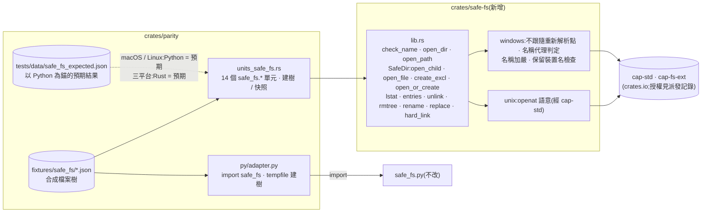
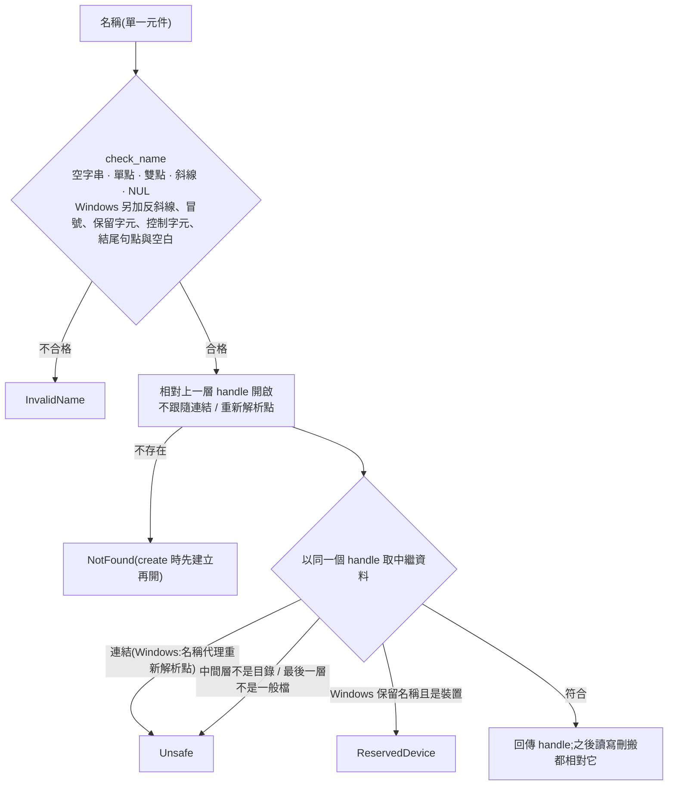
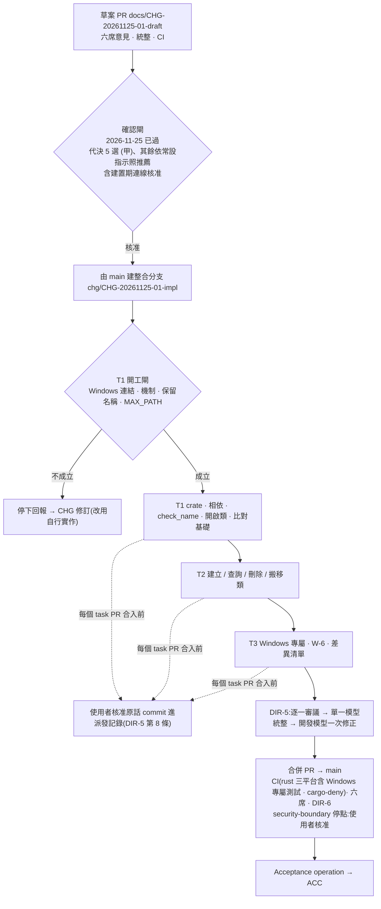

# CHG-20261125-01 — Rust 遷移路線圖第 3 筆:`safe_fs` 安全路徑層移植到新 crate `crates/safe-fs`(含 Windows 連結、保留名稱與路徑長度處理)

- 專案:podcast-studio
- 分支(Branch):main
- 日期:2026-11-25(UTC+0)
- 類型:新增程式(新增 workspace 成員 `crates/safe-fs`,提供 `safe_fs` 的 Rust 版;`crates/parity` 登錄對應的比對單元、Python 轉接器 import `safe_fs` 並以暫存目錄建立合成檔案樹;新增比對 fixture 與預期結果表;**引入第三方 crate `cap-std`、`cap-fs-ext` 與其傳遞相依**);**不改任何根目錄 Python 產品檔**;不改 CI、不改 `deny.toml`、不改 Guideline
- 提出者:使用者(CHG-20261122-02 遷移路線圖階段一第 3 列,確認閘 2026-11-23 使用者逐條覆核;路線圖粒度「按照1模組1CHG」)
- 實作者:主 agent 派發(DIR-3);草案由 Claude subagent 起草(DIR-3 第 2 條例外:治理文件草案直接派 Claude subagent);T1~T3 建議依 DIR-3 第 2 條例外二直接派 Claude subagent(代決 2);實際工作者記於「## 派發記錄」
- 驗收者:獨立 Claude subagent(不參與起草、施工、審議與統整,不看實作者自述)+ 使用者確認
- 風險分級:高(理由見「## 決策與取捨」代決 1;要點:(1) **安全邊界**——`safe_fs` 就是路徑防護本身(Guideline §6.1「安全(應用程式)」列、CHG-20261122-02 安全影響 (4)),本筆以另一種語言、在 Windows 以另一套作業系統機制重做它;(2) **供應鏈**——第一次引入會呼叫作業系統 API(含 FFI 與 `unsafe` 程式碼)的第三方 crate,並需在建置期連線 crates.io 取得新 package;(3) **跨平台與跨語言行為差異**——Windows 沒有 `dir_fd` / `O_NOFOLLOW`,連結、保留裝置名、名稱字元、大小寫、開啟中檔案的刪除與搬移語意都與 macOS / Linux 不同,差異逐條列出,經確認閘 2026-11-25 由使用者核准(見「## 審議 › 確認閘紀錄(2026-11-25)」);(4) **比對工具首次寫檔**——比對單元須在暫存目錄建立合成檔案樹,改變 CHG-20261123-01「工具不寫任何檔案」的描述。不新增執行期網路呼叫、不送資料出本機、不改 CI;可由 `git revert` 完整還原)
- Autonomy:halt;確認閘 2026-11-25 已過(派發者就代決 5 的建置期下載詢問一題,使用者選「核准,每次取最新公告 (Recommended)」,代決 5 定為 (甲);其餘代決 1~4、6~21 依使用者 2026-11-25 常設指示「後面全部自動繼續，不再人為干預」照推薦;見「## 審議 › 確認閘紀錄(2026-11-25)」)
- Commit/PR:草案分支 `docs/CHG-20261125-01-draft`(自 origin/main `e338680` 起草;PR #176,draft,base main);施工整合分支 `chg/CHG-20261125-01-impl`(DIR-5,草案合入 main 後由 main 建立);task 分支 `chg/CHG-20261125-01-T1`~`T3`(PR base 皆為整合分支)
- 重複性檢查(Recurrence check):首次——本 repo 先前沒有移植檔案系統操作到 Rust 的 CHG;CHG-20261124-01 已處理名稱規則(純函式)。CHG-20261124-01 合併 PR #174 的 cargo-deny wildcard 失敗(path 相依未帶 version)已寫入本筆 Global Constraints,未另建 KN
- Diagrams:見「## 設計圖」節
- Mockup: skipped — 本筆沒有任何畫面;安全路徑層的使用者可見訊息由之後的畫面 CHG 處理
- Security-impact:見「## 安全影響」節
- Behaviour spec / Interaction spec:Behaviour spec 為 `features/safe_fs.feature`(T1 新增,T2、T3 各補場景),草案見「### Behaviour spec」;Interaction spec 不適用(不改畫面)
- Skill: ai-sdlc v1.69.1
- 關聯:CHG-20261122-02(遷移路線圖第 3 列;共通規則 (1)~(8);代決 13、14;事實 B、J;安全影響 (4)(6)(7));CHG-20261123-01(比對工具 `parity`、fixture 格式、JSON 行協定、Rust 單元登錄表、CI `rust` job、`deny.toml`);CHG-20261124-01(路線圖第 2 筆:比對單元與轉接器 import 產品模組的做法、「## 後續改善」交給第 3 筆的事項、「### 呼叫端指引」Windows 註、W-6、D-7;合併 PR #174 CI 修正);ACC-20261125-02;CHG-20261022-04 DIR-5 修正 2~5(`safe_fs.py` 的來源);DIR-2、DIR-3 第 2 條例外與例外二、DIR-4、DIR-5、DIR-6、DIR-7;KN-1(本 CHG 全文不寫狀態觸發字)、KN-3(家目錄寫 `~`);Guideline §2 遷移範圍、§5、§6、§6.1、§7、§8「技術約束」

## 動機

CHG-20261122-02「## 遷移路線圖」階段一第 3 列(以下稱「路線圖第 3 筆」)原文要點:

- 模組 / 單元:`safe_fs`
- 目標:安全路徑層
- 範圍:自受信根目錄逐層開啟、任一層是連結即拒絕、最後一層須為一般檔、後續讀寫只用已開啟的 handle(安全影響 (4));能力式目錄存取為首選(代決 14)
- 退出條件:比對 fixture 上接受 / 拒絕與錯誤類別一致;**Windows 上拒絕符號連結與 junction 的測試通過**
- 回滾:revert

路線圖第 2 筆(CHG-20261124-01)已於 2026-11-25 收尾(ACC-20261125-02 判定通過)。該筆「## 後續改善」交給本筆、並經確認閘 2026-11-25 由使用者核准為本筆必做的事項:

- (H-1)Windows 上開啟名稱為保留裝置名的既有項目(例 `con`)的行為「可以開啟,或明確回報無法開啟」須有測試,且**列入本筆 Acceptance operation**(CHG-20261124-01 代決 9、確認閘第 3 題)。
- (H-2)W-6 查證:NTFS 的大小寫對照與 Python `str.casefold` 的差異(例 U+0131 `ı`)。
- (H-3)呼叫端指引的 Windows 註:既有名稱即使通過 `normalize_name`,在 Windows 上開啟、寫入、刪除時仍須經本筆 `safe_fs` 的 handle 相對開啟,不得以字串組路徑。
- (H-4)Windows 路徑長度上限(`MAX_PATH`)的處理(非 UTF-8 目錄項 D-7 的測試交第 5 筆,不在本筆)。
- (H-5)CHG-20261124-01 派發記錄「合併 PR CI 修正」列:workspace 內 path 相依須帶 `version`,否則 `deny.toml` 的 `wildcards = "deny"` 會讓 CI ubuntu 格失敗;本機閘未含 cargo-deny 所以逐 PR 審議沒發現。

起草者 2026-11-25 於 origin/main `e338680` 查證的事實(來源等級標於句首):

A. 〔觀察〕`safe_fs.py` 共 218 行,只 import 標準函式庫(`contextlib`、`errno`、`os`、`stat`,第 30~33 行)。模組 docstring(第 1~27 行)寫明:所有操作自受信根目錄出發;中間各層以 `os.open(名稱, O_RDONLY | O_NOFOLLOW | O_DIRECTORY, dir_fd=上一層)` 開啟,是連結或不是目錄丟 `UnsafePathError`、不存在丟 `FileNotFoundError`;最後一層的檔案以 `O_NOFOLLOW` 開啟後 `fstat` 確認一般檔,之後讀寫一律用該 fd;刪除、搬移、建立連結都以 `dir_fd` 對單一名稱操作;刪除目錄樹以 fd 遞迴、遇連結只刪連結本身;名稱須為單一路徑元件;**訊息不含本機路徑**(第 12 行)。
B. 〔觀察〕各函式的現行行為(行號為 `safe_fs.py`):
   - 常數:`_CLOEXEC`、`_NOFOLLOW`、`_DIRECTORY` 以 `getattr(os, …, 0)` 取得,平台沒有時為 0(第 35~37 行);`_LINK_ERRNOS = {ELOOP, ENOTDIR, EMLINK}`(第 38 行)。`UnsafePathError` 是 `OSError` 子類別(第 41~42 行)。
   - `_check_name(name)`(第 45~48 行):不是 `str`、空字串、`.`、`..`、含 `/` 或 NUL 丟 `ValueError("路徑元件不合法")`;**不檢查** `\`、`:`、結尾句點與空白、Windows 保留名稱。
   - `closing(fd)`(第 51~56 行):`with` 區塊結束時 `os.close`。
   - `_open_subdir(dirfd, name)`(第 59~67 行):`O_RDONLY | O_NOFOLLOW | O_DIRECTORY | O_CLOEXEC`;`FileNotFoundError` 原樣丟出;errno 在 `_LINK_ERRNOS` 內者轉成 `UnsafePathError`;其他 `OSError` 原樣丟出。
   - `open_dir(top, parts=(), *, create=False, mode=0o755)`(第 70~85 行):先檢查全部 `parts` 的名稱(任一不合法即 `ValueError`,不開任何東西);`top` 以 `O_RDONLY | O_DIRECTORY` 開啟(**跟隨連結**——`top` 視為受信);逐層 `open_child`;失敗時關閉已開的 fd。`top` 不存在丟 `FileNotFoundError`、是一般檔丟 `NotADirectoryError`(原樣,不轉 `UnsafePathError`)。
   - `open_child(dirfd, name, *, create=False, mode=0o755)`(第 88~98 行):先 `_open_subdir`;不存在且 `create=False` 丟 `FileNotFoundError`;`create=True` 時 `mkdir(name, mode, dir_fd)`(吞掉 `FileExistsError`)後再 `_open_subdir`——所以名稱已是一般檔或連結(含懸空連結)時,`mkdir` 的 `FileExistsError` 被吞掉,再開啟時丟 `UnsafePathError`(`tests/test_safe_fs.py` 第 69~73 行)。
   - `open_file(dirfd, name, flags=O_RDONLY)`(第 101~115 行):`flags | O_NOFOLLOW | O_CLOEXEC`;連結類 errno 轉 `UnsafePathError`;開啟成功後 `fstat` 不是一般檔就關閉並丟 `UnsafePathError`。〔推論〕以 `O_RDONLY` 開啟目錄會成功、再被 `fstat` 擋下(`UnsafePathError`);以 `O_WRONLY` / `O_RDWR` 開啟目錄則在 `open` 就得 `EISDIR`(`IsADirectoryError`,不轉換);以 `O_RDONLY` 開啟沒有寫入端的 FIFO 會**阻塞**(沒有 `O_NONBLOCK`)。
   - `open_path(top, parts, flags=O_RDONLY)`(第 118~124 行):`parts` 為空丟 `ValueError`;`open_dir(top, parts[:-1])` 後 `open_file` 最後一段。
   - `create_excl(dirfd, name, mode=0o600, flags=O_WRONLY)`(第 127~130 行):`O_CREAT | O_EXCL | O_NOFOLLOW`;名稱已存在(含連結、懸空連結)丟 `FileExistsError`,不跟隨。
   - `open_or_create(dirfd, name, flags=O_RDWR, mode=0o600, tries=100)`(第 133~152 行):迴圈「`open_file` → 不存在就 `create_excl` → 撞到 `FileExistsError` 再重開」最多 100 次,用盡丟 `FileExistsError`;不用 `O_CREAT` 不帶 `O_EXCL` 的理由是 macOS 多行程同時建立同一檔偶發 `ENOENT`(第 136~137 行註解)。
   - `lstat(dirfd, name)`(第 155~160 行):`os.stat(follow_symlinks=False)`;不存在回 `None`。
   - `entries(dirfd)`(第 163~172 行):`os.scandir(dirfd)` 取名稱、依名稱排序(Python `str` 比較即碼位順序),逐一 `lstat`,列舉途中消失者略過。
   - `unlink(dirfd, name, missing_ok=False)`(第 175~181 行)。
   - `rmtree(dirfd, name, missing_ok=False)`(第 184~204 行):`lstat`;不存在時依 `missing_ok` 回傳或丟 `FileNotFoundError`;不是目錄(含連結)只 `unlink` 本身;是目錄則 `_open_subdir`——`lstat` 之後被換成連結(`UnsafePathError`)時只刪連結、消失時直接回傳;以子目錄 fd 遞迴刪除每個子項(`missing_ok=True`)後 `rmdir`。〔推論〕遞迴深度受 Python 遞迴上限(預設 1000)限制。
   - `rename` / `replace`(第 207~212 行):`os.rename` / `os.replace`,兩個名稱都先 `_check_name`;POSIX 上 `rename` 對既有一般檔目標也會覆蓋。
   - `link(src_dirfd, src, dst_dirfd, dst)`(第 215~218 行):`os.link(…, follow_symlinks=False)`;目標已存在(含連結)丟 `FileExistsError`;來源是連結時不跟隨。
C. 〔觀察〕呼叫端(`git grep -n safe_fs` 結果,不含 `docs/`):`heavy_lock.py`(第 55、65~66 行:`outputs/` 目錄與 `.heavy.lock`)、`media.py`(第 40~44、55~62、74~75、89~90、366~371、544 行)、`nodes.py`(第 198、375、386、417 行)、`project.py`(第 969~1489 行約 50 處:專案目錄、鎖檔、專案檔原子寫入、`history/` 硬連結快照、列舉、移到 `.trash/`、`rmtree` 清理)、`settings.py`(第 528~614、825、987、1227 行:`config/` 目錄、設定資料庫建立與鎖檔、`models.json`)、`studio_server.py`(第 539~631、911~974、1062~1065、1181、1275~1290、1338~1409 行:靜態檔、上傳、硬連結發佈、工作流程存檔)、`tts_service.py`(第 113~664 行:暫存目錄、語音檔搬移)。值得注意的用法:
   - **開著 fd 就刪名稱**:`studio_server.py:1064-1065`、`tts_service.py:254-256` 以 `create_excl` 取得 fd 後立刻 `unlink`,之後繼續用 fd(匿名暫存檔手法)。
   - **硬連結**:`project.py:1217`(版本快照)、`studio_server.py:617`、`1402`(排他發佈:目標已存在就 409)。
   - **跨目錄搬移**:`tts_service.py:418`、`664`,`media.py:44`,`project.py:1192`(原子取代專案檔)、`1403`(在持有專案目錄 fd 與專案鎖的情況下,把專案目錄 `rename` 到 `.trash/`)。
   - **`lstat` 結果的欄位**:`st_mode`(`S_ISDIR` / `S_ISREG` / `S_ISLNK`)、`st_size`、`st_mtime` / `st_mtime_ns`、`(st_dev, st_ino)`(`settings.py:537`、`546` 以此辨識同一個資料庫檔)。
   - 既有測試:`tests/test_safe_fs.py`(14 個測試,第 43~193 行);`tests/test_project.py:811-818`、`tests/test_server_files.py:696-703` 以 monkeypatch 替換 `safe_fs` 函式。
D. 〔觀察〕Python `safe_fs` **不能在 Windows 執行**:起草者在 Windows 開發機以 Python 3.12.10 唯讀試跑,`os.supports_dir_fd` 為空集合,`safe_fs._NOFOLLOW`、`_DIRECTORY` 皆為 0;`open_dir(top, ["a"])` 在開啟 `top` 本身就丟 `PermissionError`(Windows 不能以 `os.open` 開啟目錄),任何帶 `dir_fd` 的呼叫丟「平台不支援」的例外(類別名稱為 `NotImpl` 開頭、`Error` 結尾,依 KN-1 不寫全名;訊息 `dir_fd unavailable on this platform`)。所以**比對只能在 macOS / Linux 進行**;Windows 上的 Rust 行為沒有 Python 對照,只能以「與 macOS / Linux 上 Python 結果相同」為準(代決 10)。Guideline §6「限制與假設(v1.18)」已記 `safe_fs` 依賴 `dir_fd`、`O_NOFOLLOW`、`O_DIRECTORY`(Windows 沒有)。
E. 〔觀察〕現有 Rust:`crates/studio-core`(`#![forbid(unsafe_code)]`;`value_checks`、`names` 兩個純函式模組;CHG-20261124-01 T3 test (2) 以 `grep -rn "cfg(windows)\|cfg(target_os" crates/studio-core/src/` 無輸出斷言名稱規則不分平台;`docs/structure/design.md` 記錄「Windows 保留名稱:只擋新名稱、三平台一致」);`crates/parity`(lib、bin;`src/lib.rs` 第 12 行與 `src/main.rs` 第 10 行寫明「不寫任何檔案」,`docs/structure/design.md`、`directory.md` 同);`Cargo.lock` 共 13 個 package(`itoa`、`memchr`、`parity`、`proc-macro2`、`quote`、`serde`、`serde_core`、`serde_derive`、`serde_json`、`studio-core`、`syn`、`unicode-ident`、`zmij`)。workspace `members = ["crates/*"]`,新目錄自動成為成員。
F. 〔觀察〕`deny.toml`:`licenses.allow` 為 `MIT`、`Apache-2.0`、`Apache-2.0 WITH LLVM-exception`、`BSD-2-Clause`、`BSD-3-Clause`、`ISC`、`Zlib`、`Unicode-3.0`、`BSL-1.0`、`Unlicense`;`[licenses.private] ignore = true` 略過 `publish = false` 的 workspace 成員;`bans.wildcards = "deny"`、`multiple-versions = "warn"`;`sources` 只允許 crates.io;`advisories` 的 unmaintained、unsound 一律擋、yanked 擋;檔頭寫明「本檔的任何放寬都須另經 CHG」。CI 只在 `rust-platform` 的 ubuntu 格以 `cargo deny --locked check` 執行。
G. 〔觀察〕起草者本機的 cargo 快取(`~/.cargo/registry/cache/`)沒有 `cap-std`、`cap-fs-ext`、`cap-primitives`、`rustix`;只有 `windows-sys-0.61.2`(其他專案留下)。所以引入代決 4 的 crate 需要建置期連線,實際會發生的連線有三類:(i) T1 以 `cargo update --workspace` 解析相依,向 crates.io 的 index 查詢並更新 `Cargo.lock`;(ii) 新 package 的 `.crate` 原始檔下載——`--locked` 只鎖版本、不阻止下載,Windows 開發機與 WSL 各有自己的 `~/.cargo`,第一次建置各下載一次,CI 每次執行與 Acceptance operation 的乾淨工作副本(若該環境快取沒有)亦同;(iii) `cargo deny --locked check` 的 advisories 檢查預設**每次**向 GitHub 取 RustSec 公告資料庫(advisory-db)。另〔觀察〕本機已有 `~/.cargo/advisory-dbs/`(含 `advisory-db-` 開頭的子目錄與 `db.lock`),表示先前的 `cargo deny` 已取過公告資料庫。以上皆為**只下載**的建置期連線(對象為 crates.io 與 github.com 上的 RustSec 公告庫),屬 Guideline §6.1「離線(建置期)」允許的建置期例外;本 repo 前兩筆 Rust CHG 都以離線方式更新 `Cargo.lock`,本筆是第一次需要為新 package 連線。執行期與產品程式不新增任何網路呼叫。
H. 〔推論〕cap-std 系列(Bytecode Alliance)的授權為 `Apache-2.0 WITH LLVM-exception OR Apache-2.0 OR MIT`;其傳遞相依〔推論〕包含 `cap-primitives`、`ambient-authority`、`fs-set-times`、`io-extras`、`io-lifetimes`、`ipnet`、`maybe-owned`、`rustix`、`linux-raw-sys`、`bitflags`、`libc`、`errno`、`windows-sys` 與 `windows-targets` 系列、`winx` 等,授權〔推論〕皆為 MIT / Apache-2.0 系;實際清單、版本、授權與 RustSec 公告狀態〔未知〕,由 T1 以 `cargo metadata --locked` 與本機 `cargo deny --locked check` 查證後寫入派發記錄(本草案依記憶寫出,不得當作已查證)。
I. 〔未知〕cap-std / cap-primitives 在 Windows 上「相對目錄 handle 開啟」的實際機制:〔推論〕可能是以目錄 handle 取回完整路徑後串接再以 Win32 API 開啟(此時保留裝置名、`MAX_PATH`、結尾句點的處理依 Win32 路徑規則),也可能以 NT API 相對 handle 開啟(此時不經 DOS 路徑轉換)。兩者對 H-1、H-4 的結果不同,所以 T1 第一步以測試查證(代決 4 的閘)。
J. 〔推論〕Windows 的連結種類以「重新解析點」(reparse point)表示:符號連結(`IO_REPARSE_TAG_SYMLINK`)、junction(`IO_REPARSE_TAG_MOUNT_POINT`)、WSL 建立的連結(`IO_REPARSE_TAG_LX_SYMLINK`)都帶「名稱代理」(name surrogate)位元;OneDrive 等雲端佔位檔、重複資料刪除等重新解析點不帶此位元。Rust 標準函式庫的 `FileType::is_symlink()` 在 Windows 上以「是重新解析點且帶名稱代理位元」判定〔推論〕。建立符號連結在 Windows 需要 `SeCreateSymbolicLinkPrivilege`(系統管理員或開發人員模式);建立 junction 不需要〔推論〕。GitHub-hosted `windows-latest` 以系統管理員執行,可建立符號連結〔推論〕。
K. 〔推論〕Windows 檔名規則:Win32 路徑轉換會去掉名稱結尾的句點與空白、把 `\` 當分隔字元、把 `:` 解讀為磁碟機或替代資料流(ADS)、不接受 `<>"|?*` 與控制字元;保留裝置名(`CON`、`NUL`、`COM1` 等)在一般路徑中可能被解讀為裝置(Windows 11 是否已放寬帶目錄的路徑〔未知〕);NTFS 不分大小寫,大小寫對照依磁碟區的 `$UpCase` 表(格式化時決定,不同 Windows 版本格式化的磁碟區可能不同);NTFS 可能保留 8.3 短檔名別名。macOS 的 APFS 預設也不分大小寫(並對 Unicode 正規化不敏感),Python 版在 macOS 上本來就有此行為。

## 使用者故事

1. 作為使用者,Rust 應用程式存取 `projects/`、`outputs/`、`config/`、`workflows/` 時,「哪些路徑會被拒絕、哪些可以開啟、出錯時是哪一類錯誤」與 Python 網頁版相同(macOS / Linux 以並行比對證明),以便兩版讀寫同一份資料時行為一致。
2. 作為使用者,在 Windows 上符號連結與 junction 一樣會被拒絕,檔案也只透過已開啟的目錄 handle 存取,以便 Windows 版有與 macOS / Linux 相同的路徑防護。
3. 作為使用者,資料夾中若有名為 `con` 這類 Windows 保留裝置名的既有專案(例如從 Mac 複製過來),Windows 版要嘛正常開啟它,要嘛明確告訴我無法開啟,絕不會誤開到主控台等裝置。
4. 作為使用者,Rust 版與 Python 版、Windows 與 macOS / Linux 在路徑層刻意或無法避免的不同之處逐條列在本 CHG,且由自動測試鎖住。
5. 作為使用者,Python 網頁版、MCP 伺服器與我的資料完全不受本筆影響;新增的第三方套件有清楚的用途、授權與來源記錄。

## 決策與取捨

> 依使用者 2026-10-26 原則「如果多次審議都無交集 只採最低限度」:本筆只移植 `safe_fs` 的公開介面(`_check_name` 一併比對)並登錄比對單元,加上路線圖與 CHG-20261124-01 交接指定的 Windows 處理;不移植任何呼叫端(`project`、`settings`、`heavy_lock`、`media`、`tts_service`、`nodes`、`studio_server` 依路線圖各自一筆)、不改 CI、不改 `deny.toml`、不改 Guideline。凡依記憶而非本 repo 可讀證據寫出的第三方事實(cap-std 的 API 名稱與 Windows 機制、相依清單與授權、Windows 重新解析點與檔名規則),一律標〔推論〕或〔未知〕並列為該 task 開工時的查證項。

### 1. crate 配置(代決 3)

| 選項 | 說明 | 優點 | 缺點 |
|------|------|------|------|
| (a) **新增 workspace 成員 `crates/safe-fs`**(package `safe-fs`、lib `safe_fs`,`publish = false`) | 平台相關程式只在這個 crate;`studio-core` 不動 | 平台條件編譯(`cfg(windows)` / `cfg(unix)`)集中在一個 crate,符合 Guideline §8「平台差異集中在少數模組」;`studio-core` 維持「名稱規則不分平台、沒有 `cfg(windows)`」(事實 E,CHG-20261124-01 代決 8 的不變式);新增的第三方相依只進這個 crate,之後只需純函式的讀取方不會被迫帶上;回滾只需移除一個目錄 | 多一個 crate;路線圖第 5 筆起 `studio-core` 的檔案存取模組要 path 相依 `safe-fs` |
| (b) 放進 `crates/studio-core/src/safe_fs.rs` | 與 `names` 同 crate | 少一個 crate | `studio-core` 首次出現 `cfg(windows)`,CHG-20261124-01 T3 test (2) 的不變式失效;第三方相依擴散到全部產品核心 |
| (c) 放進 `crates/parity` | — | — | 產品程式不得依賴比對工具,不可行 |

**代決 3**:採 (a)。`parity` 以 `safe-fs = { path = "../safe-fs", version = "=0.0.0" }` 相依(H-5:path 相依必須帶 `version`,否則 cargo-deny `wildcards = "deny"` 失敗);`safe-fs` 保留 `#![forbid(unsafe_code)]`(需要 `unsafe` 的部分只在第三方 crate 內)。

### 2. 能力式目錄存取的實作方式(代決 4)

路線圖代決 14:能力式目錄存取(如 cap-std 類 crate)為首選,自行以平台 API 實作為備案,路徑字串檢查等於回退(不採)。

| 選項 | 說明 | 優點 | 缺點 |
|------|------|------|------|
| (a) **`cap-std` + `cap-fs-ext`** | 以 `cap_std::fs::Dir` 表示已開啟的目錄 handle;每一層只開**單一名稱**,並以不跟隨連結的開啟方式(〔推論〕`cap-fs-ext` 的 `DirExt::open_dir_nofollow`、`OpenOptionsFollowExt::follow(FollowSymlinks::No)`、`DirExt::symlink_metadata`)取得下一層;開啟後再以 handle 取得中繼資料確認型別 | 路線圖首選;三平台一套 API;Unix 上〔推論〕以 `openat` + `O_NOFOLLOW` 實現,與 Python 語意最接近;本 repo 不必寫 `unsafe` | 新增約 15~20 個 package(事實 H)、首次需連線 crates.io(事實 G);**Windows 上的實際機制〔未知〕**(事實 I);cap-std 的預設語意是「沙箱內的連結可以跟隨」,本筆要的是「任何連結都拒絕」——要靠「每次只開單一名稱 + 不跟隨」組合出來,須以測試證明 |
| (b) 自行以平台 API 實作 | Unix:`rustix`(`openat`、`O_NOFOLLOW`、`O_DIRECTORY`、`fstat`、`unlinkat`、`renameat`、`linkat`、`mkdirat`);Windows:`windows-sys` 的 `NtCreateFile`(以 `RootDirectory` 相對開啟、`FILE_OPEN_REPARSE_POINT`)與 `SetFileInformationByHandle` | 每一步都可控,Windows 上可確定不經 Win32 路徑轉換(保留裝置名、`MAX_PATH`、結尾句點都不會被改寫) | Windows 部分需要 `unsafe` FFI,須放寬或另立 crate 放寬 `forbid(unsafe_code)`;程式量與審查負擔大得多;仍要引入 `rustix`、`windows-sys` |
| (c) 只用標準函式庫 | 標準函式庫穩定版沒有 `openat` 類 API(〔未知〕1.100 是否已有穩定的目錄 handle API) | 無新相依 | 做不到「相對已開啟目錄」的操作,只能以路徑字串檢查,等於回退(CHG-20261122-02 代決 14 不採) |

**代決 4**:採 (a),以 (b) 為備案,並設**開工閘**:T1 第一步先只寫測試(紅燈),在 Windows 開發機與 WSL 實跑以下查證項,結果寫入派發記錄——(i) Windows 上檔案符號連結、目錄符號連結、junction 在中間層與最後一層都被拒絕;(ii) Windows 上 cap-std 相對開啟的實際機制(事實 I;以讀 `cap-primitives` 原始碼與實測兩種方式確認);(iii) 開啟既有的保留名稱項目(`con`)時打開的是真正的目錄項而非裝置,或明確失敗(H-1);(iv) 總長超過 260 字元的深層路徑可開啟與刪除(H-4)。任一項做不到時,施工者**停下回報派發者**,不得自行改用 (b) 或改寫測試;改用 (b) 屬 CHG 修訂,須使用者確認(確認閘 2026-11-25 已過不涵蓋改用備案;常設指示也不涵蓋,因為改用備案是 CHG 修訂,須另經確認閘)。

### 3. 新增 crate、授權與建置期連線(代決 5;共通規則 (6))

**代決 5**:

- 直接相依只新增兩個:`cap-std`(用途:能力式目錄 handle 與相對開啟)、`cap-fs-ext`(用途:不跟隨連結的開啟與 `symlink_metadata`、跨平台的檔案識別碼)。授權〔推論〕皆為 `Apache-2.0 WITH LLVM-exception OR Apache-2.0 OR MIT`,在 `deny.toml` 允許清單內(事實 F)。傳遞相依的清單、版本與授權由 T1 以 `cargo metadata --locked --format-version 1` 列出,逐一寫入派發記錄(package、版本、授權、引入它的上層 crate)。
- **`deny.toml` 不改**。T1 須在本機(Windows 開發機與 WSL 各一次)執行 `cargo deny --locked check`(H-5:CI 只在 ubuntu 格跑),licenses、bans、sources、advisories 四項都 ok 才繼續;任一 package 的授權不在允許清單、有 RustSec 公告、或來源不是 crates.io 時,停下回報派發者(放寬 `deny.toml` 須另經 CHG,事實 F)。`multiple-versions` 只警告(例 `windows-sys` 多版本),警告內容寫入派發記錄。
- **建置期連線**(事實 G 的三類,皆只下載):(i) T1 在 `crates/safe-fs/Cargo.toml` 與 `crates/parity/Cargo.toml` 加入相依後,以 `cargo update --workspace` 解析並更新 `Cargo.lock`(連 crates.io index),只把新 package 加進 `Cargo.lock`;以 `git diff Cargo.lock` 與 `cargo metadata --locked` 確認既有 13 個 package 的名稱與版本**全部不變**,差異寫入派發記錄;之後所有 cargo 指令一律帶 `--locked`。若 `cargo update --workspace` 會升級任何既有 package,改以 `cargo update -p <新 package> --precise <版本>` 逐一處理,仍不得升級既有 package;做不到時停下回報。(ii) `--locked` 不阻止下載:Windows 開發機與 WSL 第一次建置各會從 crates.io 下載新 package 的 `.crate` 原始檔一次,CI 與 Acceptance operation 的乾淨工作副本(快取沒有時)亦同。(iii) `cargo deny --locked check` 的 advisories 檢查預設每次向 GitHub 取 RustSec 公告資料庫。(iii) 的處理方式有兩個選項(保留作紀錄):**(甲)** 本機每次執行都連線取最新公告(與 CI 相同,公告最新;每次本機閘都有一次對 github.com 的下載);**(乙)**(未採)本機改帶「不取公告、只用既有快取」的旗標(〔推論〕旗標名稱類似 `--disable-fetch`,由 T1 以 `cargo deny check --help` 查證實際名稱後寫入派發記錄),只用 `~/.cargo/advisory-dbs/` 既有快取,最新公告以 CI ubuntu 格為準(本機的公告判定可能落後)。起草者原建議 (乙);**確認閘 2026-11-25 使用者選「核准,每次取最新公告 (Recommended)」,定為 (甲)**:本機與 CI 的 `cargo deny --locked check` 都以預設方式每次連線取最新公告,不使用「只用快取」旗標。以上 (i)~(iii) 都是只下載、不上傳的建置期連線(Guideline §6.1「離線(建置期)」),**確認閘 2026-11-25 已由使用者核准**(原話見「## 審議 › 確認閘紀錄(2026-11-25)」);CI 本來就由 crates.io 下載相依並執行 cargo-deny,不因本筆新增連線種類。執行期與產品程式不新增任何網路呼叫。
- 版本以 crates.io 當時最新的穩定版為準,但須支援 `rust-toolchain.toml` 的 1.100.0 且 `edition = "2024"` 可建置〔推論〕;採用的版本寫入派發記錄。不使用 git 相依、不開非預設 feature(除非 T1 查證需要,需要時寫明理由)。

### 4. Rust API(代決 6)

| Python | Rust(`crates/safe-fs`) | 等價範圍 |
|--------|--------------------------|----------|
| fd(`int`)+ `closing` | `SafeDir`(擁有一個目錄 handle;`Drop` 時關閉)、檔案以 `std::fs::File` 回傳 | 生命週期由型別保證;`closing` 不需要對應函式 |
| `UnsafePathError` / `ValueError` / `FileNotFoundError` / `FileExistsError` / `NotADirectoryError` / `IsADirectoryError` / `PermissionError` / 其他 `OSError` | `Error { kind: ErrorKind, .. }`,`ErrorKind::{InvalidName, Unsafe, NotFound, AlreadyExists, NotADirectory, IsADirectory, PermissionDenied, ReservedDevice, Other(…)}`;`Display` 訊息不含本機路徑(事實 A) | 類別與 Python 一一對應(對應規則見代決 10 的錯誤類別表);`ReservedDevice` 只在 Windows 可能出現(代決 9) |
| `_check_name(name)` | `check_name(name: &OsStr) -> Result<(), Error>`(公開,供比對與呼叫端) | macOS / Linux 與 Python 相同;Windows 另加規則(代決 8) |
| `open_dir(top, parts, create, mode)` | `open_dir(top: &Path, parts: &[&OsStr], opts: DirOptions) -> Result<SafeDir>`;`DirOptions { create: bool, mode: u32 }` | `top` 跟隨連結(受信);`mode` 只在 Unix 生效 |
| `open_child`、`open_file`、`create_excl`、`open_or_create`、`lstat`、`entries`、`unlink`、`rmtree` | `SafeDir` 的同名方法;`open_file` 等以 `FileAccess::{Read, Write, ReadWrite}` 加 `truncate: bool` 取代任意 `flags` 整數(呼叫端只用到 `O_RDONLY`、`O_WRONLY`、`O_RDWR`、`O_WRONLY \| O_TRUNC`,事實 C) | 名稱參數一律 `&OsStr`(接受 `&str`),`entries` 回傳 `OsString`,使非 UTF-8 目錄項可被列出與刪除(D-7 的測試仍交第 5 筆) |
| `open_path(top, parts, flags)` | `open_path(top: &Path, parts: &[&OsStr], access: FileAccess) -> Result<File>` | 同 |
| `rename` / `replace` / `link`(兩個 dir fd + 兩個名稱) | `SafeDir::rename(&self, src, dst_dir: &SafeDir, dst)`、`replace`、`hard_link` | 見 D-9(Windows 的 `rename` 語意) |
| `lstat` 回 `os.stat_result` | `Option<Meta>`:`kind: EntryKind::{File, Dir, Symlink, Other}`、`len: u64`、`modified: SystemTime`、`identity: (u64, u64)`(Unix 為 `(st_dev, st_ino)`;Windows 為〔推論〕磁碟區序號與檔案索引,經 `cap-fs-ext` 取得) | 呼叫端用到的欄位(事實 C)都有;Windows 上的連結(名稱代理重新解析點)回 `Symlink` |

**代決 6**:照上表。替代:(b) 保留整數 `flags` 參數——Windows 沒有對應旗標,呼叫端仍要分平台;(c) 名稱參數只收 `&str`——非 UTF-8 目錄項無法被 `rmtree` 刪除,與 Python(`surrogateescape`)不同。

### 5. Windows 的連結判定(代決 7)

| 選項 | 說明 | 優點 | 缺點 |
|------|------|------|------|
| (a) **拒絕帶「名稱代理」位元的重新解析點**(符號連結、junction、WSL 連結);其他重新解析點(雲端佔位檔、重複資料刪除)依其本身的檔案 / 目錄屬性處理 | 等同 Python「拒絕連結」的意圖 | 路線圖退出條件(符號連結、junction)成立;OneDrive「檔案隨選」等同步資料夾內的檔案仍可存取 | 開啟雲端佔位檔可能觸發同步程式下載內容(作業系統行為,不是本程式的網路呼叫〔推論〕);非名稱代理的重新解析點種類多,CI 只能測符號連結與 junction |
| (b) 拒絕**全部**重新解析點 | 最嚴 | 規則最簡單 | 若資料放在 OneDrive 同步資料夾(Windows「文件」常被重新導向),佔位檔全部打不開〔推論〕;起草者無法確認使用者的「文件」是否由 OneDrive 管理(〔未知〕;CHG-20261124-01 代決 16 記錄 cargo 在 `Documents` 下異常、原因〔未知〕) |

**代決 7**:採 (a)。判定以「開啟時不跟隨重新解析點,再以同一個 handle 的中繼資料判定」為準,不以路徑另查;符號連結與 junction 在**中間層與最後一層**皆拒絕(對應 Python `test_open_dir_rejects_symlink_at_any_level`、`test_open_file_rejects_symlink_and_non_regular`),指向受信根目錄**內部**的連結也拒絕。`rmtree` 遇到連結類項目只刪項目本身、不進入(對應 `test_rmtree_on_symlink_removes_only_the_link`)。

### 6. Windows 的名稱規則(代決 8)

Python `_check_name` 不檢查 `\`、`:`、結尾句點與空白(事實 B);這些在 Windows 會改變名稱的意義(事實 K):`a\..\..\x` 會被拆成多層、`f.txt:s` 會開到替代資料流、`f.txt.` 會開到 `f.txt`。

| 選項 | 說明 | 優點 | 缺點 |
|------|------|------|------|
| (a) **只在 Windows 加嚴**:`check_name` 在 Windows 另拒絕 `\`、`:`、`<>"\|?*`、U+0001~U+001F 控制字元、結尾句點或空白(`InvalidName`);macOS / Linux 與 Python 完全相同 | 平台差異集中在 `safe-fs`(代決 3) | macOS / Linux 與 Python 零差異——既有資料中檔名含 `:` 的項目(例:其他工具建立、在 `.trash/` 中)在 Rust 版仍能列舉與刪除;Windows 上不會因名稱被改寫而開到別的項目 | Windows 上若磁碟上已有這類名稱(由 WSL 或 `\\?\` 工具建立),Rust 版無法開啟或刪除,`rmtree` 會以 `InvalidName` 失敗(D-4) |
| (b) 三平台都加嚴 | 與 CHG-20261124-01 代決 8「三平台一致」同方向 | 行為只有一套 | macOS / Linux 上 `rmtree` 遇到含 `:` 的子項會失敗,Python 卻刪得掉——資料刪除行為與 Python 不同,違反路線圖「行為等價」;名稱政策(新名稱不得用保留名稱)已由 `names::normalize_new_name` 負責,不需要在路徑層重複 |

**代決 8**:採 (a)。保留裝置名**不列入** `check_name`(見代決 9)。與 CHG-20261124-01 代決 8 的關係:該筆管「新名稱」的政策(三平台一致);本筆管「路徑層能否無歧義地開啟某個名稱」,屬平台機制,兩者不衝突。

### 7. Windows 上的保留裝置名(代決 9;H-1)

| 選項 | 說明 | 優點 | 缺點 |
|------|------|------|------|
| (a) **開啟既有項目時,以 handle 相對開啟真正的目錄項;實作做不到時以 `ReservedDevice` 明確失敗,絕不開到裝置** | `check_name` 不擋保留名稱;`safe-fs` 在 Windows 上對保留名稱(CHG-20261124-01 代決 10 的 24 個名稱,ASCII 不分大小寫、整個名稱相等;另加〔推論〕帶副檔名形式 `con.txt`)走「開啟後以 handle 確認是磁碟上的檔案或目錄(不是字元裝置)」的檢查 | 符合 H-1「可以開啟,或明確回報無法開啟」;代決 4 (a) 若在 Windows 是 NT 相對開啟,`con` 專案可正常開啟(CHG-20261124-01 代決 9 的「既有 `con` 專案仍可開啟」在 Windows 也成立) | 哪一種結果取決於事實 I(〔未知〕),T1 開工閘查證後才知道 |
| (b) Windows 上一律以 `ReservedDevice` 拒絕保留名稱 | 不嘗試開啟 | 結果確定 | 從 Mac 帶來的 `con` 專案在 Windows 版永遠打不開,即使實作有能力安全開啟 |

**代決 9**:採 (a)。**必做測試**(列入 Acceptance operation,H-1):Windows 上在暫存的受信根目錄內,以 `\\?\` 完整路徑(不經 DOS 裝置名轉換)預先建立名為 `con` 的目錄(內含標記檔)、`nul` 的一般檔、`COM1` 的目錄;再以 `safe-fs` 的 `open_dir`、`open_file`、`lstat`、`entries`、`rmtree` 操作它們,斷言每一項「開到的是該目錄項(讀到標記檔 / 內容)」或「回 `ReservedDevice`」,兩者之一,且**測試輸出逐項印出是哪一種**;另斷言 `create_excl(d, "con")` 不會開到裝置(建立出磁碟上的檔案,或回 `ReservedDevice`)。結果寫入派發記錄,並更新「### 呼叫端指引」的 Windows 註。

### 8. MAX_PATH(代決 13;H-4)

**代決 13**:不另訂路徑長度上限;以「每次只對單一名稱、相對已開啟的 handle 操作」避開整條路徑的長度限制。必做測試(Windows):以 `open_dir(create=true)` 建立 30 層、每層 20 字元(總長超過 600 字元)的目錄,在最底層 `create_excl`、寫入、以 `open_path` 讀回、最後由最上層 `rmtree` 刪除,全部成功。若 cap-std 的 Windows 機制以完整路徑串接而受 `MAX_PATH` 限制(事實 I),屬代決 4 開工閘的失敗項,停下回報。macOS / Linux 的 `PATH_MAX` 同理以相對開啟避開(同一測試三平台執行)。

### 9. 比對設計:檔案系統行為怎麼比(代決 10)

比對工具的單元是 `fn(&Value) -> Outcome` 的純函式介面(CHG-20261123-01),但 `safe_fs` 的行為依賴檔案系統狀態。設計:

- **單元**:一個公開函式一個單元,共 14 個:`safe_fs.check_name`(純函式,輸入為名稱)與 `safe_fs.open_dir`、`open_child`、`open_file`、`open_path`、`create_excl`、`open_or_create`、`lstat`、`entries`、`unlink`、`rmtree`、`rename`、`replace`、`link`。fixture 一單元一檔,放 `crates/parity/fixtures/safe_fs/<函式>.json`。
- **輸入**:`{"tree": [<項目>…], "call": {<參數>}}`。`<項目>` 為 `{"path": "a/b/f.txt", "type": "file", "content": "<UTF-8 文字>"}`、`{"path": "a/b", "type": "dir"}`、`{"path": "a/mid", "type": "symlink", "target": "<記號>", "kind": "dir" | "file"}`;`<記號>` 只允許 `@top/…`、`@outside/…`、`@missing`(懸空),由兩邊各自換成自己的暫存路徑。`call` 的名稱與路徑元件為 JSON 字串;開啟旗標以 `"r"`、`"w"`、`"rw"`、`"w_trunc"` 表示。
- **兩邊各自建樹**:Python 轉接器以 `tempfile.mkdtemp()`、Rust 單元以標準函式庫在系統暫存目錄建立唯一名稱的工作目錄(`create_dir` 排他建立,不引入 `tempfile` crate),其下建 `top/`(受信根目錄)與 `outside/`(含標記檔,模擬根目錄外的資料);呼叫函式;取結果;**每個案例結束都刪除工作目錄**(Python `shutil.rmtree`、Rust `std::fs::remove_dir_all`,兩者都不跟隨連結〔推論〕)。
- **輸出(`ok` 的 `value`)**:`{"result": <正規化結果>, "top": <快照>, "outside": <快照>}`。`<正規化結果>`:回傳檔案者為 `{"file": <讀到的內容>}`(寫入旗標時先寫入固定標記字串,快照會反映寫到哪裡);回傳目錄者為 `{"dir": [<該目錄的名稱清單>]}`(證明開到哪一個目錄);`lstat` 為 `{"type": "file" | "dir" | "symlink" | "other", "size": <一般檔才有>}`(不比對時間、inode 等隨環境變動的欄位);`entries` 為 `[[名稱, 型別], …]`;無回傳值者為 `null`。`<快照>` 為依名稱排序的 `[[相對路徑, 型別, 內容或連結記號], …]`。
- **錯誤類別**(轉接器與 Rust 單元同一張表):

| Python | Rust `ErrorKind` | 比對結果 |
|--------|------------------|----------|
| `UnsafePathError`(須先於其他 `OSError` 判斷) | `Unsafe` | `reject unsafe` |
| `ValueError` | `InvalidName` | `reject invalid_name` |
| (無;只在 Windows) | `ReservedDevice` | `reject reserved_device` |
| `FileNotFoundError` | `NotFound` | `error not_found` |
| `FileExistsError` | `AlreadyExists` | `error exists` |
| `NotADirectoryError` | `NotADirectory` | `error not_a_directory` |
| `IsADirectoryError` | `IsADirectory` | `error is_a_directory` |
| `PermissionError` | `PermissionDenied` | `error permission` |
| 其他 `OSError` | `Other` | `error os_<errno 名稱>`(例 `os_ENOTEMPTY`) |
| 輸入格式不符(非物件、缺欄位) | 同 | `error type` |

  Rust 在 Unix 上由原始 errno 依 PEP 3151 的同一組對應決定類別(不依 `std::io::ErrorKind`,避免兩邊對應表不同);同一情境在 Linux 與 macOS 的 errno 可能不同(例:對目錄 `unlink`,〔推論〕Linux 為 `EISDIR`、macOS 為 `EPERM`),兩邊在同一平台執行所以比對不受影響,跨平台差異記在預期結果表(下一點)。
- **Windows 怎麼辦**:Python 端在 Windows 無法執行(事實 D),所以——(1) `crates/parity/tests/module_parity.rs` 在 Windows 上**略過 `fixtures/safe_fs/`**(印出略過原因,其他 fixture 照舊比對);(2) 新增預期結果表 `crates/parity/tests/data/safe_fs_expected.json`(`{單元: {案例 id: {"all": <結果>, "linux"?: …, "macos"?: …, "windows"?: …}}}`,放在 `fixtures/` 之外,不屬 fixture 格式);(3) 新增 `crates/parity/tests/safe_fs_expected.rs`:**在 macOS / Linux 斷言 Python 實際結果等於表中該平台的預期**(預期表以 Python 為錨,不能憑空寫),**在三平台斷言 Rust 實際結果等於表中該平台的預期**;Windows 欄只能出現在「### 行為差異清單」列出的案例上(測試以常數寫明筆數)。如此 Windows 的 Rust 行為經由預期表間接等於 macOS / Linux 上的 Python 行為。
- **建立連結的權限**:符號連結案例在 Windows 需要權限(事實 J)。`safe_fs_expected.rs` 與 Windows 專屬測試在無法建立符號連結時:環境變數 `GITHUB_ACTIONS` 為 `true`(CI)即**判失敗**;本機則印出「略過:無權限建立符號連結」與略過案例數、不判失敗(同 CHG-20261124-01 代決 7 的做法)。junction 以測試程式呼叫 `cmd /c mklink /J`(只在測試中)建立,不需權限,不得略過。注意 `cmd /c` 本身就是 shell:它會把後面的參數重新當命令列解析,即使以 argv 清單傳入也擋不住 cmd 的元字元。所以呼叫前須斷言連結路徑與目標路徑都**不含** `&`、`|`、`<`、`>`、`^`、`%`、`"`、`(`、`)` 與換行;含有時判測試失敗並印出原因(哪一個路徑、哪一個字元),**不得略過**。T1 若查證到不經 shell 的建立方式(例:標準函式庫或既有相依已穩定提供的 API,須查證;不得為此新增 crate),可改用,並記入派發記錄。
- **不進 fixture 的情境**:檢查與使用之間被換成連結的競態(`test_rmtree_dir_swapped_to_symlink_after_lstat`、`test_dir_fd_survives_swap_of_its_path`)需要在函式執行途中改動檔案系統,無法以 fixture 表達;屬 DIR-7「威脅模型外」,但既有防護不回退——改由 `crates/safe-fs/tests/` 的 Rust 測試以「handle 取得後改名原路徑並換成連結,之後的建立與刪除仍落在原目錄」驗證(Unix;Windows 見 W-S10),`rmtree` 的換連結競態以程式結構保證(子目錄一律以不跟隨方式開啟),不另寫注入點。

**代決 10**:照上述設計。替代:(b) fixture 加預期欄位——改 CHG-20261123-01 的 fixture 格式與比對器,等於在本筆夾帶比對工具功能變更(同 CHG-20261124-01 代決 11 不採的理由);(c) Windows 不做任何與 Python 的對照、只跑 Windows 專屬測試——路線圖退出條件「接受 / 拒絕與錯誤類別一致」在 Windows 沒有任何證據。

### 10. 比對工具的調整(代決 11)

- `crates/parity/py/adapter.py`:`import safe_fs`(只 import 標準函式庫,三平台都能 import);新增 14 個單元函式;建樹、快照、錯誤類別對應寫在轉接器內;docstring 列入 `safe_fs` 與「單元會在系統暫存目錄建立並刪除合成檔案樹」。
- `tests/test_parity_adapter.py`:`ALLOWED_PRODUCT_MODULES` 改為 `{"names", "value_checks", "safe_fs"}`,集合外的 import 仍失敗;加入 Python 端案例。
- `crates/parity/src/units_safe_fs.rs`(新增)放 Rust 單元與建樹 / 快照輔助程式;`Registry::builtin()` 登錄 14 個單元。
- **「工具不寫任何檔案」的描述**(`crates/parity/src/lib.rs` 第 12 行、`src/main.rs` 第 10 行、`docs/structure/design.md`、`directory.md`)改為「只有 `safe_fs.*` 單元會在系統暫存目錄建立唯一名稱的工作目錄、放合成檔案樹,案例結束即刪除;不寫其他任何位置、不使用網路」。
- `crates/parity/tests/registry.rs` 的「每個已登錄單元都有合法回應」對 `safe_fs.*` 單元送 `"5"` 應得 `error type`,不需修改測試邏輯〔推論〕;若需修改,只限放寬到「回應合法」。

**代決 11**:照上列調整。替代:另起一支只比對檔案系統的工具——重複比對協定與報告,無實益。

### 11. 已知與刻意的差異(代決 12)

**代決 12**:「### 行為差異清單」D-1~D-11 依確認閘 2026-11-25(常設指示照推薦)接受;其中 D-1(FIFO 不阻塞)、D-2(`rmtree` 深度)是 Rust 比 Python 更穩健的刻意差異,D-3~D-11 是 Windows 平台機制造成、無法與 macOS / Linux 相同的差異。全部不進比對 fixture 的 `all` 欄;Windows 差異以預期結果表的 `windows` 欄與 `crates/safe-fs/tests/windows.rs` 鎖住,D-1、D-2 以 `crates/safe-fs/tests/` 的 Rust 測試鎖住。

### 12. W-6:NTFS 大小寫對照與 `casefold`(代決 14;H-2)

**代決 14**:本筆只**查證並記錄**,不改 `names`(CHG-20261124-01 範圍)也不改任何呼叫端:

- `crates/safe-fs/tests/windows.rs` 的定點測試(CI 與本機都跑):在暫存目錄建立名為 `ı`(U+0131)的目錄,再以 `lstat` 查 `I`(U+0049)與 `i`(U+0069);另以 `ß` / `ss`、`K`(U+212A)/ `k`、`ſ`(U+017F)/ `s` 各查一次;印出每組「NTFS 是否視為同名」與「`fold_name` 是否相等」。
- 全面查證(`#[ignore]`,不在 CI 預設執行,由 T3 與 Acceptance operation 以 `--ignored` 在 Windows 開發機執行):對 U+0000~U+FFFF 中可作為 Windows 檔名的每個字元,依碼位順序在空目錄內排他建立單字元檔名;建立失敗(已存在)即表示 NTFS 視它與先前某字元同名,記錄配對;最後列出「NTFS 同名但 `fold_name` 不同」(對安全較要緊:Rust / Python 的衝突檢查會漏掉)與「`fold_name` 相同但 NTFS 不同名」(只會多擋)兩組的數量與前 50 筆。耗時〔未知〕,T3 實測寫入派發記錄。
- 結果寫入派發記錄,並在「## 後續改善」交路線圖第 5 筆(`project._case_variant`)與第 21 筆(工作流程)評估。NTFS 的 `$UpCase` 表依磁碟區而定(事實 K),本機與 CI 結果可能不同,所以只記錄、不以常數鎖住。

### 13. CI、Python 檔與 Guideline(代決 15、16、17)

- **代決 15**:不改 `.github/workflows/ci.yml`。新 crate 由 workspace `crates/*` 自動納入,`cargo fmt` / `clippy` / `test` / `build --release` 在三平台執行;cargo-deny 在 ubuntu 格檢查新相依;CI 由 crates.io 下載新 package(既有行為)。Windows 專屬測試以 `#[cfg(windows)]` 放在 `crates/safe-fs/tests/windows.rs`,由 `windows-latest` 格執行。
- **代決 16**:本筆不修改、不刪除任何根目錄 Python 產品檔(含 `safe_fs.py` 與全部呼叫端)、`static/`、既有產品測試(含 `tests/test_safe_fs.py`、`tests/test_project.py`、`tests/test_server_files.py`);唯一例外為代決 11 的比對工具檔案(`crates/parity/py/adapter.py`、`tests/test_parity_adapter.py`)。Python 版 `_check_name` 維持現狀(不加 Windows 規則:Python 版本來就不在 Windows 執行,事實 D)。
- **代決 17**:Guideline §7 沒有直接對應 `safe_fs` 的條件;與路徑防護最接近的「NFR 安全:…`/files/` 取不到 `outputs/` 以外的檔案」是 HTTP 端點的條件,〔推論〕應由取代 HTTP 的那一筆(GUI 與檔案拖放,路線圖第 21 筆或應用程式殼)改寫,〔未知〕確切筆數。共通規則 (7) 在本筆不適用,本筆不改 Guideline。

### 14. 施工方式、驗證平台、結構文件與行為規格(代決 2、18、19、20、21)

- **代決 2**:施工依 DIR-5 開整合分支 `chg/CHG-20261125-01-impl`,T1 → T2 → T3 依序;T1~T3 依 DIR-3 第 2 條例外二直接派 Claude subagent(高風險程式 task)。
- **代決 18**:三平台驗證來源沿用 CHG-20261124-01 代決 16:施工者在 Windows 開發機(`Documents` 以外、`core.autocrlf=false` 的工作副本)與 WSL Ubuntu(Linux 檔案系統,不在 `/mnt/c` 下)各跑本機閘;macOS 由合併 PR 的 CI 證明。Windows 開發機上若無權限建立符號連結,依代決 10 印出略過,符號連結案例的 Windows 證據以 CI `windows-latest` 為準(〔未知〕開發機是否啟用開發人員模式,T1 查證寫入派發記錄)。
- **代決 19**:結構文件——T1 同步 `directory.md`(新 crate、`fixtures/safe_fs/`、`tests/data/`)、`design.md`(關鍵元件表 `safe_fs` 列補 Rust 對應;`parity` 列改寫「不寫檔」描述);T2 同步 `design.md`(其餘函式);T3 同步 `design.md`(設計決策表新增「Windows 連結以名稱代理重新解析點判定」「Windows 名稱規則只在路徑層、只在 Windows 加嚴」「保留裝置名:開啟真正目錄項或明確失敗」三列)。`data.md`(不改資料格式)、`logical.md`(不改流程)不需更新。
- **代決 20**:Behaviour spec 新增 `features/safe_fs.feature`(T1 兩個場景、T2 一個、T3 三個,見「### Behaviour spec」)。
- **代決 21**:「### 呼叫端指引」只寫給之後各筆遵守的約定;各筆偏離須在該筆 CHG 以代決提出並引用本條。

**代決事項**(使用者原話推導不出細節,由 agent 先決定;確認閘 2026-11-25 已過——代決 5 由使用者選定 (甲),其餘依常設指示照推薦,見「## 審議 › 確認閘紀錄(2026-11-25)」。建議分兩層呈現——第一層:代決 4(cap-std 與開工閘)、5(新 crate、授權、建置期連線)、7(Windows 連結判定)、8(Windows 名稱規則只在 Windows 加嚴)、9(保留裝置名的開啟方式與必做測試)、10(比對設計與 Windows 的預期結果表)、12(行為差異清單)、3(新 crate 配置);第二層:其餘):

1. 風險分級判「高」:命中安全邊界(重做路徑防護本身,Windows 以新機制實現)、供應鏈(首次引入含 FFI 的第三方 crate、首次需建置期連線)、跨平台 / 跨語言行為差異(D-3~D-11)、比對工具首次寫檔。不因「不改 CI、不改 Python、Python 版不受影響」自評降級:安全邊界與供應鏈任一命中即為高。Autonomy halt;停點:確認閘;T1 開工閘(代決 4)查證失敗時;T1~T3 各 task PR 合入整合分支前使用者核准(DIR-5 第 8 條,三者都改程式路徑;使用者 2026-11-25 常設指示「後面全部自動繼續，不再人為干預」延用到本筆——指示寫「後面全部」,確認閘 2026-11-25 據此認定;派發者把 T1~T3 各自合入整合分支前的停點視為使用者已預先核准,每筆 task PR 合入前仍把此原話記入派發記錄(DIR-5 第 8 條的紀錄形式);T1 開工閘維持為機械式的閘,任一查證項不成立即停下,改用備案屬 CHG 修訂;常設指示不能放寬合併 PR 合入 main 前的 security-boundary 永遠停點);合併 PR 合入 main 前停下等使用者核准(security-boundary 永遠停點,任何預授權不能放寬)。本筆不改治理基礎設施路徑,不需 `infra-approved`;不改 ruleset。
2. 施工依 DIR-5 整合分支,T1(crate、相依、名稱檢查、開啟類函式、Windows 連結)→ T2(建立、查詢、刪除、搬移類函式)→ T3(Windows 專屬:保留名稱、`MAX_PATH`、開啟中檔案、W-6、差異清單)依序;T1~T3 直接派 Claude subagent。
3. 新增 workspace 成員 `crates/safe-fs`(lib `safe_fs`,`publish = false`,`forbid(unsafe_code)`),`studio-core` 不動;`parity` 以帶 `version = "=0.0.0"` 的 path 相依引用(替代:放進 `studio-core`;放進 `parity`)。
4. 以 `cap-std` + `cap-fs-ext` 實作「每次只開單一名稱、不跟隨連結、以 handle 確認型別」;T1 先以測試查證 Windows 機制、連結拒絕、保留名稱與 `MAX_PATH`,任一項不成立即停下,改用自行實作(`rustix` + `windows-sys`)屬 CHG 修訂(替代:自行實作;只用標準函式庫)。
5. 直接相依只新增 `cap-std`、`cap-fs-ext`(授權〔推論〕`Apache-2.0 WITH LLVM-exception OR Apache-2.0 OR MIT`);傳遞相依逐一記錄;`deny.toml` 不改,本機 `cargo deny --locked check` 四項皆 ok 才繼續;T1 以 `cargo update --workspace` 解析相依,只新增 package、不升級既有 13 個,之後一律 `--locked`;建置期連線共三類(index 解析、各環境第一次建置下載 `.crate`、`cargo deny` 取 RustSec 公告庫),皆只下載,確認閘 2026-11-25 已核准;`cargo deny` 的公告取得方式確認閘定為 (甲):本機與 CI 每次取最新公告(使用者選「核准,每次取最新公告 (Recommended)」;未採 (乙) 本機只用快取)。
6. Rust API:`SafeDir` 擁有目錄 handle、檔案回 `std::fs::File`、`ErrorKind` 與 Python 例外一一對應(另有 Windows 的 `ReservedDevice`)、名稱一律 `&OsStr`、旗標改 `FileAccess` + `truncate`、`mode` 只在 Unix 生效、`Meta` 提供型別 / 大小 / 修改時間 / 檔案識別碼(替代:保留整數旗標;名稱只收 `&str`)。
7. Windows 拒絕帶名稱代理位元的重新解析點(符號連結、junction、WSL 連結),中間層與最後一層皆拒絕;雲端佔位檔等其他重新解析點依本身型別處理(替代:拒絕全部重新解析點)。
8. Windows 的 `check_name` 另拒絕 `\`、`:`、`<>"|?*`、控制字元、結尾句點與空白;macOS / Linux 與 Python 完全相同;保留裝置名不列入(替代:三平台都加嚴)。
9. Windows 上開啟保留裝置名的既有項目:開到真正的目錄項,或以 `ReservedDevice` 明確失敗,絕不開到裝置;以 `\\?\` 預先建立的 `con` / `nul` / `COM1` 測試逐項印出結果,列入 Acceptance operation(替代:一律拒絕)。
10. 比對:14 個單元、`{"tree", "call"}` 輸入、兩邊各自在暫存目錄建樹、輸出結果與 `top` / `outside` 快照、錯誤類別表;Windows 上 `module_parity` 略過 `safe_fs/`,改以 Python 為錨的預期結果表 `safe_fs_expected.json` 間接比對;CI 無法建立符號連結即失敗、本機略過並印出(替代:fixture 加預期欄位;Windows 不做對照)。
11. 轉接器 import `safe_fs`、允許集合加 `safe_fs`;新增 `units_safe_fs.rs`;比對工具「不寫任何檔案」的描述改為「`safe_fs.*` 單元只在系統暫存目錄建立並刪除合成檔案樹」。
12. 行為差異清單 D-1~D-11 依確認閘照推薦接受;D-1、D-2 為更穩健的刻意差異,D-3~D-11 為 Windows 機制差異;全部以 Rust 測試與預期結果表的 `windows` 欄鎖住。
13. 不另訂路徑長度上限,以相對 handle 操作避開 `MAX_PATH` / `PATH_MAX`;以 30 層、總長超過 600 字元的建立 / 讀寫 / 刪除測試證明(三平台)。
14. W-6 只查證並記錄:定點測試(U+0131 等)CI 與本機都跑;全碼位(BMP)查證為 `#[ignore]`,T3 與驗收在 Windows 開發機執行;結果交路線圖第 5、21 筆。
15. 不改 `ci.yml`;Windows 專屬測試以 `#[cfg(windows)]` 由 `windows-latest` 格執行。
16. 不修改任何根目錄 Python 產品檔、`static/` 與既有產品測試;例外只有代決 11 的比對工具檔案。
17. Guideline §7 沒有對應本筆的條件,共通規則 (7) 不適用,本筆不改 Guideline;「NFR 安全」的 `/files/` 條件〔推論〕由取代 HTTP 的那一筆改寫。
18. 三平台驗證:Windows 開發機(`Documents` 以外)與 WSL Ubuntu 實跑本機閘,macOS 由合併 PR CI 證明;符號連結案例在開發機無權限時以 CI 為準。
19. 結構文件:T1 同步 `directory.md`、`design.md`;T2、T3 同步 `design.md`;`data.md`、`logical.md` 不需更新。
20. 新增 Behaviour spec `features/safe_fs.feature`(六個場景,分屬 T1~T3)。
21. 「### 呼叫端指引」為之後各筆的約定;偏離須在該筆以代決提出。

## 設計圖

### (1) 本筆完成後的 crate 與比對



### (2) 一次開啟的判定(每一層相同)



### (3) 本次變更的施工流程



## 安全影響

| 類別 | 是否觸及 | 影響範圍 / 理由 |
|------|----------|-----------------|
| irreversible-delete | 否(產品資料) | 本筆的 Rust 程式有 `unlink`、`rmtree`,但沒有任何呼叫端使用它們(不移植呼叫端),不刪除任何使用者資料;比對單元與測試只在系統暫存目錄內自己建立的工作目錄中建立與刪除合成資料。風險控制:測試中的刪除一律限定在剛排他建立的工作目錄下;`rmtree` 的「不跟隨連結、不刪到根目錄外」以 `outside/` 快照不變斷言(對應 Python `test_rmtree_removes_tree_but_never_follows_links`) |
| payments | 否 | 無金流 |
| prod-migration | 否 | 不改 `projects/`、`config/studio.db`、`workflows/`、`outputs/` 的格式或內容;不讀使用者資料(fixture 只放合成資料) |
| security-boundary | **是** | (a) **路徑防護本身**:Rust 版須維持 Guideline §6.1「自受信根目錄逐層開啟、不跟隨符號連結、最後一層須為一般檔、後續讀寫只用已開啟的 handle」;macOS / Linux 以比對證明與 Python 相同,Windows 以預期結果表與 Windows 專屬測試證明拒絕符號連結與 junction(路線圖退出條件)。不得放寬任何拒絕條件;Windows 只會**更嚴**(代決 8)。(b) **Windows 名稱歧義**:`\`、`:`、結尾句點與空白、保留裝置名在 Win32 路徑規則下會改變意義,代決 8、9 確保不會開到非預期的項目、替代資料流或裝置。(c) **DIR-7**:檢查與使用之間的競態屬威脅模型外,但既有防護不回退——以 handle 相對操作在程式結構上保留(代決 10 最後一點)。(d) **供應鏈**:新增 `cap-std`、`cap-fs-ext` 與其傳遞相依(含 `rustix`、`windows-sys` 等以 FFI 呼叫作業系統的 crate);套件來源只限 crates.io、版本釘在 `Cargo.lock`、授權在 `deny.toml` 白名單內、無 RustSec 公告,由 cargo-deny 在本機與 CI 檢查(本機與 CI 每次取最新公告,代決 5 (甲));`deny.toml` 不放寬(代決 5)。(e) **建置期連線**:三類,皆只下載、不上傳——T1 的 `cargo update --workspace` 解析 crates.io index;各環境(Windows 開發機、WSL、CI、驗收的乾淨副本)第一次建置下載新 package 的 `.crate`(`--locked` 不阻止下載);`cargo deny` 取 github.com 上的 RustSec 公告庫(每次執行,代決 5 (甲))。屬 Guideline §6.1 建置期例外,確認閘 2026-11-25 已由使用者核准;執行期不新增任何網路呼叫、不開監聽埠、不啟動子程序(產品程式)。(f) **比對工具寫檔與測試子程序**:只在系統暫存目錄建立唯一名稱的工作目錄,案例結束即刪除;Windows 測試以 `cmd /c mklink /J` 建立 junction——`cmd /c` 會把後面的參數重新當命令列解析,以 argv 清單傳入**擋不住** cmd 的元字元,所以呼叫前斷言連結路徑與目標路徑都不含 `&`、`|`、`<`、`>`、`^`、`%`、`"`、`(`、`)` 與換行,含有時測試失敗並印出原因、不得略過(暫存路徑來自 `TEMP` 環境變數,可能含帳號名稱,Windows 帳號名稱可含這些字元);T1 若查證到不經 shell 的建立方式,可改用並記入派發記錄(代決 10)。(g) **錯誤訊息**:不含本機路徑(沿用 Python 第 12 行的約定),避免日後被記錄或顯示時洩漏帳號名稱(KN-3 精神)。(h) **檔案權限**:Unix 上 `mode`(例 `0o600`)照 Python 傳遞;Windows 沒有對應語意,檔案繼承上層目錄的 ACL(D-8),本筆不另設 ACL。不送資料出本機 |

## 修改指引

### 目標

依 CHG-20261122-02 路線圖第 3 筆:把 `safe_fs` 的公開介面移植到新 crate `crates/safe-fs`,以 cap-std 的能力式目錄存取實作「自受信根目錄逐層、單一名稱、不跟隨連結、以 handle 操作」;macOS / Linux 以並行比對證明與 Python 等價,Windows 以 Python 為錨的預期結果表與 Windows 專屬測試證明拒絕符號連結與 junction;完成 CHG-20261124-01 交接的保留裝置名測試(H-1)、W-6 查證(H-2)、呼叫端指引 Windows 註(H-3)與 `MAX_PATH` 處理(H-4)。不移植任何呼叫端、不改任何 Python 產品檔、不改 CI、`deny.toml` 與 Guideline。

### 影響範圍

| 受影響項 | 類型 | 改動 | 連帶影響 |
|----------|------|------|----------|
| `crates/safe-fs/Cargo.toml`(新增,T1) | 設計 / 目錄 | package `safe-fs`、`publish = false`、相依 `cap-std`、`cap-fs-ext` | workspace 自動納入 |
| `crates/safe-fs/src/lib.rs`、`src/error.rs`、`src/unix.rs`、`src/windows.rs`(新增,T1;T2、T3 擴充;檔案切分由施工者定,平台條件編譯只在本 crate) | 設計 | 代決 6 的 API | 路線圖第 4、5、9、10、14~16、21 筆讀取 |
| `crates/safe-fs/tests/{open,mutate,windows,max_path}.rs`(新增) | 測試 | T1~T3;`windows.rs` 以 `#[cfg(windows)]` | 由 `cargo test` 在三平台 CI 執行 |
| `Cargo.lock` | 設計 | 新增 `safe-fs` 與 cap-std 系列 package;既有 13 個 package 版本不變(代決 5) | cargo-deny 檢查 |
| `crates/parity/Cargo.toml` | 設計 | 加 `safe-fs = { path = "../safe-fs", version = "=0.0.0" }`(T1) | — |
| `crates/parity/src/units_safe_fs.rs`(新增)、`src/lib.rs`(登錄與 crate 說明)、`src/main.rs`(說明一行) | 設計 | 14 個比對單元;「不寫檔」描述改寫(代決 11) | `parity list` 多出 14 個單元 |
| `crates/parity/py/adapter.py` | 比對工具 | import `safe_fs`、14 個單元、建樹與快照 | — |
| `crates/parity/fixtures/safe_fs/*.json`(新增,14 檔) | 比對資料 | 合成檔案樹 | `module_parity.rs` 自動納入(macOS / Linux) |
| `crates/parity/tests/data/safe_fs_expected.json`、`crates/parity/tests/safe_fs_expected.rs`(新增) | 測試 | 以 Python 為錨的預期結果表(代決 10) | — |
| `crates/parity/tests/module_parity.rs` | 測試 | Windows 上略過 `fixtures/safe_fs/` 並印出原因 | — |
| `crates/parity/tests/registry.rs` | 測試 | 必要時放寬為「回應合法」(代決 11) | — |
| `tests/test_parity_adapter.py` | 比對工具測試 | 允許集合加 `safe_fs`、Python 端案例 | `program` job 一併執行 |
| `features/safe_fs.feature`(新增) | 行為 | 見「### Behaviour spec」 | — |
| `docs/structure/directory.md`、`design.md` | 結構文件 | 見「### 結構文件更新」 | — |

不改:任何根目錄 Python 產品檔(`safe_fs.py`、`heavy_lock.py`、`media.py`、`nodes.py`、`project.py`、`settings.py`、`studio_server.py`、`tts_service.py` 等)、`static/`、`tests/` 內除 `tests/test_parity_adapter.py` 以外的檔案、`scripts/`、`tests/ci/`、`.github/`、`.ai-sdlc/`、`deny.toml`、`rust-toolchain.toml`、根目錄 `Cargo.toml`、`crates/studio-core/`、`docs/ai-guideline.md`、`docs/knowledge/`、`docs/structure/{data,logical}.md`、`AGENTS.md`、`PODCAST_STUDIO.md`、比對工具的 fixture 格式、JSON 行協定、報告格式與退出碼(`crates/parity/src/{py,demo}.rs`、`crates/parity/tests/{fixture_format,protocol,cli}.rs`;`src/main.rs` 只改說明一行,不改行為)。

### 契約清單

| 契約 | 提供方 | 讀取方 | 本筆變更 | 契約測試(路徑/無) |
|------|--------|--------|----------|----------------------|
| `safe_fs` Rust API(代決 6)與 Python `safe_fs` 在 macOS / Linux 的接受 / 拒絕、錯誤類別與檔案系統副作用等價 | `crates/safe-fs` | 路線圖第 4、5、9、10、14~16、21 筆;比對單元 `safe_fs.*` | 新增 | `crates/parity/tests/module_parity.rs`、`crates/parity/tests/safe_fs_expected.rs`、`crates/safe-fs/tests/{open,mutate}.rs` |
| Windows 的連結判定、名稱規則、保留裝置名、`MAX_PATH`、開啟中檔案語意(代決 7~9、13,D-3~D-11) | `crates/safe-fs` | 之後在 Windows 存取資料的各筆(「### 呼叫端指引」) | 新增 | `crates/safe-fs/tests/windows.rs`、`crates/safe-fs/tests/max_path.rs`、`crates/parity/tests/safe_fs_expected.rs`(`windows` 欄) |
| 比對單元名、`{"tree","call"}` 輸入、輸出與快照格式、錯誤類別表(代決 10) | `crates/parity/src/units_safe_fs.rs` 與 `crates/parity/py/adapter.py` | `parity` 比對器、`module_parity.rs`、`safe_fs_expected.rs`、驗收 | 新增 | `crates/parity/tests/module_parity.rs`、`crates/parity/tests/registry.rs`、`tests/test_parity_adapter.py` |
| 預期結果表格式與「Windows 欄只限差異清單案例」 | `crates/parity/tests/data/safe_fs_expected.json` | `safe_fs_expected.rs` | 新增 | `crates/parity/tests/safe_fs_expected.rs` |
| 轉接器可 import 的產品模組集合 `{names, value_checks, safe_fs}` | `crates/parity/py/adapter.py` | `tests/test_parity_adapter.py` 的 AST 斷言 | 修改(加 `safe_fs`) | `tests/test_parity_adapter.py` |
| 比對工具的寫檔範圍(只限系統暫存目錄的工作目錄,案例結束即刪除) | `crates/parity` | 安全審查、驗收 | 修改(原為不寫任何檔案) | `crates/parity/tests/safe_fs_expected.rs`(斷言案例結束後工作目錄不存在) |
| 供應鏈:新增 package 的來源、授權、公告狀態 | `Cargo.lock`、`deny.toml`(不改) | CI `rust-platform`(ubuntu)cargo-deny | 修改(`Cargo.lock` 新增 package) | CI cargo-deny;本機 `cargo deny --locked check` |
| CHG-20261123-01 的 fixture 格式、JSON 行協定、報告與退出碼 | `crates/parity` | 本筆的 fixture 與測試 | **不變** | 既有 `crates/parity/tests/{fixture_format,protocol,cli}.rs` 不改且須全過 |
| `studio-core` 的名稱規則不分平台(CHG-20261124-01 代決 8) | `crates/studio-core` | — | **不變**(本筆不動 `studio-core`) | 既有 `crates/studio-core/tests/*` 須全過 |

### Global Constraints(全域約束——每個 task 都要遵守)

- 不改任何根目錄 Python 產品檔、`static/`、`tests/` 內除 `tests/test_parity_adapter.py` 以外的檔案、`scripts/`、`tests/ci/`、`.github/`、`.ai-sdlc/`、`deny.toml`、`rust-toolchain.toml`、根目錄 `Cargo.toml`、`crates/studio-core/`、`docs/ai-guideline.md`、`docs/knowledge/`、`docs/structure/{data,logical}.md`、`AGENTS.md`、`PODCAST_STUDIO.md`。
- 不改比對工具的 fixture 格式、JSON 行協定、報告格式與退出碼(CHG-20261123-01 契約);`crates/parity/src/{py,demo}.rs` 與 `crates/parity/tests/{fixture_format,protocol,cli}.rs` 不改;`src/main.rs` 只改說明文字。
- 第三方直接相依只限 `cap-std`、`cap-fs-ext`;不使用 git 相依、不使用 crates.io 以外的 registry;workspace 內 path 相依一律帶 `version = "=0.0.0"`(H-5)。**建置期連線只限代決 5 列出的三類**(T1 的 `cargo update --workspace` 解析、各環境第一次建置下載新 package 的 `.crate`、`cargo deny` 取 RustSec 公告庫),皆只下載、不上傳;`cargo update --workspace` 只新增 package、不升級既有 13 個 package;之後會解析相依的 cargo 指令一律帶 `--locked`,`cargo fmt` 除外。使用者已於確認閘 2026-11-25 核准建置期連線(原話「核准,每次取最新公告 (Recommended)」,見「## 審議 › 確認閘紀錄(2026-11-25)」)。不得新增上述三類以外的連線(例:`cargo install`、下載其他工具或資料)。
- 每個 task 的本機閘須含 `cargo deny --locked check`(Windows 開發機與 WSL 各一次;四項 ok;警告寫入派發記錄);公告取得方式依確認閘定為 (甲):以預設方式執行、每次連線 github.com 取最新公告,不帶「只用快取」旗標。
- `safe-fs` 保留 `#![forbid(unsafe_code)]`;clippy 警告視為錯誤;不得 panic 於任何名稱輸入(含空字串、NUL、非 UTF-8 的 `OsStr`)。
- 平台條件編譯(`cfg(windows)`、`cfg(unix)`、`cfg(target_os = …)`)只出現在 `crates/safe-fs/` 與測試檔;`crates/parity/src/` 不得出現產品語意的平台判斷(`module_parity.rs` 的略過與測試中的建立連結除外)。
- 拒絕條件只能比 Python 嚴、不能比 Python 寬:凡 Python 在 macOS / Linux 拒絕(`UnsafePathError`、`ValueError`)的案例,Rust 在三平台都必須拒絕(`safe_fs_expected.rs` 以性質測試斷言)。
- 錯誤訊息不得含本機路徑(以測試斷言:錯誤 `Display` 不含工作目錄路徑字串)。
- fixture 只放合成資料,不得放使用者的專案名稱、目錄清單或任何 `projects/`、`workflows/`、`config/`、`outputs/` 內容;連結目標只能用 `@top`、`@outside`、`@missing` 記號,不得寫絕對路徑。
- 測試與比對單元只能在自己排他建立的暫存工作目錄內建立、修改、刪除檔案;不得觸及 repo 工作副本(`target/` 除外)與家目錄其他位置。
- 每個 task 先寫會紅的測試並確認紅燈,再寫程式(TDD);紅燈必須是測試失敗或編譯失敗,不得以「lock 檔需要更新」或「無法下載相依」的錯誤充當紅燈;紅燈與綠燈 commit 分開,記在派發記錄。
- Windows 開發機上的 cargo 指令在 `Documents` 以外、`core.autocrlf=false` 的工作副本執行,並逐項核對確有編譯與測試輸出(代決 18)。
- 程式 task PR 合入整合分支前,先在本 CHG「## 派發記錄」寫入使用者核准原話並 commit(DIR-5 第 8 條)。
- 任何 agent 不得修改 GitHub ruleset 或 repo 設定(DIR-4 第 2 條)。
- 使用者面文字、程式註解、文件一律繁體中文與台灣用語(Rust 的型別與函式名稱用英文);本 CHG、派發記錄與 commit 訊息不寫 KN-1 列出的狀態觸發字與 PEM 私鑰區塊開頭行原文;路徑的家目錄寫 `~`(KN-3)。

### 行為差異清單(Rust 與 Python、Windows 與 macOS / Linux 刻意或已知不同之處;逐條鎖在測試)

| 編號 | 項目 | Python(macOS / Linux) | Rust | 原因 | 鎖住的測試 |
|------|------|------------------------|------|------|------------|
| D-1 | `open_file` 遇到 FIFO 等特殊檔 | 以 `O_RDONLY` 開啟沒有寫入端的 FIFO 會阻塞(〔推論〕,事實 B) | Unix 上開啟時加 `O_NONBLOCK`(〔推論〕cap-std 的 `custom_flags`),再以 handle 確認不是一般檔,回 `Unsafe`,不阻塞 | 阻塞不是值得保留的行為;結果類別與 Python 不阻塞時相同 | `crates/safe-fs/tests/mutate.rs`(Unix) |
| D-2 | `rmtree` 的目錄深度 | 受 Python 遞迴上限限制,約 1000 層以上丟 `RecursionError`(〔推論〕) | 以明確的堆疊迭代,不受呼叫堆疊深度限制 | 避免 Rust 堆疊溢位(會使行程中止,比例外更糟) | `crates/safe-fs/tests/mutate.rs`(1500 層) |
| D-3 | Windows 上的連結 | (不在 Windows 執行) | 名稱代理重新解析點(符號連結、junction、WSL 連結)回 `Unsafe`;其他重新解析點依本身型別 | 代決 7 | `windows.rs`、`safe_fs_expected.rs` |
| D-4 | Windows 上含 `\`、`:`、`<>"\|?*`、控制字元、結尾句點或空白的名稱 | macOS / Linux 合格(Python `_check_name` 不檢查) | Windows 回 `InvalidName`;macOS / Linux 與 Python 相同。磁碟上已有這類名稱時,Windows 版無法開啟或刪除,`rmtree` 以 `InvalidName` 失敗 | 代決 8 | `windows.rs`、`safe_fs_expected.rs`(`windows` 欄) |
| D-5 | Windows 上的保留裝置名既有項目 | macOS / Linux 為一般名稱 | 開到真正的目錄項,或 `ReservedDevice`(T1 查證後填入實際結果) | 代決 9 | `windows.rs`(逐項印出) |
| D-6 | 只差大小寫的名稱 | Linux(一般為分大小寫)找不到;macOS APFS 預設不分大小寫可開到 | Windows NTFS 不分大小寫,開到同一項目;大小寫對照依 `$UpCase` 表(W-6) | 檔案系統語意;Python 在 macOS 已有同類行為 | `safe_fs_expected.rs`(`linux` / `macos` / `windows` 欄)、`windows.rs` |
| D-7 | 錯誤類別的平台差異(例:對目錄 `unlink`、以讀取方式開啟目錄) | Linux / macOS 依各自 errno | Windows 由 Win32 錯誤碼對應;同一情境若 Windows 只給「拒絕存取」,`safe-fs` 以不跟隨方式取得該名稱的型別,改回與 Linux 相同的類別(〔推論〕可做到,T2 查證;做不到者列入 `windows` 欄) | 平台錯誤碼不同 | `safe_fs_expected.rs` |
| D-8 | `mode` 參數 | Unix 權限位元(受 umask 影響) | Unix 相同;Windows 忽略,繼承上層目錄 ACL | Windows 沒有對應語意 | `mutate.rs`(Unix 檢查權限位元) |
| D-9 | `rename` 目標已存在 | POSIX `rename` 覆蓋一般檔 | Unix 相同;Windows 上〔推論〕cap-std 以取代方式實現,結果相同;目標或來源有開啟中的 handle 時 Windows 可能以共用違規失敗(T2 查證) | Windows 檔案共用語意 | `windows.rs`、`safe_fs_expected.rs` |
| D-10 | 開著 handle 就刪除或搬移(`studio_server.py:1064-1065`、`tts_service.py:254-256`、`project.py:1403`) | 名稱立即消失,fd 照常可用 | Windows 上〔推論〕NTFS 支援 POSIX 刪除語意時名稱立即消失;否則名稱保留到 handle 關閉,或刪除 / 搬移失敗。T3 以測試記錄實際結果 | Windows 檔案共用與刪除語意 | `windows.rs`(印出結果並鎖住) |
| D-11 | 8.3 短檔名別名 | 不適用 | Windows 磁碟區若保留短檔名,以別名(例 `LONGNA~1.TXT`)可開到原檔;`safe-fs` 不另擋(〔推論〕,T3 記錄) | NTFS 機制;進入 `safe-fs` 的名稱來自白名單或程式產生,白名單不含 `~` | `windows.rs`(記錄) |

非 UTF-8 目錄項(CHG-20261124-01 D-7):`safe-fs` 以 `OsStr` 傳遞,可列出與刪除;相關測試依該筆交接由路線圖第 5 筆負責。

### 呼叫端指引(代決 21;之後各筆遵守)

| 情境 | 規則 | 移植筆數 |
|------|------|----------|
| **通則(H-3)** | 對 `projects/`、`outputs/`、`config/`、`workflows/`、`static/` 內的任何讀、寫、刪、搬,一律經 `safe-fs` 的 `SafeDir` 相對操作;**在 Windows 上不得以字串組出路徑後交給 `std::fs` 或外部程式開啟**(保留裝置名、結尾句點、`:`、`MAX_PATH` 都可能改變意義);名稱先經 `names::normalize_name` / `normalize_new_name`(CHG-20261124-01)再交給 `safe-fs` | 第 4、5、9、10、14~16、21 筆 |
| 外部程式(ffmpeg、BreezyVoice)需要的輸入 | 沿用 Python 現行做法:以 `safe-fs` 開啟後經 stdin 或 handle 傳入,不傳路徑;必須傳路徑時須在該筆以代決提出,說明 Windows 上的保留名稱與長度處理 | 第 10、13、14 筆 |
| 鎖檔(`.heavy.lock`、專案 `.lock`、`config/.studio.db.lock`) | 以 `open_or_create` 取得檔案 handle 後再上鎖(CHG-20261122-02 代決 13) | 第 4、5、9 筆 |
| 開著 handle 就刪除或搬移(D-10) | Windows 上須依 T3 記錄的實際語意設計;做不到時改為「先關閉再刪除」,並在該筆以代決說明 | 第 5、14、21 筆 |
| 原子取代(`replace`)與硬連結排他發佈(`hard_link`) | 取代前關閉目標的 handle;Windows 上硬連結需 NTFS(FAT / exFAT 不支援〔推論〕),失敗時明確回報、不退回非原子寫法 | 第 5、9、21 筆 |
| 檔案識別(`settings.py:537`、`546`) | 以 `Meta::identity` 比對,不以路徑比對 | 第 9 筆 |
| 只差大小寫的衝突(W-6) | 依本筆 T3 記錄的 NTFS 對照結果,評估 `fold_name` 是否需補 NTFS 對照 | 第 5、21 筆 |

### Tasks(checkbox=續作點)

- [ ] T1. 新 crate `crates/safe-fs` 與相依(cap-std、cap-fs-ext)、開工閘、`check_name`(含 Windows 加嚴)、開啟類函式(`open_dir`、`open_child`、`open_file`、`open_path`)與錯誤型別、Windows 連結拒絕、比對基礎(轉接器建樹 / 快照、`units_safe_fs.rs`、預期結果表與 `safe_fs_expected.rs`、`module_parity.rs` 的 Windows 略過)、五個比對單元(`check_name` 與四個開啟類)、`features/safe_fs.feature` 兩個場景,同步 `directory.md`、`design.md`
  - interfaces: consumes 本 CHG 代決 3~11、CHG-20261123-01 的 `parity` 契約、CHG-20261124-01 的轉接器 import 做法 / produces `crates/safe-fs/{Cargo.toml,src/*,tests/open.rs,tests/windows.rs}`、`Cargo.lock`、`crates/parity/{Cargo.toml,src/lib.rs,src/main.rs,src/units_safe_fs.rs,py/adapter.py,fixtures/safe_fs/{check_name,open_dir,open_child,open_file,open_path}.json,tests/data/safe_fs_expected.json,tests/safe_fs_expected.rs,tests/module_parity.rs,tests/registry.rs}`、`tests/test_parity_adapter.py`、`features/safe_fs.feature`、`docs/structure/{directory,design}.md`;分支 `chg/CHG-20261125-01-T1`,PR base 整合分支 `chg/CHG-20261125-01-impl`;commit 訊息帶 CHG-20261125-01
  - test: **開工閘**(代決 4):先只加相依並依 Global Constraints 第 3 點(建置期連線)執行 `cargo update --workspace`,以 `git diff Cargo.lock` 與 `cargo metadata --locked --format-version 1` 確認既有 13 個 package 不變、列出新 package 與授權,本機 `cargo deny --locked check` 四項 ok,全部寫入派發記錄;再新增 `crates/safe-fs/tests/windows.rs` 的查證測試(i)~(iv)與 `tests/open.rs`,在 Windows 開發機與 WSL 確認紅燈(編譯失敗或測試失敗),寫最小程式使 (i)~(iv) 有結果,讀 `cap-primitives` 原始碼確認 Windows 開啟機制(事實 I),結果寫入派發記錄;任一項不成立即停下回報,不得改寫測試或改用備案。通過開工閘後,紅燈先行新增 fixture、預期結果表、`safe_fs_expected.rs` 與 Python 端案例,確認失敗後再寫程式。完成後 (1) Windows 開發機(`Documents` 以外)與 WSL Ubuntu 各跑 `cargo fmt --all --check`、`cargo clippy --workspace --all-targets --locked -- -D warnings`、`cargo test --workspace --locked`、`cargo build --workspace --release --locked`、`cargo deny --locked check` 全過;(2) WSL 上五個 fixture 各以 `cargo run --locked --release -p parity -- run --unit <單元> --fixture <檔案>` 執行,exit 0、最後一行「結論:一致」;既有五個產品 fixture 與兩個 `demo` 示範結果不變;(3) `cargo test --locked -p parity --test safe_fs_expected -- --nocapture` 在 WSL 印出 Python 與 Rust 都等於預期、在 Windows 印出 Rust 等於預期(本機無符號連結權限時印出略過案例數);(4) WSL 上 `UV_OFFLINE=1 ./scripts/check.sh` 全過;(5) `git diff --name-only chg/CHG-20261125-01-impl...HEAD` 只含本 task 的檔案與本 CHG,且不含任何根目錄 `.py`;(6) `python .ai-sdlc/skills/ai-sdlc-autopilot/scripts/doc_integrity_check.py --repo .` exit 0
  - 施工者注意(DIR-6 第 1 輪統整的非修正建議):(a) `open_dir` 的 API 文件須寫明 `top` 必須是呼叫端給的受信目錄(來自程式內固定設定,不得來自使用者輸入),且 `top` 本身會跟隨連結;(b) 比對單元與測試的暫存工作目錄以 `Drop` 守衛清理,使 `Registry` 以 `catch_unwind` 攔截 panic 時也會刪除工作目錄
  - L1: `check_name`:`""`、`.`、`..`、`a/b`、`x\0y` 三平台 `InvalidName`;`a\b`、`a:b`、`f.txt.`、`f.txt `、`a*b`、U+0001 在 Windows `InvalidName`、在 macOS / Linux 合格;`...`、`.a`、`a.b`、`con`、`漢字` 三平台合格。開啟類:`open_dir` 在每一層遇到符號連結(指向外部、指向內部)、一般檔皆 `Unsafe`;不存在 `NotFound`;`create=true` 建立多層;`create=true` 遇到既有連結或一般檔 `Unsafe` 且不在連結目標建立任何東西(`outside/` 快照不變);`top` 不存在 `NotFound`、是一般檔 `NotADirectory`、是連結時跟隨;`open_file` 遇連結、目錄(讀取)皆 `Unsafe`;`open_path` 空 `parts` 為 `InvalidName`;錯誤訊息不含工作目錄路徑
  - L2: 提供方與讀取方雙側——`module_parity.rs` 在 macOS / Linux 以真轉接器跑五個 fixture 全部一致、在 Windows 印出略過 `safe_fs/`;`safe_fs_expected.rs` 斷言 Python 結果等於預期(macOS / Linux)、Rust 結果等於預期(三平台)、每個 fixture 案例都有預期且 `windows` 欄只出現在差異清單案例;轉接器實際 import 的是 repo 根目錄的 `safe_fs.py`;`tests/test_parity_adapter.py` 的 AST 斷言對 `{names, value_checks, safe_fs}` 以外的非標準函式庫 import 仍失敗(以暫存副本加一行 `import requests` 反向確認,不 commit);每個案例結束後工作目錄不存在
  - L3: `features/safe_fs.feature` 場景「開啟類函式兩邊一致」「Windows 拒絕符號連結與 junction」
  - L4: `parity run` 以真執行檔與真 Python 直譯器跑五個 `safe_fs.*` fixture(WSL),exit 0、最後一行「結論:一致」;`parity list` 列出五個單元
- [ ] T2. 建立、查詢、刪除、搬移類函式(`create_excl`、`open_or_create`、`lstat`、`entries`、`unlink`、`rmtree`、`rename`、`replace`、`hard_link`)、九個比對單元與 fixture、D-1、D-2、D-7、D-8、D-9,`features/safe_fs.feature` 補一個場景,同步 `design.md`
  - interfaces: consumes T1 的 crate、錯誤型別、比對基礎與預期結果表 / produces `crates/safe-fs/{src/*,tests/mutate.rs,tests/windows.rs}`、`crates/parity/{src/units_safe_fs.rs,src/lib.rs,py/adapter.py,fixtures/safe_fs/{create_excl,open_or_create,lstat,entries,unlink,rmtree,rename,replace,link}.json,tests/data/safe_fs_expected.json}`、`tests/test_parity_adapter.py`、`features/safe_fs.feature`、`docs/structure/design.md`;分支 `chg/CHG-20261125-01-T2`,PR base 整合分支;commit 訊息帶 CHG-20261125-01
  - test: 紅燈先行——先新增 `tests/mutate.rs`、九個 fixture、預期結果表條目與 Python 端案例,確認失敗後再寫程式;完成後 (1) 同 T1 test (1);(2) WSL 上九個 fixture 各以 `parity run` 執行 exit 0、「結論:一致」,T1 的五個不變;(3) 同 T1 test (3)~(6);(4) D-7 的 Windows 錯誤類別對應實測結果(哪些情境能改回與 Linux 相同、哪些列入 `windows` 欄)寫入派發記錄,並同步更新本 CHG「### 行為差異清單」D-7 的說明(施工期補記)
  - L1: `create_excl` 遇既有檔、連結、懸空連結皆 `AlreadyExists` 且不跟隨(`outside/` 快照不變),新檔 Unix 權限為 `0o600`(D-8);`open_or_create` 已存在直接開、不存在建立、遇連結 `Unsafe`;`lstat` 不存在 `None`、連結回 `Symlink`;`entries` 依名稱排序、含連結項目的型別;`rmtree` 刪除整棵樹、遇連結只刪連結本身、`missing_ok` 兩種行為、1500 層深度成功(D-2);`unlink` 的 `missing_ok`;`rename` / `replace` / `hard_link`(含目標已存在 `AlreadyExists`)對應 Python `test_rename_replace_link`;取得目錄 handle 後原路徑改名並換成連結,之後的 `create_excl` 與 `unlink` 仍落在原目錄(Unix,對應 `test_dir_fd_survives_swap_of_its_path`);FIFO 不阻塞並回 `Unsafe`(D-1,Unix)
  - L2: `module_parity.rs` 跑九個新 fixture 全部一致(macOS / Linux);`safe_fs_expected.rs` 三平台通過;`registry.rs` 對新單元有合法回應
  - L3: `features/safe_fs.feature` 場景「刪除目錄樹不跟隨連結」
  - L4: `parity run` 以真執行檔跑九個 fixture(WSL),exit 0
- [ ] T3. Windows 專屬:保留裝置名(H-1,代決 9)、`MAX_PATH`(H-4,代決 13)、開啟中檔案的刪除與搬移(D-10)、8.3 短檔名(D-11)、W-6 查證(H-2,代決 14)、差異清單的鎖定與計數;`features/safe_fs.feature` 補三個場景,同步 `design.md`
  - interfaces: consumes T1、T2 的 crate 與測試、本 CHG 代決 9、12~14 與「### 行為差異清單」 / produces `crates/safe-fs/{src/*,tests/windows.rs,tests/max_path.rs}`、`crates/parity/tests/{data/safe_fs_expected.json,safe_fs_expected.rs}`、`features/safe_fs.feature`、`docs/structure/design.md`;分支 `chg/CHG-20261125-01-T3`,PR base 整合分支;commit 訊息帶 CHG-20261125-01
  - test: 紅燈先行——先新增 `max_path.rs` 與 `windows.rs` 的新測試,確認失敗後再寫程式;完成後 (1) 同 T1 test (1);(2) Windows 開發機上 `cargo test --locked -p safe-fs --test windows -- --nocapture` 印出保留名稱逐項結果(開到目錄項或 `ReservedDevice`)、D-10、D-11 的實際結果與 W-6 定點結果;(3) `cargo test --locked -p safe-fs --test windows -- --ignored --nocapture` 在 Windows 開發機執行 W-6 全面查證,印出兩組數量與前 50 筆、耗時,寫入派發記錄;(4) `grep -rn "cfg(windows)\|cfg(unix)\|cfg(target_os" crates/parity/src/ crates/studio-core/src/` 無輸出;(5) 同 T1 test (2)~(6)(T3 不改 fixture);(6) 依實測結果把 D-5、D-9、D-10、D-11 的「〔推論〕」改記實際結果(施工期補記)
  - L1: `max_path.rs`(三平台):30 層、每層 20 字元的建立、寫入、讀回、`rmtree` 全部成功;`windows.rs`:代決 9 的保留名稱逐項斷言「開到目錄項(讀到標記)或 `ReservedDevice`」、`create_excl(d, "con")` 不開到裝置;開著 handle 時 `unlink` / `rename` 的結果與 D-10 記載相同;W-6 定點四組印出結果
  - L2: `safe_fs_expected.rs` 的 `windows` 欄筆數與「### 行為差異清單」一致(測試內以常數寫明);凡 Python 拒絕的案例 Rust 三平台都拒絕(性質測試)
  - L3: `features/safe_fs.feature` 場景「Windows 上開啟保留裝置名的既有項目」「深層路徑不受長度上限影響」「Windows 名稱歧義一律拒絕」
  - L4: 不適用(本筆沒有使用者操作的端到端路徑;`safe-fs` 的讀取方在之後各筆);三平台行為由合併 PR 的 CI 三格執行 `windows.rs`、`max_path.rs`、`safe_fs_expected.rs` 證明

### Behaviour spec

- feature: features/safe_fs.feature

`features/safe_fs.feature` 為 T1 新增(兩個場景),T2、T3 依序補場景;施工者可補場景,不得刪減已列場景。

```gherkin
# language: zh-TW
功能: 安全路徑層的 Rust 移植

  場景: 開啟類函式兩邊一致
    假設 safe_fs 的 check_name、open_dir、open_child、open_file、open_path 的 Python 版與 Rust 版
    當 在 macOS 或 Linux 以 parity run 對 crates/parity/fixtures/safe_fs/ 下的開啟類 fixture 逐一執行比對
    那麼 連結、一般檔、不存在、不合法名稱的接受與拒絕及錯誤類別兩邊相同
    而且 根目錄外的 outside 內容沒有任何變動
    而且 每份報告最後一行為「結論:一致」

  場景: Windows 拒絕符號連結與 junction
    假設 Windows 上受信根目錄內有指向外部的目錄符號連結、檔案符號連結與 junction
    當 以 safe-fs 逐層開啟經過它們的路徑
    那麼 每一層都回 Unsafe,與 macOS / Linux 上 Python 拒絕符號連結的結果相同
    而且 連結目標內的檔案沒有被讀取或改動

  場景: 刪除目錄樹不跟隨連結
    假設 要刪除的目錄樹內有指向外部目錄的連結
    當 以 rmtree 刪除該目錄樹
    那麼 目錄樹與連結本身都被刪除
    而且 連結目標的內容完全不變

  場景: Windows 上開啟保留裝置名的既有項目
    假設 Windows 上受信根目錄內已有從 Mac 帶來、名為 con 的專案目錄
    當 以 safe-fs 開啟 con
    那麼 開到的是該目錄本身,或回報 ReservedDevice
    而且 絕不會開到主控台裝置

  場景: 深層路徑不受長度上限影響
    假設 30 層、每層 20 字元的目錄,完整路徑超過 600 字元
    當 以 safe-fs 逐層建立、寫入、讀回並刪除
    那麼 每一步都成功

  場景: Windows 名稱歧義一律拒絕
    假設 名稱含反斜線、冒號或以句點結尾
    當 在 Windows 以 check_name 檢查
    那麼 結果為 InvalidName
    而且 在 macOS 與 Linux 上的結果與 Python 相同
```

### Acceptance operation

- operate: (1) 合併 PR 合入 main 後,獨立 Claude subagent(未參與起草、施工、審議與統整)以 `gh run list --branch main --limit 3` 與 `gh run view <id> --json jobs` 查看合併 PR squash commit 的 push 觸發的 CI,以及合併 PR 最後一個 head 的 pull_request 觸發的 CI,並以 `gh run view <id> --log` 確認 `windows-latest` 格的 `cargo test` 執行了 `safe-fs` 的 `windows` 測試與 `parity` 的 `safe_fs_expected` 測試、沒有「略過:無權限建立符號連結」;(2) 在 main 的乾淨工作副本(WSL Ubuntu 的 Linux 檔案系統,以及 Windows 開發機 `Documents` 以外、`core.autocrlf=false` 的位置各一份)執行 `cargo fmt --all --check`、`cargo clippy --workspace --all-targets --locked -- -D warnings`、`cargo test --workspace --locked`、`cargo deny --locked check`;在 WSL 對 14 個 `safe_fs.*` fixture 各執行一次 `cargo run --locked --release -p parity -- run --unit <單元> --fixture <檔案>`;(3) 在 Windows 開發機執行 `cargo test --locked -p safe-fs --test windows -- --nocapture`(**含 H-1 保留裝置名測試**)、`cargo test --locked -p safe-fs --test max_path -- --nocapture` 與 `cargo test --locked -p safe-fs --test windows -- --ignored --nocapture`(W-6 全面查證);(4) 在 WSL 與 Windows 各執行 `cargo test --locked -p parity --test safe_fs_expected -- --nocapture`;(5) `git diff --name-only <合併 PR 合入前的 main>..<squash commit>`,以及 `git diff --stat <合併 PR 合入前的 main>..<squash commit> -- '*.py' ':(exclude)crates/' ':(exclude)tests/test_parity_adapter.py'`;(6) `cargo metadata --locked --format-version 1` 列出 package 清單,與派發記錄 T1 列的清單比對
- observe: (1) `rust-platform` 三格與 `rust` 皆 success,`windows-latest` 格的日誌含 `windows`、`max_path`、`safe_fs_expected` 測試且全部通過、沒有略過訊息,ubuntu 格 cargo-deny 四項 ok,既有其他 job 也都 success;(2) 指令全部 exit 0;14 個 fixture 的報告最後一行皆為「結論:一致」、exit 0;(3) H-1:`con`、`nul`、`COM1` 每一項印出「開到目錄項」或「ReservedDevice」之一、沒有任何一項開到裝置,且與「### 行為差異清單」D-5 的記載相同;Windows 上符號連結與 junction 測試通過(本機無符號連結權限時印出略過,該部分以 observe (1) 的 CI 證據為準);`max_path` 通過;W-6 全面查證印出兩組數量;(4) WSL 印出 Python 與 Rust 都等於預期,Windows 印出 Rust 等於預期,`windows` 欄筆數與差異清單相同;(5) 變更檔案只含「### 影響範圍」所列檔案、本 CHG 與 DIR-5 統整報告;第二個指令無輸出;(6) package 清單與派發記錄相同,既有 13 個 package 版本不變
- pass: 六項 observe 全部成立;使用者確認看過「### 行為差異清單」、operate (3) 的保留裝置名逐項結果與 W-6 查證結果

### 本機閘

- cmd: cargo fmt --all --check && cargo clippy --workspace --all-targets --locked -- -D warnings && cargo test --workspace --locked && cargo deny --locked check && python .ai-sdlc/skills/ai-sdlc-autopilot/scripts/doc_integrity_check.py --repo .
- pass: exit 0(Windows 開發機與 WSL 各一次;WSL / macOS 另跑 `UV_OFFLINE=1 ./scripts/check.sh`,exit 0;Windows 另跑 `cargo test --locked -p safe-fs --test windows -- --nocapture` 並核對印出結果)

### 結構文件更新

- [ ] `docs/structure/directory.md`(T1):表頭加更新註記;樹狀圖加 `crates/safe-fs/`(`src/`、`tests/`)、`crates/parity/fixtures/safe_fs/`、`crates/parity/tests/data/`、`features/safe_fs.feature`;職責表新增 `crates/safe-fs/` 列(相依 `cap-std`、`cap-fs-ext`,平台條件編譯只在此 crate),`crates/parity/` 列補 `safe-fs` 相依、`units_safe_fs.rs` 並改寫「工具不寫檔」
- [ ] `docs/structure/design.md`(T1):關鍵元件表 `safe_fs` 列補「Rust 對應:`safe_fs`(`crates/safe-fs`,CHG-20261125-01)」與 Windows 機制摘要;`parity` 列改寫「不寫檔」並補 `safe_fs.*` 單元與預期結果表;表頭加更新註記
- [ ] `docs/structure/design.md`(T2):`safe_fs` 列補建立、查詢、刪除、搬移類的 Rust 對應與 D-1、D-2;表頭加更新註記
- [ ] `docs/structure/design.md`(T3):設計決策表新增「Windows 連結以名稱代理重新解析點判定」「Windows 名稱規則只在路徑層、只在 Windows 加嚴」「保留裝置名:開啟真正目錄項或明確失敗」三列;表頭加更新註記
- `docs/structure/data.md`:不需更新——不改資料格式
- `docs/structure/logical.md`:不需更新——不改流程與 CI

### 風險與回滾

- 風險:(1) **cap-std 在 Windows 的機制不符**(事實 I):若以完整路徑串接再以 Win32 API 開啟,保留裝置名、`MAX_PATH`、結尾句點的處理會不同 → 代決 4 開工閘在寫任何產品程式前查證,不成立即停下、改用備案屬 CHG 修訂。(2) **「每層單一名稱 + 不跟隨」組合語意**:cap-std 預設允許沙箱內連結,若某個 API 在內部跟隨了中間層連結,指向內部的連結可能被接受(Python 拒絕)→ 每一層只開單一名稱,fixture 含「指向內部的連結」案例,`safe_fs_expected.rs` 斷言三平台皆 `Unsafe`。(3) **供應鏈**:新增 package 可能有 RustSec 公告或授權不符 → 本機與 CI 的 cargo-deny;`deny.toml` 不放寬;之後的公告依 `deny.toml` 檔頭另開 CHG 升級或豁免。(4) **建置期連線**:實際連線有三類(index 解析、各環境第一次建置下載 `.crate`、`cargo deny` 取 RustSec 公告庫),若只揭露其中一類,施工者第一次在 WSL 執行 `cargo build --locked` 或 `cargo deny` 就會超出核准範圍 → 代決 5 與 Global Constraints 逐類列出,確認閘 2026-11-25 一次核准,公告取得方式定為 (甲) 每次取最新;`cargo update --workspace` 可能順帶升級既有 package → 以 `git diff Cargo.lock` 與 `cargo metadata` 核對,做不到時停下。(5) **path 相依 wildcard**(H-5)→ Global Constraints 寫明 `version = "=0.0.0"`,本機閘含 `cargo deny`。(6) **Windows 符號連結權限**:本機無權限時測試會略過,證據不足 → CI(`GITHUB_ACTIONS=true`)無法建立即判失敗;驗收以 CI 日誌確認沒有略過。(7) **比對工具寫檔**:暫存工作目錄若未刪除會殘留合成資料 → 每案例結束刪除並以測試斷言;只在系統暫存目錄,不碰 repo 與使用者資料。(8) **預期結果表漂移**:表若不再以 Python 為錨,Windows 的間接比對就失去意義 → macOS / Linux 上 Python 結果必須等於表(CI 兩格執行)。(9) **錯誤類別跨平台不同**(D-7)→ 同一平台內兩邊比對不受影響;跨平台差異逐案記在預期表的平台欄。(10) **呼叫端在 Windows 以字串路徑開檔**:之後各筆若繞過 `safe-fs`,本筆的 Windows 處理全部失效 → 「### 呼叫端指引」通則列;各筆審議逐一檢查。(11) **W-6 全面查證耗時與 `$UpCase` 差異** → 設為 `#[ignore]`、只記錄不鎖定。(12) **三平台 CI 第一次在合併 PR 才執行**(DIR-5 第 1 條)→ 施工期 Windows + WSL 實跑(代決 18);合併 PR 紅燈依 DIR-6 第 7 條修正。
- 回滾方式:`git revert` 合併 PR 的 squash commit——移除 `crates/safe-fs`、`Cargo.lock` 中新增的 package、比對單元、fixture、預期結果表、新測試與 `features/safe_fs.feature`,轉接器、`tests/test_parity_adapter.py`、`module_parity.rs`、`registry.rs`、`lib.rs` / `main.rs` 說明與結構文件回到合入前。不需改 ruleset;Python 版與使用者資料未被寫入,不受影響。

### 執行計畫(DIR-5)

1. 確認閘(2026-11-25 已過,見「## 審議 › 確認閘紀錄(2026-11-25)」;以下為原規劃,保留作紀錄):派發者把代決 1~21 分兩層呈現給使用者(第一層:代決 4、5、7、8、9、10、12、3),附「### 行為差異清單」,並明確詢問 (a) 建置期連線的核准——三類只下載的連線(T1 `cargo update --workspace` 解析 crates.io index;Windows 開發機、WSL、CI、驗收乾淨副本各自第一次建置下載新 package 的 `.crate`;`cargo deny` 取 github.com 上的 RustSec 公告庫)一次涵蓋,並請使用者在 `cargo deny` 公告取得方式 (甲) 本機每次取最新 / (乙) 本機只用快取、最新公告以 CI 為準 之間擇一、(b) CHG-20261124-01 的常設指示是否延用到本筆。草案 PR(`docs/CHG-20261125-01-draft`)依 main 現行規則與腳本審議,DIR-6 統整判定 merge、CI 全綠後依 DIR-4 合入 main。
2. 草案依 DIR-4 合入 main 後由 main 開整合分支 `chg/CHG-20261125-01-impl`。
3. T1(`chg/CHG-20261125-01-T1`):先過開工閘(結果寫入派發記錄;不成立即停下)→ PR base 整合分支;合入前依 DIR-5 第 8 條取得使用者核准並先把核准原話 commit 進「## 派發記錄」。
4. T2(`chg/CHG-20261125-01-T2`)→ 同第 3 步(不含開工閘)。
5. T3(`chg/CHG-20261125-01-T3`)→ 同第 4 步。
6. T1~T3 合入後依 DIR-5 第 2 條逐一審議,第 3 條由單一模型統整成 `docs/changes/review/CHG-20261125-01-summary.md`,第 4 條開發模型一次修正。
7. 合併 PR(整合分支 → main):CI 全部 check(`rust` 三平台第一次執行本筆的 Windows 專屬測試與 cargo-deny 新相依檢查);六席意見、DIR-6 統整;統整判定 merge、CI 全綠後,依 security-boundary 永遠停點停下等使用者核准合入。
8. 依「### Acceptance operation」驗收,ACC 收尾。

## 後續改善(不屬本筆範圍,另開 CHG)

- 路線圖第 4 筆(`heavy_lock`)、第 5 筆(`project`)、第 9 筆(`settings`):鎖檔以 `open_or_create` 取得 handle 後上鎖;Windows 上「開著 handle 就刪除或搬移」(D-10)與 `replace` 共用違規(D-9)的處置,依本筆 T3 記錄的實際語意在該筆以代決決定;`settings` 的檔案識別改用 `Meta::identity`。
- 路線圖第 5 筆(`project`)、第 21 筆(工作流程):依本筆 W-6 查證結果評估 `_case_variant` 是否需補 NTFS 大小寫對照(「NTFS 同名但 `fold_name` 不同」那一組不為空時須提出);非 UTF-8 目錄項(CHG-20261124-01 D-7)的測試照該筆交接由第 5 筆負責,`safe-fs` 已以 `OsStr` 傳遞。
- 路線圖第 10、13、14 筆(外部程式):輸入檔以 handle 經 stdin 傳入;必須傳路徑時另以代決處理 Windows 保留名稱與長度。
- Windows 上非名稱代理的重新解析點(雲端佔位檔等)的實際行為:CI 無法建立,若使用者的資料放在 OneDrive 等同步資料夾,於使用者 Windows 實機驗收時補測(Guideline §6 Q6、Q9)。
- `deny.toml` 的 `license-not-encountered` 警告(ACC-20261125-02 O-4)在本筆新增 package 後可能減少;是否收斂允許清單另開 CHG。

## 派發記錄

> 依 DIR-3:主 agent 只派發。審查與審議結論不記在本節,一律見對應 PR 的審議留言與「## 審議」節。

| task | 施工者 | 派發者獨立驗證 | PR | 備註 |
|------|--------|----------------|----|------|
| 草案 | Claude subagent(DIR-3 第 2 條例外:治理文件草案直接派 Claude subagent) | — | 分支 `docs/CHG-20261125-01-draft`(自 origin/main `e338680`) | 只新增本 CHG,並在 CHG-20261124-01「## 派發記錄」補一列(收尾帳本 PR #175 合入,事後補記);唯讀查 `AGENTS.md`、Guideline v1.20(§2、§5、§6、§6.1、§7、§8、§9)、`docs/knowledge/INDEX.md`、`directives.md`(DIR-1~7)、`patterns.md`(KN-1~3)、CHG-20261122-02(路線圖第 3 列、共通規則、代決 13、14、安全影響 (4))、CHG-20261124-01 全文(格式範本與交接)、ACC-20261125-02、`safe_fs.py`、`git grep -n safe_fs` 列出的全部呼叫端與既有測試、`crates/studio-core`、`crates/parity`、`deny.toml`、`Cargo.lock`、`.github/workflows/ci.yml`;本機以 Python 3.12.10 唯讀試跑 `safe_fs` 確認事實 D(在系統暫存目錄建立一個空目錄後刪除);查看 `~/.cargo/registry/cache/` 確認事實 G;未寫任何程式檔、未安裝或下載任何東西 |
| DIR-6 第 1 輪一次修正(F1~F2) | Claude subagent(同草案起草者;DIR-3 第 2 條例外:治理文件草案) | — | PR #176(draft,base main;修正前 head `a4102cb`) | 第 1 輪統整判定 fix(`claude-opus-5-5`,effort medium;sha `a4102cbcb334330043d414d60f6b5bfda1cb83cc`;需使用者決定:無),依留言修法清單一次修正、只改本 CHG:F1 建置期連線改列實際的三類只下載連線(`cargo update --workspace` 解析 index、各環境第一次建置下載 `.crate`、`cargo deny` 取 RustSec 公告庫),公告取得方式 (甲) / (乙) 交確認閘,刪去與事實不符的單一連線說法,同步事實 G、代決 5、代決事項 5、Global Constraints 第 3、4 點、安全影響 (d)(e)、風險 (4)、執行計畫第 1 步 (a)、T1 開工閘;F2 更正 `cmd /c mklink /J` 會經 cmd 重新解析,補路徑特殊字元斷言(含有即失敗、不略過)與「T1 查證到不經 shell 的方式可改用並記錄」,同步代決 10、安全影響 (f);另依統整的非修正建議在 T1 加「施工者注意」兩點(`open_dir` 的 `top` 須受信寫入 API 文件、暫存目錄以 `Drop` 守衛清理) |
| 確認閘紀錄與文字更正(2026-11-25) | Claude subagent(同草案起草者;DIR-3 第 2 條例外:治理文件草案) | — | PR #176(draft,base main;修正前 head `556b0d8`) | 確認閘 2026-11-25:派發者就代決 5 問一題,使用者答「核准,每次取最新公告 (Recommended)」;其餘代決依常設指示「後面全部自動繼續，不再人為干預」照推薦。本次只改本 CHG:新增「## 審議 › 確認閘紀錄(2026-11-25)」;表頭 Autonomy、Commit/PR、風險分級 (3);代決 4 備案說明、代決 5(定為 (甲),不再建議 (乙))、代決 12、代決事項表頭與第 1、5、12 點、設計圖 (3)、安全影響 (d)(e)、Global Constraints 第 3、4 點、T1 開工閘(刪去查證「只用快取」旗標)、風險 (4)、執行計畫第 1、2 步、「## 狀態」的確認閘前用語改為確認閘結果,選項表保留作紀錄 |
| 草案合入 main | — | 派發者 2026-11-25 貼出 DIR-6 第 2 輪統整判定(merge,head `6b76d4b`),重跑 `review` 後 `gh pr checks 176` 八項全 pass | PR #176(squash 合入 main `b83cdf1`,`--match-head-commit 6b76d4b`) | 依 DIR-4 第 1 條預授權合入(確認閘已過、第 2 輪判定 merge、CI 全綠;第 1 輪 fix、第 2 輪 merge,非連續兩輪 fix);合入前以 `gh pr ready` 轉為 ready |
| 整合分支 | 主 agent | — | 分支 `chg/CHG-20261125-01-impl`(2026-11-25 由 main `b83cdf1` 建立,`core.autocrlf=false` 的乾淨 clone) | 第 2 輪統整席裁定:使用者常設指示原話「後面全部自動繼續，不再人為干預」可作為 T1~T3 合入整合分支的核准(DIR-5 第 8 條),每筆合入前仍於該 PR 分支提交只改本節的核准列;合併 PR 合入 main 屬 security-boundary 永遠停點,仍停下等使用者核准。第 2 輪統整另列給施工者的交接 C-1~C-8(C-1 以開啟後 handle 型別判定「未開到裝置」並補 `con.txt`、`CONIN$`、`CONOUT$`、`COM¹`、大小寫變形;C-2 補 Windows「取得目錄 handle 後原路徑換成 junction」測試並以實際測試名取代不存在的 W-S10;C-3 cmd 元字元清單補 `!` 並記錄命令列組法;C-4 `hard_link` 補來源為連結的案例;C-5 呼叫端指引補 Windows 權限列;C-6 D-1/D-7/D-9/D-10 以實測取代〔推論〕;C-7 改寫 D-11 理由;C-8 風險理由可補刪除類與跨模組介面),派發者於各 task 派發時轉交 |
| T1 合入核准 | 主 agent | 派發者未另跑 Windows 測試;統整席依 DIR-6 第 12 條於 head `d6d7304` 匯出副本以 `--locked --offline` 跑 `cargo test --workspace` 全過,`windows.rs --nocapture` 重現開工閘 (i)~(iv) 結果 | PR #177(base 整合分支;統整判定 merge,head `d6d7304`) | 使用者 2026-11-25 常設指示原話「後面全部自動繼續，不再人為干預」,作為 T1 合入整合分支的核准(DIR-5 第 8 條;本列提交於整合分支、於 #177 合入之前,因 #177 已審 head 不再變動)。統整席裁定開工閘依 CHG 文字通過:代決 13 的停點條件為「以完整路徑串接**而受 `MAX_PATH` 限制**」,實測 701 字元成功;變動類操作(`create_dir`、`remove_*`、`rename`、`hard_link`、`read_dir`)在 Windows 以完整路徑經 Win32,名稱安全由 `check_name` 與保留名稱預檢承擔,殘餘風險交 T2(K-1~K-5)。施工者偏離:為查 cap-std 版本另跑一次 `cargo search`(只下載、未上傳),在使用者核准的三類建置期連線之外,派發者已告知使用者,T2 / T3 派發時明令禁止。T1 L1 的 `...` 在 Windows 依代決 8 為 InvalidName(結尾句點),以代決 8 為準 |

## 審議

- DIR-6 第 1 輪(PR #176,head `a4102cb`):統整判定 fix,修法清單 F1~F2 見 PR #176 的統整判定留言(`review-decision` 標記,sha `a4102cbcb334330043d414d60f6b5bfda1cb83cc`);需使用者決定的事項:無。F1~F2 已依留言在本分支一次修正(見「## 派發記錄」)。
- 確認閘:2026-11-25 已過,見下節。

### 確認閘紀錄(2026-11-25)

派發者以 AskUserQuestion 詢問一題(問題為摘要;答覆為使用者所選選項的原文):

1. 代決 5 的建置期下載:Rust 程式第一次要下載新的第三方套件(`cap-std`、`cap-fs-ext` 與其相依,約 15~20 個);只在建置期由 crates.io 下載,Windows 開發機與 WSL 第一次建置各一次,CI 本來就會下載;另外每次 cargo-deny 安全檢查會從 GitHub 取 RustSec 漏洞公告資料庫。以上連線都只下載、不上傳使用者任何資料,程式執行期不連網。是否核准?選項為「核准,每次取最新公告 (Recommended)」「核准,本機只用公告快取」「不核准」。——使用者答「核准,每次取最新公告 (Recommended)」。決定:代決 5 照推薦核准建置期連線,`cargo deny` 公告取得方式定為 (甲) 每次取最新(與本 CHG 先前起草者建議的 (乙) 不同,以使用者選擇為準;代決 5、代決事項 5、Global Constraints 第 3、4 點、安全影響 (d)(e)、風險 (4) 已改寫)。

其餘代決 1~4、6~21:依使用者 2026-11-25 常設指示原話「後面全部自動繼續，不再人為干預」照推薦。代決 1 的「常設指示是否延用到本筆」據此認定為延用(指示寫「後面全部」);常設指示不能放寬合併 PR 合入 main 前的 security-boundary 永遠停點;T1 開工閘(代決 4)維持為機械式的閘,任一查證項不成立即停下,改用備案屬 CHG 修訂。

依答覆:代決 1~21 全部照推薦,代決 5 的公告取得方式選 (甲)。

## 狀態

施工中(2026-11-25)——確認閘 2026-11-25 已過;草案 PR #176 合入 main `b83cdf1`;T1(PR #177,開工閘 (i)~(iv) 通過)統整判定 merge、合入整合分支;下一步派發 T2(含交接 K-1~K-5)。
