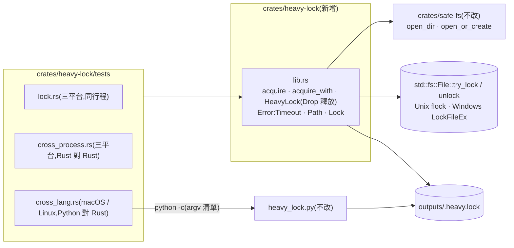
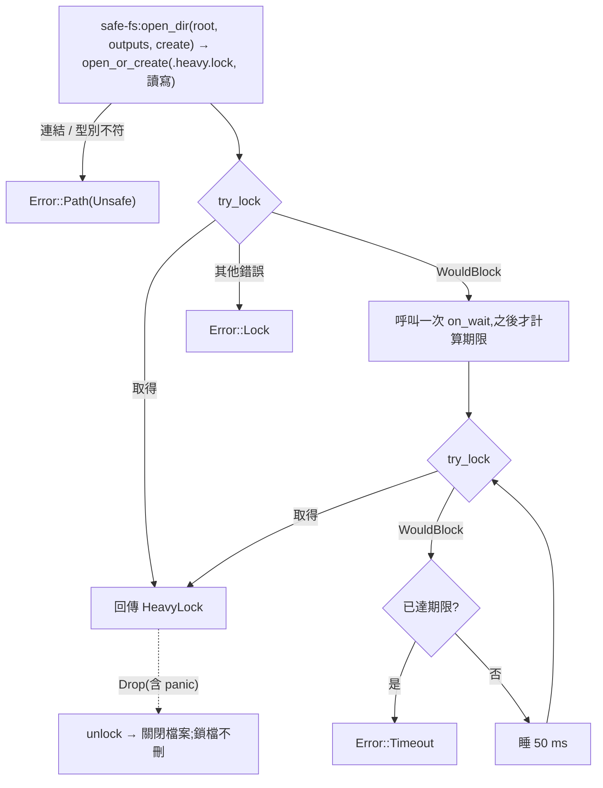

# CHG-20261127-01 — Rust 遷移路線圖第 4 筆:`heavy_lock` 重型工作鎖移植到新 crate `crates/heavy-lock`(標準函式庫檔案鎖、跨語言互斥測試)

- 專案:podcast-studio
- 分支(Branch):main
- 日期:2026-11-27(UTC+0)
- 類型:新增程式(新增 workspace 成員 `crates/heavy-lock`,提供 `heavy_lock` 的 Rust 版;以 Rust 標準函式庫 `std::fs::File::try_lock` 上鎖、以 `crates/safe-fs` 開啟鎖檔;新增同行程、Rust 對 Rust 跨行程(三平台)與 Python 對 Rust 跨語言(macOS / Linux)測試);**不引入任何第三方 crate、本筆沒有新增下載或網路連線**;**不改任何根目錄 Python 產品檔與既有 Python 測試**;不改 CI、不改 `deny.toml`、不改 Guideline;另在 CHG-20261126-01「## 派發記錄」補一列(代決 17)
- 提出者:使用者(CHG-20261122-02 遷移路線圖階段一第 4 列,確認閘 2026-11-23 使用者逐條覆核;路線圖粒度「按照1模組1CHG」)
- 實作者:主 agent 派發(DIR-3);草案由 Claude subagent 起草(DIR-3 第 2 條例外:治理文件草案直接派 Claude subagent);T1、T2 建議依 DIR-3 第 2 條例外二直接派 Claude subagent(中、高風險 CHG 的程式 task,代決 2);實際工作者記於「## 派發記錄」
- 驗收者:獨立 Claude subagent(不參與起草、施工、審議與統整,不看實作者自述)
- 風險分級:高(建議,須於確認閘由使用者確認;理由見「## 決策與取捨」代決 1。要點:命中審議用高風險清單(`scripts/local_review.py` risk 席:安全相關、資料模型、跨模組介面、刪除或不可逆動作、部署 / 遷移)的**跨模組介面**——(1) Python ↔ Rust 的跨語言互斥契約(Guideline §6.1「重型工作互斥(v1.18)」「資料相容」列;路線圖代決 13 要求以跨語言測試證明 `flock` 語意),做錯會讓兩個重型工作同時執行而記憶體不足;(2) 新 Rust API 是路線圖第 10、14、16、22 筆的依賴;(3) 共用鎖檔 `outputs/.heavy.lock` 的約定(只鎖鎖檔、不讀不寫不刪)。先例:CHG-20261124-01 表頭 (3) 與代決 1、CHG-20261123-01 表頭 (4)、CHG-20261122-02 表頭 (4) 都以跨語言契約判高。緩解措施(不作為降級理由):路徑防護沿用 `safe-fs` 不新增判斷、不引入第三方 crate、不新增建置期或執行期網路連線、沒有呼叫端、不刪除任何東西、可由 `git revert` 完整還原;安全影響四類皆答「否」)
- Autonomy:高風險停點(建議,須於確認閘由使用者確認)——確認閘停下等使用者回覆(DIR-8 第 3 條:交叉決議一致的代決免逐項詢問、列為「依交叉決議照推薦」,風險分級、Autonomy 與「## 安全影響」答覆仍由使用者確認);task PR 依 DIR-8 第 2 條以常設指示原話預先核准;合併 PR 在統整判定 merge、CI 必要檢查全綠、本機閘與測試實跑紀錄成立時依 DIR-8 第 1 條合入(安全影響四類皆否,不屬第 5 條永遠停點;若經使用者改答「是」,合入 main 前停下等使用者核准);驗收由獨立驗收者實跑 operate、判定 observe(DIR-8 第 3 條,見「### Acceptance operation」)
- Commit/PR:草案分支 `docs/CHG-20261127-01-draft`(自 origin/main `7e60cac` 起草);PR 待開;施工整合分支 `chg/CHG-20261127-01-impl`(DIR-5,草案合入 main 後由 main 建立);task 分支 `chg/CHG-20261127-01-T1`、`T2`(PR base 皆為整合分支)
- 重複性檢查(Recurrence check):首次——本 repo 先前沒有移植檔案鎖到 Rust 的 CHG。CHG-20261124-01 合併 PR #174 的 cargo-deny wildcard 教訓(path 相依須帶 `version`)寫入本筆 Global Constraints,未另建 KN
- Diagrams:見「## 設計圖」節
- Mockup: skipped — 本筆沒有任何畫面;等待中的提示文字由呼叫端(之後各筆)處理
- Security-impact:見「## 安全影響」節
- Behaviour spec / Interaction spec:Behaviour spec 為 `features/heavy_lock_rust.feature`(T1 新增,T2 補場景;既有 `features/heavy_lock.feature` 屬 CHG-20261022-01 的 Python 版,不改;代決 15),草案見「### Behaviour spec」;Interaction spec 不適用(不改畫面)
- Skill: ai-sdlc v1.69.1
- 關聯:CHG-20261122-02(遷移路線圖第 4 列;代決 13;共通規則 (1)~(8);事實 B、D、J;安全影響 (1)(3)(4)(7));CHG-20261125-01(`safe-fs` 的 `open_dir`、`open_or_create`;「### 呼叫端指引」鎖檔列與檔案權限列;D-1、D-8、D-10;K-2;「## 後續改善」第 2 項);CHG-20261124-01(合併 PR #174 的 path 相依教訓);CHG-20261123-01(CI `rust` job、`deny.toml`、`PARITY_PYTHON`);CHG-20261022-01 T4(`heavy_lock.py` 的來源,ADP-2);CHG-20261022-04 DIR-5 修正 4(`outputs/` 以 dir_fd 開啟);CHG-20261126-01(帳本補記,代決 17);DIR-2、DIR-3 第 2 條例外與例外二、DIR-5、DIR-6、DIR-7、DIR-8;KN-1(本 CHG 全文不寫狀態觸發字)、KN-3(家目錄寫 `~`)、KN-4(Windows 工作副本與逐檔 stage);Guideline §2 遷移範圍、§6.1「重型工作互斥(v1.18)」「資料相容」「離線(建置期)」、§7「NFR 記憶體與互斥」、§8「技術約束」

## 動機

CHG-20261122-02「## 遷移路線圖」階段一第 4 列(以下稱「路線圖第 4 筆」)原文要點:

- 模組 / 單元:`heavy_lock`;目標:重型工作鎖
- 範圍:`outputs/.heavy.lock`;Unix `flock` 語意、Windows `LockFileEx`,只鎖鎖檔(代決 13)
- 退出條件:macOS / Linux 跨語言互斥測試通過(Python 持鎖時 Rust 等待,反之亦然)
- 回滾:revert;鎖檔路徑不變

路線圖代決 13 另寫明:沿用同一組鎖檔路徑、只鎖鎖檔不鎖資料檔;**Unix 上 Rust 必須是 `flock` 語意(不是 POSIX 記錄鎖),以跨語言互斥測試證明**;Windows 上 Python 版本來就不執行(事實 B),沒有跨語言互斥問題。本筆另加 Windows 上 Rust 對 Rust 跨行程互斥測試為退出條件(比路線圖原文多一項,屬加嚴)。

上一筆(CHG-20261126-01)已於 2026-11-27 收尾(ACC-20261127-01 判定通過),沒有未收尾事項;其「## 派發記錄」缺收尾帳本 PR #185 合入一列,由本筆補記(代決 17)。

起草者 2026-11-27 於 origin/main `7e60cac` 查證的事實(來源等級標於句首):

A. 〔觀察〕`heavy_lock.py` 共 81 行:第 24 行 `import fcntl`、第 29 行 `import safe_fs`;`ROOT` 為模組所在目錄、`LOCK_PATH = ROOT / "outputs" / ".heavy.lock"`、`POLL_SECONDS = 0.05`(第 31~33 行);`_try_lock` 以 `fcntl.flock(fd, LOCK_EX | LOCK_NB)`,`BlockingIOError` 回 `False`(第 36~41 行);`_outputs_fd` 先確認 `LOCK_PATH` 的上層是 `ROOT/outputs`(否則丟 `OSError`,訊息含路徑),再 `safe_fs.open_dir(root, ["outputs"], create=True)`,`UnsafePathError` 轉成 `OSError`(第 44~57 行);`heavy_lock()` 以 `safe_fs.open_or_create(dfd, ".heavy.lock", O_RDWR, 0o600)` 取得 fd 後關閉目錄 fd;第一次取鎖失敗才呼叫一次 `on_wait()`,**之後**才計算 `deadline`;迴圈中每次重試失敗後才判斷逾時,逾時丟 `TimeoutError`(訊息含秒數與鎖檔路徑,第 74 行),否則睡 0.05 秒;離開時 `LOCK_UN` 再 `os.close`(第 61~81 行)。docstring(第 14~19 行):持鎖行程結束(含被 kill)由作業系統釋放;同一行程不同執行緒各自開檔、彼此互斥;**同一執行緒不可巢狀取鎖**(會等到自己);鎖檔不讀不寫、不刪除。
B. 〔觀察〕呼叫端:`executor.py:314`(`timeout=LOCK_RETRY_SECONDS`(0.2 秒)反覆重試以便檢查取消,`on_wait` 以旗標只通知一次)、`local_models_mcp.py:43`(`busy()`,`on_wait=_waiting`,不設逾時)、`studio_server.py:1070`(`timeout=ANNOTATE_TIMEOUT`)、`studio_server.py:1990`、`tts_service.py:421`(`on_wait` 送出 waiting 事件)。本筆不移植任何呼叫端(路線圖第 10、14、16、22 筆)。
C. 〔觀察〕`tests/test_heavy_lock.py` 共 21 個測試,其中鎖本身的有:`LOCK_EX` 監看、建立 `outputs/` 與鎖檔、例外時釋放、鎖檔是符號連結時不跟隨、`outputs/` 是指向 repo 外或 repo 內的符號連結時拒絕且不建立、`LOCK_PATH` 不在 `ROOT/outputs` 下時拒絕、四執行緒互斥、兩子行程執行區間不重疊、持鎖行程被 kill 後 **2 秒內**取得、等待時 `on_wait` 一次、不等待時不呼叫、逾時(耗時 0.25~5 秒)、`outputs/` 開啟後被換成連結;子行程以改寫模組屬性 `heavy_lock.ROOT`、`heavy_lock.LOCK_PATH` 指向暫存目錄(第 40~53 行)——跨語言測試可用同一做法,不必改 Python 檔。
D. 〔觀察〕Rust 標準函式庫 `std::fs::File` 的 `lock`、`try_lock`、`unlock` 自 1.89.0 起穩定。起草者讀本機 rust-docs(`~/.rustup/toolchains/stable-x86_64-pc-windows-msvc/share/doc/rust/html/std/fs/struct.File.html`;該工具鏈 `rustc --version` 為 `rustc 1.100.0 (0ef1bc386 2026-11-09)`,與 `rust-toolchain.toml` 釘的 1.100.0 同版號)的「Platform-specific behavior」:`lock` 目前對應 Unix 的 `flock`(`LOCK_EX`)、Windows 的 `LockFileEx`(`LOCKFILE_EXCLUSIVE_LOCK`);`try_lock` 對應 `flock`(`LOCK_EX | LOCK_NB`)、`LockFileEx`(另加 `LOCKFILE_FAIL_IMMEDIATELY`),被占用時回 `TryLockError::WouldBlock`;`unlock` 對應 `flock`(`LOCK_UN`)、`UnlockFile`;文件註明「this may change in the future」;鎖在檔案(含複製或繼承的 handle)關閉時釋放;同一 handle 已持鎖時再取鎖的行為未規定(可能死結);檔案未以寫入方式開啟時是否回錯誤未規定。Windows 原始碼頁(同目錄 `src/std/sys/fs/windows.rs.html` 第 442~499 行)可見 `try_lock` 以 `LockFileEx(handle, flags, 0, u32::MAX, u32::MAX, …)` 鎖住自位移 0 起最大長度的範圍,`ERROR_LOCK_VIOLATION` 轉為 `WouldBlock`;`unlock` 呼叫兩次 `UnlockFile` 並忽略 `ERROR_NOT_LOCKED`。
E. 〔未知〕Unix 上 1.100.0 的實作原始碼:本機只有 Windows 目標的文件與原始碼頁,釘版工具鏈 `1.100.0-x86_64-pc-windows-msvc` 未裝 rust-src;Linux / macOS 實際是否以 `flock(2)` 實作只有文件敘述為據,**以跨語言互斥測試證明**(退出條件),並以 Linux 上的區辨測試佐證(代決 10 (vii))。
F. 〔推論〕Linux 上 `flock` 與 `fcntl` 記錄鎖(`lockf`)互不影響(`flock(2)` 手冊,依記憶;NFS 例外);所以 Rust 若以 POSIX 記錄鎖實作,就不會與 Python 的 `fcntl.flock` 互斥——這是路線圖要求 `flock` 語意的原因。macOS 上兩者是否互相影響〔未知〕。Python 的 `fcntl.flock` 呼叫 `flock(2)`〔推論〕。
G. 〔推論〕Windows 的 `LockFileEx` 是強制性的位元組範圍鎖:其他 handle 對被鎖範圍的讀寫會失敗;鎖檔一律不讀不寫,不受影響。行程結束時作業系統釋放其鎖,但微軟文件寫明釋放所需時間取決於系統資源(依記憶)——Windows 上「被 kill 後多久取得」的門檻須留餘裕(代決 10)。
H. 〔觀察〕`crates/safe-fs`:`open_dir(top, parts, DirOptions { create, mode })` 回 `SafeDir`;`SafeDir::open_or_create(name, FileAccess, mode)` 回 `std::fs::File`(doc 註明「鎖檔用」,不跟隨連結、不是一般檔回 `Unsafe`);Unix 開檔一律加 `O_NONBLOCK`(CHG-20261125-01 D-1);Windows 忽略 `mode`(D-8)。CHG-20261125-01「### 呼叫端指引」鎖檔列:「以 `open_or_create` 取得檔案 handle 後再上鎖」(第 4、5、9 筆)。〔推論〕`O_NONBLOCK` 是檔案狀態旗標,不影響 `flock` 是否阻塞(由 `LOCK_NB` 決定);本筆只用非阻塞的 `try_lock`,不受影響。
I. 〔觀察〕Rust workspace:`members = ["crates/*"]`,新目錄自動成為成員;三個 crate 皆 `#![forbid(unsafe_code)]`;`Cargo.lock` 共 54 個 package;`deny.toml` 的 `bans.wildcards = "deny"`、`[licenses.private] ignore = true`(檔頭寫明放寬須另經 CHG);path 相依須帶 `version`(CHG-20261124-01 合併 PR #174)。起草者 Windows 開發機的 `~/.cargo/registry/cache/` 有既有相依的 `.crate`(例 `cap-std-4.0.3`、`serde_json-1.0.154`);WSL 的快取〔未知〕,由 T1 以 `--offline` 確認(代決 12)。
J. 〔觀察〕CI `rust-platform` 三格(ubuntu、macos、windows)每格都以 `actions/setup-python` 裝 Python 3.11,再跑 `cargo fmt`、`clippy`、`cargo test --workspace --locked`、release 建置、比對示範;cargo-deny 只在 ubuntu 格;不加快取。`crates/parity` 以 `PARITY_PYTHON` → 平台預設(Unix `python3`、Windows `python`)取得直譯器。所以 macOS / Linux 格的 `cargo test` 能啟動 Python 子程序跑跨語言測試,不必改 CI。
K. 〔觀察〕Guideline §6.1「重型工作互斥(v1.18)」:Python 網頁版、Python MCP、Rust 應用程式、Rust MCP 共用同一把鎖(`outputs/.heavy.lock`);「資料相容」列:過渡期兩版彼此的檔案鎖互相排斥。§7「NFR 記憶體與互斥」條件是網頁與 MCP 的端到端行為,路線圖第 22 筆(`local_models_mcp`)的退出條件明列由該筆改寫。`features/heavy_lock.feature` 已存在(CHG-20261022-01,Python 版三個場景)。

## 使用者故事

1. 作為使用者,之後的 Rust 應用程式與 Rust MCP 執行重型工作時,與正在執行的 Python 網頁版、Python MCP 互相等待(macOS / Linux 以跨語言測試證明),24 GB 記憶體不會同時跑兩個重型工作。
2. 作為使用者,在 Windows 上兩個 Rust 行程(例:應用程式與 MCP)也互相等待;任一行程當掉或被終止,鎖由作業系統釋放,不需要手動刪檔。
3. 作為使用者,Python 網頁版、MCP 伺服器與我的資料完全不受本筆影響;本筆不新增任何第三方套件與網路連線。

## 決策與取捨

> 依使用者 2026-10-26 原則「如果多次審議都無交集 只採最低限度」:本筆只移植 `heavy_lock()` 的取鎖語意與鎖檔位置,不移植呼叫端、不改 Python、不改 CI 與 Guideline。依記憶寫出的平台事實(事實 E~G)標〔推論〕或〔未知〕,由測試證明。

**代決事項**(使用者原話推導不出細節,由 agent 先決定;確認閘依 DIR-8 第 3 條:代決 1 的風險分級、Autonomy 與安全影響答覆由使用者確認,其餘交叉決議一致時照推薦):

1. **風險分級建議「高」、Autonomy 依高風險停點、安全影響四類皆答「否」**(表頭與「## 安全影響」)。理由:審議用高風險清單(`scripts/local_review.py` risk 席判決問題原文:「安全相關、資料模型、跨模組介面、刪除或不可逆動作、部署 / 遷移」,命中即為高、不接受自評降級)中,本筆命中**跨模組介面**——(1) Python ↔ Rust 跨語言互斥契約(過渡期 Python 網頁版、Python MCP 與 Rust 應用程式、Rust MCP 必須互斥,Guideline §6.1;路線圖代決 13);(2) `heavy_lock::acquire` / `acquire_with` 是路線圖第 10、14、16、22 筆的依賴;(3) 共用鎖檔 `outputs/.heavy.lock` 的約定(位置、只鎖鎖檔、不讀不寫不刪)。先例:CHG-20261124-01(表頭要點 (3)「跨語言契約」與代決 1「安全邊界與跨語言契約任一命中即為高」)、CHG-20261123-01(表頭要點 (4)「跨語言介面」)、CHG-20261122-02(表頭要點 (4)「跨模組介面」)都以跨語言契約判高。其餘四類:安全相關——否(路徑防護沿用 `safe-fs`、不新增判斷,見「## 安全影響」);資料模型——否(鎖檔格式不變);刪除或不可逆動作——否(鎖檔永不刪除);部署 / 遷移——否(不改 CI、不改資料)。緩解措施(不作為降級理由):不引入第三方 crate、不新增建置期或執行期網路連線、沒有呼叫端、可由 `git revert` 完整還原、Python 不改、跨語言測試列為退出條件。停點:確認閘停下等使用者回覆(DIR-8 第 3 條);合併 PR 依 DIR-8 第 1 條(安全影響皆否);驗收為獨立驗收者實跑(DIR-8 第 3 條,高風險驗收不由交叉決議取代)。替代:(b) 判「中」——理由是不改路徑防護、沒有呼叫端、失效只影響可用性;則確認閘仍停一次(DIR-8 第 3 條中風險)、驗收依中風險矩陣。**本項不得依交叉決議代決,須使用者確認。**
2. **施工方式**:依 DIR-5 開整合分支 `chg/CHG-20261127-01-impl`,T1 → T2 依序;T1、T2 依 DIR-3 第 2 條例外二直接派 Claude subagent;task PR 合入整合分支依 DIR-8 第 2 條以常設指示原話預先核准(核准列在該 PR 分支、送審前提交)。替代:(b) 單一 task(範圍小,但 T2 的跨語言測試依賴 T1 的 API 與輔助行程,分開較好審)。
3. **crate 配置:新增 workspace 成員 `crates/heavy-lock`**(package `heavy-lock`、lib `heavy_lock`、`publish = false`、`#![forbid(unsafe_code)]`),以 `safe-fs = { path = "../safe-fs", version = "=0.0.0" }` 相依(H-5 教訓)。理由:一個 Python 模組對一個 crate,與 `safe-fs` 相同;`safe-fs` 維持「路徑層」單一職責;回滾只移除一個目錄。替代:(b) 放進 `crates/safe-fs`(混入協調語意);(c) 放進 `crates/studio-core`(`studio-core` 須開始相依 `safe-fs`,這件事留給第 5 筆決定)。
4. **上鎖機制:Rust 標準函式庫 `std::fs::File::try_lock` / `unlock`,不引入任何 crate**(事實 D)。依文件,Unix 為 `flock`、Windows 為 `LockFileEx(LOCKFILE_EXCLUSIVE_LOCK)`,正是代決 13 要的語意;Unix 實作〔未知〕(事實 E)由 T2 跨語言測試證明,不成立時施工者**停下回報**,不得改寫測試或自行改用其他機制(改機制屬 CHG 修訂)。本筆 `Cargo.lock` 只新增 `heavy-lock` 本身一個 package,**沒有新增下載或網路連線**。替代:(b) `fs4` 類第三方 crate(需建置期下載,依 DIR-8 第 5 條須使用者同意);(c) 自行以 `libc` / `windows-sys` FFI 呼叫(需 `unsafe` 與新相依)。
5. **鎖檔開啟沿用 `safe-fs`**(三平台同一條路徑):`safe_fs::open_dir(root, ["outputs"], DirOptions { create: true, mode: 0o755 })` 取得 `outputs/` 的 handle,再 `open_or_create(".heavy.lock", FileAccess::ReadWrite { truncate: false }, 0o600)` 取得檔案,隨即釋放目錄 handle(與 Python 第 65~66 行相同:目錄 fd 只在開檔期間持有)。`outputs/` 是連結或不是目錄、鎖檔是連結或不是一般檔,一律由 `safe-fs` 回 `Unsafe`;Windows 的名稱代理重新解析點判定、保留名稱與完整路徑處理全部沿用 `safe-fs`(`outputs`、`.heavy.lock` 皆非保留名稱)。不另寫任何路徑判斷。
6. **Rust API**:
   - 常數 `LOCK_DIR = "outputs"`、`LOCK_NAME = ".heavy.lock"`、`POLL_INTERVAL = 50 ms`(Python `POLL_SECONDS`)。
   - `acquire(root: &Path, timeout: Option<Duration>) -> Result<HeavyLock>`、`acquire_with(root, timeout, on_wait: impl FnOnce()) -> Result<HeavyLock>`;`root` 是呼叫端給的受信根目錄(Python 的 `ROOT`),鎖檔固定為 `root/outputs/.heavy.lock`,API 不收任意鎖檔路徑(D-2)。
   - 順序與 Python 逐步相同:開檔 → `try_lock` → 失敗才呼叫一次 `on_wait`(`FnOnce` 以型別保證最多一次)→ **其後**才計算期限 → 迴圈「`try_lock` 失敗 → 已達期限就回 `Timeout` → 睡 `POLL_INTERVAL`」;`timeout = Some(Duration::ZERO)` 時仍重試一次才回 `Timeout`;期限以 `Instant::checked_add` 計算,溢位視同不逾時(不 panic,D-4)。
   - `HeavyLock`(`#[must_use]`)擁有鎖檔的 `File`;`Drop` 時先 `unlock`(忽略錯誤)再關閉檔案——含 panic 展開;行程中止或被終止時由作業系統釋放。不提供讀寫鎖檔的方法;鎖檔永不刪除。
   - `Error`:`Timeout`(逾時)、`Path(safe_fs::Error)`(開啟 `outputs/` 或鎖檔失敗,類別沿用 `safe_fs::ErrorKind`)、`Lock(std::io::Error)`(`try_lock` 回 `WouldBlock` 以外的錯誤);`Display` 為繁體中文、不含本機路徑(D-1)。
   - `try_lock` 回 `WouldBlock` 以外的錯誤時立即回 `Lock`,不重試(Python 的 `flock` 丟 `BlockingIOError` 以外的 `OSError` 時同樣直接丟出)。
   替代:(b) 單一 `acquire(root, timeout, on_wait: Option<F>)`(傳 `None` 時須標型別,呼叫端較囉嗦)。
7. **等待一律以 `try_lock` 輪詢**(含 `timeout = None`),不用阻塞的 `lock()`。理由:與 Python 同一條程式路徑、同一個輪詢間隔;阻塞呼叫無法逾時;呼叫端(executor)靠短逾時重試檢查取消(事實 B)。替代:(b) `timeout = None` 時改用 `lock()`(少一點喚醒,但與 Python 行為分岔)。
8. **巢狀、執行緒與釋放語意與 Python 相同**:每次 `acquire` 各自開一個新的 `File`,所以同一行程不同執行緒彼此互斥;**同一執行緒巢狀取鎖會等到自己**(有逾時時回 `Timeout`,沒有逾時時形同死結)——與 Python docstring 相同,寫入 API 文件並以測試鎖住(有逾時的巢狀取鎖回 `Timeout`)。〔推論〕Windows 上同一行程另一個 handle 對已鎖範圍 `LockFileEx` 會得 `ERROR_LOCK_VIOLATION`,行為相同,由三平台測試確認。替代:(b) 以執行緒區域變數偵測巢狀並回錯誤(比 Python 嚴,但新增 Python 沒有的錯誤類別)。
9. **行為差異清單 D-1~D-4**(見「### 行為差異清單」):都是 API 形態或訊息差異,不改「誰等誰」的語意。
10. **測試設計與時序抖動的處理**:
    - **一律以標記檔交握、斷言因果順序,不以睡眠時間推斷重疊**:持鎖方取得後寫 `ready`,只在看到對方的 `waiting`(由 `on_wait` 寫出)或 `release` 標記後,才先寫 `releasing` 再釋放;等待方取得後斷言 `releasing` 已存在。等待方只能在對方釋放後取得,所以斷言不依賴時脈,不會因機器慢而誤判。
    - 唯二的時間斷言:(i) 逾時——持鎖方在收到訊號前一直持有,等待方以 `timeout = 0.3 s` 必回 `Timeout`,耗時下限以自己的 `Instant` 量測(≥ 0.3 s)、上限放寬到 10 s;(ii) 被終止後釋放——自 `Child::wait()` 返回(行程已回收)起計時,Unix 2 s 內(與 Python 測試相同)、Windows 10 s 內(事實 G),一律印出實際耗時;Windows 門檻若仍不足,施工者停下回報,不自行放寬。
    - 子行程等待訊號一律有上限(30 s 等開始、60 s 等釋放),逾時以非 0 結束,不留孤兒行程;測試以 `Drop` 守衛在結束時 kill 並回收子行程、刪除暫存工作目錄(與 CHG-20261125-01 相同,`create_dir` 排他建立,不引入 `tempfile`)。
    - **Rust 持鎖子行程**:以測試執行檔自己重新執行自己(`std::env::current_exe()`,argv 清單 `--exact <輔助測試名> --nocapture`,以環境變數傳角色與暫存目錄;輔助測試在沒有該環境變數時立即返回),不新增 `[[bin]]` 或範例程式、不新增 dev-dependency。
    - **Python 子行程**(T2,只在 Unix):以 argv 清單 `[<python>, "-c", <程式>]` 啟動、不經 shell;直譯器取 `PARITY_PYTHON`,沒有時 `python3`(在測試內寫同一條規則,不相依 `parity`);環境設 `PYTHONUTF8=1`、`PYTHONDONTWRITEBYTECODE=1`;程式把 repo 根目錄(`CARGO_MANIFEST_DIR/../..`)放進 `sys.path`、`import heavy_lock`,並把 `heavy_lock.ROOT`、`heavy_lock.LOCK_PATH` 改指向暫存根目錄(事實 C 的做法;暫存根目錄先 `canonicalize`,避免 macOS `/var` → `/private/var` 的連結使 Python 的 `resolve()` 比對失敗)。Python 無法啟動時測試**判失敗**(CI 與本機皆然),不略過。
    - 重複執行:Acceptance operation 在 WSL 與 Windows 各把跨行程 / 跨語言測試連跑 10 次,全數通過才算(偵測偶發失敗)。
    替代:(b) 以時間戳記比對兩行程的執行區間(Python 既有測試的做法;跨行程時脈比較在 CI 上較易抖動)。
11. **不經 `parity` 比對工具**:鎖的行為是兩個行程之間的時序關係,不是 `fn(輸入) -> 輸出` 的單元,CHG-20261123-01 的 fixture 格式表達不了;路線圖本列的退出條件本來就是跨語言互斥測試。所以不登錄比對單元、不改 `crates/parity/`、`py/adapter.py` 與 `tests/test_parity_adapter.py`(轉接器可 import 的產品模組集合不變)。屬共通規則 (2)「並行比對」在本筆的適用方式,需確認閘知悉。替代:(b) 為 `parity` 新增時序型單元(改比對工具契約,等於夾帶工具功能變更)。
12. **本機閘不連網**:本筆沒有新 package,所以會解析相依的 cargo 指令一律帶 `--locked --offline`;本機的 cargo-deny 以 `cargo deny --locked --offline check bans licenses sources` 執行(〔推論〕帶 `--offline` 且不含 `advisories` 就不會取 RustSec 公告庫;T1 先以 `cargo deny --help` 與 `cargo deny check --help` 查證 `--offline` 旗標存在,不存在就停下回報,不得改為連網執行;查證結果記入派發記錄),用來抓 path 相依未帶 `version` 這類錯誤;公告檢查以 CI ubuntu 格為準(既有行為)。任何指令因快取缺漏而需要下載時,**停下回報**(屬新增下載,依 DIR-8 第 5 條須使用者同意)。替代:(b) 沿用 CHG-20261125-01 代決 5 (甲) 每次取最新公告——那是該筆確認閘的核准,本筆是否延用須使用者另行同意。
13. **不改 CI**(`.github/workflows/ci.yml`):新 crate 由 workspace 自動納入三平台 `cargo test`;macOS / Linux 格已有 Python 3.11(事實 J);跨語言測試檔以 `#![cfg(unix)]` 只在這兩格編譯執行。
14. **不改任何根目錄 Python 產品檔**(含 `heavy_lock.py`、`safe_fs.py` 與全部呼叫端)、`tests/` 內任何檔案、`static/`;**不改 Guideline**:§7「NFR 記憶體與互斥」由路線圖第 22 筆改寫(事實 K),共通規則 (7) 在本筆不適用;§6.1 的要求本筆只提供鎖本身,不需改字。
15. **Behaviour spec 新增 `features/heavy_lock_rust.feature`**,不改既有 `features/heavy_lock.feature`(屬 CHG-20261022-01 的 Python 行為,場景與 MCP、網頁節點相關)。替代:(b) 在既有檔補場景(與 Python 場景混在同一個功能,追溯不清)。
16. **結構文件**:T1 同步 `directory.md`(新 crate、新 feature)、`design.md`(關鍵元件表 `heavy_lock` 列補 Rust 對應)、`data.md`(`.heavy.lock` 列補「Rust `heavy-lock` 共用」);T2 同步 `design.md`(設計決策表新增一列)。`logical.md` 不需更新(沒有呼叫端,流程不變)。
17. **CHG-20261126-01 帳本補記隨本筆提交**:該 CHG「## 派發記錄」在「## 審議」之前補「收尾帳本 PR 合入」一列(PR #185,head `0342498`,squash 合入 main `7e60cac`;派發者 2026-11-27 貼出統整判定 merge、`gh pr checks 185` 八項全 pass;依 DIR-4 預授權 merge;統整席逐 hunk 核對範圍符合修訂後 DIR-8 第 5 條;標「本列為事後補記」);不改該 CHG 的「## 狀態」與表頭。理由:比照 CHG-20261126-01 代決 12、CHG-20261125-02 代決 17 的先例;是已收尾 CHG 的紀錄補正,不改判定。替代:(b) 另開帳本 PR 只補這一列。

## 設計圖

### (1) 本筆完成後的 crate 與測試



### (2) 一次取鎖(與 Python 逐步相同)



## 安全影響

| 類別 | 是否觸及 | 影響範圍 / 理由 |
|------|----------|-----------------|
| irreversible-delete | 否 | 鎖檔永不刪除(Python 第 19 行的約定,刪除會讓兩個行程各鎖到不同的檔);產品程式沒有任何刪除。測試只在自己排他建立的系統暫存工作目錄內建立與刪除標記檔與鎖檔 |
| payments | 否 | 無金流 |
| prod-migration | 否 | 鎖檔位置(`outputs/.heavy.lock`)與內容(空檔,不讀不寫)不變;不存在時與 Python 相同以 `0o600` 建立(Windows 忽略 `mode`、繼承上層 ACL,CHG-20261125-01 D-8);不讀寫 `projects/`、`config/`、`workflows/` |
| security-boundary | 否 | (a) **路徑防護不變**:開啟 `outputs/` 與鎖檔完全經 `safe-fs`(代決 5),不新增、不放寬任何路徑判斷;`outputs/` 或鎖檔是連結時拒絕,以測試鎖住(對應 Python 的三個連結測試)。(b) **不新增網路與子程序**:產品程式不開監聽埠、不連線、不啟動子程序;測試的子程序(Python 直譯器、測試執行檔自己)一律 argv 清單、不經 shell,參數只含程式常數與暫存路徑。(c) **供應鏈不變**:不引入第三方 crate,`Cargo.lock` 只新增 workspace 成員 `heavy-lock`;本機閘以 `--offline` 執行,本筆沒有新增下載或網路連線(代決 4、12)。(d) **強制鎖只落在鎖檔**:Windows `LockFileEx` 是強制性範圍鎖(事實 G),只鎖專用鎖檔、絕不鎖資料檔(路線圖代決 13),鎖檔不讀不寫,不影響其他程式讀取任何資料。(e) **DIR-7**:能寫入本機檔案的人可以搶先持鎖使重型工作一直等待(阻斷服務)、或把 `outputs/` 換成連結——前者屬威脅模型外且 Python 版相同,後者由 `safe-fs` 拒絕(既有防護不回退)。(f) **錯誤訊息不含本機路徑**(D-1,KN-3 精神)。(g) 鎖本身是資源協調機制,失效的後果是兩個重型工作同時執行而記憶體不足(可用性),不涉及資料外洩或越權。不送資料出本機 |

## 修改指引

### 目標

依 CHG-20261122-02 路線圖第 4 筆,把 `heavy_lock()` 的取鎖語意移植到新 crate `crates/heavy-lock`:以 `safe-fs` 開啟 `outputs/.heavy.lock`、以標準函式庫 `File::try_lock` 輪詢取得排他鎖;macOS / Linux 以跨語言互斥測試證明 Python 與 Rust 雙向互斥,三平台以 Rust 對 Rust 跨行程測試證明互斥與行程終止後釋放。不移植呼叫端、不改 Python、不改 CI、`deny.toml` 與 Guideline。

### 影響範圍

| 受影響項 | 類型 | 改動 | 連帶影響 |
|----------|------|------|----------|
| `crates/heavy-lock/Cargo.toml`(新增,T1) | 設計 / 目錄 | package `heavy-lock`、`publish = false`、相依只有 `safe-fs`(path,帶 `version = "=0.0.0"`) | workspace 自動納入 |
| `crates/heavy-lock/src/lib.rs`(新增,T1) | 設計 | 代決 6 的 API;不含任何平台條件編譯 | 路線圖第 10、14、16、22 筆讀取 |
| `crates/heavy-lock/tests/{lock,cross_process}.rs`、`tests/common/mod.rs`(新增,T1) | 測試 | 同行程與 Rust 對 Rust 跨行程測試、交握與暫存目錄輔助 | 三平台 CI 執行 |
| `crates/heavy-lock/tests/cross_lang.rs`(新增,T2) | 測試 | `#![cfg(unix)]`,Python 對 Rust 跨語言測試 | macOS / Linux CI 執行;唯讀 import repo 根目錄的 `heavy_lock.py` |
| `Cargo.lock` | 設計 | 只新增 `heavy-lock` 一個 package;既有 54 個 package 不變 | — |
| `features/heavy_lock_rust.feature`(新增) | 行為 | 見「### Behaviour spec」 | — |
| `docs/structure/directory.md`、`design.md`、`data.md` | 結構文件 | 見「### 結構文件更新」 | — |
| `docs/changes/CHG-20261126-01.md` | 帳本 | 「## 派發記錄」補一列(代決 17,隨草案提交) | — |

不改:任何根目錄 Python 產品檔、`tests/`、`static/`、`scripts/`、`tests/ci/`、`.github/`、`.ai-sdlc/`、`deny.toml`、`rust-toolchain.toml`、根目錄 `Cargo.toml`、`crates/safe-fs/`、`crates/studio-core/`、`crates/parity/`、`features/heavy_lock.feature`、`docs/ai-guideline.md`、`docs/knowledge/`、`docs/structure/logical.md`、`AGENTS.md`、`PODCAST_STUDIO.md`。

### 契約清單

| 契約 | 提供方 | 讀取方 | 本筆變更 | 契約測試(路徑/無) |
|------|--------|--------|----------|----------------------|
| 鎖檔位置 `outputs/.heavy.lock` 與「只鎖鎖檔、不讀不寫不刪」 | `heavy_lock.py`、`crates/heavy-lock` | 兩版的全部呼叫端 | 新增(Rust 側) | `crates/heavy-lock/tests/lock.rs`(位置、空檔、不刪) |
| Python ↔ Rust 互斥(Unix `flock` 語意,路線圖代決 13) | 兩版 | 過渡期並存的 Python 網頁版、Python MCP、Rust 應用程式、Rust MCP(Guideline §6.1) | 新增 | `crates/heavy-lock/tests/cross_lang.rs` |
| Rust ↔ Rust 跨行程互斥與行程終止後釋放(三平台) | `crates/heavy-lock` | Rust 應用程式與 Rust MCP | 新增 | `crates/heavy-lock/tests/cross_process.rs` |
| Rust API(`acquire`、`acquire_with`、`HeavyLock`、`Error`、等待與逾時順序) | `crates/heavy-lock` | 路線圖第 10、14、16、22 筆 | 新增 | `crates/heavy-lock/tests/lock.rs` |
| `safe-fs` 的 `open_dir`、`open_or_create` 契約(CHG-20261125-01) | `crates/safe-fs` | 本筆 | **不變** | 既有 `crates/safe-fs/tests/*` 須全過 |
| Python `heavy_lock` 行為 | `heavy_lock.py` | 網頁、MCP | **不變** | 既有 `tests/test_heavy_lock.py` 須全過(WSL `scripts/check.sh`) |

### Global Constraints(全域約束——每個 task 都要遵守)

- 不改「### 影響範圍」「不改」所列的任何檔案;只能新增或修改該節表格所列項目。
- 不引入任何第三方 crate、不使用 git 相依;workspace 內 path 相依一律帶 `version = "=0.0.0"`。**不得有任何網路連線**:會解析相依的 cargo 指令一律帶 `--locked --offline`(`cargo fmt` 除外),本機 cargo-deny 一律 `cargo deny --locked --offline check bans licenses sources`(`--offline` 旗標不存在時停下回報,不得改為連網);任何指令需要下載時停下回報(代決 12)。不安裝任何工具或 Python 套件。
- `heavy-lock` 保留 `#![forbid(unsafe_code)]`;`src/` 不得出現 `cfg(windows)`、`cfg(unix)`、`cfg(target_os`(平台差異由標準函式庫與 `safe-fs` 承擔);clippy 警告視為錯誤;任何輸入(含 `Duration::MAX`、`Duration::ZERO`)不得 panic。
- 上鎖只用 `std::fs::File::try_lock` 與 `unlock`;不得改用其他機制或自行呼叫作業系統 API(代決 4)。開啟 `outputs/` 與鎖檔只經 `safe-fs`,不得以字串組路徑交給 `std::fs`。
- 產品程式不讀、不寫、不刪鎖檔內容;錯誤訊息不含本機路徑(以測試斷言 `Display` 不含暫存根目錄字串)。
- 測試只能在自己排他建立的系統暫存工作目錄內建立、修改、刪除檔案;不得觸及 repo 工作副本(`target/` 除外)的 `outputs/` 與家目錄其他位置。子程序一律 argv 清單、不經 shell,結束時 kill 並回收。
- 測試以標記檔交握、斷言因果順序,不得以睡眠長短推斷兩行程是否重疊(代決 10);時間門檻只限代決 10 列出的兩種。測試失敗時不得放寬門檻或改寫斷言,停下回報。
- 每個 task 先寫會紅的測試並確認紅燈(測試失敗或編譯失敗,不得以下載或 lock 檔錯誤充當紅燈),紅燈與綠燈 commit 分開,記在派發記錄。
- Windows 開發機上的 cargo 指令在 `Documents` 以外、`core.autocrlf=false` 的工作副本執行;提交時逐檔 `git add <路徑>`、提交前看 `git diff --cached --stat`(KN-4)。
- 程式 task PR 合入整合分支前,依 DIR-8 第 2 條在該 PR 分支提交核准列(常設指示原話、日期、條次)後再送審與合入。
- 任何 agent 不得修改 GitHub ruleset 或 repo 設定。
- 使用者面文字、程式註解、文件一律繁體中文與台灣用語(型別與函式名稱用英文);本 CHG、派發記錄與 commit 訊息不寫 KN-1 列出的狀態觸發字;路徑的家目錄寫 `~`(KN-3)。

### 行為差異清單(Rust 與 Python 刻意或已知不同之處;逐條鎖在測試)

| 編號 | 項目 | Python | Rust | 原因 | 鎖住的測試 |
|------|------|--------|------|------|------------|
| D-1 | 逾時訊息 | `TimeoutError`,訊息含秒數與鎖檔絕對路徑(第 74 行) | `Error::Timeout`,`Display` 只含秒數,不含路徑 | 沿用 `safe-fs`「錯誤訊息不含本機路徑」(KN-3 精神) | `lock.rs`(`Display` 不含暫存根目錄) |
| D-2 | 鎖檔位置的指定方式 | 模組屬性 `LOCK_PATH` 可改,改到 `ROOT/outputs/` 以外丟 `OSError`(第 49~53 行) | 只收 `root`,其餘為常數,沒有「位置不合法」這條錯誤路徑 | API 形態;結果相同(鎖檔只會在 `root/outputs/`) | `lock.rs`(鎖檔建立於 `root/outputs/.heavy.lock`) |
| D-3 | Windows | 不能執行(`fcntl`,事實 B) | `LockFileEx` 排他範圍鎖;被終止後釋放門檻 10 s(事實 G) | 平台機制 | `cross_process.rs`(Windows 格) |
| D-4 | 極大逾時 | `float("inf")` 時期限為無限大,一直等 | 期限計算溢位視同不逾時,一直等;不 panic | 型別不同,語意相同 | `lock.rs`(`Duration::MAX`) |

錯誤類別對照:Python `outputs/` 是連結或不是目錄的 `OSError`、鎖檔是連結的 `UnsafePathError` → Rust `Error::Path`(`safe_fs::ErrorKind::Unsafe`);`TimeoutError` → `Error::Timeout`;`flock` 的其他 `OSError` → `Error::Lock`。

### 呼叫端指引(之後各筆遵守)

| 情境 | 規則 | 移植筆數 |
|------|------|----------|
| 鎖檔的根目錄 | 過渡期 Rust 傳入的 `root` 必須與 Python `heavy_lock.ROOT`(repo 根目錄)是**同一個目錄**,否則兩版各鎖各的、互斥失效;Rust 應用程式的資料根目錄由哪一筆決定〔未知〕,該筆須以代決說明並以跨語言測試確認 | 第 7、10、22 筆 |
| 等待通知與取消 | 等待提示放在 `on_wait`;需要取消時比照 `executor.py:314` 以短逾時重試並在每次 `Timeout` 後檢查取消,不在 `on_wait` 內阻塞 | 第 10、14、16、22 筆 |
| 巢狀 | 同一執行緒不得在持有 `HeavyLock` 時再取鎖(代決 8);重型工作的組合由最外層取一次 | 第 10、14、16 筆 |
| 持鎖期間 | 持鎖期間不刪除、不改名 `outputs/` 與鎖檔;Windows 上持有鎖檔 handle 時 `outputs/` 不能改名或刪除(CHG-20261125-01 D-10、K-2) | 全部 |

### Tasks(checkbox=續作點)

- [ ] T1. 新 crate `crates/heavy-lock`、API(代決 5~8)、同行程測試、Rust 對 Rust 跨行程測試(三平台)、`features/heavy_lock_rust.feature` 兩個場景,同步 `directory.md`、`design.md`、`data.md`
  - interfaces: consumes `crates/safe-fs` 的 `open_dir`、`open_or_create`、`ErrorKind`(CHG-20261125-01)、本 CHG 代決 3~10 / produces `crates/heavy-lock/{Cargo.toml,src/lib.rs,tests/common/mod.rs,tests/lock.rs,tests/cross_process.rs}`、`Cargo.lock`、`features/heavy_lock_rust.feature`、`docs/structure/{directory,design,data}.md`;分支 `chg/CHG-20261127-01-T1`,PR base 整合分支 `chg/CHG-20261127-01-impl`;commit 訊息帶 CHG-20261127-01
  - test: 紅燈先行——先新增 `tests/lock.rs`、`tests/cross_process.rs`(只有測試、`src/lib.rs` 為空殼),在 Windows 開發機與 WSL 確認編譯失敗或測試失敗,再寫程式。完成後 (1) Windows 開發機(`Documents` 以外)與 WSL Ubuntu(Linux 檔案系統)各跑本機閘全過;(2) `cargo test --locked --offline -p heavy-lock -- --nocapture` 在兩處印出被終止後取得的實際耗時;(3) 先以 `cargo deny --help` 與 `cargo deny check --help` 查證 `--offline` 旗標存在(不存在就停下回報,不得改為連網),再執行 `cargo deny --locked --offline check bans licenses sources`,結果寫入派發記錄;(4) `git diff Cargo.lock` 只新增 `heavy-lock`;(5) `grep -rn "cfg(windows)\|cfg(unix)\|cfg(target_os" crates/heavy-lock/src/` 無輸出,`src/lib.rs` 含 `#![forbid(unsafe_code)]`;(6) `git diff --name-only chg/CHG-20261127-01-impl...HEAD` 只含本 task 的檔案與本 CHG,不含任何 `.py`;(7) WSL 上 `UV_OFFLINE=1 ./scripts/check.sh` 全過
  - L1: `lock.rs`(三平台):建立 `outputs/` 與鎖檔(長度 0),離開後以 `timeout = 0.5 s` 可再取得;`catch_unwind` 攔下持鎖中的 panic 後可再取得;鎖檔是連結 → `Error::Path(Unsafe)` 且連結目標內容不變;`outputs/` 是指向外部或內部的連結 → `Error::Path(Unsafe)`,目標目錄內不建立任何東西;`outputs/` 是一般檔 → `Error::Path(Unsafe)`;四個執行緒同時取鎖,持鎖區間計數從不超過 1(以共享計數器斷言,不以時間);同一執行緒巢狀以 `timeout = 0.2 s` 取鎖回 `Timeout`;沒有等待時不呼叫 `on_wait`;另一執行緒持鎖時 `acquire_with` 呼叫 `on_wait` 恰一次、且在 `on_wait` 之後才取得;`timeout = Duration::ZERO` 在被占用時回 `Timeout`;`Duration::MAX` 不 panic、持鎖方釋放後取得;`Timeout` 的 `Display` 不含暫存根目錄字串;取得與釋放後鎖檔仍存在且長度 0。Unix 以 `std::os::unix::fs::symlink` 建連結;Windows 以 `safe_fs::support::symlink` 建立,無權限時依 CHG-20261125-01 代決 10 的規則(`GITHUB_ACTIONS=true` 判失敗,本機印出略過與略過數)
  - L2: `cross_process.rs`(三平台,Rust 對 Rust,代決 10 的自我重新執行):(i) 子行程持鎖(寫 `ready`)時父行程 `timeout = 0.3 s` 回 `Timeout`,耗時 ≥ 0.3 s 且 < 10 s;(ii) 父行程 `acquire_with` 的 `on_wait` 寫 `waiting`,子行程見到後寫 `releasing` 再釋放,父行程取得後斷言 `releasing` 存在、`on_wait` 恰一次;(iii) 父行程持鎖時子行程以 `timeout = 0.3 s` 取鎖,以結束碼回報 `Timeout`;(iv) 子行程持鎖後被 `Child::kill`,自 `wait()` 返回起 Unix 2 s、Windows 10 s 內取得(印出實際耗時)
  - L3: `features/heavy_lock_rust.feature` 場景「Rust 行程之間互斥」「持鎖行程被終止後由作業系統釋放」
  - L4: 不適用(沒有呼叫端,沒有使用者操作的端到端路徑);三平台行為由合併 PR 的 CI 三格證明
- [ ] T2. Python 對 Rust 跨語言互斥測試(macOS / Linux)、Linux 區辨測試,`features/heavy_lock_rust.feature` 補兩個場景,同步 `design.md`
  - interfaces: consumes T1 的 crate、`tests/common/mod.rs` 與自我重新執行的持鎖輔助、repo 根目錄 `heavy_lock.py`(唯讀 import)/ produces `crates/heavy-lock/{tests/cross_lang.rs,tests/common/mod.rs}`、`features/heavy_lock_rust.feature`、`docs/structure/design.md`;分支 `chg/CHG-20261127-01-T2`,PR base 整合分支;commit 訊息帶 CHG-20261127-01
  - test: 紅燈先行——先新增 `tests/cross_lang.rs`,以「尚未存在的輔助函式」造成編譯失敗或以刻意錯誤的預期確認測試會失敗(紅燈 commit 中寫明方式),再補齊。完成後 (1) 同 T1 test (1);(2) WSL 上 `cargo test --locked --offline -p heavy-lock --test cross_lang -- --nocapture` 連跑 10 次全過,印出 Python 版本與各案例結果;(3) Windows 上 `cargo test --locked --offline -p heavy-lock` 顯示 `cross_lang` 為 0 個測試(只在 Unix 編譯);(4) 同 T1 test (5)~(7)。任何一項跨語言案例不成立(例:Rust 持鎖時 Python 直接取得)→ 停下回報派發者,屬代決 4 的機制不符,不得改寫測試或改用其他機制
  - L1: 不適用(單行程行為已在 T1)
  - L2: `cross_lang.rs`(`#![cfg(unix)]`):(i) Python 子行程持鎖(寫 `ready`)時 Rust `timeout = 0.3 s` 回 `Timeout`;(ii) Python 持鎖、Rust `acquire_with` 的 `on_wait` 寫 `waiting`,Python 見到後寫 `releasing` 並離開 `with`,Rust 取得後斷言 `releasing` 存在;(iii) Rust 持鎖時 Python `heavy_lock(timeout=0.3)` 丟 `TimeoutError`(子程序印出結果、結束碼 0);(iv) Rust 持鎖時 Python `heavy_lock(timeout=30, on_wait=寫 waiting)`,Rust 見到後寫 `releasing` 並釋放,Python 取得後確認 `releasing` 存在、結束碼 0;(v) Python 持鎖子行程被 kill,Rust 自 `wait()` 返回起 2 s 內取得;(vi) T1 的 Rust 持鎖輔助行程被 kill,Python `heavy_lock(timeout=2)` 取得;(vii) **Linux 限定的區辨測試**:Rust 持鎖時,Python 以 `os.open` 讀寫開啟同一鎖檔並 `fcntl.lockf(fd, LOCK_EX | LOCK_NB)` **可取得**(事實 F〔推論〕:Linux 上 `flock` 與記錄鎖互不影響,證明 Rust 不是以 POSIX 記錄鎖實作),結果與說明印出;macOS 不跑此案例(事實 F〔未知〕)
  - L3: `features/heavy_lock_rust.feature` 場景「Python 持鎖時 Rust 等待」「Rust 持鎖時 Python 等待」
  - L4: 不適用;macOS 由合併 PR 的 CI `macos-latest` 格證明

### Behaviour spec

- feature: features/heavy_lock_rust.feature

T1 新增(兩個場景),T2 補兩個場景;施工者可補場景,不得刪減已列場景。

```gherkin
# language: zh-TW
功能: 重型工作鎖的 Rust 移植

  場景: Rust 行程之間互斥
    假設 一個 Rust 行程以 heavy-lock 持有 outputs/.heavy.lock
    當 另一個 Rust 行程以 0.3 秒逾時取鎖
    那麼 取鎖回報逾時
    而且 持鎖行程釋放後,等待中的行程才取得鎖,等待通知只呼叫一次

  場景: 持鎖行程被終止後由作業系統釋放
    假設 一個持有重型鎖的 Rust 行程被終止
    那麼 另一個行程在 macOS 與 Linux 上 2 秒內、在 Windows 上 10 秒內取得重型鎖
    而且 鎖檔仍在且沒有內容

  場景: Python 持鎖時 Rust 等待
    假設 在 macOS 或 Linux 上,Python 網頁版的 heavy_lock 持有 outputs/.heavy.lock
    當 Rust 以 heavy-lock 取鎖
    那麼 Rust 等待,直到 Python 釋放後才取得

  場景: Rust 持鎖時 Python 等待
    假設 在 macOS 或 Linux 上,Rust 以 heavy-lock 持有 outputs/.heavy.lock
    當 Python 的 heavy_lock 以 0.3 秒逾時取鎖
    那麼 Python 丟出 TimeoutError
    而且 不設短逾時的 Python 取鎖在 Rust 釋放後才取得
```

### Acceptance operation

- operate: (1) 合併 PR 合入 main 後,獨立 Claude subagent(未參與起草、施工、審議與統整)以 `gh run list --branch main --limit 3` 與 `gh run view <id> --json jobs` 查看合併 PR squash commit 的 push 觸發的 CI,並以 `gh run view <id> --log` 確認:ubuntu 與 macOS 格的 `cargo test` 執行了 `heavy-lock` 的 `lock`、`cross_process`、`cross_lang` 測試且 `cross_lang` 的測試數不為 0,windows 格執行了 `lock` 與 `cross_process`;(2) 在 main 的乾淨工作副本(WSL Ubuntu 的 Linux 檔案系統,以及 Windows 開發機 `Documents` 以外、`core.autocrlf=false` 的位置各一份)執行「### 本機閘」的 cmd;(3) WSL 上把 `cargo test --locked --offline -p heavy-lock --test cross_lang -- --nocapture` 與 `--test cross_process` 各連跑 10 次;Windows 上把 `--test cross_process` 連跑 10 次;(4) `git diff --name-only <合併 PR 合入前的 main>..<squash commit>` 與 `git diff <合併 PR 合入前的 main>..<squash commit> -- Cargo.lock`;(5) `grep -rn "cfg(windows)\|cfg(unix)\|cfg(target_os" crates/heavy-lock/src/`
- observe: (1) `rust-platform` 三格與 `rust` 皆 success,日誌中的測試清單與上述相符,既有其他 job 也都 success;(2) 指令全部 exit 0;(3) 30 次全部通過,沒有偶發失敗;印出的被終止後取得耗時 Unix 在 2 s 內、Windows 在 10 s 內;Linux 區辨測試印出 Python `lockf` 可取得;(4) 變更檔案只含「### 影響範圍」所列項目、本 CHG 與 DIR-5 統整報告,不含任何 `.py`;`Cargo.lock` 只新增 `heavy-lock` 一個 package;(5) 無輸出
- pass: 五項 observe 全部成立
- 驗收方式:高風險(代決 1),停點矩陣的驗收為獨立驗收(halt_independent);依 DIR-8 第 3 條,本條不由交叉決議取代——operate 由未參與起草、施工、審議與統整的獨立驗收者實跑,observe 由其判定。本筆 pass 條件沒有「使用者確認」類項目;使用者在確認閘若改判中,改依中風險矩陣

### 本機閘

- cmd: cargo fmt --all --check && cargo clippy --workspace --all-targets --locked --offline -- -D warnings && cargo test --workspace --locked --offline && cargo deny --locked --offline check bans licenses sources && python .ai-sdlc/skills/ai-sdlc-autopilot/scripts/doc_integrity_check.py --repo .
- pass: exit 0(Windows 開發機與 WSL 各一次;WSL 另跑 `UV_OFFLINE=1 ./scripts/check.sh`,exit 0;macOS 由合併 PR 的 CI 證明)

### 結構文件更新

- [ ] `docs/structure/directory.md`(T1):表頭加更新註記;樹狀圖加 `crates/heavy-lock/`(`src/lib.rs`、`tests/`)與 `features/heavy_lock_rust.feature`;職責表新增 `crates/heavy-lock/` 列(相依只有 `safe-fs`,不含平台條件編譯)
- [ ] `docs/structure/design.md`(T1):關鍵元件表 `heavy_lock.heavy_lock(...)` 列補「Rust 對應:`heavy_lock::acquire` / `acquire_with`(`crates/heavy-lock`,CHG-20261127-01;標準函式庫 `File::try_lock`,Unix `flock`、Windows `LockFileEx`)」;表頭加更新註記
- [ ] `docs/structure/data.md`(T1):檔案表 `.heavy.lock` 列補「Rust `heavy-lock` 共用同一鎖檔(CHG-20261127-01)」;表頭加更新註記
- [ ] `docs/structure/design.md`(T2):設計決策表新增「Rust 重型工作鎖用標準函式庫檔案鎖、以跨語言測試證明 `flock` 語意」一列;表頭加更新註記
- `docs/structure/logical.md`:不需更新——沒有呼叫端,流程與 CI 不變

### 風險與回滾

- 風險:(1) **Unix 實作不是 `flock`**(事實 E)→ T2 跨語言測試與 Linux 區辨測試會失敗;施工者停下回報,改機制屬 CHG 修訂(代決 4)。(2) **標準函式庫日後改變對應的系統呼叫**(文件寫「may change in the future」)→ 工具鏈升級本來就另開 CHG(`rust-toolchain.toml` 註解),該筆須重跑本筆的跨語言測試;寫入「## 後續改善」。(3) **時序抖動造成偽陽性或偽陰性** → 交握與因果斷言(代決 10),時間門檻只有兩種且放寬;驗收連跑 30 次。(4) **Windows 被終止後釋放較慢**(事實 G)→ 門檻 10 s 並印出實際值;仍不足時停下回報。(5) **鎖檔根目錄不一致**使兩版互斥失效 → 本筆的 API 由呼叫端傳 `root`,過渡期須與 Python 的 repo 根目錄相同,寫入「### 呼叫端指引」;本筆沒有呼叫端,不會發生。(6) **本機閘意外連網**(WSL 快取缺漏)→ `--offline` 會直接失敗,施工者停下回報(代決 12)。(7) **三平台 CI 第一次在合併 PR 才執行**(DIR-5 第 1 條)→ 施工期 Windows + WSL 實跑;macOS 紅燈依 DIR-6 第 7 條修正。
- 回滾方式:`git revert` 合併 PR 的 squash commit——移除 `crates/heavy-lock`、`Cargo.lock` 中的 `heavy-lock`、`features/heavy_lock_rust.feature` 與結構文件的更新。鎖檔路徑不變、Python 版與使用者資料未被寫入,不受影響;不需改 ruleset。

### 執行計畫(DIR-5)

1. 確認閘:高風險,停下等使用者回覆(DIR-8 第 3 條)——代決 2~17 交叉決議一致者列為「依交叉決議照推薦」、免逐項詢問,未一致者逐項詢問;代決 1(風險分級「高」、Autonomy、安全影響四類答覆「否」)由使用者確認。使用者若改判中,改依中風險停點(確認閘停一次)重排本節。草案 PR(`docs/CHG-20261127-01-draft`,含 CHG-20261126-01 的補記列)依 main 現行規則審議,DIR-6 統整判定 merge、CI 全綠後依 DIR-4 / DIR-8 第 1 條合入 main。
2. 草案合入 main 後由 main 開整合分支 `chg/CHG-20261127-01-impl`(`core.autocrlf=false` 的乾淨 clone,KN-4)。
3. T1(`chg/CHG-20261127-01-T1`)→ PR base 整合分支;依 DIR-8 第 2 條先提交核准列,統整判定 merge 且本機閘實跑紀錄成立後合入。
4. T2(`chg/CHG-20261127-01-T2`)→ 同第 3 步。
5. T1、T2 合入後依 DIR-5 第 2 條逐一審議,第 3 條由單一模型統整成 `docs/changes/review/CHG-20261127-01-summary.md`,第 4 條開發模型一次修正。
6. 合併 PR(整合分支 → main):CI 全部 check(`rust` 三平台第一次執行本筆的跨行程與跨語言測試)、六席意見、DIR-6 統整;統整判定 merge、CI 必要檢查全綠、本機閘與測試實跑紀錄成立後依 DIR-8 第 1 條合入(安全影響四類皆否,不屬第 5 條永遠停點;若經確認閘改答「是」,改為停下等使用者核准)。
7. 依「### Acceptance operation」驗收:高風險,由獨立驗收者實跑 operate、判定 observe(DIR-8 第 3 條:高風險驗收不由交叉決議取代);ACC 收尾。

## 後續改善(不屬本筆範圍,另開 CHG)

- 路線圖第 7、10、22 筆:Rust 應用程式與 Rust MCP 的資料根目錄如何決定,過渡期須與 Python 的 repo 根目錄相同(「### 呼叫端指引」第 1 列);取鎖的呼叫端(等待提示、取消、`busy()` 的 stdout 導向)隨各筆移植;§7「NFR 記憶體與互斥」由第 22 筆改寫並在三平台驗證。
- 路線圖第 5 筆(專案 `.lock`)、第 9 筆(`config/.studio.db.lock`):沿用本筆的做法(`safe-fs` 開檔 + `File::try_lock` + 跨語言測試);是否把共通部分抽成共用 crate 在第 5 筆以代決決定。
- 工具鏈升級的 CHG:標準函式庫的檔案鎖對應可能改變(事實 D),升級時須重跑 `crates/heavy-lock` 的跨語言測試。
- Windows 上鎖檔的 ACL(CHG-20261125-01 D-8、「### 呼叫端指引」檔案權限列):由路線圖第 9 筆一併評估。

## 派發記錄

> 依 DIR-3:主 agent 只派發。審查與審議結論不記在本節,一律見對應 PR 的審議留言與「## 審議」節。

| task | 施工者 | 派發者獨立驗證 | PR | 備註 |
|------|--------|----------------|----|------|
| 草案 | Claude subagent(DIR-3 第 2 條例外:治理文件草案直接派 Claude subagent) | — | 分支 `docs/CHG-20261127-01-draft`(自 origin/main `7e60cac`);PR 待開 | 新增本 CHG,並在 CHG-20261126-01「## 派發記錄」補收尾帳本 PR #185 合入一列(代決 17,事後補記)。唯讀查 `AGENTS.md`、Guideline v1.20(§2、§5、§6、§6.1、§7、§8、§9)、`docs/knowledge/`(INDEX、DIR-3、DIR-5、DIR-8、KN-1~4)、CHG-20261122-02(路線圖第 4 列、代決 13、共通規則、事實 B、J、安全影響)、CHG-20261125-01、CHG-20261126-01、`heavy_lock.py`、`tests/test_heavy_lock.py`、呼叫端、`crates/*`、`deny.toml`、`.github/workflows/ci.yml`;`std::fs::File::lock` 的平台對應讀本機 1.100.0 rust-docs(事實 D)。未執行任何會連網的指令,未編譯。工作在起草者 scratchpad 的新 clone 完成(`…/scratchpad/…`) |
| DIR-6 第 1 輪一次修正(F-1、F-2) | Claude subagent(同草案起草者;DIR-3 第 2 條例外) | — | PR #186(draft,base main;修正前 head `d3bd800`) | 統整判定 fix(sha `d3bd800a8a0ff6daa076475183f4a84fd67ba595`,需使用者決定:無),依修法清單一次修正、只改本 CHG:F-1 表頭「風險分級」「Autonomy」、代決 1、執行計畫第 1、6、7 步與「### Acceptance operation」改為建議「高」(審議用高風險清單的跨模組介面,引 CHG-20261124-01、CHG-20261123-01、CHG-20261122-02 三先例;原理由改列緩解措施,「中」改列替代 (b);安全影響四類答「否」不變);F-2 本機閘 cmd、Global Constraints 第 2 點、代決 12、T1 test (3) 的 cargo-deny 改為 `cargo deny --locked --offline check bans licenses sources`,T1 先以 `--help` 查證旗標,不存在即停下回報。未連網、未編譯 |

## 審議

- DIR-6 第 1 輪(PR #186,head `d3bd800`):統整判定 fix(`review-decision` 標記,sha `d3bd800a8a0ff6daa076475183f4a84fd67ba595`);修法 F-1(風險分級論證改依審議用高風險清單、建議改高)、F-2(本機 cargo-deny 加 `--offline`);需使用者決定的事項:無;意見與判定全文見 PR #186 留言。F-1、F-2 已依留言在本分支一次修正(見「## 派發記錄」)。
- 確認閘:未開始(高風險,草案送審後由派發者依 DIR-8 第 3 條停下等使用者回覆;代決 1 須使用者確認)。

## 狀態

草稿(2026-11-27)——DIR-6 第 1 輪 fix(F-1、F-2)一次修正完成,下一步為 DIR-6 第 2 輪審議與確認閘。
