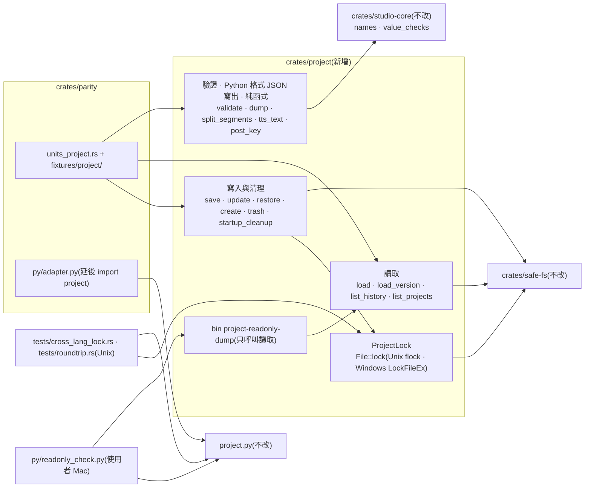
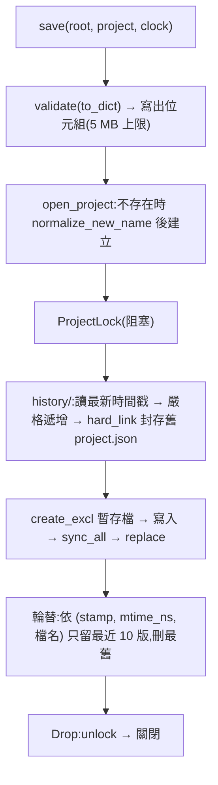

# CHG-20261128-01 — Rust 遷移路線圖第 5 筆:`project` 專案檔、`history/` 與專案鎖移植到新 crate `crates/project`(Python 格式寫出、並行比對、跨語言鎖與往返測試、使用者 Mac 唯讀載入)

- 專案:podcast-studio
- 分支(Branch):main
- 日期:2026-11-28(UTC+0)
- 類型:新增程式(新增 workspace 成員 `crates/project`,提供 `project.py` 的 Rust 版:專案檔 schema 2 讀取 / 驗證 / 以 Python 相同位元組寫出、`history/` 封存與輪替、專案 `.lock`、回收區與啟動清理、純函式;新增比對單元、跨語言鎖與往返測試、唯讀比對工具);**不改任何根目錄 Python 產品檔與既有產品測試**(唯一例外為比對工具的 `crates/parity/py/adapter.py` 與 `tests/test_parity_adapter.py`,代決 22);不改 CI、不改 `deny.toml`、不改 Guideline;建議不引入第三方 crate(沿用 `Cargo.lock` 既有的 `serde`、`serde_json`,另開 `serde_json` 的 `float_roundtrip` feature,不新增 package,代決 5);使用者 Mac 上的唯讀載入可能需要使用者自己的電腦下載工具鏈或 crate(代決 19,須使用者同意);另在 CHG-20261127-01「## 派發記錄」補一列(代決 25)
- 提出者:使用者(CHG-20261122-02 遷移路線圖階段一第 5 列,確認閘 2026-11-23 使用者逐條覆核;路線圖粒度「按照1模組1CHG」)
- 實作者:主 agent 派發(DIR-3);草案由 Claude subagent 起草(DIR-3 第 2 條例外:治理文件草案直接派 Claude subagent);T1~T7 建議依 DIR-3 第 2 條例外二直接派 Claude subagent(中、高風險 CHG 的程式 task,代決 3);實際工作者記於「## 派發記錄」
- 驗收者:獨立 Claude subagent(不參與起草、施工、審議與統整,不看實作者自述)+ 使用者在自己的 Mac 上執行唯讀比對並回報輸出(退出條件 (2),代決 19)
- 風險分級:建議高(待確認閘使用者確認;理由見代決 1。要點:命中審議用高風險清單(`scripts/local_review.py` risk 席:安全相關、資料模型、跨模組介面、刪除或不可逆動作、部署 / 遷移)中的**資料模型**(專案檔 schema 2 的讀寫與 Python 相同位元組的寫出格式)、**跨模組介面**(Python ↔ Rust 專案鎖互斥與專案檔往返;Rust API 是路線圖第 6、7、13~16、18、21 筆的依賴)、**刪除或不可逆動作**(`history/` 超過 10 版刪最舊、回收區滿 30 天刪除、`tmp/` 清空的選取規則在本筆定義)。先例:CHG-20261122-01(history 輪替排序判高)、CHG-20261127-01、CHG-20261124-01(跨語言契約判高))
- Autonomy:建議高風險停點(待確認閘使用者確認)——確認閘停下等使用者回覆(DIR-8 第 3 條:交叉決議一致的代決免逐項詢問,風險分級、Autonomy、「## 安全影響」答覆、拆筆(代決 2)、新增下載(代決 19)與 Mac 唯讀載入步驟由使用者確認);task PR 依 DIR-8 第 2 條以常設指示原話預先核准;**「## 安全影響」irreversible-delete 建議答「是(有限)」,若使用者確認,合併 PR 合入 main 前屬 DIR-8 第 5 條永遠停點,停下等使用者核准**;驗收由獨立驗收者實跑 operate、判定 observe(高風險 halt_independent),退出條件 (2) 由使用者實際操作,不由交叉決議或統整判定取代
- Commit/PR:草案分支 `docs/CHG-20261128-01-draft`(自 origin/main `f4d489a` 起草);草案 PR 編號、整合分支與各 task PR 記於「## 派發記錄」
- 重複性檢查(Recurrence check):首次——本 repo 先前沒有移植專案資料模型到 Rust 的 CHG。前四筆審議與驗收抓到的問題(帳本落後、`directory.md` 漏列、施工偏離未回寫規格、驗收依據沒有具體數字、macOS 才出現的 clippy `dead_code`、Windows 無權限建立符號連結、CI 不帶 `--nocapture`)寫入本筆 Global Constraints 預先避免,未另建 KN
- Diagrams:見「## 設計圖」節
- Mockup: skipped — 本筆沒有任何畫面;錯誤訊息文字沿用 Python 原文,畫面由路線圖第 7、17~21 筆處理
- Security-impact:見「## 安全影響」節
- Behaviour spec / Interaction spec:Behaviour spec 為 `features/project_rust.feature`(T1 新增,T2~T7 各補場景;既有 `features/timeline_editor.feature`、`pause_tone.feature`、`prosody_trim.feature` 等含專案行為的 feature 屬 Python 版,不改,代決 23),草案見「### Behaviour spec」;Interaction spec 不適用(不改畫面)
- Skill: ai-sdlc v1.69.1
- 關聯:CHG-20261122-02(路線圖第 5 列;代決 5、11、12、13、14、22;共通規則 (1)~(8);事實 B、D、J;安全影響 (4)(6)(7));CHG-20261122-01(history 版本時間戳嚴格遞增,等價基準);CHG-20261124-01(`names`、`value_checks`;D-5、D-6、D-7;「### 呼叫端指引」;「## 後續改善」第 5 筆各項;newtype 再議);CHG-20261125-01(`safe-fs`;D-5、D-8~D-12、K-1、K-2、W-6;「### 呼叫端指引」;「## 後續改善」);CHG-20261127-01(`heavy-lock` 的鎖做法;「### 呼叫端指引」根目錄列;「## 後續改善」第 2 項;ACC-20261127-02 觀察 O-1、O-2;帳本補記,代決 25);CHG-20261123-01(CI `rust` job、`deny.toml`、`parity`、`PARITY_PYTHON`);CHG-20261022-04 T2(`project.py` 的來源);CHG-20261029-01(schema 2、後製鍵);DIR-2、DIR-3 第 2 條例外與例外二、DIR-5、DIR-6、DIR-7、DIR-8;KN-1(本 CHG 全文不寫狀態觸發字)、KN-3(家目錄寫 `~`)、KN-4(Windows 工作副本與逐檔 stage);Guideline §2 遷移範圍、§5、§6.1「資料相容」「離線(建置期)」、§7 FR-30、§8「技術約束」

## 動機

CHG-20261122-02「## 遷移路線圖」階段一第 5 列(以下稱「路線圖第 5 筆」)原文要點:

- 模組 / 單元:`project`;目標:專案檔、`history/` 與專案鎖
- 範圍:專案檔 schema 2 讀取 / 驗證 / 寫出;`history/` 輪替(以 CHG-20261122-01 修正後規則為準);專案 `.lock`
- 退出條件:(1) 比對 fixture 上接受 / 拒絕與錯誤類別一致;Rust 寫出的專案檔 Python 能載入且內容相同,反之亦然;(2) 在使用者 Mac 上以**唯讀**方式載入全部既有專案,與 Python 載入結果相同,且前後檔案雜湊不變;(3) macOS / Linux 專案鎖跨語言互斥測試通過;(1)~(3) 通過前 Rust 不寫使用者的專案資料
- 回滾:revert;唯讀比對未寫入使用者資料

上一筆(CHG-20261127-01)已於 2026-11-27 收尾(ACC-20261127-02 判定通過),沒有未收尾事項;其「## 派發記錄」缺收尾帳本 PR #190 合入一列,由本筆補記(代決 25)。前幾筆交給第 5 筆的事項,逐項承接於「### 前幾筆交辦事項的承接」。

起草者 2026-11-28 於 origin/main `f4d489a` 查證的事實(來源等級標於句首):

A. 〔觀察〕`project.py` 共 1495 行。頂層 import `fcntl`(第 93 行)、`breezy_worker`(第 108 行,只用 `marked_to_digit` 驗證注音,第 266 行;`breezy_worker.py` 頂層只 import 標準函式庫 `argparse`、`json`、`os`、`re`、`sys`)、`names`、`safe_fs`、`value_checks`。內容分四群:(a) 驗證——`check_name`、`normalize_speed` / `normalize_pause`(`Decimal(str(v))` 後 `ROUND_HALF_UP`)、`check_zhuyin`、`check_percent`、`check_pitch_points`、`_check_*`、`validate`(累積全部錯誤訊息,第 874~912 行)、`_dump`(`json.dumps(ensure_ascii=False, indent=1) + "\n"`,第 915 行;`validate` 以其位元組長度檢查 5 MB 上限);(b) 純函式——`split_segments`、`escape_text`、`tts_text`、`fused_out`、`model_units`、`shift_marks`、`post_params`、`post_key`(SHA-256,`json.dumps(sort_keys=True, ensure_ascii=False)`)、`is_post_fresh`、`is_default_post`、`effective_speed` / `effective_pause`、`new_id`(`secrets.token_hex(8)`);(c) 檔案系統讀取——`open_project`、`open_subdir`、`_case_variant`、`load`、`load_version`、`list_history`、`list_projects`、`disk_usage`;(d) 檔案系統寫入與鎖——`_project_lock`(`safe_fs.open_or_create(pfd, ".lock", O_RDWR, 0o600)` 後 `fcntl.flock(LOCK_EX)`,**阻塞、無逾時**,第 989~1002 行)、`save` / `_save_locked` / `_archive_current`(`safe_fs.link` 排他建立到 `history/`)/ `_write_atomic`(`create_excl` 暫存檔 → `fsync` → `replace`)/ `_rotate`、`update`、`restore`、`create`、`trash`(持專案目錄 fd 與專案鎖時 `rename` 到 `.trash/`,第 1398~1404 行)、`startup_cleanup`、`unlink_in`、`check_quota`;另有回傳路徑的 `subdir()`、`_top()`。
B. 〔觀察〕呼叫端(`grep` 根目錄 `.py`,排除 `outputs/`、`tools/`、`.claude/`):`studio_server.py`(載入、存檔、還原、建立、刪除、清理、分句、`tts_text`、`shift_marks` 等 30 餘種)、`tts_service.py`(`post_key`、`post_params`、`tts_text`、`model_units`、`open_subdir`、`_top`、`check_pitch_points` 等)、`nodes.py`(`update`、`load`、`open_subdir`、`unlink_in`、`check_quota`、`new_id`)、`media.py`(`subdir`、`_top`、`ProjectError`、`ID_RE`、`ASSET_EXTS`)、`timeline.py`(`is_post_fresh`、`effective_speed`、`effective_pause`)。本筆不移植任何呼叫端;路線圖第 6 筆(`timeline`)開工即需要 `is_post_fresh` 與 `effective_*`。
C. 〔觀察〕`tests/test_project.py` 96 個測試、`tests/test_server_projects.py` 67 個;fixture `repo` 以 `monkeypatch.setattr(pj, "ROOT", <暫存目錄>)` 把資料根目錄指到暫存目錄——比對轉接器與跨語言測試可用同一做法,不必改 Python 檔。
D. 〔觀察〕Python JSON 層(起草者以本機 Python 3.12.10 `-I` 唯讀執行):`json.loads` 接受 `NaN`、`Infinity`,`1e400` 得 `inf`,重複鍵取最後一個;`math.isfinite(10**400)` 丟 `OverflowError`(所以 `_is_number` 遇到超大整數會丟出非 `ProjectError` 的例外);`"\ud800"` 可載入,但 `_dump` 的 `encode("utf-8")` 丟 `UnicodeEncodeError`;`repr` 浮點:`1e+16`、`1000000000000000.0`、`1e-05`、`0.0001`、`-0.0`、`2.0`;`"\x1c".isspace()` 為 `True`(Rust `char::is_whitespace` 不含 U+001C~U+001F,〔推論〕依記憶)。
E. 〔觀察〕`Cargo.lock` 共 55 個 package,含 `serde` 1.0.229(`parity` 以 `derive` 使用)、`serde_json` 1.0.154(MIT OR Apache-2.0;`studio-core`、`parity` 使用);**沒有** `sha2`、`rand` / `getrandom`、`chrono`、`regex`、`indexmap`。起草者 Windows 開發機 `~/.cargo/registry/src/` 內 `serde_json-1.0.154/Cargo.toml` 的 features:`float_roundtrip = []`、`arbitrary_precision = []`、`raw_value = []`(皆無額外相依),`preserve_order` 需 `indexmap` 與 `foldhash`(不在 `Cargo.lock`)。〔推論〕依記憶:`serde_json::Map` 預設以 `BTreeMap` 排序鍵;預設的浮點解析不保證與正確捨入一致(`float_roundtrip` 才保證);預設巢狀深度上限 128;`Value` 遇到重複鍵取最後一個。CHG-20261124-01 T1 已實測:`-0` 與超出 `u64` 的整數被 `serde_json` 解析成浮點。
F. 〔觀察〕Python `_dump` 的鍵順序依 `validate` 建構順序;`audio`、`post`、`assets[i]` 以 `dict(...)` 複製,**保留輸入檔的鍵順序**(第 787、392、833 行);`audio.seconds`、`post.seconds`、`post.trim` 原樣保留整數或浮點的表示。
G. 〔觀察〕`projects/` 被 `.gitignore` 第 23 行忽略;起草者的工作副本與本開發機 repo 主工作副本都沒有 `projects/`。〔推論〕使用者的既有專案只在使用者的 Mac 上;WSL 內是否有〔未知〕(不影響:退出條件 (2) 指定在使用者 Mac 上)。使用者 Mac 是否已裝釘版工具鏈 1.100.0 與 crate 快取〔未知〕。
H. 〔觀察〕`crates/parity/py/adapter.py` 在檔頂 import `names`、`safe_fs`、`value_checks`,`tests/test_parity_adapter.py` 以 AST 斷言 import 集合;`project.py` 頂層 import `fcntl`,在 Windows 上 import 失敗——轉接器若在檔頂 import `project`,Windows 格的既有比對單元會全部失效。`crates/parity/tests/safe_fs_expected.rs` 已有「以 Python 為錨的預期結果表」做法:macOS / Linux 斷言 Python 等於表、三平台斷言 Rust 等於表(`windows` 欄只放差異清單列出的案例)。
I. 〔觀察〕CHG-20261125-01 D-10(Windows 開發機實測、斷言鎖住):持有目錄 handle 時改名該目錄回 `Other`(32),只持有目錄內檔案的 handle(例:專案鎖檔)時回 `PermissionDenied`(5)——`project.py:1403`「持專案鎖時把專案目錄搬到 `.trash/`」在 Windows 上照原順序做不到。W-6:系統磁碟區「NTFS 同名但 `fold_name` 不同」0 組、「`fold_name` 相同但 NTFS 不同名」257 組。
J. 〔觀察〕`crates/heavy-lock` 以 `safe-fs` `open_or_create` 取得 `File` 後 `File::try_lock` 輪詢;ACC-20261127-02 的 Linux 區辨測試證明 `try_lock` 為 `flock` 語意(`lockf_acquired=True flock_acquired=False`)。依 CHG-20261127-01 事實 D,阻塞的 `File::lock` 在 Unix 對應 `flock(LOCK_EX)`、Windows 對應 `LockFileEx`(文件敘述;Unix 實作以本筆跨語言測試再證明)。
K. 〔觀察〕CI `rust-platform` 三格都裝 Python 3.11;`crates/parity` 以 `PARITY_PYTHON` → 平台預設取得直譯器;ACC-20261127-02 O-1:CI 的 `cargo test --workspace --locked` 不帶 `--nocapture`,通過測試自己印的內容在 CI 日誌看不到;O-2:「日誌沒有略過字樣」不能單獨當證據,實質保證是略過路徑先 `assert!(!in_ci())`。
L. 〔觀察〕Guideline §7 FR-30「專案存檔保留最近 10 版,可還原」是端到端條件(匯出與版本還原畫面),CHG-20261122-02「原草案 9 階段的退出條件分配」表把 FR-30 分到路線圖第 18 筆;共通規則 (7) 在本筆沒有對應的 §7 條件需要改寫。`docs/structure/data.md`「專案資料」節標題仍寫 `schema_version: 1`(CHG-20261122-02 事實 D 已記錄的內部不一致)。

## 使用者故事

1. 作為使用者,我既有的專案(含 `history/` 舊版本)不必轉換,之後的 Rust 應用程式直接讀得到,內容與 Python 網頁版看到的完全相同;這一點先在我自己的 Mac 上以唯讀方式全部比對過,比對過程不改動任何一個檔案。
2. 作為使用者,Rust 版存檔寫出的 `project.json` 與 Python 版一模一樣(同樣的位元組),兩個版本可以交替開同一個專案;存檔前的舊版照樣進 `history/`、只留最近 10 版,刪的一定是最舊的。
3. 作為使用者,過渡期 Python 網頁版與之後的 Rust 應用程式同時改同一個專案時,專案鎖讓兩邊依序存檔,不會互相覆蓋。
4. 作為使用者,本筆合入後 Python 網頁版、MCP 伺服器與我的資料完全不受影響;本筆沒有任何會寫入我專案的呼叫端,也不新增網路連線。

## 決策與取捨

> 依使用者 2026-10-26 原則「如果多次審議都無交集 只採最低限度」:本筆移植 `project.py` 的行為(含已知缺陷,路線圖代決 22),不移植呼叫端、不改 Python、不改 CI 與 Guideline。依記憶寫出的第三方事實(事實 D 括號、事實 E〔推論〕)由測試證明;不成立時施工者停下回報,不得改寫測試或自行換做法。

**代決事項**(使用者原話推導不出細節,由 agent 先決定;確認閘依 DIR-8 第 3 條:代決 1 的風險分級、Autonomy 與安全影響答覆、代決 2 的拆筆、代決 19 的下載與使用者操作由使用者確認,其餘交叉決議一致時照推薦):

1. **風險分級建議「高」、Autonomy 依高風險停點;安全影響建議 irreversible-delete 答「是(有限)」、其餘三類答「否」**(表頭與「## 安全影響」)。理由:審議用高風險清單(`scripts/local_review.py` risk 席判決問題原文:「安全相關、資料模型、跨模組介面、刪除或不可逆動作、部署 / 遷移」,命中即為高、不接受自評降級)中本筆命中三項——**資料模型**:專案檔 schema 2 的完整驗證規則與 Python 相同位元組的寫出格式(Guideline §6.1「資料相容」);**跨模組介面**:Python ↔ Rust 專案鎖互斥、專案檔雙向往返,Rust API 是路線圖第 6、7、13~16、18、21 筆的依賴;**刪除或不可逆動作**:`history/` 超過 10 版刪最舊、回收區滿 30 天以 `rmtree` 刪除、`tmp/` 清空的**選取規則**在本筆定義與驗證,之後的呼叫端原樣呼叫。先例:CHG-20261122-01(只改 history 排序輸入即判高、irreversible-delete「是(有限)」)、CHG-20261022-04(同一組刪除規則判「是(有限)」)、CHG-20261127-01 與 CHG-20261124-01(跨語言契約判高)。CHG-20261125-01 對 `unlink` / `rmtree` 答「否(產品資料)」,理由是 `safe-fs` 只提供刪除原語、沒有選取規則,與本筆不同。答「是」的後果:合併 PR 合入 main 前屬 DIR-8 第 5 條永遠停點,須使用者核准;其後同一 CHG 的收尾帳本 PR 依 DIR-4。緩解措施(不作為降級理由):沒有任何產品呼叫端;測試只在自己排他建立的暫存目錄內寫入與刪除;唯讀比對工具只呼叫讀取 API;不新增網路連線;可由 `git revert` 完整還原。替代:(b) irreversible-delete 答「否」——比照 CHG-20261125-01「沒有呼叫端就不刪使用者資料」;則合併 PR 依 DIR-8 第 1 條自動合入。**本項不得依交叉決議代決,須使用者確認。**
2. **拆筆:建議不拆,一筆 CHG、T1~T7 七個可獨立 PR 的 task**(DIR-5 整合分支)。理由:使用者 2026-11-23 指定粒度「按照1模組1CHG」(路線圖代決 5);退出條件 (1)~(3) 互相牽連((1) 的往返需要寫出、(3) 需要讀取 API 開專案目錄);「(1)~(3) 通過前不寫使用者資料」以「沒有呼叫端」保證(代決 20),不必靠拆筆。風險:合併 PR 差異大,本機審議席有單份資料上限(CHG-20261127-01 施工期 compliance 席即因超過上限未派發)——以 task 切小、逐 PR 審議、DIR-5 統整逐 task 檢視緩解,合併 PR 的席位資料依 DIR-1 既有切分方式處理。替代:(b) **拆兩筆**——第 5 筆之一(本 CHG)只含 T1~T4(驗證、純函式、讀取、Mac 唯讀比對工具;程式裡根本沒有寫入函式),第 5 筆之二另開 CHG 含 T5~T7(專案鎖、寫出與 history、回收區與清理,往返與鎖的退出條件);好處是之一合入後「Rust 不寫使用者資料」由程式本身保證、每筆差異較小,壞處是偏離「1 模組 1 CHG」、路線圖第 5 列的退出條件分在兩筆、多一輪確認閘與驗收。選 (b) 時以 CHG 修訂把 T5~T7 移出。**本項偏離路線圖粒度與否須使用者決定。**
3. **施工方式**:依 DIR-5 開整合分支 `chg/CHG-20261128-01-impl`,T1 → T7 依序(每個 task 依賴前一個的 API);全部依 DIR-3 第 2 條例外二直接派 Claude subagent;task PR 合入整合分支依 DIR-8 第 2 條以常設指示原話預先核准(核准列在該 PR 分支、送審前提交)。
4. **crate 配置:新增 workspace 成員 `crates/project`**(package `project`、lib `project`、`publish = false`、`#![forbid(unsafe_code)]`),相依 `studio-core`(`names`、`value_checks`)、`safe-fs`(path 相依皆帶 `version = "=0.0.0"`)、`serde`(`derive`)、`serde_json`(版本同 `Cargo.lock`)。`studio-core` 維持「不碰檔案系統、不分平台」,不改。理由:一個 Python 模組一個 crate(`safe-fs`、`heavy-lock` 先例);回滾只移除一個目錄。替代:(b) 純函式放 `studio-core`、檔案系統部分另開 crate(同一模組拆兩處,追溯不清);(c) 全放 `studio-core`(須開始相依 `safe-fs`,CHG-20261127-01 代決 3 (c) 交本筆決定——不採)。
5. **讀 JSON:`serde_json` 解析成 `Value`,開 `float_roundtrip` feature;D-5(`-0`)、D-6(超出 `u64` 的整數)列為已知差異**(CHG-20261124-01 交辦)。`float_roundtrip` 讓浮點解析正確捨入、與 Python `float()` 相同(〔推論〕,T1 以難例比對證明),無額外相依、`Cargo.lock` 不變(feature 不記錄在 lock;T1 以 `cargo metadata --locked --offline` 確認 package 集合不變);workspace 內 feature 統一,`parity` 與 `studio-core` 的解析因此也變成正確捨入——只會更接近 Python,既有 fixture 仍須全數一致(T1 驗證)。D-5:`-0` 在 Rust 是 `-0.0`,整數欄位被拒(Python 接受為 0)、數值欄位寫出 `-0.0`(Python 寫 `0.0`);D-6:超出 `u64` 的整數在 Rust 是浮點,整數欄位被拒、原樣保留欄位(`audio.seconds` 等)寫成浮點表示。兩者都只會出現在手動編輯的檔案(Python 自己寫出的整數不會是 `-0`,範圍檢查也讓大整數最後被拒),**退出條件 (2) 的唯讀比對會揭露真實資料中是否出現**;出現即停下回報、交使用者決定。替代:(b) 開 `arbitrary_precision`(改變 `parity` 的數值比較,CHG-20261124-01 代決 5 已否決);(c) 自寫與 Python `json` 完全等價的解析器(約數百行的安全敏感程式,只為手動編輯的極端值)。
6. **寫 JSON:與 Python `_dump` 逐位元組相同**。自寫 `serde_json::ser::Formatter`(縮排 1 個空白、項目分隔 `,` + 換行、鍵值分隔 `: `、`ensure_ascii=False` 的跳脫規則、浮點依 Python `repr`:十進位指數 < −4 或 ≥ 16 改科學記號、指數帶正負號且至少兩位、整數值浮點補 `.0`),結尾加 `\n`;另一個緊湊、鍵排序的寫法供 `post_key`(`json.dumps(sort_keys=True, ensure_ascii=False)`,分隔 `, `、`: `)。鍵順序以型別欄位宣告順序固定為 Python `validate` 的建構順序;`audio`、`post`、素材的鍵以 Python 程式自己產生時的順序寫出(D-6 鍵順序:輸入檔若不是這個順序,Rust 寫出的位元組不同但內容相同)。`validate` 的 5 MB 上限以同一個寫出器的位元組長度計算。原樣保留欄位以 `serde_json::Number` 儲存,不改整數 / 浮點表示。不引入任何 crate。替代:(b) 只要求「內容相同」不要求位元組相同(5 MB 上限的邊界會與 Python 不同,且 `history/` 以硬連結封存舊檔,位元組不同會讓兩版的版本檔看起來不一致)。
7. **四捨五入**:`_round` 的 `Decimal(str(v)) / step → quantize(ROUND_HALF_UP) × step` 以十進位整數運算重現(取 Rust 浮點最短表示的數字與指數,與 Python `repr` 的數字相同〔推論〕,T1 以比對證明),結果以 `str::parse::<f64>` 轉回;不引入 decimal crate。`float(semi) + 0.0` 把 `-0.0` 變 `0.0` 等細節逐行對應。
8. **Python 字串語意**:長度與索引一律以 Unicode 碼位計(`chars()`);`str.strip()` / `isspace()` 以 Python 3.11(CI 版本)的空白字元集重現(不是 Rust `char::is_whitespace`,事實 D);漢字範圍、注音字元、`ID_RE` / `KEY_RE` / `STAMP_RE` / `HISTORY_RE` / `VERSION_RE` / `TRASH_RE` 與 `breezy_worker.MARKED_RE`(`marked_to_digit`)以手寫比對重現,不引入 regex crate;`HISTORY_RE`、`ID_RE` 等的 `re.ASCII` 數字類只認 ASCII。
9. **錯誤模型與訊息**:`Error { kind, errors: Vec<String> }`,`kind` 為 `Invalid`(`ProjectError`)、`UnsafePath`、`NotFound`(`ProjectNotFound`)、`Exists`(`ProjectExists`)、`Quota`(`QuotaExceeded`)、`Fs(safe_fs::Error)`(Python 直接丟出的 `OSError`);`Display` 以「;」串接,與 Python `ProjectError.__str__` 相同。**錯誤訊息清單逐字與 Python 相同**(繁體中文,含累積順序),由比對單元比對;例外只限「### 行為差異清單」列出者(例:`schema_version` 訊息中 Python `repr` 字串的顯示)。訊息不含本機路徑(Python 相同)。替代:(b) 只比錯誤類別(之後 Rust 畫面顯示的訊息就沒有等價依據)。
10. **比對設計**(共通規則 (2) 在本筆的適用):
    - **走 `parity` fixture**(純資料、可決定的輸入輸出):純函式單元(T1、T3);`project.validate_text`——輸入是**JSON 原文字串**(兩邊各自解析,才測得到 JSON 層差異,CHG-20261124-01 代決 5 (c) 的做法),輸出為接受時 `{"dump": <寫出的字串>}`、拒絕時 `{"class", "errors"}`;檔案系統單元比照 `safe_fs.*`(輸入合成檔案樹,兩邊各在自己排他建立的暫存工作目錄內執行,輸出結果與樹的快照),寫入類以注入的時鐘與隨機碼使結果可決定(代決 13)。Python 端在轉接器內**延後 import `project`**(只在 `project.*` 單元內;事實 H),Windows 不執行 Python 端;三平台以「以 Python 為錨的預期結果表」`crates/parity/tests/data/project_expected.json` 斷言 Rust(`windows` 欄只放差異清單列出的案例)。
    - **走 Rust 測試**:專案鎖與跨行程時序(T5)、Windows 機制(D-8、D-9)、行為差異 D-1~D-5(Python 會丟非 `ProjectError` 例外或結果刻意不同的案例,不進 fixture,CHG-20261124-01 代決 11 先例)、非 UTF-8 目錄項(代決 16)、SHA-256 測試向量。
    - **往返**(退出條件 (1) 後半,T6,`#![cfg(unix)]`):以 `validate_text` fixture 中全部「接受」案例與寫入類單元產生的專案為語料——Rust 存檔 → Python `load` 後 `_dump(validate(...))` 與 Rust 寫出的檔案位元組相同;Python `save` → Rust `load` 後寫出的位元組與 Python 檔案相同;Rust 連續存檔後 Python `list_history` / `load_version` 結果相同,反之亦然。
11. **專案鎖**:`safe-fs` `open_or_create(".lock", ReadWrite { truncate: false }, 0o600)` 取得 `File` 後以標準函式庫 **阻塞的 `File::lock()`** 上鎖(Python 為阻塞 `flock(LOCK_EX)`、無逾時,本筆照搬,不加逾時);`ProjectLock` 以 `Drop` 先 `unlock` 再關閉;每次取鎖各開新的 `File`,同一行程不同執行緒互斥;**同一執行緒巢狀取鎖會等到自己**(與 Python 相同,寫入 API 文件)。退出條件 (3):`tests/cross_lang_lock.rs`(`#![cfg(unix)]`)Python 持鎖時 Rust 等待、Rust 持鎖時 Python 等待,另加 Linux 區辨測試(Rust 持鎖時 Python `fcntl.lockf` 可取得、`flock` 被擋);`tests/cross_process_lock.rs` 三平台 Rust 對 Rust。交握與因果斷言沿用 CHG-20261127-01 代決 10(標記檔、`releasing` 先於釋放);因為沒有逾時,「對方持鎖時取不到」以「取鎖執行緒在 0.5 秒觀察期內沒有返回,且對方寫出 `releasing` 後才返回、返回時 `releasing` 已存在」斷言(若錯誤地立即取得,0.5 秒內必然返回,不依賴機器快慢)。不提供非阻塞取鎖的公開 API(Python 沒有)。
12. **不把 `heavy-lock` 的共通部分抽成共用 crate**(CHG-20261127-01「## 後續改善」交本筆決定)。理由:共通部分只有「`safe-fs` 開檔 + 標準函式庫上鎖 + `Drop` 釋放」約 30 行,兩者的等待語意不同(輪詢有逾時 vs 阻塞);抽出要改已收尾的 `heavy-lock`,屬範圍外。路線圖第 9 筆(`config/.studio.db.lock`)出現第三個使用者時再以代決評估。
13. **時間與亂數**:`Clock` trait(`now_ms()`、`rand4()`、`token_hex8()`)注入寫入類 API,預設實作取系統時間與作業系統亂數;比對與測試注入固定值。UTC 時間戳格式化與解析(`_stamp`、`_stamp_ms`、`_format_ms`、`_parse_stamp` 的 `strptime` 有效範圍)以整數毫秒自寫,不引入時間 crate;**版本時間戳嚴格遞增規則照 CHG-20261122-01**(在專案鎖內讀 `history/` 最新時間戳,現在 ≤ 最新時取最新 + 1 毫秒;重試只換隨機碼;排序鍵 `(stamp, mtime_ns, 檔名)`)。亂數來源:T1 先讀本機 1.100.0 rust-docs 查 `std::random` 是否已穩定,穩定就用,否則以 `std::hash::RandomState`(每行程由作業系統亂數取種子〔推論〕)加計數器產生——識別碼與暫存檔名只需不重複,且每個用途都有撞名重試或重複檢查;查證結果寫入派發記錄。不引入 `rand` / `getrandom`。
14. **Windows 上的回收(D-10 的處置)**:`trash` 先照 Python 順序在鎖內改名;改名回 `PermissionDenied` 或 `Other`(Windows 共用違規,事實 I)時,關閉專案目錄與鎖檔 handle 後在鎖外重試一次,仍失敗回 `Error`(訊息「專案正在使用中,請關閉其他程式後再試」)、不留部分狀態(改名是原子的)。macOS / Linux 第一次就成功,行為與 Python 相同;`src/` 不需要平台條件編譯。鎖的空窗只在 Windows:空窗期間另一個行程若開始存檔,其寫入相對已開啟的 handle,會落在改名後的回收目錄內——與 Python 在「存檔已開啟專案目錄、正在等鎖」時被回收的結果相同,不會損毀資料(D-9)。替代:(b) `cfg(windows)` 分支直接先釋放再改名;(c) 三平台一律先釋放再改名(macOS / Linux 也與 Python 不同)。
15. **新名稱**:`create`,以及 `save` 遇到專案目錄尚不存在時(Python `open_project(create=True)` 會建立),名稱一律經 `names::normalize_new_name`(CHG-20261124-01 通則列),Windows 保留名稱被拒(D-7);既有項目一律 `normalize_name`。**不引入 newtype**(CHG-20261124-01 交本筆以代決重新提出):建立路徑只在本 crate 內部(`create` 與 `save` 的建立分支),API 收 `&str` 並在內部檢查,呼叫端無從繞過;本筆審議逐一檢查這兩個呼叫點。路線圖第 21 筆(工作流程另存)若出現由呼叫端組名稱的建立路徑,再以代決評估。
16. **非 UTF-8 目錄項**(CHG-20261124-01 D-7):`list_projects` 略過;`startup_cleanup` 的專案列舉記「名稱不合規則」警告並略過;`_case_variant` 略過(摺疊鍵不可能相等);`_history_entries` 略過(`HISTORY_RE` 不會符合);回收區項目以 `to_string_lossy()` 比對 `TRASH_RE`(後段時間戳與隨機碼是 ASCII,與 Python 對 `surrogateescape` 名稱的比對結果相同〔推論〕),刪除時以原始 `OsStr` 操作,警告訊息以替代字元顯示(D-11)。測試:Linux 以非 UTF-8 位元組建立、Windows 以不成對 UTF-16 代理建立(測試以標準函式庫在暫存目錄建立夾具);macOS 斷言檔案系統拒絕建立非 UTF-8 名稱(〔推論〕,CI 證明;不成立時停下回報)。**這組測試列入 Acceptance operation**(確認閘 2026-11-25 交辦)。
17. **範圍:移植 `project.py` 全部公開行為**(事實 A 四群;`timeline`(第 6 筆)開工就要 `is_post_fresh` 與 `effective_*`,依「被依賴的模組先移」一併移植),**不移植**:`subdir()`、`_top()`(回傳交給外部程式的路徑;依 CHG-20261125-01「### 呼叫端指引」通則列,Windows 上不得以字串組路徑交給外部程式,由路線圖第 13、14 筆以代決處理,D-13);`log.warning` 的記錄(Rust 不引入記錄 crate,警告以回傳值交呼叫端,D-10)。
18. **`post_key` 的 SHA-256:自寫(FIPS 180-4),不引入 crate**。用途只是後製快取鍵(碰撞只會讓過期的後製結果被重用,不是安全邊界);以 NIST 測試向量與比對單元 `project.post_key`(大量變化輸入對 Python `hashlib`)鎖住。替代:(b) `sha2` crate(新增下載,依 DIR-8 第 5 條須使用者同意;相依 package 數離線無法查,〔未知〕);(c) 延到第 6 筆(第 6 筆開工即需要,只是延後同一個決定)。
19. **退出條件 (2):使用者 Mac 唯讀比對**(設計與使用者操作見「### 使用者 Mac 唯讀比對」)。本筆提供 `crates/project/src/bin/project-readonly-dump.rs`(只呼叫讀取 API)與 `crates/project/py/readonly_check.py`(標準函式庫,比對 Python 與 Rust 的載入結果、比對前後計算全部檔案的 SHA-256 清單);**結果只印數量與「是 / 否」,不印專案名稱與內容,不寫任何檔案,不送出本機**(共通規則 (5)、路線圖安全影響 (6))。時點:合併 PR 合入 main 後、驗收時由使用者執行。使用者 Mac 若缺釘版工具鏈或 crate 快取,`--offline` 建置會失敗——屬**使用者電腦上的新增下載**(`rustup` 取得 1.100.0 工具鏈、`cargo fetch --locked` 取得 `Cargo.lock` 列出的 crate),依 DIR-8 第 5 條每次須使用者同意,由使用者自己執行。若驗收期間使用者無法執行:建議 (甲) 本筆維持未收尾,等使用者執行;替代 (乙) 驗收記 (2) 未成立、本筆不收尾,但同意路線圖第 6 筆先開工(第 6 筆只讀資料模型),第一個會寫入專案資料的呼叫端(路線圖第 7、18 筆)在 (2) 成立前不得合入。**(甲)(乙) 與下載同意須使用者決定。**
20. **「(1)~(3) 通過前 Rust 不寫使用者的專案資料」的保證**:(a) 本筆沒有任何產品呼叫端(不改 Python、沒有 Rust 應用程式);(b) 唯一的執行檔 `project-readonly-dump` 只呼叫讀取 API,以測試與 grep 確認其原始碼不含寫入類函式名稱(Acceptance operation (5));讀取 API 一律 `create: false`、`FileAccess::Read`;(c) 測試與比對單元只在自己排他建立的暫存目錄內寫入,並在測試前後確認 repo 工作副本的 `projects/` 狀態不變(比照 CHG-20261127-01 交施工補充 (a));(d) 唯讀比對工具以比對前後的檔案清單與雜湊證明沒有新增、修改、刪除任何檔案(含 `.lock`、`history/`)。
21. **本機閘不連網**:會解析相依的 cargo 指令一律帶 `--locked --offline`;cargo-deny 以 `cargo deny --locked --offline check bans licenses sources`;任何指令需要下載時停下回報(CHG-20261127-01 代決 12 相同)。`Cargo.lock` 只新增 `project` 本身一個 package(T1 加相依後以一次不帶 `--locked` 的 `cargo metadata --offline` 寫入,與 CHG-20261127-01 T1 相同)。
22. **不改 CI、不改 Python 產品檔與既有產品測試**:新 crate 由 workspace 自動納入三平台;macOS / Linux 格已有 Python 3.11(事實 K)。比對工具例外:`crates/parity/{Cargo.toml,src/lib.rs,src/units_project.rs,py/adapter.py,fixtures/project/*,tests/project_parity.rs,tests/data/project_expected.json}` 與 `tests/test_parity_adapter.py`(轉接器 import 集合加入 `project`,延後 import;AST 斷言同步)。**不改 Guideline**(事實 L:FR-30 屬第 18 筆;§6.1「資料相容」本筆照現行文字落實)。
23. **Behaviour spec 新增 `features/project_rust.feature`**,不改 Python 版的既有 feature 檔。
24. **結構文件**:各 task 在同一個 PR 同步(見「### 結構文件更新」);`directory.md` 列出每一個新檔(含 `src/` 內檔案、fixture、測試、`py/`、`bin/`)。
25. **CHG-20261127-01 帳本補記隨本筆提交**:該 CHG「## 派發記錄」在「## 審議」之前補「收尾帳本 PR 合入」一列(PR #190,head `a7d1d6b`,squash 合入 main `f4d489a`;派發者 2026-11-28 貼出統整判定 merge、`gh pr checks 190` 八項全 pass;依 DIR-4 預授權 merge;統整席逐 hunk 核對範圍符合 DIR-8 第 5 條;標「本列為事後補記」);不改該 CHG 的「## 狀態」與表頭。理由:比照 CHG-20261127-01 代決 17、CHG-20261126-01 代決 12 的先例。替代:(b) 另開帳本 PR 只補這一列。

### 前幾筆交辦事項的承接

| 來源 | 交辦內容 | 本筆處置 |
|------|----------|----------|
| CHG-20261124-01「## 後續改善」、確認閘 2026-11-25 第 3 題 | 讀 JSON 時決定 D-5(`-0`)、D-6(超出 `u64` 的整數)的處置 | 代決 5:列為已知差異(本筆 D-1、D-2),由 Rust 測試鎖住,退出條件 (2) 揭露真實資料是否出現 |
| 同上 | 比對 fixture 加「既有專案名為保留名稱」的唯讀載入案例 | T4 `project.load` fixture 加 `CON`、`nul`、`COM1` 等專案(macOS / Linux 兩邊皆載入成功;Windows 欄依 D-8 明確失敗) |
| 同上 | 「以保留名稱建立新專案被拒」案例 | T6 Rust 測試(三平台)與 `project.save_sequence` 的 D-7 Rust 測試;代決 15 |
| 同上 | 非 UTF-8 目錄項(D-7)的測試須列入本筆 Acceptance | 代決 16;Acceptance operation (3) |
| 同上 | 第一個建立名稱的呼叫端出現時重新提出 newtype;審議逐一檢查建立路徑呼叫點 | 代決 15:不引入,理由與檢查點寫明;T6 審議重點 |
| CHG-20261124-01「### 呼叫端指引」 | `check_name` 建立用 `normalize_new_name`、既有用 `normalize_name`;列舉與清理非 UTF-8 視為不合格;`_case_variant` 用 `fold_name`;專案鎖字典鍵用 `fold_name`;整數欄位用 `is_int` | 代決 15、16;`_case_variant` 對全部目錄項以 `fold_name`;「專案鎖字典鍵」是 Python 呼叫端(`studio_server`)的執行中旗標,不在 `project.py`,交第 18 筆;`is_int` 沿用 `studio_core::value_checks` |
| CHG-20261125-01「## 後續改善」 | 專案鎖以 `open_or_create` 取得 handle 後上鎖 | 代決 11 |
| 同上 | Windows 上「開著 handle 就刪除或搬移」(D-10)與 `replace` 共用違規(D-9)的處置以代決決定 | D-10:代決 14(`trash`);D-9:`_write_atomic` 取代時本程式不持有 `project.json` 的 handle(Python 相同),Windows 實測取代在目標被他人開著時仍成功,不另處理,T6 以測試鎖住(其他行程唯讀開著 `project.json` 時存檔成功) |
| 同上 | 依 W-6 評估 `_case_variant` 是否補 NTFS 大小寫對照 | 不補:「NTFS 同名但 `fold_name` 不同」0 組,`fold_name` 不會漏擋,只會多擋(與 Python 在 macOS 相同的保守方向);記入設計決策 |
| CHG-20261125-01「### 呼叫端指引」通則與 Windows 刪除改名列(H-3、K-1、K-2、D-12) | 一律經 `SafeDir` 相對操作;刪除或搬移前先 drop 相關 handle | Global Constraints;`trash`、`startup_cleanup` 的 `rmtree` 前先關閉自己的子目錄 handle(代決 14) |
| 同上「原子取代與硬連結排他發佈」列 | 取代前關閉目標 handle;硬連結需 NTFS,失敗明確回報、不退回非原子寫法 | `_archive_current` 以 `hard_link`,失敗回 `Error::Fs`、不改用複製;T6 測試 |
| 同上「檔案權限」列(D-8、C-5) | Windows 忽略 `mode` | 沿用(D-14);資料位置由 Guideline §6 Q9 決定,本筆不處理 |
| 同上「`rmtree` 中途失敗」列(D-5、D-7、K-2) | 呼叫端須能處理部分刪除 | 與 Python 相同:回收區清理遇 `rmtree` 失敗時錯誤往上傳(Python 不攔),已刪部分不還原;寫入本筆「### 呼叫端指引」:啟動時的呼叫端(第 7 筆)不得因此中止應用程式,改記警告 |
| CHG-20261127-01「## 後續改善」 | 專案 `.lock` 沿用 `safe-fs` 開檔 + 標準函式庫上鎖 + 跨語言測試;是否抽共用 crate | 代決 11、12 |
| CHG-20261127-01「### 呼叫端指引」根目錄列 | Rust `root` 與 Python `ROOT` 須為同一目錄(交第 7、10、22 筆) | 本筆 API 同樣收 `root`(資料根目錄,其下 `projects/`);本筆沒有呼叫端,不決定根目錄;跨語言測試讓兩邊指向同一個暫存根目錄;本筆「### 呼叫端指引」補一列交第 7、15、18 筆 |
| ACC-20261127-02 O-1、O-2 | CI 不帶 `--nocapture`;「日誌沒有略過字樣」不能當證據 | Global Constraints;observe 以 `test result` 行的測試數與 `assert!(!in_ci())` 為證據 |
| CHG-20261122-02 代決 22、24 | CHG-20261122-01 修正後的 history 規則為等價基準 | 代決 13;T6 移植 `tests/test_project.py` 的同毫秒、時鐘倒退案例 |

## 設計圖

### (1) 本筆完成後的 crate、比對與測試



### (2) 存檔(與 Python 逐步相同)



## 安全影響

| 類別 | 是否觸及 | 影響範圍 / 理由 |
|------|----------|-----------------|
| irreversible-delete | **是(有限)**(建議;代決 1,待使用者確認) | 本筆定義並驗證三條會刪除使用者資料的選取規則:`history/` 超過 10 版刪最舊(`_rotate`)、回收區項目名稱內時間戳滿 30 天以 `rmtree` 刪除(`_clean_trash`)、`tmp/` 內容清空(`_clean_project`);之後的呼叫端原樣呼叫。範圍:只限單一專案的 `history/` 版本檔、`projects/.trash/` 之下、各專案 `tmp/` 之下;規則與 Python 相同、不擴大。**本筆沒有任何產品呼叫端,合入後不會刪除任何使用者資料**;測試與比對單元的刪除只在自己排他建立的暫存工作目錄內。對策:(1) 輪替排序鍵與時間戳規則照 CHG-20261122-01,T6 移植同毫秒與時鐘倒退測試並以比對單元對照 Python;(2) 回收區年齡只看名稱內的時間戳(`strptime` 有效範圍照 Python),T7 移植 30 天邊界測試;(3) 連結一律不跟隨、`rmtree` 經 `safe-fs`(CHG-20261125-01);(4) Windows 上 `rmtree` 中途失敗不還原(與 Python 相同),寫入「### 呼叫端指引」。若答「是」,合併 PR 合入 main 前停下等使用者核准(DIR-8 第 5 條) |
| payments | 否 | 無金流 |
| prod-migration | 否 | 不改專案檔格式、`schema_version`、版本檔命名、鎖檔位置;schema 1 在記憶體升級為 2、存檔才寫成 2,與 Python 現行行為相同(不是新的遷移);本筆不讀寫任何使用者的專案資料,使用者 Mac 上的比對為唯讀並以前後雜湊證明;不改 CI、部署腳本與 `config/` |
| security-boundary | 否 | (a) **路徑防護不變**:所有開啟、建立、刪除、改名經 `safe-fs`,不新增、不放寬路徑判斷;專案、`projects/`、`.trash/`、`history/`、`tmp/` 是連結時拒絕(對應 Python 的連結與競態測試,T4、T6、T7 移植)。(b) **名稱規則只會更嚴**:建立路徑用 `normalize_new_name`(Windows 保留名稱被拒,D-7),既有名稱用 `normalize_name`;不改 `names`。(c) **不新增網路連線**:產品程式不開監聽埠、不連線;`project-readonly-dump` 只讀檔與寫 stdout。(d) **子程序只在測試與唯讀比對工具**:一律 argv 清單、不經 shell(Python 直譯器以 `-I -B -X utf8`,比照 CHG-20261127-01 T2)。(e) **供應鏈**:建議不引入第三方 crate(代決 5、13、18),`Cargo.lock` 只新增 workspace 成員 `project`;使用者 Mac 上若需下載工具鏈或 crate,由使用者同意後自行執行(代決 19)。(f) **使用者資料不外送**:唯讀比對只印數量與是否一致,不印專案名稱與內容、不寫檔;回報到對話或 PR 的只有這些數量(路線圖安全影響 (6))。(g) **DIR-7**:能寫入本機檔案的人可放超大或深巢狀的 JSON 讓載入失敗(兩版都拒絕,5 MB 上限照舊)、或在專案目錄放連結(由 `safe-fs` 拒絕)——威脅模型外,既有防護不回退。(h) 錯誤訊息不含本機路徑(Python 相同) |

## 修改指引

### 目標

依 CHG-20261122-02 路線圖第 5 筆,把 `project.py` 的行為移植到新 crate `crates/project`:驗證規則與錯誤訊息逐字相同、寫出位元組與 Python `_dump` 相同、`history/` 封存與輪替照 CHG-20261122-01、專案 `.lock` 與 Python 跨語言互斥;以並行比對、往返測試與跨語言鎖測試證明退出條件 (1)(3),以使用者 Mac 上的唯讀比對證明退出條件 (2)。不移植呼叫端、不改 Python、不改 CI、`deny.toml` 與 Guideline。

### 影響範圍

| 受影響項 | 類型 | 改動 | 連帶影響 |
|----------|------|------|----------|
| `crates/project/Cargo.toml`(新增,T1) | 設計 / 目錄 | package `project`、`publish = false`;相依 `studio-core`、`safe-fs`(path,帶 `version = "=0.0.0"`)、`serde`(`derive`)、`serde_json`(`float_roundtrip`);`[[bin]] project-readonly-dump`(T4) | workspace 自動納入 |
| `crates/project/src/*.rs`(新增,T1~T7) | 設計 | 代決 4~18 的 API;檔案切分由施工者決定,每個新檔列入 `directory.md` 與該 task 的派發記錄 | 路線圖第 6、7、13~16、18、21 筆讀取 |
| `crates/project/src/bin/project-readonly-dump.rs`(新增,T4) | 設計 | 只呼叫讀取 API,輸出 JSON 行到 stdout | 使用者 Mac 唯讀比對 |
| `crates/project/py/readonly_check.py`(新增,T4) | 設計 | 標準函式庫;比對與前後雜湊;只印數量 | 使用者 Mac 唯讀比對 |
| `crates/project/tests/*.rs`(新增,T1~T7) | 測試 | 單元、Windows 機制、行為差異、非 UTF-8、鎖(同行程、跨行程、跨語言)、往返、唯讀工具端到端 | 三平台 CI |
| `crates/parity/{Cargo.toml,src/lib.rs,src/units_project.rs,py/adapter.py,fixtures/project/*.json,tests/project_parity.rs,tests/data/project_expected.json}` | 比對工具 | `parity` 相依 `project`(path,帶 version);登錄 `project.*` 單元;轉接器延後 import `project`;預期結果表 | 既有單元與 fixture 不變、須全數一致 |
| `tests/test_parity_adapter.py` | 比對工具測試 | AST import 集合加入 `project`;新單元的轉接器測試 | WSL `scripts/check.sh` |
| `Cargo.lock` | 設計 | 只新增 `project` 一個 package 與 `parity` 的相依邊;既有 55 個 package 不變 | — |
| `features/project_rust.feature`(新增) | 行為 | 見「### Behaviour spec」 | — |
| `docs/structure/directory.md`、`design.md`、`data.md`、`logical.md` | 結構文件 | 見「### 結構文件更新」 | — |
| `docs/changes/CHG-20261127-01.md` | 帳本 | 「## 派發記錄」補一列(代決 25,隨草案提交) | — |

不改:任何根目錄 Python 產品檔(含 `project.py`、`breezy_worker.py`、`names.py`、`safe_fs.py`、`value_checks.py`)、`tests/` 內 `test_parity_adapter.py` 以外的檔案、`static/`、`scripts/`、`tests/ci/`、`.github/`、`.ai-sdlc/`、`deny.toml`、`rust-toolchain.toml`、根目錄 `Cargo.toml`、`crates/safe-fs/`、`crates/studio-core/`、`crates/heavy-lock/`、`crates/parity/` 內既有的 fixture 與既有單元、既有 feature 檔、`docs/ai-guideline.md`、`docs/knowledge/`、`AGENTS.md`、`PODCAST_STUDIO.md`。

### 契約清單

| 契約 | 提供方 | 讀取方 | 本筆變更 | 契約測試(路徑/無) |
|------|--------|--------|----------|----------------------|
| 專案檔 schema 2(欄位、上限、驗證規則、錯誤訊息,含 v1 升級) | `project.py`、`crates/project` | 兩版全部呼叫端 | 新增(Rust 側) | `crates/parity/tests/project_parity.rs`(`project.validate_text` 等) |
| 專案檔寫出位元組(`_dump` 格式) | 兩版 | 兩版、`history/` 版本檔 | 新增(Rust 側) | `project_parity.rs`、`crates/project/tests/roundtrip.rs` |
| `history/` 命名、嚴格遞增時間戳、輪替只留 10 版(CHG-20261122-01) | 兩版 | 兩版、網頁版本下拉 | 新增(Rust 側) | `project_parity.rs`(`project.save_sequence`)、`crates/project/tests/history.rs`、`roundtrip.rs` |
| 專案 `.lock` 位置與跨語言互斥(Unix `flock` 語意,路線圖代決 13) | 兩版 | 過渡期並存的 Python 網頁版與 Rust 應用程式 | 新增 | `crates/project/tests/cross_lang_lock.rs`、`cross_process_lock.rs` |
| 回收區命名、30 天清除、`tmp/` 清空 | 兩版 | 兩版的啟動流程 | 新增(Rust 側) | `project_parity.rs`(`project.trash`、`project.startup_cleanup`)、`crates/project/tests/cleanup.rs` |
| Rust API(代決 9、11、13~17) | `crates/project` | 路線圖第 6、7、13~16、18、21 筆 | 新增 | `crates/project/tests/*.rs` |
| 比對單元 `project.*` 的輸入輸出與轉接器協定 | `crates/parity`、`py/adapter.py` | 比對器 | 新增 | `crates/parity/tests/{project_parity,registry}.rs`、`tests/test_parity_adapter.py` |
| 唯讀比對工具的輸出格式(只有數量與是否一致) | `crates/project/py/readonly_check.py` | 使用者、驗收者 | 新增 | `crates/project/tests/readonly_tool.rs` |
| `safe-fs`、`names`、`value_checks`、`heavy-lock` 契約 | 既有 crate | 本筆 | **不變** | 既有 `crates/*/tests/*` 全過 |
| Python `project` 行為 | `project.py` | 網頁、MCP | **不變** | 既有 `tests/test_project.py`、`tests/test_server_projects.py` 全過(WSL `scripts/check.sh`) |

### Global Constraints(全域約束——每個 task 都要遵守)

- 不改「### 影響範圍」「不改」所列的任何檔案;只能新增或修改該節表格所列項目。
- **不引入任何第三方 crate、不使用 git 相依**;只用 `Cargo.lock` 既有的 `serde`、`serde_json`(`float_roundtrip` 為唯一新開的 feature);workspace 內 path 相依一律帶 `version = "=0.0.0"`。**不得有任何網路連線**:會解析相依的 cargo 指令一律 `--locked --offline`(`cargo fmt` 除外;T1 寫入 `Cargo.lock` 的一次 `cargo metadata --offline` 除外),cargo-deny 一律 `cargo deny --locked --offline check bans licenses sources`;任何指令需要下載時停下回報(代決 21)。不安裝任何工具或 Python 套件。
- `crates/project` 保留 `#![forbid(unsafe_code)]`;`src/` 不出現 `cfg(windows)`、`cfg(unix)`、`cfg(target_os`(平台差異由標準函式庫與 `safe-fs` 承擔,代決 14);clippy 警告視為錯誤;任何輸入不得 panic(以比對與測試的極端案例鎖住)。
- **平台條件編譯的未使用項目**:測試檔凡以 `cfg(target_os = ...)`、`cfg(unix)`、`cfg(windows)` 限定**使用**的常數、函式、匯入,其**定義**也要加同樣的條件(本機閘只跑 Windows 與 WSL,macOS 的 `dead_code` 只會在合併 PR 的 CI 出現——CHG-20261127-01 合併 PR 教訓);每個 task 提交前以 `grep -n "cfg(target_os\|cfg(unix)\|cfg(windows)" -r crates/project crates/parity/tests` 逐一自查並記入派發記錄。
- 開啟、建立、刪除、改名一律經 `safe-fs` 的 `SafeDir`,不得以字串組路徑交給 `std::fs`(測試建立夾具除外,且只限自己的暫存工作目錄);上鎖只用 `std::fs::File::lock` / `unlock`。
- 讀取 API 不得建立任何檔案或目錄(`create: false`、`FileAccess::Read`);`project-readonly-dump` 只能呼叫讀取 API(代決 20)。
- 測試與比對單元只能在自己排他建立的系統暫存工作目錄內建立、修改、刪除檔案;每個會寫入的測試檔在開頭與結尾確認 repo 工作副本的 `projects/` 狀態未變(不存在者仍不存在、存在者清單與 mtime 不變);子程序一律 argv 清單、不經 shell,結束時 kill 並回收。
- **略過與證據**:任何略過路徑(例:Windows 無權限建立符號連結、本機 Python 版本與 3.11 不同)先 `assert!(!in_ci())`(`GITHUB_ACTIONS == "true"` 判失敗)再印略過數;驗收與派發記錄的證據以 `test result: ok. N passed` 的測試數與 fixture 案例數為準,不以「日誌沒有某字樣」為唯一證據(ACC-20261127-02 O-1、O-2)。Windows 無權限建立符號連結時本機印出略過數,CI 必須執行。
- 跨行程與跨語言測試以標記檔交握、斷言因果順序(代決 11);時間門檻只限代決 11 的 0.5 秒觀察期與 CHG-20261127-01 代決 10 的子行程上限;測試失敗時不得放寬門檻或改寫斷言,停下回報。
- Python 子行程一律 `[<python>, "-I", "-B", "-X", "utf8", ...]`;直譯器取 `PARITY_PYTHON`,沒有時平台預設(Unix `python3`);repo 根目錄附加在 `sys.path` 末端,匯入後核對 `project`、`names`、`safe_fs`、`value_checks`、`breezy_worker` 的 `__file__` 來自 repo 根目錄;`project.ROOT` 改指暫存根目錄(先 `canonicalize`)。Python 無法啟動時判失敗,不略過。
- 每個 task 先寫會紅的測試並確認紅燈(測試失敗或編譯失敗,不得以下載或 lock 檔錯誤充當紅燈),紅燈與綠燈 commit 分開,記在派發記錄。
- **帳本與規格同步**:每個 task PR 同時更新本 CHG 的「## 派發記錄」(含實測數字:各測試檔 passed 數、各 fixture 案例數、`windows` 欄筆數)、該 task 的結構文件,以及施工偏離——任何與本 CHG 代決、API、行為差異清單不同之處,在同一個 PR 回寫對應段落(標「T 補記」),不得只寫在派發記錄或 PR 說明。
- Windows 開發機上的 cargo 指令在 `Documents` 以外、`core.autocrlf=false` 的工作副本執行;提交時逐檔 `git add <路徑>`、提交前看 `git diff --cached --stat`(KN-4)。
- 程式 task PR 合入整合分支前,依 DIR-8 第 2 條在該 PR 分支提交核准列(常設指示原話、日期、條次)後再送審與合入。
- 任何 agent 不得修改 GitHub ruleset 或 repo 設定;不得讀取、複製或要求使用者提供其真實專案資料。
- 使用者面文字、程式註解、文件一律繁體中文與台灣用語(型別與函式名稱用英文);本 CHG、派發記錄與 commit 訊息不寫 KN-1 列出的狀態觸發字;路徑的家目錄寫 `~`(KN-3)。

### 行為差異清單(Rust 與 Python 刻意或已知不同之處;逐條鎖在測試)

| 編號 | 項目 | Python | Rust | 原因 | 鎖住的測試 |
|------|------|--------|------|------|------------|
| D-1 | JSON 原文 `-0`(CHG-20261124-01 D-5) | `int` 0:整數欄位接受、數值欄位寫出 `0.0` | `-0.0`:整數欄位拒絕(訊息同該欄位的整數錯誤)、數值欄位寫出 `-0.0` | 代決 5 | `crates/project/tests/json_differences.rs` |
| D-2 | 超出 `u64` / 低於 `i64` 的整數(CHG-20261124-01 D-6) | `int`;`bytes` 等欄位進入範圍檢查;原樣保留欄位寫回整數 | 浮點:整數欄位以型別錯誤拒絕;原樣保留欄位(`audio.seconds`、`post.seconds`、`post.trim`)寫成浮點表示 | 代決 5 | 同上 |
| D-3 | `NaN`、`Infinity`、`1e400` | 可解析,由欄位檢查以該欄位的訊息拒絕 | 解析失敗,訊息「專案檔內容損壞,無法讀取」 | `serde_json` 不接受非有限數 | 同上 |
| D-4 | 巢狀超過 128 層 | 解析成功(上限約 1000 層),由欄位檢查拒絕 | 解析失敗,「專案檔內容損壞,無法讀取」 | `serde_json` 深度上限〔推論〕 | 同上 |
| D-5 | Python 丟出非 `ProjectError` 例外的輸入:數值欄位為超過 `1.8e308` 的整數(`OverflowError`)、字串含不成對代理(`UnicodeEncodeError`)、`history/` 內有符合 `HISTORY_RE` 但日期無效的檔名時存檔(`ValueError`) | 未分類例外(網頁回 500) | 前兩者解析失敗回「專案檔內容損壞」;第三者回 `Invalid`(「history 內有無法解析的版本檔名,拒絕存檔」),不寫入任何東西 | 不在 Rust 重現當機;結果同為「失敗、不寫入」 | `json_differences.rs`、`history.rs` |
| D-6 | `audio`、`post`、素材物件的鍵順序 | 保留輸入檔的順序 | 以 Python 程式產生時的順序寫出 | 代決 6;內容相同,只有手動編輯或鍵序不同的檔案位元組不同 | `json_differences.rs` |
| D-7 | 以 Windows 保留名稱(`CON`、`COM1` 等 24 個)建立新專案,或存檔到尚不存在的保留名稱專案 | 接受 | `Invalid`(`names::NewNameError::Reserved` 的訊息),三平台一致 | 代決 15;CHG-20261124-01 D-1~D-3 | `crates/project/tests/names_rules.rs` |
| D-8 | Windows 上開啟名稱為保留裝置名的既有專案 | (不在 Windows 執行) | `Invalid`「專案名稱是 Windows 保留裝置名,無法在 Windows 上開啟」(`safe-fs` `ReservedDevice`);macOS / Linux 照常載入 | CHG-20261125-01 D-5 | `project_expected.json` 的 `windows` 欄、`crates/project/tests/windows.rs` |
| D-9 | Windows 上回收專案時其他 handle 持有專案目錄 | (不在 Windows 執行;macOS / Linux 在鎖內改名) | 鎖內改名失敗時關閉 handle、在鎖外重試一次;仍失敗回「專案正在使用中」 | 代決 14;CHG-20261125-01 D-10 | `windows.rs` |
| D-10 | 警告 | `logging` 記錄 | 以回傳值交呼叫端(`save` / `update` 的結果、`startup_cleanup` 的 `warnings`) | 代決 17 | `crates/project/tests/history.rs`、`cleanup.rs` |
| D-11 | 非 UTF-8 目錄項的警告文字 | 以 `surrogateescape` 字串顯示 | 以替代字元顯示;略過與刪除的判定相同 | 代決 16 | `crates/project/tests/non_utf8.rs` |
| D-12 | API 形態 | 模組屬性 `ROOT`;`now` 收 `datetime` 或秒數;時間與亂數取自模組 | 參數 `root: &Path`;`now` 收 `SystemTime`;寫入類可注入 `Clock` | 型別與可測性 | `crates/project/tests/*.rs` |
| D-13 | `subdir()`、`_top()`(回傳路徑) | 有 | 不提供 | 代決 17;交第 13、14 筆 | 無(沒有對應) |
| D-14 | `mode` | `.lock` 0600、暫存檔 0644 | Unix 相同;Windows 忽略(繼承上層 ACL) | CHG-20261125-01 D-8 | `crates/project/tests/lock.rs`(Unix 檢查權限位元) |

錯誤類別對照:`ProjectError` → `Invalid`、`UnsafePath` → `UnsafePath`、`ProjectNotFound` → `NotFound`、`ProjectExists` → `Exists`、`QuotaExceeded` → `Quota`、Python 直接丟出的 `OSError` → `Fs`;比對單元以小寫字串 `project_error`、`unsafe_path`、`not_found`、`exists`、`quota`、`os_error` 表示。

### 呼叫端指引(之後各筆遵守)

| 情境 | 規則 | 移植筆數 |
|------|------|----------|
| 資料根目錄 | 過渡期 Rust 傳入的 `root` 必須與 Python `project.ROOT`(repo 根目錄)是**同一個目錄**,否則專案鎖各鎖各的、互斥失效(與 CHG-20261127-01 根目錄列同一個決定,由同一筆處理) | 第 7、15、18 筆 |
| 專案鎖 | 同一執行緒不得在持有 `ProjectLock` 時再取同一專案的鎖(會等到自己);「載入 → 修改 → 存檔」用 `update`,不要自己組合 | 第 15、18 筆 |
| 啟動清理 | `startup_cleanup` 回 `Err`(例:Windows 上回收項目內有保留裝置名,`rmtree` 中途失敗、已刪部分不還原)時,應用程式不得因此中止,改記警告;下次啟動會再試 | 第 7 筆 |
| 建立名稱 | 新專案一律經 `create`(內部用 `normalize_new_name`);若新增改名、複製、匯入等建立路徑,須在該筆以代決說明並改用 `normalize_new_name` | 第 18、21 筆與之後新增功能 |
| 交給外部程式的路徑 | 本筆不提供 `subdir()`;需要時依 CHG-20261125-01 通則以 handle 或 stdin 傳入,必須傳路徑者在該筆以代決處理 | 第 13、14 筆 |
| 警告 | `save` / `update` / `startup_cleanup` 回傳的警告由呼叫端記錄或顯示(D-10) | 第 7、15、18 筆 |

### 使用者 Mac 唯讀比對(退出條件 (2);代決 19)

**誰做**:使用者本人,在自己的 Mac、放真實專案的那份 repo 工作副本(含 `projects/`)。agent 不經手資料、不要求提供專案內容。

**前置**:(a) repo 更新到本筆合入後的 main(`git pull`;只更新程式,`projects/` 不受 git 影響);(b) `python3 --version` 為 3.11 以上(沒有就停下,不安裝);(c) `cargo --version` 可用且 `rustup show` 列出 1.100.0——沒有時**停下**,由使用者決定是否下載工具鏈(新增下載,DIR-8 第 5 條);(d) 建議先確認 Time Machine 等備份可用(工具為唯讀,這是額外保險)。

**指令**(在 repo 根目錄):

```bash
cargo build --locked --offline --release -p project --bin project-readonly-dump
python3 -I -B -X utf8 crates/project/py/readonly_check.py --repo . --rust target/release/project-readonly-dump
```

第一行若因缺 crate 快取而失敗(訊息含「offline」或「failed to download」),**停下**:由使用者決定是否執行 `cargo fetch --locked`(從 crates.io 下載 `Cargo.lock` 列出的 crate;新增下載,須使用者同意),之後再重跑第一行。工具本身不連網。

**工具做什麼**:(1) 比對前走訪 `projects/` 全部項目(不跟隨連結),記錄每個檔案的相對路徑、大小與 SHA-256、每個目錄與連結;(2) 以 repo 內的 `project.py` 執行 `list_projects()`、每個專案 `load()`、每個版本 `list_history()` + `load_version()`,記錄 `_dump(validate(...))` 或錯誤類別與訊息;(3) 以 argv 清單啟動 `project-readonly-dump --root <repo>`,從 stdout 讀 Rust 的相同結果(只在記憶體中,不寫檔);(4) 逐筆比對;(5) 比對後再走訪一次,比較清單與雜湊;(6) 只印下列數量,**不印任何專案名稱、版本 id 或內容**。

**預期輸出**(數字依使用者資料而定):

```
唯讀比對:專案 N 個(Python 列出 N、Rust 列出 N;清單一致:是)
版本檔:M 個
載入結果一致:N+M 筆;不一致:0 筆(其中兩邊都拒絕載入:Z 筆)
不一致的序號:無
檔案清單與雜湊:比對前後各 K 個檔案、J 個目錄;一致:是
結論:通過
```

**怎麼回報**:把以上六行原樣貼回對話(只有數量與是 / 否)。雜湊值本身不回報、不寫進 repo,工具只回報「一致:是 / 否」(共通規則 (5))。若出現「不一致」或「否」:工具只列序號與錯誤類別;**停下**,由使用者決定是否在本機進一步查看,agent 不要求專案內容。驗收者把使用者貼回的六行記入 ACC(數量照錄)。

### Tasks(checkbox=續作點)

- [ ] T1. 新 crate `crates/project`、錯誤型別、Python 格式 JSON 寫出器、十進位四捨五入、Python 字串語意、常數與單值檢查,比對單元第一批,`features/project_rust.feature` 第一個場景,同步 `directory.md`、`design.md`
  - interfaces: consumes `crates/studio-core`(`names`、`value_checks::is_int`)、`crates/parity` 的單元登錄與轉接器協定(CHG-20261123-01)、本 CHG 代決 4~9、13 / produces `crates/project/{Cargo.toml,src/lib.rs,src/<錯誤、寫出器、四捨五入、字串、檢查各檔>.rs,tests/pyjson.rs,tests/checks.rs}`、`crates/parity/{Cargo.toml,src/lib.rs,src/units_project.rs,py/adapter.py,fixtures/project/{constants,normalize_speed,normalize_pause,check_zhuyin,check_pitch_points,py_json}.json,tests/project_parity.rs,tests/data/project_expected.json}`、`tests/test_parity_adapter.py`、`Cargo.lock`、`features/project_rust.feature`、`docs/structure/{directory,design}.md`、本 CHG(派發記錄與 T 補記);分支 `chg/CHG-20261128-01-T1`,PR base 整合分支 `chg/CHG-20261128-01-impl`;commit 訊息帶 CHG-20261128-01
  - test: 紅燈先行——先新增測試、fixture 與轉接器單元(`src/lib.rs` 為空殼),在 Windows 開發機與 WSL 確認編譯失敗或測試失敗,再寫程式。完成後 (1) Windows 開發機(`Documents` 以外)與 WSL 各跑「### 本機閘」全過;(2) WSL 對六份 fixture 各 `cargo run --locked --offline --release -p parity -- run --unit <單元> --fixture <檔>` 皆「結論:一致」、exit 0,既有全部 fixture 仍一致、兩個 `demo` 結果不變;(3) `cargo metadata --locked --offline --format-version 1` 的 package 集合只比合入前多 `project`;(4) 查 `std::random` 穩定性(代決 13)與 `float_roundtrip` 的難例結果寫入派發記錄;(5) `grep -rn "cfg(windows)\|cfg(unix)\|cfg(target_os" crates/project/src/` 無輸出;(6) `git diff --name-only chg/CHG-20261128-01-impl...HEAD` 只含 interfaces 列出的檔案,不含根目錄 `.py`;(7) WSL `UV_OFFLINE=1 ./scripts/check.sh` 全過
  - L1: `pyjson.rs`:寫出器對 Python 參考輸出逐位元組相同(浮點 `repr` 邊界 `1e16` / `1e15` / `1e-05` / `0.0001` / `-0.0` / 極大極小值 / 次正規數、整數、跳脫 U+0000~U+001F 與 `"`、`\`、非 ASCII 原樣、空陣列與空物件、縮排與結尾換行;緊湊排序寫法);`float_roundtrip` 解析難例(長位數、`2.2250738585072011e-308` 等)與 Python 相同。`checks.rs`:`normalize_speed` / `normalize_pause` 的四捨五入邊界(`x.x5`、`x.x25`、`0.1 + 0.2` 類浮點)、範圍與錯誤訊息;`check_zhuyin`(含 `marked_to_digit` 的輕聲前後置、長度 1~5);`check_percent`;`check_pitch_points`;Python 空白字元集與 `strip`
  - L2: 比對單元 `project.constants`、`project.normalize_speed`(≥ 30 案例)、`project.normalize_pause`(≥ 30)、`project.check_zhuyin`(≥ 40)、`project.check_pitch_points`(≥ 20)、`project.py_json`(≥ 40;輸入 JSON 值,輸出 `_dump` 字串與緊湊排序字串),macOS / Linux 兩邊一致;三平台 Rust 等於預期結果表;`tests/test_parity_adapter.py` 確認轉接器只在 `project.*` 單元內 import `project`
  - L3: `features/project_rust.feature` 場景「數值四捨五入與錯誤訊息與 Python 相同」
  - L4: 不適用(沒有呼叫端);三平台行為由合併 PR 的 CI 證明
- [ ] T2. 完整 `validate`、讀 JSON 原文、`Project` 型別與 `to_dict`、寫出(5 MB 上限)、v1 升級,`project.validate_text` 比對,行為差異 D-1~D-6 的 Rust 測試,同步 `design.md`、`data.md`
  - interfaces: consumes T1 的寫出器、檢查與錯誤型別、代決 5、6、9 / produces `crates/project/{src/<驗證、模型>.rs,tests/validate.rs,tests/json_differences.rs}`、`crates/parity/{src/units_project.rs,py/adapter.py,fixtures/project/validate_text.json,tests/project_parity.rs,tests/data/project_expected.json}`、`tests/test_parity_adapter.py`、`features/project_rust.feature`、`docs/structure/{directory,design,data}.md`、本 CHG;分支 `chg/CHG-20261128-01-T2`
  - test: 紅燈先行(同 T1)。完成後同 T1 test (1)(2)(5)~(7);`validate_text.json` 的案例數、其中接受 / 拒絕各幾筆寫入派發記錄
  - L1: `validate.rs`:每一個錯誤訊息分支至少一案例(`_check_keys` 不認得的欄位 / 缺少欄位、版本、名稱、文稿、defaults、片段各欄位、合音與停用合音互斥、素材、畫面軌、音訊總長、5 MB 上限)、錯誤訊息累積順序、正規化結果;v1 檔載入補 v2 欄位、v1 不得含 v2 欄位。`json_differences.rs`:D-1~D-6 逐條以斷言鎖住 Rust 行為,並在 Unix 以 Python 子程序確認 Python 側的對應行為(D-5 確認 Python 丟出的例外類別)
  - L2: `project.validate_text`(≥ 150 案例:涵蓋 L1 的每個訊息分支、重複鍵、BOM、前後空白、控制字元、超長、v1 升級、名稱為保留名稱的既有專案檔(兩邊皆接受)),兩邊一致;三平台 Rust 等於預期結果表
  - L3: 場景「專案檔驗證結果與錯誤訊息與 Python 相同」「Rust 寫出的位元組與 Python 相同」
  - L4: 不適用
- [ ] T3. 純函式:`split_segments`、`escape_text`、`tts_text`、`fused_out`、`model_units`、`shift_marks`、`post_params`、`post_key`(自寫 SHA-256)、`is_post_fresh`、`is_default_post`、`effective_speed` / `effective_pause`、`new_id`,比對單元,同步 `design.md`
  - interfaces: consumes T2 的 `Project` 與片段型別、代決 8、13、18 / produces `crates/project/{src/<文字、後製、雜湊>.rs,tests/text.rs,tests/post.rs,tests/sha256.rs}`、`crates/parity/{src/units_project.rs,py/adapter.py,fixtures/project/{split_segments,escape_text,tts_text,fused_out,model_units,shift_marks,post_params,post_key,is_post_fresh,is_default_post,effective}.json,tests/project_parity.rs,tests/data/project_expected.json}`、`tests/test_parity_adapter.py`、`features/project_rust.feature`、`docs/structure/{directory,design}.md`、本 CHG;分支 `chg/CHG-20261128-01-T3`
  - test: 紅燈先行。完成後同 T1 test (1)(2)(5)~(7)
  - L1: `sha256.rs`:FIPS 180-4 / NIST 短訊息與長訊息測試向量、0~130 位元組各長度與多區塊邊界;`text.rs` / `post.rs`:移植 `tests/test_project.py` 對應案例(分句、強制停頓、跳脫、標註、合音 2~4 字、顯示字、`shift_marks` 位移與清除、後製鍵演算法標記只附用到的部分、修訂前鍵不變)
  - L2: 十一份 fixture(每份 ≥ 15 案例;`post_key` ≥ 60、`split_segments` ≥ 40、`tts_text` ≥ 40),兩邊一致;三平台 Rust 等於預期結果表
  - L3: 場景「分句與合成文字與 Python 相同」「後製鍵與 Python 相同」
  - L4: 不適用
- [ ] T4. 讀取:`open_project` / `open_subdir`(`create: false`)、`_case_variant`、`load`、`load_version`、`list_history`、`list_projects`、`disk_usage`;檔案系統比對單元;非 UTF-8 目錄項;Windows 保留裝置名既有專案;唯讀比對工具(`bin/project-readonly-dump.rs`、`py/readonly_check.py`)與其端到端測試,同步 `directory.md`、`design.md`、`data.md`、`logical.md`
  - interfaces: consumes T2 的 `load` 所需驗證、`crates/safe-fs`(`open_dir`、`open_child`、`open_file`、`lstat`、`entries`)、`crates/parity/src/units_safe_fs.rs` 的合成檔案樹做法、代決 10、15~17、19、20 / produces `crates/project/{Cargo.toml,src/<讀取>.rs,src/bin/project-readonly-dump.rs,py/readonly_check.py,tests/read.rs,tests/non_utf8.rs,tests/windows.rs,tests/readonly_tool.rs,tests/common/mod.rs}`、`crates/parity/{src/units_project.rs,py/adapter.py,fixtures/project/{load,load_version,list_history,list_projects,disk_usage}.json,tests/project_parity.rs,tests/data/project_expected.json}`、`tests/test_parity_adapter.py`、`features/project_rust.feature`、`docs/structure/{directory,design,data,logical}.md`、本 CHG;分支 `chg/CHG-20261128-01-T4`
  - test: 紅燈先行。完成後同 T1 test (1)(2)(5)~(7);另 (8) `readonly_tool.rs` 在 WSL 對合成專案樹(含 v1 專案、壞檔、連結、`history/` 版本)印出的六行與預期相同,且比對前後樹的雜湊清單相同;(9) `grep -n "save\|update\|restore\|create\|trash\|startup_cleanup\|unlink_in\|check_quota" crates/project/src/bin/project-readonly-dump.rs` 無輸出
  - L1: `read.rs`:移植 `tests/test_project.py` 的載入類案例(名稱不符、版本 3 拒絕、壞檔、5 MB、只差大小寫、`projects/` 與專案目錄是連結、`load_version` 版本 id 格式);讀取 API 不建立任何東西(呼叫前後樹快照相同)。`non_utf8.rs`(代決 16):Linux 非 UTF-8 位元組、Windows 不成對代理的目錄項在 `list_projects`、`_case_variant`、`list_history` 的結果;macOS 斷言無法建立。`windows.rs`(`#![cfg(windows)]`):D-8
  - L2: 五份 fixture(`load` ≥ 40 案例,含保留名稱 `CON`、`nul`、`COM1` 的既有專案;其餘每份 ≥ 15),macOS / Linux 兩邊一致;三平台 Rust 等於預期結果表(`windows` 欄只放 D-8 案例,筆數以常數鎖住)
  - L3: 場景「Rust 載入既有專案的結果與 Python 相同且不改動任何檔案」「唯讀比對只回報數量」
  - L4: 使用者 Mac 唯讀比對(退出條件 (2))在驗收時由使用者執行(「### 使用者 Mac 唯讀比對」)
- [ ] T5. 專案鎖 `ProjectLock`;同行程、Rust 對 Rust 跨行程(三平台)與 Python 對 Rust 跨語言(macOS / Linux)測試、Linux 區辨測試,同步 `design.md`、`data.md`
  - interfaces: consumes T4 的 `open_project`、`crates/safe-fs` `open_or_create`、CHG-20261127-01 的交握與自我重新執行做法、代決 11、12 / produces `crates/project/{src/<鎖>.rs,tests/lock.rs,tests/cross_process_lock.rs,tests/cross_lang_lock.rs,tests/common/mod.rs}`、`features/project_rust.feature`、`docs/structure/{directory,design,data}.md`、本 CHG;分支 `chg/CHG-20261128-01-T5`
  - test: 紅燈先行。完成後同 T1 test (1)(5)~(7);另 WSL 上 `cargo test --locked --offline -p project --test cross_lang_lock -- --nocapture` 與 `--test cross_process_lock` 各連跑 10 次全過、Windows 上 `--test cross_process_lock` 連跑 10 次全過,印出 Python 版本與各案例結果。任何跨語言案例不成立(例:Python 持鎖時 Rust 立即取得)→ 停下回報,不得改寫測試或改用其他機制
  - L1: `lock.rs`:建立 `.lock`(長度 0,Unix 權限 0600)、離開後可再取得、`catch_unwind` 攔下 panic 後可再取得、鎖檔是連結 → `UnsafePath` 且目標不變、四執行緒互斥(共享計數器不超過 1)、鎖檔取得與釋放後仍在且為空
  - L2: `cross_process_lock.rs`(三平台):子行程持鎖時父行程取鎖在 0.5 秒觀察期內不返回、子行程寫 `releasing` 後才返回;反向;持鎖子行程被終止後取得(Unix 2 秒、Windows 10 秒內)。`cross_lang_lock.rs`(`#![cfg(unix)]`):Python `_project_lock` 持鎖時 Rust 等待、Rust 持鎖時 Python 等待(雙向皆以 `releasing` 因果斷言)、Python 持鎖子行程被終止後 Rust 取得;Linux 限定:Rust 持鎖時 Python `fcntl.lockf` 可取得、`fcntl.flock(LOCK_EX | LOCK_NB)` 被擋
  - L3: 場景「Python 持專案鎖時 Rust 等待,反之亦然」
  - L4: 不適用;macOS 由合併 PR 的 CI 證明
- [ ] T6. 寫入:`save`(含 `Clock`)、`_write_atomic`、`_archive_current`(嚴格遞增時間戳)、輪替、`update`、`restore`、`create`(`normalize_new_name`)、`open_project` / `open_subdir` 的建立分支;寫入類比對單元;雙向往返測試,同步 `design.md`、`data.md`、`logical.md`
  - interfaces: consumes T2~T5、`crates/safe-fs`(`create_excl`、`replace`、`hard_link`、`unlink`)、代決 6、10、13、15 / produces `crates/project/{src/<寫入>.rs,tests/history.rs,tests/write.rs,tests/names_rules.rs,tests/roundtrip.rs}`、`crates/parity/{src/units_project.rs,py/adapter.py,fixtures/project/{save_sequence,create}.json,tests/project_parity.rs,tests/data/project_expected.json}`、`tests/test_parity_adapter.py`、`features/project_rust.feature`、`docs/structure/{directory,design,data,logical}.md`、本 CHG;分支 `chg/CHG-20261128-01-T6`
  - test: 紅燈先行。完成後同 T1 test (1)(2)(5)~(7);另 WSL 上 `cargo test --locked --offline -p project --test roundtrip -- --nocapture` 印出兩個方向的語料筆數與一致筆數(兩者相等)
  - L1: `history.rs`:移植 `tests/test_project.py` 的 history 案例(第 11 次存檔留 10 版、不相干檔案不計、撞名重試只換隨機碼、同一毫秒 12 次嚴格遞增、時鐘倒退取最新 + 1 毫秒、`update` / `restore` 也嚴格遞增、`history/` 是連結時拒絕輪替並回警告、D-5 的無效日期檔名);`write.rs`:原子寫入失敗時暫存檔被刪、`update` 的 change 回錯誤時不存檔、不能改名、兩執行緒同時 `update` 不互相覆蓋、其他 handle 唯讀開著 `project.json` 時存檔成功(D-9 交辦);`names_rules.rs`:D-7
  - L2: `project.save_sequence`(≥ 25 案例:輸入合成樹與注入時鐘 / 隨機碼的操作序列,輸出每步回傳值與最後的樹快照含檔案內容)、`project.create`(≥ 10),兩邊一致;`roundtrip.rs`(`#![cfg(unix)]`):代決 10 的雙向往返,語料為 `validate_text.json` 全部接受案例加 `save_sequence` 產生的專案
  - L3: 場景「Rust 存檔後 Python 能載入且內容相同,反之亦然」「同一毫秒連續存檔版本時間戳嚴格遞增、只留最近 10 版」「以保留名稱建立新專案被拒」
  - L4: 不適用(沒有呼叫端)
- [ ] T7. 回收與清理:`trash`(代決 14)、`startup_cleanup`、`unlink_in`、`check_quota`;比對單元;Windows D-9 測試,同步 `design.md`、`data.md`、`directory.md`
  - interfaces: consumes T4~T6、`crates/safe-fs`(`rename`、`rmtree`)、代決 13、14、16 / produces `crates/project/{src/<清理>.rs,tests/cleanup.rs,tests/windows.rs}`、`crates/parity/{src/units_project.rs,py/adapter.py,fixtures/project/{trash,startup_cleanup,unlink_in,check_quota}.json,tests/project_parity.rs,tests/data/project_expected.json}`、`tests/test_parity_adapter.py`、`features/project_rust.feature`、`docs/structure/{directory,design,data}.md`、本 CHG;分支 `chg/CHG-20261128-01-T7`
  - test: 紅燈先行。完成後同 T1 test (1)(2)(5)~(7)
  - L1: `cleanup.rs`:移植 `tests/test_project.py` 的回收與清理案例(需確認、不覆蓋既有項目、30 天邊界、回收區與 `tmp/` 內連結不跟隨、`projects/` / 回收區 / `tmp/` 是連結時拒絕、清空 `tmp/` 不動專案資料、沒有 `projects/`、清單取得後被換成連結的競態);`windows.rs`:D-9(另一個 handle 持有專案目錄時回收成功或回「專案正在使用中」且磁碟不變)
  - L2: 四份 fixture(`startup_cleanup` ≥ 20 案例、`trash` ≥ 12、其餘每份 ≥ 6),兩邊一致;三平台 Rust 等於預期結果表
  - L3: 場景「回收區滿 30 天才清除、連結不跟隨」
  - L4: 不適用

### Behaviour spec

- feature: features/project_rust.feature

T1 新增第一個場景,T2~T7 各補場景;施工者可補場景,不得刪減已列場景。

```gherkin
# language: zh-TW
功能: 專案資料模型的 Rust 移植

  場景: 數值四捨五入與錯誤訊息與 Python 相同
    假設 同一組語速與停頓輸入分別交給 Python 的 project 與 Rust 的 project
    那麼 四捨五入後的值與錯誤訊息逐字相同

  場景: 專案檔驗證結果與錯誤訊息與 Python 相同
    假設 同一份專案檔原文分別交給兩邊
    那麼 兩邊同時接受或同時拒絕,拒絕時的錯誤訊息清單逐字相同

  場景: Rust 寫出的位元組與 Python 相同
    假設 一份兩邊都接受的專案檔
    那麼 Rust 寫出的位元組與 Python 的 _dump 結果相同

  場景: 分句與合成文字與 Python 相同
    假設 同一段文稿與標註、合音
    那麼 兩邊的分句結果與合成文字相同

  場景: 後製鍵與 Python 相同
    假設 同一個片段的後製參數
    那麼 兩邊算出的後製鍵相同

  場景: Rust 載入既有專案的結果與 Python 相同且不改動任何檔案
    假設 projects/ 內有一般專案、v1 專案、損壞的專案與 history 版本
    當 Rust 以唯讀方式列出並載入全部專案與版本
    那麼 每一筆結果與 Python 相同
    而且 載入前後 projects/ 內每個檔案的雜湊不變、沒有新增任何檔案

  場景: 唯讀比對只回報數量
    當 唯讀比對工具跑完
    那麼 輸出只有專案數、版本數、一致與不一致的筆數與雜湊是否一致,沒有任何專案名稱或內容

  場景: Python 持專案鎖時 Rust 等待,反之亦然
    假設 在 macOS 或 Linux 上,Python 網頁版持有某專案的 .lock
    當 Rust 取同一專案的鎖
    那麼 Rust 等到 Python 釋放後才取得
    而且 反過來 Rust 持鎖時 Python 也等待

  場景: Rust 存檔後 Python 能載入且內容相同,反之亦然
    假設 Rust 把一個專案存檔
    那麼 Python 載入後寫出的位元組與 Rust 的檔案相同
    而且 Python 存檔後 Rust 載入的結果也與 Python 的檔案相同

  場景: 同一毫秒連續存檔版本時間戳嚴格遞增、只留最近 10 版
    假設 時鐘固定在同一毫秒
    當 Rust 連續存檔 12 次
    那麼 history 的版本時間戳依序遞增 1 毫秒,只留最近 10 版,被刪的是最舊的

  場景: 以保留名稱建立新專案被拒
    當 以 CON 建立新專案
    那麼 Rust 回報名稱不合格,沒有建立任何目錄

  場景: 回收區滿 30 天才清除、連結不跟隨
    假設 回收區有剛滿 30 天、差 1 毫秒滿 30 天的項目與一個符號連結
    當 Rust 執行啟動清理
    那麼 只有滿 30 天的項目被刪除,符號連結與其目標都不動
```

### Acceptance operation

- operate: (1) 合併 PR 合入 main 後,獨立 Claude subagent(未參與起草、施工、審議與統整)以 `gh run list --branch main --limit 3` 與 `gh run view <id> --json jobs` 查看合併 PR squash commit 的 push 觸發的 CI,並以 `gh run view <id> --log` 取三格 `cargo test` 中 `project` 各測試執行檔與 `parity` 的 `project_parity` 的 `test result` 行;(2) 在 main 的乾淨工作副本(WSL Ubuntu 的 Linux 檔案系統,以及 Windows 開發機 `Documents` 以外、`core.autocrlf=false` 的位置各一份)執行「### 本機閘」的 cmd(WSL 以 `python3` 執行末段),WSL 另對 `crates/parity/fixtures/project/` 每一份 fixture 執行 `cargo run --locked --offline --release -p parity -- run --unit <單元> --fixture <檔>`;(3) WSL 上執行 `cargo test --locked --offline -p project --test non_utf8 -- --nocapture`、Windows 上執行同一指令與 `--test windows -- --nocapture`(**非 UTF-8 目錄項,確認閘 2026-11-25 交辦**);(4) WSL 上把 `--test cross_lang_lock` 與 `--test cross_process_lock` 各連跑 10 次、`--test roundtrip -- --nocapture` 跑 1 次;Windows 上把 `--test cross_process_lock` 連跑 10 次;(5) `git diff --name-only <合併 PR 合入前的 main>..<squash commit>`、`git diff <合併 PR 合入前的 main>..<squash commit> -- Cargo.lock`、`grep -rn "cfg(windows)\|cfg(unix)\|cfg(target_os" crates/project/src/`、`grep -n "save\|update\|restore\|create\|trash\|startup_cleanup\|unlink_in\|check_quota" crates/project/src/bin/project-readonly-dump.rs`;(6) **使用者**在自己的 Mac 依「### 使用者 Mac 唯讀比對」執行並把輸出六行貼回對話,驗收者照錄
- observe: (1) `rust-platform` 三格與 `rust` 皆 success,既有其他 job 也都 success;三格 `project` 各測試執行檔與 `project_parity` 的 passed 數等於本句列出的數字(**合併 PR 送審前由 DIR-5 一次修正依 T1~T7 派發記錄回寫為具體數字,不得保留「依派發記錄」字樣**;Unix 限定的 `cross_lang_lock`、`roundtrip`、`json_differences` 的 Python 確認部分在 windows 格為 0 個或較少,數字分平台寫出),`failed` 皆為 0;fixture 總數與每份案例數等於「### 影響範圍」施工後回寫的數字(T1~T7 的 L2 下限為最低要求);(2) 指令全部 exit 0,每份 fixture 報告最後一行為「結論:一致」;(3) 非 UTF-8 測試的 passed 數:WSL 與 Windows 各等於回寫的數字,`--nocapture` 印出每個 API 的處理結果(略過或警告)與代決 16 相同;Windows `windows` 測試含 D-8、D-9 並通過;(4) 30 次連跑全部通過;`roundtrip` 印出兩個方向的語料筆數與一致筆數相等,且語料筆數不小於 `validate_text.json` 的接受案例數;(5) 變更檔案只含「### 影響範圍」所列項目、本 CHG 與 DIR-5 統整報告,不含任何根目錄 `.py`;`Cargo.lock` 只新增 `project` 一個 package 與 `parity` 的相依邊;兩個 grep 無輸出;(6) 使用者貼回的六行為「清單一致:是」「不一致:0 筆」「一致:是」「結論:通過」
- pass: 六項 observe 全部成立;observe (6) 是使用者實際操作的結果,不由交叉決議或統整判定取代(DIR-8 第 3 條「使用者確認」類 pass 條件的採用方式不適用於實際操作)
- 驗收方式:高風險(代決 1),停點矩陣的驗收為獨立驗收(halt_independent);operate (1)~(5) 由獨立驗收者實跑、observe 由其判定;operate (6) 由使用者執行。使用者在驗收期間無法執行 (6) 時,依代決 19 使用者所選 (甲) 或 (乙) 處理

### 本機閘

- cmd: cargo fmt --all --check && cargo clippy --workspace --all-targets --locked --offline -- -D warnings && cargo test --workspace --locked --offline && cargo deny --locked --offline check bans licenses sources && python .ai-sdlc/skills/ai-sdlc-autopilot/scripts/doc_integrity_check.py --repo .
- pass: exit 0(Windows 開發機與 WSL 各一次;WSL 沒有 `python` 指令時,cmd 末段以 `python3` 執行;WSL 另跑 `UV_OFFLINE=1 ./scripts/check.sh`,exit 0;macOS 由合併 PR 的 CI 證明;`PARITY_PYTHON` 於 Windows 開發機設為 `UV_PYTHON_DOWNLOADS=never uv python find 3.11` 的結果,找不到即停下回報)

### 結構文件更新

- [ ] `docs/structure/directory.md`(T1~T7,每個 task 各自補):表頭加更新註記;樹狀圖加 `crates/project/`(`Cargo.toml`、`src/` 內每一個檔、`src/bin/project-readonly-dump.rs`、`py/readonly_check.py`、`tests/` 內每一個檔與 `tests/common/`)、`crates/parity/` 新增的 `src/units_project.rs`、`fixtures/project/`(列出每一份)、`tests/project_parity.rs`、`tests/data/project_expected.json`、`features/project_rust.feature`;職責表新增 `crates/project/` 列(相依、`src/` 不含平台條件編譯、唯讀執行檔)
- [ ] `docs/structure/design.md`(T1~T7):關鍵元件表 `project` 列補 Rust 對應(`crates/project` 的各 API、錯誤型別、`Clock`、`ProjectLock`;不提供 `subdir()`);`parity` 列補 `project.*` 單元與轉接器延後 import;設計決策表新增「專案檔以 Python 相同位元組寫出(自寫 Formatter、`float_roundtrip`)」「專案鎖用阻塞 `File::lock`、不抽共用 crate」「Windows 上回收先在鎖內改名、失敗才鎖外重試」「`post_key` 自寫 SHA-256」「使用者資料的比對只在使用者本機、只回報數量」各一列
- [ ] `docs/structure/data.md`(T2、T4~T7):「專案資料」節標題與內文的 `schema_version` 改為現況 2(v1 自動升級,CHG-20261029-01;CHG-20261122-02 事實 D 記錄的內部不一致);補「Rust `crates/project` 以相同規則讀寫、寫出位元組與 Python 相同(CHG-20261128-01)」、行為差異 D-1~D-7 摘要、專案 `.lock` 由兩版共用、回收與清理規則兩版相同
- [ ] `docs/structure/logical.md`(T4、T6):相依方向補「Rust `project` → `studio-core`、`safe-fs`」;新增「使用者 Mac 唯讀比對」流程(只讀、只印數量);註明 Rust `project` 目前沒有產品呼叫端、Python 流程不變

### 風險與回滾

- 風險:(1) **寫出位元組與 Python 不同**(浮點 `repr`、跳脫、鍵順序)→ `py_json` 與 `validate_text` 比對、往返測試;T1 的難例。(2) **`float_roundtrip` 仍有與 Python 不同的解析結果**(事實 E〔推論〕)→ T1 難例比對;不成立時停下回報(改解析方式屬 CHG 修訂)。(3) **真實資料含 D-1~D-6**(手動編輯的檔案)→ 退出條件 (2) 揭露,停下交使用者。(4) **Unix 上阻塞 `File::lock` 不是 `flock`**→ T5 跨語言與 Linux 區辨測試失敗即停下(事實 J)。(5) **時序抖動**→ 交握與因果斷言,0.5 秒觀察期只用於「錯誤地立即取得」的偵測;驗收連跑 30 次。(6) **Windows 回收的鎖空窗**(D-9)→ 只在 Windows、只在另一程式持有專案 handle 時;結果與 Python 等鎖中被回收相同,不損毀資料。(7) **比對工具的 feature 統一**使既有 fixture 結果改變 → T1 重跑全部既有 fixture。(8) **合併 PR 差異大、審議席資料超過上限**(代決 2)→ task 切小、DIR-5 統整逐 task。(9) **使用者 Mac 無法執行唯讀比對**(工具鏈或快取缺漏、需要下載)→ 代決 19 的 (甲)(乙),下載由使用者同意後自行執行。(10) **macOS 才出現的編譯警告**→ Global Constraints 的 `cfg` 自查;合併 PR CI 紅燈依 DIR-6 第 7 條修正。(11) **跨語言測試意外動到 repo 的 `projects/`**→ 測試前後檢查(Global Constraints)。(12) **本機閘意外連網**→ `--offline` 直接失敗,停下回報。
- 回滾方式:`git revert` 合併 PR 的 squash commit——移除 `crates/project`、`Cargo.lock` 中的 `project`、`crates/parity` 的 `project.*` 單元與 fixture、`tests/test_parity_adapter.py` 的對應修改、`features/project_rust.feature` 與結構文件的更新。專案檔格式、鎖檔位置不變;Python 版與使用者資料未被 Rust 寫入,不受影響;唯讀比對未寫入使用者資料;不需改 ruleset。

### 執行計畫(DIR-5)

1. 確認閘:高風險,停下等使用者回覆(DIR-8 第 3 條)——代決 3~18、20~25 交叉決議一致者列為「依交叉決議照推薦」、免逐項詢問,未一致者逐項詢問;由使用者決定:代決 1(風險分級「高」、Autonomy、安全影響 irreversible-delete「是(有限)」與其餘三類「否」)、代決 2(拆筆與否)、代決 19(Mac 唯讀比對的步驟、時點、使用者電腦上的下載,及無法執行時 (甲) 或 (乙))。草案 PR(`docs/CHG-20261128-01-draft`,含 CHG-20261127-01 的補記列)依 main 現行規則審議,DIR-6 統整判定 merge、CI 全綠後依 DIR-4 / DIR-8 第 1 條合入 main。
2. 草案合入 main 後由 main 開整合分支 `chg/CHG-20261128-01-impl`(`core.autocrlf=false` 的乾淨 clone,KN-4)。
3. T1~T7 依序(`chg/CHG-20261128-01-T<n>`,PR base 整合分支);每個 task 依 DIR-8 第 2 條先提交核准列,統整判定 merge 且本機閘實跑紀錄成立後合入。
4. 全部合入後依 DIR-5 第 2 條逐一審議,第 3 條由單一模型統整成 `docs/changes/review/CHG-20261128-01-summary.md`,第 4 條開發模型一次修正(含 observe (1) 的具體數字回寫)。
5. 合併 PR(整合分支 → main):CI 全部 check(`rust` 三平台第一次執行本筆的 macOS 測試)、六席意見、DIR-6 統整;統整判定 merge、CI 必要檢查全綠、本機閘與測試實跑紀錄成立後——若 irreversible-delete 經確認為「是」,**停下等使用者核准**(DIR-8 第 5 條永遠停點)再合入;若改答「否」,依 DIR-8 第 1 條合入。
6. 依「### Acceptance operation」驗收:獨立驗收者實跑 operate (1)~(5)、判定 observe;使用者執行 operate (6);ACC 收尾。

## 後續改善(不屬本筆範圍,另開 CHG)

- 路線圖第 7、15、18 筆:Rust 應用程式的資料根目錄如何決定,過渡期須與 Python 的 repo 根目錄相同(本筆「### 呼叫端指引」第 1 列,與 CHG-20261127-01 同一個決定);第 18 筆改寫 §7 FR-30 並在三平台驗證;`studio_server` 的執行中旗標與專案鎖字典鍵用 `fold_name`(CHG-20261124-01 指引)。
- 路線圖第 9 筆:`config/.studio.db.lock` 是第三把檔案鎖,屆時評估是否把 `heavy-lock` 與本筆 `ProjectLock` 的共通部分抽成共用 crate(代決 12)。
- 路線圖第 13、14 筆:`subdir()` / `_top()` 的對應(交給外部程式的輸入以 handle 或 stdin 傳入,必須傳路徑時以代決處理 Windows 保留名稱與長度;D-13)。
- 路線圖第 21 筆:工作流程的 `_case_variant` 同樣不必補 NTFS 對照(W-6 結果),該筆確認;建立路徑若由呼叫端組名稱,再評估 newtype(代決 15)。
- Python 版的當機路徑(D-5:超大整數、不成對代理、無效日期的版本檔名)是 Python 的既有缺陷,本筆不修(共通規則 (3));若要修,另開 CHG 並先在 Guideline §9 登記。
- 工具鏈升級的 CHG:標準函式庫檔案鎖的平台對應可能改變,升級時須重跑本筆 `cross_lang_lock` 與 `heavy-lock` 的跨語言測試。

## 派發記錄

> 依 DIR-3:主 agent 只派發。審查與審議結論不記在本節,一律見對應 PR 的審議留言與「## 審議」節。

| task | 施工者 | 派發者獨立驗證 | PR | 備註 |
|------|--------|----------------|----|------|
| 草案 | Claude subagent(DIR-3 第 2 條例外:治理文件草案直接派 Claude subagent) | — | 分支 `docs/CHG-20261128-01-draft`(自 origin/main `f4d489a`);PR 待開 | 新增本 CHG,並在 CHG-20261127-01「## 派發記錄」補收尾帳本 PR #190 合入一列(代決 25,事後補記)。唯讀查 `AGENTS.md`、Guideline v1.20(§2、§5、§6、§6.1、§7、§8、§9)、`docs/knowledge/`(INDEX、DIR-1~DIR-8、KN-1~4)、CHG-20261122-02(路線圖第 5 列、代決 5、11~14、22、24、共通規則、事實、安全影響)、CHG-20261122-01、CHG-20261124-01、CHG-20261125-01、CHG-20261127-01 與 ACC-20261127-02、`project.py` 全文、`breezy_worker.py` 的 `marked_to_digit`、`tests/test_project.py` 測試清單、呼叫端 `grep`、`crates/*`、`Cargo.toml`、`Cargo.lock`、`.github/workflows/ci.yml`、`.gitignore`;本機 `~/.cargo/registry/src/` 內 `serde_json-1.0.154/Cargo.toml` 的 features(事實 E);以本機 Python 3.12.10 `-I` 唯讀執行標準函式庫確認事實 D。未執行任何會連網的指令,未編譯,未讀取任何使用者專案資料(本機沒有 `projects/`)。工作在起草者 scratchpad 的新 clone 完成(`…/scratchpad/…`) |

## 審議

(待草案 PR 審議後補記)

## 狀態

草稿(2026-11-28)——待確認閘;代決 1、2、19 須使用者決定。
