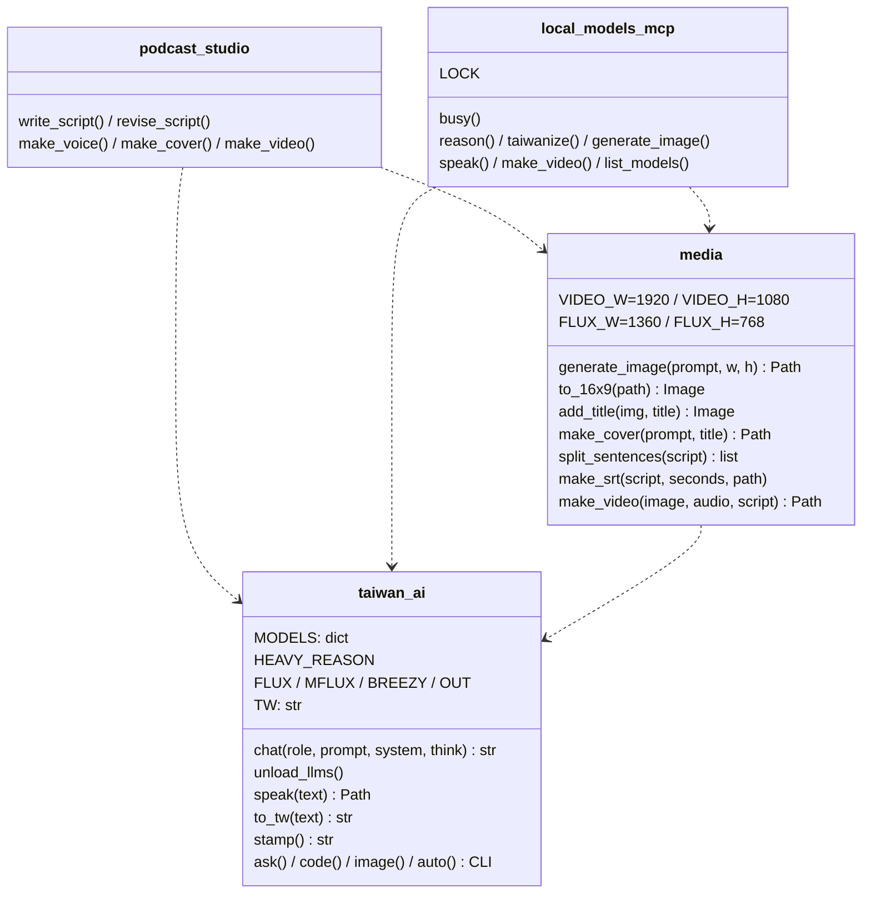

# 設計結構

> 導入反推(2026-10-22,基準點 `7da165b6048897abb8acac4bba69db9677827471`)。來源等級見 `docs/ai-guideline.md` 表頭。現況不等於規範;缺陷見 Guideline §9。

## 關鍵元件

| 元件 | 責任 | 對外介面/契約 | 等級 |
|------|------|----------------|------|
| `taiwan_ai.chat(role, prompt, system="", think=None)` | 對 Ollama `/api/chat` 非串流請求;`num_ctx=16384`、`keep_alive=10m`、逾時 1800 秒;移除 `<think>…</think>` | 回傳 `str`(可能是空字串);HTTP 錯誤直接拋出 | 〔觀察〕 |
| `taiwan_ai.unload_llms()` | 對 `MODELS` 每個模型送 `keep_alive: 0`;錯誤全吞 | 無回傳 | 〔觀察〕不含 `HEAVY_REASON`(ADP-1) |
| `taiwan_ai.speak(text)` | 清 Markdown 符號 → 子程序 BreezyVoice(固定女聲樣本與逐字稿) | 回傳 `outputs/speech-<stamp>.wav` 的 `Path`;另 `print` 路徑 | 〔觀察〕 |
| `taiwan_ai.to_tw` | OpenCC `s2twp` | `str → str` | 〔觀察〕 |
| `taiwan_ai.stamp()` | 建 `outputs/`,回傳 `YYYYmmdd-HHMMSS` | 秒級(ADP-8) | 〔觀察〕 |
| `media.generate_image(prompt, w, h)` | 卸載 LLM → mflux 4 步 | `outputs/image-<stamp>.png` | 〔觀察〕 |
| `media.make_cover(prompt, title)` | 1360×768 → 放大裁切 1920×1080 → 底部 28% 模糊帶 + 白字黑邊標題(120→48 px,最多 2 行) | `outputs/cover-<stamp>.png` | 〔觀察〕超過 2 行未處理(ADP-3) |
| `media.split_sentences(script, max_chars=24)` | 依 `。！？!?；;\n` 切,過長再依 `，,、` 切,仍過長硬切 | `list[str]` | 〔觀察〕 |
| `media.make_srt(script, seconds, path)` | 依字數比例分配時間 | 寫 SRT,回傳 path | 〔觀察〕 |
| `media.make_video(image, audio, script="")` | ffmpeg:loop 圖 + 音訊(+ mov_text 字幕),`-r 2 -tune stillimage`,`-shortest` | `outputs/podcast-<stamp>.mp4`(+ 同名 `.srt`) | 〔觀察〕音訊須為 WAV 才能算字幕(ADP-7) |
| `local_models_mcp.busy()` | 全域 `threading.Lock` + `redirect_stdout(stderr)` | context manager | 〔觀察〕 |
| 網頁 handler(`write_script` 等 5 個) | 輸入檢查、prompt 組裝 | Gradio 事件 | 〔觀察〕 |

## 元件關係圖

## 介面 / API 契約

### MCP 工具(〔觀察〕`local_models_mcp.py`)

| 工具 | 輸入 | 輸出 | 錯誤行為 |
|------|------|------|----------|
| `reason` | `prompt: str`, `think: bool = True`, `heavy: bool = False` | 台灣正體文字 | 空回答 → `RuntimeError` |
| `taiwanize` | `text: str` | 台灣正體文字 | Ollama 錯誤直接拋出 |
| `generate_image` | `prompt: str`, `width: int = 1024`, `height: int = 1024` | PNG 絕對路徑 | 非 16 倍數 → `ValueError`;mflux 失敗 → `CalledProcessError` |
| `speak` | `text: str` | WAV 絕對路徑 | 子程序失敗 → `CalledProcessError`(stderr 被丟棄) |
| `make_video` | `image_path: str`, `audio_path: str`, `script: str = ""` | MP4 路徑 | 檔案不存在 → `FileNotFoundError`;非 WAV + script → `wave.Error`(ADP-7) |
| `list_models` | — | JSON 字串:`roles`、`loaded_now`、`outputs` | Ollama 沒開 → `URLError` |

### 外部引擎契約(〔觀察〕)
- Ollama:`POST /api/chat`、`POST /api/generate`(卸載)、`GET /api/tags`、`GET /api/ps`
- mflux:`--model <FLUX> --base-model schnell --steps 4 --width --height --prompt --output`
- BreezyVoice:`single_inference.py --content_to_synthesize --speaker_prompt_audio_path --speaker_prompt_text_transcription --output_path`,cwd = `tools/BreezyVoice`

## 設計決策與取捨

| 決策 | 選項 | 取捨理由 | 等級 |
|------|------|----------|------|
| Gradio 網頁 | 網頁 vs CLI | 文案需反覆編輯,文字框比終端機好用 | 〔推論〕`PODCAST_STUDIO.md §5` |
| 文案 `think=False` | 開 vs 關思考 | 寫作不需長推理;開思考吃 context、慢 3–5 倍 | 〔推論〕`§5` |
| 每分鐘 250 字 | — | 台灣華語播報常見語速 | 〔推論〕`§5` |
| 標題用字型疊上 | FLUX 畫字 vs 字型疊加 | FLUX 無法正確產生中文字 | 〔推論〕`§5` |
| 生圖前卸載 LLM | 同時載入 vs 卸載 | FLUX 峰值 14–16 GB,與 LLM 並存超出記憶體 | 〔推論〕`§5` |
| 2 fps、`-tune stillimage` | — | 靜態畫面,降低檔案大小與編碼時間 | 〔推論〕`§5` |
| imageio-ffmpeg | 系統 ffmpeg vs 內附 | 沒有 Homebrew,免額外安裝 | 〔推論〕`§5` |
| 軟字幕 mov_text + `.srt` | 硬字幕 vs 軟字幕 | 已確認決策 | 〔推論〕`§8 #3` |
| 依字數比例分配字幕時間 | 對齊模型 vs 比例 | 沒有語音對齊模型;誤差約 1–2 秒 | 〔觀察〕`media.py:94` 註解 |
| MCP 全部工具共用一把鎖 | 並行 vs 序列 | 24 GB 同時只撐得住一個重型工作 | 〔觀察〕`local_models_mcp.py:21` 註解 |
| `tools/` 不入 git,以 patches + 腳本重建 | vendor vs 重建 | 已確認決策 | 〔推論〕`§8 #4` |
| 數字正規化自製 `tn/` | WeTextProcessing vs 自製 | pynini 無 macOS ARM wheel | 〔觀察〕`setup_breezyvoice.sh:16` 註解 |

## 採用模式

- 〔觀察〕**單檔 PEP 723 script**:每個入口檔自帶依賴宣告,`uv run --script` 執行;沒有 package / `pyproject.toml`。
- 〔觀察〕**共用模組以 `sys.path.insert` + import 重用**(`taiwan_ai` 同時是 CLI 與函式庫)。
- 〔觀察〕**外部引擎一律子程序或 HTTP**,不在行程內載入模型——讓記憶體可由卸載控制。
- 〔觀察〕**重複**:mflux 指令在 `taiwan_ai.image()` 與 `media.generate_image()` 各一份(CLI 固定 1024×768,media 參數化)。〔未知〕是否刻意,與 Q2(CLI 去留)一起決定。
