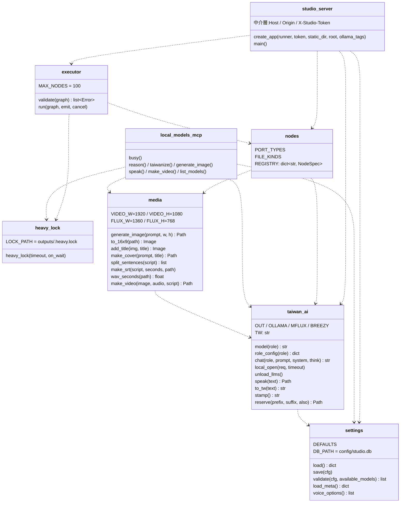

# 設計結構

> 導入反推(2026-10-22,基準點 `7da165b6048897abb8acac4bba69db9677827471`)。來源等級見 `docs/ai-guideline.md` 表頭。現況不等於規範;缺陷見 Guideline §9。
> 2026-10-26 依 CHG-20261022-01 結構文件更新:新增 HTTP API 契約、節點登錄表、設定模組介面、跨行程鎖;CLI 與 Gradio 版移除;設計決策表加入本筆決策(以 T1~T13 合併後的 main 為準)。
> 2026-10-26 依 CHG-20261026-01 結構文件更新:新增 `taiwan_ai.role_config()`;生圖與聲線改讀設定、mflux 子程序加 `HF_HUB_OFFLINE=1`;移除 `FLUX` 常數;`wav_seconds()` 改為自寫 RIFF/WAVE 解析;影片合成 `-r 10`、WAV 加 `-t`;設計決策表加入本筆代決(以 T1~T5 合併後的 main 為準)。
> 2026-10-28 依 CHG-20261028-01 結構文件更新:設計決策表新增「Codex 席以 PR head 唯讀檢視讀完整程式」。

> 2026-10-28 依 CHG-20261022-04 結構文件更新(DIR-5 修正輪,以整合分支 T1~T9 與修正為準):新增專案 API 契約、`breezy_worker` 介面(jobs 格式、stdout 進度行、G2PW `num_workers = 0`、環境由 `tts_service` 傳入 `taiwan_ai.BREEZY_ENV`)、合成快取鍵、`project` / `timeline` / `tts_service` / `names` 元件、`media.render_timeline` 與 `media.sniff_binary`;設計決策表加入本筆決策(含修訂 2 合成粒度與實測依據);畫布存檔改為保留 `steps`。

## 關鍵元件

| 元件 | 責任 | 對外介面/契約 | 等級 |
|------|------|----------------|------|
| `taiwan_ai.model(role)` | 每次呼叫經 `settings.load()` 取該角色(`reason`、`reason_heavy`、`taiwan`)的模型名稱 | 回傳 `str`;未知角色丟 `KeyError` | 〔觀察〕 |
| `taiwan_ai.role_config(role)` | 每次呼叫經 `settings.load()` 取 `roles[role]`;不要求角色有 `model` 鍵(`voice` 只有 `wav`、`text`) | 回傳該角色設定的**副本**(`dict`);未知角色丟 `KeyError` | 〔觀察〕CHG-20261026-01 T1 |
| `taiwan_ai.chat(role, prompt, system="", think=None)` | 對 Ollama `/api/chat` 非串流請求;模型與 `num_ctx` 取自設定;`keep_alive=10m`、逾時 1800 秒;移除 `<think>…</think>` | 回傳 `str`(可能是空字串);HTTP 錯誤直接拋出 | 〔觀察〕 |
| `taiwan_ai.local_open(req, timeout)` | 對本機 Ollama 送請求:只限 `localhost` / `127.0.0.1` / `::1`、不經代理、不跟隨重新導向 | `chat`、`unload_llms`、網頁設定 API、MCP `list_models` 一律經此 | 〔觀察〕 |
| `taiwan_ai.unload_llms()` | 查 `/api/ps`,對目前載入的**全部**模型送 `keep_alive: 0`;錯誤全吞 | 無回傳 | 〔觀察〕ADP-1 的處理(CHG-20261022-01 T2) |
| `taiwan_ai.speak(text)` | 每次呼叫以 `role_config("voice")` 取聲線檔(repo 相對路徑轉絕對路徑)與逐字稿 → 清 Markdown 符號 → 子程序 BreezyVoice;子程序環境 `BREEZY_ENV` 含 `HF_HUB_OFFLINE=1`、`TRANSFORMERS_OFFLINE=1`,模型快取不存在時失敗並提示,不下載 | 回傳 `outputs/speech-<stamp>.wav` 的 `Path`;呼叫端須在 `heavy_lock()` 內 | 〔觀察〕ADP-12 的處理(T4);ADP-4、ADP-9 未處理 |
| `taiwan_ai.to_tw` | OpenCC `s2twp` | `str → str` | 〔觀察〕 |
| `taiwan_ai.stamp()` / `reserve(prefix, suffix, also=())` | `stamp()`:`YYYYmmdd-HHMMSS-毫秒-4 碼隨機`;`reserve()`:在 `outputs/` 以 `O_EXCL`、不跟隨符號連結排他建立佔位檔,撞名重取(最多 20 次) | 輸出檔一律先佔位再寫入,不覆寫既有檔 | 〔觀察〕ADP-8 的處理(T2) |
| `media.generate_image(prompt, w, h)` | 每次呼叫以 `role_config("image")` 取 `model`、`steps`(一次呼叫讀一次)→ 卸載 LLM → mflux;子程序環境為目前環境的副本加 `HF_HUB_OFFLINE=1`(沒有快取的模型直接失敗,不下載) | `outputs/image-<stamp>.png` | 〔觀察〕CHG-20261026-01 T2 |
| `media.make_cover(prompt, title)` / `add_title(img, title)` | 1360×768 → 放大裁切 1920×1080 → 底部 28% 模糊帶 + 白字黑邊標題(120→48 px,最多 2 行) | `outputs/cover-<stamp>.png` | 〔觀察〕超過 2 行未處理(ADP-3) |
| `media.split_sentences(script, max_chars=24)` | 依 `。！？!?；;\n` 切,過長再依 `，,、` 切,仍過長硬切 | `list[str]` | 〔觀察〕 |
| `media.make_srt(script, seconds, path)` | 依字數比例分配時間 | 寫 SRT,回傳 path | 〔觀察〕 |
| `media.wav_seconds(path)` | 以標準庫 `struct` 解析 RIFF/WAVE:只讀 chunk 標頭與 `fmt `(最多 64 位元組),以 `seek` 跳過其他 chunk,data 不讀進記憶體;支援 PCM(1)、IEEE float(3)、WAVE_FORMAT_EXTENSIBLE(0xFFFE,以 SubFormat 前 2 位元組判斷 1 或 3);長度 = data 位元組數 ÷(聲道數 × 每樣本位元組數)÷ 取樣率;chunk 長度(含奇數補位)不得超出檔尾、最多走訪 `WAV_MAX_CHUNKS`(1024)個 chunk | 回傳 `float` 秒數;不是 RIFF/WAVE、缺 `fmt ` 或 `data`、不支援的編碼、欄位為 0、data 不是整數個樣本框、讀檔失敗(`OSError`,以 `from None` 斷開例外鏈)一律丟繁中 `ValueError`,訊息不含路徑 | 〔觀察〕CHG-20261026-01 T4;`RF64`、64 位元 float 未支援 |
| `media.make_video(image, audio, script="")` | ffmpeg:loop 圖 + 音訊(+ mov_text 字幕),`-r 10 -tune stillimage`,`-shortest`;以檔頭前 12 位元組判斷音檔為 RIFF/WAVE(不看副檔名)時,在輸出檔名前加 `-t <wav_seconds(),小數 3 位>`,影片軌與音軌長度差 ≤ 0.1 秒 | `outputs/podcast-<stamp>.mp4`(+ 同名 `.srt`) | 〔觀察〕CHG-20261026-01 T5;非 WAV 不加 `-t`(片尾可能多出靜止畫面),帶字幕時讀不到長度而失敗(ADP-7) |
| `heavy_lock.heavy_lock(timeout=None, on_wait=None)` | 跨行程排他鎖 `outputs/.heavy.lock`(`fcntl.flock(LOCK_EX)`);被占用時呼叫一次 `on_wait()` 再每 0.05 秒重試 | context manager;`timeout` 秒數逾時丟 `TimeoutError`;`outputs/` 或鎖檔是符號連結丟 `OSError`;鎖檔不讀不寫不刪 | 〔觀察〕ADP-2 的處理(T4) |
| `local_models_mcp.busy()` | 重讀設定 → `heavy_lock(on_wait=…)` → `redirect_stdout(stderr)` | context manager;等待時寫 stderr | 〔觀察〕 |
| `safe_fs`(`open_dir` / `open_child` / `open_file` / `open_path` / `open_or_create` / `create_excl` / `lstat` / `entries` / `unlink` / `rmtree` / `rename` / `replace` / `link` / `closing`) | 自受信根目錄(呼叫端給的固定目錄,例 `project.ROOT`、`outputs/`、`static/`)以 `dir_fd` 逐層 `O_NOFOLLOW` 開啟;名稱一律單一路徑元件(空、`.`、`..`、含 `/` 或 NUL 丟 `ValueError`);任一層是符號連結或不是預期種類丟 `UnsafePathError`(`OSError` 子類別),不存在丟 `FileNotFoundError`;`rmtree` 以 fd 遞迴,遇符號連結只 unlink 連結本身;`open_or_create` 以「先開、不存在再 `O_EXCL` 建立」迴圈取代 `O_CREAT`(macOS 上多行程 `openat(O_CREAT \| O_NOFOLLOW)` 實測偶發 ENOENT) | 回傳 fd(呼叫端關閉);訊息不含本機路徑 | 〔觀察〕CHG-20261022-04 DIR-5 修正 4 |
| `settings`(`load` / `save` / `validate` / `load_meta` / `voice_options`) | 模型設定的唯一存取點,儲存層為 SQLite `config/studio.db` | 見下方「設定模組介面」 | 〔觀察〕 |
| `nodes.REGISTRY` | 十種節點的宣告與 `run()`,包住 `taiwan_ai` / `media` | 見下方「節點登錄表」 | 〔觀察〕 |
| `executor.validate(graph)` / `run(graph, emit, cancel=None)` | 驗證流程圖;依拓撲順序在呼叫端執行緒執行並以 `emit(dict)` 推送事件 | 見下方「流程圖格式與執行事件」 | 〔觀察〕 |
| `studio_server.create_app(...)` / `main()` | FastAPI app;`main()` 以 uvicorn 綁 `127.0.0.1:7860`,啟動時呼叫 `project.startup_cleanup()` | 見下方「HTTP API」「專案 API」 | 〔觀察〕 |
| `names`(`name_char_ok`、`normalize_name`、`fold_name`) | 工作流程名稱與專案名稱共用的中英日白名單(1~64 字、逐字比對,不做正規化);只差大小寫的比對鍵 | 不合格回錯誤;規則單一來源 | 〔觀察〕CHG-20261022-04 T2 |
| `project`(`Project`、`validate`、`split_segments`、`tts_text`、`load` / `save` / `update` / `restore` / `trash`、`startup_cleanup`、`subdir`) | 專案資料模型與存取:分句(句尾標點、換行、強制停頓)、停頓與語速正規化、標註驗證與 `字[:注音]` 產生、原子寫入 + history 10 版、`.trash/` 30 天、專案層級鎖 | 不合法丟 `ProjectError`(繁中 `.errors`);`ProjectNotFound`(404)、`ProjectExists`(409);見 `data.md`「專案資料」 | 〔觀察〕CHG-20261022-04 T2、T6、T8 |
| `timeline.layout(project)` | 純函式:片段起訖(變速後長度 + 停頓)、字幕 cue(超過 24 字切段)、畫面軌起訖、總長(不含片尾停頓) | `{segments:[{id,start,end}], cues:[{segment,start,end,text}], images:[{id,file,start,end}], duration}`;沒有音檔的片段長度 0、不丟錯 | 〔觀察〕CHG-20261022-04 T4;預覽與匯出共用 |
| `tts_service`(`load_voice`、`cache_key`、`dirty_segments`、`synth`、`apply_speed`) | 只合成髒片段、內容雜湊快取、逐句 emit、語速後製(ffmpeg `atempo`,單一濾鏡) | `synth(project, emit)` 就地更新片段 `audio`、不存檔,回 `{"synthesized", "cached"}`;每句 emit `{"type": "segment", "id", "seconds", "cached", "audio"}`;`apply_speed(segment, project)` 回變速後音檔路徑;失敗丟 `SynthError`(繁中、不含路徑) | 〔觀察〕CHG-20261022-04 T3;`audio` 欄位為 DIR-5 修正 M-1 |
| `breezy_worker.py` | 在 BreezyVoice venv 執行的子程序:`synth`(逐句合成、模型載入一次)、`annotate`(逐字注音) | 見下方「BreezyVoice worker 介面」 | 〔觀察〕CHG-20261022-04 T1 |
| `media.render_timeline(project, layout)` | 依 layout 匯出 MP4 + SRT;片段音檔經 `tts_service.apply_speed` 取變速後檔案、以 `O_NOFOLLOW` 開啟經 stdin 交給 ffmpeg 解碼(以 `-t` 截在片段需要的長度);畫面以 concat demuxer 依 0.1 秒格排程 | `(mp4, srt)`;輸出以 `taiwan_ai.reserve()` 佔位;未合成或路徑不安全丟 `RenderError`(`.segments` 列出片段);逾時 max(600, 音訊秒數 × 2) 秒 | 〔觀察〕CHG-20261022-04 T5;`-t` 解碼截止為 DIR-5 修正 M-3 |
| `media.sniff_binary(ext, head)` | 依檔頭位元組判斷內容與副檔名是否相符(png、jpg、webp、wav、mp3、m4a) | `/api/upload` 與「送到素材庫」節點共用,規則單一來源 | 〔觀察〕DIR-5 修正 M-5(由 `studio_server._sniff_binary` 搬出,規則不變) |

〔觀察〕設定中的 `roles.image`(`model`、`steps`)與 `roles.voice`(`wav`、`text`)由 `media.generate_image()`、`taiwan_ai.speak()` 在每次呼叫時經 `taiwan_ai.role_config()` → `settings.load()` 讀取(CHG-20261026-01 T1、T2);網頁節點與 MCP 工具共用這兩個函式,MCP 不需另改即跟上。`--base-model` 仍固定 `schnell`,設定頁沒有對應欄位〔觀察〕;換成 dev 系模型時以錯誤基底執行(CHG-20261026-01 代決 3)。

## 元件關係圖

## 介面 / API 契約

### HTTP API(〔觀察〕`studio_server.py` 檔頭與實作)

所有回應帶 `X-Content-Type-Options: nosniff` 與 `Content-Security-Policy: default-src 'self'; media-src 'self' blob:; img-src 'self' blob: data:`;不送任何 CORS 標頭。

| 方法與路徑 | 輸入 | 成功 | 錯誤 |
|------------|------|------|------|
| `GET /` | — | 首頁 HTML,`__STUDIO_TOKEN__` 換成啟動權杖 | — |
| `GET /static/{path}` | — | `static/` 之下的真實檔案 | 404 |
| `GET /api/nodes` | — | `{"nodes": [NodeSpec 宣告…], "port_types": [...]}` | — |
| `POST /api/run` | 本文 = 流程圖 JSON(≤ 4 MB) | 200 `{"run_id"}` | 400 `{"errors": [{node_id, port, message}]}`;409 已有執行中的 run;413 |
| `GET /api/run/{id}/events` | `Last-Event-ID`(選填) | SSE:`id: <序號>` + `data: <事件 JSON>`,送完 `finished` 結束;保留最近 20 次 run 供重連 | 404 |
| `POST /api/run/{id}/cancel` | — | 設定取消旗標 | 404 |
| `POST /api/upload?name=<原始檔名>` | 本文 = 檔案原始位元組(非 multipart) | 200 `{"file_id": "uploads/<uuid>.<ext>", "kind", "url": "/files/outputs/uploads/<uuid>.<ext>"}` | 400 副檔名不在白名單、內容嗅探不符、文字非 UTF-8 / 含 NUL / 超過 20000 字;413 超過 200 MB(串流累計,超過即中止並刪暫存檔) |
| `GET /files/{path}` | `path` 第一層必須是 `outputs` | 已知媒體型別 inline;文字 `text/plain; charset=utf-8`;其他 `application/octet-stream` + attachment | 404:絕對路徑、任一層以 `.` 開頭、指向 `outputs/` 外、非一般檔案 |
| `GET /api/workflows/{name}` | — | `{"name", "graph"}` | 400 名稱不合規則;404;422 檔案損壞或超過 4 MB |
| `PUT /api/workflows/{name}` | `{"graph", "overwrite": bool(預設 false)}` | 寫入 `workflows/<name>.json`(暫存檔 `.wf-<uuid>.tmp` 後以 `os.link` 排他建立,或 `os.replace` 覆寫) | 400 名稱不合規則或 graph 未通過 `executor.validate`;409 已存在且未帶 `overwrite:true`,或已有只差大小寫(casefold 相等)的其他名稱(不論 overwrite);413;500 目錄不安全 |
| `GET /api/config` | — | `settings.load()` 結果 + `meta: {imported_from, imported_at}`(有 `_warnings` 時 `meta` 為 `{}`) | — |
| `PUT /api/config` | 設定 JSON(≤ 256 KB;`_warnings`、`meta` 會被忽略) | 200 `{"saved": true, "config"}` | 413;422 非物件或 `validate` 有錯;503 Ollama 連不上(不儲存);500 `save()` 失敗(本文不含本機路徑) |
| `GET /api/models` | — | `{"ollama": {"reachable", "models", "error"?}, "mflux": {"installed"}, "breezyvoice": {"installed"}, "voices": [...]}` | Ollama 連不上時 `reachable=false`,仍回 200 |

- 〔觀察〕**安全中介層**:所有請求(含 GET、`/files/*`、SSE)的 `Host` 必須是 `127.0.0.1:7860` 或 `localhost:7860`;GET / HEAD 以外另要求 `Origin` 完整等於 `http://127.0.0.1:7860` 或 `http://localhost:7860`(缺少或 `null` 拒絕,`OPTIONS` 一律拒絕),且 `X-Studio-Token` 等於啟動權杖(`hmac.compare_digest`)。不符一律 403。
- 〔觀察〕啟動權杖每次啟動以 `secrets.token_urlsafe(32)` 產生,只存在記憶體與首頁 HTML。
- 〔觀察〕工作流程名稱規則(PR #44):名稱視為 Unicode 字串逐字比對中英日白名單——ASCII 英數、`-`、`_`、CJK 統一漢字(U+4E00–U+9FFF)與擴充 A(U+3400–U+4DBF)、平假名(U+3041–U+3096)、片假名(U+30A1–U+30FA)、「ー」、「々」,1~64 字,不做正規化。
- 〔觀察〕`outputs/`、`outputs/uploads/`、`workflows/` 逐層不得是符號連結、解析後必須等於 repo 內對應目錄;不符時寫入回 500、讀取回 404,且不建立任何東西。
- 〔觀察〕錯誤訊息與事件字串一律經 `scrub()`,不送本機絕對路徑;未預期例外回 500,本文不含例外內容。

### 流程圖格式與執行事件(〔觀察〕`executor.py` 檔頭)

- 流程圖:`{"nodes": [{"id": 字串, "kind", "params", "pinned"?, "outputs"?, "pos"?}], "edges": [{"from": {"node", "port"}, "to": {"node", "port"}}]}`;`executor.validate` 只讀 `nodes`、`edges`,其他頂層鍵(例如 `workflows/default.json` 的 `steps`)與節點的 `pos` 不影響驗證。
- 驗證錯誤 `Error(node_id, port, message)`:未知種類、未宣告的參數、參數不合格(`Param.check`)、型別不符、有環、必填未接、格式錯誤、節點數超過 100;釘住的節點只能是「全部輸出埠為 text」且每個輸出都有字串編輯值(≤ 20000 字)。
- 事件:`started`(拓撲順序)→ 每個節點 `running` / `waiting` / `done`(outputs)/ `error` / `skipped`(`pinned` 或 `upstream`)/ `cancelled` → `finished`(`ok` / `error` / `cancelled`)。
- `workflows/default.json` 另有頂層 `steps`:`[{"id", "label", "nodes": [節點 id…], "note"?}]`,定義步驟精靈預設步驟 ① 文稿 ② 語音 ③ 封面 ④ 剪輯 ⑤ 匯出(④ 沒有節點,屬 CHG-20261022-04);精靈只讀 `GET /api/workflows/default` 的 `steps`(不新增清單端點,修訂 3 R3-1);前端畫布存檔(`buildGraph()`)保留載入時的 `steps`,移除已不在畫布上的節點 id,原本有節點、移除後變空的步驟刪除,原本就沒有節點的步驟保留(修訂 3 R3-2)。

### 節點登錄表(〔觀察〕`nodes.py`)

| 種類 | 輸入埠 | 輸出埠 | 參數 | 重型 |
|------|--------|--------|------|------|
| `text-input` | — | `text` | `text`(≤ 20000 字) | 否 |
| `file-input` | — | 依 `kind`:`text` / `image` / `audio` 其一 | `file`(相對 `outputs/`,≤ 512 字)、`kind`(text / image / audio) | 否 |
| `write-script` | `topic: text` | `text` | `style`(五種風格)、`minutes`(0.5–10,步進 0.5)、`notes`(≤ 2000 字) | 是 |
| `revise` | `text: text` | `text` | `instruction`(≤ 2000 字) | 是 |
| `taiwanize` | `text: text` | `text` | — | 是 |
| `speak` | `text: text` | `audio` | — | 是 |
| `cover-prompt` | `title: text`、`script: text`(選填) | `text` | `extra`(≤ 2000 字) | 是 |
| `generate-image` | `prompt: text` | `image` | `width`、`height`(256–2048,16 倍數;預設 1360×768) | 是 |
| `add-title` | `image: image`、`title: text` | `image` | — | 否 |
| `make-video` | `image: image`、`audio: audio`、`script: text`(選填) | `video` | `subtitles`(預設 true) | 是 |
| `send-to-library` | `text`、`image`、`audio`(皆選填,至少一個) | `text`(結果訊息) | `project`(專案名稱,`names.py` 白名單;專案須已存在) | 否 |

- 〔觀察〕`send-to-library`(CHG-20261022-04 T8):文字存成 `.txt`;圖片與音訊只收 `outputs/` 之下的一般檔案——檔案本身與其在 `outputs/` 之下的每一層目錄都不得是符號連結(解析前逐層 `lstat`,DIR-5 修正 M-4)、解析後在 `outputs/` 內、`O_NOFOLLOW` 開啟、副檔名在 `project.ASSET_EXTS`、≤ 200 MB、檔頭經 `media.sniff_binary` 與副檔名相符(DIR-5 修正 M-5);複製到 `assets/<新 id>` 後經 `project.update()` 登記,失敗刪除複製檔。
- 〔觀察〕埠型別只有 `text`、`image`、`audio`、`video`;文字輸出是字串,其餘是 `outputs/` 下的檔案路徑。節點本身不取重型鎖,由 `executor` 對 `heavy=True` 的節點包 `heavy_lock()`。
- 〔觀察〕`write-script` 只做推理模型起稿(字數 = 分鐘 × 250),台灣用語潤飾拆成 `taiwanize` 節點(舊版 `write_script` 一次做完)。

### 設定模組介面(〔觀察〕`settings.py`)

| 介面 | 契約 |
|------|------|
| `load() -> dict` | 回 `{"roles", "review_seats"}`;路徑不安全、資料庫不是 SQLite / 損壞、`schema_version` 不明、內容不合法 → `DEFAULTS` 副本 + `_warnings`(同時寫 stderr),不修改資料庫;資料庫不存在時依 `config/models.json` 決定回預設值或一次性匯入 |
| `save(cfg) -> None` | 先 `validate(cfg, None)`,不合格丟 `ValueError(錯誤清單)`;`BEGIN IMMEDIATE` 單一交易 DELETE + INSERT 整批改寫 `roles`、`review_seats`,例外即 ROLLBACK;路徑不安全、非 SQLite、版本不明丟 `ValueError`,不寫入、不覆寫、不重建 |
| `validate(cfg, available_models) -> list[str]` | 逐欄繁中錯誤;`available_models=None` 只做結構檢查;否決席(risk、security、compliance)不得為 `glm4:*`;`codex` 只限否決席;暫停的 27B 不得用於審議席位;聲線檔限 `tools/BreezyVoice/data/`、`outputs/uploads/` 之下 |
| `load_meta() -> dict` | 唯讀取得 `imported_from`、`imported_at`;不建立、不匯入、不寫入 |
| `voice_options() -> list[str]` | 允許目錄下可選的 `.wav`(repo 相對路徑,不跟隨符號連結) |

- 〔觀察〕儲存層:既有資料庫先以唯讀 URI(`mode=ro`)讀 `meta.schema_version`,此階段不下 PRAGMA;版本已知或新建時才以讀寫模式開啟並設 `journal_mode=WAL`、`busy_timeout=5000`;資料庫檔由本模組排他建立(權限 0600)。
- 〔觀察〕SQL 一律參數化(`?` 佔位),表名、欄名寫死在 `settings.py`;其他模組不得直接開資料庫或讀 `config/models.json`。
- 〔觀察〕路徑規則:`config/`、`studio.db`、`-wal`、`-shm` 逐層不得是符號連結、解析後必須位於 repo 內。

### MCP 工具(〔觀察〕`local_models_mcp.py`)

| 工具 | 輸入 | 輸出 | 錯誤行為 |
|------|------|------|----------|
| `reason` | `prompt: str`, `think: bool = True`, `heavy: bool = False`(true 時用 `reason_heavy` 角色) | 台灣正體文字 | 空回答 → `RuntimeError` |
| `taiwanize` | `text: str` | 台灣正體文字 | Ollama 錯誤直接拋出 |
| `generate_image` | `prompt: str`, `width: int = 1024`, `height: int = 1024` | PNG 絕對路徑 | 非 16 倍數 → `ValueError`;mflux 失敗 → `CalledProcessError` |
| `speak` | `text: str` | WAV 絕對路徑 | 子程序失敗 → `CalledProcessError`(子程序 stderr 被丟棄;本行程 stderr 印離線提示) |
| `make_video` | `image_path: str`, `audio_path: str`, `script: str = ""` | MP4 路徑 | 檔案不存在 → `FileNotFoundError`;非 WAV 或壞掉的 WAV + script → 繁中 `ValueError`(ADP-7;CHG-20261026-01 T4 前為 `wave.Error`) |
| `list_models` | — | JSON 字串:`roles`(reason、taiwan、reason_heavy 取自設定;image 的 `model` 也取自設定 `roles.image.model`(CHG-20261026-01 T2);另有 speech)、`loaded_now`、`outputs` | Ollama 沒開 → `URLError` |

〔觀察〕工具名稱、參數、回傳格式在 CHG-20261022-01 前後相同;每次工具呼叫重讀設定,重型工具在 `heavy_lock()` 內執行。

### 外部引擎契約(〔觀察〕)
- Ollama:`POST /api/chat`、`POST /api/generate`(卸載)、`GET /api/tags`、`GET /api/ps`
- mflux:`--model <roles.image.model> --base-model schnell --steps <roles.image.steps> --width --height --prompt --output`;環境變數為目前環境加 `HF_HUB_OFFLINE=1`(CHG-20261026-01 T2)
- ffmpeg(imageio-ffmpeg 內附):`-y -loop 1 -i <圖> -i <音>`(+ `-i <srt> -map 0:v -map 1:a -map 2:s -c:s mov_text -metadata:s:s:0 language=chi`)`-vf scale…,pad… -c:v libx264 -tune stillimage -r 10 -pix_fmt yuv420p -c:a aac -b:a 192k -shortest`(WAV 時再加 `-t <秒數>`)`<輸出>`(CHG-20261026-01 T5)
- BreezyVoice:`single_inference.py --content_to_synthesize --speaker_prompt_audio_path <roles.voice.wav 絕對路徑> --speaker_prompt_text_transcription <roles.voice.text> --output_path`,cwd = `tools/BreezyVoice`;環境變數只有 `PYTHONUTF8`、`PATH`、`HF_HUB_OFFLINE=1`、`TRANSFORMERS_OFFLINE=1`(ADP-12)
- BreezyVoice worker(CHG-20261022-04):`tools/BreezyVoice/.venv/bin/python breezy_worker.py synth --jobs <json> --out <dir>` 或 `annotate --input <json>`,argv list、cwd = `tools/BreezyVoice`、`env = taiwan_ai.BREEZY_ENV`(見下節)

### 專案 API(〔觀察〕`studio_server.py` 檔頭;CHG-20261022-04 T6)

沿用同一個安全中介層(Host / Origin / Token);{p} 為專案名稱(`names.py` 白名單,含 `.`、`..`、`%2e%2e`、`/` 一律 400)。本文一律 JSON 物件(上限 `MAX_PROJECT_BODY`,不認得的欄位 422)。錯誤 `{"error", "errors"?, "segments"?}`,經 `scrub()`、不含本機絕對路徑。修改類端點一律「載入 → 修改 → 存檔(舊版移入 history)」並回「專案檢視」View = `{"project", "layout", "forced_breaks"}` + `"version"`。

| 方法與路徑 | 輸入 | 成功 | 錯誤 |
|------------|------|------|------|
| `GET /api/projects` | — | `{"projects": [{"name", "updated"}]}` | — |
| `POST /api/projects` | `{"name", "script"?}` | 201 View;語速與停頓預設取自設定資料庫 `voice_defaults` | 400 名稱;409 已存在;422 |
| `GET /api/projects/{p}` | — | View(合成期間疊上本次已完成的句子,不存檔,DIR-5 修正 M-1) | 404 |
| `PUT /api/projects/{p}` | `{"script"?, "forced_breaks"?, "defaults"?}` | View;帶 script 或 forced_breaks 時重新分句,文字相同的片段沿用 id、停頓、語速、標註與音檔 | 422 |
| `DELETE /api/projects/{p}` | `{"confirm": true}` | 移到 `.trash/<名稱>-<時間戳>-<4 碼>/` | 400 未確認;409 合成或匯出中 |
| `GET /api/projects/{p}/history` / `POST …/restore` | `{"version"}` | 版本清單 / View(還原 = 一次存檔) | 404 |
| `PATCH /api/projects/{p}/segments/{id}` | `{"text"?, "pause_after"?, "speed"?, "annotations"?, "split_at"?, "merge_next"?, "audio_file"?, "audio"?}` | View;改文字或標註時清除自錄音檔;`audio_file` 以上傳的 WAV 取代該句(只看前 12 位元組 RIFF/WAVE,長度以 `media.wav_seconds()` 取得) | 404;422(注音、停頓、語速、非 WAV「取代語音只接受 WAV 音檔」) |
| `POST /api/projects/{p}/assets` | `{"file_id", "label"?}` | View + `{"asset"}`(素材庫匯入;CHG 修訂 4 補記) | 404;422 |
| `POST /api/projects/{p}/images` | `{"asset"}` 或 `{"file_id"}`,`start`?、`end`? | View + `{"image"}` | 404;422 |
| `PATCH` / `DELETE /api/projects/{p}/images/{id}` | `{"start"?, "end"?}` / — | View;刪除只移除時間軸項目,不刪素材檔(CHG 修訂 4 補記) | 404;422 |
| `GET /api/projects/{p}/media/{id}` | — | 只依 id 解析到該專案 `assets/<id>.<ext>` 或 `audio/<id>.wav`(含合成中途已完成、尚未寫回的音檔);白名單副檔名、`nosniff`;送合成原檔(變速前),預覽以 `playbackRate` 套語速 | 404:不存在、他專案、符號連結 |
| `POST /api/projects/{p}/synth` | — | `{"run_id", "events"}`;SSE 事件 waiting、segment(`id`、`seconds`、`cached`、`audio`)、error、finished(`status`、`synthesized`、`cached`、`saved`);結束(含中途失敗)時一次寫回,只更新同 id、合成文字未變、期間沒改成自錄音檔的片段 | 404;409 已有工作 |
| `POST /api/projects/{p}/render` | — | `{"run_id", "events"}`;finished 帶 `mp4`、`srt`(`outputs/…`) | 400 未合成或過期片段(`segments` 列出);409 |
| `POST /api/annotate` | `{"text": 1~500 字}` | `{"text", "zhuyin": [每字注音或 null]}`;`heavy_lock` 內執行,逾時 60 秒 | 422;500 worker 失敗;409 |

- 〔觀察〕synth、render、annotate 與 `/api/run` 共用同一個「執行中」旗標(`Runs.active`),第二個一律 409;`projects/` 不經 `/files/*` 提供。
- 〔觀察〕合成中途可試聽(DIR-5 修正 M-1):伺服器在該次合成期間以記憶體記錄「已完成、尚未寫回」的片段音檔(`{片段 id: (合成當時的含標註文字, audio)}`),疊到 View、layout 與 media 端點上;前端收到 segment 事件即重新讀取 View。結束時一次 `merge_audio()` 寫回後清除記錄,一次合成最多新增一個 history 版本。

### BreezyVoice worker 介面(〔觀察〕`breezy_worker.py`、`tts_service.py`;CHG-20261022-04 T1、T3)

- `synth --jobs <json> --out <dir>`:jobs 檔 = `{"prompt_wav": 聲線檔絕對路徑, "prompt_text": 聲線逐字稿(必填,不走 Whisper 後備), "model"?: 預設 MediaTek-Research/BreezyVoice-300M, "jobs": [{"id": ^[0-9a-f]{8,32}$, "text": 1–500 字}]}`;jobs 檔由 `tts_service` 寫在 `projects/<名稱>/tmp/`(`O_EXCL`、`O_NOFOLLOW`、0600),用完即刪,使用者文字不進 argv。
- `CustomCosyVoice` 只建構一次;`G2PWConverter` 建立後把 `num_workers` 屬性設為 0(建構子把 0 當假值忽略);每句各自呼叫 `single_inference`,寫完 `<out>/<id>.wav` 即在 stdout 印一行 `{"id", "seconds"}`;全部完成後寫 `<out>/result.json`。標註以聲調符號書寫,送進 BreezyVoice 前轉成數字聲調。
- `annotate --input <json>`:`{"text": 1–500 字}` → stdout 一個 JSON 陣列(每字聲調符號格式注音,非中文字 null);只用 G2PW。
- 環境由 `tts_service` 直接傳入 `taiwan_ai.BREEZY_ENV`(含 `HF_HUB_OFFLINE=1`、`TRANSFORMERS_OFFLINE=1`,修訂 3 R3-3,ADP-12);模型快取缺失時離線失敗(結束碼 3,訊息提示需在建置期允許連網時先下載一次),不下載。結束碼:2 輸入不合法、3 模型載入失敗、4 合成失敗;錯誤訊息繁中、不含本機絕對路徑。
- 逾時(`tts_service`):第一個進度行最多等 `MODEL_LOAD_TIMEOUT`(180 秒,含模型載入)+ `SENTENCE_TIMEOUT`(120 秒),之後每句 120 秒;整批上限 = 180 + 句數 × 120 秒;逾時即終止子程序(CHG 修訂 4,RS-7)。
- 合成快取鍵 = SHA-256(JSON 陣列 [含標註的合成文字, 聲線檔 SHA-256, 聲線逐字稿 SHA-256, 模型名]);合成音檔以鍵前 32 碼內容定址存於 `audio/`,命中即重用;變速結果以「音檔 id + 語速」另存 `audio/<id>-s<語速×100>.wav`。聲線每次 `synth()` 經 `taiwan_ai.role_config("voice")` 讀一次。

## 設計決策與取捨

| 決策 | 選項 | 取捨理由 | 等級 |
|------|------|----------|------|
| ~~Gradio 網頁~~(已由下方 CHG-20261022-01 各列取代) | 網頁 vs CLI | 文案需反覆編輯,文字框比終端機好用 | 〔推論〕`PODCAST_STUDIO.md §5` |
| 文案 `think=False` | 開 vs 關思考 | 寫作不需長推理;開思考吃 context、慢 3–5 倍 | 〔推論〕`§5` |
| 每分鐘 250 字 | — | 台灣華語播報常見語速 | 〔推論〕`§5` |
| 標題用字型疊上 | FLUX 畫字 vs 字型疊加 | FLUX 無法正確產生中文字 | 〔推論〕`§5` |
| 生圖前卸載 LLM | 同時載入 vs 卸載 | FLUX 峰值 14–16 GB,與 LLM 並存超出記憶體 | 〔推論〕`§5` |
| ~~2 fps~~ 10 fps、`-tune stillimage` | 2 fps vs 10 fps | 靜態畫面,降低檔案大小與編碼時間;CHG-20261026-01 T5 改為 10 fps:影格間隔 0.1 秒,`-t` 截止誤差才能 ≤ 0.1 秒(2 fps 實測誤差達 0.5 秒) | 〔推論〕`§5`;〔觀察〕CHG-20261026-01 T5 |
| imageio-ffmpeg | 系統 ffmpeg vs 內附 | 沒有 Homebrew,免額外安裝 | 〔推論〕`§5` |
| 軟字幕 mov_text + `.srt` | 硬字幕 vs 軟字幕 | 已確認決策 | 〔推論〕`§8 #3` |
| 依字數比例分配字幕時間 | 對齊模型 vs 比例 | 沒有語音對齊模型;誤差約 1–2 秒 | 〔觀察〕`media.py:94` 註解 |
| MCP 全部重型工具共用一把鎖 | 並行 vs 序列 | 24 GB 同時只撐得住一個重型工作;CHG-20261022-01 起改為與網頁共用的跨行程檔案鎖 | 〔觀察〕`local_models_mcp.busy()` 註解 |
| `tools/` 不入 git,以 patches + 腳本重建 | vendor vs 重建 | 已確認決策 | 〔推論〕`§8 #4` |
| 數字正規化自製 `tn/` | WeTextProcessing vs 自製 | pynini 無 macOS ARM wheel | 〔觀察〕`setup_breezyvoice.sh:16` 註解 |
| 網頁框架:FastAPI + 原生 JS | FastAPI + 原生 JS vs Gradio + 嵌入 vs ComfyUI | 本機沒有 node/npm,前端必須免建置、離線;節點編輯器與 HTML5 拖放用原生 JS 最直接 | 〔觀察〕CHG-20261022-01(使用者選定) |
| 節點編輯器:Drawflow 0.0.60 vendored | Drawflow vs LiteGraph.js vs 自寫 SVG | 單一 JS + CSS、MIT、免建置;存進 `static/vendor/` 並記 SHA-256,不從 CDN 載入 | 〔觀察〕CHG-20261022-01(代決,確認閘覆核) |
| 伺服器端依拓撲順序逐一執行 + SSE | 伺服器端 vs 前端逐節點呼叫 | 24 GB 同時只撐一個重型工作;前端關掉分頁也不中斷 | 〔觀察〕CHG-20261022-01 |
| 四種埠型別,前後端各檢查一次 | — | 現有資料只有 text / image / audio / video;前端可被繞過,執行前伺服器再驗證 | 〔觀察〕CHG-20261022-01 |
| 人工修改以「釘住」節點保留 | pinned vs 每次重跑覆蓋 | FR-2 要保留人工修改;只有全文字輸出的節點可釘住 | 〔觀察〕CHG-20261022-01(代決) |
| MCP 每次工具呼叫重讀設定 | 每次重讀 vs 啟動時讀一次 | 使用者期待改了就生效 | 〔觀察〕CHG-20261022-01 |
| 跨行程鎖 `fcntl.flock` | 檔案鎖 vs 行程內鎖 | 網頁與 MCP 是兩個行程;持鎖行程結束時由作業系統釋放 | 〔觀察〕CHG-20261022-01(ADP-2) |
| 卸載目前載入的全部模型 | 卸載設定中的模型 vs `/api/ps` 全部 | heavy 模型會殘留(ADP-1) | 〔觀察〕CHG-20261022-01 |
| 移除 CLI 與 Gradio 版 | 保留並存 vs 刪除 | 使用者決定不需要 CLI;新版涵蓋 FR-1~7;git 可回復 | 〔觀察〕CHG-20261022-01 |
| 防跨站:Host + Origin + 啟動權杖 | 不防 vs 檢查 | 瀏覽器中任何網站都能對 `127.0.0.1:7860` 發請求(CSRF / DNS rebinding) | 〔觀察〕CHG-20261022-01(代決) |
| 上傳上限 200 MB、內容嗅探、伺服器產生檔名 | — | 不信任用戶端檔名與 `Content-Type` | 〔觀察〕CHG-20261022-01(代決) |
| 沿用埠 7860 | 沿用 vs 換新 | 使用者習慣與 `launch.json` | 〔觀察〕CHG-20261022-01(代決) |
| 預設範本兼作步驟精靈預設步驟 | 範本與步驟分開 vs 同一檔 | 修訂 1:畫布移入「設定 › 進階流程」,用來調整精靈步驟;`workflows/default.json` 頂層 `steps` 供 CHG-20261022-04 的精靈讀取 | 〔觀察〕CHG-20261022-01 修訂 1、T13 |
| 模型設定改存 SQLite `config/studio.db`(修訂 2) | `config/models.json` vs SQLite | 使用者選定;不入 git,網頁存設定不弄髒工作樹;`load/save/validate` 簽名不變 | 〔觀察〕CHG-20261022-01 修訂 2(使用者選定) |
| WAL + `busy_timeout=5000` + `BEGIN IMMEDIATE`(修訂 2) | 每次寫整檔 vs SQLite 交易 | 網頁寫、MCP 讀可能同時發生;版本不明或非 SQLite 時不下會寫入的 PRAGMA | 〔觀察〕CHG-20261022-01 修訂 2(代決) |
| 舊 JSON 一次性匯入後停用(修訂 2) | 持續雙寫 vs 一次性匯入 | 匯入不刪原檔;`config/models.json` 移出 git | 〔觀察〕CHG-20261022-01 修訂 2(代決) |
| 工作流程名稱中英日白名單 | 只限 ASCII vs Unicode 字母數字 vs 中英日白名單 | 使用者要能用中文命名,多次審議無交集時採最低限度 | 〔觀察〕CHG-20261022-01 派發記錄(使用者 2026-10-26 指示,PR #44) |
| CI 平台:GitHub Actions 代管 ubuntu runner | 代管 vs self-hosted runner | Mac 不常駐外部任務程式、CI 不搶 GPU 記憶體;本機模型審議在開 PR 前於本機跑,判決以 PR 留言帶進 CI(代決) | 〔觀察〕CHG-20261022-03 |
| 治理腳本 vendored 進 `.ai-sdlc/` | 從 `kamira/ai-skills` checkout vs vendored | 上游 repo 為 private,跨 repo checkout 需秘密;vendored v1.66.0 不需秘密,以 `SHA256SUMS` 驗完整性;腳本隨本 repo 公開(使用者確認閘同意) | 〔觀察〕CHG-20261022-03 |
| commit 引用 CHG 編號,只改 `docs/knowledge/` 豁免 | 全部要 CHG vs knowledge 豁免 | knowledge 條目是帳本寫入,不是變更 | 〔觀察〕CHG-20261022-03 |
| plan-check 只查 PR 改到、尚未完成驗收的 CHG | 全部 CHG vs PR 改到的 CHG | 已收尾的舊 CHG 不該因新規則變紅;狀態寫明「計畫待補」的草稿只警告 | 〔觀察〕CHG-20261022-03 |
| lint 範圍 `ruff check --select E9,F` | ruff 全規則 vs `E9,F` | 既有程式 `E9,F` 全過;全規則會把既有風格債變成紅燈,更嚴格的規則另開 CHG | 〔觀察〕CHG-20261022-03 |
| 本機審議閘:本機跑、CI 驗留言 | CI 內跑模型 vs 本機跑、CI 驗留言 | 代管 runner 連不到本機 Ollama;`review` job 只驗擁有者留言、目前 head sha、否決席無 fail、每席有回答 | 〔觀察〕CHG-20261022-03 |
| CD 定義為本機部署腳本 `scripts/deploy_local.sh` | 不做 vs 本機部署腳本 vs 發 release | 產品只在本機執行,沒有遠端環境;部署後驗證只綁本機(fail-closed) | 〔觀察〕CHG-20261022-03 |
| main 保護以 ruleset 強制 | ruleset vs 只靠約定 | repo 已公開,ruleset 免費可用;要求四項 check 通過、禁止直接 push 與 force push、只允許 squash | 〔觀察〕CHG-20261022-03 |
| security、compliance 審議席由 Codex 擔任 | 本機 Ollama vs Codex(雲端,`-s read-only`) | 實審中 8B / 27B 輸出截斷或誤判,Codex 回答證據具體;送審資料送出本機屬使用者明示例外,前提是 repo 已公開 | 〔觀察〕DIR-1 第 9 條(使用者 2026-10-23 指示) |
| 暫停 27B 審議 | 27B vs Codex 擔任高風險 risk 席 | 使用者指示暫不使用 27B;`scripts/local_review.py` 預設仍含 27B,暫停期間須帶 `--codex-seats risk,security,compliance` | 〔觀察〕DIR-1 第 10 條(使用者 2026-10-23 指示) |
| Codex 席以 PR head 唯讀檢視讀完整程式 | 整份 diff 內嵌 vs 分檔送審 vs PR head 唯讀檢視 | Codex 席沿用 Ollama 的 `num_ctx` 截短時,大 CHG 讓 diff 被截到空(PR #76);Codex 以 `-s read-only` 執行,可唯讀執行 `git show`、`git diff`。diff 經過濾後 ≤ 30000 字內嵌完整 diff,超過改用 `.review/` 下以 head sha 建立的 `--no-checkout` detached worktree(不寫出追蹤檔以免依 PR 的 `.gitattributes` 觸發本機 filter、停用 hook、比對 HEAD、審完移除;Codex 只以 `git show`、`git diff --no-textconv --no-ext-diff` 讀取);本次與舊檢視共用安全清理:只有 `.git` 才刪指標檔與空目錄並 prune,不用 git 的強制移除與遞迴刪除,否則留下並警告;同名舊目錄另須為登記的 worktree;Ollama 席不變 | 〔觀察〕CHG-20261028-01(使用者 2026-10-28 核准 C-2) |
| 27B 逾時 30 分鐘改派 Codex | 重派 27B vs 改派 Codex | 27B 太慢;某階段逾時或累計超過 30 分鐘沒有回答即改派,該席判決的模型欄註明改派 | 〔觀察〕DIR-1(使用者 2026-10-23 規則) |
| 生圖與聲線設定每次呼叫重讀 | 每次呼叫重讀 vs 行程啟動時讀一次 | 與 `taiwan_ai.model()` 一致;MCP 是長駐行程,改了設定要立刻生效 | 〔觀察〕CHG-20261026-01 代決 1 |
| 新增 `taiwan_ai.role_config()` | 新增介面 vs 各處直接讀 `settings.load()["roles"]` | `_role()` 要求 `model` 鍵,`voice` 沒有;設定只經 `settings.load()` 存取 | 〔觀察〕CHG-20261026-01 代決 1 |
| `generate-image` 節點不加 `steps` 參數 | 節點參數 vs 只走設定 | 避免兩個來源互相覆蓋 | 〔觀察〕CHG-20261026-01 代決 2 |
| `--base-model schnell` 維持固定 | 固定 vs 開放設定 | 設定 schema v1 不變;代價是 dev 系模型以錯誤基底執行 | 〔觀察〕CHG-20261026-01 代決 3 |
| mflux 子程序加 `HF_HUB_OFFLINE=1` | 允許下載 vs 離線 vs 只准預設模型 | 不送資料出本機;沒有快取直接失敗,同 ADP-12 對 BreezyVoice 的做法 | 〔觀察〕CHG-20261026-01 代決 4 |
| 移除 `FLUX`、`VOICE_WAV`、`VOICE_TEXT` | 保留 vs 移除 | 保留會留下第二個「看似生效」的來源;預設值只留在 `settings.DEFAULTS` | 〔觀察〕CHG-20261026-01 代決 5 |
| 不新增 `settings.validate` 規則 | 新增 vs 沿用 | 既有規則已限制步數、聲線檔目錄、文字長度與控制字元;argv 為 list、不經 shell | 〔觀察〕CHG-20261026-01 代決 6 |
| 覆寫 `default` 只記錄、不擋 | 只記錄 vs 伺服器拒絕 | 使用者指示範圍只限 `.gitignore`;覆寫後 `deploy_local.sh` 中止,以 `git checkout` 復原 | 〔觀察〕CHG-20261026-01 代決 7 |
| `workflows/` 只追蹤 `default.json`,不改 `deploy_local.sh` | `.gitignore` vs 改存檔位置 vs 改部署判定 | 使用者指示;已忽略的檔案不算工作樹不乾淨 | 〔觀察〕CHG-20261026-01 代決 8 |
| WAV 長度自寫 RIFF/WAVE 解析 | 自寫 `struct` 解析 vs imageio-ffmpeg | imageio-ffmpeg 只附 `ffmpeg`、沒有 `ffprobe`,改用要另開子程序解析文字;自寫不加依賴、精度為取樣等級 | 〔觀察〕CHG-20261026-01 代決 10 |
| WAV 加 `-t <秒數>` 並保留 `-shortest`;非 WAV 沿用 | `-shortest` vs `-t` vs `-shortest -t` vs `+shortest` 旗標 | 實測 `-loop 1` + `-shortest` 對 17 秒的聲音產出約 50 秒的影片;`-t` 才能截止 | 〔觀察〕CHG-20261026-01 代決 11、12 |
| 壞檔丟繁中 `ValueError`、訊息不含路徑 | 沿用 `wave.Error` vs 自訂 | 節點與 MCP 會把錯誤訊息顯示給使用者 | 〔觀察〕CHG-20261026-01 代決 13 |
| 合成粒度 B2:逐句輸出、模型載入一次、G2PW `num_workers = 0` | A 整段 vs B 逐句 vs B2 vs C 每句新行程 | 2026-10-26 實測(10 句、267 字,CPU):B2 總耗時 610.3 秒(A 655.9 / 662.0 秒)、第一段可播放 92.8 秒(A 要等全部完成)、峰值 RSS 12.13 GiB(A 10.78 GiB);B 變慢的原因是 G2PW 每次呼叫以 DataLoader 產生子行程;整段合成本來就逐句推論後串接,逐句輸出不損失跨句韻律 | 〔觀察〕CHG-20261022-04 修訂 2 |
| 停頓以分句合成 + 精確靜音 | 文字插入標點 vs 分句合成插靜音 | 模型沒有停頓指令;靜音長度精確到 0.1 秒;逗號不切,要加長時設強制停頓 | 〔觀察〕CHG-20261022-04 |
| 片段快取以內容雜湊、音檔內容定址 | 每次全部重合成 vs 快取 | 使用者會反覆改少數幾句;鍵含聲線逐字稿,只改逐字稿也會重合成(修訂 3 R3-4) | 〔觀察〕CHG-20261022-04 |
| 語速以 ffmpeg `atempo` 後製 | 模型參數 vs 後製 | BreezyVoice 沒有語速參數;只改語速不重新合成,變速結果另行快取 | 〔觀察〕CHG-20261022-04 修訂 1 |
| 專案檔 JSON + history 10 版 | JSON vs SQLite | 單人、可人工檢視;拖拉編輯容易誤改,保留最近 10 版 | 〔觀察〕CHG-20261022-04 |
| 預覽在瀏覽器排程播放,匯出才用 ffmpeg | 先渲染 vs 即時播放 | 片段都是獨立 WAV;預覽與匯出共用 `timeline.layout()` | 〔觀察〕CHG-20261022-04 |
| 時間軸前端自寫 | 第三方套件 vs 自寫 | 免建置、離線;只需三軌、拖拉空隙與圖片 | 〔觀察〕CHG-20261022-04(代決) |
| 語音預設存設定資料庫 `voice_defaults` 表(schema 2) | 另建設定檔 vs 設定資料庫 | 設定只經 `settings.py`;升級在單一交易內,失敗維持 v1 | 〔觀察〕CHG-20261022-04 修訂 2 |
| 自錄音檔只收 RIFF/WAVE | 全部上傳音檔 vs 只收 WAV vs 轉檔 | `media.wav_seconds()` 只讀得到 WAV 長度;不新增轉檔子程序路徑 | 〔觀察〕CHG-20261022-04 修訂 3 R3-6 |
| 合成中途以記憶體疊加試聽,結束一次寫回 | 每句存檔 vs 記憶體疊加 | 不新增端點;每句存檔會讓 history 10 版被合成中間狀態洗掉 | 〔觀察〕DIR-5 修正 M-1(使用者故事 13) |
| 停頓空隙的點擊範圍以交界為中心至少 12px、層級高於選取片段 | 依停頓寬度 vs 最小點擊範圍 | 停頓可設 0 秒(使用者 2026-10-27),逗號強制停頓預設 0 秒,0 秒空隙是常態 | 〔觀察〕DIR-5 修正 M-2 |
| 第一句另給 180 秒模型載入額度 | 每句 120 秒含載入 vs 另給載入額度 | 改聲調後只重合成一句是主要路徑,實測載入約 70–93 秒,原規定餘裕約 27 秒 | 〔觀察〕CHG-20261022-04 修訂 4(使用者 2026-10-28 核准,RS-7) |
| 專案名稱沿用中英日白名單 | ASCII `^[\w\-]{1,64}$` vs 中英日白名單 | 驗收要建立「夜市的味道」;與工作流程名稱同一套規則(使用者 2026-10-26「中英日即可」) | 〔觀察〕CHG-20261022-04 修訂 4(RS-3) |

## 採用模式

- 〔觀察〕**單檔 PEP 723 script**:每個入口檔自帶依賴宣告,`uv run --script` 執行;沒有 package / `pyproject.toml`。
- 〔觀察〕**共用模組以 `sys.path.insert` + import 重用**(`taiwan_ai` 只是函式庫,CLI 已於 CHG-20261022-01 T2 移除)。
- 〔觀察〕**節點包裝**:`nodes.py` 以 `NodeSpec` 包住既有 `taiwan_ai` / `media` 函式,不改其行為;新功能以新節點種類加入登錄表。
- 〔觀察〕**單一存取點**:模型設定只經 `settings.py`;輸出檔名只經 `taiwan_ai.reserve()`;重型工作只在 `heavy_lock()` 內。
- 〔觀察〕**檔案存取經目錄 fd**(CHG-20261022-04 DIR-5 修正 4):本程式自己對專案資料、`outputs/`、`static/`、`workflows/`、`config/` 的讀寫刪搬一律經 `safe_fs`(dir_fd 逐層 `O_NOFOLLOW`),回應與複製讀同一個 fd;`project.subdir()` 回傳的路徑只交給外部程式(worker、ffmpeg)。外部程式只能以路徑存取的位置(BreezyVoice worker 的 `--out`、mflux 輸出、匯出時 ffmpeg 的暫存與輸出、SQLite 資料庫)列為殘餘風險,見 CHG-20261022-04 修訂 4 補記 20。outputs/ 佔位檔以 `media.open_reserved()` / `save_image()` 經目錄 fd 寫入,匯出與生圖的暫存目錄以 `media._mkdtemp_out()` 建立並保留 fd(修正 5,補記 22)。
- 〔觀察〕**外部引擎一律子程序或 HTTP**,不在行程內載入模型——讓記憶體可由卸載控制。
- 〔觀察〕~~**重複**:mflux 指令在 `taiwan_ai.image()` 與 `media.generate_image()` 各一份~~——`taiwan_ai.image()` 隨 CLI 移除(CHG-20261022-01 T2),只剩 `media.generate_image()`。
