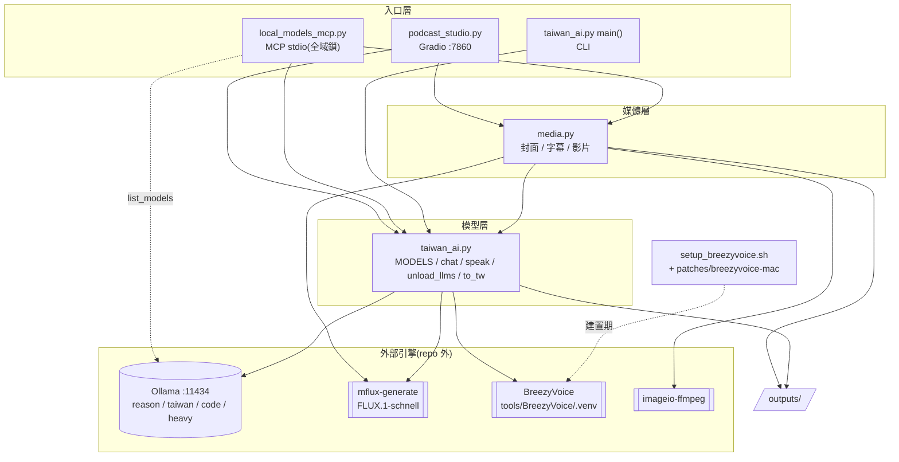
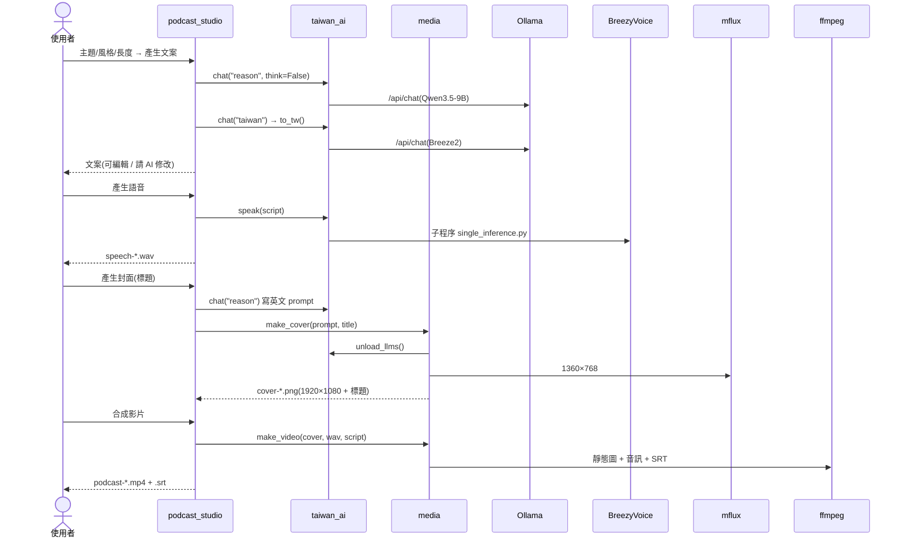
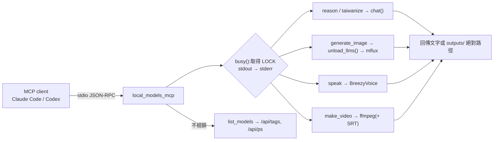

# 邏輯結構

> 導入反推(2026-10-22,基準點 `7da165b6048897abb8acac4bba69db9677827471`)。來源等級:〔觀察〕/〔推論〕/〔未知〕,定義見 `docs/ai-guideline.md` 表頭。
> 本文件描述**現況**,不代表現況正確;已知缺陷見 Guideline §9(ADP-n)。

## 分層 / 模組

| 層/模組 | 職責 | 依賴 | 回應需求 | 等級 |
|---------|------|------|----------|------|
| 入口層:網頁 `podcast_studio.py` | Gradio UI、四步流程、輸入檢查、prompt 組裝 | `media`、`taiwan_ai`、gradio | FR-1~7 | 〔觀察〕 |
| 入口層:MCP `local_models_mcp.py` | 把模型包成 6 個 stdio 工具;全域鎖;stdout 導向 stderr | `media`、`taiwan_ai`、mcp SDK、Ollama `/api/tags` `/api/ps` | FR-8~13 | 〔觀察〕 |
| 入口層:CLI `taiwan_ai.main()` | 命令列 `ask/code/image/speak/auto` | `taiwan_ai` 本身 | FR-14 | 〔觀察〕 |
| 媒體層 `media.py` | 生圖、16:9 裁切、疊標題、切句、SRT、ffmpeg 合成 | `taiwan_ai`(`OUT`、`stamp`、`unload_llms`、`MFLUX`、`FLUX`)、Pillow、imageio-ffmpeg | FR-4~6、10、12 | 〔觀察〕 |
| 模型層 `taiwan_ai.py` | 模型名稱設定、`chat()`、`unload_llms()`、`speak()`、`to_tw()`、輸出目錄與時間戳 | Ollama HTTP、BreezyVoice 子程序、mflux 子程序、OpenCC | FR-1~3、8、9、11 | 〔觀察〕 |
| 外部引擎 | Ollama(`localhost:11434`)、`mflux-generate`、`tools/BreezyVoice/.venv`、內附 ffmpeg | — | — | 〔觀察〕皆不在 repo 內 |
| 建置 `setup_breezyvoice.sh` + `patches/` | 重建 BreezyVoice macOS 環境 | GitHub、uv | FR-15 | 〔觀察〕 |

## 架構圖

〔觀察〕`taiwan_ai.image()`(CLI)與 `media.generate_image()` 各自組一次 mflux 指令——同一功能兩份實作(見設計結構「重複」)。

## 主要流程

### 流程 A:網頁產出一集(FR-1~7)

- 〔觀察〕語音與封面兩步沒有相依,可任意順序(FR-7)。
- 〔觀察〕錯誤路徑:輸入空白 → `gr.Error`;子程序失敗 → `CalledProcessError` 由 Gradio 顯示;stdout/stderr 被丟到 DEVNULL,失敗原因看不到。
- 〔觀察〕網頁沒有跨事件鎖,語音與封面可能同時跑(ADP-2)。

### 流程 B:MCP 工具呼叫(FR-8~13)

- 〔觀察〕`list_models` 不取鎖(唯讀 HTTP)。
- 〔觀察〕`make_video` 在取鎖前檢查兩個路徑存在;`generate_image` 在取鎖前檢查 16 倍數。
- 〔觀察〕`reason(heavy=true)` 暫時替換 `MODELS["reason"]`,結束後還原 → heavy 模型不在卸載清單(ADP-1)。

## 相依方向

〔觀察〕單向、無循環:入口層 → 媒體層 → 模型層 → 外部引擎;入口層也直接用模型層。`media` 依賴 `taiwan_ai`,`taiwan_ai` 不依賴 `media`。

〔觀察〕耦合點:`media.py` 直接讀 `taiwan_ai` 的模組層常數(`OUT`、`MFLUX`、`FLUX`)與函式;MCP 的 `reason` 以**改寫模組全域變數** `tai.MODELS` 切換模型——靠全域鎖才安全,網頁行程裡沒有這把鎖(目前網頁不切 heavy,〔推論〕暫無實害)。
