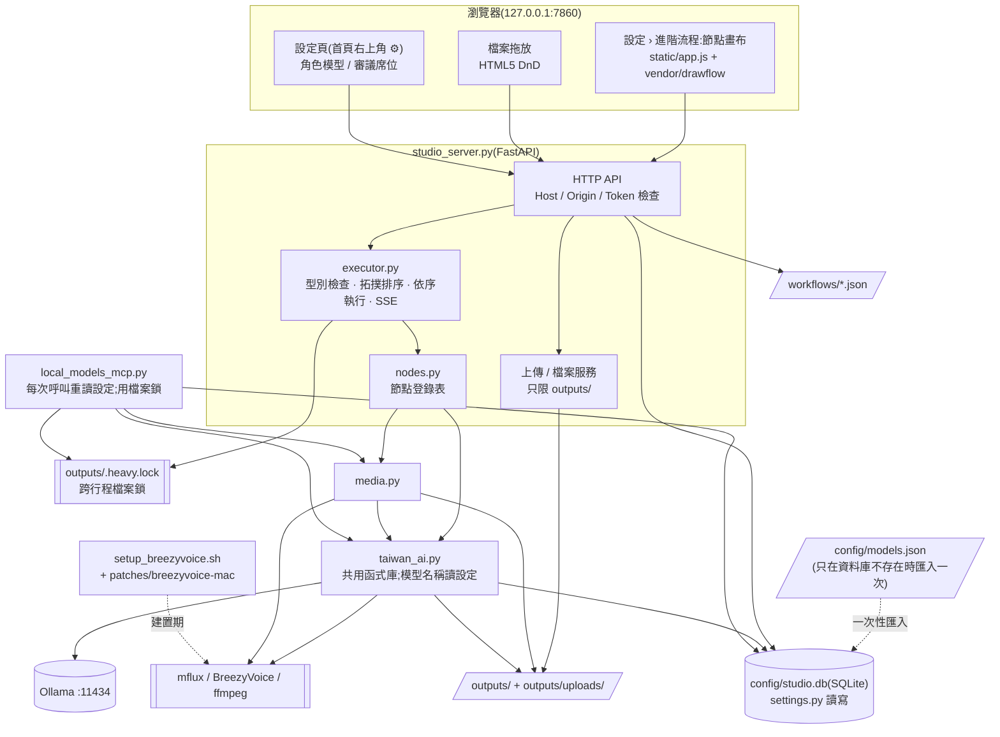
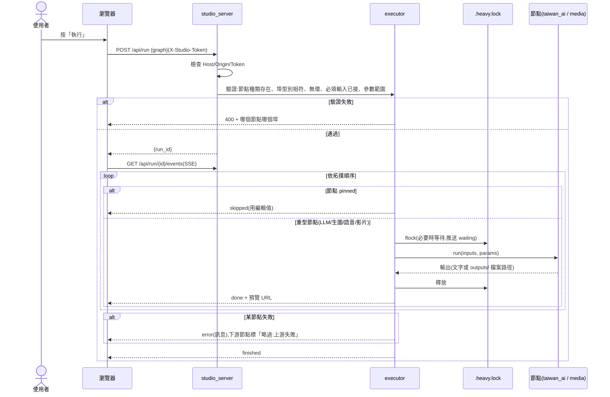
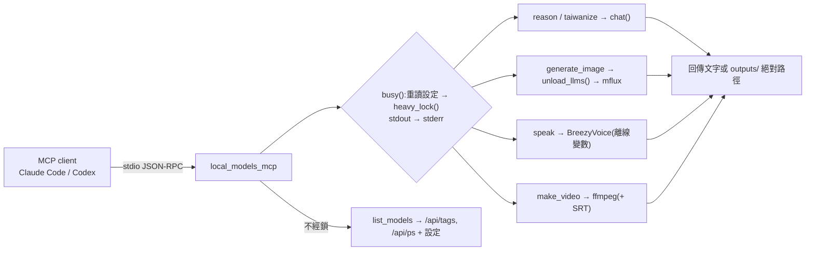
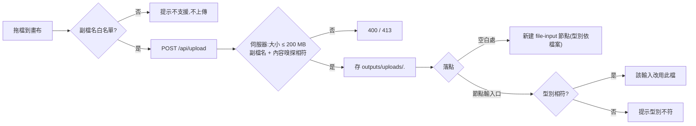
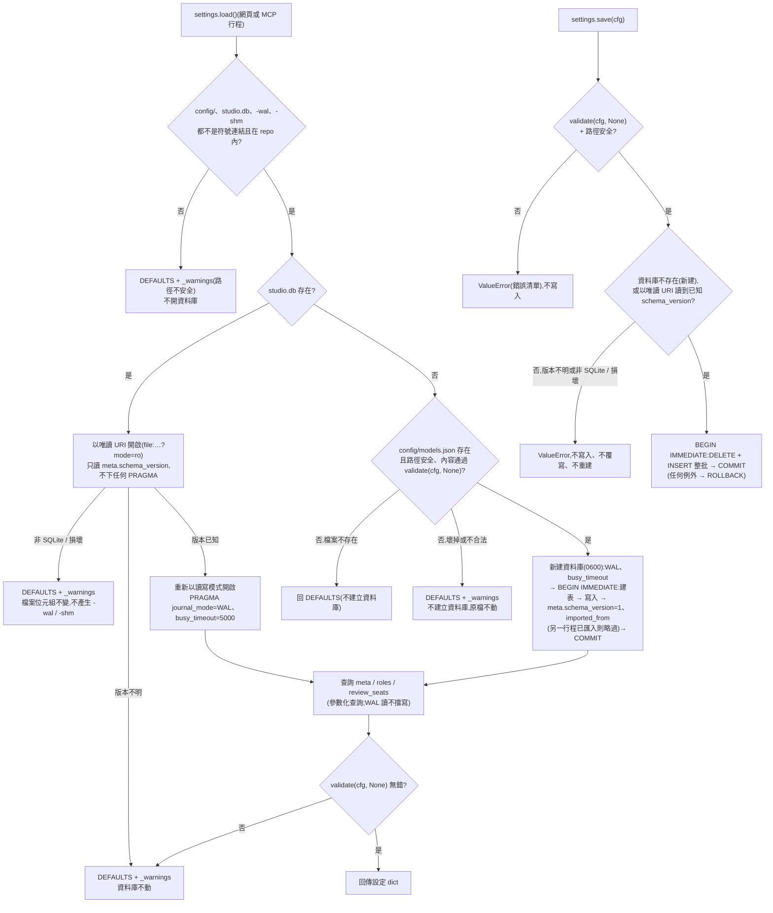
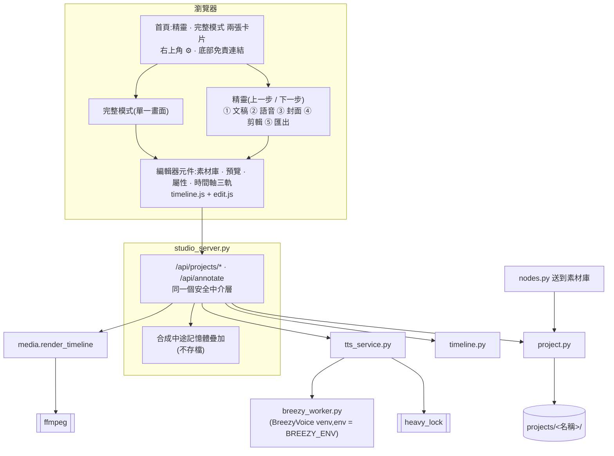
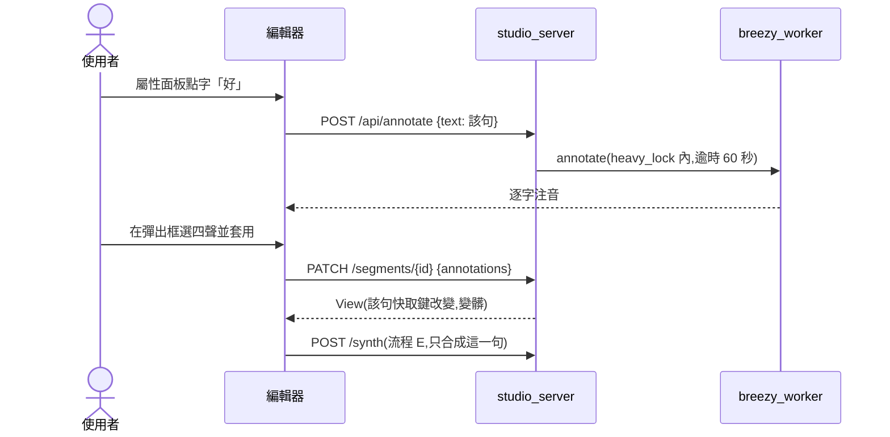
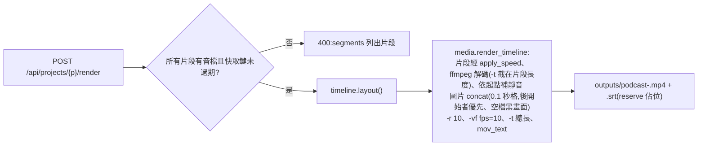
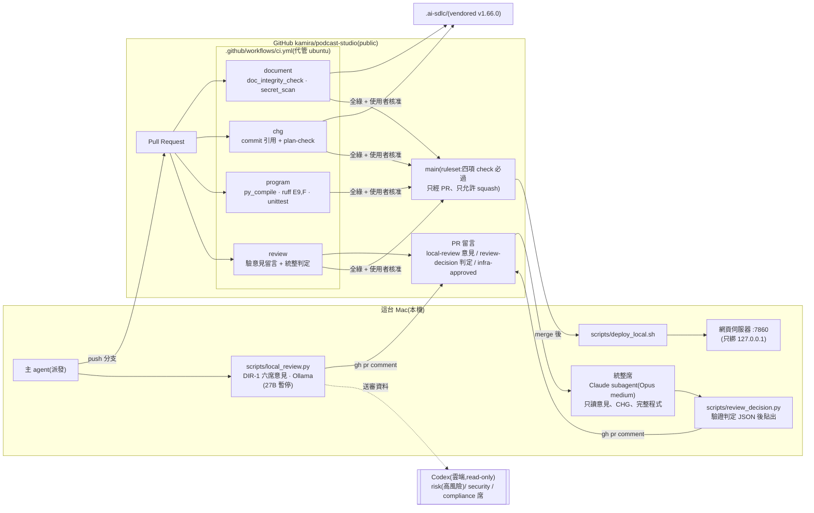

# 邏輯結構

> 導入反推(2026-10-22,基準點 `7da165b6048897abb8acac4bba69db9677827471`)。來源等級:〔觀察〕/〔推論〕/〔未知〕,定義見 `docs/ai-guideline.md` 表頭。
> 本文件描述**現況**,不代表現況正確;已知缺陷見 Guideline §9(ADP-n)。
> 2026-10-26 依 CHG-20261022-01 結構文件更新:網頁改為 `studio_server.py`(FastAPI + 原生 JS 節點畫布),移除 Gradio 版與 CLI;架構圖與流程 A 改寫,新增檔案拖放流程與設定讀寫流程(以 T1~T13 合併後的 main 為準;端到端驗收結果以 `docs/acceptance/` 為準)。
> 2026-10-28 依 CHG-20261022-04 結構文件更新:新增「專案編輯器」節(首頁雙卡片、精靈、完整模式、編輯器元件、專案模組;流程 E 逐句合成含合成中途試聽、流程 F 改聲調、流程 G 匯出)與相依方向。
> 2026-10-26 依 CHG-20261026-01 結構文件更新:媒體層改經 `taiwan_ai.role_config()` 讀生圖設定(不再讀 `FLUX`),語音改讀聲線設定;耦合點補上 `roles.image`、`roles.voice` 的讀取端(以 T1~T5 合併後的 main 為準)。
> 2026-10-28 依 CHG-20261028-01 結構文件更新:CI/CD 流程的本機審議步驟補記 Codex 席讀取完整程式的方式。
> 2026-10-28 依 CHG-20261028-02 結構文件更新:本機審議改為「六席意見 → 統整席判定」;流程圖補統整席與 `scripts/review_decision.py`;`review` 檢查與 DIR-4 改依統整判定。
> 2026-10-30 依 CHG-20261030-02 結構文件更新:CI/CD 流程的本機審議步驟補記統整席可依 DIR-6 第 12 條在暫存目錄執行既有測試。
> 2026-10-30 依 CHG-20261022-02 結構文件更新(以整合分支 `chg/CHG-20261022-02-impl` 的 T1~T3 為準):新增 `mcp_registry` 元件(FR-22)、設定頁「MCP 註冊」子頁、流程 H「MCP 註冊 / 重新檢查」與相依方向 `studio_server` → `mcp_registry`。

## 分層 / 模組

| 層/模組 | 職責 | 依賴 | 回應需求 | 等級 |
|---------|------|------|----------|------|
| 前端 `static/`(`index.html`、`app.js`、`style.css`、`vendor/drawflow.*`;專案編輯器的 `project.js`、`timeline.js`、`wizard.js`、`edit.js` 見「專案編輯器」節) | 首頁右上角 ⚙ 進入設定頁;設定頁子頁:模型、審議席位、語音預設(CHG-20261022-04 T8)、MCP 註冊(CHG-20261022-02 T3,`McpPanel`)、進階流程(節點畫布:拖出節點、連線型別檢查、執行 / 停止、SSE 狀態與預覽、文字輸出可編輯並釘住、檔案拖放、工作流程存檔 / 載入) | `studio_server` 的 HTTP API;Drawflow 0.0.60 | FR-16~23、31 | 〔觀察〕 |
| 入口層:網頁 `studio_server.py` | FastAPI,只綁 `127.0.0.1:7860`;Host / Origin / 權杖中介層;靜態檔、執行 API + SSE、上傳、檔案服務、工作流程存取、設定 API、MCP 註冊 API(`/api/mcp/*`,轉接 `mcp_registry`) | `executor`、`nodes`、`settings`、`mcp_registry`、`taiwan_ai`(`local_open`、`OLLAMA`、`MFLUX`、`BREEZY`)、fastapi、uvicorn | FR-16~23 | 〔觀察〕 |
| MCP 註冊 `mcp_registry.py` | local-models 在 Claude Code / Codex 的 user scope 註冊:查狀態(Claude 唯讀解析 `.claude.json` 頂層 `mcpServers["local-models"]`、Codex 執行 `codex mcp get --json`)、組指令(`plan`)、執行(`apply`,只經官方 CLI 的 `mcp add` / `mcp remove`)、重新檢查(`claude mcp get` 健康檢查);只操作名稱 `local-models`;回傳字串依「去除 env 值 → `scrub()` → 截斷 64 KB」處理;行程內非阻塞鎖(不進 `heavy_lock`) | 標準庫;外部 CLI `~/.local/bin/{claude,codex}`;不匯入其他專案模組 | FR-22 | 〔觀察〕CHG-20261022-02 T1 |
| 節點引擎 `executor.py` + `nodes.py` | `executor`:流程圖驗證(種類、型別、有環、必填、參數範圍、節點數)、拓撲排序、依序執行、pinned 跳過、上游失敗下游略過、可取消、重型節點包在 `heavy_lock()` 內;`nodes`:十種節點的埠、參數宣告與 `run()` | `heavy_lock`、`media`、`taiwan_ai` | FR-1~7(功能保留)、FR-16、17、20 | 〔觀察〕 |
| 入口層:MCP `local_models_mcp.py` | 把模型包成 6 個 stdio 工具;每次工具呼叫重讀設定;重型工具在跨行程 `heavy_lock()` 內執行並把 stdout 導向 stderr | `media`、`taiwan_ai`、`settings`、`heavy_lock`、mcp SDK、Ollama `/api/tags` `/api/ps` | FR-8~13、21 | 〔觀察〕 |
| 設定 `settings.py` | 模型角色與審議席位設定的唯一存取點:`load()` / `save()` / `validate()` / `load_meta()` / `voice_options()`;SQLite `config/studio.db`;一次性從 `config/models.json` 匯入 | sqlite3(標準函式庫) | FR-21、23 | 〔觀察〕 |
| 鎖 `heavy_lock.py` | 跨行程排他鎖 `outputs/.heavy.lock`(`fcntl.flock(LOCK_EX)`),網頁與 MCP 共用 | `safe_fs` | NFR 重型工作互斥(ADP-2) | 〔觀察〕 |
| 安全路徑 `safe_fs.py` | 自受信根目錄以 `dir_fd` 逐層 `O_RDONLY \| O_NOFOLLOW \| O_DIRECTORY` 走到目標;開檔(`O_NOFOLLOW` + `fstat` 驗一般檔)、列舉(`os.scandir(fd)`)、排他建立、刪除與 fd 遞迴刪除樹(符號連結只刪連結本身)、rename / replace / link(皆相對 dir_fd)。專案資料、`outputs/`、`static/`、`workflows/`、`config/` 的讀寫刪搬一律經它,取代「先以路徑檢查、再以路徑操作」 | 標準庫 | 安全影響(security-boundary) | 〔觀察〕CHG-20261022-04 DIR-5 修正 4 |
| 媒體層 `media.py` | 生圖、16:9 裁切、疊標題、切句、SRT、ffmpeg 合成 | `taiwan_ai`(`OUT`、`reserve`、`unload_llms`、`MFLUX`、`role_config("image")`)、Pillow、imageio-ffmpeg | FR-4~6、10、12 | 〔觀察〕 |
| 模型層 `taiwan_ai.py` | `model(role)` / `role_config(role)`(每次經 `settings.load()`)、`chat()`、`unload_llms()`(卸載 `/api/ps` 列出的全部模型)、`speak()`(每次經 `role_config("voice")` 取聲線;子程序帶離線變數)、`to_tw()`、`local_open()`、`stamp()` / `reserve()` | Ollama HTTP、BreezyVoice 子程序、mflux 子程序、OpenCC、`settings` | FR-1~3、8、9、11 | 〔觀察〕 |
| 外部引擎 | Ollama(`localhost:11434`)、`mflux-generate`、`tools/BreezyVoice/.venv`、內附 ffmpeg | — | — | 〔觀察〕皆不在 repo 內 |
| 建置 `setup_breezyvoice.sh` + `patches/` | 重建 BreezyVoice macOS 環境 | GitHub、uv | FR-15 | 〔觀察〕 |

〔觀察〕CLI(`taiwan_ai.main()` 與 `ask/code/image/auto`)與 `code` 角色已於 CHG-20261022-01 T2 移除;Gradio 版 `podcast_studio.py` 已於 T13 刪除。

## 架構圖



- 〔觀察〕`API --> CFG` 一律經 `settings.py`(`studio_server.py` 不含 `sqlite3` 或 `models.json` 字樣,`tests/test_server_config.py` 檢查);`API --> OLLAMA` 只有設定 API 查 `/api/tags`(經 `taiwan_ai.local_open()`,圖中省略)。
- 〔觀察〕`TAI --> ENG` 的 BreezyVoice 子程序環境一律帶 `HF_HUB_OFFLINE=1`、`TRANSFORMERS_OFFLINE=1`(ADP-12,CHG-20261022-01 T4)。
- 〔觀察〕mflux 指令只剩 `media.generate_image()` 一份(CLI 的 `taiwan_ai.image()` 已移除);mflux 子程序環境為目前環境加 `HF_HUB_OFFLINE=1`(CHG-20261026-01 T2)。
- 〔觀察〕ffmpeg 合成:音檔為 WAV 時加 `-t <wav_seconds() 秒數>`、影格率 `-r 10`,影片在聲音結束時截止(CHG-20261026-01 T5);非 WAV 只靠 `-shortest`(ADP-7)。

## 主要流程

### 流程 A:網頁按下「執行」(FR-1~7、16)



- 〔觀察〕預設範本 `workflows/default.json` 重現舊版四步流程:主題 → 寫文案 → 台灣用語 → 語音;標題 → 封面 prompt → 生圖 → 疊標題;封面 + 語音 + 文案 → 影片。前端進入「設定 › 進階流程」時以 `GET /api/workflows/default` 載入。
- 〔觀察〕語音與封面兩支沒有相依(FR-7);執行器在單一背景執行緒依拓撲順序逐一執行,重型節點彼此不重疊。
- 〔觀察〕同時只允許一個執行中的 run(第二個回 409);停止 = 設定取消旗標,進行中的節點跑完、不再啟動新節點。
- 〔觀察〕事件裡的字串經 `scrub()`:repo 根目錄換成 `<repo>`、家目錄換成 `~`;檔案輸出改送 repo 相對路徑,由 `/files/*` 下載。

### 流程 B:MCP 工具呼叫(FR-8~13)



- 〔觀察〕`list_models` 不取鎖(唯讀 HTTP),同一次呼叫內只讀一次設定。
- 〔觀察〕`make_video` 在取鎖前檢查兩個路徑存在;`generate_image` 在取鎖前檢查 16 倍數。
- 〔觀察〕`reason(heavy=true)` 改以 `reason_heavy` 角色呼叫 `chat()`,不再改寫模組全域變數;`unload_llms()` 卸載 `/api/ps` 列出的全部模型(ADP-1 的處理,結案以 ACC 為準)。
- 〔觀察〕MCP 工具名稱、參數、回傳格式與 CHG-20261022-01 之前相同。

### 流程 C:檔案拖放(FR-19)



- 〔觀察〕白名單 `.txt .md .png .jpg .jpeg .webp .wav .mp3 .m4a`,前端 `app.js` 與伺服器(`nodes.FILE_KINDS`)一致,由 `tests/test_static.py` 檢查。

### 流程 D:設定讀寫與一次性匯入(FR-21、23)



- 〔觀察〕網頁 `PUT /api/config` 先 `validate(cfg, None)`,再向 Ollama `/api/tags` 取已下載清單做第二次 `validate`(連不上回 503,不儲存),合格才 `save()`。MCP 每次工具呼叫經 `taiwan_ai.model()` / `settings.load()` 重讀,改設定後下一次呼叫生效。
- 〔觀察〕資料庫不存在或還沒有任何表時,建立、匯入、第一次存入在 `config/.studio.db.lock`(`flock`)內進行。

## 專案編輯器(CHG-20261022-04)

> 2026-10-28 依 CHG-20261022-04 結構文件更新(DIR-5 修正輪,以整合分支 T1~T9 與修正為準)。端到端驗收結果以 `docs/acceptance/` 為準。

### 分層 / 模組

| 層/模組 | 職責 | 依賴 | 回應需求 | 等級 |
|---------|------|------|----------|------|
| 前端首頁 `wizard.js` | 首頁「精靈」「完整模式」兩張卡片、右上角 ⚙、底部「免責說明與授權」連結(無分頁列);步驟精靈(步驟取自 `GET /api/workflows/default` 的 `steps`,只有上一步 / 下一步);完整模式(文稿、語音、封面、素材庫、預覽、屬性、時間軸同一畫面) | `app.js` 路由、`project.js` 面板 | FR-31、32、34、35 | 〔觀察〕 |
| 前端專案 `project.js` | `Store`(專案檢視、`reload()` 只採用最後一次回應)、文稿 / 封面 / ② 語音 / ⑤ 匯出面板、逐句合成(每句完成即重新讀取專案檢視) | `/api/projects/*` | FR-25、30、33、35 | 〔觀察〕 |
| 前端時間軸 `timeline.js` | 三軌(字幕、語音、畫面)、預覽(依 layout 排程播放片段並切換圖片與字幕)、屬性面板(文字只顯示,DIR-5 修正 M-8)、素材庫 | `project.js` 的 `Store` | FR-24、28、29 | 〔觀察〕 |
| 前端編輯 `edit.js` | 拖空隙改停頓(點擊範圍以交界為中心至少 12px)、屬性面板停頓 / 語速、注音彈出框、畫面軌拖邊緣(設定「語音預設」子頁在 `app.js`) | `Studio.hook` 鉤子、`/api/annotate` | FR-26、27、29、33 | 〔觀察〕 |
| 專案 API(`studio_server.py`) | `/api/projects/*`、`/api/annotate`;synth / render 以背景執行緒 + SSE;合成中途在記憶體疊上已完成的句子 | `project`、`timeline`、`tts_service`、`media` | FR-24~35 | 〔觀察〕 |
| 專案模組 `project.py` | 資料模型、分句、停頓、標註、history、`.trash/`、專案鎖 | `names`、`breezy_worker`(注音格式) | FR-25~27、30 | 〔觀察〕 |
| 時間軸 `timeline.py` | `layout()` 純函式 | `project` | FR-26、28、29 | 〔觀察〕 |
| 合成服務 `tts_service.py` | 髒片段、快取、逐句 emit、`apply_speed` | `heavy_lock`、`project`、`media`、`taiwan_ai` | FR-25、27、33 | 〔觀察〕 |
| worker `breezy_worker.py` | BreezyVoice venv 子程序:`synth`、`annotate` | BreezyVoice(`single_inference`、`CustomCosyVoice`、`G2PWConverter`) | FR-25、27 | 〔觀察〕 |

### 架構圖



### 流程 E:逐句合成(含合成中途試聽,FR-25、使用者故事 13)

```mermaid
sequenceDiagram
  participant B as 瀏覽器
  participant S as studio_server
  participant T as tts_service
  participant W as breezy_worker
  B->>S: POST /api/projects/{p}/synth
  S-->>B: {run_id};B 開 SSE
  S->>T: synth(snapshot, emit)
  T->>T: 髒片段 → 快取命中的直接 emit
  T->>W: argv list + jobs.json(heavy_lock 內;env = BREEZY_ENV)
  loop 每一句
    W-->>T: stdout {id, seconds}(<id>.wav 已寫完)
    T->>T: 移入 audio/,更新 snapshot 片段
    T-->>S: emit segment {id, seconds, cached, audio}
    S->>S: 記入記憶體(片段 id → 合成文字, audio)
    S-->>B: SSE segment
    B->>S: GET /api/projects/{p}(疊上已完成的句子)
    S-->>B: View:該句有音檔,語音軌出現、試聽可按、media 端點可取
  end
  S->>S: merge_audio:只寫回同 id、合成文字未變、不是自錄音檔的片段(一次存檔)
  S->>S: 清除記憶體記錄
  S-->>B: SSE finished;B 再讀一次 View
```

- 〔觀察〕逾時:第一個進度行另給 180 秒模型載入額度,之後每句 120 秒(CHG 修訂 4);逾時終止 worker,已完成的句子仍寫回(快取保留,重跑會命中)。
- 〔觀察〕合成期間改了某句文字:該句合成當時的文字與目前文字不同,不疊加、不寫回。

### 流程 F:改一個字的聲調(FR-27)



### 流程 G:匯出(FR-30)



## 相依方向

〔觀察〕單向、無循環:入口(`studio_server` / `local_models_mcp`)→ `executor` → `nodes` → `media` → `taiwan_ai` → `settings`;`executor` 與 `local_models_mcp` 另依賴 `heavy_lock`;`studio_server` 也直接用 `settings`、`taiwan_ai`。`media` 依賴 `taiwan_ai`,`taiwan_ai` 不依賴 `media`;`settings` 不依賴其他專案模組。

〔觀察〕CHG-20261022-04 新增的相依:`studio_server` → `project`、`timeline`、`tts_service`、`names`、`media`;`tts_service` → `project`、`media`、`heavy_lock`、`taiwan_ai`、`breezy_worker`(只取常數,worker 本身以子程序執行);`timeline` → `project`;`project` → `names`、`breezy_worker`(注音格式);`nodes` → `project`、`names`(送到素材庫)、`media`(`sniff_binary`)。`media.render_timeline` 在函式內延後匯入 `project` 與 `tts_service`(`tts_service` 在模組層匯入 `media`),避免循環匯入。`breezy_worker.py` 不匯入 repo 內任何模組。

〔觀察〕CHG-20261022-02 新增的相依:`studio_server` → `mcp_registry`(單向);`mcp_registry` 不匯入 repo 內任何模組(自有 `scrub()`,規則同 `studio_server.scrub()`,避免循環匯入),只以子程序呼叫外部 CLI `~/.local/bin/claude`、`~/.local/bin/codex`。

〔觀察〕耦合點:`media.py` 直接讀 `taiwan_ai` 的模組層常數(`OUT`、`MFLUX`)與函式(`role_config`、`reserve`、`unload_llms`);`roles.image` 的讀取端是 `media.generate_image()`、`roles.voice` 的讀取端是 `taiwan_ai.speak()`,兩者每次呼叫經 `taiwan_ai.role_config()` → `settings.load()` 讀一次,網頁與 MCP 兩個行程都經這兩個函式(CHG-20261026-01 T1、T2);設定資料(`config/studio.db`)是網頁與 MCP 兩個行程共享的**資料契約**,只經 `settings.py` 存取(CHG-20261022-01 Global Constraints)。

## 開發流程(CI/CD)

> 2026-10-23 依 CHG-20261022-03 新增。本節描述開發流程(repo 的檢查與部署),不是產品執行期的模組;產品「不送資料出本機」的要求不因本節改變,開發期送往 Codex 的審議資料屬 DIR-1 第 9 條的使用者明示例外。

### 架構圖



- 〔觀察〕四個 job 都先把 PR head 取到 `pr/`、base 取到 `trusted/`,治理檢查一律執行 `trusted/` 的腳本,PR 內容只當資料讀取(`.github/workflows/ci.yml` 檔頭註解)。
- 〔觀察〕main 的 ruleset 要求 `document`、`chg`、`program`、`review` 四項通過,禁止直接 push 與 force push,合併只允許 squash(CHG-20261022-03 派發記錄 T7)。
- 〔觀察〕DIR-1 第 9 條:security、compliance 席由 Codex 擔任;第 10 條暫停 27B,高風險 CHG 的 risk 席改由 Codex 擔任。`scripts/local_review.py` 的預設值仍含 27B,暫停期間須帶 `--codex-seats risk,security,compliance`。
- 〔觀察〕`program` job 在 `scripts/check.sh` 不存在時跳過該步;該檔已由 CHG-20261022-01 T1 建立,現在每個 PR 都會執行產品 pytest。

### 一個 PR 的流程

1. **開 PR**:每個步驟開自己的分支(`chg/<CHG 編號>-<task>` 或 `docs/<主題>`),commit message 帶 CHG 編號(只改 `docs/knowledge/` 者除外),push 後開 PR(DIR-2 第 1 條)。
2. **本機審議(意見 → 統整席判定)**:CHG 風險為中 / 高,或 PR 改到程式路徑時,主 agent 從 main 的工作副本執行 `scripts/local_review.py`,六席各自獨立作答一次(不互讀,CHG-20261028-02 DIR-5 修正)後以 `gh pr comment` 貼出各席意見(建議等級不具否決效力),留言帶 `<!-- local-review CHG-… sha=<head sha> -->` 標記。只處理本 repo 分支且作者為擁有者的 PR。Codex 席不套 Ollama 的 `num_ctx` 截短:diff 經過濾後 ≤ 30000 字時完整內嵌,超過時以 head sha 在 `.review/` 建 PR head 的 `--no-checkout` detached worktree(不寫出追蹤檔),Codex 以 `-C` 指向它,以 `git show`、`git diff --no-textconv --no-ext-diff` 自行讀完整 diff 與檔案,審完移除(CHG-20261028-01)。非 think 的 Ollama 席在 diff 截到 0 仍放不進 `num_ctx` 時截短 CHG 並記注意行。意見留言貼出後,主 agent 派一個獨立 Claude subagent(預設 Opus、effort medium,非該 PR 施工者)擔任統整席,讀意見、CHG 全文與完整程式(可依 DIR-6 第 12 條在 repo 外的暫存目錄匯出 head 副本,離線執行 repo 內既有測試),寫判定 JSON(`merge` / `fix`,含逐席意見、未回答席位、修法、需使用者決定事項);主 agent 以 `scripts/review_decision.py` 驗證後貼出帶 `<!-- review-decision CHG-… sha=<head sha> decision=… model=… effort=… -->` 標記的判定留言(DIR-6,CHG-20261028-02)。
3. **CI 四項**:`document`(doc_integrity_check、全 repo 與 commit 範圍秘密掃描、vendored 完整性)、`chg`(commit 引用 CHG 編號、PR 改到的 CHG 做 plan-check)、`program`(`py_compile`、`ruff check --select E9,F`、`python3 -m unittest discover -s tests/ci`)、`review`(只採信擁有者留言;標記 sha 須為目前 head;意見標記須含六席,`fail`、`no-answer` 不單獨擋下;其後須有同 CHG 的統整判定且為 `merge`;改到治理基礎設施路徑另需 `<!-- infra-approved sha=<head> -->`)。
4. **使用者核准**:CI 全綠後,只改 `docs/`、`features/` 的 PR 可自動 merge;改到任何程式路徑的 PR 不論分級,一律停下等使用者核准(DIR-2 第 3 條);已過確認閘的 CHG 依 DIR-4 預授權,以統整席判定 `merge` 且 CI 全綠為條件由派發者 merge。審議留言只是完整性檢查,授權只有使用者核准(CHG-20261022-03 安全影響 (n))。
5. **squash merge**:main 只接受 squash merge,標題帶 CHG 編號。
6. **本機部署**:有程式變更時,在乾淨的 main 上執行 `scripts/deploy_local.sh`:`git pull --ff-only` → 跑 `scripts/check.sh`(存在時)→ 重啟 7860 網頁伺服器 → 驗證本專案行程的全部 LISTEN socket 只綁 `127.0.0.1` / `[::1]`,否則停止伺服器並 exit 1。MCP 伺服器由 client 啟動,腳本只印出重新啟動提醒。

## CHG-20261029-01:後製管線與語調關鍵點流程

〔觀察〕合成片段的後製:合成檔(內容定址,不改寫)→ ① 裁切(ffmpeg)→ 參數皆為預設時即為後製檔;否則 ② 連音 → ③ 清晰度(整句再疊字詞)→ ④ 語調(`breezy_worker shape`,BreezyVoice venv)→ 後製檔 `audio/<後製鍵前 32 碼>.wav` → ⑤ 語速 `atempo`(既有)→ 匯出;預覽播放後製檔並以 `playbackRate` 變速。改連音、清晰度、字詞清晰度、語調、語速一律不呼叫 synth。

拖曳語調關鍵點:使用者在時間軸選取的片段上點兩下新增 / 拖曳 / Delete 刪除 → `PATCH segments/{id} {pitch}`(`project.validate` 驗證並存檔)→ 前端 `POST /post {segments: [id]}` → 伺服器取執行中旗標(忙碌 409,前端每秒重試)→ `tts_service.post_process` → 後製鍵未命中時啟動 shape worker → 寫回 `segment.post` → 時間軸依新長度重排、預覽改播新後製檔。

合音:文稿框標示(未決定 / 啟用 / 停用)→ 啟用寫入片段 `fusions`(文稿未存檔先存檔分句)→ 該句 `tts_text` 改變、變髒 → 既有 synth(heavy_lock)重新合成該句;字幕、時間軸顯示原文。

## CHG-20261022-02:MCP 註冊管理

〔觀察〕以整合分支 T1~T3 的程式為準(`mcp_registry.py`、`studio_server.py` 的 `/api/mcp/*`、`static/app.js` 的 `McpPanel`)。介面與端點契約見 `design.md`「CHG-20261022-02」節,讀寫的 repo 外檔案見 `data.md`「repo 外讀寫的檔案」。

### 流程 H:MCP 註冊 / 重新檢查(FR-22)

```mermaid
sequenceDiagram
  actor U as 使用者
  participant B as 瀏覽器(McpPanel)
  participant S as studio_server
  participant M as mcp_registry
  participant C as claude / codex CLI
  participant L as local_models_mcp.py

  U->>B: 進入 設定 › MCP 註冊(#/settings/mcp)
  B->>S: POST /api/mcp/status {check:false}(Origin + Token)
  S->>M: status(False)(取行程內鎖,忙碌 409)
  M->>M: Claude:唯讀解析 .claude.json 頂層 mcpServers.local-models;<br/>只判斷 projects[<repo>] 與 <repo>/.mcp.json 有無同名項(遮蔽)
  M->>C: codex mcp get local-models --json(不啟動 MCP 伺服器)
  M-->>B: 兩邊狀態(去除 env 值 → scrub → 截斷)
  U->>B: 按「註冊」或「移除」
  B->>S: POST /api/mcp/plan {client, action}
  S->>M: plan():狀態不允許時 ValueError → 422
  M-->>B: argv(逐元素)、會修改的檔案、目前註冊內容、警告
  B->>U: 確認框 #mcp-dialog
  U->>B: 確認執行
  B->>S: POST /api/mcp/apply {client, action, confirm:true}
  S->>M: apply()
  M->>C: mcp add / mcp remove(argv list、不經 shell、逾時 30 秒、cwd = repo)
  C-->>M: 結束碼 + 輸出
  M->>M: 重新查狀態(同 check=False);結束碼 0 且狀態符合預期才 ok
  M-->>B: ok、exit_code、CLI 輸出、新狀態
  U->>B: 按「重新檢查」
  B->>S: POST /api/mcp/status {check:true}
  S->>M: status(True)
  alt Claude 為 registered 且未被遮蔽
    M->>C: claude mcp get local-models
    C->>L: 啟動並做健康檢查
    C-->>M: Status 行 → health ok / failed / unknown
  else other / absent / unknown / 被遮蔽 / 無法判斷遮蔽 / 未安裝
    M->>M: 不呼叫 CLI,detail「不做健康檢查:…」
  end
  M-->>B: 兩邊狀態 + Claude 連線結果
```

- 〔觀察〕開頁(`check:false`)不呼叫 `claude mcp get` / `list`,不會啟動 MCP 伺服器;只有「重新檢查」在上圖條件成立時呼叫一次(D8 (b)、D17 (a))。
- 〔觀察〕所有 CLI 子程序環境沿用伺服器行程(含 `CLAUDE_CONFIG_DIR`、`CODEX_HOME`),另一律帶 `UV_OFFLINE=1`、`CLAUDE_CODE_DISABLE_NONESSENTIAL_TRAFFIC=1`、`DISABLE_TELEMETRY=1`(只加在子程序,不寫入註冊內容)。
- 〔觀察〕`status` / `plan` / `apply` 共用 `mcp_registry` 的行程內非阻塞鎖,任一執行中時其他呼叫回 409;不進 `heavy_lock`,不受合成或匯出影響。
- 〔觀察〕Claude 的 `MCP_TOOL_TIMEOUT`、Codex 的 `tool_timeout_sec` 只讀取並提醒,不寫入;Codex 註冊後沒有 `tool_timeout_sec` 時畫面給手動補的 TOML 片段。
