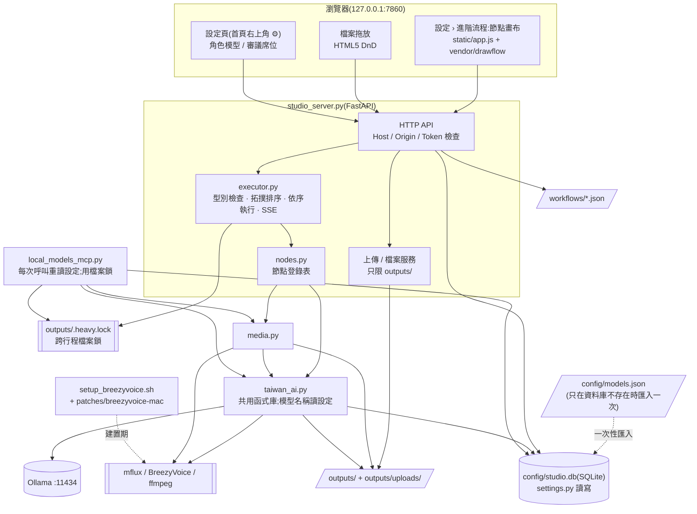
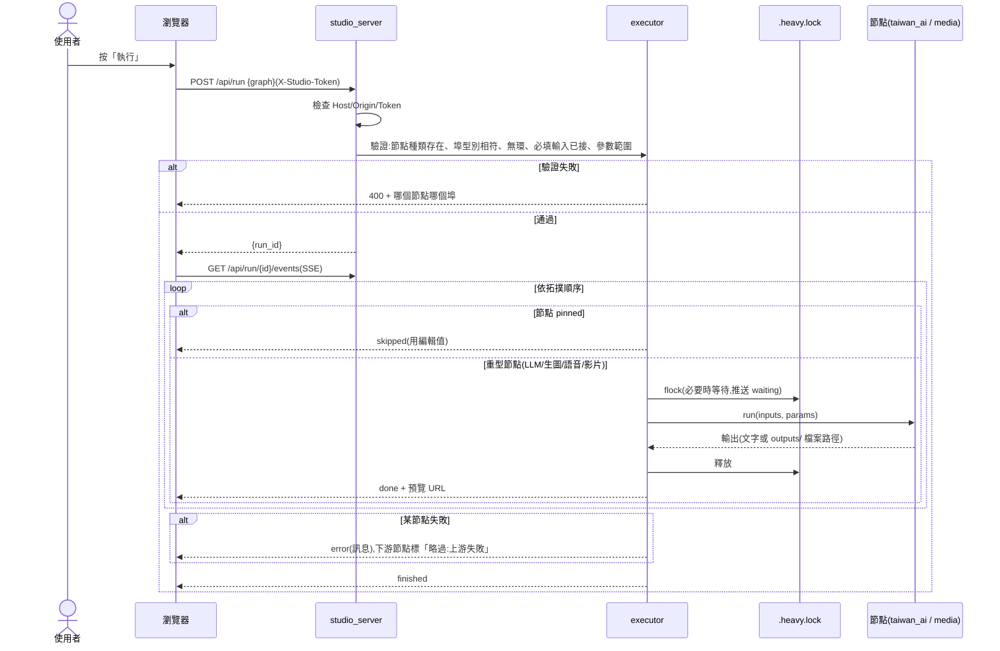
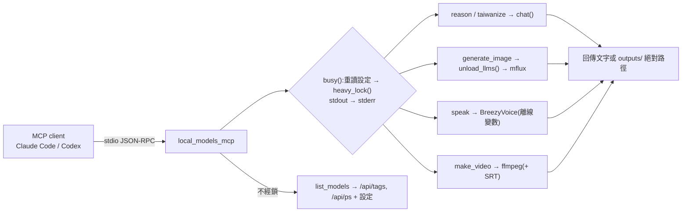
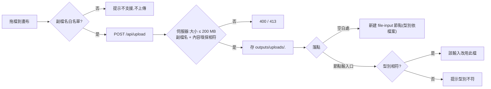
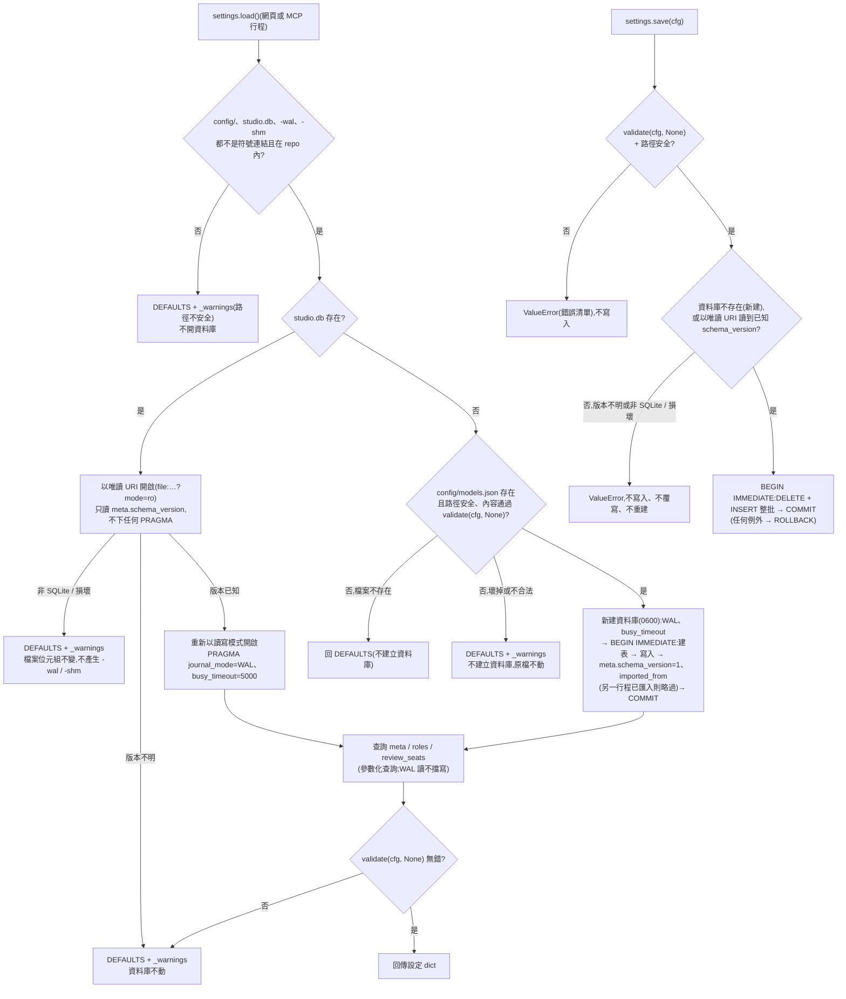
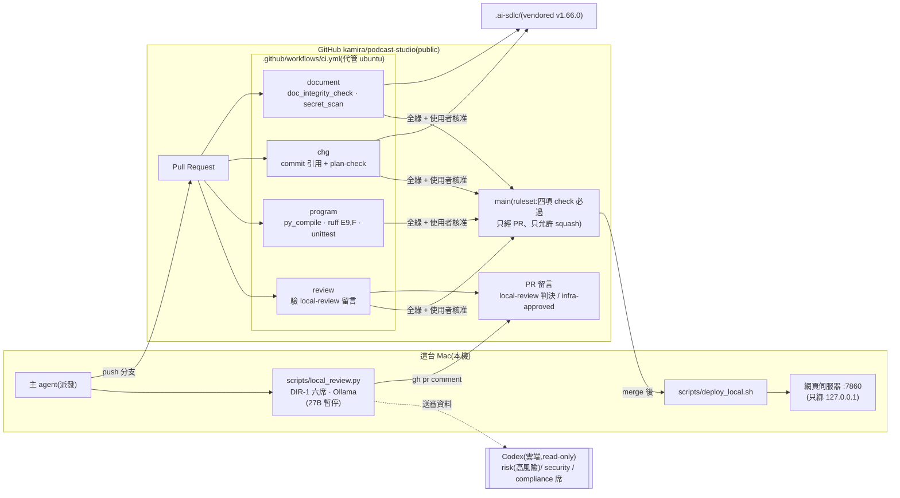

# 邏輯結構

> 導入反推(2026-10-22,基準點 `7da165b6048897abb8acac4bba69db9677827471`)。來源等級:〔觀察〕/〔推論〕/〔未知〕,定義見 `docs/ai-guideline.md` 表頭。
> 本文件描述**現況**,不代表現況正確;已知缺陷見 Guideline §9(ADP-n)。
> 2026-10-26 依 CHG-20261022-01 結構文件更新:網頁改為 `studio_server.py`(FastAPI + 原生 JS 節點畫布),移除 Gradio 版與 CLI;架構圖與流程 A 改寫,新增檔案拖放流程與設定讀寫流程(以 T1~T13 合併後的 main 為準;端到端驗收結果以 `docs/acceptance/` 為準)。
> 2026-10-26 依 CHG-20261026-01 結構文件更新:媒體層改經 `taiwan_ai.role_config()` 讀生圖設定(不再讀 `FLUX`),語音改讀聲線設定;耦合點補上 `roles.image`、`roles.voice` 的讀取端(以 T1~T5 合併後的 main 為準)。

## 分層 / 模組

| 層/模組 | 職責 | 依賴 | 回應需求 | 等級 |
|---------|------|------|----------|------|
| 前端 `static/`(`index.html`、`app.js`、`style.css`、`vendor/drawflow.*`) | 首頁右上角 ⚙ 進入設定頁;設定頁子頁:模型、審議席位、進階流程(節點畫布:拖出節點、連線型別檢查、執行 / 停止、SSE 狀態與預覽、文字輸出可編輯並釘住、檔案拖放、工作流程存檔 / 載入) | `studio_server` 的 HTTP API;Drawflow 0.0.60 | FR-16~21、23、31 | 〔觀察〕 |
| 入口層:網頁 `studio_server.py` | FastAPI,只綁 `127.0.0.1:7860`;Host / Origin / 權杖中介層;靜態檔、執行 API + SSE、上傳、檔案服務、工作流程存取、設定 API | `executor`、`nodes`、`settings`、`taiwan_ai`(`local_open`、`OLLAMA`、`MFLUX`、`BREEZY`)、fastapi、uvicorn | FR-16~21、23 | 〔觀察〕 |
| 節點引擎 `executor.py` + `nodes.py` | `executor`:流程圖驗證(種類、型別、有環、必填、參數範圍、節點數)、拓撲排序、依序執行、pinned 跳過、上游失敗下游略過、可取消、重型節點包在 `heavy_lock()` 內;`nodes`:十種節點的埠、參數宣告與 `run()` | `heavy_lock`、`media`、`taiwan_ai` | FR-1~7(功能保留)、FR-16、17、20 | 〔觀察〕 |
| 入口層:MCP `local_models_mcp.py` | 把模型包成 6 個 stdio 工具;每次工具呼叫重讀設定;重型工具在跨行程 `heavy_lock()` 內執行並把 stdout 導向 stderr | `media`、`taiwan_ai`、`settings`、`heavy_lock`、mcp SDK、Ollama `/api/tags` `/api/ps` | FR-8~13、21 | 〔觀察〕 |
| 設定 `settings.py` | 模型角色與審議席位設定的唯一存取點:`load()` / `save()` / `validate()` / `load_meta()` / `voice_options()`;SQLite `config/studio.db`;一次性從 `config/models.json` 匯入 | sqlite3(標準函式庫) | FR-21、23 | 〔觀察〕 |
| 鎖 `heavy_lock.py` | 跨行程排他鎖 `outputs/.heavy.lock`(`fcntl.flock(LOCK_EX)`),網頁與 MCP 共用 | — | NFR 重型工作互斥(ADP-2) | 〔觀察〕 |
| 媒體層 `media.py` | 生圖、16:9 裁切、疊標題、切句、SRT、ffmpeg 合成 | `taiwan_ai`(`OUT`、`reserve`、`unload_llms`、`MFLUX`、`role_config("image")`)、Pillow、imageio-ffmpeg | FR-4~6、10、12 | 〔觀察〕 |
| 模型層 `taiwan_ai.py` | `model(role)` / `role_config(role)`(每次經 `settings.load()`)、`chat()`、`unload_llms()`(卸載 `/api/ps` 列出的全部模型)、`speak()`(每次經 `role_config("voice")` 取聲線;子程序帶離線變數)、`to_tw()`、`local_open()`、`stamp()` / `reserve()` | Ollama HTTP、BreezyVoice 子程序、mflux 子程序、OpenCC、`settings` | FR-1~3、8、9、11 | 〔觀察〕 |
| 外部引擎 | Ollama(`localhost:11434`)、`mflux-generate`、`tools/BreezyVoice/.venv`、內附 ffmpeg | — | — | 〔觀察〕皆不在 repo 內 |
| 建置 `setup_breezyvoice.sh` + `patches/` | 重建 BreezyVoice macOS 環境 | GitHub、uv | FR-15 | 〔觀察〕 |

〔觀察〕CLI(`taiwan_ai.main()` 與 `ask/code/image/auto`)與 `code` 角色已於 CHG-20261022-01 T2 移除;Gradio 版 `podcast_studio.py` 已於 T13 刪除。

## 架構圖

- 〔觀察〕`API --> CFG` 一律經 `settings.py`(`studio_server.py` 不含 `sqlite3` 或 `models.json` 字樣,`tests/test_server_config.py` 檢查);`API --> OLLAMA` 只有設定 API 查 `/api/tags`(經 `taiwan_ai.local_open()`,圖中省略)。
- 〔觀察〕`TAI --> ENG` 的 BreezyVoice 子程序環境一律帶 `HF_HUB_OFFLINE=1`、`TRANSFORMERS_OFFLINE=1`(ADP-12,CHG-20261022-01 T4)。
- 〔觀察〕mflux 指令只剩 `media.generate_image()` 一份(CLI 的 `taiwan_ai.image()` 已移除);mflux 子程序環境為目前環境加 `HF_HUB_OFFLINE=1`(CHG-20261026-01 T2)。
- 〔觀察〕ffmpeg 合成:音檔為 WAV 時加 `-t <wav_seconds() 秒數>`、影格率 `-r 10`,影片在聲音結束時截止(CHG-20261026-01 T5);非 WAV 只靠 `-shortest`(ADP-7)。

## 主要流程

### 流程 A:網頁按下「執行」(FR-1~7、16)

- 〔觀察〕預設範本 `workflows/default.json` 重現舊版四步流程:主題 → 寫文案 → 台灣用語 → 語音;標題 → 封面 prompt → 生圖 → 疊標題;封面 + 語音 + 文案 → 影片。前端進入「設定 › 進階流程」時以 `GET /api/workflows/default` 載入。
- 〔觀察〕語音與封面兩支沒有相依(FR-7);執行器在單一背景執行緒依拓撲順序逐一執行,重型節點彼此不重疊。
- 〔觀察〕同時只允許一個執行中的 run(第二個回 409);停止 = 設定取消旗標,進行中的節點跑完、不再啟動新節點。
- 〔觀察〕事件裡的字串經 `scrub()`:repo 根目錄換成 `<repo>`、家目錄換成 `~`;檔案輸出改送 repo 相對路徑,由 `/files/*` 下載。

### 流程 B:MCP 工具呼叫(FR-8~13)

- 〔觀察〕`list_models` 不取鎖(唯讀 HTTP),同一次呼叫內只讀一次設定。
- 〔觀察〕`make_video` 在取鎖前檢查兩個路徑存在;`generate_image` 在取鎖前檢查 16 倍數。
- 〔觀察〕`reason(heavy=true)` 改以 `reason_heavy` 角色呼叫 `chat()`,不再改寫模組全域變數;`unload_llms()` 卸載 `/api/ps` 列出的全部模型(ADP-1 的處理,結案以 ACC 為準)。
- 〔觀察〕MCP 工具名稱、參數、回傳格式與 CHG-20261022-01 之前相同。

### 流程 C:檔案拖放(FR-19)

- 〔觀察〕白名單 `.txt .md .png .jpg .jpeg .webp .wav .mp3 .m4a`,前端 `app.js` 與伺服器(`nodes.FILE_KINDS`)一致,由 `tests/test_static.py` 檢查。

### 流程 D:設定讀寫與一次性匯入(FR-21、23)

- 〔觀察〕網頁 `PUT /api/config` 先 `validate(cfg, None)`,再向 Ollama `/api/tags` 取已下載清單做第二次 `validate`(連不上回 503,不儲存),合格才 `save()`。MCP 每次工具呼叫經 `taiwan_ai.model()` / `settings.load()` 重讀,改設定後下一次呼叫生效。
- 〔觀察〕資料庫不存在或還沒有任何表時,建立、匯入、第一次存入在 `config/.studio.db.lock`(`flock`)內進行。

## 相依方向

〔觀察〕單向、無循環:入口(`studio_server` / `local_models_mcp`)→ `executor` → `nodes` → `media` → `taiwan_ai` → `settings`;`executor` 與 `local_models_mcp` 另依賴 `heavy_lock`;`studio_server` 也直接用 `settings`、`taiwan_ai`。`media` 依賴 `taiwan_ai`,`taiwan_ai` 不依賴 `media`;`settings` 不依賴其他專案模組。

〔觀察〕耦合點:`media.py` 直接讀 `taiwan_ai` 的模組層常數(`OUT`、`MFLUX`)與函式(`role_config`、`reserve`、`unload_llms`);`roles.image` 的讀取端是 `media.generate_image()`、`roles.voice` 的讀取端是 `taiwan_ai.speak()`,兩者每次呼叫經 `taiwan_ai.role_config()` → `settings.load()` 讀一次,網頁與 MCP 兩個行程都經這兩個函式(CHG-20261026-01 T1、T2);設定資料(`config/studio.db`)是網頁與 MCP 兩個行程共享的**資料契約**,只經 `settings.py` 存取(CHG-20261022-01 Global Constraints)。

## 開發流程(CI/CD)

> 2026-10-23 依 CHG-20261022-03 新增。本節描述開發流程(repo 的檢查與部署),不是產品執行期的模組;產品「不送資料出本機」的要求不因本節改變,開發期送往 Codex 的審議資料屬 DIR-1 第 9 條的使用者明示例外。

### 架構圖

- 〔觀察〕四個 job 都先把 PR head 取到 `pr/`、base 取到 `trusted/`,治理檢查一律執行 `trusted/` 的腳本,PR 內容只當資料讀取(`.github/workflows/ci.yml` 檔頭註解)。
- 〔觀察〕main 的 ruleset 要求 `document`、`chg`、`program`、`review` 四項通過,禁止直接 push 與 force push,合併只允許 squash(CHG-20261022-03 派發記錄 T7)。
- 〔觀察〕DIR-1 第 9 條:security、compliance 席由 Codex 擔任;第 10 條暫停 27B,高風險 CHG 的 risk 席改由 Codex 擔任。`scripts/local_review.py` 的預設值仍含 27B,暫停期間須帶 `--codex-seats risk,security,compliance`。
- 〔觀察〕`program` job 在 `scripts/check.sh` 不存在時跳過該步;該檔已由 CHG-20261022-01 T1 建立,現在每個 PR 都會執行產品 pytest。

### 一個 PR 的流程

1. **開 PR**:每個步驟開自己的分支(`chg/<CHG 編號>-<task>` 或 `docs/<主題>`),commit message 帶 CHG 編號(只改 `docs/knowledge/` 者除外),push 後開 PR(DIR-2 第 1 條)。
2. **本機審議**:CHG 風險為中 / 高,或 PR 改到程式路徑時,主 agent 從 main 的工作副本執行 `scripts/local_review.py`,六席兩階段審議後以 `gh pr comment` 貼出判決,留言帶 `<!-- local-review CHG-… sha=<head sha> -->` 標記。只處理本 repo 分支且作者為擁有者的 PR。
3. **CI 四項**:`document`(doc_integrity_check、全 repo 與 commit 範圍秘密掃描、vendored 完整性)、`chg`(commit 引用 CHG 編號、PR 改到的 CHG 做 plan-check)、`program`(`py_compile`、`ruff check --select E9,F`、`python3 -m unittest discover -s tests/ci`)、`review`(只採信擁有者留言;標記 sha 須為目前 head;否決席無 fail、每席都有回答;改到治理基礎設施路徑另需 `<!-- infra-approved sha=<head> -->`)。
4. **使用者核准**:CI 全綠後,只改 `docs/`、`features/` 的 PR 可自動 merge;改到任何程式路徑的 PR 不論分級,一律停下等使用者核准(DIR-2 第 3 條)。審議留言只是完整性檢查,授權只有使用者核准(CHG-20261022-03 安全影響 (n))。
5. **squash merge**:main 只接受 squash merge,標題帶 CHG 編號。
6. **本機部署**:有程式變更時,在乾淨的 main 上執行 `scripts/deploy_local.sh`:`git pull --ff-only` → 跑 `scripts/check.sh`(存在時)→ 重啟 7860 網頁伺服器 → 驗證本專案行程的全部 LISTEN socket 只綁 `127.0.0.1` / `[::1]`,否則停止伺服器並 exit 1。MCP 伺服器由 client 啟動,腳本只印出重新啟動提醒。
